# 人教版化学九年级下册（根据2022年版课程标准修订）

覆盖与核验说明见 README.md。

## RJ-CHEMISTRY-9B-001 金属材料

第八单元 金属和金属材料 / 课题1 金属材料 · P7

金属材料是指用纯金属或合金等制成的材料。

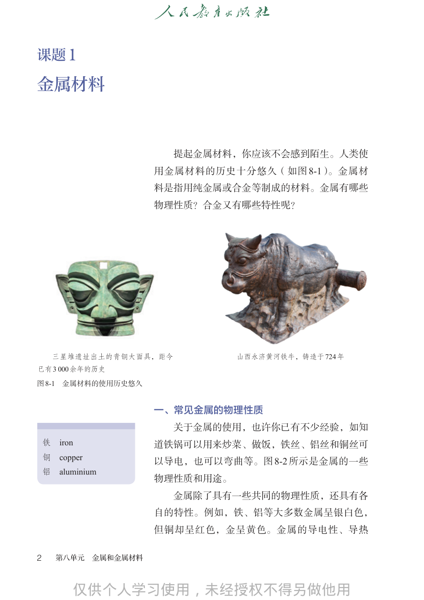

## RJ-CHEMISTRY-9B-002 常见金属的物理性质与用途

第八单元 金属和金属材料 / 课题1 金属材料 · P7-P8;P13

关于金属的使用，也许你已有不少经验，如知道铁锅可以用来炒菜、做饭，铁丝、铝丝和铜丝可以导电，也可以弯曲等。图8-2所示是金属的一些物理性质和用途。金属除了具有一些共同的物理性质，还具有各自的特性。例如，铁、铝等大多数金属呈银白色，但铜却呈红色，金呈黄色。金属的导电性、导热性、密度、熔点、硬度等物理性质差别也较大（如表8-1）。

金属具有很多共同的物理性质。例如，它们都有金属光泽，大多数为电和热的优良导体，有延展性，密度较大，熔点较高。

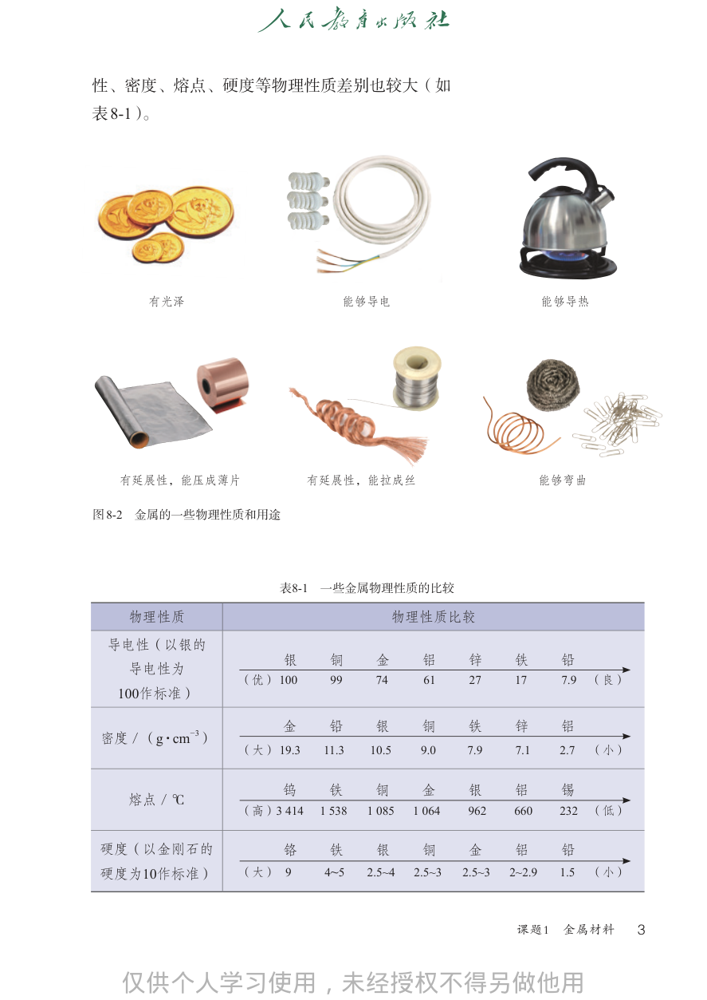

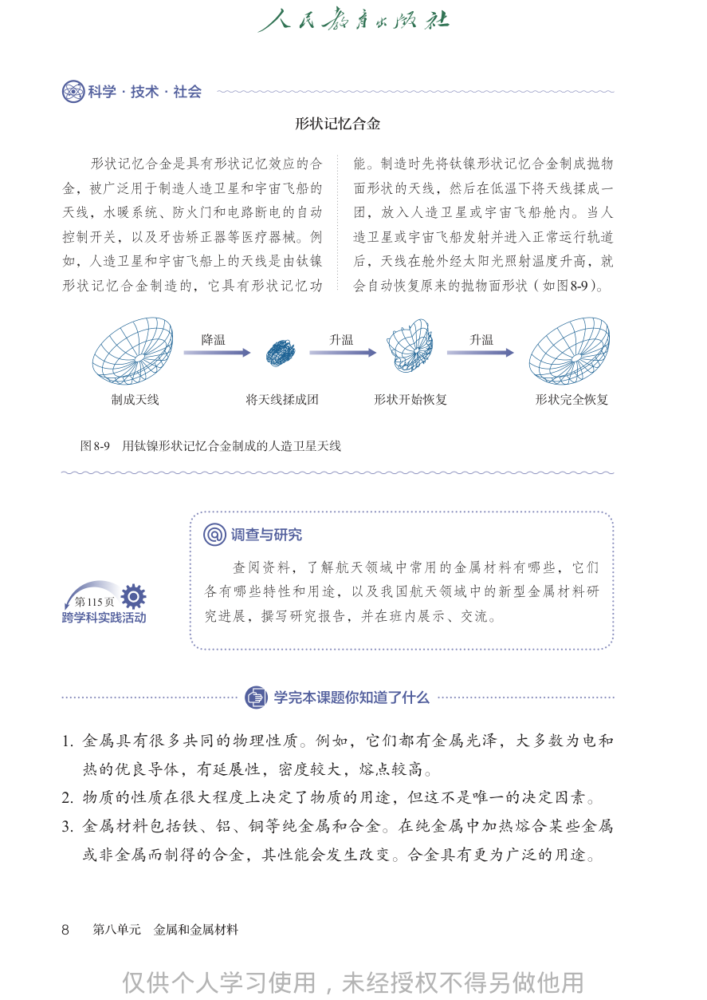

## RJ-CHEMISTRY-9B-003 一些金属物理性质的比较

第八单元 金属和金属材料 / 课题1 金属材料 · P8

表8-1 一些金属物理性质的比较

|物理性质|金属及数值（按原表顺序）|
|---|---|
|导电性（以银的导电性为100作标准）|银100；铜99；金74；铝61；锌27；铁17；铅7.9|
|密度／（g·cm⁻³）|金19.3；铅11.3；银10.5；铜9.0；铁7.9；锌7.1；铝2.7|
|熔点／℃|钨3414；铁1538；铜1085；金1064；银962；铝660；锡232|
|硬度（以金刚石的硬度为10作标准）|铬9；铁4～5；银2.5～4；铜2.5～3；金2.5～3；铝2～2.9；铅1.5|

## RJ-CHEMISTRY-9B-004 金属之最

第八单元 金属和金属材料 / 课题1 金属材料 · P9

● 地壳中含量最高的金属元素——铝

● 人体中含量最高的金属元素——钙

● 目前世界年产量最高的金属——铁

● 导电性、导热性最好的金属——银

● 硬度最大的金属——铬

● 熔点最高的金属——钨

● 熔点最低的金属——汞

● 密度最大的金属——锇

● 密度最小的金属——锂

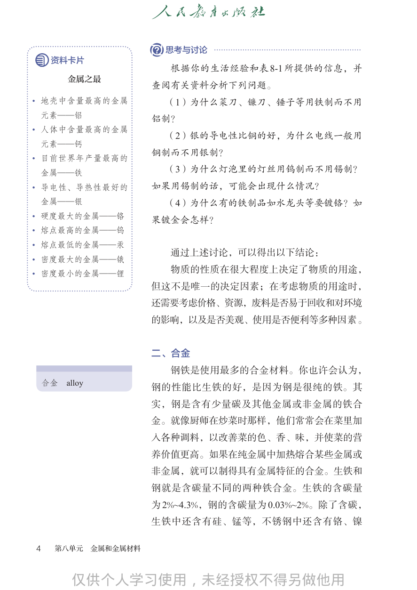

## RJ-CHEMISTRY-9B-005 选择材料时需要考虑的因素

第八单元 金属和金属材料 / 课题1 金属材料 · P9

物质的性质在很大程度上决定了物质的用途，但这不是唯一的决定因素；在考虑物质的用途时，还需要考虑价格、资源，废料是否易于回收和对环境的影响，以及是否美观、使用是否便利等多种因素。

## RJ-CHEMISTRY-9B-006 合金与铁合金的组成和性能

第八单元 金属和金属材料 / 课题1 金属材料 · P9-P10

钢铁是使用最多的合金材料。你也许会认为，钢的性能比生铁的好，是因为钢是很纯的铁。其实，钢是含有少量碳及其他金属或非金属的铁合金。就像厨师在炒菜时那样，他们常常会在菜里加入各种调料，以改善菜的色、香、味，并使菜的营养价值更高。如果在纯金属中加热熔合某些金属或非金属，就可以制得具有金属特征的合金。生铁和钢就是含碳量不同的两种铁合金。生铁的含碳量为2%~4.3%，钢的含碳量为0.03%~2%。除了含碳，生铁中还含有硅、锰等，不锈钢中还含有铬、镍等。由于在纯金属铁中熔合了一定量的碳、硅、锰或碳、铬、镍等，组成发生改变，合金性能也随之发生改变。例如：纯铁较软，而生铁比纯铁硬；不锈钢不仅比纯铁硬，而且其抗锈蚀性能也比纯铁好得多。因此，日常生活、工农业生产和科学研究中，大量使用的常常不是纯铁，而是铁的合金。

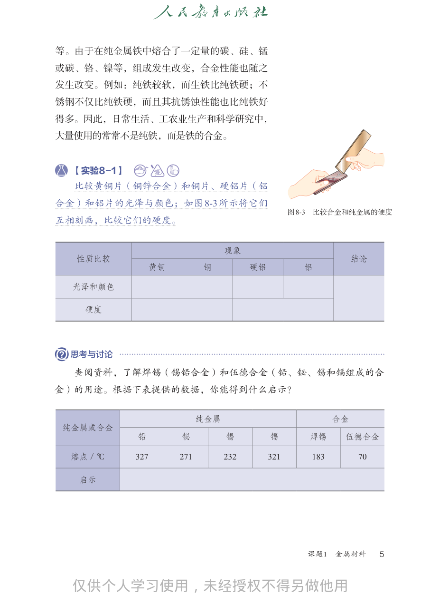

## RJ-CHEMISTRY-9B-007 比较合金和纯金属的光泽、颜色与硬度

第八单元 金属和金属材料 / 课题1 金属材料 · P10

比较黄铜片（铜锌合金）和铜片、硬铝片（铝合金）和铝片的光泽与颜色；如图8-3所示将它们互相刻画，比较它们的硬度。

## RJ-CHEMISTRY-9B-008 常见合金的成分、性能和用途

第八单元 金属和金属材料 / 课题1 金属材料 · P11

合金的很多性能与组成它们的纯金属不同，使合金更适合于不同的用途。因此，金属材料中合金的使用更加广泛。目前已制得的纯金属只有几十种，但由这些纯金属（或纯金属与非金属）按一定组成和质量比制得的合金已达几千种。表8-2 一些常见合金的主要成分、性能和用途：

|合金|主要成分|主要性能|主要用途|
|---|---|---|---|
|不锈钢|铁、铬、镍|抗腐蚀性好|医疗器械、炊具、容器、反应釜|
|锰钢|铁、锰、碳|韧性好、硬度大|钢轨、挖掘机铲斗、坦克装甲、自行车架|
|黄铜|铜、锌|强度高、可塑性好、易加工、耐腐蚀|机器零件、仪表、日用品|
|青铜|铜、锡|强度高、可塑性好、耐磨、耐腐蚀|机器零件，如轴承、齿轮|
|白铜|铜、镍|光泽好、耐磨、耐腐蚀、易加工|钱币、饰品|
|焊锡|锡、铅|熔点低|焊接金属|
|硬铝|铝、铜、镁、硅|强度高、硬度大|火箭、飞机、轮船|
|18K黄金|金、银、铜|光泽好、耐磨、易加工|金饰品|

K是表示金的纯度的指标。例如，18K表示含金量达75%，14K表示含金量达58.5%。

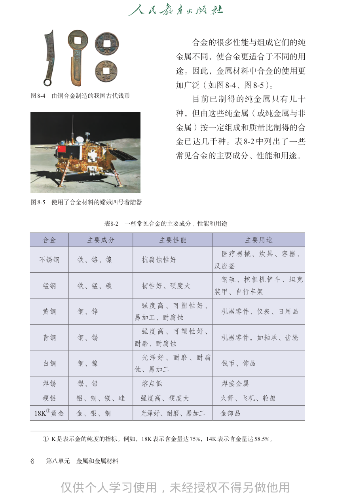

## RJ-CHEMISTRY-9B-009 钛和钛合金的性能与用途

第八单元 金属和金属材料 / 课题1 金属材料 · P12

钛和钛合金被认为是21世纪的重要金属材料，它们具有很多优良的性能，如熔点高、密度小（钛的密度仅为4.5 g/cm³）、可塑性好、易加工、机械性能好等。钛和钛合金的抗腐蚀性能非常好，即使把它们放在海水中数年，取出后仍光亮如初，其抗腐蚀性能远优于不锈钢。钛和钛合金被广泛用于火箭、导弹、航天器、船舶、化工设备、通信设备和医疗（如图8-6）等。

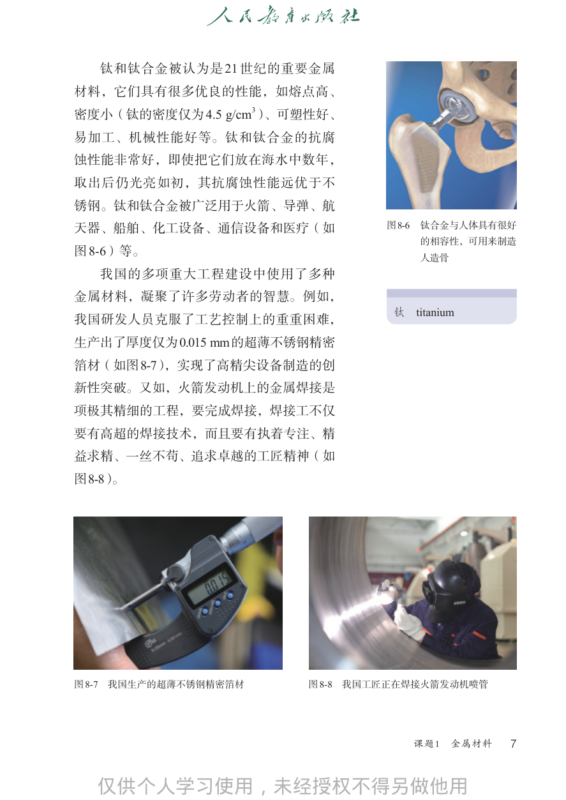

## RJ-CHEMISTRY-9B-010 形状记忆合金

第八单元 金属和金属材料 / 课题1 金属材料 · P13

形状记忆合金是具有形状记忆效应的合金，被广泛用于制造人造卫星和宇宙飞船的天线，水暖系统、防火门和电路断电的自动控制开关，以及牙齿矫正器等医疗器械。例如，人造卫星和宇宙飞船上的天线是由钛镍形状记忆合金制造的，它具有形状记忆功能。制造时先将钛镍形状记忆合金制成抛物面形状的天线，然后在低温下将天线揉成一团，放入人造卫星或宇宙飞船舱内。当人造卫星或宇宙飞船发射并进入正常运行轨道后，天线在舱外经太阳光照射温度升高，就会自动恢复原来的抛物面形状（如图8-9）。

## RJ-CHEMISTRY-9B-011 金属与氧气的反应

第八单元 金属和金属材料 / 课题2 金属的化学性质 · P15

我们已经知道镁和铁都能与氧气反应。实验表明，大多数金属能与氧气发生反应，但反应的难易程度是不同的。例如，镁、铝等在常温下就能与氧气反应。铝在空气中与氧气反应，其表面生成一层致密的氧化铝（Al₂O₃）薄膜，从而阻止铝进一步被氧化，因此，铝具有很好的抗腐蚀性能。

$\mathrm{4Al+3O_2=2Al_2O_3}$

铁、铜等在常温下几乎不与氧气反应，但在高温时能与氧气反应。“真金不怕火炼”说明即使在高温时金也不与氧气反应。可以看出，镁、铝比较活泼，铁、铜次之，金最不活泼。

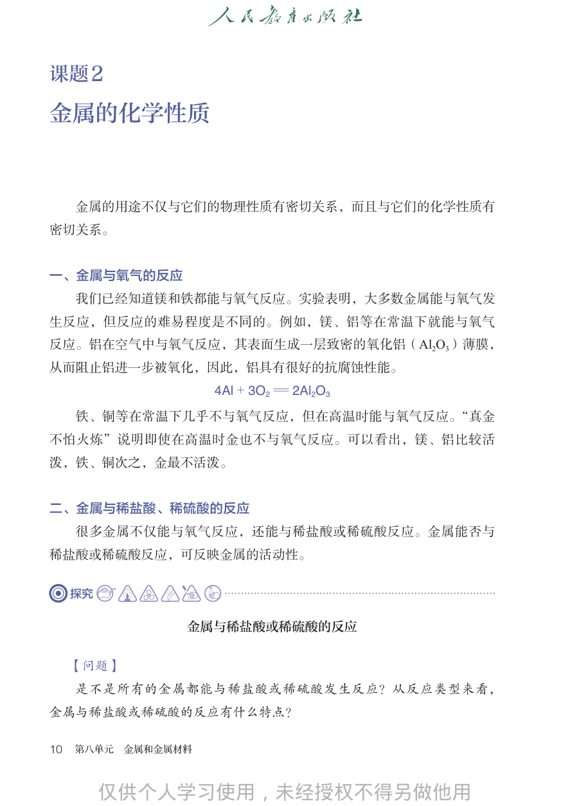

## RJ-CHEMISTRY-9B-012 金属与稀盐酸、稀硫酸的反应及探究

第八单元 金属和金属材料 / 课题2 金属的化学性质 · P15-P17

很多金属不仅能与氧气反应，还能与稀盐酸或稀硫酸反应。金属能否与稀盐酸或稀硫酸反应，可反映金属的活动性。

【实验】

（1）在试管中放入少量镁，加入5 mL稀盐酸，将燃着的木条放在试管口，观察现象，并判断反应后生成了什么气体。

参照上述实验步骤，分别向盛有少量锌、铁、铜的试管中加入5 mL稀盐酸，观察现象（如图8-10）。如果有气体生成，判断生成的是什么气体。

（2）用稀硫酸代替稀盐酸进行上述实验。

在上述探究中，镁、锌、铁能与稀盐酸、稀硫酸发生反应，反应都生成可燃性气体——氢气，而铜不能与稀盐酸、稀硫酸反应。

通过上述探究还可以得出，镁、锌、铁的金属活动性比铜的强，它们能置换出稀盐酸或稀硫酸中的氢。

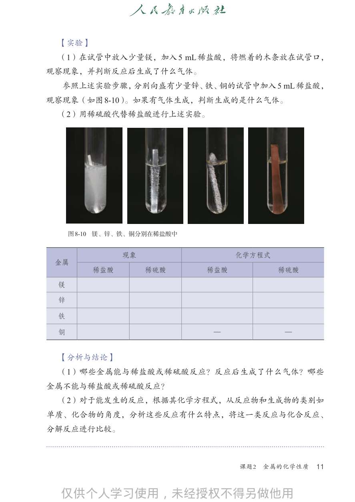

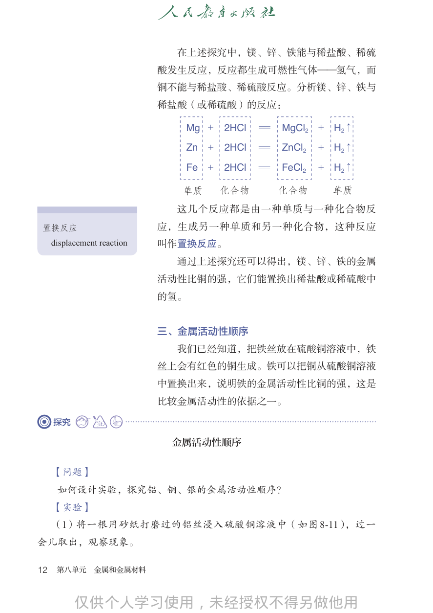

## RJ-CHEMISTRY-9B-013 置换反应

第八单元 金属和金属材料 / 课题2 金属的化学性质 · P17

分析镁、锌、铁与稀盐酸（或稀硫酸）的反应：

$\mathrm{Mg+2HCl=MgCl_2+H_2\uparrow}$

$\mathrm{Zn+2HCl=ZnCl_2+H_2\uparrow}$

$\mathrm{Fe+2HCl=FeCl_2+H_2\uparrow}$

这几个反应都是由一种单质与一种化合物反应，生成另一种单质和另一种化合物，这种反应叫作置换反应。

## RJ-CHEMISTRY-9B-014 通过置换反应比较金属活动性

第八单元 金属和金属材料 / 课题2 金属的化学性质 · P17-P18

我们已经知道，把铁丝放在硫酸铜溶液中，铁丝上会有红色的铜生成。铁可以把铜从硫酸铜溶液中置换出来，说明铁的金属活动性比铜的强，这是比较金属活动性的依据之一。

（1）将一根用砂纸打磨过的铝丝浸入硫酸铜溶液中（如图8-11），过一会儿取出，观察现象。

（2）将一根洁净的铜丝浸入硝酸银溶液中（如图8-12），过一会儿取出，观察现象。

（3）将另一根洁净的铜丝浸入硫酸铝溶液中，过一会儿取出，观察现象。

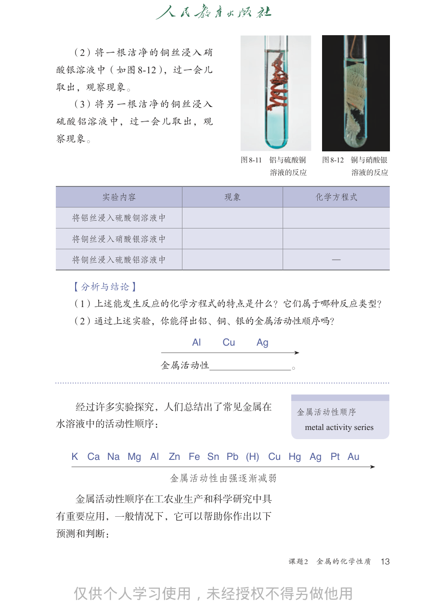

## RJ-CHEMISTRY-9B-015 金属活动性顺序及其应用

第八单元 金属和金属材料 / 课题2 金属的化学性质 · P18-P19

经过许多实验探究，人们总结出了常见金属在水溶液中的活动性顺序：

K Ca Na Mg Al Zn Fe Sn Pb (H) Cu Hg Ag Pt Au

金属活动性由强逐渐减弱。

金属活动性顺序在工农业生产和科学研究中具有重要应用，一般情况下，它可以帮助你作出以下预测和判断：

（1）在金属活动性顺序里，金属的位置越靠前，它的活动性就越强；
（2）在金属活动性顺序里，位于氢前面的金属能置换出稀盐酸、稀硫酸中的氢；
（3）在金属活动性顺序里，位于前面的金属能把位于后面的金属从它们化合物的溶液里置换出来。

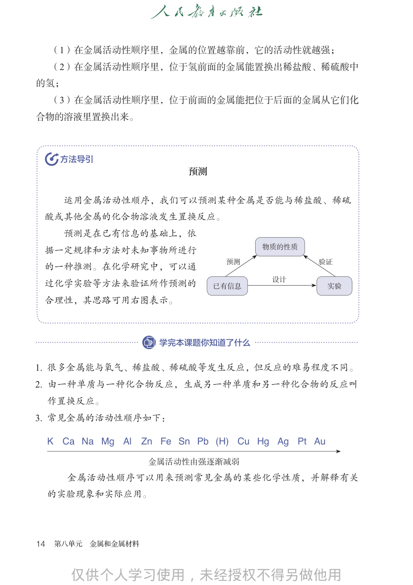

## RJ-CHEMISTRY-9B-016 预测与实验验证

第八单元 金属和金属材料 / 课题2 金属的化学性质 · P19

运用金属活动性顺序，我们可以预测某种金属是否能与稀盐酸、稀硫酸或其他金属的化合物溶液发生置换反应。预测是在已有信息的基础上，依据一定规律和方法对未知事物所进行的一种推测。在化学研究中，可以通过化学实验等方法来验证所作预测的合理性，其思路可用右图表示。

## RJ-CHEMISTRY-9B-017 金属资源与常见金属矿石

第八单元 金属和金属材料 / 课题3 金属资源的利用和保护 · P21

地球上的金属资源广泛地存在于地壳和海洋中，除了金、银等有单质形式存在，金属多以化合物的形式存在。大多数金属在自然界中是以金属矿物形式存在的。

图8-14：赤铁矿（主要成分是Fe₂O₃）、磁铁矿（主要成分是Fe₃O₄）、铝土矿（主要成分是Al₂O₃）、赤铜矿（主要成分是Cu₂O）、金红石（主要成分是TiO₂）、软锰矿（主要成分是MnO₂）。

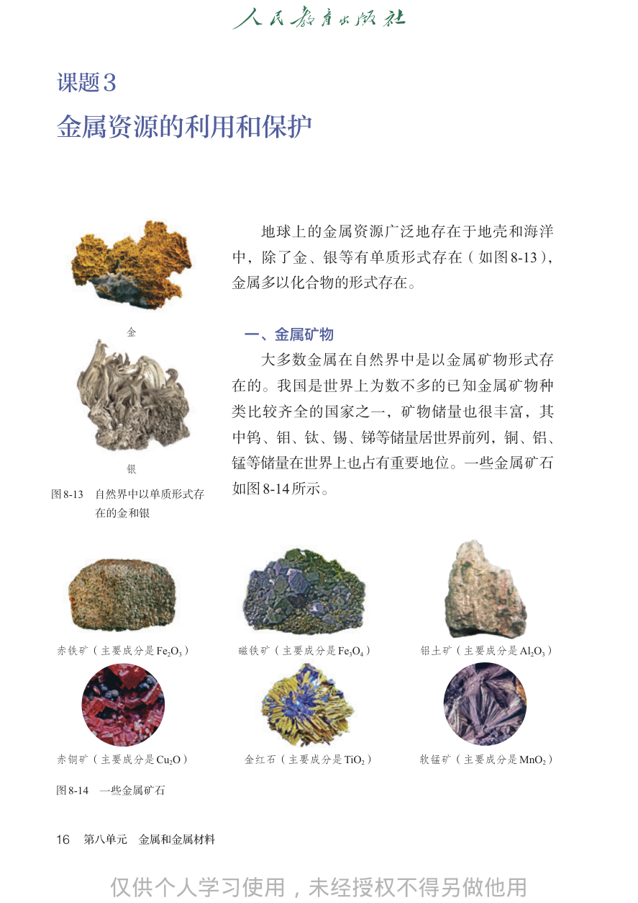

## RJ-CHEMISTRY-9B-018 铁的冶炼

第八单元 金属和金属材料 / 课题3 金属资源的利用和保护 · P22

炼铁的主要原理是一氧化碳与氧化铁反应，其化学方程式如下：

$\mathrm{Fe_2O_3+3CO\xlongequal{高温}2Fe+3CO_2}$

把铁矿石冶炼成铁是一个复杂的过程。把赤铁矿石、焦炭和石灰石一起加入高炉，在高温下，利用炉内反应生成的一氧化碳把铁从氧化铁里还原出来。炼铁高炉及炉内的主要化学反应如图8-16所示。

石灰石的主要作用是将矿石中的二氧化硅转变为炉渣。

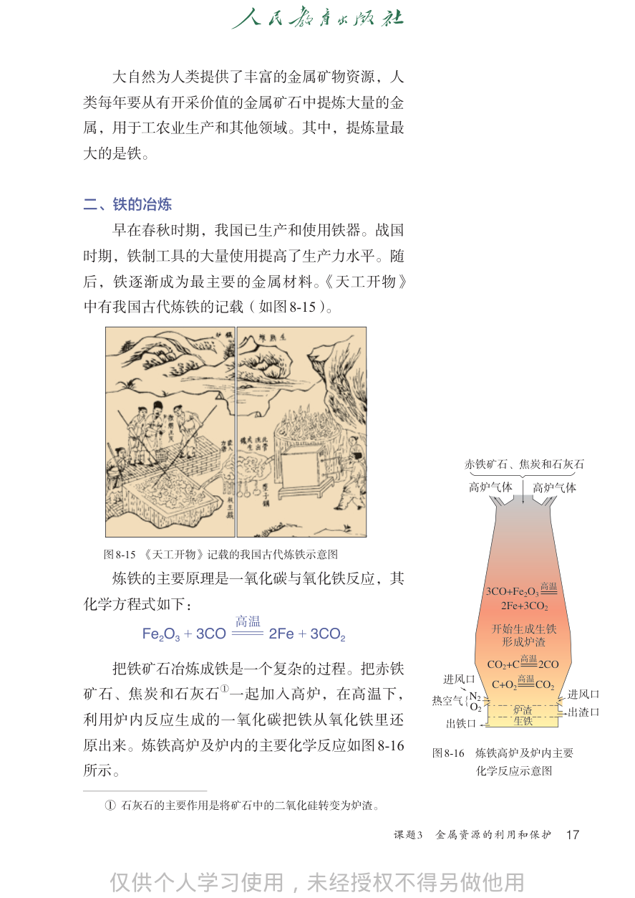

## RJ-CHEMISTRY-9B-019 含杂质原料与产物的计算

第八单元 金属和金属材料 / 课题3 金属资源的利用和保护 · P23

在实际生产时，炼铁所用的原料或所得的产物一般都含有杂质，在计算用料和产量时，应考虑到杂质问题。

【例题】用1 000 t含氧化铁80%的赤铁矿石，理论上可以炼出含铁96%的生铁的质量是多少（计算结果保留一位小数）？

【解】1 000 t赤铁矿石中含氧化铁的质量为：

1 000 t × 80% = 800 t

设：800 t氧化铁理论上可以炼出的铁的质量为x。

$\mathrm{Fe_2O_3+3CO\xlongequal{高温}2Fe+3CO_2}$

对应质量：160，2×56；800 t，x。

$\frac{160}{2\times56}=\frac{800\ \mathrm{t}}{x}$

$x=\frac{2\times56\times800\ \mathrm{t}}{160}=560\ \mathrm{t}$

折合为含铁96%的生铁的质量为：

560 t ÷ 96% = 583.3 t

答：理论上可以炼出含铁96%的生铁的质量是583.3 t。

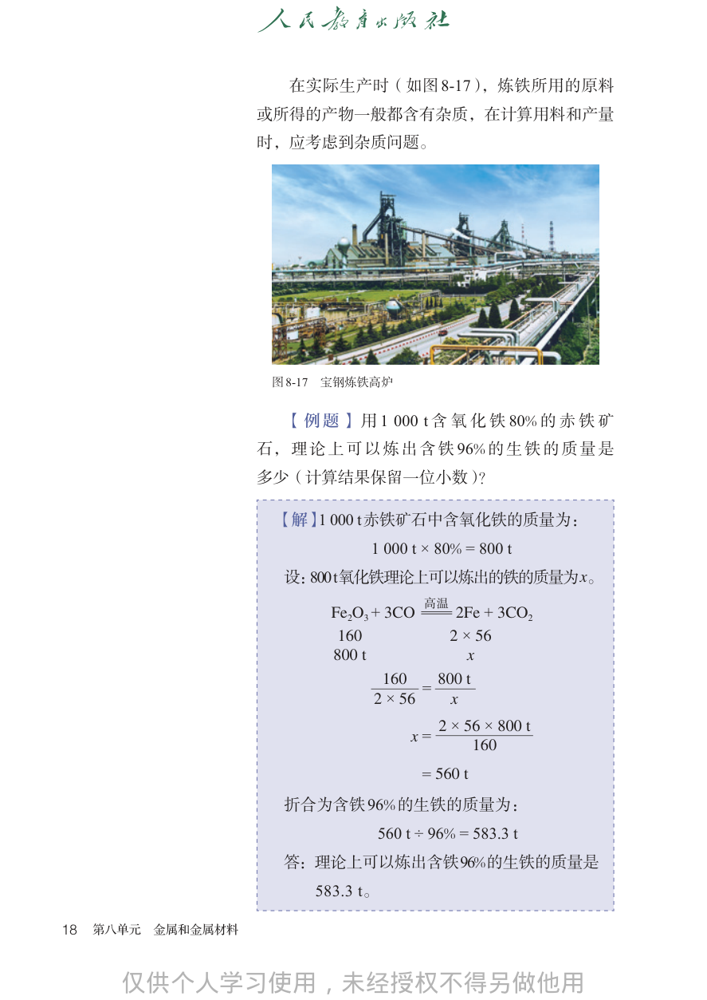

## RJ-CHEMISTRY-9B-020 铁钉生锈条件的探究与铁制品防护

第八单元 金属和金属材料 / 课题3 金属资源的利用和保护 · P24-P25;P27

铁钉容易生锈（铁锈的主要成分是Fe₂O₃·xH₂O）。那么，铁钉生锈需要哪些条件呢？

【实验】

现有洁净无锈的铁钉、试管、经煮沸迅速冷却的蒸馏水（思考：为什么要用蒸馏水？）、植物油、棉花和氯化钙（干燥剂）。你还可以选用其他物品。

（1）仔细观察并参考图8-18所示的装置，设计实验并探究铁钉生锈的条件。
（2）每天观察铁钉生锈的现象，连续观察约一周，认真做好记录。

本探究中的实验应提前一周开始进行。

以上探究中铁钉生锈的过程，实际上是铁与空气中的氧气、水蒸气等发生化学反应的过程。铁生锈需要条件。例如，要有能够与铁发生反应的物质，反应物要能相互接触，生成物不会对反应起阻碍作用，等等。铁与氧气、水等反应生成的铁锈很疏松，不能阻碍里层的铁继续与氧气、水等反应，因此铁制品可以全部锈蚀。

了解了铁生锈的条件，就可以根据这些条件，寻找防止铁制品锈蚀的方法。

铁生锈的主要条件是铁与空气和水（或水蒸气）直接接触，如果隔绝了空气或水，就能在一定程度上防止铁生锈。在铁制品表面涂油、刷漆、镀耐磨和耐腐蚀的铬，以及制造耐腐蚀的合金等，都能防止铁制品锈蚀。

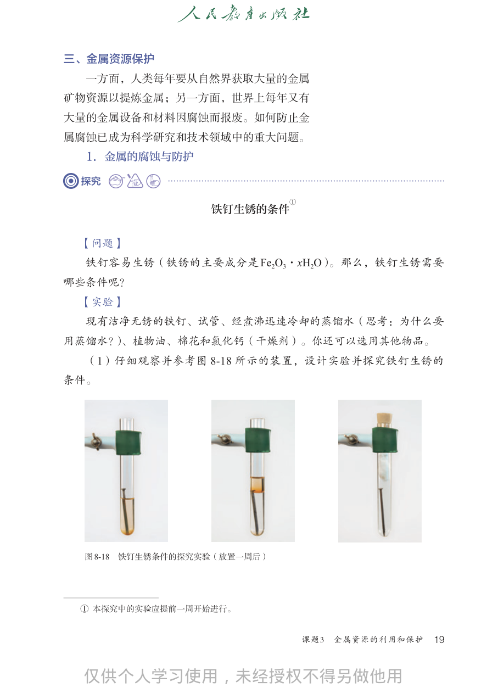

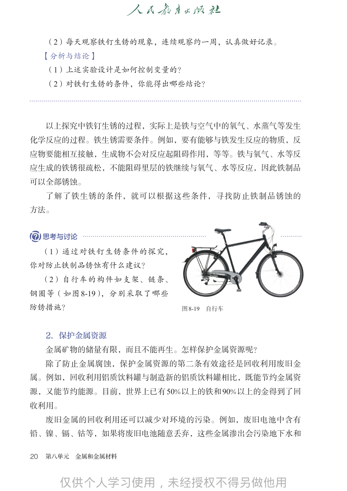

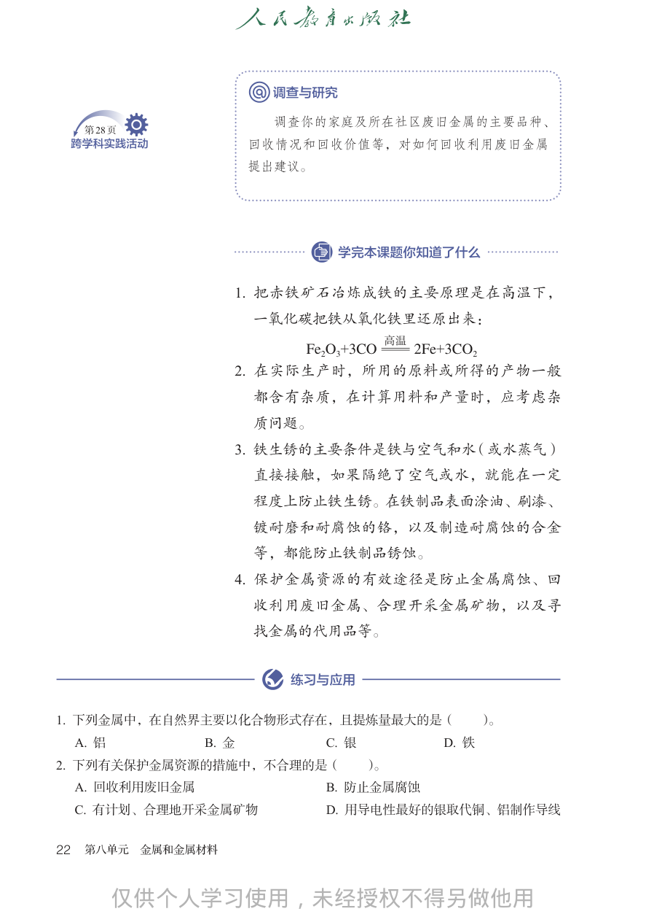

## RJ-CHEMISTRY-9B-021 保护金属资源的途径

第八单元 金属和金属材料 / 课题3 金属资源的利用和保护 · P25-P26

金属矿物的储量有限，而且不能再生。怎样保护金属资源呢？除了防止金属腐蚀，保护金属资源的第二条有效途径是回收利用废旧金属。例如，回收利用铝质饮料罐与制造新的铝质饮料罐相比，既能节约金属资源，又能节约能源。目前，世界上已有50%以上的铁和90%以上的金得到了回收利用。废旧金属的回收利用还可以减少对环境的污染。例如，废旧电池中含有铅、镍、镉、钴等，如果将废旧电池随意丢弃，这些金属渗出会污染地下水和土壤，危害人类健康。而将这些金属回收利用，既可以减少其对环境的危害，又可以节约金属资源。如从汽车用过的铅酸蓄电池中回收铅，从废旧锂离子电池中回收锂、钴、镍等，对保护环境和实现金属资源的循环利用均具有重要的意义。保护金属资源的第三条有效途径是有计划、合理地开采金属矿物，严禁不顾国家利益的乱采矿。此外，还有寻找金属的代用品等途径。例如，目前已经广泛使用塑料来代替钢和其他合金制造管道、齿轮和汽车零部件等。

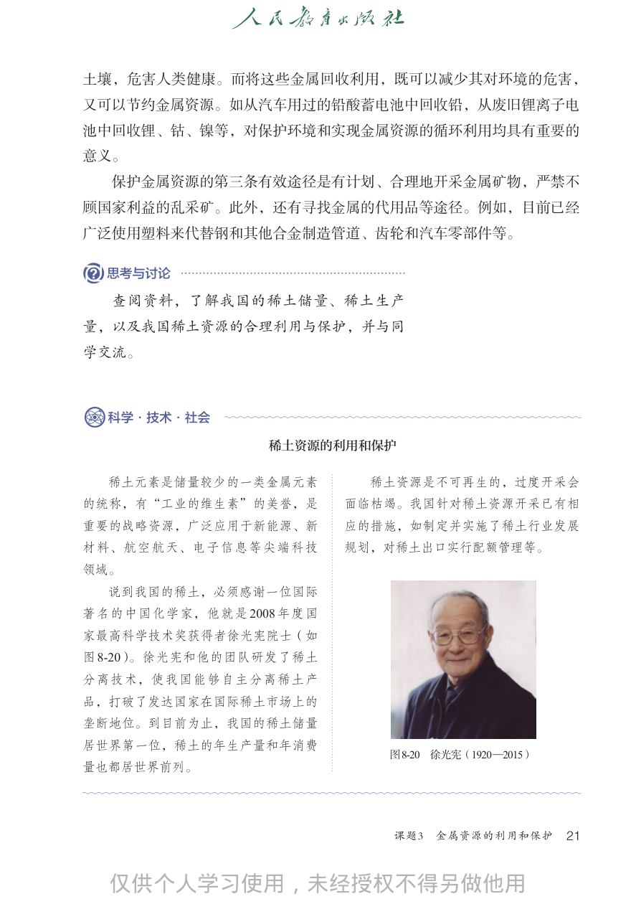

## RJ-CHEMISTRY-9B-022 稀土资源的利用和保护

第八单元 金属和金属材料 / 课题3 金属资源的利用和保护 · P26

稀土元素是储量较少的一类金属元素的统称，有“工业的维生素”的美誉，是重要的战略资源，广泛应用于新能源、新材料、航空航天、电子信息等尖端科技领域。

稀土资源是不可再生的，过度开采会面临枯竭。我国针对稀土资源开采已有相应的措施，如制定并实施了稀土行业发展规划，对稀土出口实行配额管理等。

## RJ-CHEMISTRY-9B-023 常见金属的物理性质和化学性质实验

第八单元 金属和金属材料 / 实验活动5 常见金属的物理性质和化学性质 · P32

试管、酒精灯、坩埚钳、电池、导线、小灯泡、火柴。镁条、锌粒、铝片、铁片、铜片、黄铜片（或白铜片）、稀盐酸、稀硫酸、硫酸铜溶液、硝酸银溶液。你还需要的实验用品：________。

1. 金属的物理性质（1）观察并描述镁、铝、铁、铜的颜色和光泽。

（2）通过相互刻画，比较铜片和铝片、铜片和黄铜片（或白铜片）的硬度。

（3）请你设计并进行实验，证明金属具有导电性（或导热性、延展性）。

2. 金属的化学性质（1）用坩埚钳夹取一块铜片，放在酒精灯火焰上加热，观察铜片表面的变化。

（2）向5 支试管中分别放入少量镁条、铝片、锌粒、铁片、铜片，然后各加入5 mL稀盐酸（或稀硫酸），观察现象。如果有气体生成，判断生成的是什么气体。

（3）请你设计并进行实验，比较铁、铜、银的金属活动性。

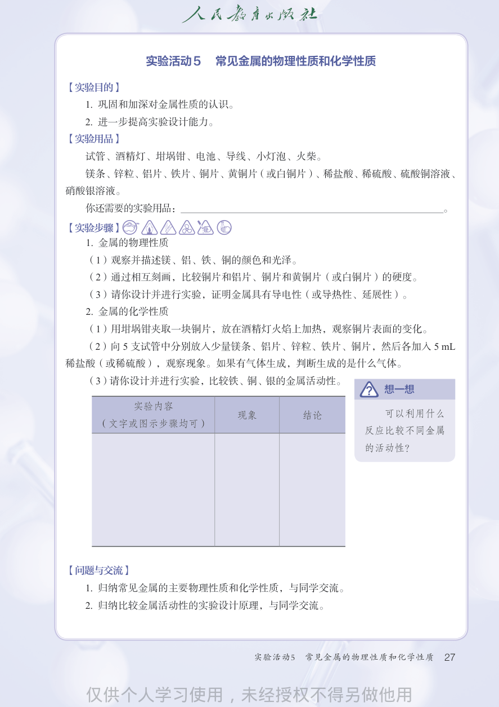

## RJ-CHEMISTRY-9B-024 溶液的形成与特征

第九单元 溶液 / 课题1 溶液及其应用 · P35-P36

如图9-2所示，在20 mL水中加入一药匙蔗糖，用玻璃棒搅拌，观察现象。

蔗糖放入水中后，蔗糖表面的分子在水分子的作用下，逐步向水里扩散，最终蔗糖分子均一地分散到水分子中间，形成一种混合物——蔗糖溶液。如果把氯化钠放入水中，氯化钠在水分子的作用下，也会向水里扩散，最终均一地分散到水分子中间，形成氯化钠溶液，只不过氯化钠在溶液中是以钠离子和氯离子的形式存在。取出蔗糖溶液（或氯化钠溶液）中的任意一部分进行分析，它们的组成是完全相同的，即溶液是均一的；只要水分不蒸发，温度不变化，蔗糖与水（或氯化钠与水）就不会分离，即溶液是稳定的。

像这样一种或几种物质分散到另一种物质里，形成的均一、稳定的混合物，叫作溶液。能溶解其他物质的物质叫作溶剂，被溶解的物质叫作溶质。溶液是由溶质和溶剂组成的。例如：在上述蔗糖溶液中，蔗糖是溶质，水是溶剂；在氯化钠溶液中，氯化钠是溶质，水是溶剂。

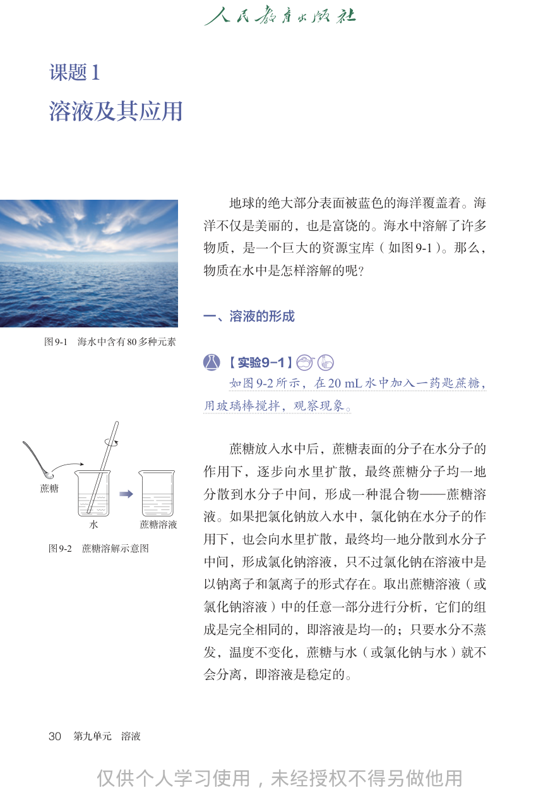

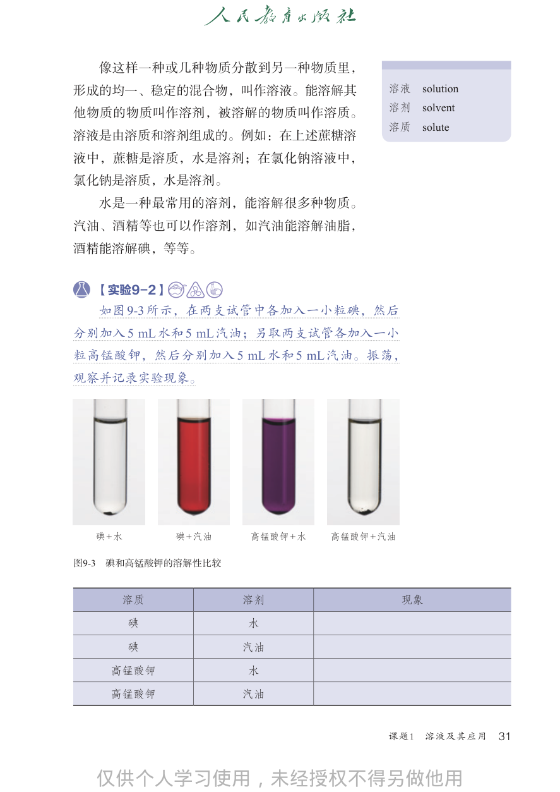

## RJ-CHEMISTRY-9B-025 溶剂对溶解性的影响

第九单元 溶液 / 课题1 溶液及其应用 · P36-P37

水是一种最常用的溶剂，能溶解很多种物质。汽油、酒精等也可以作溶剂，如汽油能溶解油脂，酒精能溶解碘，等等。

如图9-3所示，在两支试管中各加入一小粒碘，然后分别加入5 mL水和5 mL汽油；另取两支试管各加入一小粒高锰酸钾，然后分别加入5 mL水和5 mL汽油。振荡，观察并记录实验现象。

实验表明，碘几乎不溶于水，却可以溶解在汽油中；高锰酸钾几乎不溶于汽油，却可以溶解在水中。这说明，同一种物质在不同溶剂中的溶解性是不同的，不同的物质在同一溶剂中的溶解性也是不同的。

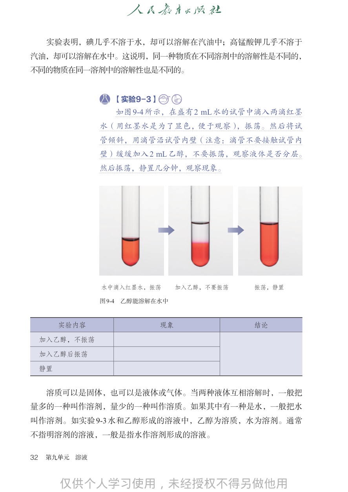

## RJ-CHEMISTRY-9B-026 液体溶质的溶解与溶质、溶剂的判断

第九单元 溶液 / 课题1 溶液及其应用 · P37

如图9-4所示，在盛有2 mL水的试管中滴入两滴红墨水（用红墨水是为了显色， 便于观察），振荡。然后将试管倾斜，用滴管沿试管内壁（注意：滴管不要接触试管内壁）缓缓加入2 mL乙醇，不要振荡，观察液体是否分层。然后振荡，静置几分钟，观察现象。

溶质可以是固体，也可以是液体或气体。当两种液体互相溶解时，一般把量多的一种叫作溶剂，量少的一种叫作溶质。如果其中有一种是水，一般把水叫作溶剂。如实验9-3水和乙醇形成的溶液中，乙醇为溶质，水为溶剂。通常不指明溶剂的溶液，一般是指水作溶剂形成的溶液。

## RJ-CHEMISTRY-9B-027 溶解过程中的热量变化

第九单元 溶液 / 课题1 溶液及其应用 · P38

向三个烧杯中各加入100 mL水，用温度计测量水的温度。取NaCl、NH₄NO₃、NaOH 固体各两药匙，分别加入上述三个烧杯中，用玻璃棒搅拌至固体全部溶解，再用温度计分别测量三种溶液的温度。记录并分析测量所得数据。

氢氧化钠有强烈的腐蚀性，使用时必须十分小心，防止溅到眼睛、皮肤、衣服等上面。实验时戴好护目镜。

物质在溶解形成溶液时，溶液的温度与加入溶质前溶剂的温度相比会发生改变，这说明物质在溶解过程中通常伴随着热量的变化。在溶解时，有些物质会出现吸热现象，有些物质则会出现放热现象。

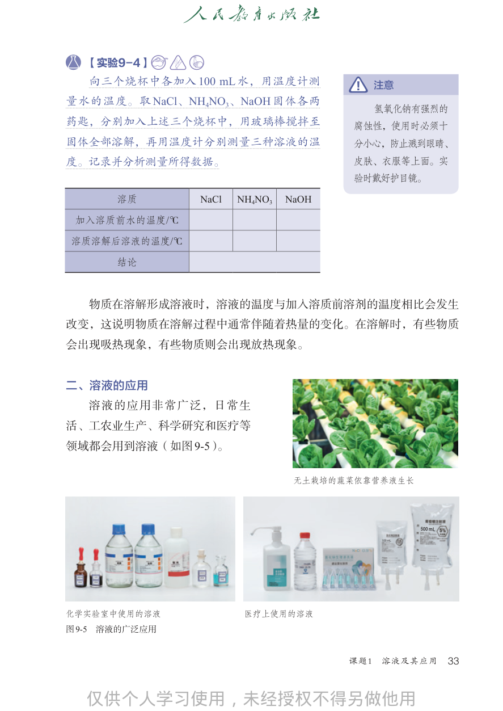

## RJ-CHEMISTRY-9B-028 溶液的应用

第九单元 溶液 / 课题1 溶液及其应用 · P38-P39

溶液的应用非常广泛，日常生活、工农业生产、科学研究和医疗等领域都会用到溶液（如图9-5）。

在溶液中进行的化学反应通常比较快。所以，在实验室和化工生产中，常常先将几种固体反应物溶解，然后将这些溶液混合后振荡或搅动，以加快反应的进行。溶液对于动植物的生理活动也具有重要意义。人的各种体液都是含有多种溶质的溶液，体内发生的化学反应也是在溶液中进行的。医疗上常用的葡萄糖溶液、生理盐水和一些眼药水等，都是根据人的生理需求配制的溶液。植物从土壤中获得的各种养料，需要溶解形成溶液后才能被吸收。在现代农业生产中，无土栽培的作物就是从营养液中吸收养料而生长的。

100 mL生理盐水中含0.9 g医用氯化钠。

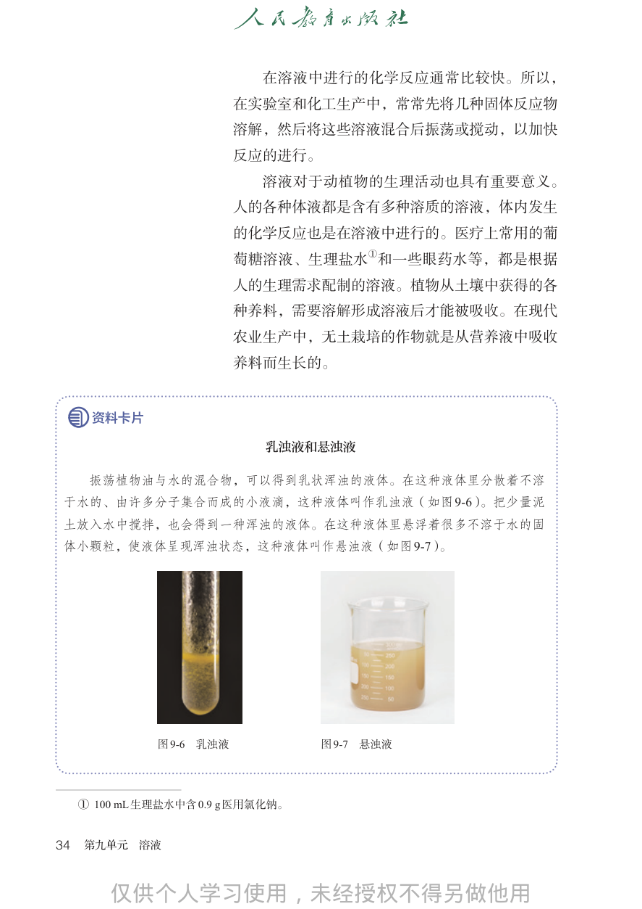

## RJ-CHEMISTRY-9B-029 乳浊液和悬浊液

第九单元 溶液 / 课题1 溶液及其应用 · P39-P40

振荡植物油与水的混合物，可以得到乳状浑浊的液体。在这种液体里分散着不溶于水的、由许多分子集合而成的小液滴，这种液体叫作乳浊液（如图9-6）。把少量泥土放入水中搅拌，也会得到一种浑浊的液体。在这种液体里悬浮着很多不溶于水的固体小颗粒，使液体呈现浑浊状态，这种液体叫作悬浊液（如图9-7）。

分散在溶液、乳浊液和悬浊液中的粒子大小是不同的。在溶液中溶质粒子的直径小于1 nm；在悬浊液和乳浊液中，粒子的直径大于100 nm。乳浊液和悬浊液具有广泛的用途。例如，用X射线检查肠胃病时，让患者服用的钡餐就是硫酸钡的悬浊液。粉刷墙壁用的乳胶漆的主要原料——合成树脂乳液是乳浊液。在农业上，为了合理使用农药，常把不溶于水的固体或液体农药配制成悬浊液或乳浊液，用来喷洒遭受病虫害的农作物。这样农药药液散失得少，附着在叶面上的多，药液喷洒均匀，既节省农药，又提高药效，使用还很方便。

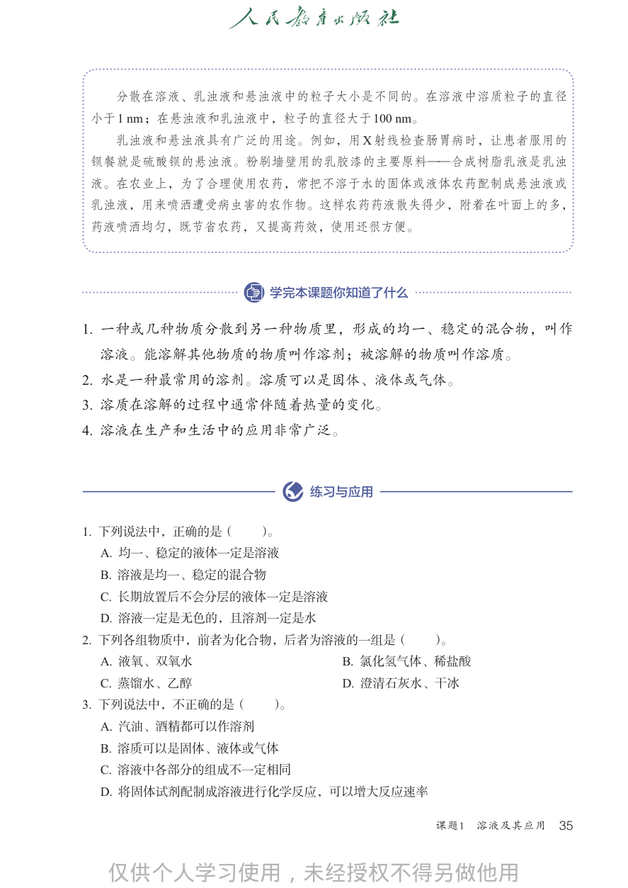

## RJ-CHEMISTRY-9B-030 饱和溶液和不饱和溶液

第九单元 溶液 / 课题2 溶解度 · P42

在室温下，如图9-8所示，向盛有10 mL水的烧杯中加入2 g氯化钠，搅拌；待溶解后，再加入2 g氯化钠，搅拌，观察现象。然后再加入10 mL水，搅拌，观察现象。

在一定温度下，向一定量溶剂里加入某种溶质，当溶质不能继续溶解时，所得到的溶液叫作这种溶质的饱和溶液；还能继续溶解溶质的溶液，叫作这种溶质的不饱和溶液。在实验9-5中，当氯化钠能继续溶解时，溶液是不饱和的；当氯化钠固体不能继续溶解而有剩余时，溶液就变成了饱和的。当再加入水，溶液又从饱和的变成不饱和的，剩余的氯化钠固体则可以继续溶解。

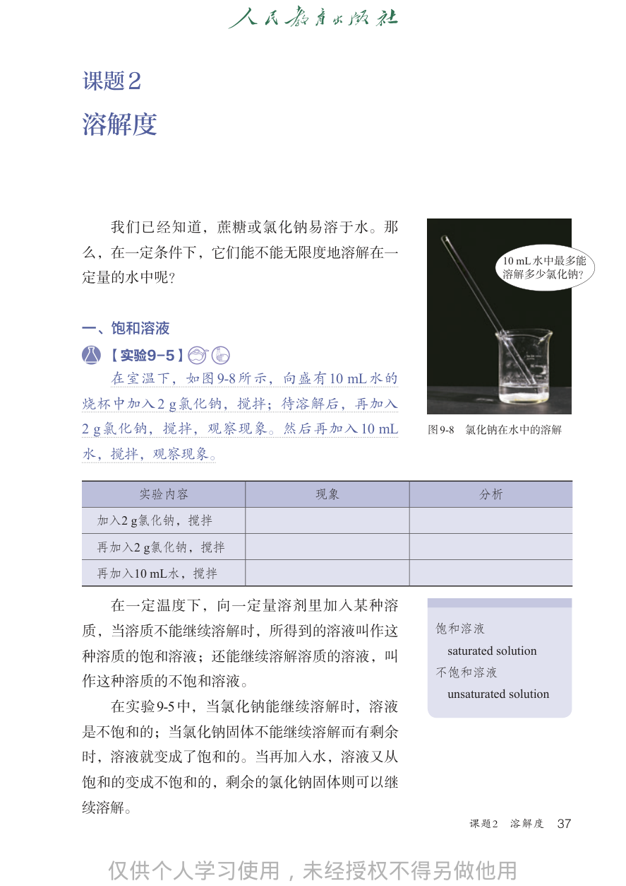

## RJ-CHEMISTRY-9B-031 温度对饱和状态的影响与结晶

第九单元 溶液 / 课题2 溶解度 · P43

在室温下，向盛有10 mL水的烧杯中加入3 g硝酸钾，搅拌；待溶解后，再加入3 g硝酸钾，搅拌，观察现象。当烧杯中硝酸钾固体有剩余而不再溶解时，加热烧杯一段时间（如图9-9），观察剩余固体有什么变化。然后再加入3 g硝酸钾，搅拌，观察现象。静置，待溶液冷却后，观察现象。

在实验9-6中，第二次加入的硝酸钾不能全部溶解，但加热后，剩余的硝酸钾固体能够继续溶解，且再次加入的硝酸钾也能全部溶解。这说明，当温度升高时，室温下的硝酸钾饱和溶液变成了较高温度下的不饱和溶液，因而能继续溶解硝酸钾。上述实验说明，在增加溶剂或升高温度的情况下，饱和溶液可以变成不饱和溶液。因此，只有指明“在一定量溶剂里”和“在一定温度下”，溶液的“饱和”和“不饱和”才有确定的意义。在实验9-6中还可以看到，当热的硝酸钾溶液冷却后，烧杯底部出现了固体。这是因为在冷却过程中，硝酸钾不饱和溶液变成了饱和溶液；温度继续降低，过多的硝酸钾会从饱和溶液中以晶体的形式析出（如图9-10），这一过程叫作结晶。结晶可以使溶质从溶液中析出，从而实现混合物的分离。

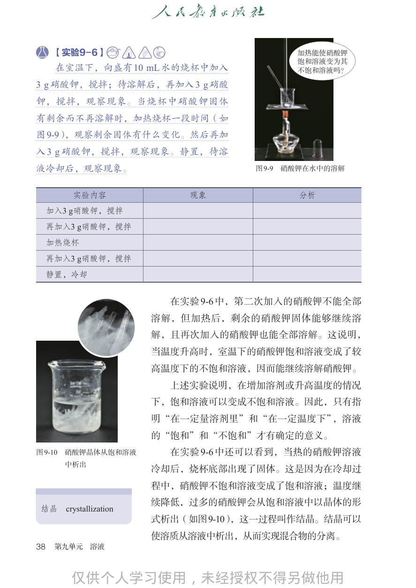

## RJ-CHEMISTRY-9B-032 蒸发结晶、海水晒盐及饱和状态转化

第九单元 溶液 / 课题2 溶解度 · P44

除了冷却热的饱和溶液的方法，蒸发溶剂也是一种获得晶体的常用方法。例如，用海水晒盐并获得氯化钠等产品的大致过程如下：

晒盐时，利用涨潮将海水引入“储水池”；待海水澄清后，引入“蒸发池”，经过风吹和日晒后水分部分蒸发；水分蒸发到一定程度后引入“结晶池”，继续风吹和日晒，海水就会慢慢成为食盐的饱和溶液；再晒，食盐晶体就会逐渐从海水中析出，得到粗盐，同时得到含有大量化工原料的母液（叫作苦卤）。综上所述，在一般情况下，不饱和溶液与饱和溶液之间的转化关系及结晶的方法可以表示如下：

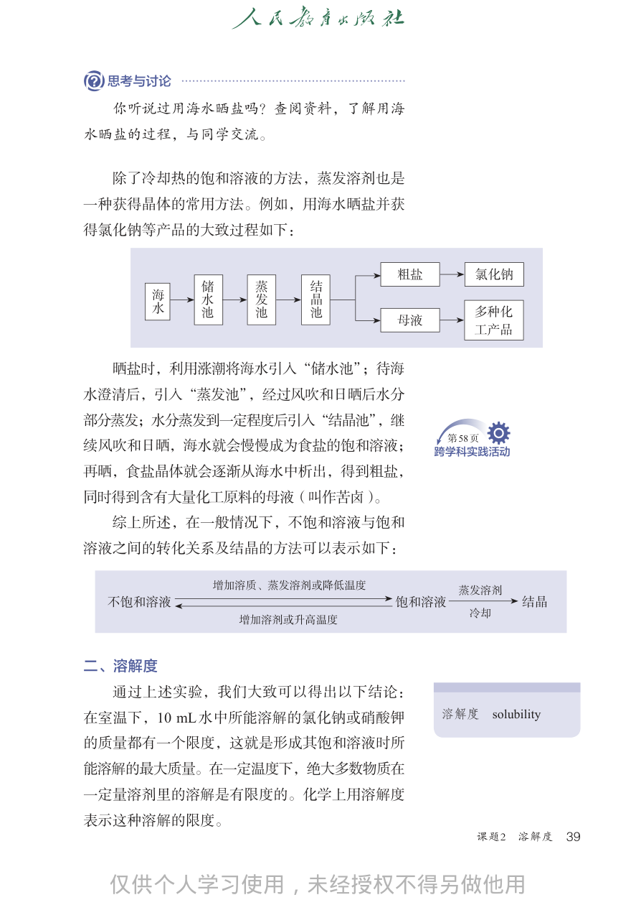

## RJ-CHEMISTRY-9B-033 固体的溶解度与溶解性的相对大小

第九单元 溶液 / 课题2 溶解度 · P45

固体的溶解度表示在一定温度下，某固态物质在100 g溶剂里达到饱和状态时所溶解的质量。如果不指明溶剂，通常所说的溶解度是指物质在水里的溶解度。例如，在20 ℃时，100 g水里最多能溶解36 g氯化钠（这时溶液达到饱和状态），我们就说在20 ℃时，氯化钠在水里的溶解度是36 g。用实验的方法可以测出物质在不同温度时的溶解度，如表9-1所示。

溶解度的相对大小（20 ℃）：小于0.01 g一般称为难溶；0.01～1 g一般称为微溶；1～10 g一般称为可溶；大于10 g一般称为易溶。

表9-1 几种物质在不同温度时的溶解度：

|温度/℃|0|10|20|30|40|50|60|70|80|90|100|
|---|---|---|---|---|---|---|---|---|---|---|---|
|NaCl溶解度/g|35.7|35.8|36.0|36.3|36.6|37.0|37.3|37.8|38.4|39.0|39.8|
|KCl溶解度/g|27.6|31.0|34.0|37.0|40.0|42.6|45.5|48.3|51.1|54.0|56.7|
|NH₄Cl溶解度/g|29.4|33.3|37.2|41.4|45.8|50.4|55.2|60.2|65.6|71.3|77.3|
|KNO₃溶解度/g|13.3|20.9|31.6|45.8|63.9|85.5|110|138|169|202|246|

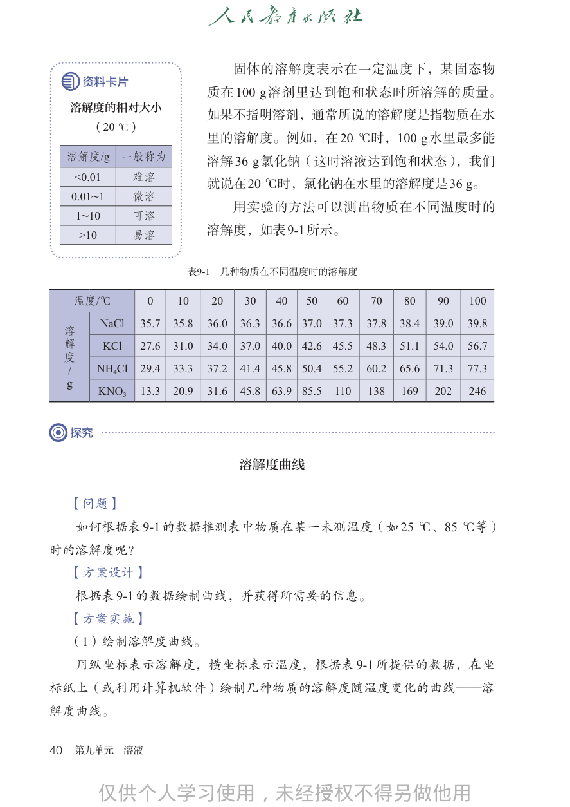

## RJ-CHEMISTRY-9B-034 溶解度曲线及温度对固体溶解度的影响

第九单元 溶液 / 课题2 溶解度 · P45-P47

根据表9-1的数据绘制曲线，并获得所需要的信息。

（1）绘制溶解度曲线。用纵坐标表示溶解度，横坐标表示温度，根据表9-1所提供的数据，在坐标纸上（或利用计算机软件）绘制几种物质的溶解度随温度变化的曲线——溶解度曲线。

利用溶解度曲线，我们可以查出某物质在不同温度时的溶解度，可以比较不同物质在同一温度时溶解度的大小，可以比较不同物质的溶解度受温度变化影响的大小，可以看出物质的溶解度随温度变化的规律，等等。从图9-11 和图9-12 可以看出，多数固体的溶解度随温度的升高而增大，如硝酸钾、氯化铵等；少数固体的溶解度受温度变化的影响很小，如氯化钠；极少数固体的溶解度随温度的升高而减小，如氢氧化钙。

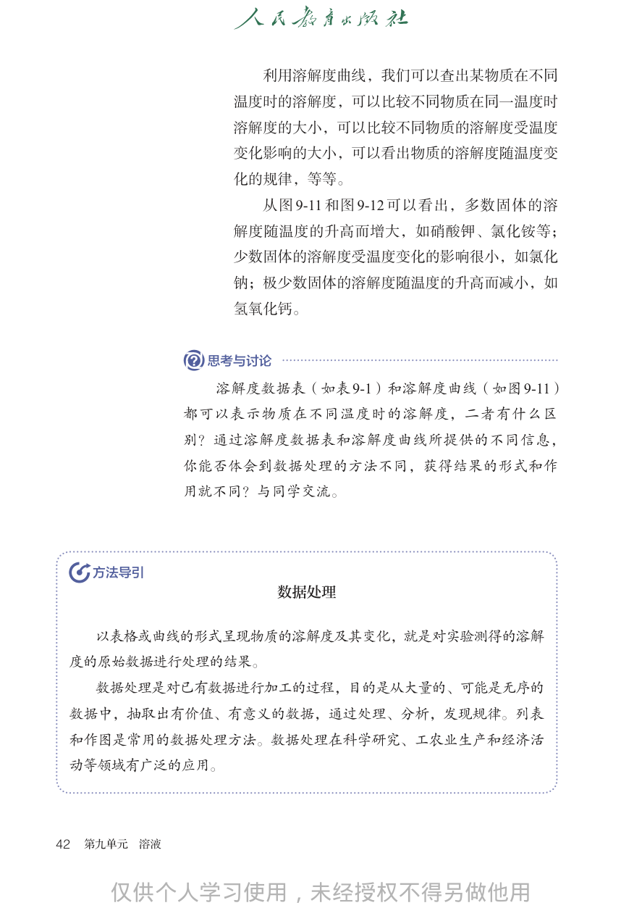

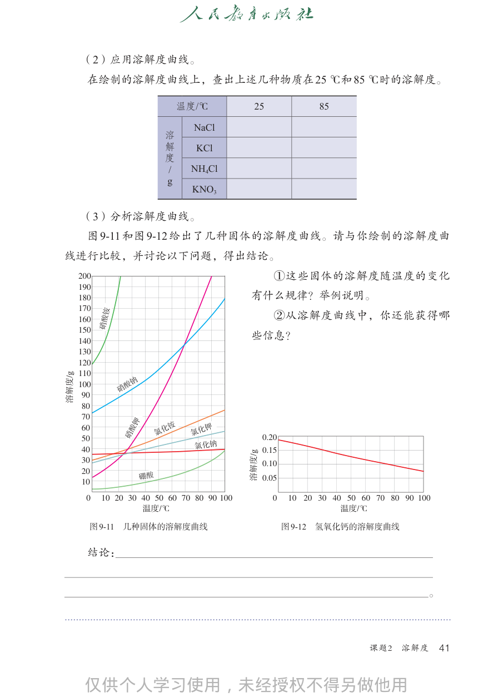

## RJ-CHEMISTRY-9B-035 数据处理

第九单元 溶液 / 课题2 溶解度 · P47

以表格或曲线的形式呈现物质的溶解度及其变化，就是对实验测得的溶解度的原始数据进行处理的结果。数据处理是对已有数据进行加工的过程，目的是从大量的、可能是无序的数据中，抽取出有价值、有意义的数据，通过处理、分析，发现规律。列表和作图是常用的数据处理方法。数据处理在科学研究、工农业生产和经济活动等领域有广泛的应用。

## RJ-CHEMISTRY-9B-036 气体的溶解度

第九单元 溶液 / 课题2 溶解度 · P48

因为称量气体的质量比较困难，所以气体的溶解度常用体积来表示。通常用的气体的溶解度，是指该气体的压强为101 kPa和一定温度时，在1体积水里溶解达到饱和状态时的气体体积。例如，氮气的压强为101 kPa、温度为0 ℃时，1体积水里最多能溶解0.024体积的氮气，则在0 ℃时，氮气的溶解度为0.024。

非标准状况时的气体体积要换算成标准状况时的体积。

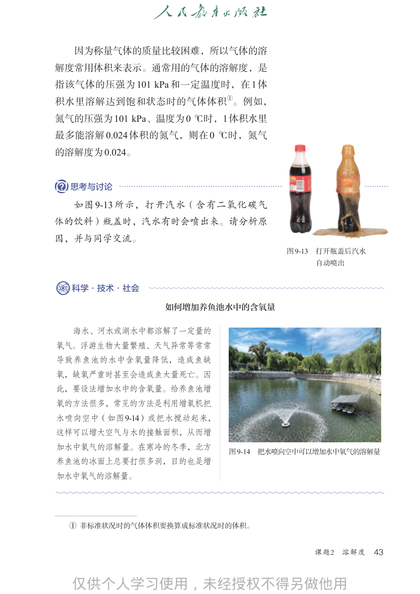

## RJ-CHEMISTRY-9B-037 增加养鱼池水中含氧量的方法

第九单元 溶液 / 课题2 溶解度 · P48

海水、河水或湖水中都溶解了一定量的氧气。浮游生物大量繁殖、天气异常等常常导致养鱼池的水中含氧量降低，造成鱼缺氧，缺氧严重时甚至会造成鱼大量死亡。因此，要设法增加水中的含氧量。给养鱼池增氧的方法很多，常见的方法是利用增氧机把水喷向空中（如图9-14）或把水搅动起来，这样可以增大空气与水的接触面积，从而增加水中氧气的溶解量。在寒冷的冬季，北方养鱼池的冰面上总要打很多洞，目的也是增加水中氧气的溶解量。

## RJ-CHEMISTRY-9B-038 溶液浓稀程度与溶质的质量分数

第九单元 溶液 / 课题3 溶质的质量分数 · P51-P52

在室温下，向三个小烧杯中各加入20 mL水，然后分别加入0.1 g、0.5 g、2 g无水硫酸铜，用玻璃棒搅拌，使硫酸铜全部溶解，比较三种硫酸铜溶液的颜色（如图9-15）。

1 mL水的质量约为1 g。

一般情况下，对于有色溶液来说，根据颜色的深浅可以判断溶液的浓稀程度。这种方法比较粗略，不能准确地表明一定量的溶液里究竟含有多少溶质。在实际应用中，常常要准确知道一定量的溶液里所含溶质的量，即浓度。例如：在施用农药时，如果药液过浓，会毒害农作物；如果药液过稀，则不能有效地杀虫灭菌。因此，我们需要准确地知道一定量的药液里所含农药有效成分的量。

表示浓度的方法很多，这里主要介绍溶质的质量分数。

溶液中溶质的质量分数是溶质质量与溶液质量之比，可用下式进行计算：

$溶质的质量分数=\frac{溶质质量}{溶液质量}\times100\%$

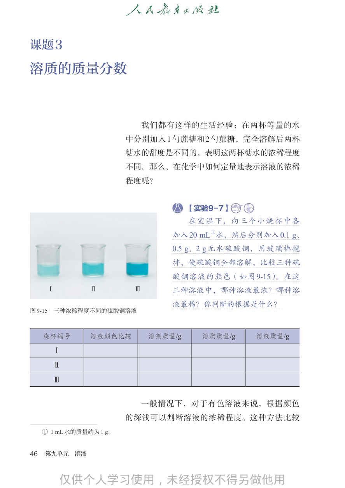

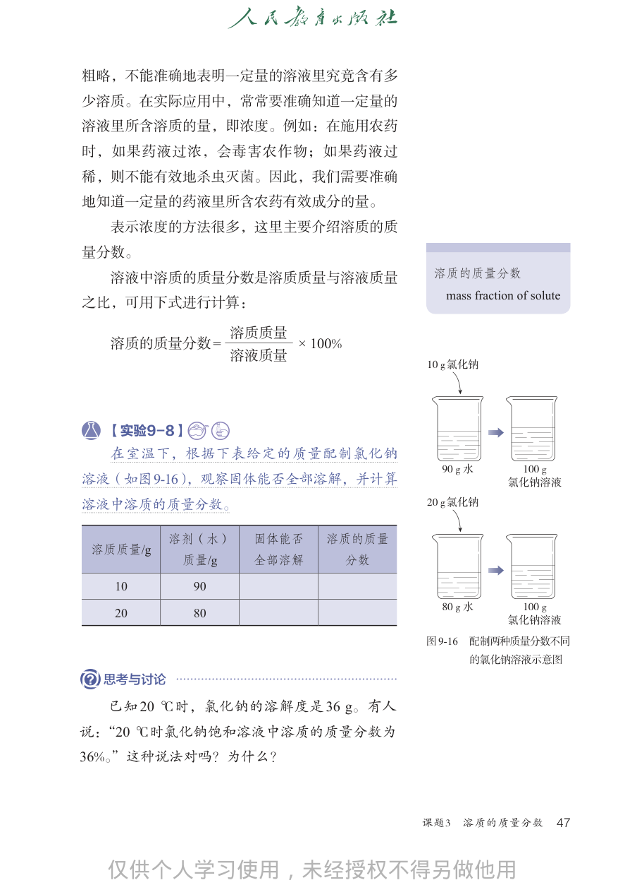

## RJ-CHEMISTRY-9B-039 配制不同质量分数的氯化钠溶液实验

第九单元 溶液 / 课题3 溶质的质量分数 · P52

在室温下，根据下表给定的质量配制氯化钠溶液（如图9-16），观察固体能否全部溶解，并计算溶液中溶质的质量分数。

|溶质质量/g|溶剂（水）质量/g|固体能否全部溶解|溶质的质量分数|
|---|---|---|---|
|10|90| | |
|20|80| | |

## RJ-CHEMISTRY-9B-040 溶质质量分数的计算与稀释计算

第九单元 溶液 / 课题3 溶质的质量分数 · P53

【例题1】在农业生产中，可利用质量分数为16%的氯化钠溶液选种。现要配制150 kg这种溶液，需要氯化钠和水的质量各是多少？

【解】$溶质的质量分数=\frac{溶质质量}{溶液质量}\times100\%$

溶质质量=溶液质量×溶质的质量分数
=150 kg×16%=24 kg

溶剂质量=溶液质量−溶质质量
=150 kg−24 kg=126 kg

答：需要24 kg氯化钠和126 kg水。

【例题2】化学实验室有质量分数为98%的浓硫酸，现需要用较稀的硫酸进行实验。要把50 g上述浓硫酸稀释为质量分数为20%的硫酸，需要水的质量是多少？

【分析】溶液稀释前后，溶质的质量不变。

【解】设：稀释后溶液的质量为x。

50 g×98%=x×20%

$x=\frac{50\ \mathrm{g}\times98\%}{20\%}=245\ \mathrm{g}$

需要水的质量=245 g−50 g=195 g

答：需要水的质量是195 g。

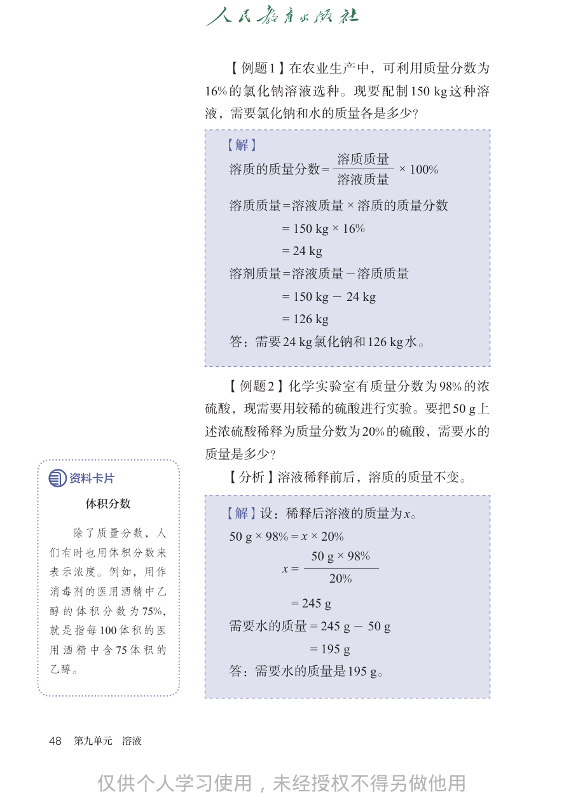

## RJ-CHEMISTRY-9B-041 体积分数

第九单元 溶液 / 课题3 溶质的质量分数 · P53

除了质量分数，人们有时也用体积分数来表示浓度。例如，用作消毒剂的医用酒精中乙醇的体积分数为75%，就是指每100 体积的医用酒精中含75 体积的乙醇。

## RJ-CHEMISTRY-9B-042 用固体配制一定溶质质量分数溶液的步骤

第九单元 溶液 / 课题3 溶质的质量分数 · P54

在实验室中用固体配制一定溶质质量分数的溶液，步骤如下：计算所需固体和水的质量；用天平称量固体、量筒量取水；将固体和水混合，并用玻璃棒搅拌，使固体全部溶解；把配制好的溶液装入试剂瓶，贴上标签，放入试剂柜。

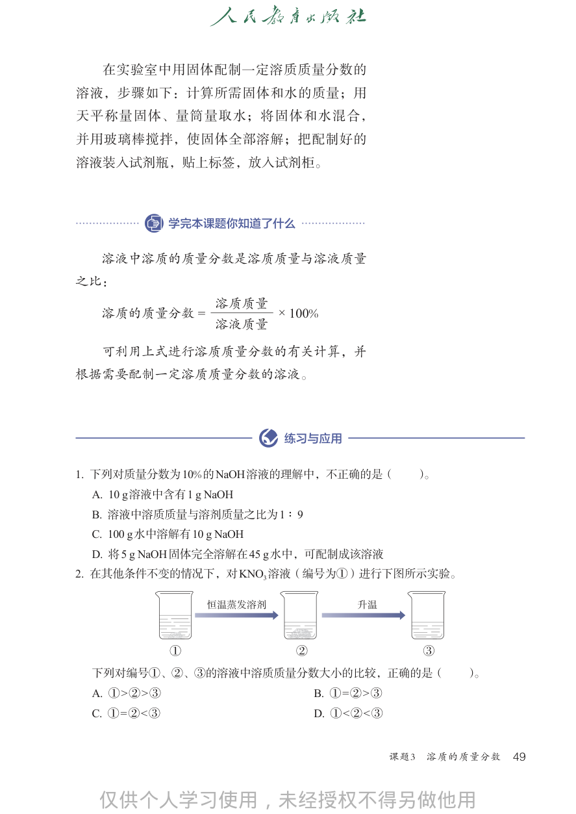

## RJ-CHEMISTRY-9B-043 配制及稀释一定溶质质量分数的氯化钠溶液

第九单元 溶液 / 实验活动6 一定溶质质量分数的氯化钠溶液的配制 · P60

天平、称量纸、烧杯、玻璃棒、药匙、量筒、胶头滴管、空试剂瓶、空白标签。氯化钠、蒸馏水。

【实验步骤】

1. 配制质量分数为6% 的氯化钠溶液。

（1）计算：配制50 g质量分数为6%的氯化钠溶液，需要氯化钠      g、水      g。

（2）称量：用天平称量所需质量的氯化钠，放入烧杯中。

（3）量取：用量筒量取所需体积的水，倒入盛有氯化钠的烧杯中。

（4）溶解：用玻璃棒搅拌，使氯化钠溶解。整个配制过程如图9-17 所示。

2. 配制质量分数为3% 的氯化钠溶液。用已配好的质量分数为6% 的氯化钠溶液（密度为1.04 g/cm³），配制50 g质量分数为3%的氯化钠溶液。

（1）计算：配制50 g质量分数为3%的氯化钠溶液，需要质量分数为6%的氯化钠溶液    g（体积     mL）、水    g（体积    mL）。

（2）量取：用量筒分别量取所需体积的氯化钠溶液和水，倒入烧杯中。

（3）混匀：用玻璃棒搅拌，使液体混合均匀。

3. 把配制好的上述两种氯化钠溶液分别装入试剂瓶，盖好瓶塞并贴上标签（标签上应标明试剂名称和溶液中溶质的质量分数），放入试剂柜。

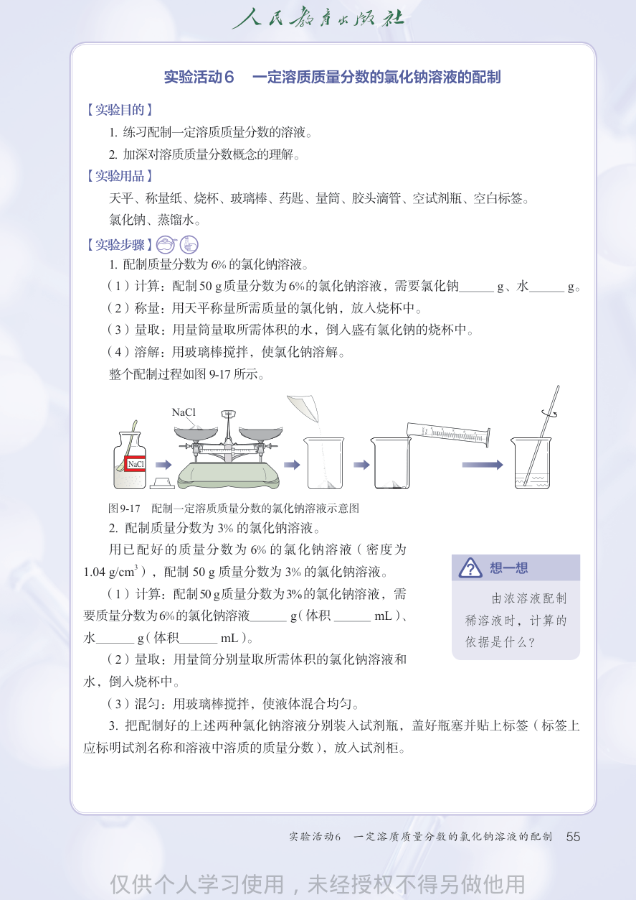

## RJ-CHEMISTRY-9B-044 粗盐中难溶性杂质的去除

第九单元 溶液 / 实验活动7 粗盐中难溶性杂质的去除 · P61-P62

烧杯、玻璃棒、蒸发皿、坩埚钳、酒精灯、漏斗、药匙、量筒、铁架台（带铁圈）、天平、称量纸、滤纸、火柴。粗盐、蒸馏水。

【实验步骤】

1. 溶解用天平称取5.0 g 粗盐，用药匙将该粗盐逐渐加入盛有10 mL 水的烧杯中，边加边用玻璃棒搅拌（思考：起什么作用？），一直加到粗盐不再溶解为止。观察所得液体是否浑浊。称量剩下的粗盐，计算加到10 mL 水中粗盐的质量。

2. 过滤如图9-18 所示，过滤步骤1 中所得液体。仔细观察滤纸上剩余物及滤液的颜色。

3. 蒸发将所得澄清滤液倒入蒸发皿。如图9-19 所示，用酒精灯加热。在加热过程中，用玻璃棒不断搅拌滤液，防止因局部温度过高，造成液滴飞溅。当蒸发皿中出现较多固体时，停止加热。利用蒸发皿的余热使滤液蒸干。观察蒸发皿中固体的外观。

如滤液仍浑浊，应再过滤一次。

停止加热后，不要立即把蒸发皿放在实验台上，以免烫坏实验台面。

4. 计算产率用玻璃棒把固体转移到称量纸上，称量后，将固体回收到指定的容器中。将提纯后的固体（精盐）与粗盐作比较，并计算精盐的产率。

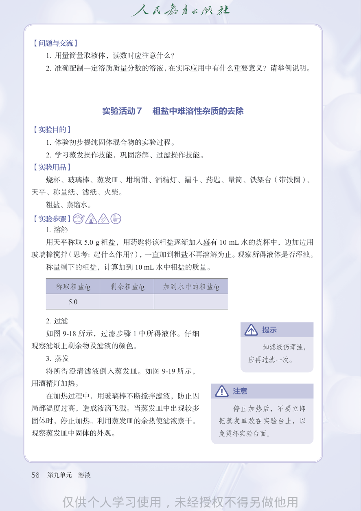

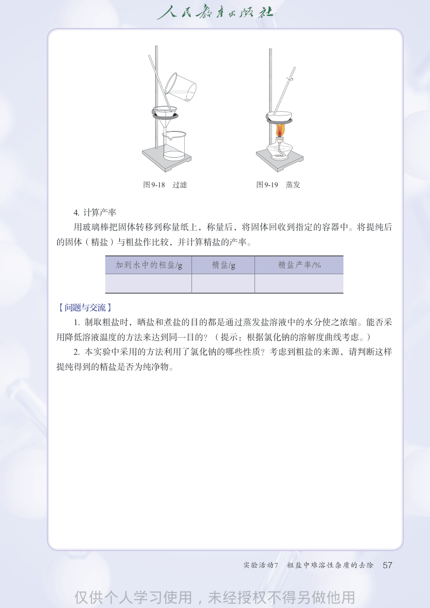

## RJ-CHEMISTRY-9B-045 酸碱指示剂及其变色

第十单元 常见的酸、碱、盐 / 课题1 溶液的酸碱性 · P65-P66

我们曾经做过碳酸使紫色石蕊溶液变成红色、氨水使无色酚酞溶液变成红色的实验。石蕊和酚酞属于酸碱指示剂，酸碱指示剂通常也简称指示剂。

将4支试管分成两组，向每组的两支试管中分别加入少量白醋和肥皂水。然后向其中一组试管中滴加紫色石蕊溶液，向另一组试管中滴加无色酚酞溶液（如图10-1）。观察并记录实验现象。

可以看到，酸性溶液能使紫色石蕊溶液变成红色，不能使无色酚酞溶液变色；碱性溶液能使紫色石蕊溶液变成蓝色，使无色酚酞溶液变成红色。利用酸碱指示剂可以检验溶液的酸碱性。

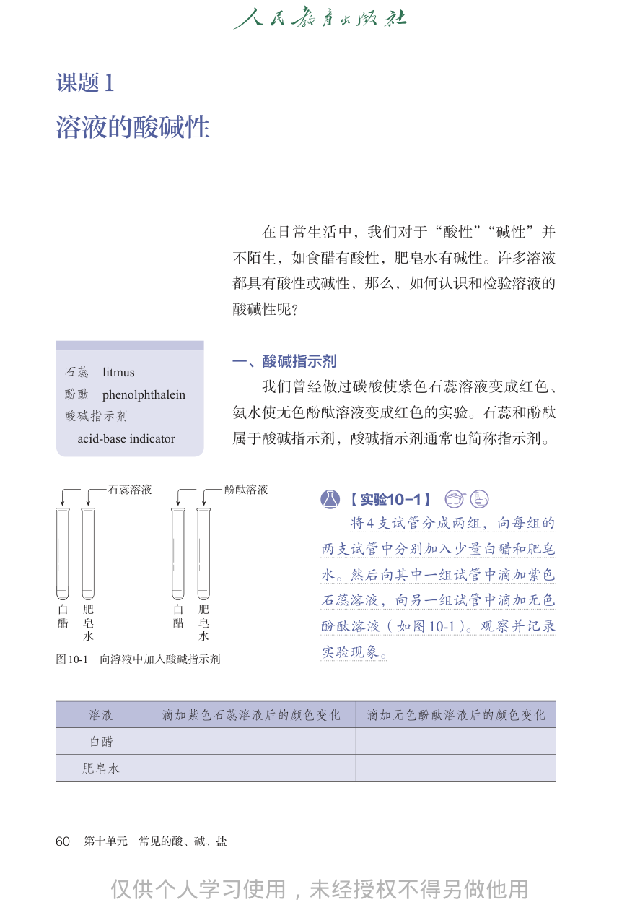

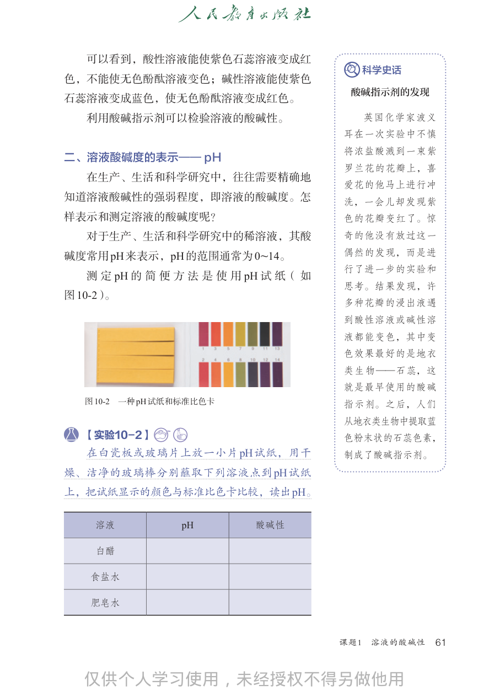

## RJ-CHEMISTRY-9B-046 溶液的酸碱度与pH的测定

第十单元 常见的酸、碱、盐 / 课题1 溶液的酸碱性 · P66-P67

在生产、生活和科学研究中，往往需要精确地知道溶液酸碱性的强弱程度，即溶液的酸碱度。怎样表示和测定溶液的酸碱度呢？对于生产、生活和科学研究中的稀溶液，其酸碱度常用pH来表示，pH的范围通常为0~14。测定pH 的简便方法是使用pH 试纸（如图10-2）。

在白瓷板或玻璃片上放一小片pH试纸，用干燥、洁净的玻璃棒分别蘸取白醋、食盐水、肥皂水点到pH试纸上，把试纸显示的颜色与标准比色卡比较，读出pH。

酸性溶液的pH<7 ；中性溶液的pH=7 ；碱性溶液的pH>7 。pH越小，表示溶液的酸性越强；pH越大，表示溶液的碱性越强（如图10-3）。

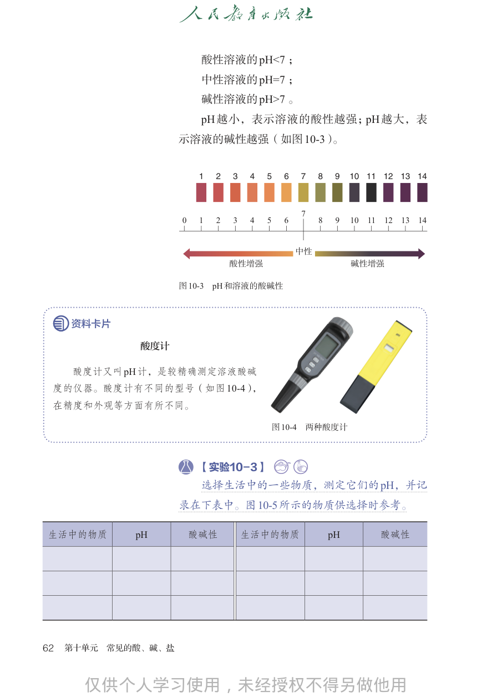

## RJ-CHEMISTRY-9B-047 植物色素作为酸碱指示剂

第十单元 常见的酸、碱、盐 / 课题1 溶液的酸碱性 · P66

许多种花瓣的浸出液遇到酸性溶液或碱性溶液都能变色，其中变色效果最好的是地衣类生物——石蕊，这就是最早使用的酸碱指示剂。之后，人们从地衣类生物中提取蓝色粉末状的石蕊色素，制成了酸碱指示剂。

## RJ-CHEMISTRY-9B-048 酸度计

第十单元 常见的酸、碱、盐 / 课题1 溶液的酸碱性 · P67

酸度计又叫pH计，是较精确测定溶液酸碱度的仪器。酸度计有不同的型号（如图10-4），在精度和外观等方面有所不同。

## RJ-CHEMISTRY-9B-049 酸碱度在健康和生产中的意义

第十单元 常见的酸、碱、盐 / 课题1 溶液的酸碱性 · P68

了解溶液的酸碱度，对生产、生活及人类的生命活动具有重要的意义。健康人的体液必须维持在一定的酸碱度范围内，如胃液pH的正常范围是0.9~1.5，如果出现异常，则可能患有疾病。测定人体内或排出的液体的pH，可以帮助人们了解身体的健康状况。

在化工生产中，许多反应都必须在一定pH范围的溶液里进行。在农业生产中，农作物一般适宜在pH=7或接近7 的土壤中生长；pH<4 的酸性土壤或pH>8的碱性土壤，一般需要经过改良才适于种植。

人体内的一些液体和排泄物的正常pH范围：

|液体|正常pH范围|
|---|---|
|血浆|7.35～7.45|
|唾液|6.6～7.1|
|胃液|0.9～1.5|
|乳汁|6.8～7.3|
|肝胆汁|7.1～8.5|
|胰液|7.8～8.4|
|尿液|4.4～8.0|

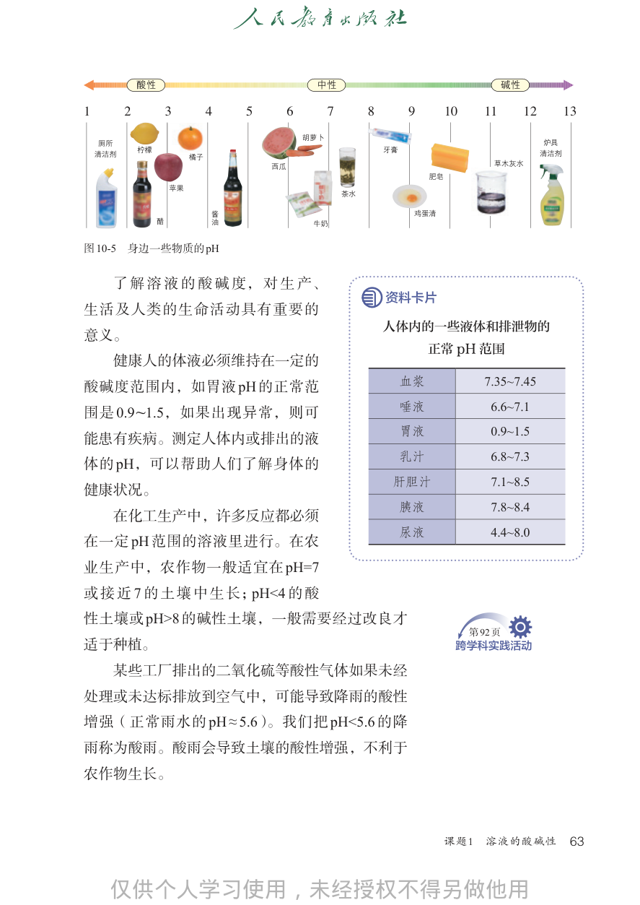

## RJ-CHEMISTRY-9B-050 酸雨

第十单元 常见的酸、碱、盐 / 课题1 溶液的酸碱性 · P68

某些工厂排出的二氧化硫等酸性气体如果未经处理或未达标排放到空气中，可能导致降雨的酸性增强（正常雨水的pH≈5.6）。我们把pH<5.6的降雨称为酸雨。酸雨会导致土壤的酸性增强，不利于农作物生长。

## RJ-CHEMISTRY-9B-051 盐酸和硫酸的性质观察

第十单元 常见的酸、碱、盐 / 课题2 常见的酸和碱 · P71

在实验室，我们经常用到的酸是盐酸和硫酸。盐酸和硫酸有哪些性质和用途呢？

（1）观察盐酸、硫酸的颜色和状态。

（2）分别打开盛有盐酸、硫酸的试剂瓶的瓶盖，观察并小心闻其气味。

酸有腐蚀性！不要将酸沾到皮肤或衣服上！实验时戴好护目镜。

常用浓盐酸（质量分数为37%～38%）的密度为1.19 g/cm³；常用浓硫酸（质量分数为98%）的密度为1.84 g/cm³。

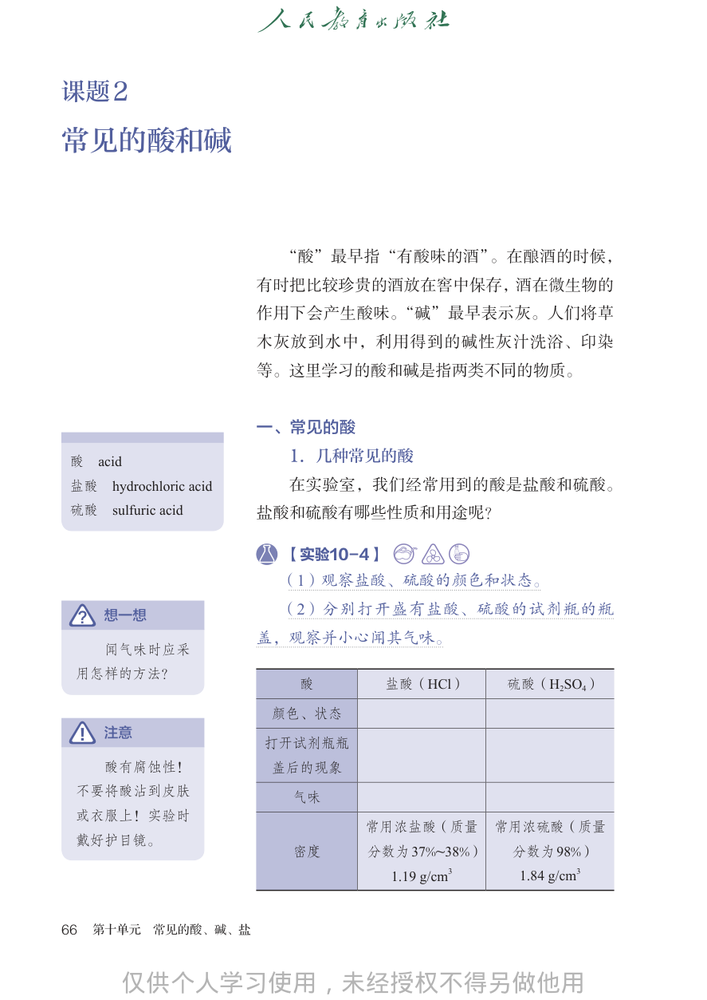

## RJ-CHEMISTRY-9B-052 浓硫酸的腐蚀性与脱水作用

第十单元 常见的酸、碱、盐 / 课题2 常见的酸和碱 · P72

将纸、小木棍、布放在玻璃片上，完成下列实验。

用玻璃棒蘸浓硫酸在纸上写字用小木棍蘸少量浓硫酸将浓硫酸滴到一小块布上浓硫酸有强烈的腐蚀性（如图10-6）。它能夺取纸张、木材、布料、皮肤（都由含碳、氢、氧等元素的化合物组成）里的水分，生成黑色的炭。所以，使用浓硫酸时应十分小心。

严格地说，浓硫酸能将这些物质中的氢、氧按水的组成比脱去，这种作用通常叫作脱水作用。

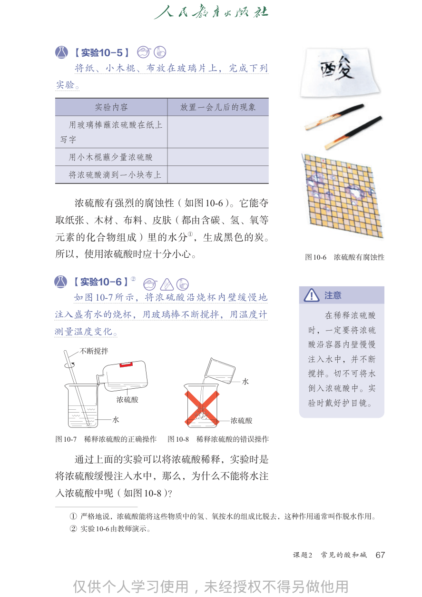

## RJ-CHEMISTRY-9B-053 浓硫酸的稀释与使用注意事项

第十单元 常见的酸、碱、盐 / 课题2 常见的酸和碱 · P72-P73

如图10-7所示，将浓硫酸沿烧杯内壁缓慢地注入盛有水的烧杯，用玻璃棒不断搅拌，用温度计测量温度变化。

在稀释浓硫酸时，一定要将浓硫酸沿容器内壁慢慢注入水中，并不断搅拌。切不可将水倒入浓硫酸中。实验时戴好护目镜。

如果将水注入浓硫酸，由于水的密度较小，水会浮在浓硫酸上面，浓硫酸溶解时放出的热能使水立刻沸腾，使硫酸液滴向四周飞溅。这是非常危险的操作！如果不慎将浓硫酸沾到皮肤上，应立即用大量水冲洗，然后涂上质量分数为3%~5%的碳酸氢钠溶液。

实验10-6由教师演示。

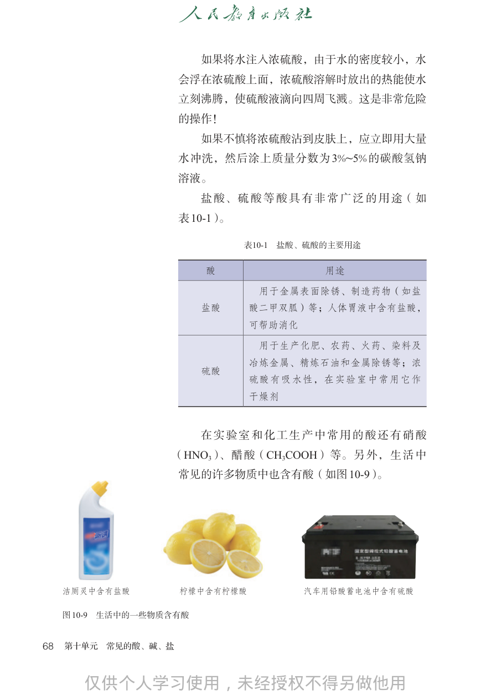

## RJ-CHEMISTRY-9B-054 常见酸的用途

第十单元 常见的酸、碱、盐 / 课题2 常见的酸和碱 · P73

盐酸、硫酸等酸具有非常广泛的用途（如表10-1）。

盐酸：用于金属表面除锈、制造药物（如盐酸二甲双胍）等；人体胃液中含有盐酸，可帮助消化。

硫酸：用于生产化肥、农药、火药、染料及冶炼金属、精炼石油和金属除锈等；浓硫酸有吸水性，在实验室中常用它作干燥剂。

在实验室和化工生产中常用的酸还有硝酸（HNO₃）、醋酸（CH₃COOH）等。另外，生活中常见的许多物质中也含有酸（如图10-9）。

## RJ-CHEMISTRY-9B-055 酸的化学性质探究

第十单元 常见的酸、碱、盐 / 课题2 常见的酸和碱 · P74;P81

（1）如图10-10所示，在白色点滴板上进行实验，观察并记录实验现象。实验用稀盐酸、稀硫酸，分别滴加紫色石蕊溶液和无色酚酞溶液。

（3）在分别盛有稀盐酸和稀硫酸的试管中各放入生锈的铁钉，过一会儿取出铁钉，用水洗净，铁钉表面和溶液颜色有什么变化？

$\mathrm{Fe_2O_3+6HCl=2FeCl_3+3H_2O}$

$\mathrm{Fe_2O_3+3H_2SO_4=Fe_2(SO_4)_3+3H_2O}$

酸能与某些金属反应，生成盐和氢气，也能与某些金属氧化物反应，生成盐和水。

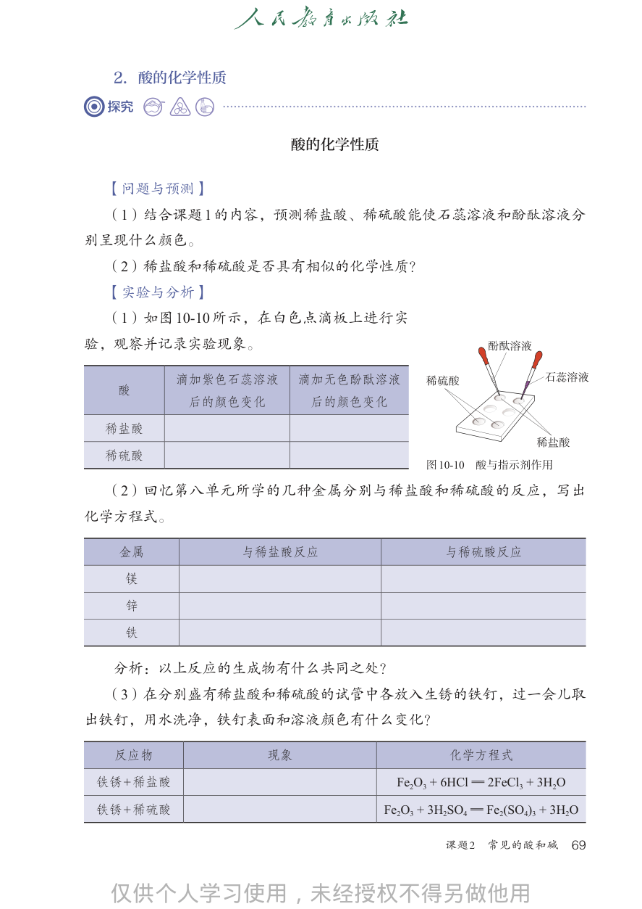

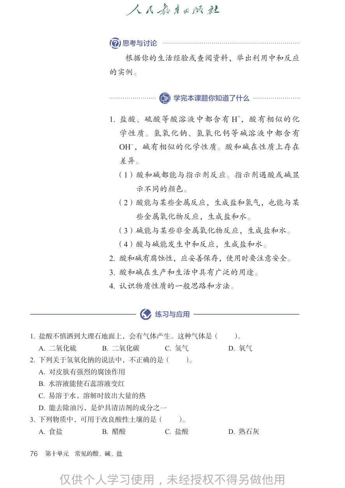

## RJ-CHEMISTRY-9B-056 酸溶液的导电性与共同离子

第十单元 常见的酸、碱、盐 / 课题2 常见的酸和碱 · P75

如图10-11 所示，分别试验稀盐酸、稀硫酸、蒸馏水和乙醇的导电性（可以将小灯泡换成发光二极管）。

可以看到，蒸馏水和乙醇不导电，而稀盐酸、稀硫酸却能导电。这说明，在稀盐酸、稀硫酸中存在能自由移动的、带电荷的粒子。通过研究和分析可知，像盐酸、硫酸这样的酸，在水中都能解离出H⁺ 和酸根离子（如图10-12），即在不同酸的溶液中都含有H⁺，所以，酸有一些相似的化学性质。

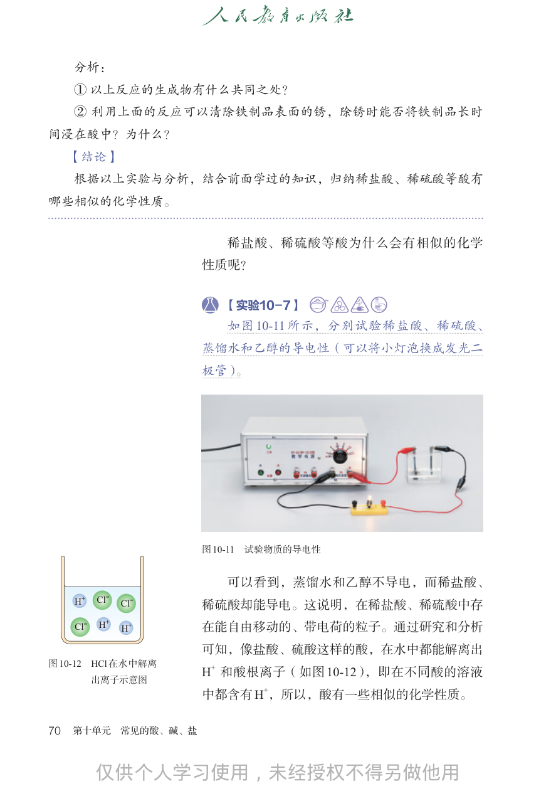

## RJ-CHEMISTRY-9B-057 氢氧化钠、潮解及其用途

第十单元 常见的酸、碱、盐 / 课题2 常见的酸和碱 · P76

氢氧化钠是一种常见的碱，俗称苛性钠、火碱或烧碱。氢氧化钠有强烈的腐蚀性，如果不慎沾到皮肤上，应立即用大量的水冲洗，再涂上质量分数为1%的硼酸溶液。

用镊子夹取3 小片氢氧化钠，如下表所示，分别进行实验（切勿用手拿）。

观察氢氧化钠的颜色和状态

将氢氧化钠放在表面皿上，放置一会儿将氢氧化钠放入试管中，加入少量水，测量温度的变化氢氧化钠曝露在空气中容易吸收水分，使表面潮湿并逐渐溶解，这种现象叫作潮解。因此，氢氧化钠可用作某些气体的干燥剂。氢氧化钠是一种重要的化工原料，广泛应用于制肥皂，以及石油、造纸、纺织和印染等工业。氢氧化钠能与油脂反应，在生活中可用来去除油污，如炉具清洁剂的成分之一就是氢氧化钠，去污时就是利用这一反应原理。

氢氧化钠有强烈的腐蚀性，使用时必须十分小心，防止溅到眼睛、皮肤、衣服等上面。实验时戴好护目镜。

## RJ-CHEMISTRY-9B-058 氢氧化钙的性质与用途

第十单元 常见的酸、碱、盐 / 课题2 常见的酸和碱 · P77

取一小药匙氢氧化钙，观察它的颜色和状态，然后放入小烧杯中，加入30 mL水，用玻璃棒搅拌，观察氢氧化钙在水中的溶解情况。

氢氧化钙也是一种常见的碱，俗称熟石灰或消石灰。氢氧化钙是白色粉末状物质，微溶于水，其水溶液俗称石灰水。当石灰水中存在较多未溶解的熟石灰时，就称为石灰乳或石灰浆。氢氧化钙在生产和生活中具有广泛的用途。例如：建筑上用熟石灰与沙子混合来砌砖；在树木上涂刷含有硫黄粉等的石灰浆（如图10-13），可保护树木，防止冻伤，并防止害虫产卵；农业上可用石灰乳与硫酸铜溶液等配制成具有杀菌作用的波尔多液，作为农药使用；熟石灰还可用来改良酸性土壤；等等。除了氢氧化钠、氢氧化钙，常见的碱还有氢氧化钾（KOH）等。

氢氧化钙对皮肤、衣服等有腐蚀作用，使用时应小心。实验时戴好护目镜。

## RJ-CHEMISTRY-9B-059 碱的化学性质与共同离子

第十单元 常见的酸、碱、盐 / 课题2 常见的酸和碱 · P78;P81

设计实验并实施，验证氢氧化钠溶液、氢氧化钙溶液使石蕊溶液和酚酞溶液分别呈现的颜色。

通过实验与分析我们知道，氢氧化钠、氢氧化钙等碱有一些相似的化学性质。这是为什么呢？

研究表明，与盐酸、硫酸等酸类似，像氢氧化钠、氢氧化钙这样的碱，在水中都能解离出金属离子和OH⁻（如图10-14），即在不同碱的溶液中都含有OH⁻，所以，碱有一些相似的化学性质。

酸和碱的组成不同，在性质上存在差异。

碱能与某些非金属氧化物反应，生成盐和水。

## RJ-CHEMISTRY-9B-060 认识物质性质的一般思路和方法

第十单元 常见的酸、碱、盐 / 课题2 常见的酸和碱 · P79

我们通过实验探究认识了常见酸、碱的性质和用途，并通过对酸和碱组成的分析，从类别的角度初步认识了酸、碱各具有相似的化学性质，以及酸和碱具有差异性。在研究物质的性质时，常采用观察、实验及归纳概括、分析解释等科学方法，从物质的存在、组成、变化和用途等视角认识物质的性质；从物质的类别认识具体物质的性质；从物质的共性和差异性认识一类物质的性质；等等。

## RJ-CHEMISTRY-9B-061 中和反应

第十单元 常见的酸、碱、盐 / 课题2 常见的酸和碱 · P79-P80

如图10-15所示，在烧杯中加入5 mL稀氢氧化钠溶液，滴入几滴酚酞溶液。然后用滴管慢慢滴入稀盐酸，并不断搅拌溶液，至溶液颜色恰好变成无色为止。

在上面的实验中，氢氧化钠与盐酸反应，生成了氯化钠和水（如图10-16）。

$\mathrm{NaOH+HCl=NaCl+H_2O}$

实际上，其他酸与碱也能发生类似的反应。例如：

$\mathrm{Ca(OH)_2+2HCl=CaCl_2+2H_2O}$

$\mathrm{2NaOH+H_2SO_4=Na_2SO_4+2H_2O}$

可以发现，上述反应中生成的氯化钠、氯化钙和硫酸钠都是由金属离子和酸根离子构成的，我们把这样的化合物叫作盐。

酸与碱作用生成盐和水的反应，叫作中和反应。中和反应在日常生活和工农业生产中有着广泛的应用。

## RJ-CHEMISTRY-9B-062 中和反应的应用

第十单元 常见的酸、碱、盐 / 课题2 常见的酸和碱 · P80

人的胃液里含有适量盐酸，可以帮助消化。但如果患有某些胃肠疾病，胃会分泌过量胃酸，造成胃部不适以致消化不良。在这种情况下，遵医嘱服用某些含有碱性物质的药物，可以中和过多的胃酸。某些蜂蜇刺或蚂蚁叮咬人的皮肤后，会释放出蚁酸，导致伤处出现肿、痛或瘙痒等症状。如果涂一些含有碱性物质的溶液，就可减轻症状。工厂生产过程中产生的污水，需进行一系列的处理。例如：硫酸厂的污水中含有硫酸等物质，可以用熟石灰进行中和处理；印染厂的碱性废水可用硫酸进行中和处理。农作物生长对土壤的酸碱性有一定的要求。在农业生产中，常根据土壤和植物种植情况来调节土壤的酸碱性，如用熟石灰中和土壤酸性，以利于农作物生长。调节土壤的pH是改良土壤的方法之一。

## RJ-CHEMISTRY-9B-063 盐的组成

第十单元 常见的酸、碱、盐 / 课题3 常见的盐 · P83

日常生活中所说的盐，通常指食盐（主要成分是NaCl）；而化学中的盐，是指一类组成里含有金属离子（或铵根离子）和酸根离子的化合物，如氯化钠、碳酸钠（Na₂CO₃）、碳酸氢钠（NaHCO₃）、碳酸钙（CaCO₃）、高锰酸钾（KMnO₄）、硫酸铜（CuSO₄）和硝酸钠（NaNO₃）等。

含有铵根离子（NH₄⁺）的盐称为铵盐，如氯化铵（NH₄Cl）。

## RJ-CHEMISTRY-9B-064 氯化钠的生理作用、用途及来源

第十单元 常见的酸、碱、盐 / 课题3 常见的盐 · P83-P84

氯化钠不仅是重要的调味品，也是维持人的正常生理活动所必不可少的。人体内所含的氯化钠大部分以离子形式存在于体液中。钠离子对神经调节、维持细胞内外正常的水分分布和促进细胞内外物质交换起重要作用；氯离子是胃液中的主要成分，具有促生盐酸、帮助消化和增进食欲的作用。人们每天都要摄入一些食盐（成年人每天摄入食盐不超过5 g）来补充由于出汗、排尿等排出的氯化钠，以满足人体的正常需要，但长期食用过多食盐不利于人体健康。氯化钠的用途很多。例如：医疗上的生理盐水是用氯化钠配制的；农业上可以用氯化钠溶液来选种；工业上可以用氯化钠作原料制取碳酸钠、氢氧化钠、氯气和盐酸等；公路上曾经使用氯化钠作融雪剂。此外，我国民间有用食盐腌渍蔬菜、鱼、肉、蛋等食物的习惯，这样可使食品具有独特风味，并能延长保存时间。

氯化钠在自然界中分布很广，海水、盐湖（如图10-17）、盐井和盐矿都是氯化钠的来源。我国地域辽阔，氯化钠资源极为丰富。

## RJ-CHEMISTRY-9B-065 碳酸钠、碳酸氢钠和碳酸钙的用途

第十单元 常见的酸、碱、盐 / 课题3 常见的盐 · P84

碳酸钠俗称纯碱、苏打，是重要的工业原料，广泛用于玻璃、造纸、纺织等行业及洗涤剂的生产。碳酸氢钠俗称小苏打，是制作面点所用发酵粉的主要成分之一；在医疗上，它是治疗胃酸过多症的一种药剂。无论在古代还是现代，石灰石、大理石都是重要的建筑材料（如图10-18），它们的主要成分都是碳酸钙；在医疗上，碳酸钙还可用作补钙剂。

## RJ-CHEMISTRY-9B-066 碳酸盐和碳酸氢盐与稀盐酸反应

第十单元 常见的酸、碱、盐 / 课题3 常见的盐 · P85;P90

在学习二氧化碳的实验室制法时，我们已经知道碳酸钙可以与稀盐酸反应：

$\mathrm{CaCO_3+2HCl=CaCl_2+H_2CO_3}$

$\mathrm{H_2CO_3=CO_2\uparrow+H_2O}$

$\mathrm{CaCO_3+2HCl=CaCl_2+CO_2\uparrow+H_2O}$

【实验10-11】向盛有0.5 g碳酸钠的试管中加入2 mL稀盐酸，迅速用带导管的橡胶塞塞紧试管口，并将导管另一端插入盛有澄清石灰水的试管中（如图10-19），观察、记录并分析现象。

用碳酸氢钠代替碳酸钠进行上述实验，观察、记录并分析现象。

上述反应可以用化学方程式表示如下：

$\mathrm{Na_2CO_3+2HCl=2NaCl+CO_2\uparrow+H_2O}$

$\mathrm{NaHCO_3+HCl=NaCl+CO_2\uparrow+H_2O}$

组成里含有碳酸根离子或碳酸氢根离子（HCO₃⁻）的盐都能与盐酸反应，有二氧化碳气体生成。

## RJ-CHEMISTRY-9B-067 复分解反应及发生的条件

第十单元 常见的酸、碱、盐 / 课题3 常见的盐 · P85-P87

碳酸钠不仅能与稀盐酸发生反应，还能与澄清石灰水发生反应。

【实验10-12】向盛有澄清石灰水的试管中滴加碳酸钠溶液，观察、记录并分析现象。

上述反应的化学方程式可以表示如下：

$\mathrm{Na_2CO_3+Ca(OH)_2=CaCO_3\downarrow+2NaOH}$

分析以上几个反应，它们都发生在溶液中，都是由两种化合物互相交换成分，生成另外两种化合物的反应，这样的反应叫作复分解反应。

酸、碱、盐之间有的能发生复分解反应，有的不能发生。只有两种化合物互相交换成分，有沉淀或有气体或有水生成时，才是发生了复分解反应。

## RJ-CHEMISTRY-9B-068 硫酸铜与氢氧化钠、氯化钡溶液反应的实验

第十单元 常见的酸、碱、盐 / 课题3 常见的盐 · P86

【实验10-13】向两支分别盛有少量氢氧化钠溶液和氯化钡溶液的试管中滴加硫酸铜溶液，观察并记录实验现象。

$\mathrm{2NaOH+CuSO_4=Cu(OH)_2\downarrow+Na_2SO_4}$

$\mathrm{BaCl_2+CuSO_4=BaSO_4\downarrow+CuCl_2}$

## RJ-CHEMISTRY-9B-069 化肥的种类与主要作用

第十单元 常见的酸、碱、盐 / 课题3 常见的盐 · P87-P88

以化学和物理方法制成的、含农作物生长所需营养元素的化学肥料（简称化肥）。常见的化肥中，除了尿素、氨水等，很多属于盐。

农作物所必需的营养元素有碳、氢、氧、氮、磷、钾、钙、镁等，其中氮、磷、钾需要量较大但常供应不足，因此氮肥、磷肥和钾肥是最主要的化肥。表10-2中列出了氮肥、磷肥和钾肥的化学成分及主要作用，详见原表。

|分类|化学成分|主要作用|
|---|---|---|
|氮肥|尿素［CO(NH₂)₂］、氯化铵（NH₄Cl）、硝酸钠（NaNO₃）等|氮是植物体内蛋白质、核酸和叶绿素的组成元素。氮肥可以促进植物茎、叶生长茂盛，使叶色浓绿，提高植物蛋白质含量|
|磷肥|磷酸钙［Ca₃(PO₄)₂］等|磷是植物体内核酸、蛋白质和酶等多种重要化合物的组成元素。磷肥可以促进作物生长，还可以增强作物的抗寒、抗旱能力|
|钾肥|硫酸钾（K₂SO₄）、氯化钾（KCl）等|钾在植物代谢活跃的器官和组织中的分布量较高。钾肥可以保证各种代谢过程顺利进行、促进植物生长、增强抗病虫害和抗倒伏能力|

## RJ-CHEMISTRY-9B-070 复合肥料与合理施用化肥

第十单元 常见的酸、碱、盐 / 课题3 常见的盐 · P88

有些化肥同时含有氮、磷、钾中的两种或三种营养元素，能同时均匀地供给作物几种养分，如磷酸二氢铵（NH₄H₂PO₄）和硝酸钾（KNO₃）等，这样的化肥属于复合肥料。随着世界人口的增长，人类对农产品的需求量不断增大，施用化肥成为农作物增产的有力措施（如图10-20），解决了部分地区粮食短缺的问题。

但是，不合理地施用化肥会造成土壤退化，以及土壤、水和大气环境的污染。因此，要根据土壤和气候条件、作物营养特点、化肥性质及其在土壤中的变化等，有针对性、均衡适度地施用化肥，提高施用效率，减少负面作用。

## RJ-CHEMISTRY-9B-071 联合制碱法的特点

第十单元 常见的酸、碱、盐 / 课题3 常见的盐 · P89

将制碱与制氨结合起来的“联合制碱法”（又称“侯氏制碱法”）。该方法既生产纯碱又制得化肥，大大提高了原料的利用率，降低了生产成本，减少了对环境的污染。

## RJ-CHEMISTRY-9B-072 常见酸、碱的化学性质实验

第十单元 常见的酸、碱、盐 / 实验活动8 常见酸、碱的化学性质 · P95-P96

白色点滴板、试管、镊子、蒸发皿、坩埚钳、玻璃棒、药匙、酒精灯、铁架台（带铁圈）、胶头滴管、火柴。稀盐酸、稀硫酸、氢氧化钠溶液、氢氧化钙溶液、硫酸铜溶液、氢氧化钙粉末、石蕊溶液、酚酞溶液、pH试纸、生锈的铁钉。

3. （1）取两个生锈的铁钉分别放入两支试管中，然后各加入2 mL稀盐酸，观察现象。

（2）当观察到铁钉表面没有铁锈，铁钉变得光亮时，将其中一支试管中的铁钉取出，洗净。继续观察另一支试管中的现象，过一段时间将铁钉取出，洗净。比较两个铁钉。

4. 在试管中加入2 mL硫酸铜溶液，然后滴入几滴氢氧化钠溶液，观察现象。再向试管中加入稀盐酸，观察现象。

5. （1）在试管中加入1 mL氢氧化钠溶液，滴入几滴酚酞溶液。然后边用滴管慢慢滴入稀盐酸，边不断振荡试管，至溶液颜色恰好变成无色为止。

（2）取上述反应后的无色溶液1 mL，置于蒸发皿中加热，使液体蒸干，观察现象。

6. （1）向两支试管中各加入相同量的氢氧化钙粉末（用药匙的柄把一端挑一点），然后各加入1 mL水，振荡；再各滴入两滴酚酞溶液，观察现象。

（2）继续向其中一支试管中加入1 mL水，振荡；向另一支试管中加入1 mL稀盐酸，振荡；比较两支试管中的现象。酸和碱有腐蚀性，实验时要注意安全！实验时戴好护目镜。

## RJ-CHEMISTRY-9B-073 人体中的常量元素和微量元素

第十一单元 化学与社会 / 课题1 化学与人体健康 · P99-P100

所有的生命都起源于自然，并通过新陈代谢与环境进行着物质和能量交换，因此人体中的元素在自然界都能找到。在人体中含量超过0.01％的氧、碳、氢、氮等11种元素，其质量占人体质量的99％以上，称为常量元素。还有一些元素的含量在0.01％以下，如铁、锌、氟、碘等，它们也是维持人体正常生命活动所必需的，称为微量元素。人体中的氧、碳、氢、氮元素主要以蛋白质、脂肪、糖类、核酸等有机化合物和水的形式存在，其余元素主要以无机盐的形式存在于骨骼和体液中。这些元素有些是构成人体组织的重要成分，有些能够调节人体的新陈代谢，为维持生命活动的正常进行，保障人体健康发挥着重要作用。

## RJ-CHEMISTRY-9B-074 有机化合物和无机化合物

第十一单元 化学与社会 / 课题1 化学与人体健康 · P100

有机化合物简称有机物，通常指含碳元素的化合物。不含碳元素的化合物，以及CO、CO₂和碳酸盐等属于无机化合物。

## RJ-CHEMISTRY-9B-075 元素摄入与人体健康

第十一单元 化学与社会 / 课题1 化学与人体健康 · P100-P101

人体中的元素通过新陈代谢保持含量相对稳定。人体必需的元素摄入不足或摄入过量均不利于健康（如表11-1）。另外，人体如果摄入某些元素，如汞（Hg）、铅（Pb）、镉（Cd）等会对健康造成损害。

表11-1：部分元素对人体健康的影响及14～18岁人群每天的适宜摄入量（或推荐摄入量），单位mg。钾、钠、钙、铁、氟、碘的作用、缺乏或过量影响与摄入量见两页原表。

|元素|对人体健康的影响|适宜摄入量（或推荐摄入量）/mg|
|---|---|---|
|钾|钾主要以K⁺的形式存在于细胞内液，对维持体内酸碱平衡和神经、肌肉的功能等具有重要意义。钾缺乏会引起肌肉无力和心律失常，影响肾功能|2 200|
|钠|钠主要以Na⁺的形式存在于细胞外液，对维持体内水量的恒定、酸碱平衡和血压等具有重要意义。钠缺乏会引起血压降低和肌肉痉挛。钠摄入过多会增加患高血压和心血管疾病的风险|1 600|
|钙|钙是人体骨骼和牙齿的重要成分。幼儿及青少年缺钙易患佝偻病，导致生长发育不良，老年人缺钙会导致骨质疏松和骨折|1 000|
|铁|铁是血红蛋白的重要成分，参与体内氧气的运输，有助于维持正常的造血功能。缺铁会引起贫血|16～18|
|氟|氟主要存在于骨骼和牙齿中。缺氟易产生龋齿，摄入过量会引起氟斑牙和氟骨症|1.5|
|碘|碘是甲状腺激素的重要成分。成人缺碘会引起甲状腺肿大，儿童缺碘会影响生长和智力发育。碘摄入过量也会引起甲状腺肿大|0.12|

## RJ-CHEMISTRY-9B-076 六类营养物质

第十一单元 化学与社会 / 课题1 化学与人体健康 · P102

谷物、蔬菜、水果、肉类等食物看似千差万别，但从化学的角度看，其成分主要是水、糖类、蛋白质、油脂、无机盐和维生素这六类营养物质。

无机盐也被称为矿物质。

## RJ-CHEMISTRY-9B-077 糖类的消化、氧化与供能

第十一单元 化学与社会 / 课题1 化学与人体健康 · P102

糖类、蛋白质等相对分子质量较大的有机物分子进入人体后，在酶的作用下会生成容易被人体吸收利用的小分子物质。例如，粮食中的淀粉［(C₆H₁₀O₅)ₙ］属于糖类，在消化道内与水发生一系列反应，最终生成葡萄糖（C₆H₁₂O₆），葡萄糖在体内经缓慢氧化，最终可生成二氧化碳和水，同时为生命活动提供能量。食物中的糖类是人体主要的供能物质。

$\mathrm{C_6H_{12}O_6+6O_2\xlongequal{酶}6CO_2+6H_2O}$

## RJ-CHEMISTRY-9B-078 蛋白质的消化与利用

第十一单元 化学与社会 / 课题1 化学与人体健康 · P102

食物中的蛋白质进入人体后，在消化道内与水反应生成氨基酸。氨基酸在人体内可以重新合成人体所需要的多种蛋白质，促进生长发育，也可以被氧化，生成尿素、二氧化碳和水等物质，同时放出能量。

## RJ-CHEMISTRY-9B-079 油脂与备用能源

第十一单元 化学与社会 / 课题1 化学与人体健康 · P102-P103

植物油脂在常温下一般呈液态，习惯上称为油；动物油脂一般呈固态，习惯上称为脂肪。食物中的油脂在人体内氧化时比相同质量的糖类能放出更多的能量。人体内的脂肪是重要的备用能源。

## RJ-CHEMISTRY-9B-080 合理膳食与食品安全

第十一单元 化学与社会 / 课题1 化学与人体健康 · P103

为了保证身体健康，我们不仅要按时适量进餐，避免营养不足或营养过剩，而且要有合理的膳食结构，保证营养均衡。同时，还应注意食品安全，避免摄入变质食物和有毒、有害物质。我国制定的《中华人民共和国食品安全法》等法律、法规和一系列食品安全国家标准，对食品的原料选择、生产加工、运输储存和监督管理等环节提出了严格要求，有效保障了公众的身体健康和生命安全。

## RJ-CHEMISTRY-9B-081 合理用药与药物危害

第十一单元 化学与社会 / 课题1 化学与人体健康 · P104

保持身心健康，不仅需要选择健康的生活方式，合理膳食，患病时还要及时治疗。药物是用于预防、治疗、诊断疾病的化学物质，如主要来源于植物、动物和矿物等的中药，以及使用化学或生物方法人工合成的药物等。药物为帮助人类战胜疾病、促进社会发展发挥了巨大的作用。为了充分发挥药效，减少药物对人体的不良影响，我们应合理使用药物，如遵从医生和药师的要求，仔细阅读药物说明书，在正确的时间以适当的剂量和方式用药。毒品会严重损害人体器官，并使人产生强烈的药物依赖性，引发疾病和犯罪等问题，对个人、家庭和社会危害极大。青少年一定要珍爱生命、远离毒品。

## RJ-CHEMISTRY-9B-082 青蒿素和对乙酰氨基酚

第十一单元 化学与社会 / 课题1 化学与人体健康 · P104

青蒿素是我国科学家从传统中药中提取的抗疟疾有效成分。

对乙酰氨基酚是通过化学方法合成的一种常用解热镇痛药。

## RJ-CHEMISTRY-9B-083 消毒防腐药

第十一单元 化学与社会 / 课题1 化学与人体健康 · P105

消毒防腐药是用来杀灭病原微生物或抑制其生长的化学物质，一般用于体表、医疗器械及环境的消毒防腐。碘、过氧化氢、次氯酸钠、乙醇、苯酚、甲醛，以及含重金属汞、银的化合物等，在规定剂量和范围内可作为消毒防腐药。消毒防腐药在控制传染病的传播、防范和应对生物安全风险、保障人民生命健康等方面发挥了重要作用。

## RJ-CHEMISTRY-9B-084 抗生素分子结构与合理使用

第十一单元 化学与社会 / 课题1 化学与人体健康 · P105

在用X射线衍射法测定青霉素的分子结构（如图11-7）后，人们开辟了人工合成抗生素的道路，通过改变青霉素的分子结构，得到了一系列青霉素类药物。

伴随青霉素等抗生素的广泛使用，人们发现抗生素滥用会导致细菌耐药性升高。因此，青霉素等抗生素必须凭处方购买，并在医师的指导下合理使用。

## RJ-CHEMISTRY-9B-085 化学与能源利用

第十一单元 化学与社会 / 课题2 化学与可持续发展 · P109

为了改变传统的能源利用方式，人们通过化学反应将化石能源转化为清洁、便利的二次能源（如电能、石油制品等），开发可再生和环境友好的新能源（如风能、太阳能、氢能等），为能源利用开辟了新的途径。无论是煤的清洁利用（如图11-8）、电解水制氢（如图11-9），还是风力发电机（如图11-10）、光伏电池、燃料电池和电动汽车锂离子电池的生产，都是化学大显身手的重要领域。

## RJ-CHEMISTRY-9B-086 风电制氢

第十一单元 化学与社会 / 课题2 化学与可持续发展 · P110

风能是一种绿色清洁能源，但受天气状况影响较大，风力发电输出不均衡，风电输送和消纳存在一定困难。我国利用高原和海上丰富的风能资源发展风电，并通过风电电解水制氢，有效克服了风电的天然缺陷，为经济发展提供了大量清洁能源。

## RJ-CHEMISTRY-9B-087 高分子材料、天然材料和合成材料

第十一单元 化学与社会 / 课题2 化学与可持续发展 · P110

煤、石油等化石燃料和秸秆等生物质直接燃烧，其应用范围有限且污染严重。如果通过化学反应进行物质转化，就能得到煤气、沼气等清洁燃料和化工原料，以及塑料、合成橡胶、合成纤维等高分子材料。化学在材料的研制和创新中均发挥着重要作用。人工合成的高分子材料（简称合成材料）与天然高分子材料（如天然橡胶和棉花、羊毛等天然纤维）都是由大量小分子聚合而成的聚合物，具有链状或网状结构（如图11-11）。但合成材料在某些方面具有更为优异的性能（如表11-2），而且便于大规模工业化生产，成本较低，产量稳定（如图11-12）。这使人类结束了严重依赖天然高分子材料的历史，能够自主设计并合成具有特殊性能的材料，更好地满足工农业生产和日常生活的需求。

高分子的相对分子质量比较大（通常在1万以上），淀粉、蛋白质、橡胶等高分子的相对分子质量可达几十万，甚至百万。

## RJ-CHEMISTRY-9B-088 常见合成材料的性能、类型和用途

第十一单元 化学与社会 / 课题2 化学与可持续发展 · P111

表11-2 常见的合成材料

|合成材料|主要性能|常见类型|应用举例|
|---|---|---|---|
|塑料|密度小，耐腐蚀，易加工|聚乙烯、聚丙烯、聚氯乙烯、聚苯乙烯、聚酯等|绝缘材料、包装材料、农用薄膜、管道、机械零件等|
|合成橡胶|弹性和绝缘性好|顺丁橡胶、丁苯橡胶、异戊橡胶、硅橡胶等|轮胎、密封制品、防护用品等|
|合成纤维|强度高，弹性好，耐磨，耐腐蚀|聚丙烯纤维（丙纶）、聚对苯二甲酸乙二酯纤维（涤纶）、聚丙烯腈纤维（腈纶）等|纺织原料、过滤材料、建筑材料等|

图11-12 合成材料的生产优势：年产10万吨的合成纤维厂，产量相当于约8万公顷棉田一年的产棉量或约2 000万只绵羊一年的产毛量；年产10万吨的合成橡胶厂，产量相当于约15万公顷橡胶林一年的产胶量。

## RJ-CHEMISTRY-9B-089 复合材料与功能材料

第十一单元 化学与社会 / 课题2 化学与可持续发展 · P112

现代航空航天、信息技术、生物医药和海洋工程等的发展，对材料性能提出了更高的要求。人们不断改进钢铁、铝合金等金属材料，玻璃、陶瓷、水泥等无机非金属材料和塑料、合成纤维、合成橡胶等高分子材料的性能，并将几种材料复合起来，综合各组分性能的优点，形成复合材料，如碳纤维复合材料、玻璃纤维增强塑料（玻璃钢）、芳纶复合材料等（如图11-13）；还开发了大量具有光、电、磁等特殊性质的功能材料。新型材料的广泛应用，对人类的生产、生活和社会发展产生了深远影响。

## RJ-CHEMISTRY-9B-090 区分棉纤维、羊毛纤维和涤纶的实验

第十一单元 化学与社会 / 课题2 化学与可持续发展 · P112

从物质组成和转化的视角分析：三种纤维的主要成分都属于有机物，可以燃烧；同时，三者的成分不同，燃烧时的现象和产物的状态不同。

【实验】

收集三种纤维，依次用坩埚钳夹持，将其点燃，观察、记录燃烧时的现象和产物的状态。

## RJ-CHEMISTRY-9B-091 资源循环利用与环境承载能力

第十一单元 化学与社会 / 课题2 化学与可持续发展 · P113

社会的可持续发展要以自然资源的合理开发和利用为基础。如果对物质的获取、使用或处理不当，就会引发一系列环境和社会问题。各种资源从开采、提炼到制成产品，再到产品的使用与回收，其中的每个环节都离不开物质的转化（如图11-14），与物质的组成、结构、性质和应用密切相关，而这些正是化学的研究对象。化学与相关技术的发展，遵循增进人类福祉、尊重生命权利、合理控制风险等原则，充分考虑资源供给和环境承载能力，将为解决影响可持续发展的社会性科学议题开辟新的途径，为人类创造更加美好的生活。

## RJ-CHEMISTRY-9B-092 塑料包装制品回收标志

第十一单元 化学与社会 / 课题2 化学与可持续发展 · P114

表11-3：我国制定的塑料包装制品回收标志及对应的塑料名称（部分）。

01（PET）：聚对苯二甲酸乙二酯；02（PE-HD）：高密度聚乙烯；03（PVC）：聚氯乙烯；04（PE-LD）：低密度聚乙烯；05（PP）：聚丙烯；06（PS）：聚苯乙烯。回收标志的图形见原表。

## RJ-CHEMISTRY-9B-093 跨学科融合解决实际问题的思路

第十一单元 化学与社会 / 课题2 化学与可持续发展 · P114

学习的目的在于应用，在于解决实际问题。在解决与化学有关的实际问题时，我们要应用化学知识和观念，从物质的组成与结构、变化与转化、性质与应用等视角，分析该问题涉及哪些化学物质，发生了哪些变化，变化需要什么条件，存在哪些定量关系，等等。然后，结合这些物质的获取途径和相关变化的实现方法，分析其对社会、环境等因素的影响，提出解决方案。在生产和生活中，我们遇到的实际问题大多比较复杂，涉及不同领域，需要我们运用跨学科融合的思路来解决。例如，风能的有效利用，涉及地理、物理、化学等基础学科，以及材料、机械、电力等技术领域，需要全面考虑环境保护、经济效益等多方面的需求，综合运用各学科知识，采用合适的方法，进行系统规划和实施。

## RJ-CHEMISTRY-9B-094 部分酸、碱和盐的溶解性（室温）

附录Ⅰ / 部分酸、碱和盐的溶解性表（室温） · P121

部分酸、碱和盐的溶解性表（室温）见原表。

说明：“溶”表示那种物质可溶于水，“难”表示难溶于水，“微”表示微溶于水，“挥”表示挥发性，“—”表示那种物质不存在或遇到水就分解了。

## RJ-CHEMISTRY-9B-095 元素周期表

元素周期表 / 元素周期表 · P126

元素周期表：各元素的原子序数、元素符号、名称和相对原子质量，以及周期、族的位置，见教材原表。

