# 人教版高中化学必修第二册

全册156条记录。教材身份、目录对齐及核验范围见 [README](README.md)。

## RJ-CHEMISTRY-HSC2-001 硫的原子结构与化合价

第五章 化工生产中的重要非金属元素 / 第一节 硫及其化合物 / 第一节 硫及其化合物 · P7

硫是一种重要的非金属元素，位于元素周期表的第三周期、第ⅥA族。硫原子的最外电子层有6个电子，在化学反应中容易得到2个电子，形成−2价硫的化合物。与同主族的氧元素相比，硫元素的原子多一个电子层，得电子能力相对较弱，而失电子能力则相对较强。这也是我们在富含氧气的地表附近找到的含硫化合物中，硫常常为+4价或+6价，而氧为−2价的原因。

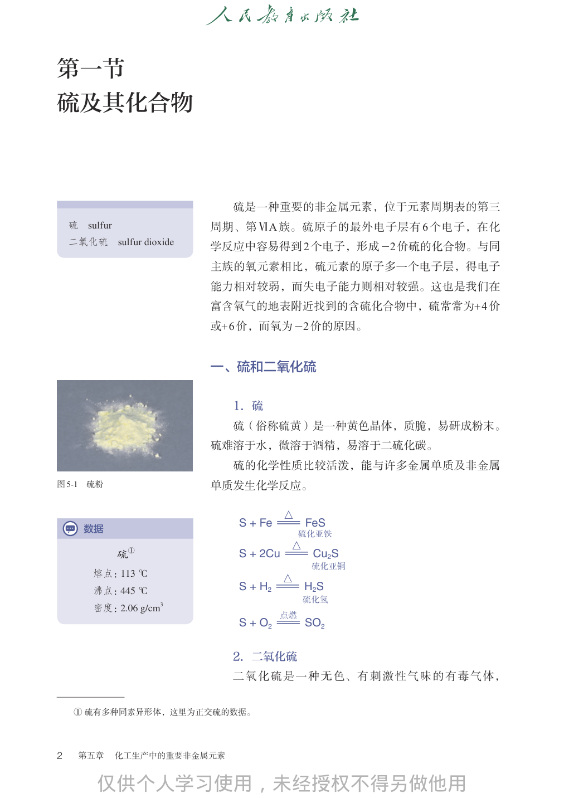

## RJ-CHEMISTRY-HSC2-002 硫的性质

第五章 化工生产中的重要非金属元素 / 第一节 硫及其化合物 / 一、硫和二氧化硫 · P7

硫（俗称硫黄）是一种黄色晶体，质脆，易研成粉末。硫难溶于水，微溶于酒精，易溶于二硫化碳。

硫的化学性质比较活泼，能与许多金属单质及非金属单质发生化学反应。

S + Fe ─加热→ FeS（硫化亚铁）
S + 2Cu ─加热→ Cu₂S（硫化亚铜）
S + H₂ ─加热→ H₂S（硫化氢）
S + O₂ ─点燃→ SO₂

硫的熔点113 ℃，沸点445 ℃，密度2.06 g/cm³。硫有多种同素异形体，这里为正交硫的数据。

## RJ-CHEMISTRY-HSC2-003 二氧化硫的物理性质与溶于水实验

第五章 化工生产中的重要非金属元素 / 第一节 硫及其化合物 / 一、硫和二氧化硫 · P7-P8

二氧化硫是一种无色、有刺激性气味的有毒气体，密度比空气的大，易溶于水。在通常情况下，1体积的水可以溶解约40体积的二氧化硫。

如图5-2 所示，把充满SO₂、塞有橡胶塞的试管倒立在水中，在水面下打开橡胶塞，观察试管内液面的上升。待液面高度不再明显变化时，在水下用橡胶塞塞紧试管口，取出试管，用pH试纸测定试管中溶液的酸碱度（保留该溶液供实验5-2使用）。

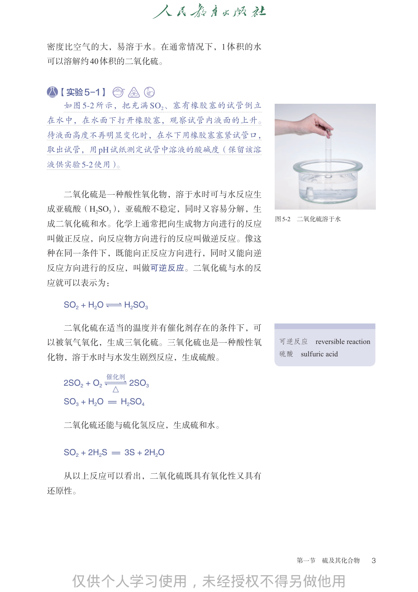

## RJ-CHEMISTRY-HSC2-004 二氧化硫与水反应及可逆反应

第五章 化工生产中的重要非金属元素 / 第一节 硫及其化合物 / 一、硫和二氧化硫 · P8

二氧化硫是一种酸性氧化物，溶于水时可与水反应生成亚硫酸（H₂SO₃），亚硫酸不稳定，同时又容易分解，生成二氧化硫和水。化学上通常把向生成物方向进行的反应叫做正反应，向反应物方向进行的反应叫做逆反应。像这种在同一条件下，既能向正反应方向进行，同时又能向逆反应方向进行的反应，叫做可逆反应。二氧化硫与水的反应就可以表示为：

SO₂ + H₂O ⇌ H₂SO₃

## RJ-CHEMISTRY-HSC2-005 二氧化硫的氧化性和还原性

第五章 化工生产中的重要非金属元素 / 第一节 硫及其化合物 / 一、硫和二氧化硫 · P8

二氧化硫在适当的温度并有催化剂存在的条件下，可以被氧气氧化，生成三氧化硫。三氧化硫也是一种酸性氧化物，溶于水时与水发生剧烈反应，生成硫酸。

2SO₂ + O₂ ⇌ 2SO₃（加热、催化剂）
SO₃ + H₂O = H₂SO₄

二氧化硫还能与硫化氢反应，生成硫和水。

SO₂ + 2H₂S = 3S + 2H₂O

从以上反应可以看出，二氧化硫既具有氧化性又具有还原性。

## RJ-CHEMISTRY-HSC2-006 二氧化硫的漂白作用与用途

第五章 化工生产中的重要非金属元素 / 第一节 硫及其化合物 / 一、硫和二氧化硫 · P9

用试管取2 mL在实验5-1中得到的溶液，向其中滴入1~2滴品红溶液，振荡，观察溶液的颜色变化。然后加热试管，注意通风，再观察溶液的变化。

二氧化硫具有漂白作用，工业上常用二氧化硫来漂白纸浆、毛、丝等。二氧化硫的漂白作用是由于它能与某些有色物质生成不稳定的无色物质。这些无色物质容易分解而使有色物质恢复原来的颜色。此外，二氧化硫可用于杀菌消毒，还是一种食品添加剂。

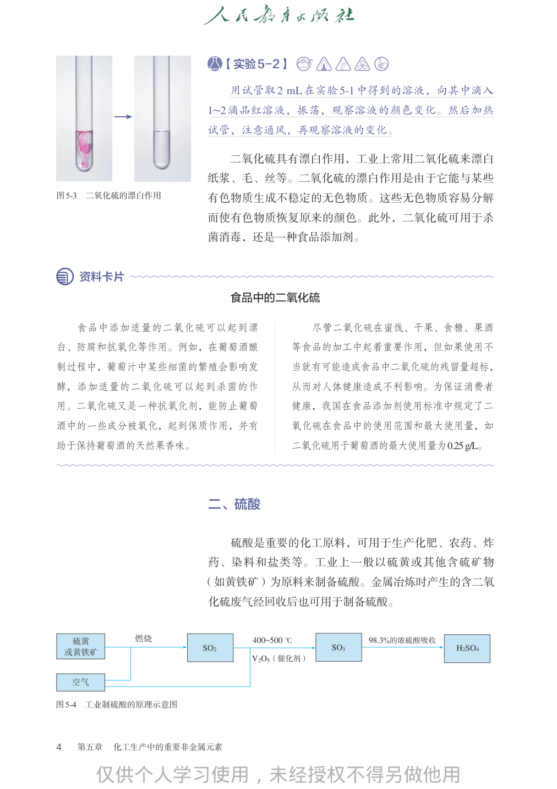

## RJ-CHEMISTRY-HSC2-007 食品中的二氧化硫

第五章 化工生产中的重要非金属元素 / 第一节 硫及其化合物 / 一、硫和二氧化硫 · P9

食品中添加适量的二氧化硫可以起到漂白、防腐和抗氧化等作用。例如，在葡萄酒酿制过程中，葡萄汁中某些细菌的繁殖会影响发酵，添加适量的二氧化硫可以起到杀菌的作用。二氧化硫又是一种抗氧化剂，能防止葡萄酒中的一些成分被氧化，起到保质作用，并有助于保持葡萄酒的天然果香味。

尽管二氧化硫在蜜饯、干果、食糖、果酒等食品的加工中起着重要作用，但如果使用不当就有可能造成食品中二氧化硫的残留量超标，从而对人体健康造成不利影响。为保证消费者健康，我国在食品添加剂使用标准中规定了二氧化硫在食品中的使用范围和最大使用量，如二氧化硫用于葡萄酒的最大使用量为0.25 g/L。

## RJ-CHEMISTRY-HSC2-008 硫酸的工业制备与用途

第五章 化工生产中的重要非金属元素 / 第一节 硫及其化合物 / 二、硫酸 · P9

硫酸是重要的化工原料，可用于生产化肥、农药、炸药、染料和盐类等。工业上一般以硫黄或其他含硫矿物（如黄铁矿）为原料来制备硫酸。金属冶炼时产生的含二氧化硫废气经回收后也可用于制备硫酸。

工业制硫酸的主要过程：含硫原料燃烧产生SO₂；SO₂在400～500 ℃、V₂O₅催化剂作用下与O₂反应生成SO₃；用98.3%的浓硫酸吸收SO₃。

## RJ-CHEMISTRY-HSC2-009 硫酸的酸性、吸水性与脱水性

第五章 化工生产中的重要非金属元素 / 第一节 硫及其化合物 / 二、硫酸 · P10

硫酸在水里很容易电离出氢离子，具有酸性。浓硫酸还具有很强的吸水性和脱水性等特殊的性质。它能吸收存在于周围环境中的水分，也能将蔗糖、纸张、棉布和木材等有机物中的氢和氧按水的组成比脱去。

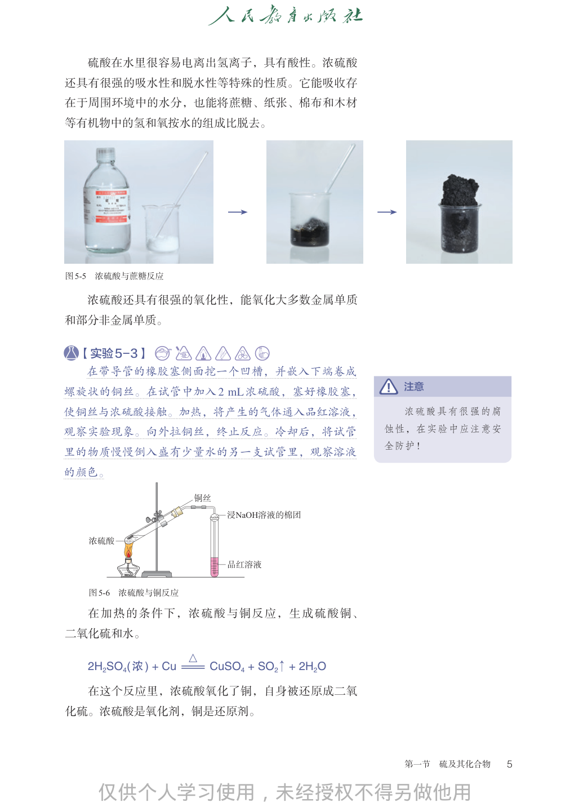

## RJ-CHEMISTRY-HSC2-010 浓硫酸的强氧化性及与铜、木炭反应

第五章 化工生产中的重要非金属元素 / 第一节 硫及其化合物 / 二、硫酸 · P10-P11

浓硫酸还具有很强的氧化性，能氧化大多数金属单质和部分非金属单质。

【实验5-3】在带导管的橡胶塞侧面挖一个凹槽，并嵌入下端卷成螺旋状的铜丝。在试管中加入2 mL浓硫酸，塞好橡胶塞，使铜丝与浓硫酸接触。加热，将产生的气体通入品红溶液，观察实验现象。向外拉铜丝，终止反应。冷却后，将试管里的物质慢慢倒入盛有少量水的另一支试管里，观察溶液的颜色。

浓硫酸具有很强的腐蚀性，在实验中应注意安全防护！

在加热的条件下，浓硫酸与铜反应，生成硫酸铜、二氧化硫和水。

2H₂SO₄（浓）+ Cu ─加热→ CuSO₄ + SO₂↑ + 2H₂O

在这个反应里，浓硫酸氧化了铜，自身被还原成二氧化硫。浓硫酸是氧化剂，铜是还原剂。

在加热时，浓硫酸也能与木炭发生反应，生成二氧化碳、二氧化硫和水。

2H₂SO₄（浓）+ C ─加热→ CO₂↑ + 2SO₂↑ + 2H₂O

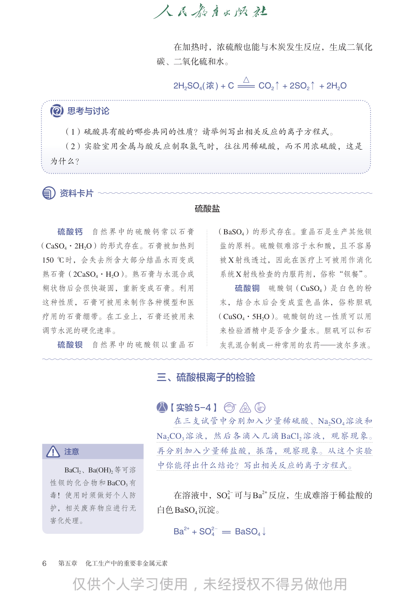

## RJ-CHEMISTRY-HSC2-011 硫酸钙、硫酸钡与硫酸铜

第五章 化工生产中的重要非金属元素 / 第一节 硫及其化合物 / 二、硫酸 · P11

硫酸钙

自然界中的硫酸钙常以石膏（CaSO₄·2H₂O）的形式存在。石膏被加热到150 ℃时，会失去所含大部分结晶水而变成熟石膏（2CaSO₄·H₂O）。熟石膏与水混合成糊状物后会很快凝固，重新变成石膏。利用这种性质，石膏可被用来制作各种模型和医疗用的石膏绷带。在工业上，石膏还被用来调节水泥的硬化速率。

硫酸钡

自然界中的硫酸钡以重晶石（BaSO₄）的形式存在。重晶石是生产其他钡盐的原料。硫酸钡难溶于水和酸，且不容易被X射线透过，因此在医疗上可被用作消化系统X射线检查的内服药剂，俗称“钡餐”。

硫酸铜

硫酸铜（CuSO₄）是白色的粉末，结合水后会变成蓝色晶体，俗称胆矾（CuSO₄·5H₂O）。硫酸铜的这一性质可以用来检验酒精中是否含少量水。胆矾可以和石灰乳混合制成一种常用的农药——波尔多液。

## RJ-CHEMISTRY-HSC2-012 硫酸根离子的检验及干扰排除

第五章 化工生产中的重要非金属元素 / 第一节 硫及其化合物 / 三、硫酸根离子的检验 · P11-P12

【实验5-4】在三支试管中分别加入少量稀硫酸、Na₂SO₄溶液和Na₂CO₃溶液，然后各滴入几滴BaCl₂溶液，观察现象。再分别加入少量稀盐酸，振荡，观察现象。

在溶液中，SO₄²⁻可与Ba²⁺反应，生成难溶于稀盐酸的白色BaSO₄沉淀。

Ba²⁺ + SO₄²⁻ = BaSO₄↓

溶液中的CO₃²⁻也能与Ba²⁺反应生成白色沉淀，但BaCO₃沉淀可以与稀盐酸反应，放出CO₂。因此在实验室里，通常将溶液先用稀盐酸酸化，以排除CO₃²⁻等可能造成的干扰，然后加入BaCl₂溶液来检验SO₄²⁻的存在。

BaCl₂、Ba(OH)₂等可溶性钡的化合物和BaCO₃有毒！使用时须做好个人防护，相关废弃物应进行无害化处理。

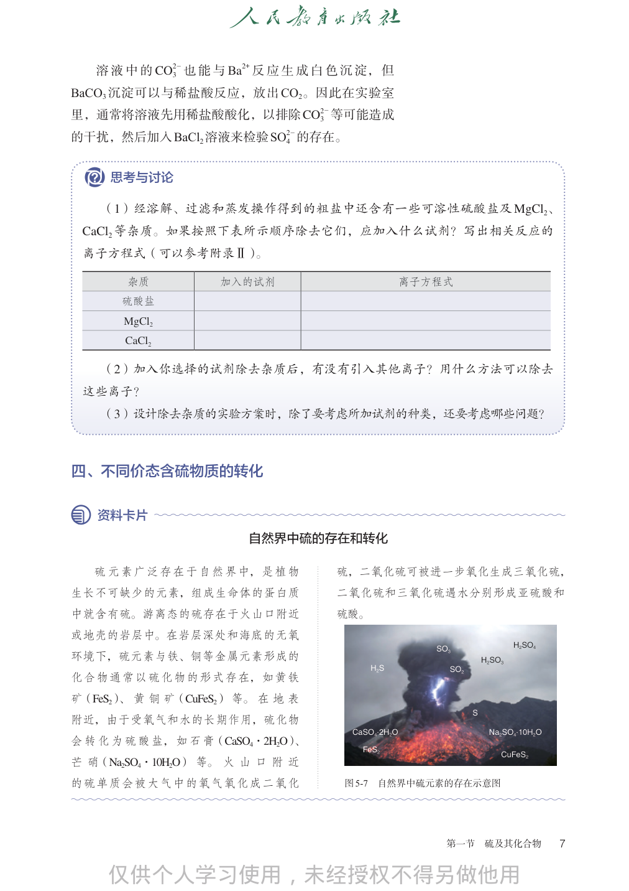

## RJ-CHEMISTRY-HSC2-013 自然界中硫的存在和转化

第五章 化工生产中的重要非金属元素 / 第一节 硫及其化合物 / 四、不同价态含硫物质的转化 · P12

硫元素广泛存在于自然界中，是植物生长不可缺少的元素，组成生命体的蛋白质中就含有硫。游离态的硫存在于火山口附近或地壳的岩层中。在岩层深处和海底的无氧环境下，硫元素与铁、铜等金属元素形成的化合物通常以硫化物的形式存在，如黄铁矿（FeS₂）、黄铜矿（CuFeS₂）等。在地表附近，由于受氧气和水的长期作用，硫化物会转化为硫酸盐，如石膏（CaSO₄·2H₂O）、芒硝（Na₂SO₄·10H₂O）等。火山口附近的硫单质会被大气中的氧气氧化成二氧化硫，二氧化硫可被进一步氧化生成三氧化硫，二氧化硫和三氧化硫遇水分别形成亚硫酸和硫酸。

## RJ-CHEMISTRY-HSC2-014 不同价态含硫物质的转化

第五章 化工生产中的重要非金属元素 / 第一节 硫及其化合物 / 四、不同价态含硫物质的转化 · P13

硫元素常见的化合价有−2、0、+4和+6，可以通过氧化还原反应实现不同价态含硫物质的相互转化。利用氧化剂，可将硫元素从低价态转化到高价态；利用还原剂，可将硫元素从高价态转化到低价态。

常用的氧化剂有浓硫酸、Cl₂、KMnO₄等，还原剂有金属单质、H₂、Na₂S等。

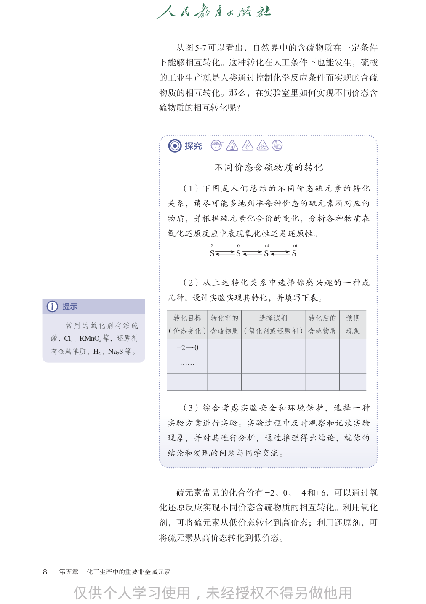

## RJ-CHEMISTRY-HSC2-015 化学实验设计

第五章 化工生产中的重要非金属元素 / 第一节 硫及其化合物 / 四、不同价态含硫物质的转化 · P14

化学实验设计是指实验者在实施化学实验之前，根据一定的实验目的，运用化学知识与技能，按照一定的实验方法，对实验的原理、试剂、仪器与装置、步骤和方法等所进行的规划。例如，设计“不同价态含硫物质的转化”实验，当确定了要实现的转化关系后，需要明确转化前后的含硫物质是哪些，通过怎样的反应（氧化/还原）实现转化，用到的氧化剂或还原剂是什么，等等。进行化学实验设计时，应遵循科学性、可行性、安全性和绿色化原则。化学实验设计一般以实验设计方案的形式呈现，通常包括实验课题、实验目的、实验原理、实验仪器与试剂、实验步骤及注意事项、实验数据及处理、实验结论与讨论等。

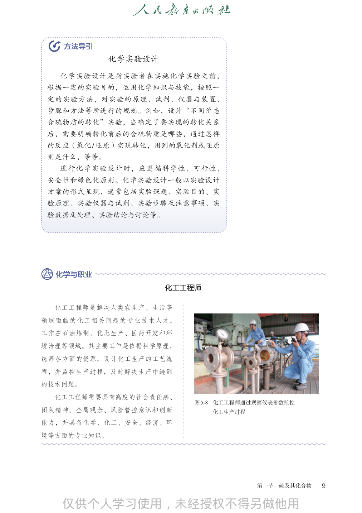

## RJ-CHEMISTRY-HSC2-016 氮元素的结构与存在

第五章 化工生产中的重要非金属元素 / 第二节 氮及其化合物 / 第二节 氮及其化合物 · P16

氮元素位于元素周期表的第二周期、第ⅤA族。氮原子的最外电子层有5个电子，既不容易得到3个电子，也不容易失去5个电子。因此，氮原子一般通过共用电子对与其他原子相互结合构成物质。在自然界里，氮元素主要以氮分子的形式存在于空气中，部分氮元素存在于动植物体内的蛋白质中，还有部分氮元素存在于土壤、海洋里的硝酸盐和铵盐中。氮是自然界各种生物体生命活动不可缺少的重要元素，自然界是怎样通过氮的循环为生物体提供氮元素的呢？

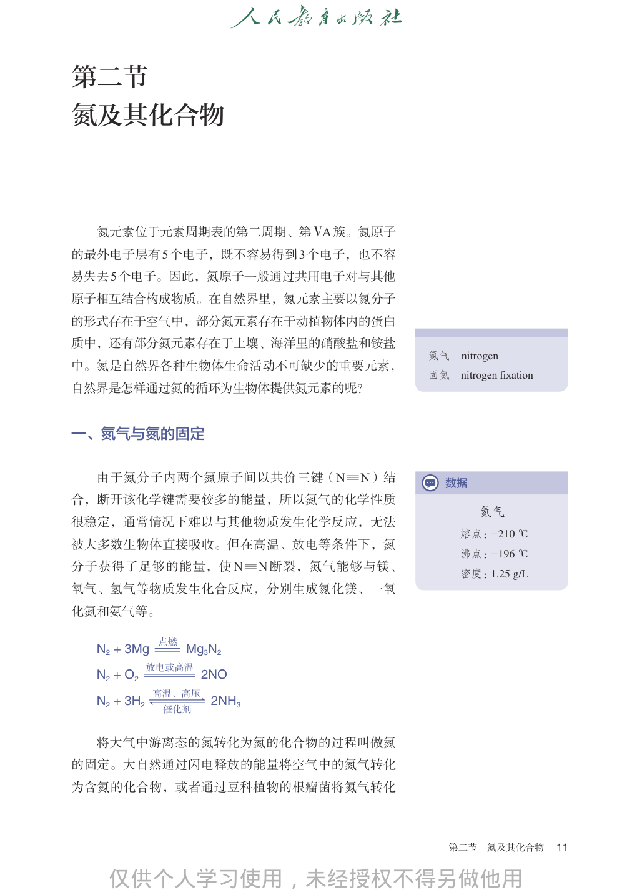

## RJ-CHEMISTRY-HSC2-017 氮气的稳定性与化学性质

第五章 化工生产中的重要非金属元素 / 第二节 氮及其化合物 / 一、氮气与氮的固定 · P16

由于氮分子内两个氮原子间以共价三键（N≡N）结合，断开该化学键需要较多的能量，所以氮气的化学性质很稳定，通常情况下难以与其他物质发生化学反应，无法被大多数生物体直接吸收。但在高温、放电等条件下，氮分子获得了足够的能量，使N≡N断裂，氮气能够与镁、氧气、氢气等物质发生化合反应，分别生成氮化镁、一氧化氮和氨气等。

N₂ + 3Mg ─点燃→ Mg₃N₂
N₂ + O₂ ─放电或高温→ 2NO
N₂ + 3H₂ ⇌ 2NH₃（高温、高压、催化剂）

氮气的熔点−210 ℃，沸点−196 ℃，密度1.25 g/L。

## RJ-CHEMISTRY-HSC2-018 氮的固定与氮循环

第五章 化工生产中的重要非金属元素 / 第二节 氮及其化合物 / 一、氮气与氮的固定 · P16-P17

将大气中游离态的氮转化为氮的化合物的过程叫做氮的固定。大自然通过闪电释放的能量将空气中的氮气转化为含氮的化合物，或者通过豆科植物的根瘤菌将氮气转化成氨，从而实现自然固氮。人类则通过控制条件，将氮气氧化或还原为氮的化合物，实现人工固氮。最重要的人工固氮途径就是工业合成氨，它不仅为农作物的生长提供了必需的氮元素，而且为其他化工产品（如炸药、农药、染料等）的生产提供了重要的原料。

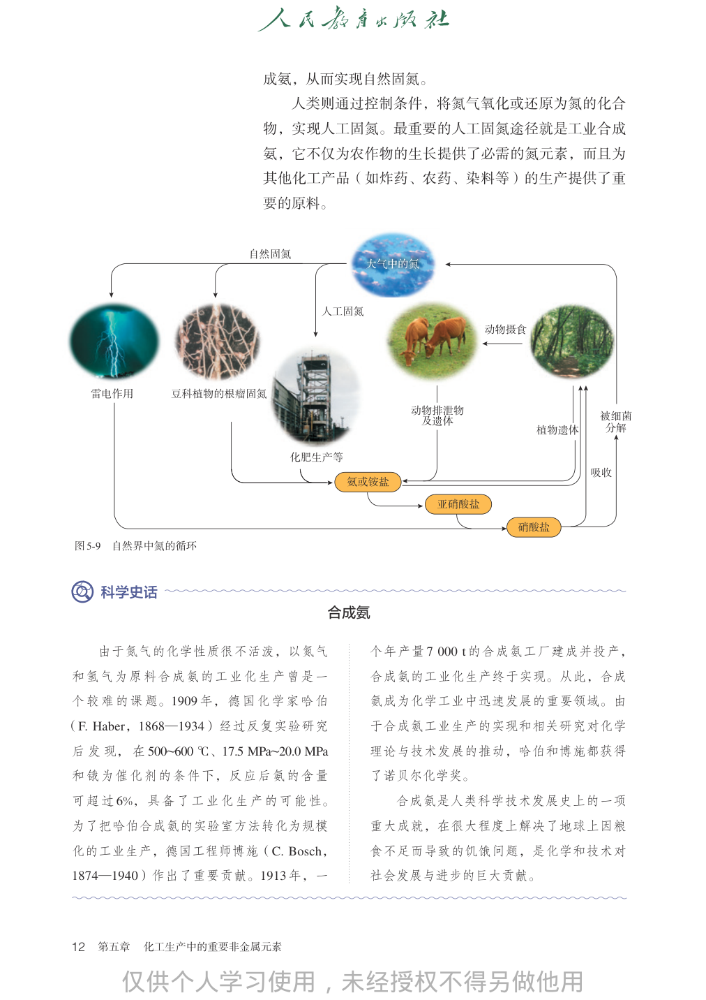

## RJ-CHEMISTRY-HSC2-019 合成氨实验的条件与氨含量

第五章 化工生产中的重要非金属元素 / 第二节 氮及其化合物 / 一、氮气与氮的固定 · P17

在500～600 ℃、17.5 MPa～20.0 MPa和锇为催化剂的条件下，反应后氨的含量可超过6%，具备了工业化生产的可能性。

## RJ-CHEMISTRY-HSC2-020 一氧化氮、二氧化氮的性质及转化实验

第五章 化工生产中的重要非金属元素 / 第二节 氮及其化合物 / 二、一氧化氮和二氧化氮 · P18

一氧化氮和二氧化氮是氮的两种重要氧化物。

一氧化氮是无色的有毒气体，不易溶于水，在常温下很容易与氧气化合，生成二氧化氮。

2NO + O₂ = 2NO₂

二氧化氮是红棕色、有刺激性气味的有毒气体，密度比空气的大，易液化，易溶于水。二氧化氮溶于水时生成硝酸和一氧化氮，工业上利用这一原理生产硝酸。

3NO₂ + H₂O = 2HNO₃ + NO

【实验5-5】如图5-10所示，在一支50 mL的注射器里充入20 mL NO，然后吸入5 mL水，用乳胶管和弹簧夹封住管口，振荡注射器，观察现象。打开弹簧夹，快速吸入10 mL空气后夹上弹簧夹，观察现象。振荡注射器，再观察现象。

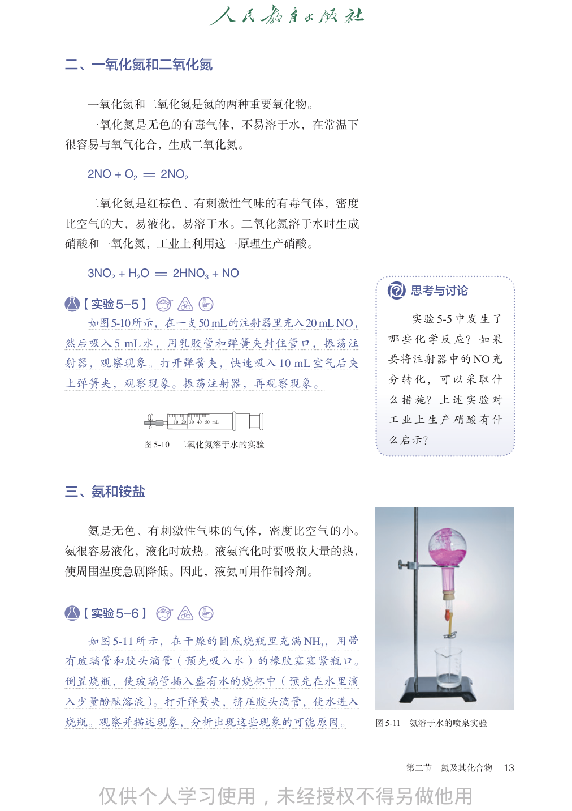

## RJ-CHEMISTRY-HSC2-021 氨的物理性质、喷泉实验及氨水

第五章 化工生产中的重要非金属元素 / 第二节 氮及其化合物 / 三、氨和铵盐 · P18-P19

氨是无色、有刺激性气味的气体，密度比空气的小。氨很容易液化，液化时放热。液氨汽化时要吸收大量的热，使周围温度急剧降低。因此，液氨可用作制冷剂。

【实验5-6】如图5-11所示，在干燥的圆底烧瓶里充满NH₃，用带有玻璃管和胶头滴管（预先吸入水）的橡胶塞塞紧瓶口。倒置烧瓶，使玻璃管插入盛有水的烧杯中（预先在水里滴入少量酚酞溶液）。打开弹簧夹，挤压胶头滴管，使水进入烧瓶。观察并描述现象，分析出现这些现象的可能原因。

氨是一种极易溶于水的气体，在常温常压下，1体积水大约可溶解700体积氨。氨溶于水时，会与水结合成一水合氨（NH₃·H₂O），一水合氨中有一小部分电离形成NH₄⁺和OH⁻。

NH₃ + H₂O ⇌ NH₃·H₂O ⇌ NH₄⁺ + OH⁻

氨的水溶液（俗称氨水）显弱碱性，能使酚酞溶液变红或使红色石蕊试纸变蓝。

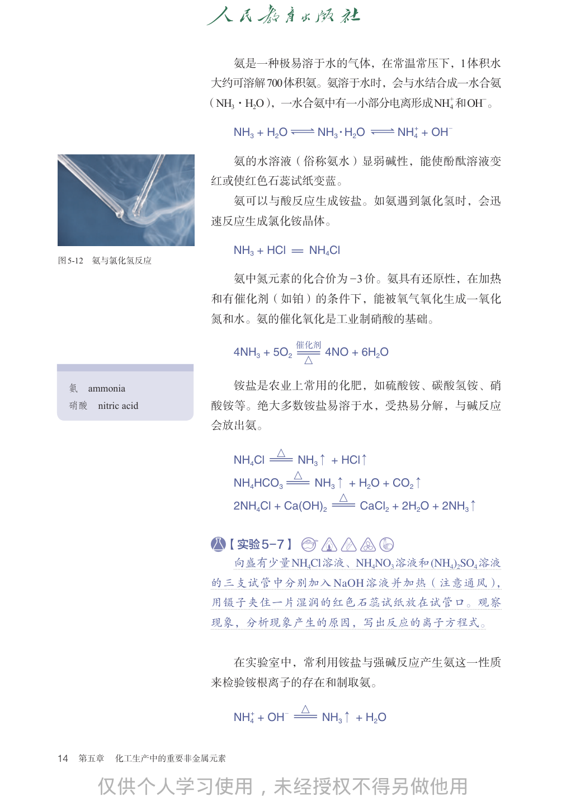

## RJ-CHEMISTRY-HSC2-022 氨与酸反应及催化氧化

第五章 化工生产中的重要非金属元素 / 第二节 氮及其化合物 / 三、氨和铵盐 · P19

氨可以与酸反应生成铵盐。如氨遇到氯化氢时，会迅速反应生成氯化铵晶体。

NH₃ + HCl = NH₄Cl

氨中氮元素的化合价为−3价。氨具有还原性，在加热和有催化剂（如铂）的条件下，能被氧气氧化生成一氧化氮和水。氨的催化氧化是工业制硝酸的基础。

4NH₃ + 5O₂ ─加热、催化剂→ 4NO + 6H₂O

## RJ-CHEMISTRY-HSC2-023 铵盐的性质、铵根离子的检验和制氨

第五章 化工生产中的重要非金属元素 / 第二节 氮及其化合物 / 三、氨和铵盐 · P19-P20

铵盐是农业上常用的化肥，如硫酸铵、碳酸氢铵、硝酸铵等。绝大多数铵盐易溶于水，受热易分解，与碱反应会放出氨。

NH₄Cl ─加热→ NH₃↑ + HCl↑
NH₄HCO₃ ─加热→ NH₃↑ + H₂O + CO₂↑
2NH₄Cl + Ca(OH)₂ ─加热→ CaCl₂ + 2H₂O + 2NH₃↑

【实验5-7】向盛有少量NH₄Cl溶液、NH₄NO₃溶液和(NH₄)₂SO₄溶液的三支试管中分别加入NaOH溶液并加热（注意通风），用镊子夹住一片湿润的红色石蕊试纸放在试管口。观察现象，分析现象产生的原因，写出反应的离子方程式。

在实验室中，常利用铵盐与强碱反应产生氨这一性质来检验铵根离子的存在和制取氨。

NH₄⁺ + OH⁻ ─加热→ NH₃↑ + H₂O

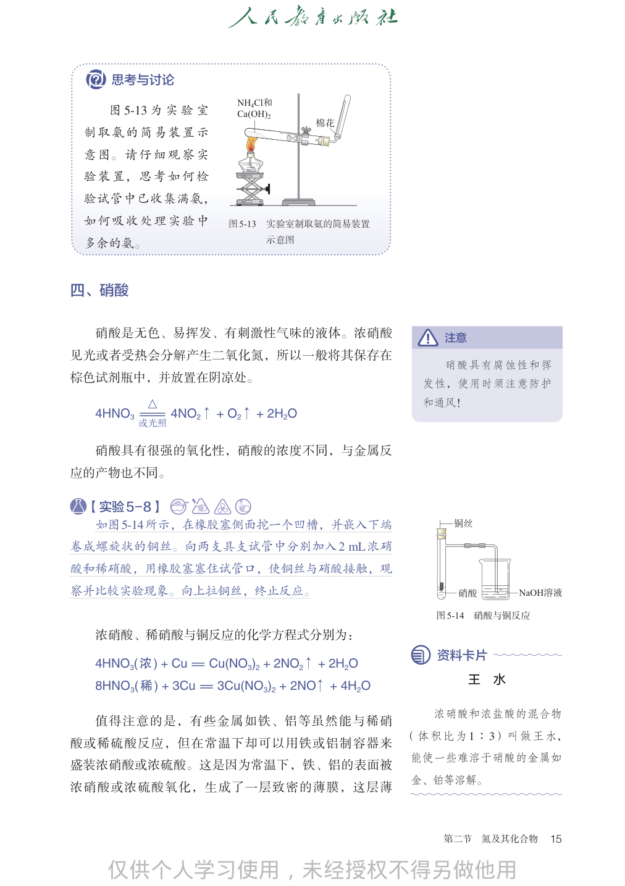

## RJ-CHEMISTRY-HSC2-024 硝酸的性质与保存

第五章 化工生产中的重要非金属元素 / 第二节 氮及其化合物 / 四、硝酸 · P20

硝酸是无色、易挥发、有刺激性气味的液体。浓硝酸见光或者受热会分解产生二氧化氮，所以一般将其保存在棕色试剂瓶中，并放置在阴凉处。

4HNO₃ ─加热或光照→ 4NO₂↑ + O₂↑ + 2H₂O

硝酸具有腐蚀性和挥发性，使用时须注意防护和通风！

## RJ-CHEMISTRY-HSC2-025 硝酸的强氧化性及铜与浓、稀硝酸反应

第五章 化工生产中的重要非金属元素 / 第二节 氮及其化合物 / 四、硝酸 · P20

硝酸具有很强的氧化性，硝酸的浓度不同，与金属反应的产物也不同。

【实验5-8】如图5-14所示，在橡胶塞侧面挖一个凹槽，并嵌入下端卷成螺旋状的铜丝。向两支具支试管中分别加入2 mL浓硝酸和稀硝酸，用橡胶塞塞住试管口，使铜丝与硝酸接触，观察并比较实验现象。向上拉铜丝，终止反应。

浓硝酸、稀硝酸与铜反应的化学方程式分别为：

4HNO₃（浓）+ Cu = Cu(NO₃)₂ + 2NO₂↑ + 2H₂O
8HNO₃（稀）+ 3Cu = 3Cu(NO₃)₂ + 2NO↑ + 4H₂O

## RJ-CHEMISTRY-HSC2-026 铁、铝的钝化及加热反应

第五章 化工生产中的重要非金属元素 / 第二节 氮及其化合物 / 四、硝酸 · P20-P21

值得注意的是，有些金属如铁、铝等虽然能与稀硝酸或稀硫酸反应，但在常温下却可以用铁或铝制容器来盛装浓硝酸或浓硫酸。这是因为常温下，铁、铝的表面被浓硝酸或浓硫酸氧化，生成了一层致密的薄膜，这层薄膜阻止了酸与内层金属的进一步反应。当加热时，铁、铝会与浓硝酸或浓硫酸发生反应。

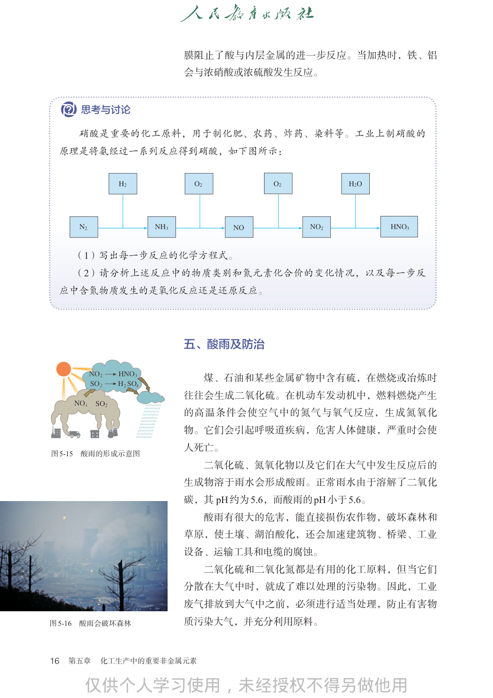

## RJ-CHEMISTRY-HSC2-027 王水

第五章 化工生产中的重要非金属元素 / 第二节 氮及其化合物 / 四、硝酸 · P20

浓硝酸和浓盐酸的混合物（体积比为1∶3）叫做王水，能使一些难溶于硝酸的金属如金、铂等溶解。

## RJ-CHEMISTRY-HSC2-028 工业制硝酸的原理与用途

第五章 化工生产中的重要非金属元素 / 第二节 氮及其化合物 / 四、硝酸 · P21

硝酸是重要的化工原料，用于制化肥、农药、炸药、染料等。工业上制硝酸的原理是将氨经过一系列反应得到硝酸，如下图所示：

## RJ-CHEMISTRY-HSC2-029 酸雨的形成、危害与防治

第五章 化工生产中的重要非金属元素 / 第二节 氮及其化合物 / 五、酸雨及防治 · P21

煤、石油和某些金属矿物中含有硫，在燃烧或冶炼时往往会生成二氧化硫。在机动车发动机中，燃料燃烧产生的高温条件会使空气中的氮气与氧气反应，生成氮氧化物。它们会引起呼吸道疾病，危害人体健康，严重时会使人死亡。二氧化硫、氮氧化物以及它们在大气中发生反应后的生成物溶于雨水会形成酸雨。正常雨水由于溶解了二氧化碳，其 pH约为5.6，而酸雨的pH小于5.6。酸雨有很大的危害，能直接损伤农作物，破坏森林和草原，使土壤、湖泊酸化，还会加速建筑物、桥梁、工业设备、运输工具和电缆的腐蚀。二氧化硫和二氧化氮都是有用的化工原料，但当它们分散在大气中时，就成了难以处理的污染物。因此，工业废气排放到大气中之前，必须进行适当处理，防止有害物质污染大气，并充分利用原料。

## RJ-CHEMISTRY-HSC2-030 测定雨水的pH

第五章 化工生产中的重要非金属元素 / 第二节 氮及其化合物 / 五、酸雨及防治 · P22

①下雨时用容器直接收集一些雨水作为样品，静置，以蒸馏水或自来水作为参照，观察并比较它们的外观；②用pH试纸（或pH计）测量雨水和蒸馏水的酸度并记录；③有条件的话，可连续取样并测定一段时间（如一周）内本地雨水、地表水或自来水的pH，将得到的数据列表或作图，确定你所在地区本时间段内雨水等的平均酸度。

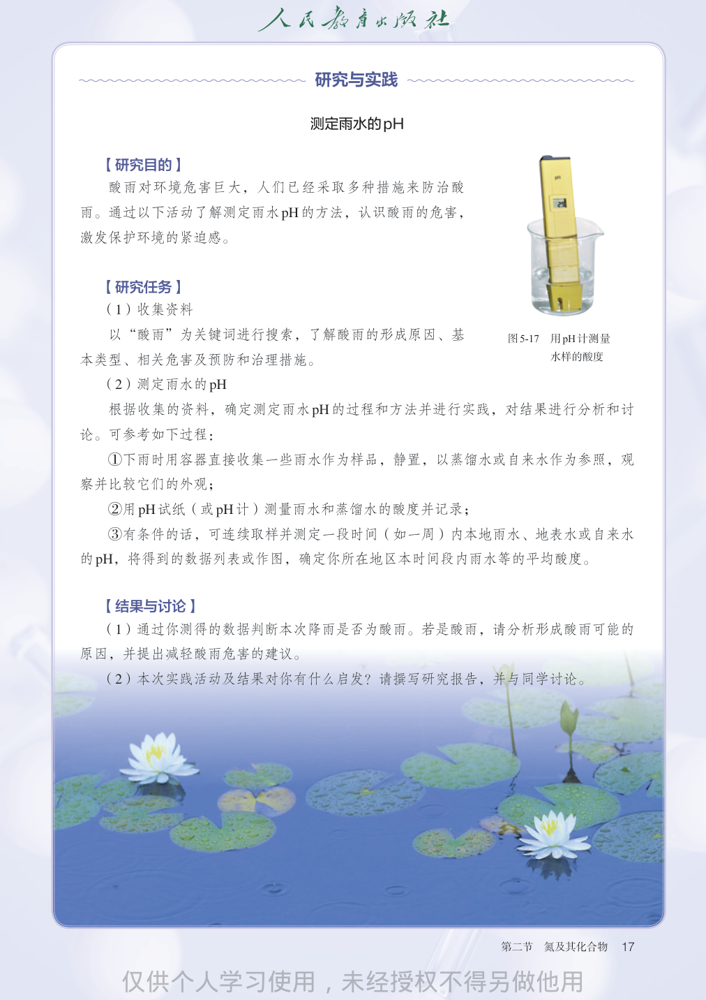

## RJ-CHEMISTRY-HSC2-031 无机非金属材料与硅酸盐材料

第五章 化工生产中的重要非金属元素 / 第三节 无机非金属材料 / 第三节 无机非金属材料 · P24

材料是人类赖以生存和发展的物质基础，人类使用的材料除了金属材料，还有无机非金属材料等。从组成上看，许多无机非金属材料含有硅、氧等元素，具有耐高温、抗腐蚀、硬度高等特点，以及特殊的光学、电学等性能。随着工业生产和社会发展对材料性能要求的提高，一批新型无机非金属材料相继诞生，成为航空、航天、信息和新能源等高技术领域必需的材料。

传统的无机非金属材料多为硅酸盐材料，在日常生活中随处可见，如制作餐具的陶瓷、窗户上的玻璃、建筑用的水泥等。

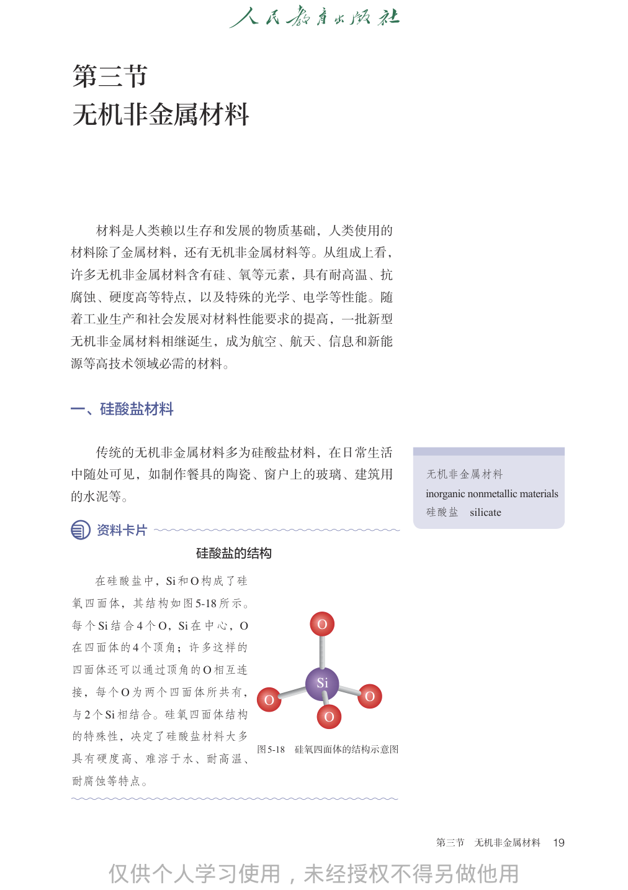

## RJ-CHEMISTRY-HSC2-032 硅酸盐的结构与性能

第五章 化工生产中的重要非金属元素 / 第三节 无机非金属材料 / 一、硅酸盐材料 · P24

在硅酸盐中，Si和O构成了硅氧四面体，其结构如图5-18 所示。每个Si 结合4 个O，Si 在中心，O在四面体的4个顶角；许多这样的四面体还可以通过顶角的O相互连接，每个O 为两个四面体所共有，O与2个Si相结合。硅氧四面体结构的特殊性，决定了硅酸盐材料大多具有硬度高、难溶于水、耐高温、耐腐蚀等特点。

## RJ-CHEMISTRY-HSC2-033 陶瓷的原料、制备与用途

第五章 化工生产中的重要非金属元素 / 第三节 无机非金属材料 / 一、硅酸盐材料 · P25

陶瓷是以黏土（主要成分为含水的铝硅酸盐）为主要原料，经高温烧结而成的。陶瓷得到广泛应用，如用于生产建筑材料、绝缘材料、日用器皿、卫生洁具等。

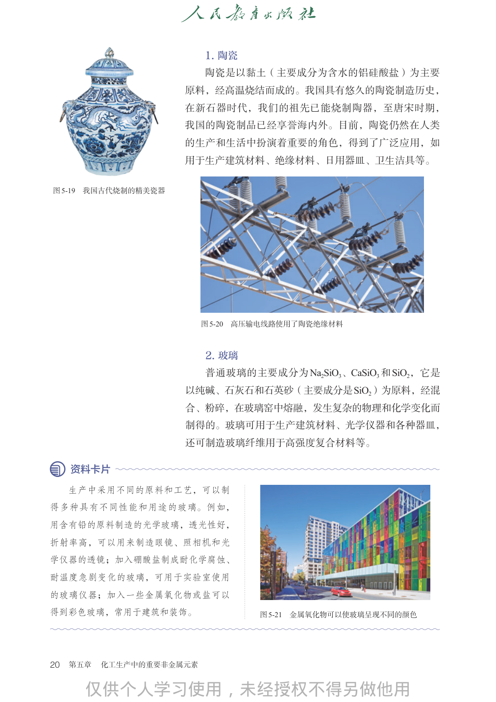

## RJ-CHEMISTRY-HSC2-034 玻璃的组成、制备与用途

第五章 化工生产中的重要非金属元素 / 第三节 无机非金属材料 / 一、硅酸盐材料 · P25

普通玻璃的主要成分为Na₂SiO₃、CaSiO₃和SiO₂，它是以纯碱、石灰石和石英砂（主要成分是SiO₂）为原料，经混合、粉碎，在玻璃窑中熔融，发生复杂的物理和化学变化而制得的。玻璃可用于生产建筑材料、光学仪器和各种器皿，还可制造玻璃纤维用于高强度复合材料等。

生产中采用不同的原料和工艺，可以制得多种具有不同性能和用途的玻璃。例如，用含有铅的原料制造的光学玻璃，透光性好，折射率高，可以用来制造眼镜、照相机和光学仪器的透镜；加入硼酸盐制成耐化学腐蚀、耐温度急剧变化的玻璃，可用于实验室使用的玻璃仪器；加入一些金属氧化物或盐可以得到彩色玻璃，常用于建筑和装饰。

## RJ-CHEMISTRY-HSC2-035 水泥与混凝土

第五章 化工生产中的重要非金属元素 / 第三节 无机非金属材料 / 一、硅酸盐材料 · P26

普通硅酸盐水泥的生产以黏土和石灰石为主要原料。二者与其他辅料经混合、研磨后在水泥回转窑中煅烧，发生复杂的物理和化学变化，加入适量石膏调节水泥硬化速率，再磨成细粉就能得到普通水泥。水泥、沙子和碎石等与水混合可以得到混凝土，大量用于建筑和水利工程。

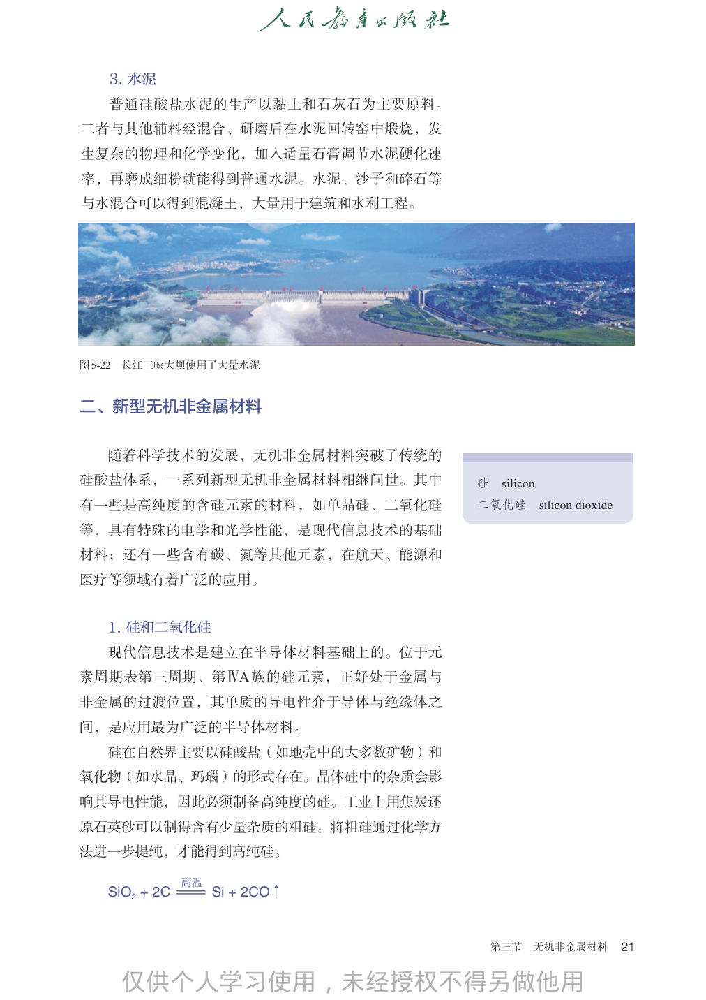

## RJ-CHEMISTRY-HSC2-036 新型无机非金属材料

第五章 化工生产中的重要非金属元素 / 第三节 无机非金属材料 / 二、新型无机非金属材料 · P26

随着科学技术的发展，无机非金属材料突破了传统的硅酸盐体系，一系列新型无机非金属材料相继问世。其中有一些是高纯度的含硅元素的材料，如单晶硅、二氧化硅等，具有特殊的电学和光学性能，是现代信息技术的基础材料；还有一些含有碳、氮等其他元素，在航天、能源和医疗等领域有着广泛的应用。

## RJ-CHEMISTRY-HSC2-037 硅的半导体性能与高纯硅制备

第五章 化工生产中的重要非金属元素 / 第三节 无机非金属材料 / 二、新型无机非金属材料 · P26

现代信息技术是建立在半导体材料基础上的。位于元素周期表第三周期、第ⅣA族的硅元素，正好处于金属与非金属的过渡位置，其单质的导电性介于导体与绝缘体之间，是应用最为广泛的半导体材料。硅在自然界主要以硅酸盐（如地壳中的大多数矿物）和氧化物（如水晶、玛瑙）的形式存在。晶体硅中的杂质会影响其导电性能，因此必须制备高纯度的硅。工业上用焦炭还原石英砂可以制得含有少量杂质的粗硅。将粗硅通过化学方法进一步提纯，才能得到高纯硅。

SiO₂ + 2C ─高温→ Si + 2CO↑

## RJ-CHEMISTRY-HSC2-038 高纯硅的制备工艺

第五章 化工生产中的重要非金属元素 / 第三节 无机非金属材料 / 二、新型无机非金属材料 · P27

工业上制备高纯硅，一般需要先制得纯度为98%左右的粗硅，再以其为原料制备高纯硅。例如，可以将粗硅转化为三氯硅烷（SiHCl₃），再经氢气还原得到高纯硅。

SiO₂ + 2C ─1800～2000 ℃→ Si + 2CO↑
Si + 3HCl ─300 ℃→ SiHCl₃ + H₂
SiHCl₃ + H₂ ─1100 ℃→ Si + 3HCl

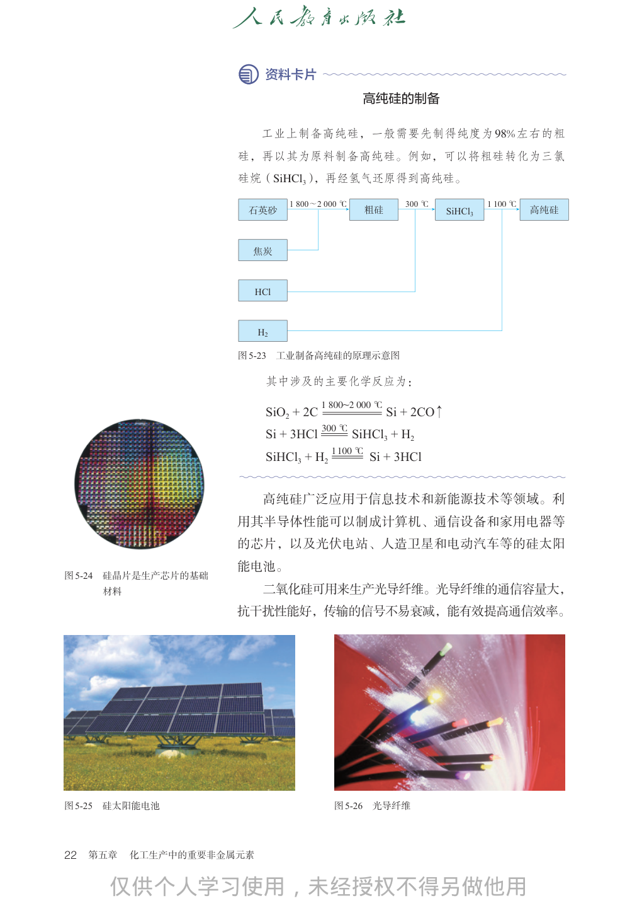

## RJ-CHEMISTRY-HSC2-039 高纯硅和二氧化硅的应用

第五章 化工生产中的重要非金属元素 / 第三节 无机非金属材料 / 二、新型无机非金属材料 · P27

高纯硅广泛应用于信息技术和新能源技术等领域。利用其半导体性能可以制成计算机、通信设备和家用电器等的芯片，以及光伏电站、人造卫星和电动汽车等的硅太阳能电池。二氧化硅可用来生产光导纤维。光导纤维的通信容量大，抗干扰性能好，传输的信号不易衰减，能有效提高通信效率。

## RJ-CHEMISTRY-HSC2-040 碳化硅陶瓷

第五章 化工生产中的重要非金属元素 / 第三节 无机非金属材料 / 二、新型无机非金属材料 · P28

新型陶瓷在组成上不再限于传统的硅酸盐体系，在光学、热学、电学、磁学等方面具有很多新的特性和功能，进一步拓展了陶瓷的应用领域。例如，碳化硅（SiC）俗称金刚砂，其中的碳原子和硅原子通过共价键连接，具有类似金刚石的结构，硬度很大，可用作砂纸和砂轮的磨料。碳化硅还具有优异的高温抗氧化性能，使用温度可达1 600 ℃，大大超过了普通金属材料所能承受的温度，可用作耐高温结构材料、耐高温半导体材料等。

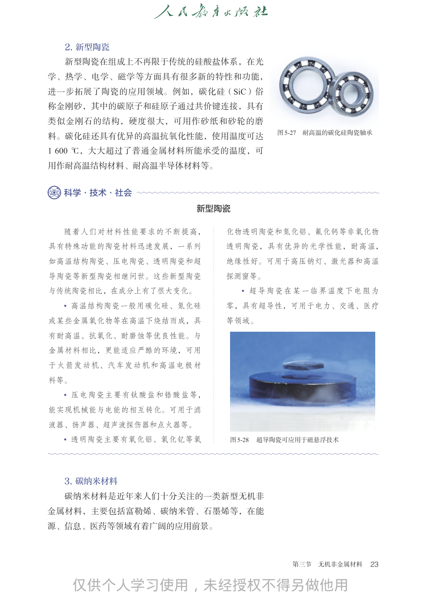

## RJ-CHEMISTRY-HSC2-041 高温结构、压电、透明和超导陶瓷

第五章 化工生产中的重要非金属元素 / 第三节 无机非金属材料 / 二、新型无机非金属材料 · P28

随着人们对材料性能要求的不断提高，具有特殊功能的陶瓷材料迅速发展，一系列如高温结构陶瓷、压电陶瓷、透明陶瓷和超导陶瓷等新型陶瓷相继问世。这些新型陶瓷与传统陶瓷相比，在成分上有了很大变化。• 高温结构陶瓷一般用碳化硅、氮化硅或某些金属氧化物等在高温下烧结而成，具有耐高温、抗氧化、耐磨蚀等优良性能。与金属材料相比，更能适应严酷的环境，可用于火箭发动机、汽车发动机和高温电极材料等。• 压电陶瓷主要有钛酸盐和锆酸盐等，能实现机械能与电能的相互转化。可用于滤波器、扬声器、超声波探伤器和点火器等。• 透明陶瓷主要有氧化铝、氧化钇等氧化物透明陶瓷和氮化铝、氟化钙等非氧化物透明陶瓷，具有优异的光学性能，耐高温，绝缘性好。可用于高压钠灯、激光器和高温探测窗等。• 超导陶瓷在某一临界温度下电阻为零，具有超导性，可用于电力、交通、医疗等领域。

## RJ-CHEMISTRY-HSC2-042 富勒烯、碳纳米管与石墨烯

第五章 化工生产中的重要非金属元素 / 第三节 无机非金属材料 / 二、新型无机非金属材料 · P28-P29

碳纳米材料是近年来人们十分关注的一类新型无机非金属材料，主要包括富勒烯、碳纳米管、石墨烯等，在能源、信息、医药等领域有着广阔的应用前景。

富勒烯是由碳原子构成的一系列笼形分子的总称，其中的C₆₀是富勒烯的代表物。

碳纳米管可以看成是由石墨片层卷成的管状物，具有纳米尺度的直径。碳纳米管的比表面积大，有相当高的强度和优良的电学性能，可用于生产复合材料、电池和传感器等。石墨烯是只有一个碳原子直径厚度的单层石墨，其独特的结构使其电阻率低、热导率高，具有很高的强度。作为一种具有优异性能的新型材料，石墨烯在光电器件、超级电容器、电池和复合材料等方面的应用研究正在不断深入。

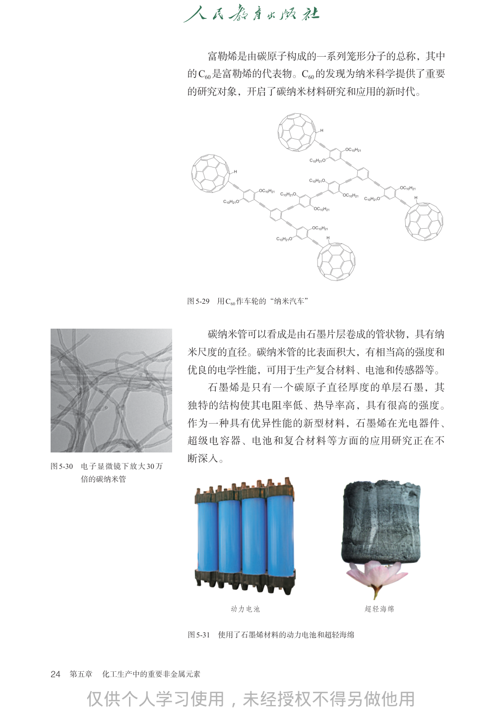

## RJ-CHEMISTRY-HSC2-043 用化学沉淀法去除粗盐中的杂质离子

第五章 化工生产中的重要非金属元素 / 实验活动4 用化学沉淀法去除粗盐中的杂质离子 / 实验活动4 用化学沉淀法去除粗盐中的杂质离子 · P34

【实验用品】天平、药匙、量筒、烧杯、玻璃棒、胶头滴管、漏斗、滤纸、蒸发皿、坩埚钳、铁架台（带铁圈）、陶土网、酒精灯、火柴。
粗盐、蒸馏水、0.1 mol/L BaCl₂溶液、20% NaOH溶液、饱和Na₂CO₃溶液、6 mol/L盐酸、pH试纸。

【实验步骤】
1. 用天平称取5.0 g粗盐，放入100 mL烧杯中，然后加入20 mL蒸馏水，用玻璃棒搅拌，使粗盐充分溶解，得到粗盐水。
2. 向粗盐水中滴加过量的BaCl₂溶液（2～3 mL），使SO₄²⁻与Ba²⁺完全反应生成BaSO₄沉淀，将烧杯静置。
3. 静置后，沿烧杯壁向上层清液中继续滴加2～3滴BaCl₂溶液。若溶液不出现浑浊，则表明SO₄²⁻已沉淀完全；若出现浑浊，则应继续滴加BaCl₂溶液，直至SO₄²⁻沉淀完全。
4. 向粗盐水中滴加过量的NaOH溶液（约0.25 mL），使Mg²⁺与OH⁻完全反应生成Mg(OH)₂沉淀；然后滴加过量的饱和Na₂CO₃溶液（2～3 mL），使Ca²⁺、Ba²⁺（请思考：Ba²⁺是从哪里来的？）与CO₃²⁻完全反应生成沉淀。
5. 用与第3步类似的方法分别检验Mg²⁺、Ca²⁺和Ba²⁺是否沉淀完全。
6. 将烧杯静置，然后过滤，除去生成的沉淀和难溶性杂质。
7. 向所得滤液中滴加盐酸，用玻璃棒搅拌，直到没有气泡冒出，并用pH试纸检验，使滤液呈中性或微酸性。
8. 将滤液倒入蒸发皿中，用酒精灯加热，同时用玻璃棒不断搅拌。当蒸发皿中出现较多固体时，停止加热，利用蒸发皿的余热使滤液蒸干。
9. 用坩埚钳将蒸发皿夹持到陶土网上冷却，得到去除了杂质离子的精盐。

陶土网是石棉网的替代品。

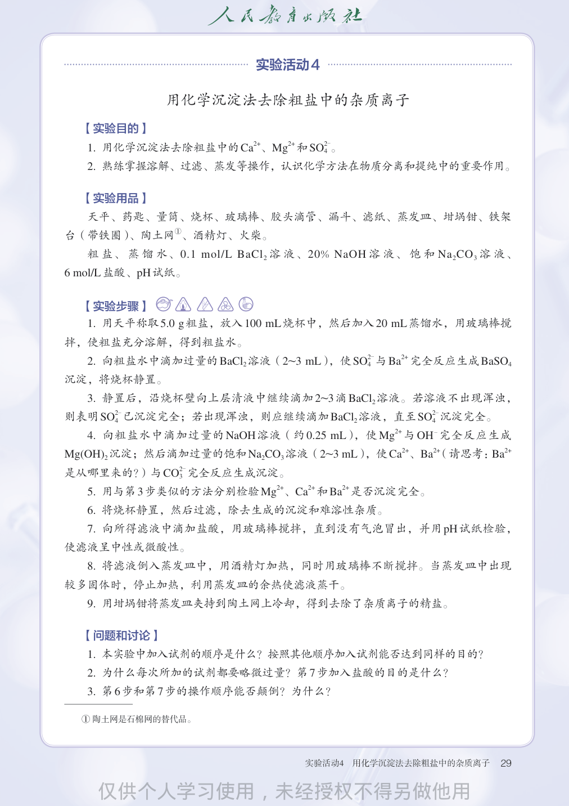

## RJ-CHEMISTRY-HSC2-044 不同价态含硫物质的转化实验

第五章 化工生产中的重要非金属元素 / 实验活动5 不同价态含硫物质的转化 / 实验活动5 不同价态含硫物质的转化 · P35

试管、天平、量筒、酒精灯、铁架台、试管架、橡胶塞、乳胶管、胶头滴管、玻璃导管、陶土网、玻璃棒、药匙、棉花、镊子、火柴。浓硫酸、铜片、硫粉、铁粉、Na₂S溶液、酸性KMnO₄溶液、NaOH溶液、H₂SO₃溶液、品红溶液。

1. 在两支试管中分别加入1 mL Na₂S溶液，向其中一支边振荡边滴加H₂SO₃溶液，另一支边振荡边滴加酸性KMnO₄溶液，用浸NaOH溶液的棉团分别塞住两个试管口，观察并记录实验现象。2. 如下图所示连接仪器装置，向试管中加入1 mL浓硫酸和一小块铜片，塞上带导管的单孔橡胶塞，加热，观察并记录实验现象。

3. 将0.5 g硫粉和1.0 g铁粉均匀混合，放在陶土网上堆成条状。用灼热的玻璃棒触及混合粉末的一端，当混合物呈红热状态时，移开玻璃棒，观察并记录实验现象。

实验中可能产生少量有毒、有刺激性气味的气体。因此要注意通风，控制试剂的用量，严格按照要求进行操作，避免污染空气，保证实验安全。

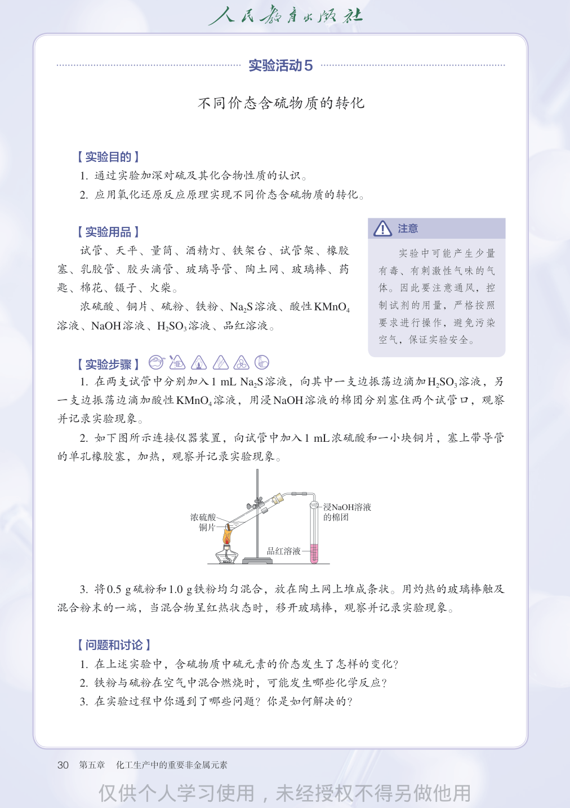

## RJ-CHEMISTRY-HSC2-045 放热反应、吸热反应及实验

第六章 化学反应与能量 / 第一节 化学反应与能量变化 / 一、化学反应与热能 · P37-P38

在一支试管中加入2 mL 2 mol/L盐酸，并用温度计测量其温度。再向试管中放入用砂纸打磨光亮的镁条，观察现象，并测量溶液温度的变化。

将20 g Ba(OH)₂·8H₂O晶体研细后与10 g NH₄Cl晶体一起放入烧杯中，并将烧杯放在滴有几滴水的木片上。用玻璃棒快速搅拌，闻到气味后迅速用玻璃片盖上烧杯，用手触摸杯壁下部，试着用手拿起烧杯。观察现象。

上述两个实验中，反应前后的温度变化说明反应过程中伴有热量的释放或吸收。化学上把释放热量的化学反应称为放热反应，如镁条、铝片与盐酸的反应，木炭、氢气、甲烷等在氧气中的燃烧，氢气与氯气的化合等都是放热反应；把吸收热量的化学反应称为吸热反应，如氢氧化钡与氯化铵的反应，盐酸与碳酸氢钠的反应，灼热的炭与二氧化碳的反应等都是吸热反应。

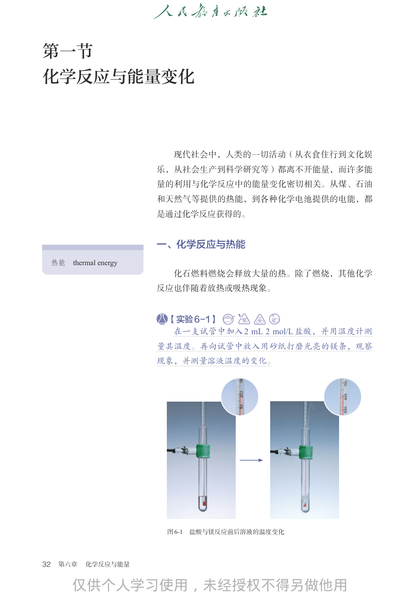

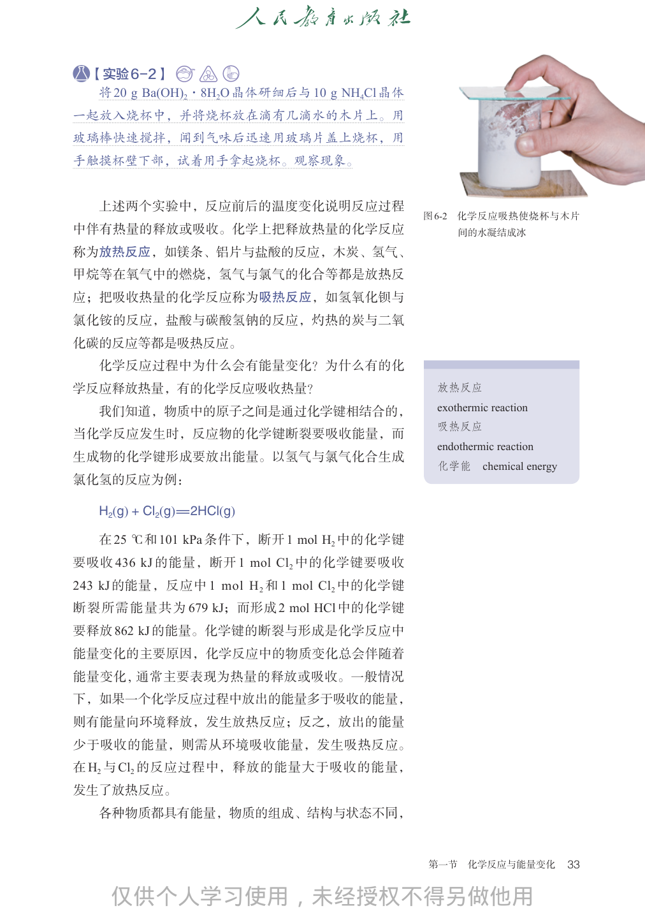

## RJ-CHEMISTRY-HSC2-046 化学键变化与反应中的能量变化

第六章 化学反应与能量 / 第一节 化学反应与能量变化 / 一、化学反应与热能 · P38

我们知道，物质中的原子之间是通过化学键相结合的，当化学反应发生时，反应物的化学键断裂要吸收能量，而生成物的化学键形成要放出能量。以氢气与氯气化合生成氯化氢的反应为例：H₂(g) + Cl₂(g)=2HCl(g)在25 ℃和101 kPa条件下，断开1 mol H₂中的化学键要吸收436 kJ 的能量，断开1 mol Cl₂ 中的化学键要吸收243 kJ的能量，反应中1 mol H₂和1 mol Cl₂中的化学键断裂所需能量共为679 kJ；而形成2 mol HCl中的化学键要释放862 kJ的能量。化学键的断裂与形成是化学反应中能量变化的主要原因，化学反应中的物质变化总会伴随着能量变化, 通常主要表现为热量的释放或吸收。一般情况下，如果一个化学反应过程中放出的能量多于吸收的能量，则有能量向环境释放，发生放热反应；反之，放出的能量少于吸收的能量，则需从环境吸收能量，发生吸热反应。在H₂ 与Cl₂ 的反应过程中，释放的能量大于吸收的能量，发生了放热反应。

## RJ-CHEMISTRY-HSC2-047 反应物与生成物总能量和吸放热的关系

第六章 化学反应与能量 / 第一节 化学反应与能量变化 / 一、化学反应与热能 · P38-P39

各种物质都具有能量，物质的组成、结构与状态不同，所具有的能量也不同。放热反应可以看成是反应物所具有的化学能转化为热能释放出来，吸热反应可以看成是热能转化为化学能被生成物所“储存”。因此，一个化学反应是释放热量还是吸收热量，与反应物总能量和生成物总能量的相对大小有关。如图6-3所示，如果反应物的总能量高于生成物的总能量，发生反应时会向环境释放能量；如果反应物的总能量低于生成物的总能量，发生反应时需要从环境吸收能量。

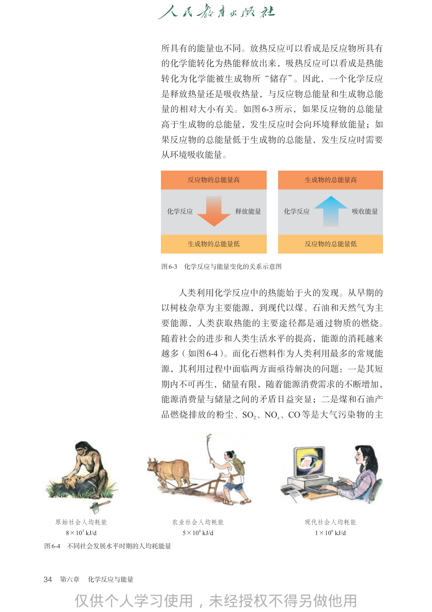

## RJ-CHEMISTRY-HSC2-048 化石能源利用的问题

第六章 化学反应与能量 / 第一节 化学反应与能量变化 / 一、化学反应与热能 · P39-P40

随着社会的进步和人类生活水平的提高，能源的消耗越来越多（如图6-4）。而化石燃料作为人类利用最多的常规能源，其利用过程中面临两方面亟待解决的问题：一是其短期内不可再生，储量有限，随着能源消费需求的不断增加，能源消费量与储量之间的矛盾日益突显；二是煤和石油产品燃烧排放的粉尘、SO₂、NOₓ、CO等是大气污染物的主要来源。为了改善人类的生存环境，促进社会可持续发展，节能和寻找清洁的新能源成为人类的必然选择。

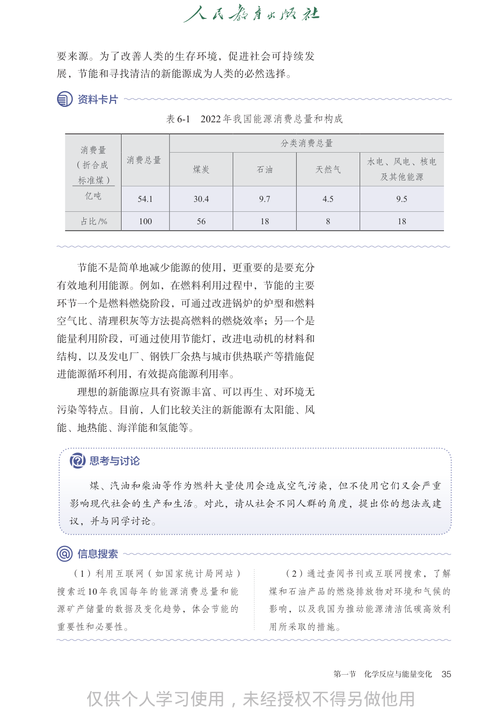

## RJ-CHEMISTRY-HSC2-049 能源消费结构

第六章 化学反应与能量 / 第一节 化学反应与能量变化 / 一、化学反应与热能 · P40

表6-1 2022年我国能源消费总量和构成。消费量折合成标准煤，单位亿吨：消费总量54.1，煤炭30.4，石油9.7，天然气4.5，水电、风电、核电及其他能源9.5；占比依次为100%、56%、18%、8%、18%。

## RJ-CHEMISTRY-HSC2-050 节能措施与新能源

第六章 化学反应与能量 / 第一节 化学反应与能量变化 / 一、化学反应与热能 · P40

节能不是简单地减少能源的使用，更重要的是要充分有效地利用能源。例如，在燃料利用过程中，节能的主要环节一个是燃料燃烧阶段，可通过改进锅炉的炉型和燃料空气比、清理积灰等方法提高燃料的燃烧效率；另一个是能量利用阶段，可通过使用节能灯，改进电动机的材料和结构，以及发电厂、钢铁厂余热与城市供热联产等措施促进能源循环利用，有效提高能源利用率。理想的新能源应具有资源丰富、可以再生、对环境无污染等特点。目前，人们比较关注的新能源有太阳能、风能、地热能、海洋能和氢能等。

## RJ-CHEMISTRY-HSC2-051 火力发电的能量转化

第六章 化学反应与能量 / 第一节 化学反应与能量变化 / 二、化学反应与电能 · P41

我们日常使用的电能主要来自火力发电。火力发电是通过化石燃料燃烧时发生的氧化还原反应，使化学能转化为热能，加热水使之汽化为蒸汽以推动蒸汽轮机，带动发电机发电。火力发电过程中，化学能经过一系列能量转化过程，间接转化为电能。其中，燃烧（氧化还原反应）是关键。

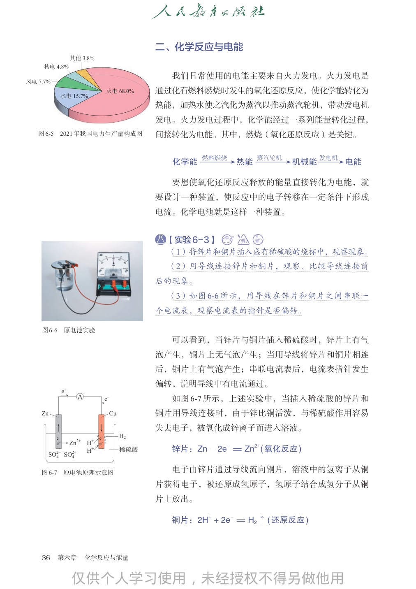

## RJ-CHEMISTRY-HSC2-052 原电池实验、电子转移与正负极

第六章 化学反应与能量 / 第一节 化学反应与能量变化 / 二、化学反应与电能 · P41-P42

要想使氧化还原反应释放的能量直接转化为电能，就要设计一种装置，使反应中的电子转移在一定条件下形成电流。化学电池就是这样一种装置。

【实验6-3】（1）将锌片和铜片插入盛有稀硫酸的烧杯中，观察现象。（2）用导线连接锌片和铜片，观察、比较导线连接前后的现象。（3）如图6-6所示，用导线在锌片和铜片之间串联一个电流表，观察电流表的指针是否偏转。

可以看到，当锌片与铜片插入稀硫酸时，锌片上有气泡产生，铜片上无气泡产生；当用导线将锌片和铜片相连后，铜片上有气泡产生；串联电流表后，电流表指针发生偏转，说明导线中有电流通过。如图6-7所示，上述实验中，当插入稀硫酸的锌片和铜片用导线连接时，由于锌比铜活泼，与稀硫酸作用容易失去电子，被氧化成锌离子而进入溶液。

锌片：Zn − 2e⁻ = Zn²⁺（氧化反应）

电子由锌片通过导线流向铜片，溶液中的氢离子从铜片获得电子，被还原成氢原子，氢原子结合成氢分子从铜片上放出。

铜片：2H⁺ + 2e⁻ = H₂↑（还原反应）

上述实验和分析表明，通过特定的装置使氧化反应与还原反应分别在两个不同的区域进行，可以使氧化还原反应中转移的电子通过导体发生定向移动，形成电流，从而实现化学能向电能的转化。这种把化学能转化为电能的装置叫做原电池。在原电池中，电子流出的一极是负极（如锌片，电极被氧化），电子流入的一极是正极（如铜片，H⁺在正极上被还原）。

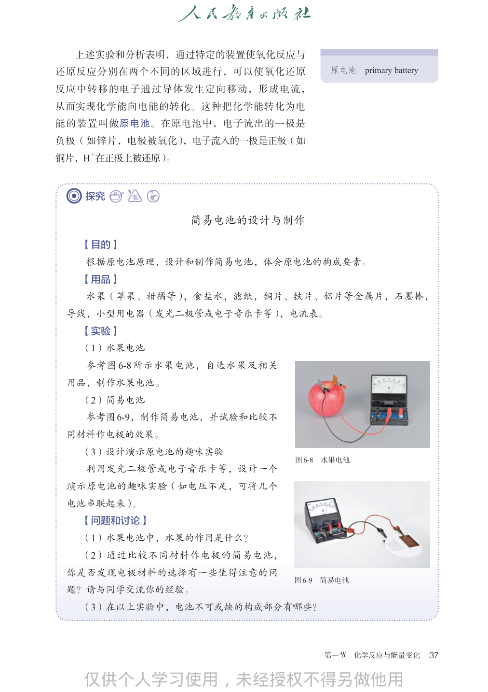

## RJ-CHEMISTRY-HSC2-053 简易电池的设计与制作

第六章 化学反应与能量 / 第一节 化学反应与能量变化 / 二、化学反应与电能 · P42

水果（苹果、柑橘等），食盐水，滤纸，铜片、铁片、铝片等金属片，石墨棒，导线，小型用电器（发光二极管或电子音乐卡等），电流表。【实验】（1）水果电池参考图6-8所示水果电池，自选水果及相关用品，制作水果电池。（2）简易电池参考图6-9，制作简易电池，并试验和比较不同材料作电极的效果。（3）设计演示原电池的趣味实验利用发光二极管或电子音乐卡等，设计一个演示原电池的趣味实验（如电压不足，可将几个电池串联起来）。

## RJ-CHEMISTRY-HSC2-054 一次电池和二次电池

第六章 化学反应与能量 / 第一节 化学反应与能量变化 / 二、化学反应与电能 · P43

根据原电池原理，人们研制出很多结构和性能各异的化学电池，以满足不同的用电需要。常见的锌锰干电池的构造如图6-10所示。其中，石墨棒作正极，氯化铵糊作电解质溶液，锌筒作负极。在使用过程中，电子由锌筒（负极）流向石墨棒（正极），锌逐渐消耗，二氧化锰不断被还原，电池电压逐渐降低，最后失效。这种电池放电之后不能充电（内部的氧化还原反应无法逆向进行），属于一次电池。有些电池放电时所进行的氧化还原反应，在充电时可以逆向进行，使电池恢复到放电前的状态，从而实现放电（化学能转化为电能）与充电（电能转化为化学能）的循环。这种充电电池属于二次电池。常见的充电电池有铅酸蓄电池、镍氢电池、锂离子电池等。

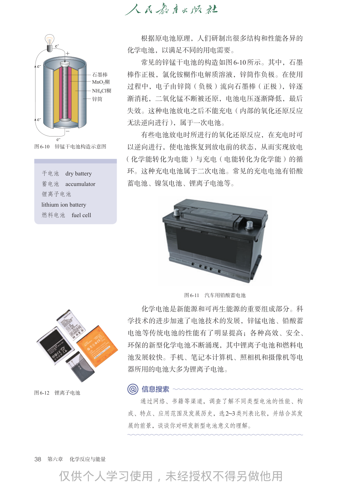

## RJ-CHEMISTRY-HSC2-055 锂离子电池的应用

第六章 化学反应与能量 / 第一节 化学反应与能量变化 / 二、化学反应与电能 · P43

化学电池是新能源和可再生能源的重要组成部分。科学技术的进步加速了电池技术的发展，锌锰电池、铅酸蓄电池等传统电池的性能有了明显提高；各种高效、安全、环保的新型化学电池不断涌现，其中锂离子电池和燃料电池发展较快。手机、笔记本计算机、照相机和摄像机等电器所用的电池大多为锂离子电池。

## RJ-CHEMISTRY-HSC2-056 燃料电池

第六章 化学反应与能量 / 第一节 化学反应与能量变化 / 二、化学反应与电能 · P44

燃料电池是一种将燃料（如氢气、甲烷、乙醇）和氧化剂（如氧气）的化学能直接转化为电能的电化学反应装置，具有清洁、安全、高效等特点。燃料电池的能量转化率较高。当以氢气为燃料时，产物为水；以甲烷为燃料时，产物为水和二氧化碳。与常规发电厂相比，其二氧化碳排放量明显降低。燃料电池与干电池或蓄电池的主要差别在于反应物不是储存在电池内部，而是从外部提供，这时电池起着类似试管、烧杯等反应器的作用。燃料电池的供电量易于调节，能适应用电器负载的变化，而且不需要很长的充电时间，在航天、军事和交通等领域有广阔的应用前景。

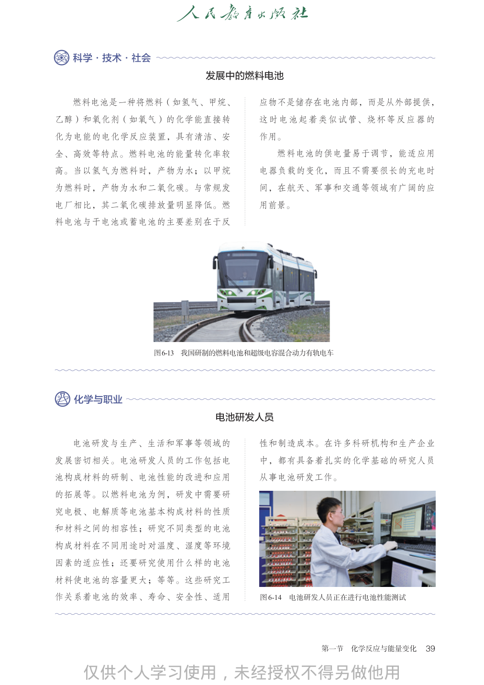

## RJ-CHEMISTRY-HSC2-057 电池材料的研究因素

第六章 化学反应与能量 / 第一节 化学反应与能量变化 / 二、化学反应与电能 · P44

以燃料电池为例，研发中需要研究电极、电解质等电池基本构成材料的性质和材料之间的相容性；研究不同类型的电池构成材料在不同用途时对温度、湿度等环境因素的适应性；还要研究使用什么样的电池材料使电池的容量更大；等等。这些研究工作关系着电池的效率、寿命、安全性、适用性和制造成本。

## RJ-CHEMISTRY-HSC2-058 化学反应速率的表示与平均速率

第六章 化学反应与能量 / 第二节 化学反应的速率与限度 / 一、化学反应的速率 · P48

不同的化学反应进行的快慢千差万别，快与慢是相对而言的，是一种定性的比较。在科学研究和实际应用中，对化学反应进行的快慢进行定量的描述或比较时，要使用同一定义或标准下的数据。与物理学中物体的运动快慢用速率表示类似，化学反应过程进行的快慢用反应速率来表示。化学反应速率通常用单位时间内反应物浓度的减小或生成物浓度的增大来表示（取正值）。浓度常以mol/L为单位，时间常以min（分）或s（秒）为单位，化学反应速率的单位相应为mol/(L·min)或mol/(L·s)。例如，某反应的反应物浓度在5 min 内由6 mol/L 变成了2 mol/L，则以该反应物浓度的变化表示的该反应在这段时间内的平均反应速率为0.8 mol/(L·min)。

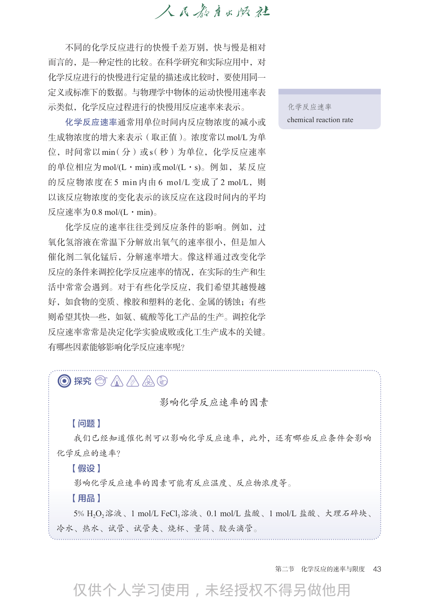

## RJ-CHEMISTRY-HSC2-059 化学反应速率的调控意义

第六章 化学反应与能量 / 第二节 化学反应的速率与限度 / 一、化学反应的速率 · P48

化学反应的速率往往受到反应条件的影响。例如，过氧化氢溶液在常温下分解放出氧气的速率很小，但是加入催化剂二氧化锰后，分解速率增大。像这样通过改变化学反应的条件来调控化学反应速率的情况，在实际的生产和生活中常常会遇到。对于有些化学反应，我们希望其越慢越好，如食物的变质、橡胶和塑料的老化、金属的锈蚀；有些则希望其快一些，如氨、硫酸等化工产品的生产。调控化学反应速率常常是决定化学实验成败或化工生产成本的关键。有哪些因素能够影响化学反应速率呢？

## RJ-CHEMISTRY-HSC2-060 温度对化学反应速率的影响实验

第六章 化学反应与能量 / 第二节 化学反应的速率与限度 / 一、化学反应的速率 · P48-P49

5% H₂O₂溶液、1 mol/L FeCl₃溶液、0.1 mol/L 盐酸、1 mol/L 盐酸、大理石碎块、冷水、热水、试管、试管夹、烧杯、量筒、胶头滴管。

（1）反应温度的影响在两支大小相同的试管中均加入2 mL 5% H₂O₂溶液，同时滴入2滴1 mol/L FeCl₃溶液。待试管中均有适量气泡出现时，将其中一支试管放入盛有冷水的烧杯中，另一支试管放入盛有热水的烧杯中，观察现象并进行对比。

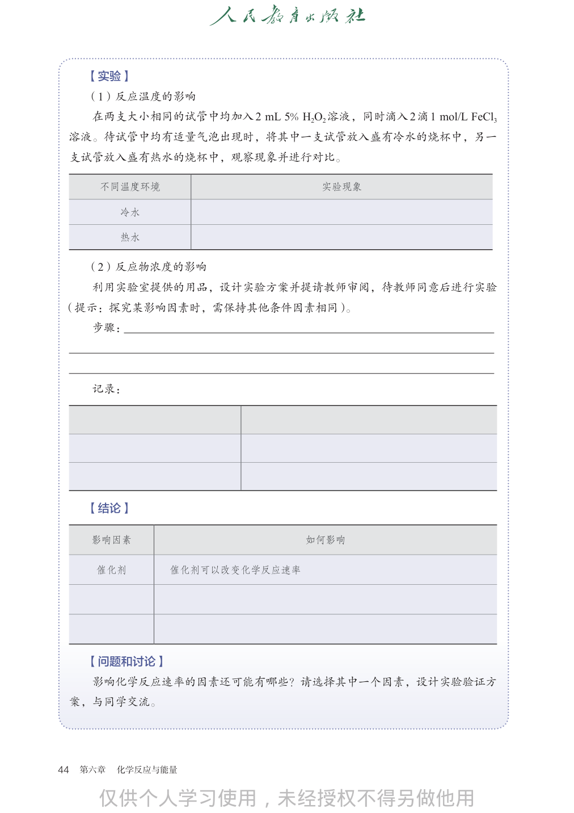

## RJ-CHEMISTRY-HSC2-061 变量控制

第六章 化学反应与能量 / 第二节 化学反应的速率与限度 / 一、化学反应的速率 · P50

科学研究中，对于多因素（多变量）的问题，常常采用只改变其中的某一个因素，控制其他因素不变的研究方法，使多因素的问题变成几个单因素的问题，分别加以研究，最后再将几个单因素问题的研究结果加以综合。这种变量控制的方法是科学探究中常用的方法。例如，以上探究在比较不同温度对化学反应速率的影响时，控制浓度和其他影响因素相同；而比较不同浓度对化学反应速率的影响时，则控制温度和其他影响因素相同；最后综合得出影响化学反应速率的多种因素。

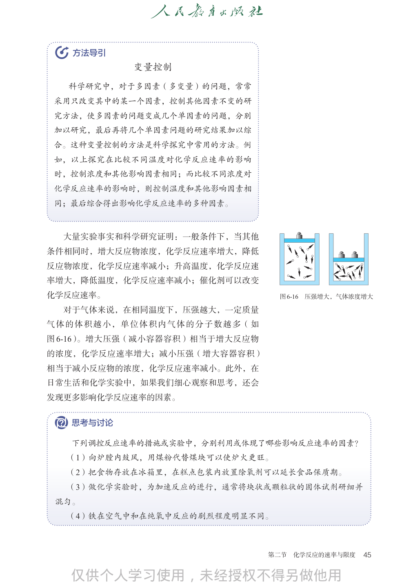

## RJ-CHEMISTRY-HSC2-062 浓度、温度、催化剂和压强对反应速率的影响

第六章 化学反应与能量 / 第二节 化学反应的速率与限度 / 一、化学反应的速率 · P50

大量实验事实和科学研究证明：一般条件下，当其他条件相同时，增大反应物浓度，化学反应速率增大，降低反应物浓度，化学反应速率减小；升高温度，化学反应速率增大，降低温度，化学反应速率减小；催化剂可以改变化学反应速率。对于气体来说，在相同温度下，压强越大，一定质量气体的体积越小，单位体积内气体的分子数越多（如图6-16）。增大压强（减小容器容积）相当于增大反应物的浓度，化学反应速率增大；减小压强（增大容器容积）相当于减小反应物的浓度，化学反应速率减小。此外，在日常生活和化学实验中，如果我们细心观察和思考，还会发现更多影响化学反应速率的因素。

## RJ-CHEMISTRY-HSC2-063 催化剂的选择性与酶

第六章 化学反应与能量 / 第二节 化学反应的速率与限度 / 一、化学反应的速率 · P51

催化剂十分神奇，它能极大地提高化学反应速率（可使反应速率增大几个到十几个数量级），而自身的组成、化学性质和质量在反应前后不发生变化；它和一些反应体系的关系就像钥匙与锁的关系，具有一定的选择性。
生物体内几乎所有的化学反应（如淀粉、脂肪、蛋白质的水解，DNA的复制等）都是由生物体内存在的特殊催化剂——酶所催化的。酶比一般的催化剂具有更高的选择性和催化效率，而且是在正常体温的条件下发生作用，反应条件温和。受酶的启示，科学家开辟了设计和合成催化剂的新途径，正在研制具有生物酶某些特性的化学酶，以期实现“仿酶催化”。

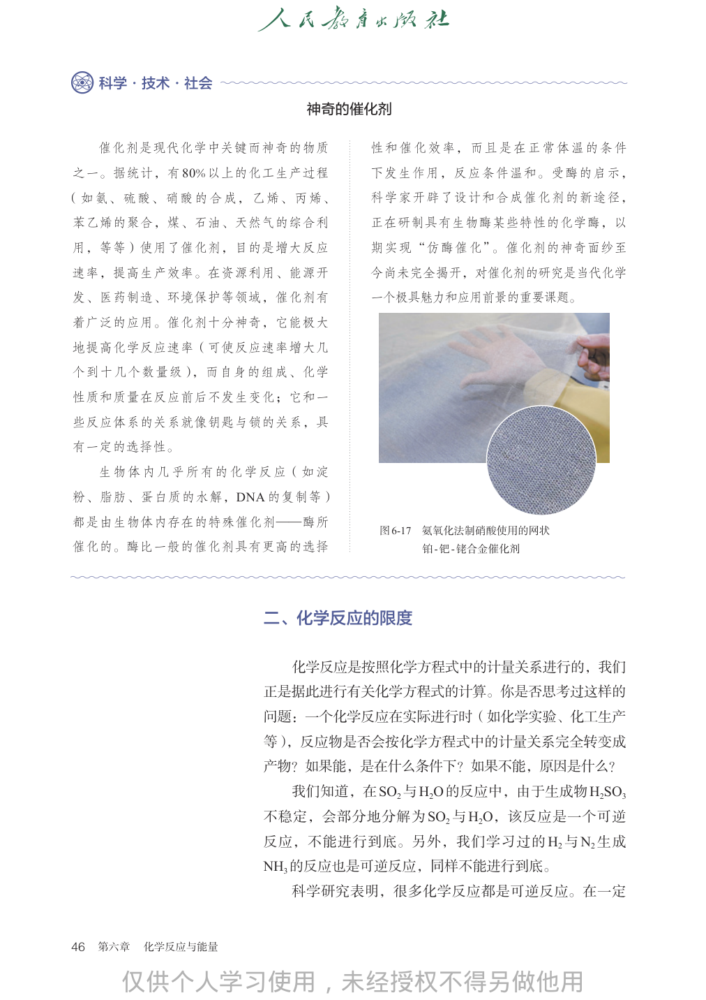

## RJ-CHEMISTRY-HSC2-064 化学平衡与反应限度

第六章 化学反应与能量 / 第二节 化学反应的速率与限度 / 二、化学反应的限度 · P51-P52

我们知道，在SO₂与H₂O的反应中，由于生成物H₂SO₃不稳定，会部分地分解为SO₂与H₂O，该反应是一个可逆反应，不能进行到底。另外，我们学习过的H₂与N₂生成NH₃的反应也是可逆反应，同样不能进行到底。科学研究表明，很多化学反应都是可逆反应。在一定条件下，某个可逆反应在开始进行时，反应物的浓度最大，生成物浓度为零，因此正反应速率大于逆反应速率。随着反应的进行，反应物的浓度逐渐减小，正反应速率逐渐减小；生成物的浓度逐渐增大，逆反应速率逐渐增大。当反应进行到一定程度时，正反应速率与逆反应速率相等（如图6-18），反应物的浓度和生成物的浓度都不再改变，达到一种表面静止的状态，我们称之为化学平衡状态，简称化学平衡。化学平衡状态是可逆反应在一定条件下所能达到的或完成的最大程度，即该反应进行的限度。化学反应的限度决定了反应物在该条件下转化为生成物的最大转化率。任何可逆反应在给定条件下的进程都有一定的限度，只是不同反应的限度不同。改变反应条件可以在一定程度上改变一个化学反应的限度，亦即改变该反应的化学平衡状态。因此，通过调控反应条件可使反应结果更好地符合人们预期的目的，这在工农业生产和环境保护等方面已经得到广泛的应用。

转化率是指已被转化的反应物的物质的量与其初始的物质的量之比。

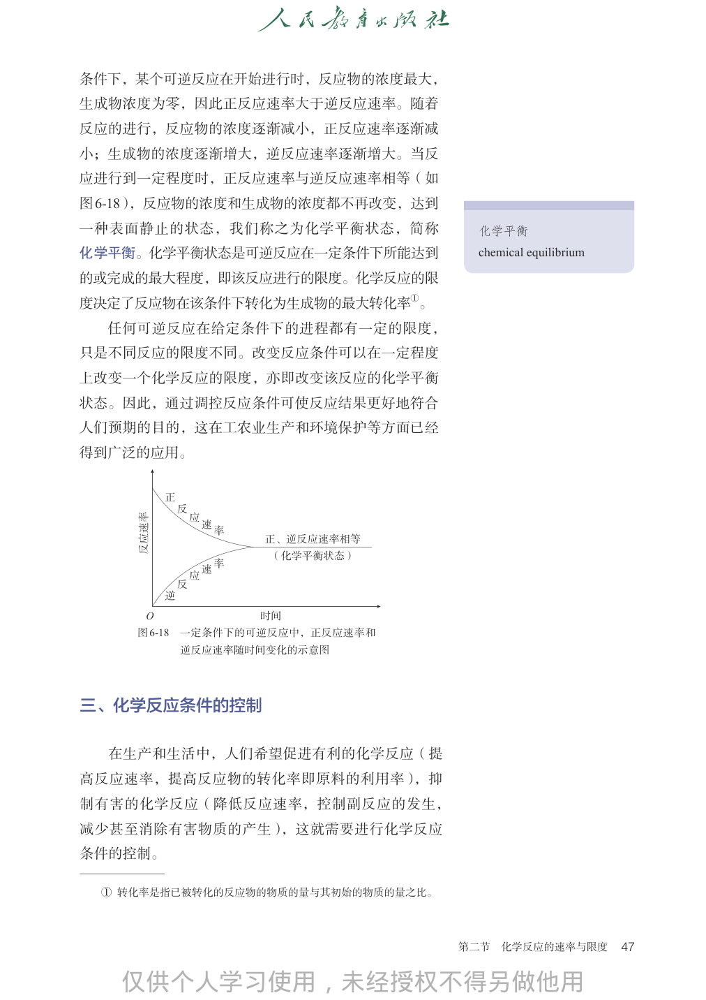

## RJ-CHEMISTRY-HSC2-065 反应条件控制与合成氨条件选择

第六章 化学反应与能量 / 第二节 化学反应的速率与限度 / 三、化学反应条件的控制 · P52-P53

在生产和生活中，人们希望促进有利的化学反应（提高反应速率，提高反应物的转化率即原料的利用率），抑制有害的化学反应（降低反应速率，控制副反应的发生，减少甚至消除有害物质的产生），这就需要进行化学反应条件的控制。

在化工生产中，为了提高反应进行的程度而调控反应条件时，需要考虑控制反应条件的成本和实际可能性。例如，合成氨的生产在温度较低时，氨的产率较高；压强越大，氨的产率越高。但温度低，反应速率小，需要很长时间才能达到化学平衡，生产成本高，工业上通常选择在400~500 ℃下进行。而压强越大，对动力和生产设备的要求也越高，合成氨厂随着生产规模和设备条件的不同，采用的压强通常为10 MPa~30 MPa。

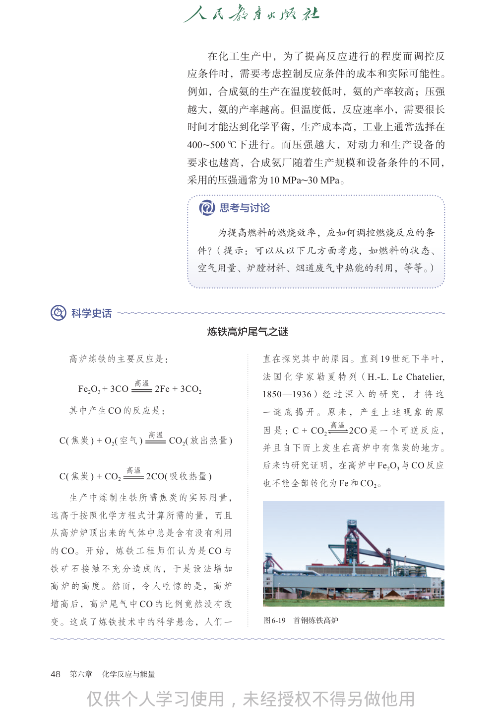

## RJ-CHEMISTRY-HSC2-066 高炉炼铁的反应限度

第六章 化学反应与能量 / 第二节 化学反应的速率与限度 / 三、化学反应条件的控制 · P53

高炉炼铁的主要反应是：

Fe₂O₃ + 3CO ─高温→ 2Fe + 3CO₂

其中产生CO的反应是：

C（焦炭）+ O₂（空气）─高温→ CO₂（放出热量）
C（焦炭）+ CO₂ ⇌ 2CO（高温，吸收热量）

生产中炼制生铁所需焦炭的实际用量，远高于按照化学方程式计算所需的量，而且从高炉炉顶出来的气体中总是含有没有利用的CO。

产生上述现象的原因是：C + CO₂ ⇌ 2CO（高温）是一个可逆反应，并且自下而上发生在高炉中有焦炭的地方。后来的研究证明，在高炉中Fe₂O₃与CO反应也不能全部转化为Fe和CO₂。

## RJ-CHEMISTRY-HSC2-067 电极材料与原电池的对比实验

第六章 化学反应与能量 / 实验活动6 化学能转化成电能 / 实验活动6 化学能转化成电能 · P61-P62

烧杯、导线、电流表。锌片、铜片、石墨棒、稀硫酸。

1. 电极材料的实验（1）用导线将电流表分别与锌片、铜片相连接，使锌片与铜片接触，观察电流表指针是否发生偏转；用石墨棒代替铜片进行上述实验。解释所观察到的现象。

（2）将锌片插入盛有稀硫酸的烧杯里，观察现象；再插入铜片，观察现象；取出铜片，插入石墨棒，观察现象。

2. 原电池实验如下表所示，选择不同的电极材料，以及稀硫酸、导线和电流表，组装原电池，试验其能否产生电流，并作出解释。

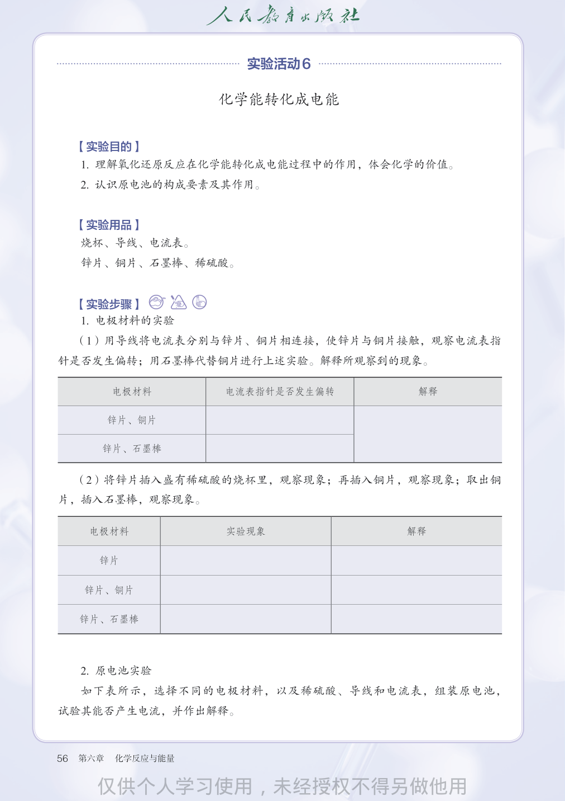

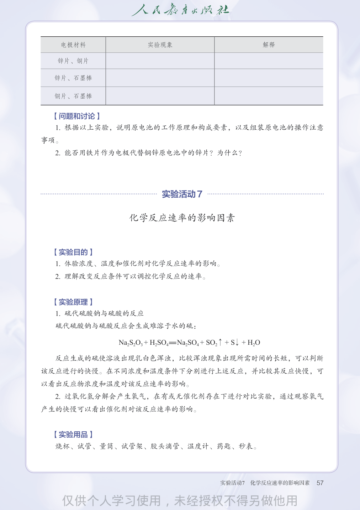

## RJ-CHEMISTRY-HSC2-068 硫代硫酸钠反应与过氧化氢分解的速率对比实验

第六章 化学反应与能量 / 实验活动7 化学反应速率的影响因素 / 实验活动7 化学反应速率的影响因素 · P62-P63

1. 硫代硫酸钠与硫酸的反应硫代硫酸钠与硫酸反应会生成难溶于水的硫：Na₂S₂O₃ + H₂SO₄=Na₂SO₄ + SO₂ ↑+ S↓+ H₂O

反应生成的硫使溶液出现乳白色浑浊，比较浑浊现象出现所需时间的长短，可以判断该反应进行的快慢。在不同浓度和温度条件下分别进行上述反应，并比较其反应快慢，可以看出反应物浓度和温度对该反应速率的影响。2. 过氧化氢分解会产生氧气，在有或无催化剂存在下进行对比实验，通过观察氧气产生的快慢可以看出催化剂对该反应速率的影响。

烧杯、试管、量筒、试管架、胶头滴管、温度计、药匙、秒表。

0.1 mol/L Na₂S₂O₃溶液、0.1 mol/L H₂SO₄溶液、10% H₂O₂溶液、1 mol/L FeCl₃溶液、MnO₂粉末、蒸馏水。

1. 浓度对化学反应速率的影响取两支大小相同的试管，分别加入2 mL和1 mL 0.1 mol/L Na₂S₂O₃溶液，向盛有1 mL Na₂S₂O₃溶液的试管中加入1 mL蒸馏水，摇匀。再同时向上述两支试管中加入2 mL 0.1 mol/L H₂SO₄溶液，振荡。观察、比较两支试管中溶液出现浑浊的快慢。

2. 温度对化学反应速率的影响取两支大小相同的试管，各加入2 mL 0.1 mol/L Na₂S₂O₃溶液，分别放入盛有冷水和热水的两个烧杯中。再同时向上述两支试管中加入2 mL 0.1 mol/L H₂SO₄溶液，振荡。观察、比较两支试管中溶液出现浑浊的快慢。

3. 催化剂对化学反应速率的影响向三支大小相同的试管中各加入2 mL 10% H₂O₂溶液，再向其中的两支试管中分别加入少量MnO₂粉末和2滴1 mol/L FeCl₃溶液。观察、比较三支试管中气泡出现的快慢。

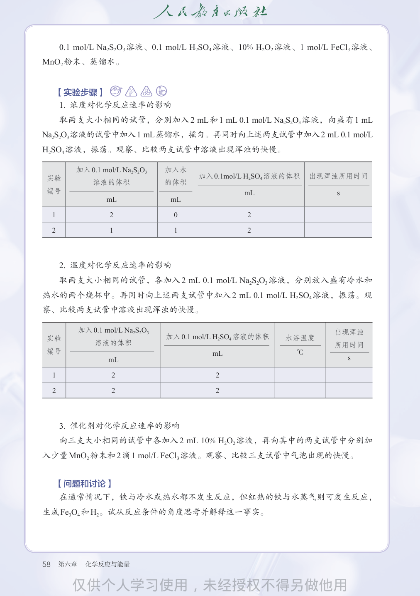

## RJ-CHEMISTRY-HSC2-069 有机化合物中碳原子的成键特点

第七章 有机化合物 / 第一节 认识有机化合物 / 一、有机化合物中碳原子的成键特点 · P65-P66

我们熟悉的甲烷（CH₄）是最简单的有机化合物，其分子中的碳原子以最外层的４个电子分别与４个氢原子的电子形成了４个C—H共价键。甲烷的电子式和结构式可分别表示为（见图）：

有机化合物中的每个碳原子不仅能与其他原子形成4个共价键，而且碳原子与碳原子之间也能形成共价键，可以形成单键、双键或三键。

多个碳原子之间可以结合成碳链，也可以结合成碳环，构成有机物链状或环状的碳骨架。有机物分子可能只含有一个或几个碳原子，也可能含有成千上万个碳原子。含有相同碳原子数的有机物分子，可能因为碳原子间成键方式或碳骨架的不同而具有多种结构。

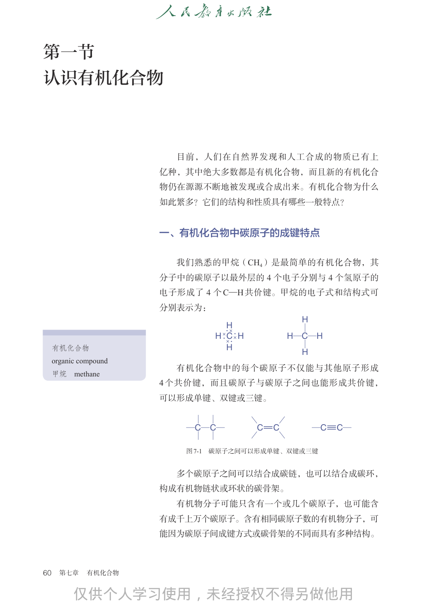

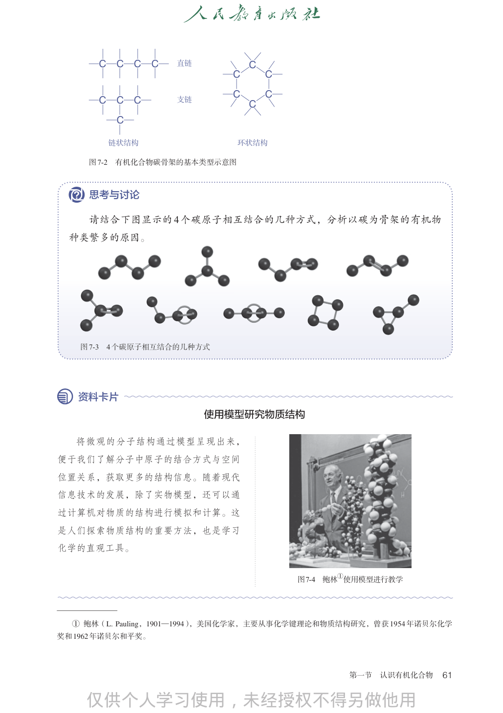

## RJ-CHEMISTRY-HSC2-070 使用模型研究物质结构

第七章 有机化合物 / 第一节 认识有机化合物 / 一、有机化合物中碳原子的成键特点 · P66

将微观的分子结构通过模型呈现出来，便于我们了解分子中原子的结合方式与空间位置关系，获取更多的结构信息。随着现代信息技术的发展，除了实物模型，还可以通过计算机对物质的结构进行模拟和计算。这是人们探索物质结构的重要方法，也是学习化学的直观工具。

## RJ-CHEMISTRY-HSC2-071 甲烷分子的正四面体结构

第七章 有机化合物 / 第一节 认识有机化合物 / 二、烷烃 · P67

实验数据表明，甲烷分子中的5个原子不在同一平面上，而是形成了正四面体的空间结构。碳原子位于正四面体的中心，4个氢原子分别位于4个顶点。分子中的４个C—H 的长度和强度相同，相互之间的夹角相等。

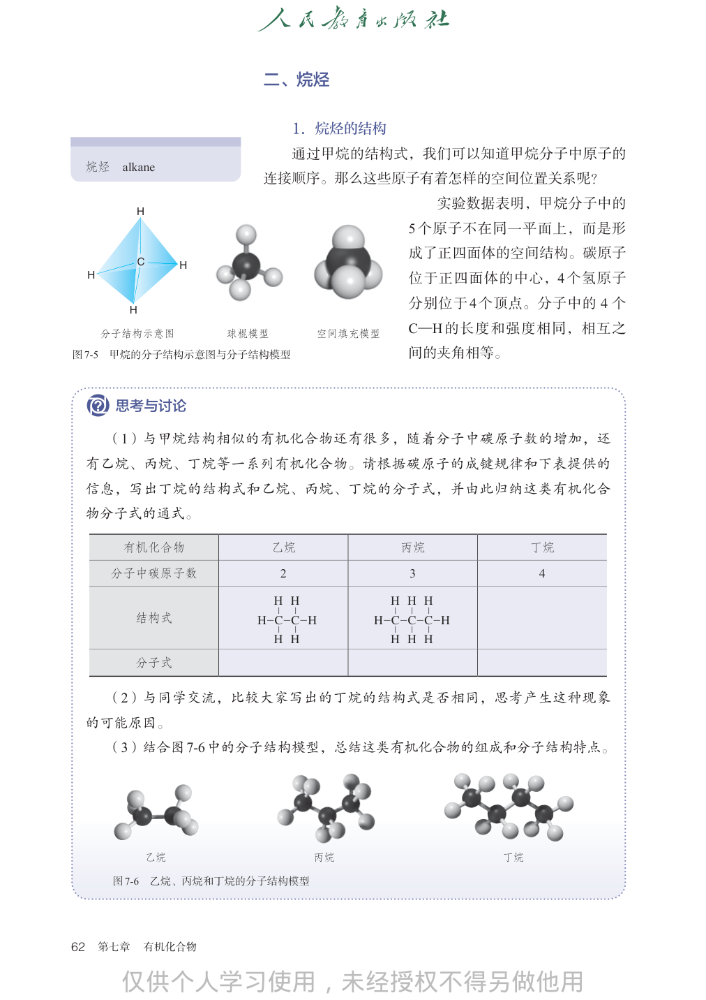

## RJ-CHEMISTRY-HSC2-072 烷烃的组成、命名和结构简式

第七章 有机化合物 / 第一节 认识有机化合物 / 二、烷烃 · P68

以上这些有机化合物只含有碳和氢两种元素，分子中的碳原子之间都以单键结合，碳原子的剩余价键均与氢原子结合，使碳原子的化合价都达到“饱和”。这样的一类有机化合物称为饱和烃，也称为烷烃。烷烃中最简单的是甲烷，其余随碳原子数的增加，依次为乙烷、丙烷、丁烷等。碳原子数不多于10时，以甲、乙、丙、丁、戊、己、庚、辛、壬、癸依次代表碳原子数；碳原子数在10 以上时，以汉字数字代表，如“十一烷”。为了书写方便，有机物通常用结构简式表示，如乙烷、丙烷和十一烷的结构简式可以分别表示为CH₃CH₃、CH₃CH₂CH₃和CH₃(CH₂)₉CH₃。

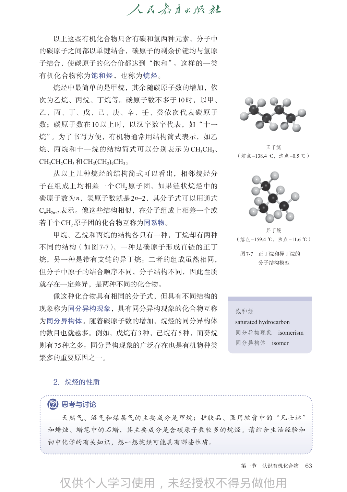

## RJ-CHEMISTRY-HSC2-073 链状烷烃通式与同系物

第七章 有机化合物 / 第一节 认识有机化合物 / 二、烷烃 · P68

从以上几种烷烃的结构简式可以看出，相邻烷烃分子在组成上均相差一个CH₂ 原子团，如果链状烷烃中的碳原子数为n，氢原子数就是2n+2，其分子式可以用通式CₙH₂ₙ₊₂表示。像这些结构相似，在分子组成上相差一个或若干个CH₂原子团的化合物互称为同系物。

## RJ-CHEMISTRY-HSC2-074 同分异构现象与同分异构体

第七章 有机化合物 / 第一节 认识有机化合物 / 二、烷烃 · P68

甲烷、乙烷和丙烷的结构各只有一种，丁烷却有两种不同的结构（如图7-7），一种是碳原子形成直链的正丁烷，另一种是带有支链的异丁烷。二者的组成虽然相同，但分子中原子的结合顺序不同，分子结构不同，因此性质就存在一定差异，是两种不同的化合物。像这种化合物具有相同的分子式，但具有不同结构的现象称为同分异构现象，具有同分异构现象的化合物互称为同分异构体。随着碳原子数的增加，烷烃的同分异构体的数目也就越多。例如，戊烷有3种，己烷有5种，而癸烷则有75种之多。同分异构现象的广泛存在也是有机物种类繁多的重要原因之一。

## RJ-CHEMISTRY-HSC2-075 烷烃的物理性质与甲烷物性数据

第七章 有机化合物 / 第一节 认识有机化合物 / 二、烷烃 · P69

烷烃均为难溶于水的无色物质，其熔点、沸点和密度一般随着分子中碳原子数的增加（同时相对分子质量也在增大）而升高，在常温下的状态由气态变为液态，再到固态。

甲烷：熔点−182 ℃，沸点−164 ℃，密度0.717 g/L。

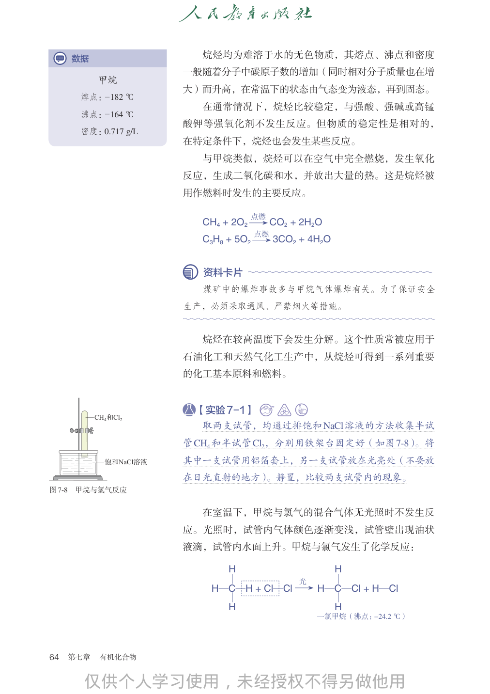

## RJ-CHEMISTRY-HSC2-076 烷烃的稳定性、燃烧与受热分解

第七章 有机化合物 / 第一节 认识有机化合物 / 二、烷烃 · P69

在通常情况下，烷烃比较稳定，与强酸、强碱或高锰酸钾等强氧化剂不发生反应。但物质的稳定性是相对的，在特定条件下，烷烃也会发生某些反应。与甲烷类似，烷烃可以在空气中完全燃烧，发生氧化反应，生成二氧化碳和水，并放出大量的热。这是烷烃被用作燃料时发生的主要反应。

CH₄ + 2O₂ ─点燃→ CO₂ + 2H₂O
C₃H₈ + 5O₂ ─点燃→ 3CO₂ + 4H₂O

煤矿中的爆炸事故多与甲烷气体爆炸有关。为了保证安全生产，必须采取通风、严禁烟火等措施。

烷烃在较高温度下会发生分解。这个性质常被应用于石油化工和天然气化工生产中，从烷烃可得到一系列重要的化工基本原料和燃料。

## RJ-CHEMISTRY-HSC2-077 甲烷与氯气的光照取代反应

第七章 有机化合物 / 第一节 认识有机化合物 / 二、烷烃 · P69-P70

取两支试管，均通过排饱和NaCl溶液的方法收集半试管CH₄和半试管Cl₂，分别用铁架台固定好（如图7-8）。将其中一支试管用铝箔套上，另一支试管放在光亮处（不要放在日光直射的地方）。静置，比较两支试管内的现象。

在室温下，甲烷与氯气的混合气体无光照时不发生反应。光照时，试管内气体颜色逐渐变浅，试管壁出现油状液滴，试管内水面上升。甲烷与氯气发生了化学反应：CH₄ + Cl₂ ─光→ CH₃Cl + HCl

生成的一氯甲烷在常温下是气体，可与氯气进一步反应，依次又生成了二氯甲烷、三氯甲烷（氯仿）和四氯甲烷（四氯化碳）。这４种产物都不易溶于水，三氯甲烷和四氯甲烷是工业上重要的有机溶剂。

在上述反应中，甲烷分子中的４个氢原子被氯原子逐一替代，生成４种不同的取代产物。像这样，有机物分子里的某些原子或原子团被其他原子或原子团所替代的反应叫做取代反应。烷烃在一定条件下，可以与卤素单质发生取代反应。

CH₃Cl + Cl₂ ─光→ CH₂Cl₂ + HCl
CH₂Cl₂ + Cl₂ ─光→ CHCl₃ + HCl
CHCl₃ + Cl₂ ─光→ CCl₄ + HCl

一氯甲烷沸点−24.2 ℃，二氯甲烷沸点39.8 ℃，三氯甲烷沸点61.7 ℃，四氯甲烷沸点76.5 ℃。

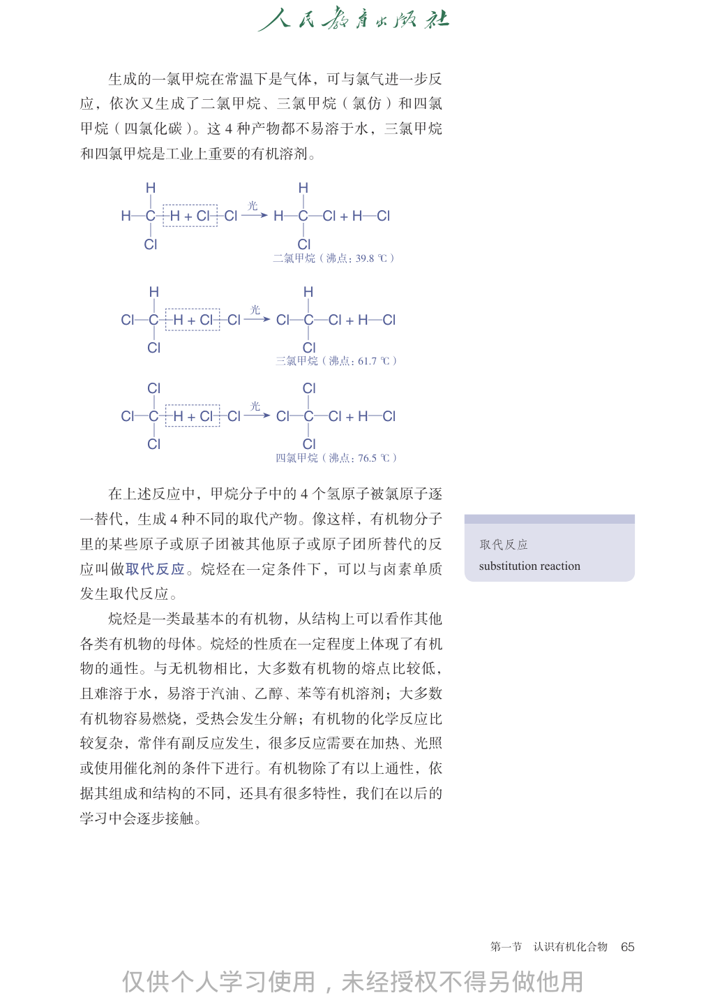

## RJ-CHEMISTRY-HSC2-078 有机化合物的一般性质

第七章 有机化合物 / 第一节 认识有机化合物 / 二、烷烃 · P70

烷烃是一类最基本的有机物，从结构上可以看作其他各类有机物的母体。烷烃的性质在一定程度上体现了有机物的通性。与无机物相比，大多数有机物的熔点比较低，且难溶于水，易溶于汽油、乙醇、苯等有机溶剂；大多数有机物容易燃烧，受热会发生分解；有机物的化学反应比较复杂，常伴有副反应发生，很多反应需要在加热、光照或使用催化剂的条件下进行。有机物除了有以上通性，依据其组成和结构的不同，还具有很多特性，我们在以后的学习中会逐步接触。

## RJ-CHEMISTRY-HSC2-079 乙烯的组成、结构与物理性质

第七章 有机化合物 / 第二节 乙烯与有机高分子材料 / 一、乙烯 · P72

乙烯是一种无色、稍有气味的气体，密度比空气的略小，难溶于水。乙烯的分子式是C₂H₄，结构式见原图，其分子中的氢原子数少于乙烷分子中的氢原子数，碳原子的价键没有全部被氢原子“饱和”。乙烯分子中含有碳碳双键，在组成和结构上与只含碳碳单键和碳氢键的烷烃有较大差异，因此在性质上也有很多不同。碳碳双键使乙烯表现出较活泼的化学性质。

乙烯：熔点−169 ℃，沸点−104 ℃，密度1.25 g/L。

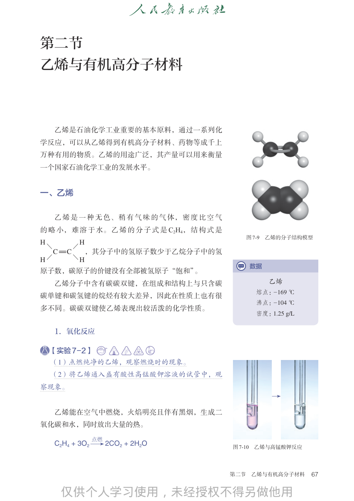

## RJ-CHEMISTRY-HSC2-080 乙烯的燃烧与被酸性高锰酸钾氧化

第七章 有机化合物 / 第二节 乙烯与有机高分子材料 / 一、乙烯 · P72-P73

（1）点燃纯净的乙烯，观察燃烧时的现象。（2）将乙烯通入盛有酸性高锰酸钾溶液的试管中，观察现象。

乙烯能在空气中燃烧，火焰明亮且伴有黑烟，生成二氧化碳和水，同时放出大量的热。

C₂H₄ + 3O₂ ─点燃→ 2CO₂ + 2H₂O

乙烯可使酸性高锰酸钾溶液褪色，被高锰酸钾等氧化剂氧化。

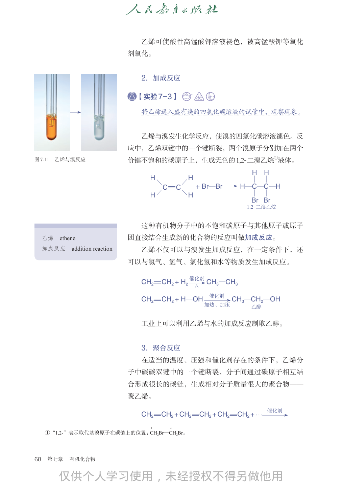

## RJ-CHEMISTRY-HSC2-081 乙烯与溴的反应及加成反应

第七章 有机化合物 / 第二节 乙烯与有机高分子材料 / 一、乙烯 · P73

将乙烯通入盛有溴的四氯化碳溶液的试管中，观察现象。

乙烯与溴发生化学反应，使溴的四氯化碳溶液褪色。反应中，乙烯双键中的一个键断裂，两个溴原子分别加在两个价键不饱和的碳原子上，生成无色的1,2-二溴乙烷液体。

CH₂=CH₂ + Br₂ → CH₂Br—CH₂Br

这种有机物分子中的不饱和碳原子与其他原子或原子团直接结合生成新的化合物的反应叫做加成反应。乙烯不仅可以与溴发生加成反应，在一定条件下，还可以与氯气、氢气、氯化氢和水等物质发生加成反应。

CH₂=CH₂ + H₂ ─催化剂、加热→ CH₃—CH₃

CH₂=CH₂ + H—OH ─催化剂、加热、加压→ CH₃—CH₂—OH

工业上可以利用乙烯与水的加成反应制取乙醇。

“1,2-”表示取代基溴原子在碳链上的位置：CH₂Br—CH₂Br。

## RJ-CHEMISTRY-HSC2-082 乙烯的聚合反应与加聚反应

第七章 有机化合物 / 第二节 乙烯与有机高分子材料 / 一、乙烯 · P73-P74

在适当的温度、压强和催化剂存在的条件下，乙烯分子中碳碳双键中的一个键断裂，分子间通过碳原子相互结合形成很长的碳链，生成相对分子质量很大的聚合物——聚乙烯。

…—CH₂—CH₂—CH₂—CH₂—CH₂—CH₂—…

这个反应还可以用下式表示：nCH₂=CH₂ ─催化剂→ [—CH₂—CH₂—]ₙ

像这样，由相对分子质量小的化合物分子互相结合成相对分子质量大的聚合物的反应叫做聚合反应。聚合反应在有机高分子材料的生产中有着广泛的应用。乙烯的聚合反应同时也是加成反应，这样的反应又被称为加成聚合反应，简称加聚反应。聚合反应生成的高分子是由较小的结构单元重复连接而成的。例如，聚乙烯分子可以用[—CH₂—CH₂—]ₙ来表示，其中重复的结构单元“—CH₂—CH₂—”称为链节，链节的数目n称为聚合度。能合成高分子的小分子物质称为单体，乙烯就是聚乙烯的单体。

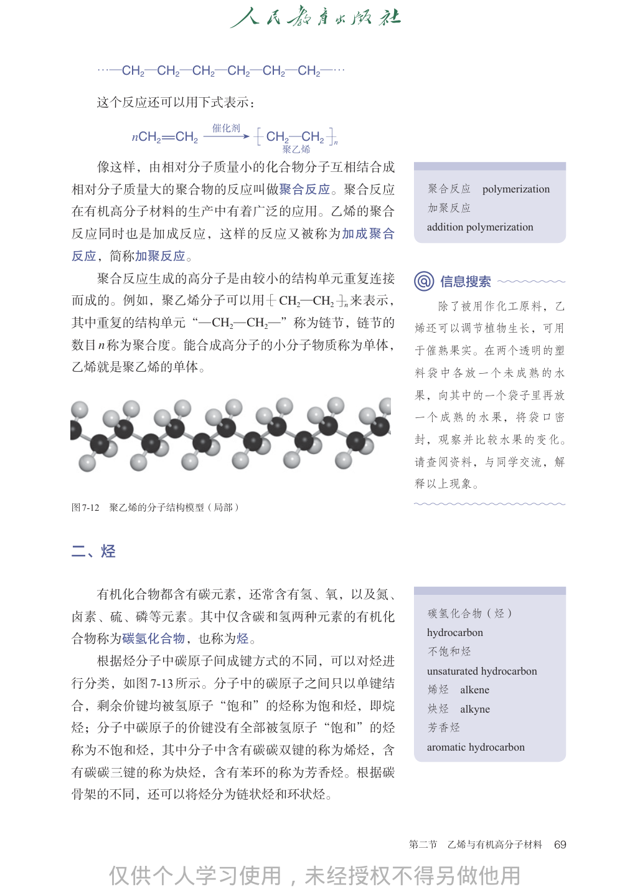

## RJ-CHEMISTRY-HSC2-083 乙烯与植物生长及果实成熟

第七章 有机化合物 / 第二节 乙烯与有机高分子材料 / 一、乙烯 · P74

除了被用作化工原料，乙烯还可以调节植物生长，可用于催熟果实。在两个透明的塑料袋中各放一个未成熟的水果，向其中的一个袋子里再放一个成熟的水果，将袋口密封，观察并比较水果的变化。

## RJ-CHEMISTRY-HSC2-084 烃的组成与分类

第七章 有机化合物 / 第二节 乙烯与有机高分子材料 / 二、烃 · P74-P75

有机化合物都含有碳元素，还常含有氢、氧，以及氮、卤素、硫、磷等元素。其中仅含碳和氢两种元素的有机化合物称为碳氢化合物，也称为烃。根据烃分子中碳原子间成键方式的不同，可以对烃进行分类，如图7-13所示。分子中的碳原子之间只以单键结合，剩余价键均被氢原子“饱和”的烃称为饱和烃，即烷烃；分子中碳原子的价键没有全部被氢原子“饱和”的烃称为不饱和烃，其中分子中含有碳碳双键的称为烯烃，含有碳碳三键的称为炔烃，含有苯环的称为芳香烃。根据碳骨架的不同，还可以将烃分为链状烃和环状烃。

除了烯烃，炔烃也是一类重要的不饱和烃，乙炔是最简单的炔烃。苯是芳香烃的母体，是一种具有环状分子结构的不饱和烃，其结构式习惯上简写为（见原图）。实际上苯分子中6个碳原子之间的键完全相同，所以也常用原图中的另一种形式来表示苯分子的结构。

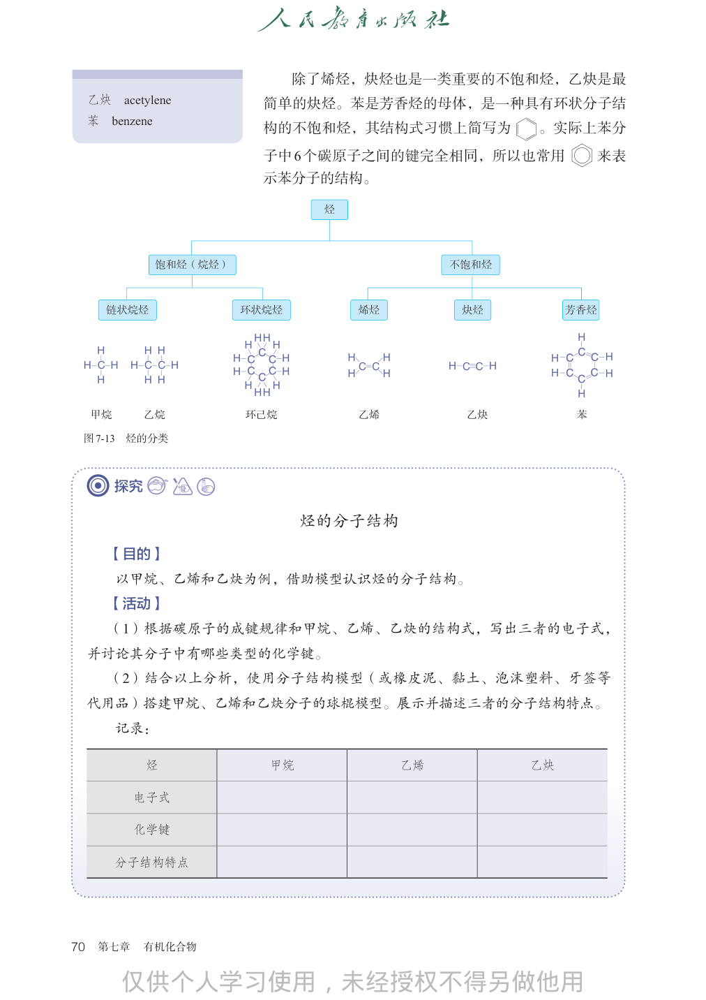

## RJ-CHEMISTRY-HSC2-085 苯的结构特点与用途

第七章 有机化合物 / 第二节 乙烯与有机高分子材料 / 二、烃 · P76

芳香族化合物一般指分子中含有苯环的有机物，它们并不一定有香味。苯是芳香族化合物的母体，是一种重要的有机化工原料和有机溶剂，被广泛用于生产医药、农药、香料、染料、洗涤剂和合成高分子材料等。

现在人们知道，苯分子具有平面正六边形结构，相邻碳原子之间的键完全相同，其键长介于碳碳单键和碳碳双键的键长之间。

## RJ-CHEMISTRY-HSC2-086 天然有机高分子与合成有机高分子

第七章 有机化合物 / 第二节 乙烯与有机高分子材料 / 三、有机高分子材料 · P77

人们很早就开始使用的棉花、羊毛、天然橡胶等属于天然有机高分子材料，现在使用更多的则是塑料、合成纤维、合成橡胶、黏合剂、涂料等合成有机高分子材料。

## RJ-CHEMISTRY-HSC2-087 塑料的组成、性质与常见品种

第七章 有机化合物 / 第二节 乙烯与有机高分子材料 / 三、有机高分子材料 · P77-P78

塑料的主要成分是合成树脂，像聚乙烯、聚丙烯、聚氯乙烯、酚醛树脂等都是生产塑料的合成树脂。此外，人们还根据需要加入一些具有特定作用的添加剂，如能提高塑性的增塑剂，防止塑料老化的防老剂，以及增强材料、着色剂等，再经过压制等加工处理，才能得到各种塑料制品。塑料具有强度高、密度小、耐腐蚀、易加工等优良的性能，在日常生活和工业生产中大量代替了钢铁、木材等传统材料。塑料的品种很多，用途也各不相同。

## RJ-CHEMISTRY-HSC2-088 橡胶、合成橡胶与硫化

第七章 有机化合物 / 第二节 乙烯与有机高分子材料 / 三、有机高分子材料 · P78-P79

橡胶是一类具有高弹性的高分子材料，是制造汽车、飞机轮胎和各种密封材料所必需的原料。人们很早就知道从橡胶树等植物中获得天然橡胶，但天然橡胶远不能满足人们的需要，于是化学家开始研究如何用化学方法人工合成橡胶。经过分析发现，天然橡胶的主要成分是聚异戊二烯。

聚异戊二烯的结构简式见原图。

通过模仿天然橡胶的分子组成和结构，人们以异戊二烯为单体进行聚合反应，制得了异戊橡胶。异戊橡胶的性能与天然橡胶十分接近，又被称为合成天然橡胶。随着技术的发展，人们还开发了丁苯橡胶、顺丁橡胶、氯丁橡胶等一系列合成橡胶。许多橡胶具有线型结构，有一定弹性，但强度和韧性差。为了克服这些缺点，工业上常用硫与橡胶作用进行橡胶硫化，使线型的高分子链之间通过硫原子形成化学键，产生交联，形成网状结构。硫化橡胶具有更好的强度、韧性、弹性和化学稳定性。人们还开发了耐热和耐酸、碱腐蚀的氟橡胶，耐高温和严寒的硅橡胶等特种橡胶。特种橡胶在航空、航天和国防等尖端技术领域中发挥着重要的作用。

## RJ-CHEMISTRY-HSC2-089 人造纤维、合成纤维与化学纤维

第七章 有机化合物 / 第二节 乙烯与有机高分子材料 / 三、有机高分子材料 · P79-P80

人类开始用化学方法将农林产品中的纤维素、蛋白质等天然高分子加工成黏胶纤维、大豆蛋白纤维等再生纤维，后来发展到以石油、天然气和煤等为原料制成有机小分子单体，再经聚合反应生产合成纤维。再生纤维与合成纤维统称为化学纤维。常见的合成纤维有聚丙烯纤维（丙纶）、聚氯乙烯纤维（氯纶）、聚丙烯腈纤维（腈纶）、聚对苯二甲酸乙二酯纤维（涤纶）和聚酰胺纤维（锦纶、芳纶）等。合成纤维具有强度高、弹性好、耐磨、耐化学腐蚀、不易虫蛀等优良性能，除了供人类穿着外，还可以制成绳索、渔网、工业用滤布，以及飞机、船舶的结构材料等，广泛应用于工农业生产的各个领域。

## RJ-CHEMISTRY-HSC2-090 胶黏剂与涂料

第七章 有机化合物 / 第二节 乙烯与有机高分子材料 / 三、有机高分子材料 · P80

黏合剂又称胶黏剂，日常生活中常用的糨糊、胶水就是最普通的黏合剂。黏合剂根据来源可分为天然黏合剂和合成黏合剂。人们很早就使用动物的皮或鱼鳔熬胶，用于黏结木材。合成黏合剂的黏结力强，性能优异，得到了广泛的应用。近几十年来，汽车、电子等行业的发展对黏合剂的性能提出了更高的要求，一系列具有耐高温、耐低温、导电、导磁和导热等性能的特种黏合剂相继问世。

涂料是一类含有机高分子的混合液或粉末，能在物体表面形成附着坚固的涂膜，油漆就是一种常见的涂料。涂料可用于建筑、船舶、车辆，以及家电、家具的保护和装饰。特种涂料在化工、航空等领域具有重要的用途。

## RJ-CHEMISTRY-HSC2-091 乙醇的物理性质、组成与结构

第七章 有机化合物 / 第三节 乙醇与乙酸 / 一、乙醇 · P82

各种酒类都含有浓度不等的乙醇，故乙醇俗称酒精。乙醇是无色、有特殊香味的液体，密度比水的小，易挥发。乙醇是一种重要的有机溶剂，能够溶解多种有机物和无机物，并能与水以任意比例互溶。乙醇的分子式是C₂H₆O，结构式见原图。

乙醇：熔点−117 ℃，沸点78.5 ℃，密度0.789 g/cm³。

## RJ-CHEMISTRY-HSC2-092 羟基与烃的衍生物

第七章 有机化合物 / 第三节 乙醇与乙酸 / 一、乙醇 · P82

乙醇的结构式可简写为CH₃CH₂OH或C₂H₅OH，其中的—OH原子团称为羟基。乙醇可以看成是乙烷分子中的一个氢原子被羟基取代后的产物。像这样，烃分子中的氢原子被其他原子或原子团所取代而生成的一系列化合物称为烃的衍生物。前面提及的一氯甲烷、二氯甲烷和1,2-二溴乙烷等卤代烃也属于烃的衍生物。烃的衍生物与其母体化合物相比，其性质因分子中取代基团的存在而不同。

## RJ-CHEMISTRY-HSC2-093 乙醇与钠的反应及与水的活泼性比较

第七章 有机化合物 / 第三节 乙醇与乙酸 / 一、乙醇 · P82-P83

【实验7-4】在盛有少量无水乙醇的试管中，加入一小块新切的、用滤纸吸干表面煤油的钠，在试管口迅速塞上带尖嘴导管的橡胶塞，用小试管收集气体并检验其纯度，然后点燃（如图7-19），再将干燥的小烧杯罩在火焰上。待烧杯壁上出现液滴后，迅速倒转烧杯，向其中加入少量澄清石灰水。观察现象，并与前面做过的水与钠反应的实验现象进行比较。

与烷烃不同，乙醇由于分子中羟基的存在，可以与钠发生反应。在该反应中，钠置换了羟基中的氢，生成了氢气和乙醇钠。

2CH₃CH₂OH + 2Na → 2CH₃CH₂ONa + H₂↑

乙醇羟基中的氢原子不如水分子中的氢原子活泼。实验现象表明，乙醇与钠的反应比相同条件下水与钠的反应缓和得多。

## RJ-CHEMISTRY-HSC2-094 官能团与烃基

第七章 有机化合物 / 第三节 乙醇与乙酸 / 一、乙醇 · P83

乙醇具有与乙烷不同的性质，从分子结构角度分析，是因为取代氢原子的羟基对乙醇的性质产生了影响。像这种决定有机化合物特性的原子或原子团叫做官能团。羟基是醇类物质的官能团，碳碳双键和碳碳三键分别是烯烃和炔烃的官能团。

烃分子失去1个氢原子后所剩余的部分叫做烃基，可以用—R来表示。如—CH₃叫甲基，—CH₂CH₃叫乙基。烃的衍生物分子一般可以看成是烃基和官能团相互结合组成的。例如，乙醇分子可以看成是由乙基和羟基组成的：CH₃CH₂—OH。

## RJ-CHEMISTRY-HSC2-095 乙醇的燃烧与催化氧化

第七章 有机化合物 / 第三节 乙醇与乙酸 / 一、乙醇 · P83-P84

乙醇在空气中燃烧时生成二氧化碳和水，同时放出大量的热。
CH₃CH₂OH + 3O₂ ─点燃→ 2CO₂ + 3H₂O
在一定条件下，乙醇还能被氧化为其他产物。

【实验7-5】向试管中加入少量乙醇，取一根铜丝，下端绕成螺旋状，在酒精灯上灼烧后插入乙醇，反复几次。注意观察反应现象，小心地闻试管中液体产生的气味。

乙醇在加热和有催化剂（如铜或银）存在等条件下，可以被空气中的氧气氧化为乙醛（CH₃CHO）。
2CH₃CH₂OH + O₂ ─催化剂、加热→ 2CH₃CHO + 2H₂O

乙醛的官能团是醛基（结构见原图，或写作—CHO），在适当条件下乙醛可以被氧气进一步氧化，生成乙酸（CH₃COOH）。乙醇还可以与酸性高锰酸钾溶液或酸性重铬酸钾（K₂Cr₂O₇）溶液反应，被氧化成乙酸。

## RJ-CHEMISTRY-HSC2-096 乙醇的用途与酒精度

第七章 有机化合物 / 第三节 乙醇与乙酸 / 一、乙醇 · P84

乙醇可用作燃料，还是重要的有机化工原料和溶剂，用于生产医药、香料、化妆品、涂料等。医疗上常用75%（体积分数）的乙醇溶液作消毒剂。

酒类产品标签中的酒精度是指乙醇的体积分数，白酒一般在25% ~ 68%，啤酒一般在3% ~ 5%。乙醇进入人体后，会在肝中通过酶的催化作用被氧化为乙醛和乙酸，最终被氧化为二氧化碳和水。过量饮酒会加重肝负担，血液中较高浓度的乙醇和乙醛也会对人体产生毒害作用。

## RJ-CHEMISTRY-HSC2-097 乙酸的物理性质、结构与酸性

第七章 有机化合物 / 第三节 乙醇与乙酸 / 二、乙酸 · P84

食醋是生活中常见的调味品，其中含有乙酸，所以乙酸又被称为醋酸。乙酸是有强烈刺激性气味的无色液体。当温度低于熔点时，乙酸可凝结成类似冰的晶体，所以纯净的乙酸又叫冰醋酸。乙酸易溶于水和乙醇。
乙酸是烃的含氧衍生物，分子式为C₂H₄O₂，结构简式为CH₃COOH。乙酸的官能团是羧基（结构见原图，或写作—COOH）。乙酸的化学性质主要由其分子中的羧基决定。乙酸是一种重要的有机酸，具有酸性。

乙酸：熔点16.6 ℃，沸点118 ℃，密度1.05 g/cm³。

## RJ-CHEMISTRY-HSC2-098 乙酸与乙醇的酯化反应及酯的性质

第七章 有机化合物 / 第三节 乙醇与乙酸 / 二、乙酸 · P85

【实验7-6】在一支试管中加入3 mL乙醇，然后边振荡试管边慢慢加入2 mL浓硫酸和2 mL乙酸，再加入几片碎瓷片。连接好装置，用酒精灯小心加热，将产生的蒸气经导管通到饱和Na₂CO₃溶液的液面上（如图7-22），观察现象。

在反应过程中，右侧试管内液体的上层有无色透明的油状液体产生，并可以闻到香味，这种有香味的液体是乙酸乙酯。该反应的化学方程式为：
CH₃COOH + C₂H₅OH ⇌ CH₃COOC₂H₅ + H₂O（浓硫酸、加热；结构式见原图）

这种酸与醇反应生成酯和水的反应，叫做酯化反应。为了提高酯化反应的速率，一般需要加热，并加入浓硫酸等催化剂。酯化反应是可逆反应，乙酸乙酯会与水发生水解反应生成乙酸和乙醇。
乙酸乙酯是酯类物质中的一种，其官能团是酯基（结构见原图，或写作—COOR）。很多鲜花和水果的香味都来自酯，如草莓中含有乙酸乙酯和乙酸异戊酯，苹果中含有戊酸戊酯。这些分子中碳原子数较少、相对分子质量较小的低级酯具有一定的挥发性，有芳香气味，可用作饮料、糖果、化妆品中的香料和有机溶剂。

乙醇和乙酸乙酯是常用的化工原料和有机溶剂。它们在储存时应置于密闭容器，存放在阴凉、通风处，并与氧化剂、易燃物等分开存放，注意远离火种和热源。

## RJ-CHEMISTRY-HSC2-099 官能团与有机化合物的分类

第七章 有机化合物 / 第三节 乙醇与乙酸 / 三、官能团与有机化合物的分类 · P86

通过对乙烯、乙醇和乙酸性质的学习，我们认识到官能团对有机物的性质具有决定作用，含有相同官能团的有机物在性质上具有相似之处。因此我们可以根据有机物分子中所含官能团的不同，从结构和性质上对数量庞大的有机物进行分类（如表7-2）。

## RJ-CHEMISTRY-HSC2-100 认识有机化合物的一般思路

第七章 有机化合物 / 第三节 乙醇与乙酸 / 三、官能团与有机化合物的分类 · P86-P87

认识一种有机物，可先从结构入手，分析其碳骨架和官能团，了解它所属的有机物类别；再结合这类有机物的一般性质，推测该有机物可能具有的性质，并通过实验进行验证；在此基础上进一步了解该有机物的用途。另外，还可以根据有机物发生的化学反应，了解其在有机物转化（有机合成）中的作用。与认识无机物类似，认识有机物也体现了“结构决定性质”的观念。各类有机物在结构和性质上具有的明显规律性，有助于我们更好地认识有机物。

## RJ-CHEMISTRY-HSC2-101 基本营养物质与糖类的分类

第七章 有机化合物 / 第四节 基本营养物质 / 一、糖类 · P88

生命活动需要一系列复杂的化学过程来维持，食物中的营养物质是这些过程的物质和能量基础。我们已经知道，营养物质主要包括糖类、蛋白质、油脂、维生素、无机盐和水。除了水，人们每天摄入量较大的是糖类、蛋白质和油脂这三类有机物，它们既是人体必需的基本营养物质，也是食品工业的重要原料。

糖类是绿色植物光合作用的产物，也是人类最重要的能量来源。人们最初发现的这一类化合物的化学组成大多符合Cₙ(H₂O)ₘ的通式，因此糖类也被称为碳水化合物。葡萄糖（C₆H₁₂O₆）、蔗糖（C₁₂H₂₂O₁₁）和淀粉［(C₆H₁₀O₅)ₙ］等都属于糖类。

## RJ-CHEMISTRY-HSC2-102 糖类物质的同分异构关系

第七章 有机化合物 / 第四节 基本营养物质 / 一、糖类 · P89

葡萄糖和果糖的分子式完全相同，但分子结构不同，二者互为同分异构体。蔗糖和麦芽糖的分子式相同，结构不同，也互为同分异构体。淀粉和纤维素是天然有机高分子，分子中的结构单元数目不同，分子式不同，不能互称为同分异构体。

## RJ-CHEMISTRY-HSC2-103 葡萄糖的结构与特征反应检验

第七章 有机化合物 / 第四节 基本营养物质 / 一、糖类 · P89

葡萄糖是最重要的单糖，是构成多种二糖和多糖的基本单元。葡萄糖是一种有甜味的无色晶体，能溶于水，其分子式是C₆H₁₂O₆，结构简式为：

CH₂OH—CHOH—CHOH—CHOH—CHOH—CHO【实验7-7】（1）在试管中加入2 mL 10% NaOH 溶液，滴加5滴5% CuSO₄溶液，得到新制的Cu(OH)₂。再加入2 mL 10%葡萄糖溶液，加热，观察现象。（2）在洁净的试管中加入1 mL 2% AgNO₃溶液，然后一边振荡试管，一边逐滴加入2%氨水，直到最初产生的沉淀恰好溶解为止，得到银氨溶液。再加入1 mL 10% 葡萄糖溶液，振荡，然后放在水浴中加热，观察现象。

葡萄糖与新制的氢氧化铜反应，生成砖红色的氧化亚铜沉淀；与银氨溶液反应生成银，在试管内壁形成光亮的银镜。这两个反应可用来检验葡萄糖。

糖尿病患者的糖代谢功能紊乱，其血液和尿液中的葡萄糖含量会超出正常范围。测定患者血液或尿液中的葡萄糖含量有助于判断病情，可使用根据葡萄糖特征反应原理制备的试纸进行测试。

## RJ-CHEMISTRY-HSC2-104 淀粉检验与糖类水解

第七章 有机化合物 / 第四节 基本营养物质 / 一、糖类 · P89-P90

【实验7-8】（1）回忆生物课中学习的检验淀粉的方法。将碘溶液滴到一片馒头或土豆上，观察现象。（2）在试管中加入0.5 g淀粉和4 mL 2 mol/L H₂SO₄溶液，加热。待溶液冷却后向其中加入NaOH溶液，将溶液调至碱性，再加入少量新制的Cu(OH)₂，加热。观察并解释实验现象。

蔗糖、淀粉和纤维素等在酸的催化下能发生水解反应，最终生成单糖。工业上一般用淀粉水解的方法生产葡萄糖。

C₁₂H₂₂O₁₁（蔗糖）+ H₂O ─催化剂→ C₆H₁₂O₆（葡萄糖）+ C₆H₁₂O₆（果糖）

(C₆H₁₀O₅)ₙ（淀粉或纤维素）+ nH₂O ─催化剂→ nC₆H₁₂O₆（葡萄糖）

## RJ-CHEMISTRY-HSC2-105 糖类在人体中的变化与制取乙醇

第七章 有机化合物 / 第四节 基本营养物质 / 一、糖类 · P90

摄入人体内的淀粉在酶的催化作用下也可以发生逐步水解，最终生成葡萄糖。葡萄糖经缓慢氧化转变为二氧化碳和水，同时放出能量（如图7-26）。食草动物的体内有纤维素水解酶，可将纤维素水解生成葡萄糖。人体内没有类似的酶，无法吸收和利用纤维素。但食物中的纤维素能刺激肠道蠕动，有助于消化，因此人们应摄入一定量的蔬菜、水果和粗粮等含纤维素较多的食物。淀粉和纤维素也是重要的工业原料，二者水解生成的葡萄糖在酶的催化下可以转变为乙醇。这个转化过程被广泛应用于酿酒和利用生物质生产燃料乙醇。

C₆H₁₂O₆ ─酶→ 2C₂H₅OH + 2CO₂↑

## RJ-CHEMISTRY-HSC2-106 蛋白质的组成、水解与氨基酸

第七章 有机化合物 / 第四节 基本营养物质 / 二、蛋白质 · P90-P91

蛋白质是构成细胞的基本物质，存在于各类生物体内。一切重要的生命现象都与蛋白质密切相关。蛋白质是一类非常复杂的天然有机高分子，由碳、氢、氧、氮、硫等元素组成。蛋白质在酸、碱或酶的作用下能发生水解，生成多肽，多肽进一步水解，最终生成氨基酸。

氨基酸分子中都含有氨基（—NH₂）和羧基。在一定条件下，氨基酸之间能发生聚合反应，生成更为复杂的多肽，进而构成蛋白质。人体从食物中摄取的蛋白质在消化道内酶的作用下，经过水解反应生成各种氨基酸。氨基酸被吸收后可结合成人体所需要的蛋白质。

## RJ-CHEMISTRY-HSC2-107 蛋白质的变性、显色与灼烧实验

第七章 有机化合物 / 第四节 基本营养物质 / 二、蛋白质 · P91

有的蛋白质能溶于水，如鸡蛋清等；有的则难溶于水，如丝、毛等。蛋白质除了可以水解为氨基酸，还具有一些其他的性质。

【实验7-9】（1）向盛有鸡蛋清溶液的试管中加几滴醋酸铅溶液，观察现象。（2）向盛有鸡蛋清溶液的试管中加几滴浓硝酸，加热，观察现象。（3）在酒精灯的火焰上分别灼烧一小段头发和丝织品，小心地闻气味。

蛋白质在一些化学试剂，如重金属的盐类、强酸、强碱、乙醇、甲醛等，以及一些物理因素，如加热、紫外线等的作用下会发生变性，溶解度下降，并失去生理活性。蛋白质还可以与一些试剂发生显色反应，如很多蛋白质与浓硝酸作用时呈黄色，可用于蛋白质的检验。此外，蛋白质被灼烧时，会产生类似烧焦羽毛的特殊气味。

## RJ-CHEMISTRY-HSC2-108 蛋白质及酶的用途

第七章 有机化合物 / 第四节 基本营养物质 / 二、蛋白质 · P91

蛋白质是人类必需的营养物质，在工业上也有很多应用。用蚕丝织成的丝绸可以制作服装；从动物皮、骨中提取的明胶可用作食品增稠剂，生产医药用胶囊和摄影用感光材料，驴皮制的阿胶还是一种中药材；从牛奶和大豆中提取的酪素可以用来制作食品和涂料。绝大多数酶也是蛋白质，是生物体内重要的催化剂，在医药、食品、纺织等领域中有重要的应用价值。

## RJ-CHEMISTRY-HSC2-109 油脂的组成、结构与物理性质

第七章 有机化合物 / 第四节 基本营养物质 / 三、油脂 · P92

油脂是重要的营养物质，我们日常食用的花生油、大豆油和动物油等都属于油脂。在室温下，植物油脂通常呈液态，叫做油；动物油脂通常呈固态，叫做脂肪。油脂的密度比水的小，黏度比较大，触摸时有明显的油腻感。油脂难溶于水，易溶于有机溶剂。食品工业中根据这一性质，常使用有机溶剂来提取植物种子里的油。油脂可以看作是高级脂肪酸与甘油（丙三醇）通过酯化反应生成的酯。其结构见原图。

油脂结构中的R、R'、R''代表高级脂肪酸的烃基，可以相同或不同。常见的高级脂肪酸有饱和脂肪酸，如硬脂酸（C₁₇H₃₅COOH）和软脂酸（C₁₅H₃₁COOH），以及不饱和脂肪酸，如油酸（C₁₇H₃₃COOH）和亚油酸（C₁₇H₃₁COOH）。

## RJ-CHEMISTRY-HSC2-110 油脂的氢化、水解与生理功能

第七章 有机化合物 / 第四节 基本营养物质 / 三、油脂 · P92-P93

脂肪酸的饱和程度对油脂的熔点影响很大。植物油含较多不饱和脂肪酸的甘油酯，熔点较低；动物油含较多饱和脂肪酸的甘油酯，熔点较高。工业上常将液态植物油在一定条件下与氢气发生加成反应，提高其饱和程度，生成固态的氢化植物油。氢化植物油性质稳定，不易变质，便于运输和储存，可用来生产人造奶油、起酥油、代可可脂等食品工业原料。油脂在人体小肠中通过酶的催化可以发生水解反应，生成高级脂肪酸和甘油，然后再分别进行氧化分解，释放能量。在工业上可利用油脂在碱性条件下的水解反应（即皂化反应）获得高级脂肪酸盐和甘油，进行肥皂生产。油脂能促进脂溶性维生素（如维生素A、D、E、K）的吸收，并为人体提供亚油酸等必需脂肪酸。在烹饪过程中，油脂不仅是加热介质，还会赋予食物令人愉悦的风味和口感。

目前，人们往往容易摄入过多的油脂，影响健康，因此在日常饮食中要注意合理控制油脂的摄入量。

## RJ-CHEMISTRY-HSC2-111 食用油的氧化变质与抗氧化

第七章 有机化合物 / 第四节 基本营养物质 / 三、油脂 · P92

常见的食用油中普遍含有油酸等不饱和脂肪酸的甘油酯，其分子中含有碳碳双键，在空气中放置久了会被氧化，产生过氧化物和醛类等。变质的油脂带有一种难闻的“哈喇”味，不能食用。因此很多食品的包装中常有一小包含有铁粉等物质的脱氧剂，市售的食用油中也普遍加入叔丁基对苯二酚（TBHQ）等抗氧化剂，以确保食品安全。

## RJ-CHEMISTRY-HSC2-112 奶油与人造奶油

第七章 有机化合物 / 第四节 基本营养物质 / 三、油脂 · P93

奶油俗称黄油，是将牛乳中的脂肪成分经过提炼浓缩而得到的动物油脂产品。奶油中含有较多的饱和脂肪酸甘油酯，熔化温度在30 ℃左右，比一般植物油的高。这使其在室温下有一定硬度，具有可塑性，适于糕点裱花和保持糕点外形完整；同时，奶油的熔化温度并不太高，因此入口即化，具有良好的口感。另外，奶油具有浓郁的奶香味，还含有较丰富的脂溶性维生素，一直是制作蛋糕、饼干、面包等烘焙食品和巧克力、冰淇淋的重要原料，受到人们的普遍喜爱。

人造奶油，又称人造黄油、植物奶油、麦淇淋，是以氢化植物油和植物油为主要原料，加入水、乳制品、乳化剂、防腐剂、抗氧化剂、香精、色素、维生素等物质生产出来的。其外观和风味与天然奶油十分接近，具有良好的加工性能，能够延长食品的保质期，且成本较低，在现代食品工业中得到了广泛的应用。

## RJ-CHEMISTRY-HSC2-113 甲烷、乙烷、乙烯和乙炔的球棍模型搭建

第七章 有机化合物 / 实验活动8 搭建球棍模型认识有机化合物分子结构的特点 / 实验活动8 搭建球棍模型认识有机化合物分子结构的特点 · P100

分子结构模型（或橡皮泥、黏土、泡沫塑料、牙签等代用品）。

1. 填写下表，并搭建甲烷分子的球棍模型。

2. 填写下表，并搭建乙烷、乙烯和乙炔分子的球棍模型，比较三者的空间结构。

## RJ-CHEMISTRY-HSC2-114 乙醇、乙酸性质及乙酸乙酯制取实验

第七章 有机化合物 / 实验活动9 乙醇、乙酸的主要性质 / 实验活动9 乙醇、乙酸的主要性质 · P101

试管、试管夹、量筒、胶头滴管、玻璃导管、乳胶管、橡胶塞、铁架台、试管架、酒精灯、火柴、碎瓷片。乙醇、乙酸、饱和Na₂CO₃溶液、浓硫酸、铜丝。设计实验所需其他用品：                        。

（1）向试管中加入少量乙醇，观察其状态，闻其气味。（2）设计实验，验证乙醇的燃烧产物。（3）在试管中加入少量乙醇，把一端弯成螺旋状的铜丝放在酒精灯外焰上加热，使铜丝表面生成一薄层黑色的CuO，立即将其插入盛有乙醇的试管中，这样反复操作几次。注意小心地闻生成物的气味，并观察铜丝表面的变化。2. 乙酸的性质（1）向试管中加入少量乙酸，观察其状态，小心地闻其气味。（2）设计实验，证明乙酸具有酸的通性，并比较乙酸与碳酸的酸性强弱。（3）在一支试管中加入2 mL乙醇，然后边振荡试管边慢慢加入0.5 mL浓硫酸和2 mL乙酸，再加入几片碎瓷片。在另一支试管中加入3 mL饱和Na₂CO₃溶液，按图7-22所示把装置连接好。用小火加热试管里的混合物，产生的蒸气经导管通到饱和Na₂CO₃溶液的上方约0.5 cm处，注意观察该试管内的变化。取下盛有饱和Na₂CO₃溶液的试管，并停止加热。振荡盛有饱和Na₂CO₃溶液的试管，静置，待溶液分层后，观察上层的油状液体，并注意闻气味。

## RJ-CHEMISTRY-HSC2-115 自然资源的分类与可持续发展

第八章 化学与可持续发展 / 第一节 自然资源的开发利用 / 第一节 自然资源的开发利用 · P103

自然资源是人类社会发展不可或缺的自然物质基础，包括土地与土壤资源、矿产资源、生物资源、水资源、能源资源、环境资源等，根据其能否再生可以分为可再生资源和不可再生资源。可持续发展的目标是在满足人类需要的同时，强调人类的行为要受到自然界的制约，强调人类代际之间、人类与其他生物种群之间、不同国家和不同地区之间的公平。它包括经济可持续发展、社会可持续发展、资源可持续发展、环境可持续发展等方面。

## RJ-CHEMISTRY-HSC2-116 金属冶炼的方法与反应原理

第八章 化学与可持续发展 / 第一节 自然资源的开发利用 / 一、金属矿物的开发利用 · P103

除了金、铂等极少数金属，绝大多数金属元素以化合物的形式存在于自然界。化学要研究如何合理、高效地开发利用这些金属矿物，将其中的金属从其化合物中还原出来，用于生产各种金属材料，这一过程在工业上称为金属的冶炼。根据金属活泼性的不同，可以采用不同的冶炼方法。对一些不活泼金属，可以直接用加热分解的方法将它们从其化合物中还原出来。例如：
2HgO ─加热→ 2Hg + O₂↑

对一些非常活泼的金属，采用一般的还原剂很难将它们从其化合物中还原出来，工业上常用电解法冶炼。例如：
MgCl₂（熔融）─电解→ Mg + Cl₂↑
2Al₂O₃（熔融）─电解、冰晶石→ 4Al + 3O₂↑
2NaCl（熔融）─电解→ 2Na + Cl₂↑

大部分金属的冶炼都是通过在高温下发生的氧化还原反应来完成的，常用的还原剂有焦炭、一氧化碳、氢气等，如我们在初中学过的用碳还原氧化铜和一氧化碳还原氧化铁。一些活泼金属也可作还原剂，将相对不活泼的金属从其化合物中置换出来。例如，铝热反应的原理是：
Fe₂O₃ + 2Al ─高温→ 2Fe + Al₂O₃

## RJ-CHEMISTRY-HSC2-117 合理利用金属资源与回收铝的能耗

第八章 化学与可持续发展 / 第一节 自然资源的开发利用 / 一、金属矿物的开发利用 · P104

地球上的金属矿物资源是有限的，且分布不均。人类通过金属的冶炼，每年从自然界中提取数以亿吨计的金属，这个过程中会消耗许多能量，也易造成环境污染。而金属腐蚀现象普遍存在，也造成了大量损失。因此，合理开发和利用金属资源显得尤为重要，其主要途径有提高金属矿物的利用率，开发环保高效的金属冶炼方法，防止金属的腐蚀，加强废旧金属的回收和再利用，使用其他材料代替金属材料，等等。

计算表明，生产1 mol铝消耗的电能至少为1.8×10⁶ J，回收铝质饮料罐得到铝与从铝土矿制铝相比，前者的能耗仅为后者的3%～5%。

## RJ-CHEMISTRY-HSC2-118 海水水资源与化学资源的利用

第八章 化学与可持续发展 / 第一节 自然资源的开发利用 / 二、海水资源的开发利用 · P105-P106

海洋约占地球表面积的71％，其中的水资源和其他化学资源具有十分巨大的开发潜力。海水中水的储量约为1.3×10¹⁸ t，约占地球上总水量的97％。海水水资源的利用，主要包括海水淡化和直接利用海水进行循环冷却等。海水淡化的方法主要有蒸馏法、反渗透法和电渗析法等。其中蒸馏法的历史最久，技术和工艺也比较成熟。我国海水制盐具有悠久的历史。目前，从海水中制得的氯化钠除了供食用，还作为化工原料用于生产烧碱、纯碱、钠、氯气、盐酸等。从海水中制取镁、钾、溴及其他化工产品，就是在传统海水制盐工业的基础上发展起来的。海水淡化与化工生产、能源开发等相结合已经成为海水综合利用的重要方向（如图8-3）。

除了上面一些实例，从海水获得其他物质和能量也具有广阔的前景。例如，铀和重水是核能开发中的重要原料，从海水中提取铀和重水具有一定的战略意义；潮汐能、波浪能等新型能源的开发和利用也越来越受到重视。

## RJ-CHEMISTRY-HSC2-119 海水中的化学元素及富集程度

第八章 化学与可持续发展 / 第一节 自然资源的开发利用 / 二、海水资源的开发利用 · P105

由于与岩石、大气和生物的相互作用，海水中溶解和悬浮着大量的无机物和有机物。海水中含量最多的O、H两种元素，加上Cl、Na、Mg、S、Ca、K、Br、C、Sr、B、F等11种元素，其总含量超过99%，其他元素为微量。虽然海水中元素的种类很多，总储量很大，但许多元素的富集程度却很低。例如，海水中金元素的总储量约为5×10⁶ t，而1 t海水中金元素的含量仅为4×10⁻⁶ g。海洋还是一个远未充分开发的巨大化学资源宝库。

## RJ-CHEMISTRY-HSC2-120 海水提溴的吹出法

第八章 化学与可持续发展 / 第一节 自然资源的开发利用 / 二、海水资源的开发利用 · P106

溴及其化合物在医药、农药、染料和阻燃剂等的生产中有广泛应用。目前，人们主要从海水和盐湖水中提取溴。工业上常用的一种海水提溴技术叫做“吹出法”，其过程主要包括氧化（用氯气氧化海水中的溴离子）、吹出（用空气将生成的溴吹出）、吸收（用二氧化硫作还原剂使溴转化为氢溴酸，以使其与空气分离）、蒸馏（再用氯气将氢溴酸氧化为溴后蒸馏分离）等环节（如图8-4）。

## RJ-CHEMISTRY-HSC2-121 煤的组成、干馏及其主要产品

第八章 化学与可持续发展 / 第一节 自然资源的开发利用 / 三、煤、石油和天然气的综合利用 · P107

煤是由有机物和少量无机物组成的复杂混合物，其组成以碳元素为主，还含有少量氢、氧、氮、硫等元素。通过煤的干馏、气化和液化获得清洁的燃料和多种化工原料，是目前实现煤的综合利用的主要途径。煤的干馏是指将煤隔绝空气加强热使之分解的过程，工业上也叫煤的焦化。从煤的干馏产物中可以获得重要的化工原料（如表8-1）。

## RJ-CHEMISTRY-HSC2-122 煤的气化、直接液化与间接液化

第八章 化学与可持续发展 / 第一节 自然资源的开发利用 / 三、煤、石油和天然气的综合利用 · P107

煤的气化是将煤转化为可燃性气体的过程，主要反应是碳与水蒸气反应生成水煤气等。

C + H₂O(g) ─高温→ CO + H₂

煤可以直接液化，使煤与氢气作用生成液体燃料；煤也可以间接液化，一般是先转化为一氧化碳和氢气，然后在催化剂的作用下合成甲醇等。

## RJ-CHEMISTRY-HSC2-123 天然气的化工利用

第八章 化学与可持续发展 / 第一节 自然资源的开发利用 / 三、煤、石油和天然气的综合利用 · P107

天然气是一种清洁的化石燃料，它作为化工原料则主要用于合成氨和生产甲醇等。以含一个碳原子的甲烷为原料，通过化学变化合成含两个或多个碳原子的其他有机化合物，是一项具有重大实用价值的研究课题。

## RJ-CHEMISTRY-HSC2-124 天然气水合物

第八章 化学与可持续发展 / 第一节 自然资源的开发利用 / 三、煤、石油和天然气的综合利用 · P108

天然气水合物是天然气与水在高压、低温条件下形成的类冰状结晶物质，主要成分是甲烷水合物，其组成可表示为CH₄·nH2O，甲烷分子处于由多个水分子形成的笼中。天然气水合物的外观像冰，具有可燃性，故又被称为“可燃冰”。它被认为是21世纪的高效清洁能源。但是，储量巨大的天然气水合物的分解和甲烷释放，可能会诱发海底地质灾害，加重温室效应。

## RJ-CHEMISTRY-HSC2-125 石油的分馏、裂化、裂解与结构调整

第八章 化学与可持续发展 / 第一节 自然资源的开发利用 / 三、煤、石油和天然气的综合利用 · P108-P109

石油是由多种碳氢化合物组成的混合物，成分复杂，需要先在炼油厂进行加工，通过分馏来分离石油中沸点不同的组分。石油经分馏后可以获得汽油、煤油、柴油等含碳原子少的轻质油，但其产量难以满足社会需求，而含碳原子多的重油却供大于求。因此，需要通过催化裂化过程将重油裂化为汽油等物质，再进一步裂解，可以获得很多重要的化工原料。例如：

C₁₆H₃₄ ─催化剂、加热、加压→ C₈H₁₈ + C₈H₁₆

C₈H₁₈ ─催化剂、加热、加压→ C₄H₁₀ + C₄H₈

C₄H₁₀ ─催化剂、加热、加压→ CH₄ + C₃H₆

C₄H₁₀ ─催化剂、加热、加压→ C₂H₆ + C₂H₄

石油通过裂化和裂解可以得到乙烯、丙烯、甲烷等重要的基本化工原料。另外，石油在加热和催化剂的作用下，可以通过结构的调整，使链状烃转化为环状烃，如苯或甲苯等。

目前，多数石油产品仍作为燃料使用，只有一部分转化为化工、纺织、建材、医药、日用化学品等行业的基本原料。

## RJ-CHEMISTRY-HSC2-126 生物质资源的利用

第八章 化学与可持续发展 / 第一节 自然资源的开发利用 / 三、煤、石油和天然气的综合利用 · P110

人们利用物理、化学和生物方法将生物质资源转化为材料（如木材、纸张）、燃料（如生物乙醇、生物柴油），以及基本化工原料（如木炭、乙醇、甲醇、甲烷）等。目前，我国可供开发利用的生物质资源主要有农业、林业产品的废弃物（如农作物秸秆、林木加工余料），生产和生活的废弃物（如厨余垃圾、畜禽粪便）等。随着科技和社会的发展，以来自生物质的纤维素、淀粉和油脂等为原料的化工生产路线，替代以煤、石油和天然气为原料的路线，将是一条绿色的可持续发展途径。

## RJ-CHEMISTRY-HSC2-127 大宗化学品与精细化学品

第八章 化学与可持续发展 / 第二节 化学品的合理使用 / 第二节 化学品的合理使用 · P112

化学品可以分为大宗化学品和精细化学品两大类。乙烯、硫酸、纯碱和化肥等属于大宗化学品，医药、农药、日用化学品、食品添加剂等属于精细化学品。

## RJ-CHEMISTRY-HSC2-128 化肥的合理施用

第八章 化学与可持续发展 / 第二节 化学品的合理使用 / 一、化肥、农药的合理施用 · P112

施用化肥和农药是保障农作物增产、减少农作物损失的重要措施。然而，化肥和农药施用不当也会给人类和环境带来危害。合理施用化肥，除了要考虑土壤酸碱性、作物营养状况等因素，还必须根据化肥本身的性质进行科学施用。例如，硝酸铵是一种高效氮肥，但受热或经撞击易发生爆炸，因此必须作改性处理后才能施用。由于很多化肥易溶于水，过量施用不仅会造成浪费，部分化肥会随着雨水流入河流和湖泊，造成水体富营养化，产生水华等污染现象。另外，不合理施用化肥还会影响土壤的酸碱性和土壤结构。

## RJ-CHEMISTRY-HSC2-129 农药的种类及施用影响

第八章 化学与可持续发展 / 第二节 化学品的合理使用 / 一、化肥、农药的合理施用 · P112-P113

农药在农作物病虫害的综合防治中占有重要地位。人类早期使用的农药有除虫菊、烟草等植物和波尔多液、石灰硫黄合剂等无机物。后来，人们研制出了有机氯农药、有机磷农药、氨基甲酸酯和拟除虫菊酯类农药等有机合成农药，使农药向着高效、低毒和低残留的方向发展。农药对生态系统和自然环境的影响是广泛而复杂的。

例如：农药可能会破坏害虫与天敌之间的生态平衡，一些害虫还会产生抗药性；蜜蜂等传粉昆虫对农药很敏感，大田用药如不注意就会引起这些昆虫的大量死亡；农药施用方法、用量和时机不当，会造成土壤和作物的农药残留超标，以及大气、地表水和地下水的污染。

## RJ-CHEMISTRY-HSC2-130 DDT的稳定性、生物富集及抗药性

第八章 化学与可持续发展 / 第二节 化学品的合理使用 / 一、化肥、农药的合理施用 · P113

DDT对光、空气、酸、碱等表现出很稳定的化学性质，难溶于水，易溶于脂肪，大量施用后会长期存在于自然界中而难以降解，并通过食物链富集在动物的脂肪中，从而对鸟类等昆虫的天敌产生慢性毒害。另外，长期施用DDT，一些害虫体内的酶会使DDT发生催化反应脱去HCl变成DDE。结构的改变使DDE的毒性较低，害虫就具有了对DDT的抗药性。

## RJ-CHEMISTRY-HSC2-131 药物分类、作用方式与分子结构

第八章 化学与可持续发展 / 第二节 化学品的合理使用 / 二、合理用药 · P114

药物的种类很多，按照来源可以分为天然药物与合成药物。现有药物中的大部分属于合成药物。药物在人体内有着不同的作用方式，有的是通过改变机体细胞周围的物理、化学环境而发挥药效，如抗酸药能中和胃里过多的胃酸，缓解胃部不适。更多的药物是通过药物分子与机体生物大分子的功能基团结合而发挥药效，其分子结构与生物活性密切相关。具有相同生物活性的药物分子常包含相同的结构成分；某些药物分子的结构稍加改变则可能失去生物活性。

## RJ-CHEMISTRY-HSC2-132 处方药与非处方药

第八章 化学与可持续发展 / 第二节 化学品的合理使用 / 二、合理用药 · P114

处方药需要凭医生处方才能从药房或药店获得，并要在医生的指导下使用。非处方药则不需要凭医生处方，消费者可自行购买和使用，其包装上有“OTC”标识。

## RJ-CHEMISTRY-HSC2-133 阿司匹林的制取、作用与不良反应

第八章 化学与可持续发展 / 第二节 化学品的合理使用 / 二、合理用药 · P115

阿司匹林是一种重要的合成药物，化学名称为乙酰水杨酸，具有解热镇痛作用。阿司匹林的发现源于柳树皮中含有的一种物质——水杨酸，阿司匹林就是以水杨酸为原料生产的。

药物在促进人类健康的同时，可能对机体产生与用药目的无关的有害作用。以阿司匹林为例，它在人体内产生的水杨酸会刺激胃黏膜，长期大量服用可能会导致胃痛、头痛、眩晕、恶心等不适症状。我国和世界卫生组织（WHO）都建立了有关药品不良反应的报告、监测制度和相关法规。

## RJ-CHEMISTRY-HSC2-134 合理用药的原则与考虑因素

第八章 化学与可持续发展 / 第二节 化学品的合理使用 / 二、合理用药 · P115

合理用药必须在医生、药师指导下，遵循安全、有效、经济和适当等原则，主要考虑药物和机体两个方面。药物方面要考虑剂量、剂型、给药途径和时间等因素，如为了发挥药物的最佳疗效，减少毒副作用，有的药物宜使用片剂，有的宜使用注射剂。机体方面要考虑患者年龄、性别、症状、心理和遗传等因素，如在用药时儿童是必须与成年人区别对待的特殊群体。滥用药物危害巨大。例如，没有医生处方长期服用安眠药或镇静剂；滥用抗生素；运动员服用兴奋剂；等等。吸毒对个人和社会的危害极大。每一个人，尤其是青少年一定要远离毒品。

## RJ-CHEMISTRY-HSC2-135 药物设计与长效缓释方法

第八章 化学与可持续发展 / 第二节 化学品的合理使用 / 二、合理用药 · P116

药物的分子结构、用量和用时的定性、定量研究是药物设计、合成、筛选和合理用药的基础。分子结构及其修饰往往是决定药效的关键，药物的用量和用时也是影响药效的重要因素。

缓释药物可以减少每天吃药的次数，方便了人们的药物使用。制造缓释药物的方法很多，常用的有改变药物的剂型，如用高分子同药物混合，制成黏结性很强的片剂或微胶囊，使药物中的有效成分缓慢释放；或者将生物活性基团嫁接到高分子的基体上制成高分子药物。例如，将阿司匹林与聚甲基丙烯酸连接起来，得到的缓释阿司匹林可作为抗血栓长效药。

## RJ-CHEMISTRY-HSC2-136 食品添加剂的定义与分类

第八章 化学与可持续发展 / 第二节 化学品的合理使用 / 三、安全使用食品添加剂 · P116-P117

如果你留意过食品标签上的配料表，常会看到其中标注的食品添加剂。食品添加剂是指为改善食品品质和色、香、味，以及防腐、保鲜和加工工艺的需要而加入食品中的人工合成或天然物质。

在现代食品工业中，食品添加剂的使用满足了人们对食品多样化的需求，保证了市场供应。目前我国使用的食品添加剂有上千个品种，按照来源可以分为天然的和人工合成的两大类；按照主要功能可以分为二十多类，以下是几种常见的类别。

## RJ-CHEMISTRY-HSC2-137 食品着色剂与增味剂

第八章 化学与可持续发展 / 第二节 化学品的合理使用 / 三、安全使用食品添加剂 · P117

有些食品在加工过程中，其中含有的色素有可能减少、消失或者改变颜色，有些食品营养丰富但色泽较差，添加着色剂可以改善这些状况。天然色素可以从植物或微生物中得到，常见的有红曲红、β-胡萝卜素、姜黄、叶绿素铜钠盐、焦糖色等。合成色素的着色力强，稳定性好，成本较低，常见的有苋菜红、柠檬黄、靛蓝等。

味精能增加食品的鲜味，是一种常用的增味剂，其主要成分为谷氨酸钠。通常状况下它是一种无色晶体，易溶于水。味精最早是从海带中发现和提取出来的，现在主要以淀粉为原料通过发酵法生产。

## RJ-CHEMISTRY-HSC2-138 食品膨松剂与凝固剂

第八章 化学与可持续发展 / 第二节 化学品的合理使用 / 三、安全使用食品添加剂 · P117-P118

加工馒头、面包和饼干等食品时，加入的膨松剂（如碳酸氢铵、碳酸氢钠等）可中和酸并受热分解，产生大量气体，使面团疏松、多孔，生产的食品松软或酥脆，易于消化吸收。实际生产中还会使用由碳酸盐和酸性物质等混合而成的复合膨松剂。为了改善食品的形态，食品加工中还会使用凝固剂等物质。例如，豆腐是我国具有悠久历史的传统美食，它是利用盐卤等物质能使豆浆中的蛋白质聚沉的原理制成的。盐卤中含有的氯化镁、硫酸钙，另外还有葡萄糖酸-δ-内酯等都是制作豆腐常用的凝固剂。

## RJ-CHEMISTRY-HSC2-139 食品防腐剂与抗氧化剂

第八章 化学与可持续发展 / 第二节 化学品的合理使用 / 三、安全使用食品添加剂 · P118

防止食品腐败变质需要杀灭微生物或者控制其滋生条件，如采用加入食盐、干燥、加热、冷冻、抽真空等方法。有的方法可能会改变食品原有的味道，有的需要一定的设备才能进行。添加少量防腐剂可以克服上述缺点，又便于食品的工业化生产。常见的防腐剂有苯甲酸及其钠盐、山梨酸及其钾盐等。亚硝酸钠是一种防腐剂和护色剂，可用于一些肉制品如腊肉、香肠等的生产。它不但使肉制品较长时间地保持鲜红色，而且具有防止变质的作用。但是，亚硝酸钠具有一定毒性，还会与食物作用生成致癌物。因此，食品中亚硝酸钠的最大使用量和残留量都有严格规定。同时，亚硝酸钠的外观与食盐相似，应防止误食中毒。有些食品会因在空气中被氧化而变质，需要加入抗氧化剂。例如，抗坏血酸（即维生素C）能被氧化为脱氢抗坏血酸而发挥抗氧化作用，是水果罐头中常用的抗氧化剂。

## RJ-CHEMISTRY-HSC2-140 营养强化剂

第八章 化学与可持续发展 / 第二节 化学品的合理使用 / 三、安全使用食品添加剂 · P118-P119

由于人们的年龄阶段（如婴幼儿时期、中老年时期等）、工作环境及地方性营养状况等的特殊要求，需要在食品中加入营养强化剂，以补充必要的营养成分。例如，在食盐中添加碘酸钾，在奶粉中添加维生素、碳酸钙、硫酸亚铁、硫酸锌等。是否需要含有营养强化剂的食品，应根据个人不同情况和医生、营养师的建议而作出选择。

## RJ-CHEMISTRY-HSC2-141 食品添加剂的安全使用与限量规定

第八章 化学与可持续发展 / 第二节 化学品的合理使用 / 三、安全使用食品添加剂 · P119

随着食品工业的发展，食品添加剂已成为人类生活中不可缺少的物质，其安全使用问题越来越受到人们的关注。什么物质可以用作食品添加剂，以及食品添加剂的使用量和残留量，相关管理部门都有严格的规定。在规定范围内合理使用食品添加剂，对人体健康不会产生不良影响。但是违反规定，将一些不能作为食品添加剂的物质当作食品添加剂，或者超量使用食品添加剂，都会损害人体健康。

食品添加剂使用时应符合以下基本要求：① 不应对人体产生任何健康危害；② 不应掩盖食品腐败变质；③ 不应掩盖食品本身或加工过程中的质量缺陷，或以掺杂、掺假、伪造为目的而使用食品添加剂；④ 不应降低食品本身的营养价值；⑤ 在达到预期效果的前提下尽可能降低在食品中的使用量。

在下列情况下可使用食品添加剂：① 保持或提高食品本身的营养价值；② 作为某些特殊膳食用食品的必要配料或成分；③ 提高食品的质量和稳定性，改进其感官特性；④ 便于食品的生产、加工、包装、运输或者储藏。

## RJ-CHEMISTRY-HSC2-142 豆腐的传统制作过程

第八章 化学与可持续发展 / 第二节 化学品的合理使用 / 三、安全使用食品添加剂 · P120

豆腐的传统制作过程：①泡豆，②磨豆，③过滤，④煮浆，⑤点卤，⑥成形。

## RJ-CHEMISTRY-HSC2-143 环境问题与环境质量监测

第八章 化学与可持续发展 / 第三节 环境保护与绿色化学 / 第三节 环境保护与绿色化学 · P122

人类和其他生物生存的生物圈与大气圈、水圈和岩石圈不断地进行着物质和能量的交换，共同构成了地球生态系统。通常所说的环境问题，主要是指由于人类不合理地开发和利用自然资源而造成的生态环境破坏，以及工农业生产和人类生活所造成的环境污染。

要研究污染物的存在、分布和转化规律，就需要对污染物的存在形态、含量等进行分析和测定，为控制和消除污染提供可靠的数据。化学工作者所承担的环境质量监测工作是进行环境质量评价和污染治理的基础。

## RJ-CHEMISTRY-HSC2-144 工业三废与大气次生污染物

第八章 化学与可持续发展 / 第三节 环境保护与绿色化学 / 一、化学与环境保护 · P122

工业生产需要大量的原料，消耗大量的能源，在得到所需产品的同时产生了大量废气、废水和废渣（简称“三废”），处理不当就会污染环境。化学在“三废”治理方面发挥着重要的作用。除了自然因素，大气污染物主要来自化石燃料的燃烧和工业生产过程产生的废气及其携带的颗粒物。这些污染物在太阳辐射等因素作用下，经过复杂变化形成次生污染物（如图8-21），在一定的天气条件下会造成酸雨、雾霾、光化学烟雾等污染现象。

## RJ-CHEMISTRY-HSC2-145 污水的处理方法及工艺流程

第八章 化学与可持续发展 / 第三节 环境保护与绿色化学 / 一、化学与环境保护 · P123

工农业生产和生活中产生的污水往往含有复杂的成分，任意排放会导致土壤和水体的污染，必须经过多步处理才能达到排放标准（如图8-22）。污水的处理方法很多，常用的有物理法、化学法和生物法等。例如，加入硫酸亚铁、硫酸铝、聚合氯化铝等混凝剂，可使污水中的细小悬浮物等聚集成较大的颗粒，然后经沉淀、过滤除去。对其他溶解在水中的污染物，则要根据其化学性质采用中和法、氧化还原法和沉淀法等进行处理。

## RJ-CHEMISTRY-HSC2-146 固体废物处理的原则

第八章 化学与可持续发展 / 第三节 环境保护与绿色化学 / 一、化学与环境保护 · P123

工业废渣和生活垃圾等固体废物的处理应遵循无害化、减量化和资源化的原则，达到减少环境污染和资源回收利用这两个重要目的。

## RJ-CHEMISTRY-HSC2-147 水华的形成及影响

第八章 化学与可持续发展 / 第三节 环境保护与绿色化学 / 一、化学与环境保护 · P124

水中氮、磷元素过多，造成藻类疯长，消耗水中溶解的氧，使水体变成浑浊的绿色，水质恶化。

## RJ-CHEMISTRY-HSC2-148 绿色化学及原子经济性反应

第八章 化学与可持续发展 / 第三节 环境保护与绿色化学 / 二、绿色化学 · P124

绿色化学也称环境友好化学，其核心理念就是改变“先污染后治理”的观念和做法，利用化学原理和技术手段，减少或消除产品在生产和应用中涉及的有害化学物质，实现从源头减少或消除环境污染（如图8-24）。

简单而言，化学反应就是原子重新组合的过程。因此，按照绿色化学的理念，最理想的“原子经济性反应”就是反应物的原子全部转化为期望的最终产物，这时原子利用率为100％。

## RJ-CHEMISTRY-HSC2-149 环氧乙烷生产工艺的不同反应

第八章 化学与可持续发展 / 第三节 环境保护与绿色化学 / 二、绿色化学 · P125

以乙烯为原料生产环氧乙烷，过去使用的氯代乙醇法主要包括以下反应：
CH₂=CH₂ + Cl₂ + H₂O → ClCH₂CH₂OH + HCl
2ClCH₂CH₂OH + Ca(OH)₂ → 2环氧乙烷 + CaCl₂ + 2H₂O（环状结构式见原图）
总的反应可表示为：
CH₂=CH₂ + Cl₂ + Ca(OH)₂ → 环氧乙烷 + CaCl₂ + H₂O（环状结构式见原图）
现代石油化工采用银作催化剂，可以实现一步完成：
2CH₂=CH₂ + O₂ ─Ag、加热→ 2环氧乙烷（环状结构式见原图）

## RJ-CHEMISTRY-HSC2-150 减量化、再利用与再循环

第八章 化学与可持续发展 / 第三节 环境保护与绿色化学 / 二、绿色化学 · P125

开发和利用自然资源，必须站在人与自然和谐共生的高度，遵循减量化（reduce）、再利用（reuse）和再循环（recycle）的原则，践行绿色发展理念，保护生态环境。

## RJ-CHEMISTRY-HSC2-151 人工光合作用的资源转化设想

第八章 化学与可持续发展 / 第三节 环境保护与绿色化学 / 二、绿色化学 · P125

人们设想利用人工光合作用固定二氧化碳，制造燃料和基本化工原料，利用阳光发电，光解水制氢气，等等。

## RJ-CHEMISTRY-HSC2-152 环境污染物的分析与鉴定方法

第八章 化学与可持续发展 / 第三节 环境保护与绿色化学 / 二、绿色化学 · P126

应用光谱分析、滴定分析等化学分析方法对环境中的污染物进行分析和鉴定；研究大气中PM₁₀浓度、PM₂.₅浓度和臭氧浓度；测定土壤和水样品的成分，检测其中的农药残留和废弃物污染等。

## RJ-CHEMISTRY-HSC2-153 室温下部分酸、碱和盐的溶解性

附录Ⅱ / 部分酸、碱和盐的溶解性表（室温） / 部分酸、碱和盐的溶解性表（室温） · P132

“溶”表示那种物质可溶于水，“难”表示难溶于水，“微”表示微溶于水，“挥”表示挥发性，“—”表示那种物质不存在或遇到水就分解了。

室温下各阳离子与OH⁻、NO₃⁻、Cl⁻、SO₄²⁻、CO₃²⁻对应的完整溶解性表见原图。

## RJ-CHEMISTRY-HSC2-154 常见元素符号及中英文名称

附录Ⅲ / 一些常见元素中英文名称对照表 / 一些常见元素中英文名称对照表 · P133

一些常见元素的元素符号、中文名称（拼音）和英文名对照见原表。

## RJ-CHEMISTRY-HSC2-155 相对原子质量及表中符号含义

附录Ⅳ / 相对原子质量表 / 相对原子质量表 · P134

相对原子质量表按照元素符号的字母次序排列。
1. 相对原子质量录自国际纯粹与应用化学联合会（IUPAC）公布的“标准相对原子质量2009”，以¹²C=12为基准。
2. 相对原子质量加方括号的为放射性元素半衰期最长的同位素的质量数。
3. 相对原子质量末尾数的不确定度加注在其后的括号内。
4. [a; b]表示该元素的相对原子质量依据其同位素丰度变化而介于a和b之间。

## RJ-CHEMISTRY-HSC2-156 元素周期表及图例

元素周期表 / 元素周期表 / 元素周期表 · P138

元素周期表的周期、族、元素符号、名称、相对原子质量、核外电子层及元素分类见教材原图。

