# 人教版高中化学选择性必修2 物质结构与性质

全书105条记录。教材身份、来源及核验说明见 [README](README.md)。

## RJ-CHEMISTRY-HSS2-001 物质组成、结构与性质的关系

引言 / 引言 / 引言 · P5

而今，人们已经搞清楚了，物质的组成与结构决定了物质的性质与变化；物质性质的改变是物质的组成与结构发生了变化的结果。

首先你会想到：物质的元素组成决定了物质的性质。例子举不胜举呀！铁易生锈，真金却不怕火炼；钠与氯反应，钠失电子，氯得电子，不会相反；氟、氯、溴、碘性质相似，因都能成盐而总称卤素；锂、钠、钾、铷、铯性质也相似，因氢氧化物都是强碱而总称碱金属……为什么不同元素有不同性质？为什么有的元素性质相似？归根结底，是它们的原子结构不同或相似。

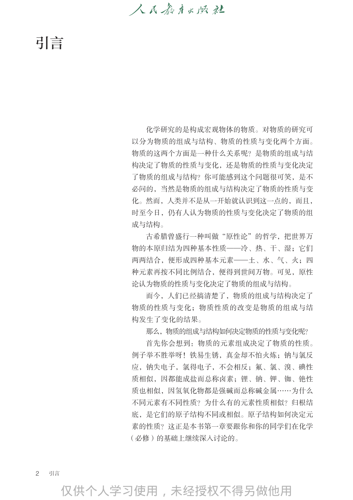

## RJ-CHEMISTRY-HSS2-002 分子组成、同分异构与相似结构的性质

引言 / 引言 / 引言 · P6

在通常条件下，除了稀有气体，所有其他元素的原子总是跟同种或异种原子结合而存在，于是有了分子。你或许能不假思索地举出许多例子说明分子的组成决定了物质的性质：O2和O3是同素异形体，空气中的O2是我们须臾不能离开的，而空气里的O3却不应多于1.2 mg/L，否则有害；CO易燃，CO2却能灭火……有的分子组成相同，却有不同的性质。例如，C2H6O有两种不同的结构（如图1）——乙醇（CH3CH2OH）和二甲醚（H3COCH3），前者与水互溶而后者不能。像乙醇和二甲醚这样的组成相同而结构不同的物质被称为同分异构体。同分异构体的存在说明，分子的结构也是决定物质性质的重要因素。

有时，分子组成完全不同，却由于有类似的结构而有某些相近的性质，下面是一个例子：磺胺药之所以能杀菌，是由于磺胺药在结构上类似于细菌必需的营养物——对氨基苯甲酸，细菌误将磺胺药当作对氨基苯甲酸，才被杀死。请看一看如图2所示的分子结构，对氨基苯磺酰胺和对氨基苯甲酸的结构相似！

化学的重要课题之一是模拟生物体中酶的结构，通过分子设计，创造与酶的结构相似从而具有酶的性质的物质。

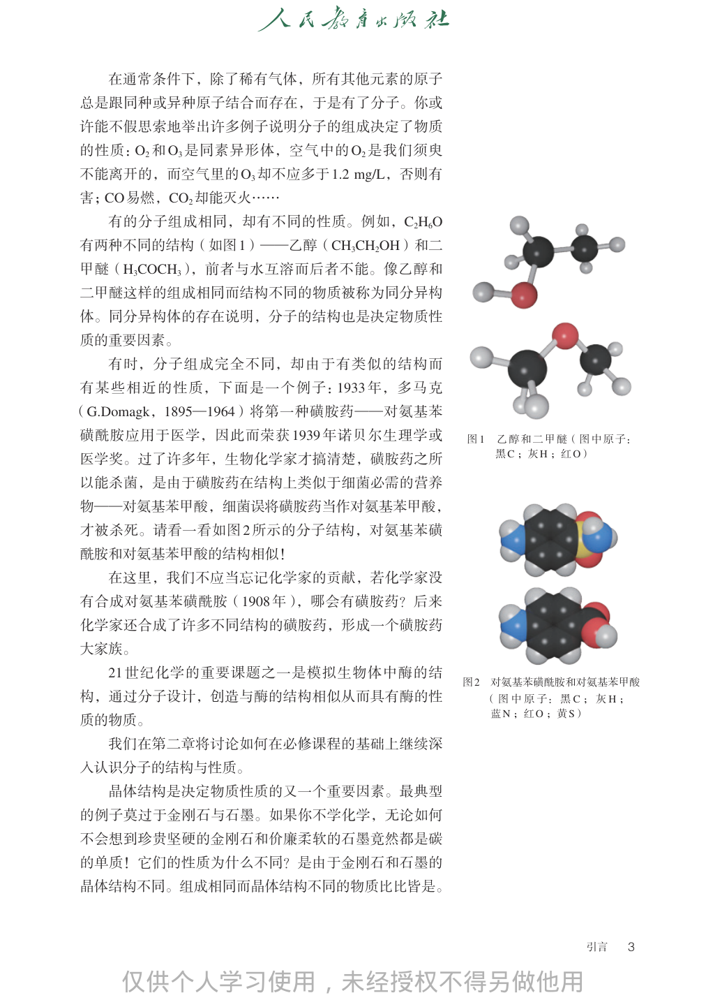

## RJ-CHEMISTRY-HSS2-003 相同组成、不同晶体结构与性质的比较

引言 / 引言 / 引言 · P6-P7

晶体结构是决定物质性质的又一个重要因素。最典型的例子莫过于金刚石与石墨。如果你不学化学，无论如何不会想到珍贵坚硬的金刚石和价廉柔软的石墨竟然都是碳的单质！它们的性质为什么不同？是由于金刚石和石墨的晶体结构不同。组成相同而晶体结构不同的物质比比皆是。

另一个例子是：贝壳的无机成分主要是CaCO3，而贝壳有外层和内层之分，分别是两种晶体结构不同的碳酸钙，外壳叫方解石，内层叫霰石，各有各的功能——方解石因坚硬而起保护作用，霰石因光滑而使软体自由移动。图3是鲍鱼及其剖面图，图中标出了它的两层不同结构的壳。

你或许可以从如图4所示的晶体结构中看出，霰石与方解石的晶体结构是不同的。

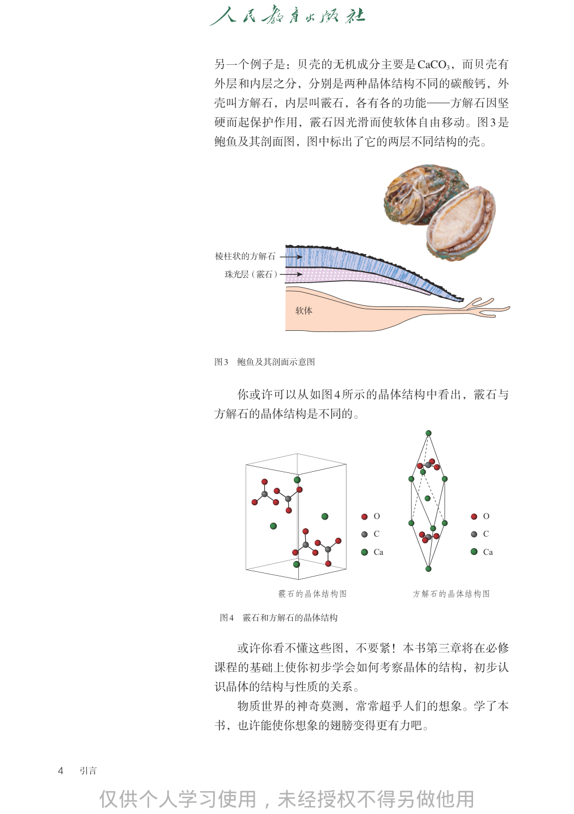

## RJ-CHEMISTRY-HSS2-004 原子基本性质的周期性与结构

第一章 原子结构与性质 / 章引言 / 章引言 · P8

原子的基本性质，如原子半径、电离能和电负性等都与原子结构密切相关，因而也呈现周期性变化。

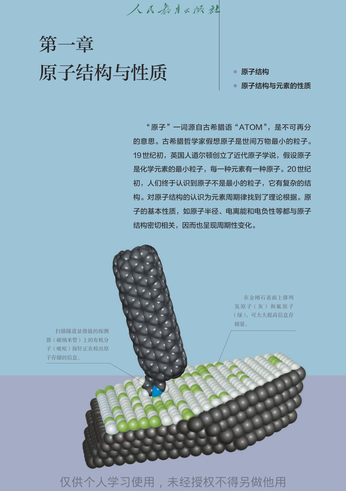

## RJ-CHEMISTRY-HSS2-005 能层、能级及其能量和电子容量

第一章 原子结构与性质 / 第一节 原子结构 / 一、能层与能级 · P9-P10

核外电子按能量不同分成能层。电子的能层由内向外排序，其序号、符号以及所能容纳的最多电子数如下：

|能层|一|二|三|四|五|六|七|
|---|---|---|---|---|---|---|---|
|符号|K|L|M|N|O|P|Q|
|最多电子数|2|8|18|32|50|72|98|

能层越高，电子的能量越高，能量的高低顺序为E(K)<E(L)<E(M)<E(N)<E(O)<E(P)<E(Q)。同一能层的电子，还被分成不同能级。能级的符号和所能容纳的最多电子数如下：s、p、d、f能级分别最多容纳2、6、10、14个电子。

任一能层的能级总是从s能级开始，能级数等于该能层序数，即第一能层只有1个能级（1s），第二能层有2个能级（2s和2p），第三能层有3个能级（3s、3p和3d），依次类推。能级的字母代号总是按s、p、d、f……排序的，字母前的数字是它们所处的能层序数，它们可容纳的最多电子数依次为自然数中的奇数序列1，3，5，7……的2倍。多电子原子中，同一能层各能级的能量顺序如下：E(ns)<E(np)<E(nd)<E(nf)……

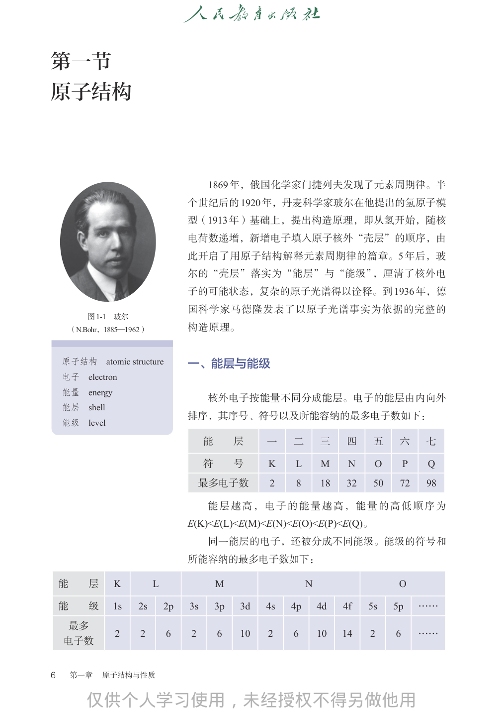

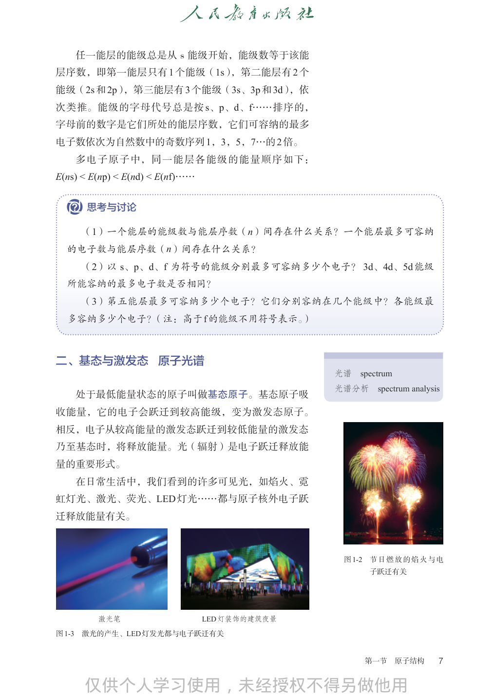

## RJ-CHEMISTRY-HSS2-006 基态、激发态与电子跃迁的能量变化

第一章 原子结构与性质 / 第一节 原子结构 / 二、基态与激发态 原子光谱 · P10

处于最低能量状态的原子叫做基态原子。基态原子吸收能量，它的电子会跃迁到较高能级，变为激发态原子。相反，电子从较高能量的激发态跃迁到较低能量的激发态乃至基态时，将释放能量。光（辐射）是电子跃迁释放能量的重要形式。在日常生活中，我们看到的许多可见光，如焰火、霓虹灯光、激光、荧光、LED灯光……都与原子核外电子跃迁释放能量有关。

## RJ-CHEMISTRY-HSS2-007 原子光谱与光谱分析

第一章 原子结构与性质 / 第一节 原子结构 / 二、基态与激发态 原子光谱 · P11

不同元素原子的电子发生跃迁时会吸收或释放不同的光，可以用光谱仪摄取各种元素原子的吸收光谱或发射光谱，总称原子光谱。在现代化学中，常利用原子光谱上的特征谱线来鉴定元素，称为光谱分析。

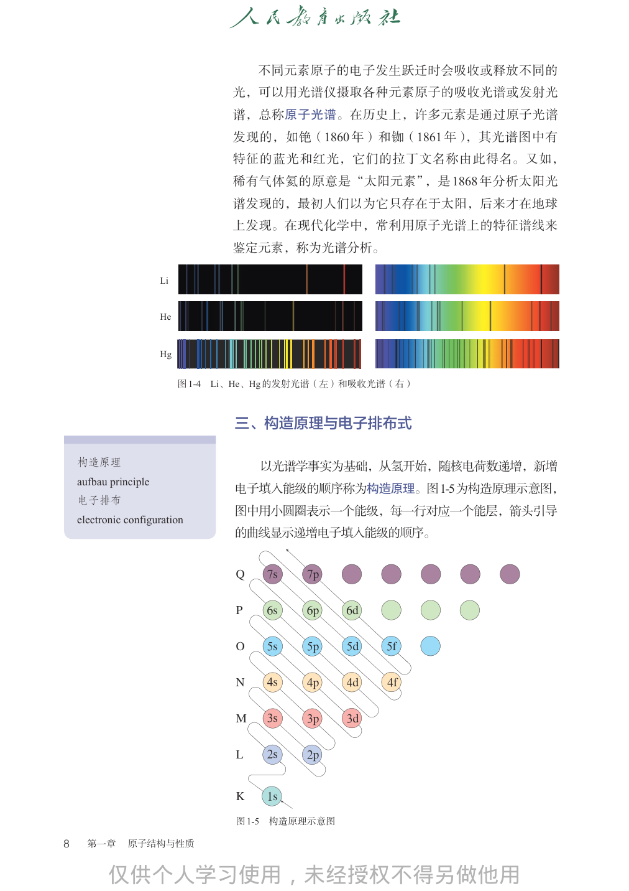

## RJ-CHEMISTRY-HSS2-008 构造原理与基态原子电子排布式

第一章 原子结构与性质 / 第一节 原子结构 / 三、构造原理与电子排布式 · P11-P13

以光谱学事实为基础，从氢开始，随核电荷数递增，新增电子填入能级的顺序称为构造原理。图1-5为构造原理示意图，图中用小圆圈表示一个能级，每一行对应一个能层，箭头引导的曲线显示递增电子填入能级的顺序。

按照构造原理，元素的核电荷数每递增一个，同时增加一个核电荷和一个核外电子，就得到一个基态原子的电子排布。电子填满了一个能级，开始填入下一个能级，由此构建了元素周期系中各元素的基态原子的电子排布。例如，从氢到碳的基态原子电子排布式如下：

氢1s¹→氦1s²→锂1s²2s¹→铍1s²2s²→硼1s²2s²2p¹→碳1s²2s²2p²。

电子排布式中，能级符号右上角的数字表示该能级的电子数。表1-1是按构造原理写出的一些元素的基态原子的电子排布式。

在书写电子排布式时，一般情况下，能层低的能级要写在左边，而不是按构造原理顺序写。例如，原子序数为21 的钪（Sc）的电子排布式中最后两个能级应为3d¹4s²，不应写成4s²3d¹。

表1-1 一些元素基态原子的电子排布式：

|原子序数|元素|电子排布式|
|---|---|---|
|1|H|1s¹|
|2|He|1s²|
|3|Li|1s²2s¹|
|4|Be|1s²2s²|
|5|B|1s²2s²2p¹|
|10|Ne|1s²2s²2p⁶|
|11|Na|1s²2s²2p⁶3s¹|
|12|Mg|1s²2s²2p⁶3s²|
|13|Al|1s²2s²2p⁶3s²3p¹|
|18|Ar|1s²2s²2p⁶3s²3p⁶|
|19|K|1s²2s²2p⁶3s²3p⁶4s¹|
|20|Ca|1s²2s²2p⁶3s²3p⁶4s²|
|21|Sc|1s²2s²2p⁶3s²3p⁶3d¹4s²|
|26|Fe|1s²2s²2p⁶3s²3p⁶3d⁶4s²|
|30|Zn|1s²2s²2p⁶3s²3p⁶3d¹⁰4s²|
|31|Ga|1s²2s²2p⁶3s²3p⁶3d¹⁰4s²4p¹|
|36|Kr|1s²2s²2p⁶3s²3p⁶3d¹⁰4s²4p⁶|
|37|Rb|1s²2s²2p⁶3s²3p⁶3d¹⁰4s²4p⁶5s¹|

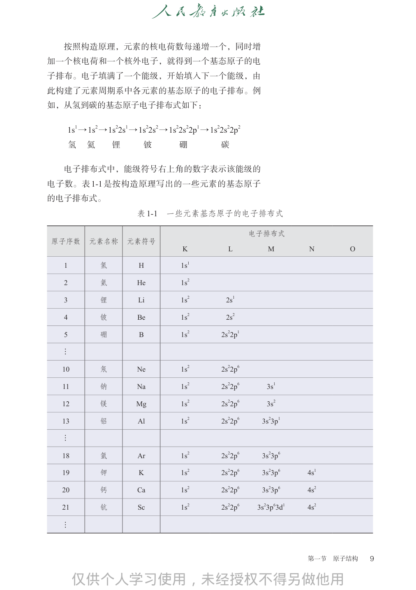

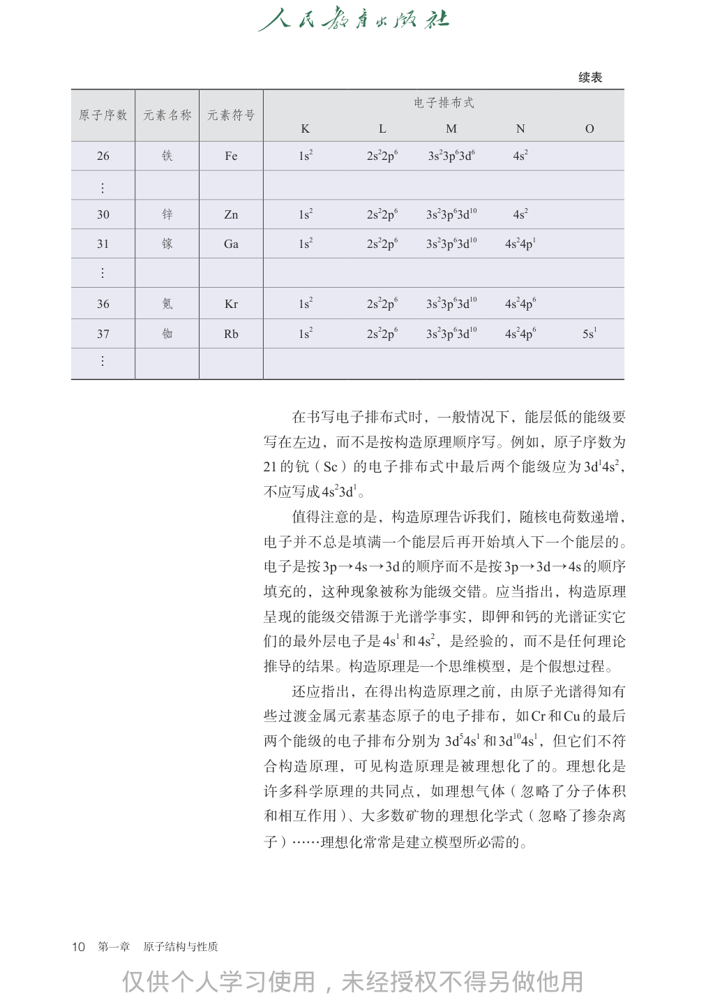

## RJ-CHEMISTRY-HSS2-009 能级交错与构造原理的模型限制

第一章 原子结构与性质 / 第一节 原子结构 / 三、构造原理与电子排布式 · P13

值得注意的是，构造原理告诉我们，随核电荷数递增，电子并不总是填满一个能层后再开始填入下一个能层的。电子是按3p→4s→3d的顺序而不是按3p→3d→4s的顺序填充的，这种现象被称为能级交错。应当指出，构造原理呈现的能级交错源于光谱学事实，即钾和钙的光谱证实它们的最外层电子是4s¹和4s²，是经验的，而不是任何理论推导的结果。构造原理是一个思维模型，是个假想过程。还应指出，在得出构造原理之前，由原子光谱得知有些过渡金属元素基态原子的电子排布，如Cr和Cu的最后两个能级的电子排布分别为 3d⁵4s¹和3d¹⁰4s¹，但它们不符合构造原理，可见构造原理是被理想化了的。理想化是许多科学原理的共同点，如理想气体（忽略了分子体积和相互作用）、大多数矿物的理想化学式（忽略了掺杂离子）……理想化常常是建立模型所必需的。

## RJ-CHEMISTRY-HSS2-010 简化电子排布与价电子层

第一章 原子结构与性质 / 第一节 原子结构 / 三、构造原理与电子排布式 · P14

电子排布式可以简化，如钠的电子排布式可简化为[Ne]3s¹。为突出化合价与电子排布的关系，将在化学反应中可能发生电子变动的能级称为价电子层（简称价层）。例如，Fe的简化电子排布式为[Ar]3d⁶4s²，价层电子排布为3d⁶4s²。通常，元素周期表只给出价层电子排布。

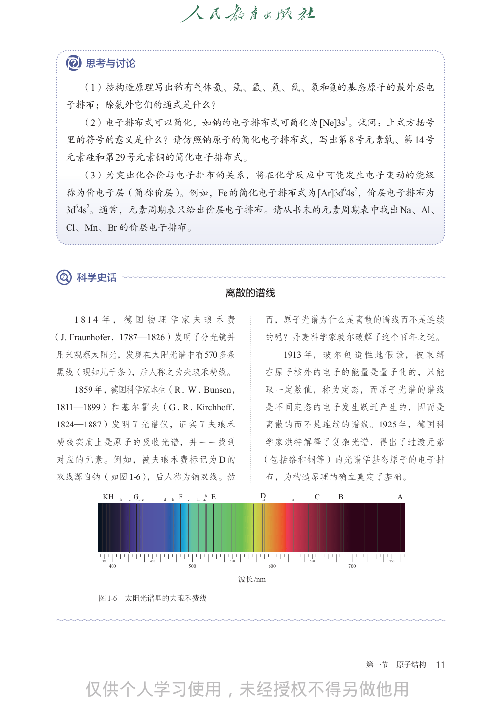

## RJ-CHEMISTRY-HSS2-011 原子光谱离散谱线的结构解释

第一章 原子结构与性质 / 第一节 原子结构 / 三、构造原理与电子排布式 · P14

夫琅禾费线实质上是原子的吸收光谱，并能找到对应的元素。例如，被标记为D的双线源自钠，称为钠双线。被束缚在原子核外的电子的能量是量子化的，只能取一定数值，称为定态，而原子光谱的谱线是不同定态的电子发生跃迁产生的，因而是离散的而不是连续的谱线。

## RJ-CHEMISTRY-HSS2-012 电子出现的概率密度与电子云

第一章 原子结构与性质 / 第一节 原子结构 / 四、电子云与原子轨道 · P15

量子力学指出，一定空间运动状态的电子并不在玻尔假定的线性轨道上运行，而在核外空间各处都可能出现，但出现的概率不同，可以算出它们的概率密度分布。用 P表示电子在某处出现的概率，V 表示该处的体积，则 P/V称为概率密度，用ρ表示，即ρ=P/V。氢原子只有一个电子，而图1-7 中有许许多多小点，可见这些小点不是电子本身。那么，图中的小点是什么呢？小点是1s电子在原子核外出现的概率密度的形象描述。小点越密，表明概率密度越大。由于核外电子的概率密度分布看起来像一片云雾，因而被形象地称作电子云。换句话说，电子云是处于一定空间运动状态的电子在原子核外空间的概率密度分布的形象化描述。电子云图很难绘制，使用不便，我们常使用电子云轮廓图。

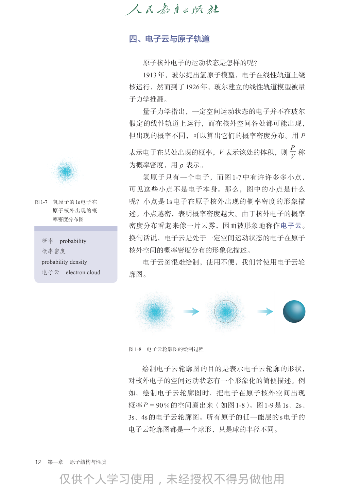

## RJ-CHEMISTRY-HSS2-013 电子云轮廓图及s、p轨道的形状与取向

第一章 原子结构与性质 / 第一节 原子结构 / 四、电子云与原子轨道 · P15-P16

绘制电子云轮廓图的目的是表示电子云轮廓的形状，对核外电子的空间运动状态有一个形象化的简便描述。例如，绘制电子云轮廓图时，把电子在原子核外空间出现概率P = 90％的空间圈出来（如图1-8）。图1-9是1s、2s、3s、4s的电子云轮廓图。所有原子的任一能层的s电子的电子云轮廓图都是一个球形，只是球的半径不同。

同一原子的能层越高，s 电子云半径越大，是由于电子的能量依次增高，电子在离核更远的区域出现的概率逐渐增大，电子云越来越向更大的空间扩展。这就好像宇宙飞船必须提供能量推动才能克服地球引力上天，2s电子比1s 电子能量高，克服原子核的吸引在离核更远的空间出现的概率就比1s 大，因而2s 电子云必然比1s 电子云更弥散。除s电子云外，其他电子云轮廓图都不是球形的。例如，p电子云轮廓图是哑铃状的，而且，无论2p、3p还是4p……都有3个相互垂直的电子云，分别称为 px、py和 pz（如图1-11），右下标 x、y、z 分别是ｐ电子云在直角坐标系里的取向。

量子力学把电子在原子核外的一个空间运动状态称为一个原子轨道。因此，常用电子云轮廓图的形状和取向来表示原子轨道的形状和取向。根据量子力学的结论，表1-2列举了Ｋ、Ｌ、Ｍ、Ｎ 等能层的能级、原子轨道数、原子轨道名称以及形状和取向。

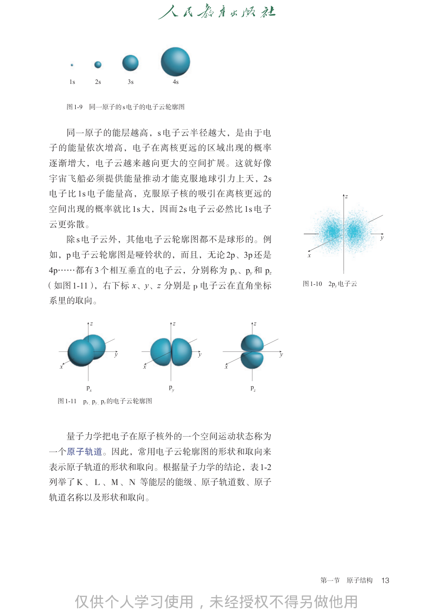

## RJ-CHEMISTRY-HSS2-014 不同能层能级的原子轨道数与形状取向

第一章 原子结构与性质 / 第一节 原子结构 / 四、电子云与原子轨道 · P17

表1-2列出不同能层的能级、原子轨道数、名称、形状和取向。

|能层|能级|原子轨道数|原子轨道名称|形状|取向|
|---|---|---|---|---|---|
|K|1s|1|1s|球形|—|
|L|2s|1|2s|球形|—|
|L|2p|3|2pₓ、2pᵧ、2p_z|哑铃形|相互垂直|
|M|3s|1|3s|球形|—|
|M|3p|3|3pₓ、3pᵧ、3p_z|哑铃形|相互垂直|
|M|3d|5|……|……|……|
|N|4s|1|4s|球形|—|
|N|4p|3|4pₓ、4pᵧ、4p_z|哑铃形|相互垂直|
|N|4d|5|……|……|……|
|N|4f|7|……|……|……|

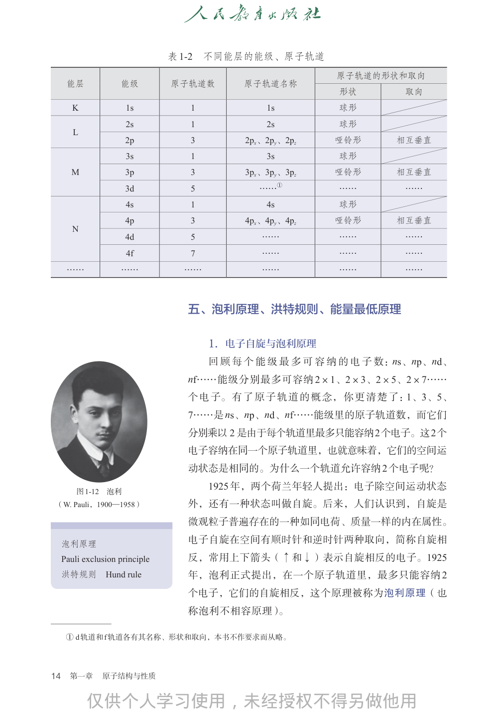

## RJ-CHEMISTRY-HSS2-015 电子自旋与泡利原理

第一章 原子结构与性质 / 第一节 原子结构 / 五、泡利原理、洪特规则、能量最低原理 · P17

回顾每个能级最多可容纳的电子数： ns、np、nd、nf……能级分别最多可容纳2×1、2×3、2×5、2×7……个电子。有了原子轨道的概念，你更清楚了：1、3、5、7……是ns、np、nd、nf……能级里的原子轨道数，而它们分别乘以２是由于每个轨道里最多只能容纳2个电子。这2个电子容纳在同一个原子轨道里，也就意味着，它们的空间运动状态是相同的。为什么一个轨道允许容纳2个电子呢？电子除空间运动状态外，还有一种状态叫做自旋。后来，人们认识到，自旋是微观粒子普遍存在的一种如同电荷、质量一样的内在属性。电子自旋在空间有顺时针和逆时针两种取向，简称自旋相反，常用上下箭头（↑和↓）表示自旋相反的电子。在一个原子轨道里，最多只能容纳2个电子，它们的自旋相反，这个原理被称为泡利原理（也称泡利不相容原理）。

## RJ-CHEMISTRY-HSS2-016 电子自旋与光谱、磁性及ESR

第一章 原子结构与性质 / 第一节 原子结构 / 五、泡利原理、洪特规则、能量最低原理 · P18

电子自旋概念的提出解决了原子结构理论发展中的一系列困惑。例如，只有1个最外层电子的碱金属原子光谱为什么会在光谱里呈现双线？为什么只有1个最外层电子的银原子在外加电场里加速飞行通过一个非匀强磁场时会分成两束？归根结底，为什么一个原子轨道里能容纳两个电子？没有泡利原理，复杂的原子光谱无法得到诠释，以光谱事实为基础的构造原理也无法建立。电子自旋可以帮助我们理解物质的磁性本质。电子自旋有许多重要应用，如电子自旋共振（ESR）技术能研究物质的诸多性质。

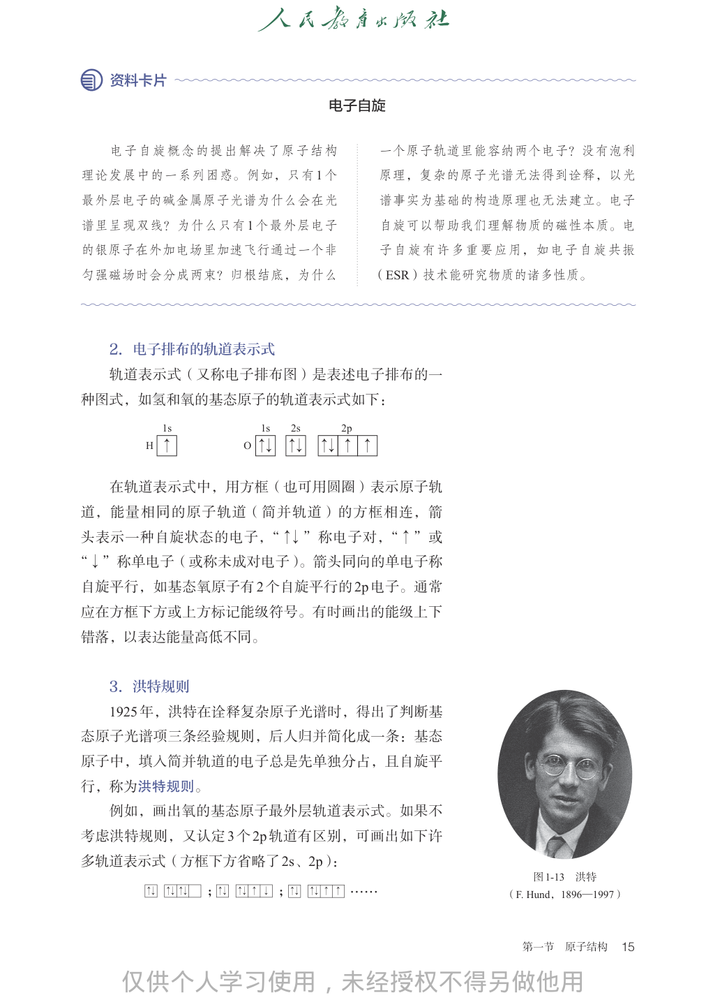

## RJ-CHEMISTRY-HSS2-017 电子排布的轨道表示式

第一章 原子结构与性质 / 第一节 原子结构 / 五、泡利原理、洪特规则、能量最低原理 · P18

轨道表示式（又称电子排布图）是表述电子排布的一种图式，如氢和氧的基态原子的轨道表示式如下：

H：1s[↑]；O：1s[↑↓]、2s[↑↓]、2p[↑↓][↑][↑]。

在轨道表示式中，用方框（也可用圆圈）表示原子轨道，能量相同的原子轨道（简并轨道）的方框相连，箭头表示一种自旋状态的电子，“↑↓”称电子对，“↑”或“↓”称单电子（或称未成对电子）。箭头同向的单电子称自旋平行，如基态氧原子有2个自旋平行的2p电子。通常应在方框下方或上方标记能级符号。有时画出的能级上下错落，以表达能量高低不同。

## RJ-CHEMISTRY-HSS2-018 洪特规则及其适用条件

第一章 原子结构与性质 / 第一节 原子结构 / 五、泡利原理、洪特规则、能量最低原理 · P18-P19

基态原子中，填入简并轨道的电子总是先单独分占，且自旋平行，称为洪特规则。例如，画出氧的基态原子最外层轨道表示式。如果不考虑洪特规则，又认定3个2p轨道有区别，可画出教材图中的许多轨道表示式；然而，若遵循洪特规则，且不区分3个2p轨道，只需画出轨道表示式：2s[↑↓]、2p[↑↓][↑][↑]。

洪特规则不仅适用于基态原子，也适用于基态离子。必须注意，洪特规则是针对电子填入简并轨道而言的，并不适用于电子填入能量不同的轨道。

## RJ-CHEMISTRY-HSS2-019 能量最低原理及基态电子排布的三个原则

第一章 原子结构与性质 / 第一节 原子结构 / 五、泡利原理、洪特规则、能量最低原理 · P19

基态是能量最低的状态，所以，基态原子的电子排布是能量最低的原子轨道组合。由此人们得出一条原理：在构建基态原子时，电子将尽可能地占据能量最低的原子轨道，使整个原子的能量最低，这就是能量最低原理。整个原子的能量由核电荷数、电子数和电子状态三个因素共同决定，相邻能级能量相差很大时，电子填入能量低的能级即可使整个原子能量最低（如所有主族元素的基态原子）；而当相邻能级能量相差不太大时，有1~2个电子占据能量稍高的能级可能反而降低了电子排斥能而使整个原子能量最低（如所有副族元素的基态原子）。总之，基态原子的核外电子排布遵循泡利原理、洪特规则和能量最低原理。

## RJ-CHEMISTRY-HSS2-020 元素周期律、元素周期系和元素周期表

第一章 原子结构与性质 / 第二节 原子结构与元素的性质 / 一、原子结构与元素周期表 · P21

元素周期律表述为元素的性质随原子序数递增而呈周期性的变化。元素的这一按其原子序数（即原子核电荷数）递增排列的序列称为元素周期系。元素周期表是呈现元素周期系的表格。元素周期系只有一个，元素周期表多种多样。

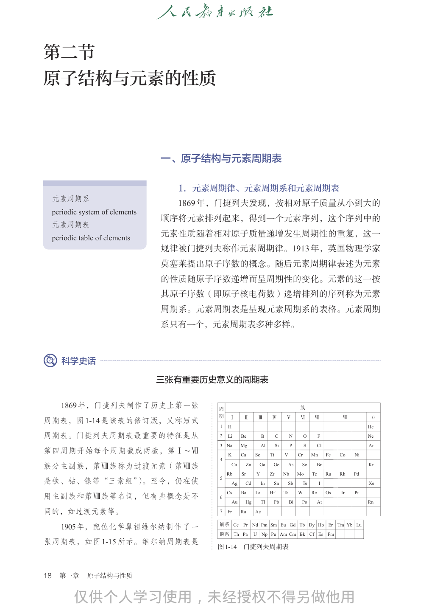

## RJ-CHEMISTRY-HSS2-021 周期表排列形式与内层电子填充的结构依据

第一章 原子结构与性质 / 第二节 原子结构与元素的性质 / 一、原子结构与元素周期表 · P21-P22

短式周期表的重要特征是从第四周期开始每个周期截成两截，第Ⅰ～Ⅶ族分主副族，第Ⅷ族称为过渡元素（第Ⅷ族是铁、钴、镍等“三素组”）。仍在使用主副族和第Ⅷ族等名词，但有些概念是不同的，如过渡元素等。

特长式周期表，每个周期一行，各族元素、过渡金属、稀有气体、镧系和锕系，各有各的位置，同族元素上下对齐。教材所示早期特长式周期表前五个周期的元素种类为2、8、8、18、18，第六、第七周期当时因镧系和锕系元素种类未知而未定；它与现今周期表相似，但Be、Mg的位置不同。

用原子结构解释周期系时，原子序数21～28和39～46的元素新增加的电子填入内层轨道。镧（La）后14种元素基态原子有4f电子，第六周期为32种元素。前后周期的相关元素（同族元素）的价电子数相等。

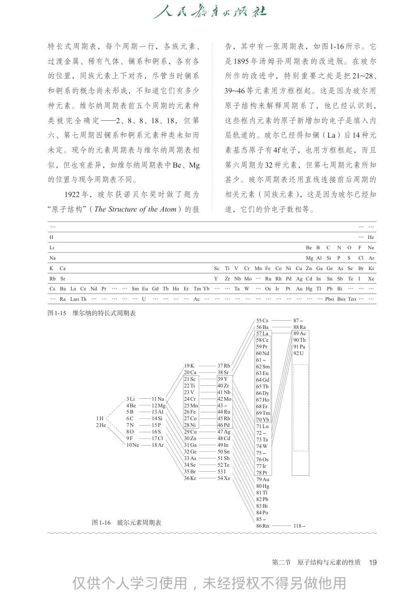

## RJ-CHEMISTRY-HSS2-022 构造原理与周期长度、同族元素性质

第一章 原子结构与性质 / 第二节 原子结构与元素的性质 / 一、原子结构与元素周期表 · P23-P24

根据构造原理得出的核外电子排布，可以解释元素周期系的基本结构。例如，可以解释元素周期系中每个周期的元素数，第一周期从1s¹开始，以1s²结束，只有两种元素。其余各周期总是从ns能级开始，以np结束，而从ns能级开始以np结束递增的核电荷数（或电子数）就等于每个周期里的元素数，具体数据如下：

各周期元素数：第一周期2，第二周期8，第三周期8，第四周期18，第五周期18，第六周期32，第七周期32。

若以一个方格代表一种元素，每个周期排一个横排，并按s、p、d、f分段，左侧对齐，可得到如下元素周期表：

在书末的元素周期表中，同族元素价层电子数相同，这是同族元素性质相似的结构基础。例如，元素周期表最左侧第ⅠA族元素的基态原子最外层都只有一个电子，即ns¹；元素周期表最右侧稀有气体元素的基态原子，除氦（1s²）外，最外层都是8电子，即ns²np⁶。从第四周期开始的长周期，比短周期多出的元素全部是金属元素，这是因为它们的最外层电子数始终不超过2，即为ns¹～²（Pd例外）。而第六、第七周期比第四、第五周期多出14种元素的基态原子最外层也只有2个s电子，所以也是金属元素。

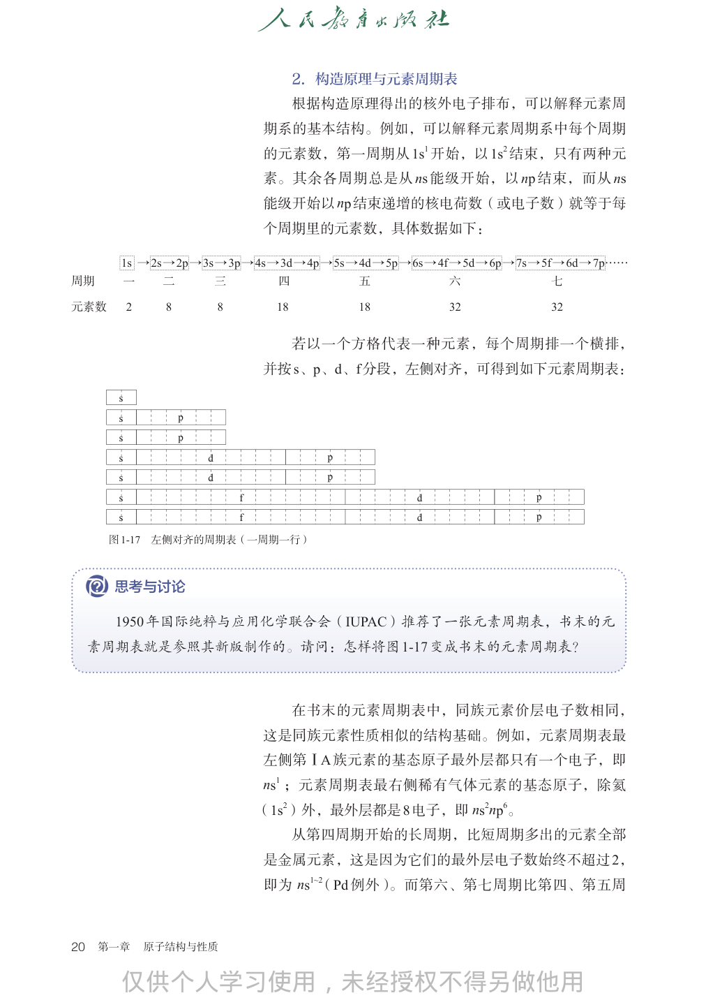

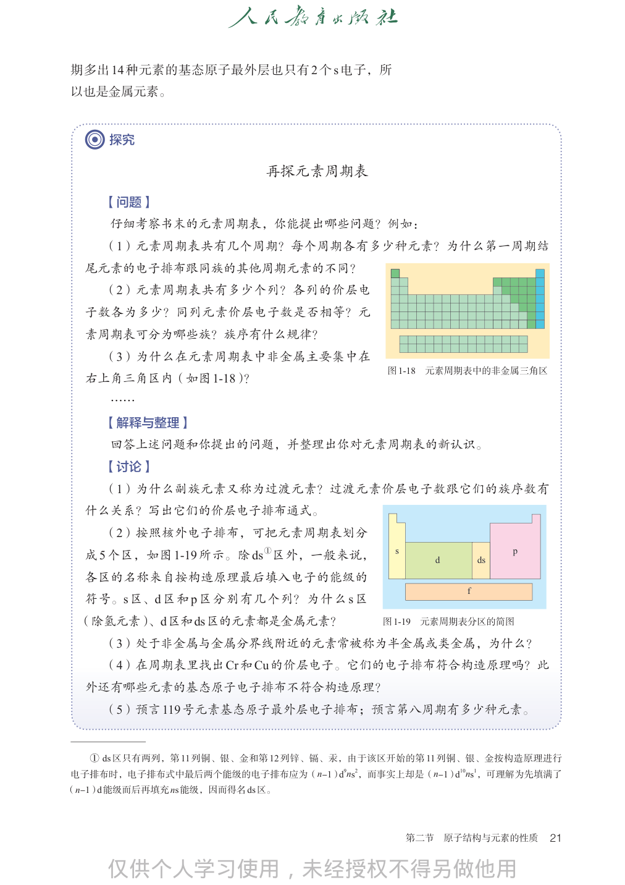

## RJ-CHEMISTRY-HSS2-023 元素周期表的五区与ds区的电子排布

第一章 原子结构与性质 / 第二节 原子结构与元素的性质 / 一、原子结构与元素周期表 · P24

按照核外电子排布，可把元素周期表划分成5个区，如图1-19所示。除ds区外，一般来说，各区的名称来自按构造原理最后填入电子的能级的符号。

ds区只有两列，第11列铜、银、金和第12列锌、镉、汞，由于该区开始的第11列铜、银、金按构造原理进行电子排布时，电子排布式中最后两个能级的电子排布应为(n−1)d⁹ns²，而事实上却是(n−1)d¹⁰ns¹，可理解为先填满了(n−1)d能级而后再填充ns能级，因而得名ds区。

## RJ-CHEMISTRY-HSS2-024 主族元素的对角线规则

第一章 原子结构与性质 / 第二节 原子结构与元素的性质 / 一、原子结构与元素周期表 · P25

在元素周期表中，某些主族元素与右下方的主族元素（如图1-20）的有些性质是相似的（如锂和镁在过量的氧气中燃烧均生成正常氧化物，而不是过氧化物），这种相似性被称为对角线规则。对角线规则是从相关元素及其化合物的许多性质中总结出来的经验规则。

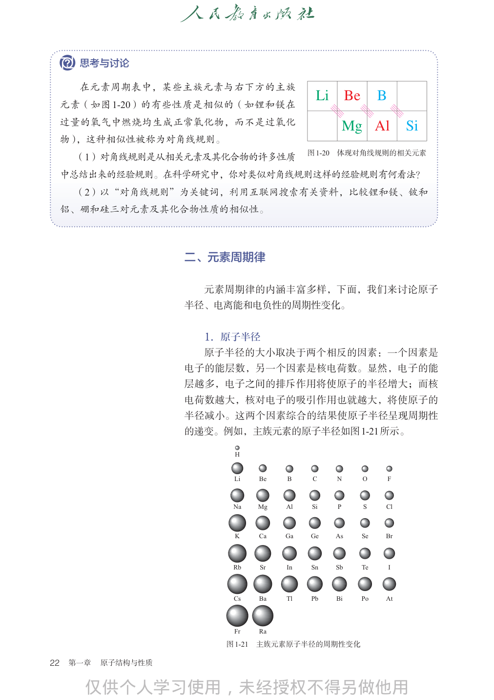

## RJ-CHEMISTRY-HSS2-025 原子半径的影响因素与周期性

第一章 原子结构与性质 / 第二节 原子结构与元素的性质 / 二、元素周期律 · P25

原子半径的大小取决于两个相反的因素：一个因素是电子的能层数，另一个因素是核电荷数。显然，电子的能层越多，电子之间的排斥作用将使原子的半径增大；而核电荷数越大，核对电子的吸引作用也就越大，将使原子的半径减小。这两个因素综合的结果使原子半径呈现周期性的递变。例如，主族元素的原子半径如图1-21所示。

## RJ-CHEMISTRY-HSS2-026 第一电离能及其周期性

第一章 原子结构与性质 / 第二节 原子结构与元素的性质 / 二、元素周期律 · P26

气态基态原子失去一个电子转化为气态基态正离子所需要的最低能量叫做第一电离能。原子的第一电离能随核电荷数递增有什么规律呢？从图1-22 可见，每个周期的第一种元素（氢和碱金属）的第一电离能最小，最后一种元素（稀有气体）的第一电离能最大；同族元素从上到下第一电离能变小，如He、Ne、Ar、Kr、Xe 的第一电离能依次下降，H、Li、Na、K、Rb、Cs的第一电离能也依次下降。

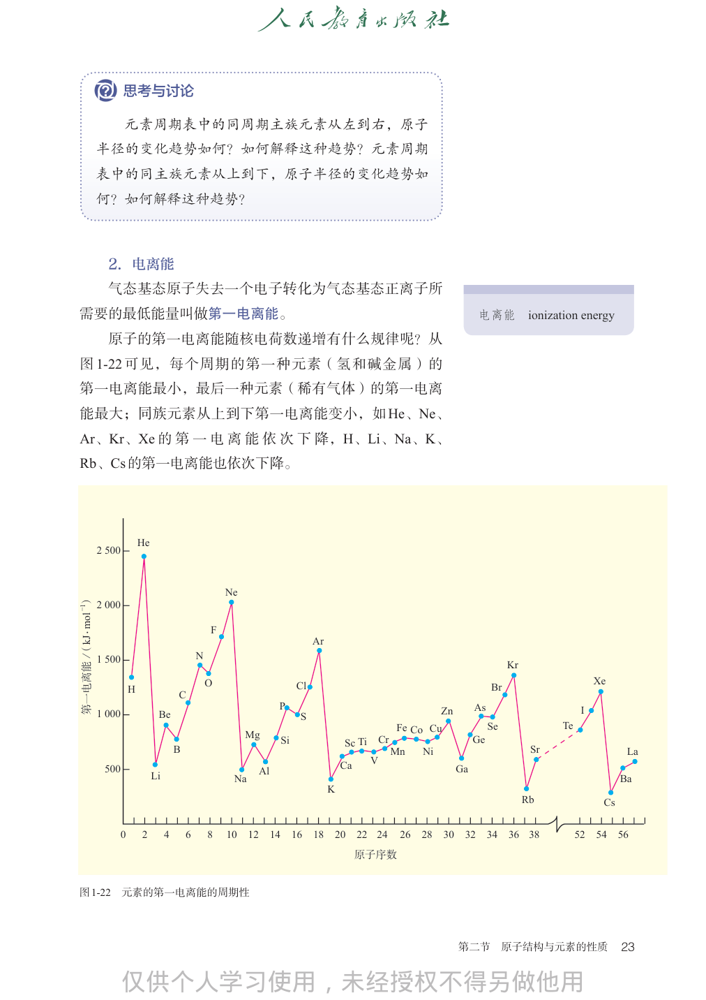

## RJ-CHEMISTRY-HSS2-027 电离能锯齿状变化的结构解释

第一章 原子结构与性质 / 第二节 原子结构与元素的性质 / 二、元素周期律 · P27

如图1-22所示，为什么B、Al、O、S等元素的电离能比它们左边元素的电离能低，而使Li—Ne 和Na—Ar 的电离能曲线呈现锯齿状变化？对于B 和Al 这两个锯齿状变化，一般解释为：B和Al的第一电离能失去的电子是np能级的，该能级电子的能量比左边Be和 Mg 失去的ns 能级电子的高。对于O 和S这两个锯齿状变化，一般解释为：N和P的电子排布是半充满的，比较稳定，电离能较高。

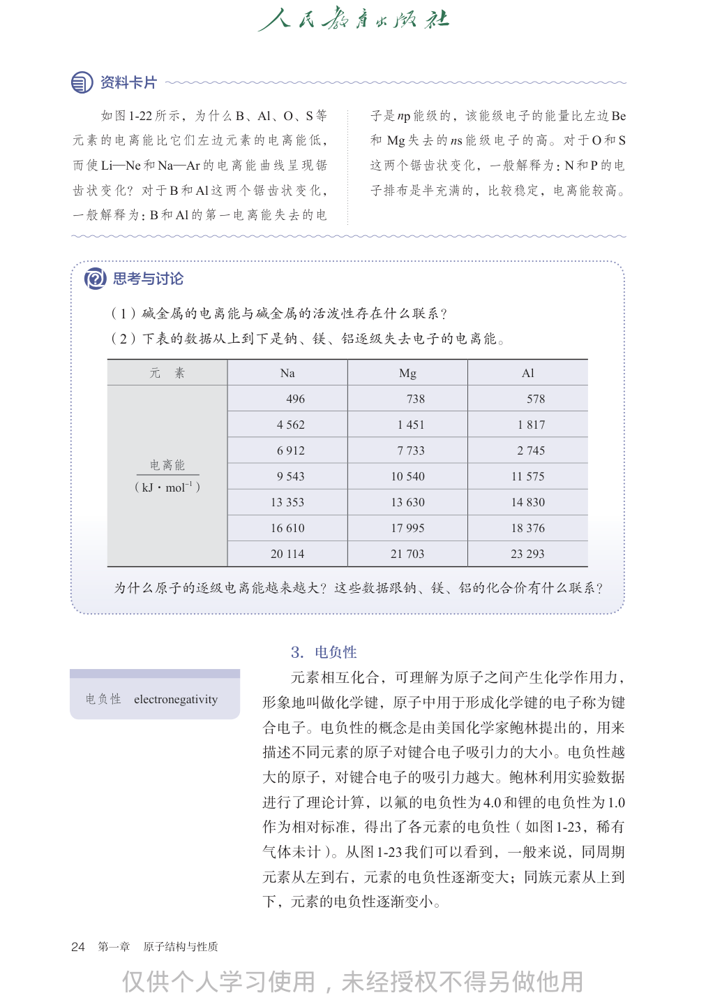

## RJ-CHEMISTRY-HSS2-028 逐级电离能的数据

第一章 原子结构与性质 / 第二节 原子结构与元素的性质 / 二、元素周期律 · P27

下表的数据从上到下是钠、镁、铝逐级失去电子的电离能（单位：kJ·mol⁻¹）。

|次序|Na|Mg|Al|
|---|---|---|---|
|1|496|738|578|
|2|4562|1451|1817|
|3|6912|7733|2745|
|4|9543|10540|11575|
|5|13353|13630|14830|
|6|16610|17995|18376|
|7|20114|21703|23293|

## RJ-CHEMISTRY-HSS2-029 电负性、键合电子及其周期性

第一章 原子结构与性质 / 第二节 原子结构与元素的性质 / 二、元素周期律 · P27-P28

元素相互化合，可理解为原子之间产生化学作用力，形象地叫做化学键，原子中用于形成化学键的电子称为键合电子。电负性的概念用来描述不同元素的原子对键合电子吸引力的大小。电负性越大的原子，对键合电子的吸引力越大。利用实验数据进行了理论计算，以氟的电负性为4.0和锂的电负性为1.0作为相对标准，得出了各元素的电负性（如图1-23，稀有气体未计）。从图1-23我们可以看到，一般来说，同周期元素从左到右，元素的电负性逐渐变大；同族元素从上到下，元素的电负性逐渐变小。

电负性的大小也可以作为判断金属性和非金属性强弱的依据。金属元素的电负性一般小于1.8，非金属元素的电负性一般大于1.8，而位于非金属三角区边界的“类金属”（如锗、锑等）的电负性则在1.8左右，它们既有金属性，又有非金属性。

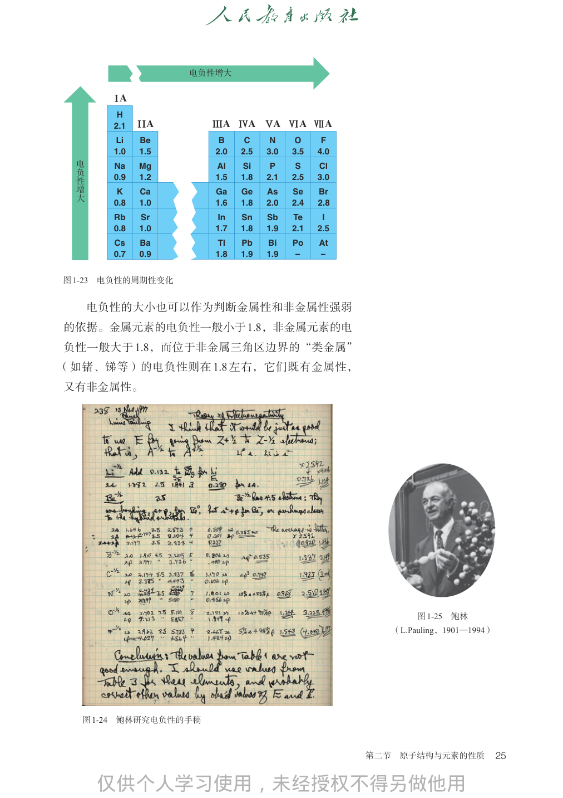

## RJ-CHEMISTRY-HSS2-030 空气组分分离和光谱鉴别氩的方法

第一章 原子结构与性质 / 第二节 原子结构与元素的性质 / 二、元素周期律 · P29-P30

用氨气分解得到的氮气的密度为1.250 8 g/L，比从空气中分离出来的氮气的密度1.257 2 g/L小。提出的假设是：从氨气分解得到的氮气是纯净的，而空气里可能含有一种比氮气的密度更大的气体，因而源自空气的氮气不纯，测得的密度较大。

分离空气组分气体的方法是仔细除去空气里的氧气、氮气、二氧化碳和水蒸气，发现残留了一种未知气体。这种未知气体的体积仅占空气的1/80。观察这种未知气体的光谱，发现谱图里有不属于任何已知元素的橙、绿色两条谱线，认定是一种新的化学元素，命名为氩。

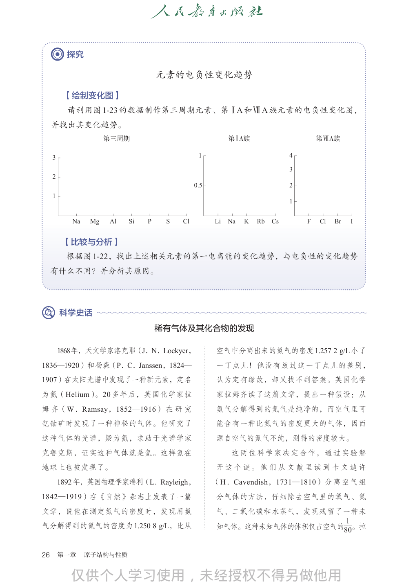

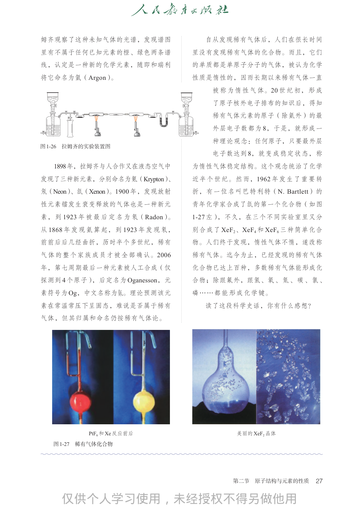

## RJ-CHEMISTRY-HSS2-031 稀有气体的结构与化合物及Og的预测状态

第一章 原子结构与性质 / 第二节 原子结构与元素的性质 / 二、元素周期律 · P30

稀有气体的单质都是单原子分子的气体。稀有气体元素的原子（除氦外）的最外层电子数都为8。后来合成了氙的化合物，如XeF2、XeF4和XeF6。已经发现的稀有气体化合物已达上百种，多数稀有气体能形成化合物；除跟氟外，跟氢、氧、氮、碳、氯、磷……都能形成化学键。

第七周期最后一种元素Oganesson，元素符号为Og，中文名称为鿫。理论预测该元素在常温常压下呈固态，难说是否属于稀有气体，但其归属和命名仍按稀有气体论。

## RJ-CHEMISTRY-HSS2-032 元素周期律涵盖的性质变化

第一章 原子结构与性质 / 整理与提升 / 整理与提升 · P33

元素的性质随核电荷数递增发生周期性的递变，叫做元素周期律。元素周期律主要体现为核外电子排布、原子半径、主要化合价、金属性、非金属性、第一电离能、电负性等的周期性变化。

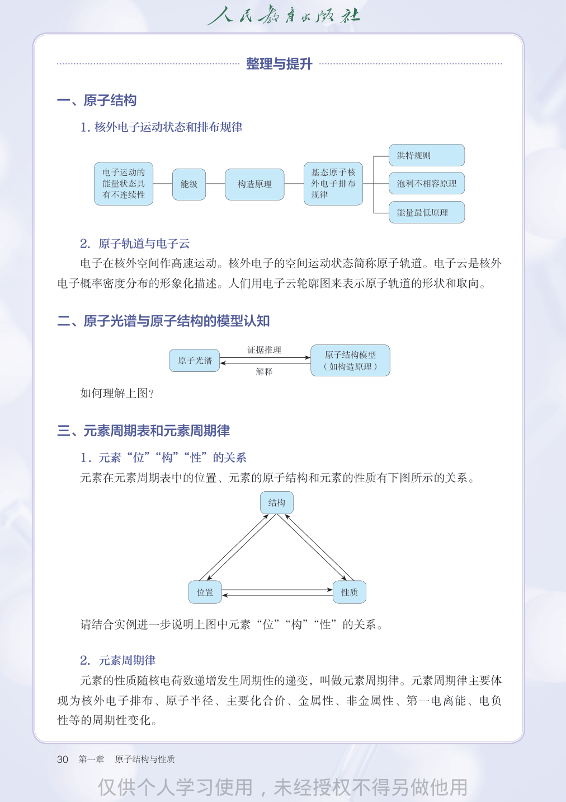

## RJ-CHEMISTRY-HSS2-033 单原子分子、高分子与巨分子

第二章 分子结构与性质 / 章引言 / 章引言 · P36

分子由原子构成。在通常的温度和压强等条件下，只有极少数物质的分子是由单个原子构成的，如稀有气体和汞蒸气等，属于单原子分子。绝大多数物质的分子是由多个原子相互结合构成的，如氧气、水、氨、甲烷等。有的物质的分子是由许许多多组成较简单的单体聚合而成的高分子（又称聚合物），如蛋白质、淀粉、塑料、橡胶、植物纤维、合成纤维等。而许多固体，即使取很小一粒，仍包含成万上亿个原子或离子构成一个整体，属于“巨分子”，如金刚石、金属单质等。

## RJ-CHEMISTRY-HSS2-034 ATP合酶的结构与工作方式

第二章 分子结构与性质 / 章引言 / 章引言 · P36

ATP是嵌在细胞线粒体膜上的“ATP合酶”产生的。ATP合酶像一个会旋转的泵，膜内外H⁺浓度的差别推动了这个泵旋转，每秒钟旋转100圈，每转一圈，抽入合成ATP的原料分子，生产出3个ATP分子。图中的α、β、γ、C等符号是组成蛋白质的代号。

## RJ-CHEMISTRY-HSS2-035 共价键的定义、饱和性与轨道重叠

第二章 分子结构与性质 / 第一节 共价键 / 一、共价键 · P37

共价键是原子间通过共用电子对所形成的相互作用。按上述定义，只能有H2、HCl、Cl2等，不可能有H3、H2Cl和Cl3等，这表明共价键具有饱和性。我们学过原子轨道，如何用原子轨道的概念来进一步理解共价键呢？用原子轨道描述氢原子形成氢分子的过程如图2-1所示。

原子轨道在两个原子核间重叠，意味着电子出现在核间的概率增大，电子带负电，因而可以形象地说，核间电子好比在核间架起一座带负电的桥梁，把带正电的两个原子核“黏结”在一起了。

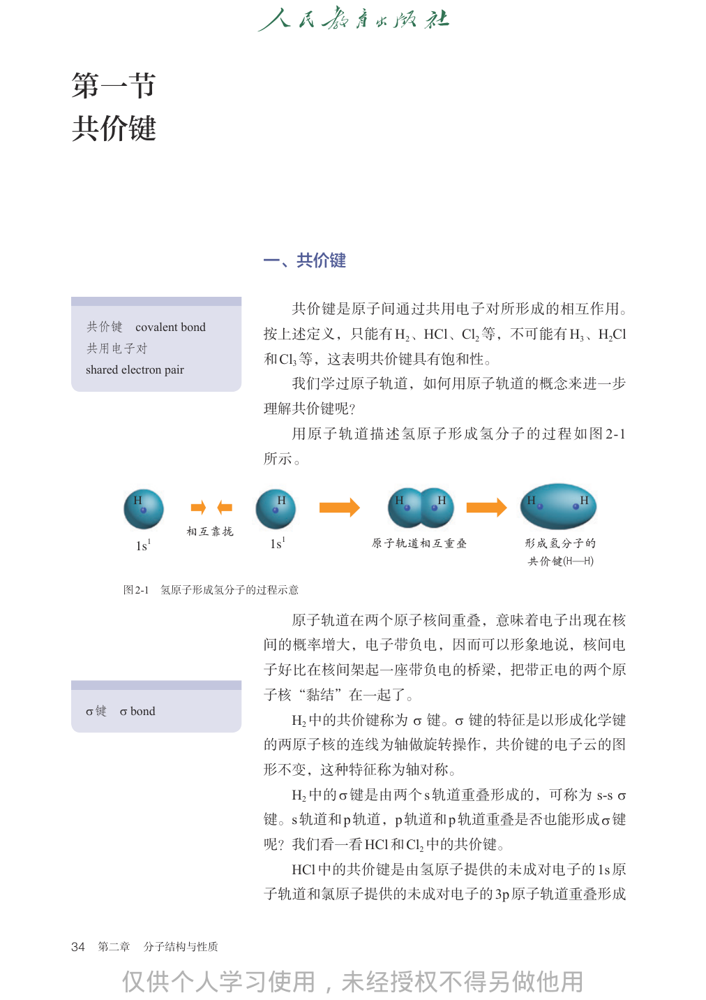

## RJ-CHEMISTRY-HSS2-036 σ键的轴对称性及s-s、s-p、p-p形成

第二章 分子结构与性质 / 第一节 共价键 / 一、共价键 · P37-P38

H2中的共价键称为 σ 键。σ 键的特征是以形成化学键的两原子核的连线为轴做旋转操作，共价键的电子云的图形不变，这种特征称为轴对称。H2中的σ键是由两个s轨道重叠形成的，可称为 s-s σ键。s轨道和p轨道，p轨道和p轨道重叠是否也能形成σ键呢？我们看一看HCl和Cl2中的共价键。HCl中的共价键是由氢原子提供的未成对电子的1s原子轨道和氯原子提供的未成对电子的3p原子轨道重叠形成的，而Cl2中的共价键是由2个氯原子各提供1个未成对电子的3p原子轨道重叠形成的（如图2-2）。

HCl和Cl2中的共价键的电子云图形跟H2中的共价键的电子云图形都是轴对称的，因而都是σ 键，分别称为s-pσ 键和p-p σ 键。

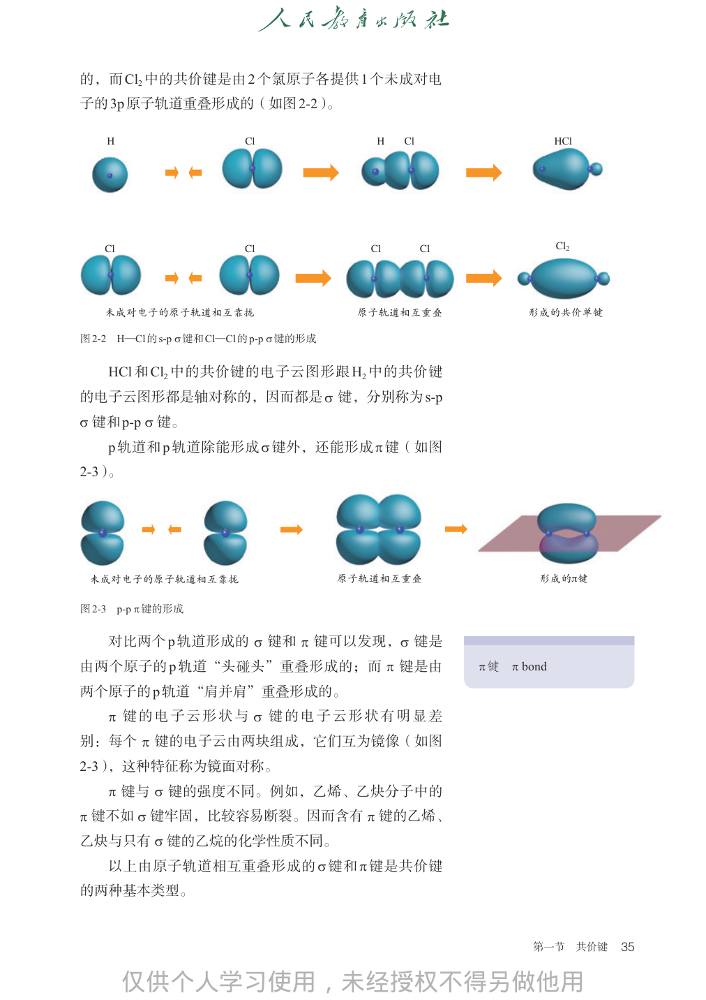

## RJ-CHEMISTRY-HSS2-037 π键的形成、镜面对称及与σ键的比较

第二章 分子结构与性质 / 第一节 共价键 / 一、共价键 · P38-P39

p轨道和p轨道除能形成σ键外，还能形成π键（如图2-3）。

对比两个p轨道形成的 σ 键和 π 键可以发现，σ 键是由两个原子的p轨道“头碰头”重叠形成的；而 π 键是由两个原子的p轨道“肩并肩”重叠形成的。π 键的电子云形状与 σ 键的电子云形状有明显差别：每个 π 键的电子云由两块组成，它们互为镜像（如图2-3），这种特征称为镜面对称。π 键与 σ 键的强度不同。例如，乙烯、乙炔分子中的π 键不如 σ 键牢固，比较容易断裂。因而含有 π 键的乙烯、乙炔与只有 σ 键的乙烷的化学性质不同。以上由原子轨道相互重叠形成的σ键和π键是共价键的两种基本类型。

哪些共价键是 σ 键，哪些共价键是π键呢？一般规律是：共价单键是σ键；而共价双键中有一个 σ 键，另一个是π键；共价三键由一个 σ 键和两个 π 键构成。

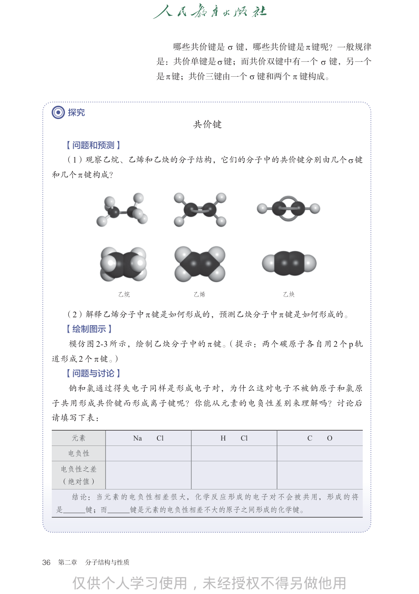

## RJ-CHEMISTRY-HSS2-038 乙炔两个π键的轨道形成提示

第二章 分子结构与性质 / 第一节 共价键 / 一、共价键 · P39

乙炔分子中的两个碳原子各自用2个p轨道形成2个π键。

## RJ-CHEMISTRY-HSS2-039 键能的定义、平均值与反应热估算

第二章 分子结构与性质 / 第一节 共价键 / 二、键参数——键能、键长与键角 · P40

共价键的强弱可用键能来衡量。键能是指气态分子中1 mol 化学键解离成气态原子所吸收的能量；键能通常是298.15 K、 101 kPa条件下的标准值。键能可通过实验测定，更多的却是推算获得的。例如，依次断开CH4中的4个C—H，所需能量并不相等，因此，CH4中的C—H键能只是平均值，而表2-1中的C—H键能是更多分子中的C—H键能的平均值。键能可用于估算化学反应热效应。某一化学反应是吸热反应还是放热反应，我们从键能数据表里查出相关化学键的键能，通过计算便可得知。

表2-1 某些共价键的键能（kJ·mol⁻¹）：

|键|键能|键|键能|
|---|---|---|---|
|H—H|436.0|N≡N|946|
|F—F|157|N—O|176|
|Cl—Cl|242.7|N=O|607|
|Br—Br|193.7|O—O|142|
|I—I|152.7|O=O|497.3|
|C—C|347.7|C—H|413.4|
|C=C|615|O—H|462.8|
|C≡C|812|N—H|390.8|
|C—O|351|H—F|568|
|C=O|745|H—Cl|431.8|
|N—N|193|H—Br|366|
|N=N|418|H—I|298.7|

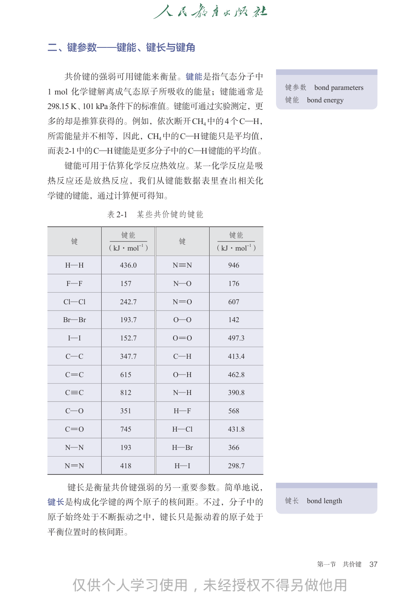

## RJ-CHEMISTRY-HSS2-040 键长及其与键能的关系

第二章 分子结构与性质 / 第一节 共价键 / 二、键参数——键能、键长与键角 · P40-P41

键长是衡量共价键强弱的另一重要参数。简单地说，键长是构成化学键的两个原子的核间距。不过，分子中的原子始终处于不断振动之中，键长只是振动着的原子处于平衡位置时的核间距。

化学键的键长与键能是相关的。例如，C—C、C=C和C≡C的键长分别为154 pm、133 pm和120 pm，越来越小，它们的键能分别为 347.7 kJ·mol⁻¹、615 kJ·mol⁻¹和812 kJ·mol⁻¹，越来越大。

1 pm=10⁻¹² m。表2-2给出共价键键长（pm）：H—H 74；F—F 141；Cl—Cl 198；Br—Br 228；I—I 267；C—C 154；C=C 133；C≡C 120；C—H 109；O—H 96；N—H 101；N≡N 110；Si—Si 235；Si—O 162。

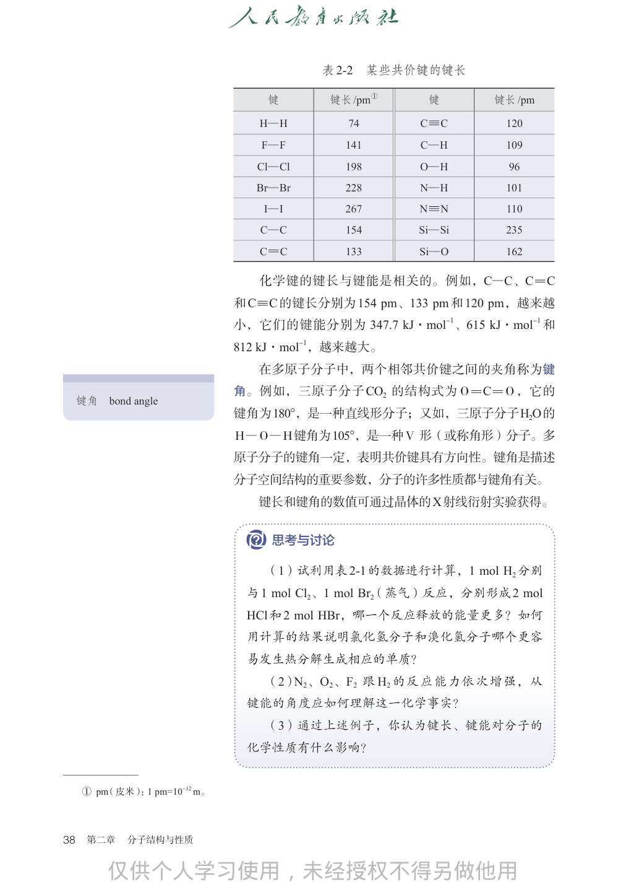

## RJ-CHEMISTRY-HSS2-041 键角、方向性与分子空间结构

第二章 分子结构与性质 / 第一节 共价键 / 二、键参数——键能、键长与键角 · P41

在多原子分子中，两个相邻共价键之间的夹角称为键角。例如，三原子分子CO2 的结构式为O=C=O，它的键角为180°，是一种直线形分子；又如，三原子分子H2O的Ｈ—Ｏ—Ｈ键角为105°，是一种Ｖ 形（或称角形）分子。多原子分子的键角一定，表明共价键具有方向性。键角是描述分子空间结构的重要参数，分子的许多性质都与键角有关。键长和键角的数值可通过晶体的X射线衍射实验获得。

## RJ-CHEMISTRY-HSS2-042 常见元素的共价半径

第二章 分子结构与性质 / 第一节 共价键 / 二、键参数——键能、键长与键角 · P42

常见元素的共价半径（单位pm）：C 77，N 70，O 66，F 64；Si 117，P 110，S 104，Cl 99。

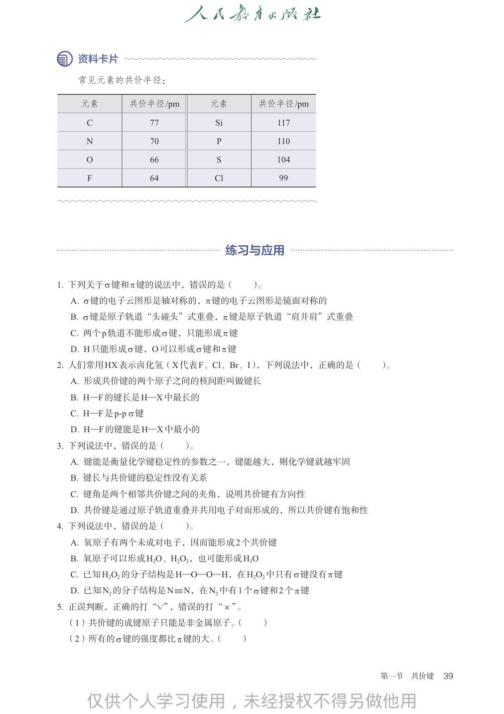

## RJ-CHEMISTRY-HSS2-043 红外光谱测定分子结构

第二章 分子结构与性质 / 第二节 分子的空间结构 / 一、分子结构的测定 · P44-P45

肉眼不能看到分子，那么，科学家是怎样知道分子的结构的呢？早年的科学家主要靠对物质的化学性质进行系统总结得出规律后进行推测。如今，科学家应用了许多测定分子结构的现代仪器和方法，如红外光谱、晶体X射线衍射等。下面先介绍红外光谱，下一章还将介绍晶体X射线衍射。分子中的原子不是固定不动的，而是不断地振动着的。当一束红外线透过分子时，分子会吸收跟它的某些化学键的振动频率相同的红外线，再记录到图谱上呈现吸收峰（如图2-5）。通过和已有谱图库比对，或通过量子化学计算，可以得知各吸收峰是由哪种化学键、哪种振动方式引起的，综合这些信息，可分析出分子中含有何种化学键或官能团的信息。

例如，通过红外光谱仪测得某未知物的红外光谱图如图2-6所示，发现有Ｏ—Ｈ、C—Ｈ和C—Ｏ的振动吸收。因此，可以初步推测该未知物中含有羟基。

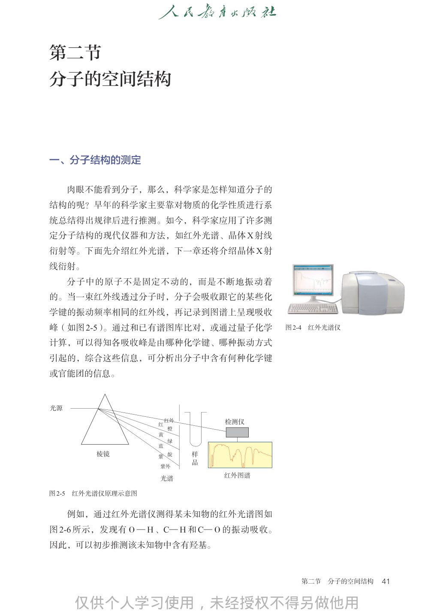

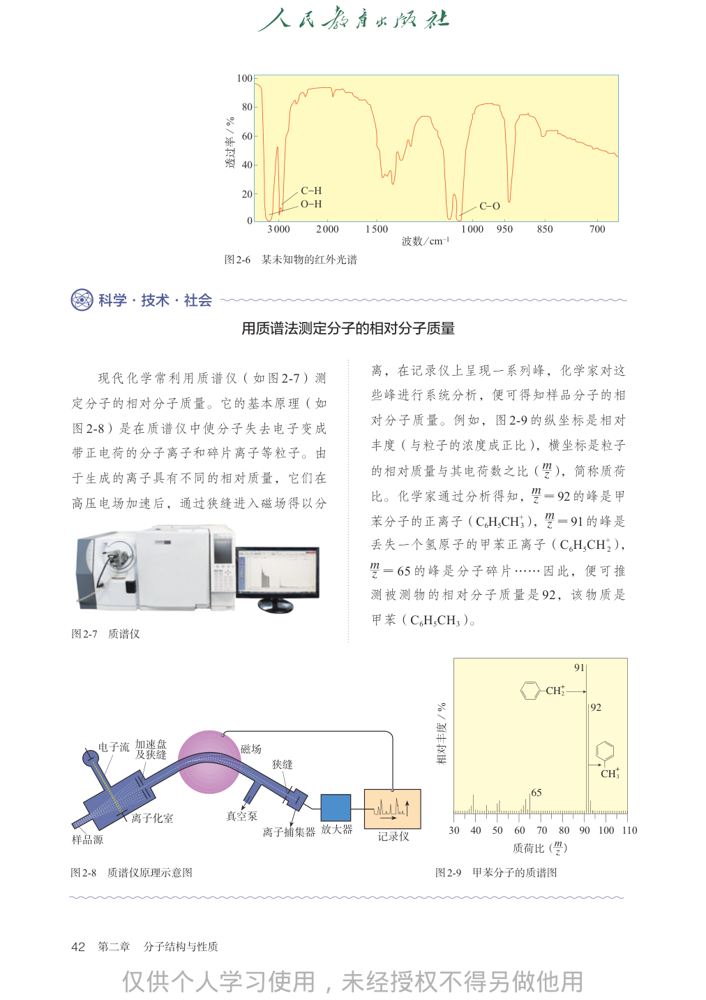

## RJ-CHEMISTRY-HSS2-044 质谱法测定相对分子质量

第二章 分子结构与性质 / 第二节 分子的空间结构 / 一、分子结构的测定 · P45

现代化学常利用质谱仪测定分子的相对分子质量。它的基本原理是在质谱仪中使分子失去电子变成带正电荷的分子离子和碎片离子等粒子。由于生成的离子具有不同的相对质量，它们在高压电场加速后，通过狭缝进入磁场得以分离，在记录仪上呈现一系列峰，化学家对这些峰进行系统分析，便可得知样品分子的相对分子质量。

例如，图2-9的纵坐标是相对丰度（与粒子的浓度成正比），横坐标是粒子的相对质量与其电荷数之比（m/z），简称质荷比。化学家通过分析得知，m/z=92的峰是甲苯分子的正离子（C₆H₅CH₃⁺），m/z=91的峰是丢失一个氢原子的甲苯正离子（C₆H₅CH₂⁺），m/z=65的峰是分子碎片……因此，便可推测被测物的相对分子质量是92，该物质是甲苯（C₆H₅CH₃）。

## RJ-CHEMISTRY-HSS2-045 三、四、五原子分子的空间结构和键角

第二章 分子结构与性质 / 第二节 分子的空间结构 / 二、多样的分子空间结构 · P46

大多数分子是由两个以上原子构成的，于是分子就有了原子的几何学关系和形状，这就是分子的空间结构。例如，三原子分子的空间结构有直线形和Ｖ形（又称角形）两种。如图2-10所示，CO2 呈直线形，而H2O呈Ｖ形，两个H—O的键角为105°。

大多数四原子分子采取平面三角形和三角锥形两种空间结构。例如，甲醛（CH2O）分子呈平面三角形，键角约120° ；氨分子呈三角锥形，键角107°（如图2-11）。

五原子分子的形状更多，最常见的是四面体形，如甲烷，键角为109°28′，其结构式上加的虚线表明氢原子的几何关系（如图2-12）。

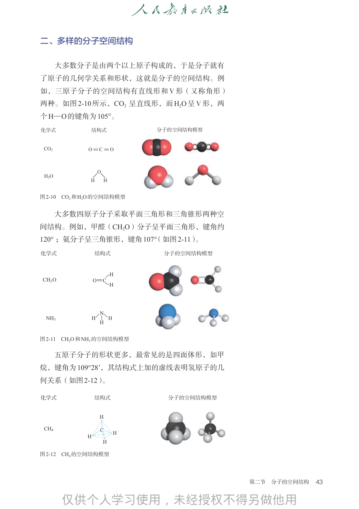

## RJ-CHEMISTRY-HSS2-046 分子空间结构模型与构象稳定性

第二章 分子结构与性质 / 第二节 分子的空间结构 / 二、多样的分子空间结构 · P47

图2-13列出一些分子的空间结构模型：P₄、P₄O₆、P₄O₁₀、C₆₀、椅式C₆H₁₂、船式C₆H₁₂、S₈和SF₆。

分子空间结构与其稳定性有关。例如，图2-13中的S₈像顶皇冠，如果把其中一个向上的硫原子倒转向下，尽管也可以存在，却不如皇冠式稳定；又如，椅式C₆H₁₂比船式C₆H₁₂稳定。

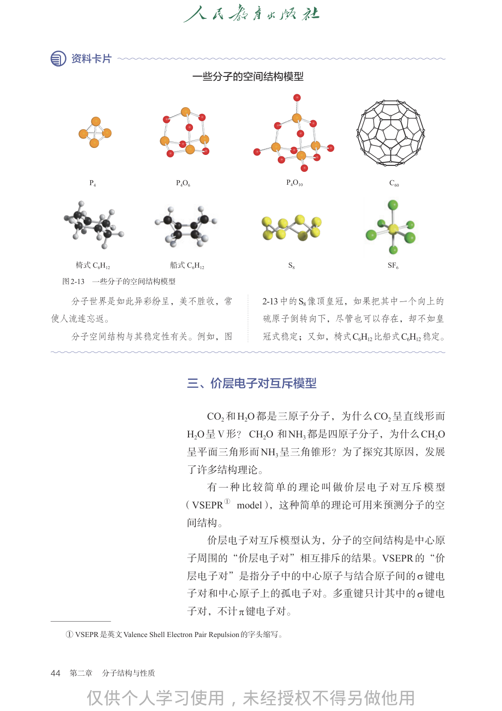

## RJ-CHEMISTRY-HSS2-047 VSEPR模型中的价层电子对

第二章 分子结构与性质 / 第二节 分子的空间结构 / 三、价层电子对互斥模型 · P47-P48

有一种比较简单的理论叫做价层电子对互斥模型（VSEPR model），这种简单的理论可用来预测分子的空间结构。价层电子对互斥模型认为，分子的空间结构是中心原子周围的“价层电子对”相互排斥的结果。VSEPR的“价层电子对”是指分子中的中心原子与结合原子间的σ键电子对和中心原子上的孤电子对。多重键只计其中的σ键电子对，不计π键电子对。

σ键电子对数可由化学式确定。例如，H2O中的中心原子为O，O有２个σ键电子对（O—H）；NH3中的中心原子为Ｎ，N 有3 个σ 键电子对（N—H）；SO3 有3 个σ 键电子对，SO₄²⁻有4个σ键电子对。

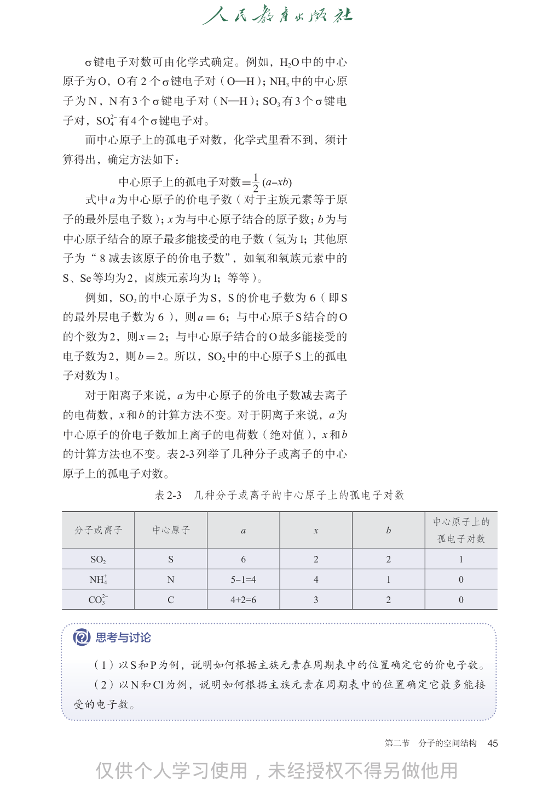

## RJ-CHEMISTRY-HSS2-048 中心原子孤电子对数的计算与离子修正

第二章 分子结构与性质 / 第二节 分子的空间结构 / 三、价层电子对互斥模型 · P48

中心原子上的孤电子对数，化学式里看不到，须计算得出，确定方法如下：

中心原子上的孤电子对数=(a−xb)/2。

式中a为中心原子的价电子数（对于主族元素等于原子的最外层电子数）；x为与中心原子结合的原子数；b为与中心原子结合的原子最多能接受的电子数（氢为1；其他原子为“8减去该原子的价电子数”，如氧和氧族元素中的S、Se等均为2，卤族元素均为1；等等）。例如，SO₂的中心原子为S，S的价电子数为6，则a=6；与中心原子S结合的O的个数为2，则x=2；与中心原子结合的O最多能接受的电子数为2，则b=2。所以，SO₂中的中心原子S上的孤电子对数为1。

对于阳离子来说，a为中心原子的价电子数减去离子的电荷数，x和b的计算方法不变。对于阴离子来说，a为中心原子的价电子数加上离子的电荷数（绝对值），x和b的计算方法也不变。

表2-3：SO₂，中心原子S，a=6、x=2、b=2，孤电子对数1；NH₄⁺，中心原子N，a=5−1=4、x=4、b=1，孤电子对数0；CO₃²⁻，中心原子C，a=4+2=6、x=3、b=2，孤电子对数0。

## RJ-CHEMISTRY-HSS2-049 由VSEPR模型推测空间结构及适用限制

第二章 分子结构与性质 / 第二节 分子的空间结构 / 三、价层电子对互斥模型 · P49-P50

在确定了σ键电子对数和中心原子上的孤电子对数后，把它们相加便可确定分子中的中心原子上的价层电子对数。由于价层电子对的相互排斥，可得到含有孤电子对的分子的VSEPR模型，然后，略去VSEPR模型中的中心原子上的孤电子对，便可得到分子的空间结构。例如，H2O和NH3的中心原子上分别有２个和１个孤电子对，加上中心原子上的σ键电子对，它们的中心原子上的价层电子对数都是４，这些价层电子对相互排斥，形成四面体形的VSEPR模型。略去VSEPR模型中的中心原子上的孤电子对，便得到了H2O的空间结构为Ｖ形，NH3的空间结构为三角锥形（如图2-14）。表2-4列举了应用价层电子对互斥模型对几种分子或离子的空间结构的推测。

由于孤电子对有较大斥力，含孤电子对的分子的实测键角几乎都小于VSEPR模型的预测值。例如，H2O的键角为105°，NH3的键角为107°，NO₂⁻的键角为115°。价层电子对互斥模型对分子空间结构的预测少有失误，但它不能用于预测以过渡金属为中心原子的分子。

表2-4：CO₂，中心原子孤电子对数0、价层电子对数2，VSEPR模型与空间结构均为直线形；SO₂，孤电子对数1、价层电子对数3，VSEPR模型平面三角形，空间结构V形；CO₃²⁻，孤电子对数0、价层电子对数3，VSEPR模型与空间结构均为平面三角形；CH₄，孤电子对数0、价层电子对数4，VSEPR模型与空间结构均为正四面体形。

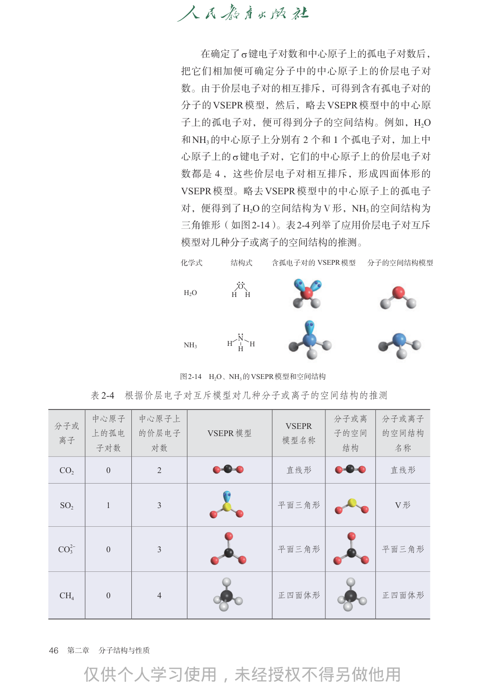

## RJ-CHEMISTRY-HSS2-050 sp³杂化与甲烷、水和氨的结构

第二章 分子结构与性质 / 第二节 分子的空间结构 / 四、杂化轨道理论简介 · P50-P51

杂化轨道理论是一种价键理论，是鲍林为了解释分子的空间结构提出的。例如，我们已经知道，甲烷分子呈正四面体形，它的4 个C—H 的键长相同，H—C—H 的键角为109°28′。按照我们已经学过的价键理论，甲烷的4 个C—H单键都应该是σ键，然而，碳原子的４个价层原子轨道是３个相互垂直的2p轨道和１个球形的2s轨道，用它们跟４个氢原子的1s原子轨道重叠，不可能得到正四面体形的甲烷分子。为了解决这一矛盾，鲍林提出了杂化轨道理论，它的要点是：当碳原子与４个氢原子形成甲烷分子时，碳原子的2s轨道和３个2p轨道会发生混杂，混杂时保持轨道总数不变，却得到４个新的能量相同、方向不同的轨道，各指向正四面体的4个顶角，夹角109°28′，称为sp³杂化轨道，表示这４个轨道是由１个s轨道和３个p轨道杂化形成的（如图2-15）。当碳原子跟４个氢原子结合时，碳原子以４个sp³杂化轨道分别与４个氢原子的1s轨道重叠，形成４个C—H σ键，因此呈正四面体形的空间结构。在学习价层电子对互斥模型时我们知道，H2O和NH3的VSEPR模型跟CH4一样，也是四面体形的，因此它们的中心原子也是采取sp³杂化的。所不同的是，水分子的氧原子的sp³杂化轨道中有２个被孤电子对占据，而氨分子的氮原子的sp³杂化轨道中有１个被孤电子对占据。

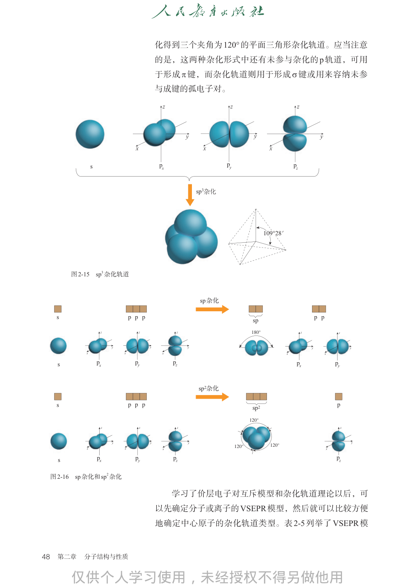

## RJ-CHEMISTRY-HSS2-051 sp、sp²杂化及杂化轨道的用途

第二章 分子结构与性质 / 第二节 分子的空间结构 / 四、杂化轨道理论简介 · P50-P51

除sp³杂化轨道外，还有sp 杂化轨道和sp²杂化轨道。sp杂化轨道由１个s轨道和１个p轨道杂化而得；sp²杂化轨道由１个s轨道和２个p轨道杂化而得，如图2-16所示。sp杂化得到两个夹角为180°的直线形杂化轨道，sp²杂化得到三个夹角为120°的平面三角形杂化轨道。应当注意的是，这两种杂化形式中还有未参与杂化的p轨道，可用于形成π键，而杂化轨道则用于形成σ键或用来容纳未参与成键的孤电子对。

## RJ-CHEMISTRY-HSS2-052 VSEPR模型与中心原子杂化类型的对应

第二章 分子结构与性质 / 第二节 分子的空间结构 / 四、杂化轨道理论简介 · P51-P52

学习了价层电子对互斥模型和杂化轨道理论以后，可以先确定分子或离子的VSEPR模型，然后就可以比较方便地确定中心原子的杂化轨道类型。

表2-5：CO₂，VSEPR模型直线形，中心原子sp杂化；SO₂、SO₃，VSEPR模型平面三角形，中心原子sp²杂化；H₂O、NH₃、CH₄，VSEPR模型分别为四面体形、四面体形、正四面体形，中心原子均为sp³杂化。原表模型图见源页。

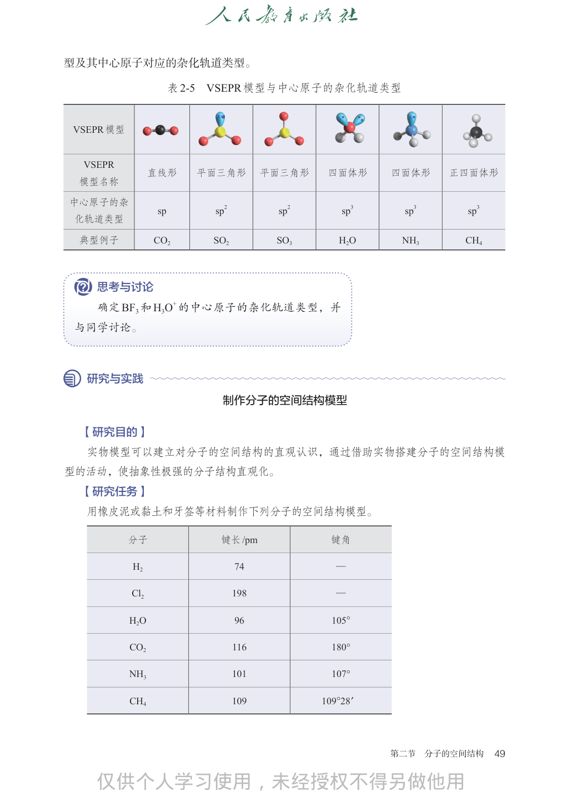

## RJ-CHEMISTRY-HSS2-053 分子模型制作所用键长和键角数据

第二章 分子结构与性质 / 第二节 分子的空间结构 / 四、杂化轨道理论简介 · P52

用橡皮泥或黏土和牙签等材料制作下列分子的空间结构模型。给定数据如下：

|分子|键长/pm|键角|
|---|---|---|
|H₂|74|—|
|Cl₂|198|—|
|H₂O|96|105°|
|CO₂|116|180°|
|NH₃|101|107°|
|CH₄|109|109°28′|

## RJ-CHEMISTRY-HSS2-054 共价键极性、分子极性与判断依据

第二章 分子结构与性质 / 第三节 分子结构与物质的性质 / 一、共价键的极性 · P55-P56

共价键有极性共价键和非极性共价键。由不同原子形成的共价键，电子对会发生偏移，是极性键，极性键中的两个键合原子，一个呈正电性（δ+），另一个呈负电性（δ-），如图2-17所示。电子对不发生偏移的共价键是非极性键。分子有极性分子和非极性分子之分。在极性分子中，正电中心和负电中心不重合，使分子的某一个部分呈正电性（δ+），另一部分呈负电性（δ-）；非极性分子的正电中心和负电中心重合。

判断分子的极性可依据分子中化学键的极性的向量和。只含非极性键的分子一定是非极性分子；含极性键的分子有没有极性，必须依据分子中极性键的极性的向量和是否等于零而定。当分子中各个键的极性的向量和等于零时，是非极性分子，否则是极性分子。或者，我们可根据分子的正电中心和负电中心是否重合来判断它是否是极性分子。

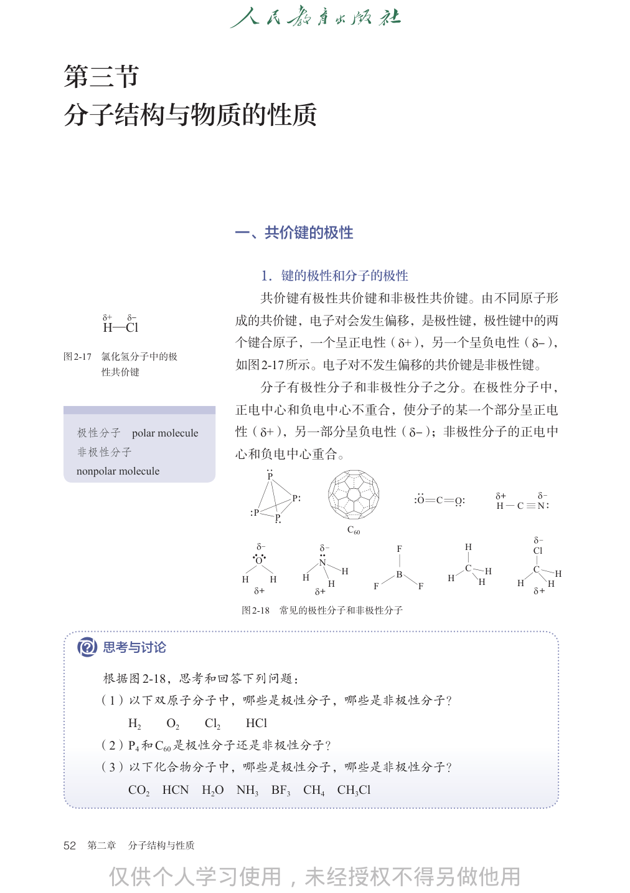

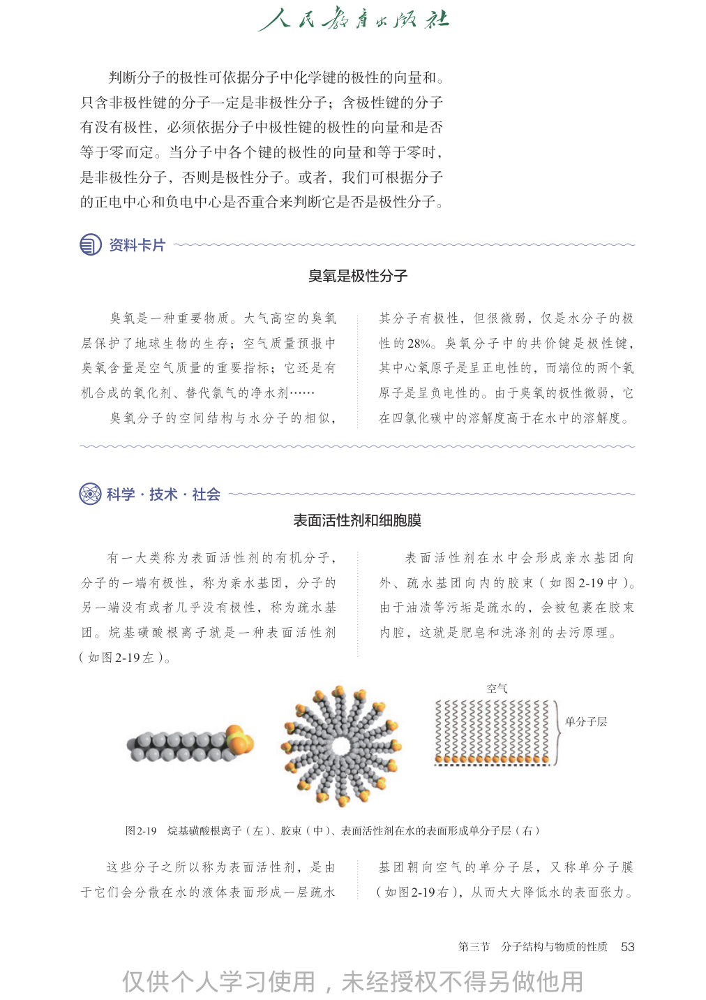

## RJ-CHEMISTRY-HSS2-055 臭氧的极性、键极性与溶解性

第二章 分子结构与性质 / 第三节 分子结构与物质的性质 / 一、共价键的极性 · P56

臭氧是一种重要物质。大气高空的臭氧层保护了地球生物的生存；空气质量预报中臭氧含量是空气质量的重要指标；它还是有机合成的氧化剂、替代氯气的净水剂……臭氧分子的空间结构与水分子的相似，其分子有极性，但很微弱，仅是水分子的极性的28%。臭氧分子中的共价键是极性键，其中心氧原子是呈正电性的，而端位的两个氧原子是呈负电性的。由于臭氧的极性微弱，它在四氯化碳中的溶解度高于在水中的溶解度。

## RJ-CHEMISTRY-HSS2-056 表面活性剂、胶束、单分子膜和双分子膜

第二章 分子结构与性质 / 第三节 分子结构与物质的性质 / 一、共价键的极性 · P56-P57

有一大类称为表面活性剂的有机分子，分子的一端有极性，称为亲水基团，分子的另一端没有或者几乎没有极性，称为疏水基团。烷基磺酸根离子就是一种表面活性剂（如图2-19左）。

表面活性剂在水中会形成亲水基团向外、疏水基团向内的胶束（如图2-19 中）。由于油渍等污垢是疏水的，会被包裹在胶束内腔，这就是肥皂和洗涤剂的去污原理。

这些分子之所以称为表面活性剂，是由于它们会分散在水的液体表面形成一层疏水基团朝向空气的单分子层，又称单分子膜（如图2-19右），从而大大降低水的表面张力。

人体细胞和细胞器的膜是双分子膜，双分子膜是由大量两性分子（一端有极性，另一端无极性）组装而成的，膜的简图如图2-20所示。为什么双分子膜以头向外而尾向内的方式排列？这是由于细胞膜的两侧都是水溶液，水是极性分子，而构成膜的两性分子的头基是极性基团而尾基是非极性基团。

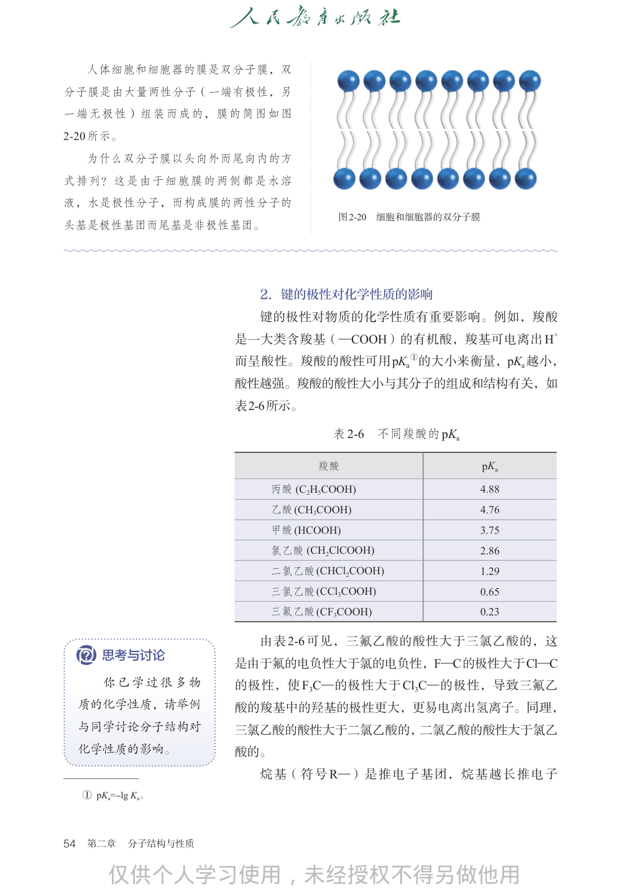

## RJ-CHEMISTRY-HSS2-057 键极性对羧酸酸性的影响

第二章 分子结构与性质 / 第三节 分子结构与物质的性质 / 一、共价键的极性 · P57-P58

键的极性对物质的化学性质有重要影响。例如，羧酸是一大类含羧基（—COOH）的有机酸，羧基可电离出H⁺而呈酸性。羧酸的酸性可用pKₐ的大小来衡量，pKₐ越小，酸性越强。羧酸的酸性大小与其分子的组成和结构有关，如表2-6所示。

pKₐ=−lgKₐ。表2-6的pKₐ依次为：丙酸(C₂H₅COOH)4.88，乙酸(CH₃COOH)4.76，甲酸(HCOOH)3.75，氯乙酸(CH₂ClCOOH)2.86，二氯乙酸(CHCl₂COOH)1.29，三氯乙酸(CCl₃COOH)0.65，三氟乙酸(CF₃COOH)0.23。

由表2-6可见，三氟乙酸的酸性大于三氯乙酸的，这是由于氟的电负性大于氯的电负性，F—C的极性大于Cl—C的极性，使F3C—的极性大于Cl3C—的极性，导致三氟乙酸的羧基中的羟基的极性更大，更易电离出氢离子。同理，三氯乙酸的酸性大于二氯乙酸的， 二氯乙酸的酸性大于氯乙酸的。烷基（符号R—）是推电子基团，烷基越长推电子效应越大，使羧基中的羟基的极性越小，羧酸的酸性越弱。因此，甲酸的酸性大于乙酸的，乙酸的酸性大于丙酸的……随着烷基加长，酸性的差异越来越小。

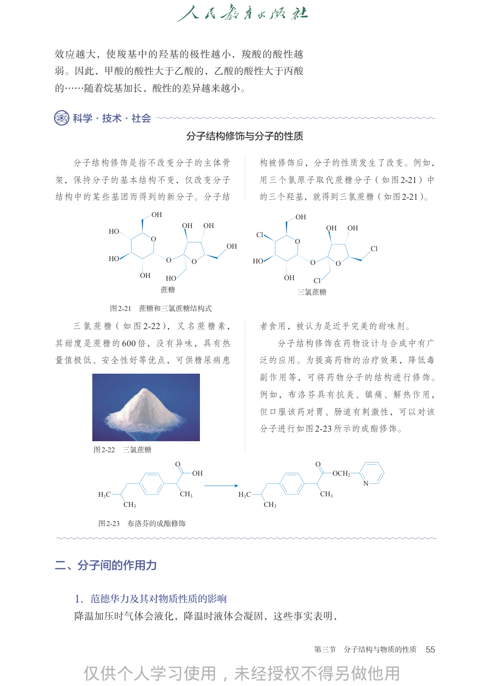

## RJ-CHEMISTRY-HSS2-058 分子修饰与物质性质的改变

第二章 分子结构与性质 / 第三节 分子结构与物质的性质 / 一、共价键的极性 · P58

分子结构修饰是指不改变分子的主体骨架，保持分子的基本结构不变，仅改变分子结构中的某些基团而得到的新分子。分子结构被修饰后，分子的性质发生了改变。例如，用三个氯原子取代蔗糖分子（如图2-21）中的三个羟基，就得到三氯蔗糖（如图2-21）。

三氯蔗糖（如图2-22），又名蔗糖素，其甜度是蔗糖的600 倍，没有异味，具有热量值极低、安全性好等优点，可供糖尿病患者食用。分子结构修饰在药物设计与合成中有广泛的应用。为提高药物的治疗效果，降低毒副作用等，可将药物分子的结构进行修饰。例如，布洛芬具有抗炎、镇痛、解热作用，但口服该药对胃、肠道有刺激性，可以对该分子进行如图2-23所示的成酯修饰。

## RJ-CHEMISTRY-HSS2-059 范德华力及其大小的影响因素

第二章 分子结构与性质 / 第三节 分子结构与物质的性质 / 二、分子间的作用力 · P58-P59

降温加压时气体会液化，降温时液体会凝固，这些事实表明，分子之间存在着相互作用力。分子间普遍存在的这类作用力称为范德华力。范德华力很弱，比化学键的键能小1~2个数量级。相对分子质量越大，范德华力越大；分子的极性越大，范德华力也越大。

表2-7 某些分子间的范德华力（kJ·mol⁻¹）：Ar 8.50，CO 8.75，HI 26.00，HBr 23.11，HCl 21.14。

表2-8 卤素单质的熔点和沸点（℃）：F₂ −219.6、−188.1；Cl₂ −101、−34.6；Br₂ −7.2、58.78；I₂ 113.5、184.4。

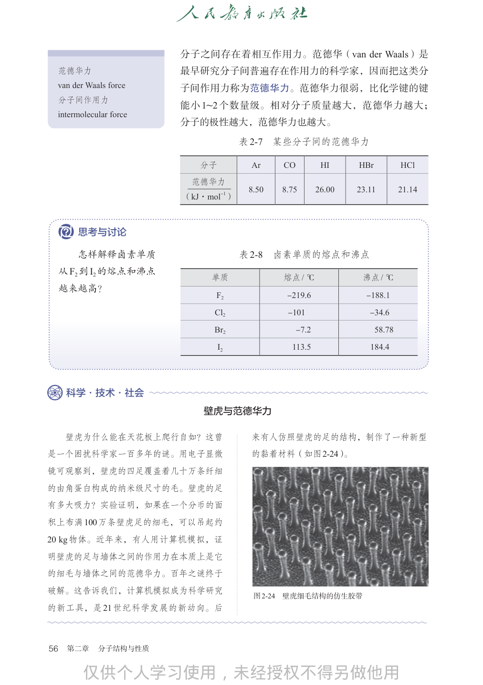

## RJ-CHEMISTRY-HSS2-060 壁虎脚趾与范德华力

第二章 分子结构与性质 / 第三节 分子结构与物质的性质 / 二、分子间的作用力 · P59

在电子显微镜下可观察到，壁虎的四足覆盖着几十万条纤细的由角蛋白构成的纳米级尺寸的毛。壁虎的足有多大吸力？实验证明，如果在一个分币的面积上布满100万条壁虎足的细毛，可以吊起约20 kg物体。有人用计算机模拟，证明壁虎的足与墙体之间的作用力在本质上是它的细毛与墙体之间的范德华力。有人仿照壁虎的足的结构，制作了一种新型的黏着材料（如图2-24）。

## RJ-CHEMISTRY-HSS2-061 氢键的形成、分子缔合与分子内外氢键

第二章 分子结构与性质 / 第三节 分子结构与物质的性质 / 二、分子间的作用力 · P60

你是否知道，常见物质中，水是熔、沸点较高的液体之一？冰的密度比液态水的小？为了解释水的这些奇特性质，人们提出了氢键的概念。氢键是除范德华力之外的另一种分子间作用力，它是由已经与电负性很大的原子形成共价键的氢原子（如水分子中的氢）与另一个电负性很大的原子（如水分子中的氧）之间形成的作用力（如图2-25）。氢键的存在，大大加强了水分子之间的作用力，使水的熔、沸点较高。实验还证明，接近水的沸点的水蒸气的相对分子质量测定值比按化学式H2O计算出来的相对分子质量大一些。用氢键能够解释这种异常性：接近水的沸点的水蒸气中存在相当量的水分子因氢键而相互缔合，形成所谓的缔合分子。后来的研究证明，氢键普遍存在于已经与Ｎ、Ｏ、Ｆ等电负性很大的原子形成共价键的氢原子与另外的Ｎ、Ｏ、Ｆ等电负性很大的原子之间。例如，不仅氟化氢分子之间以及氨分子之间存在氢键，而且它们跟水分子之间也存在氢键。此外，实验还证实，氢键不仅存在于分子之间，有时也存在于分子内。如图2-26所示的邻羟基苯甲醛在分子内形成了氢键，在分子之间不存在氢键。对羟基苯甲醛（如图2-27）不可能形成分子内氢键，只能在分子间形成氢键。因而，前者的沸点低于后者的沸点。

尽管人们把氢键也称作键，但与化学键比较，氢键属于一种较弱的作用力，比化学键的键能小1~2个数量级，不属于化学键。

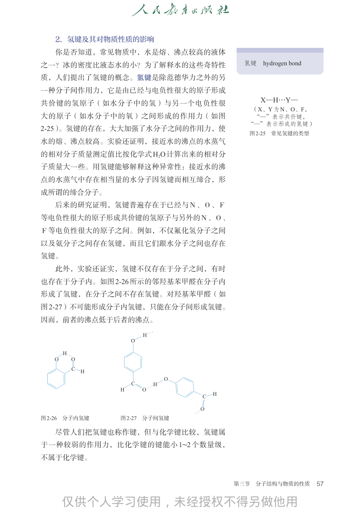

## RJ-CHEMISTRY-HSS2-062 氢键的键能与键长数据

第二章 分子结构与性质 / 第三节 分子结构与物质的性质 / 二、分子间的作用力 · P61

表2-9列出了几种氢键的键能和键长：F—H…F，28.1 kJ·mol⁻¹、255 pm，(HF)n；O—H…O，18.8 kJ·mol⁻¹、276 pm，冰；O—H…O，25.9 kJ·mol⁻¹、266 pm，甲醇、乙醇；N—H…F，20.9 kJ·mol⁻¹、268 pm，NH₄F；N—H…O，20.9 kJ·mol⁻¹、286 pm，CH₃CONH₂；N—H…N，5.4 kJ·mol⁻¹、338 pm，NH₃。这里氢键的键长是A—H…B中A和B的距离。

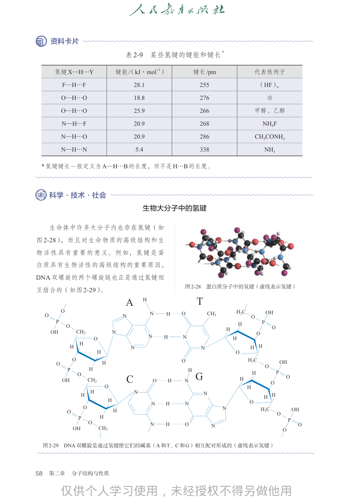

## RJ-CHEMISTRY-HSS2-063 生物大分子中的氢键

第二章 分子结构与性质 / 第三节 分子结构与物质的性质 / 二、分子间的作用力 · P61

生命体中许多大分子内也存在氢键（如图2-28），而且对生命物质的高级结构和生物活性具有重要的意义。例如，氢键是蛋白质具有生物活性的高级结构的重要原因，DNA双螺旋的两个螺旋链也正是通过氢键相互结合的（如图2-29）。

## RJ-CHEMISTRY-HSS2-064 相似相溶、氢键与物质溶解性

第二章 分子结构与性质 / 第三节 分子结构与物质的性质 / 二、分子间的作用力 · P62-P63

物质相互溶解的性质十分复杂，受许多因素影响，如温度、压强等。从分子结构的角度看，存在“相似相溶”的规律。蔗糖和氨易溶于水，难溶于四氯化碳；而萘和碘却易溶于四氯化碳，难溶于水。如果分析溶质和溶剂的分子结构就可以知道原因了，蔗糖、氨、水是极性分子，而萘、碘、四氯化碳是非极性分子。通过对许多实验的观察和研究，人们得出了一个经验性的“相似相溶”的规律：非极性溶质一般能溶于非极性溶剂，极性溶质一般能溶于极性溶剂。水是极性溶剂，根据“相似相溶”，极性溶质比非极性溶质在水中的溶解度大。如果存在氢键，则溶剂和溶质之间的氢键作用力越大，溶解性越好。相反，无氢键相互作用的溶质在有氢键的水中的溶解度就比较小。此外， “相似相溶”还适用于分子结构的相似性。例如，乙醇的结构简式为CH3CH2OH，其中的—OH与水分子的—OH相近， 因而乙醇能与水互溶； 而戊醇CH3CH2CH2CH2CH2OH中的烃基较大，其中的—OH跟水分子的—OH的相似因素小得多了，因而它在水中的溶解度明显减小。

表2-10 气体的溶解度（气体的压强为1.01×10⁵ Pa，温度为293 K，在100 g水中的溶解度，单位g）：乙炔0.117，氨气52.9，二氧化碳0.169，一氧化碳0.0028，氯气0.729，乙烷0.0062；乙烯0.0149，氢气0.00016，甲烷0.0023，氮气0.0019，氧气0.0043，二氧化硫11.28。

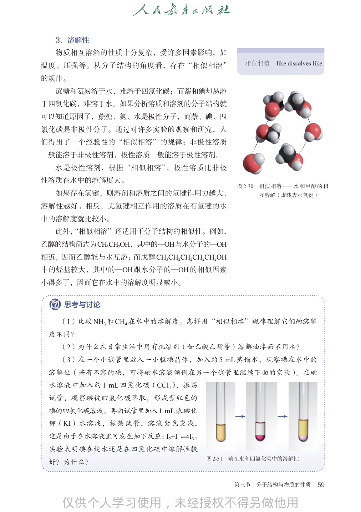

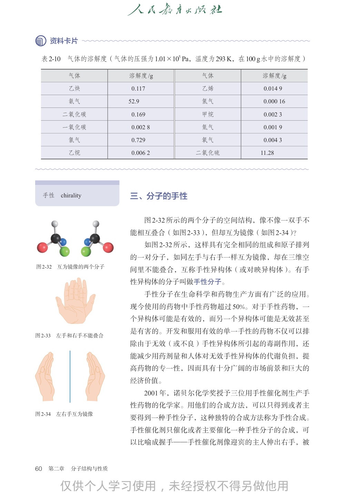

## RJ-CHEMISTRY-HSS2-065 碘在水和四氯化碳中的溶解及与碘离子的作用

第二章 分子结构与性质 / 第三节 分子结构与物质的性质 / 二、分子间的作用力 · P62

（3）在一个小试管里放入一小粒碘晶体，加入约5 mL蒸馏水，观察碘在水中的溶解性（若有不溶的碘，可将碘水溶液倾倒在另一个试管里继续下面的实验）。在碘水溶液中加入约1 mL四氯化碳（CCl4），振荡试管，观察碘被四氯化碳萃取，形成紫红色的碘的四氯化碳溶液。再向试管里加入1 mL浓碘化钾（KI）水溶液，振荡试管，溶液紫色变浅，这是由于在水溶液里可发生如下反应：I₂+I⁻ ⇌ I₃⁻。

## RJ-CHEMISTRY-HSS2-066 手性分子、对映异构与药物作用

第二章 分子结构与性质 / 第三节 分子结构与物质的性质 / 三、分子的手性 · P63

如图2-32所示，这样具有完全相同的组成和原子排列的一对分子，如同左手与右手一样互为镜像，却在三维空间里不能叠合，互称手性异构体（或对映异构体）。有手性异构体的分子叫做手性分子。手性分子在生命科学和药物生产方面有广泛的应用。现今使用的药物中手性药物超过50%。对于手性药物，一个异构体可能是有效的，而另一个异构体可能是无效甚至是有害的。开发和服用有效的单一手性的药物不仅可以排除由于无效（或不良）手性异构体所引起的毒副作用，还能减少用药剂量和人体对无效手性异构体的代谢负担，提高药物的专一性。

## RJ-CHEMISTRY-HSS2-067 手性合成与催化剂的选择性

第二章 分子结构与性质 / 第三节 分子结构与物质的性质 / 三、分子的手性 · P63-P64

用手性催化剂生产手性药物，可以只得到或者主要得到一种手性分子，这种独特的合成方法称为手性合成。手性催化剂只催化或者主要催化一种手性分子的合成，可以比喻成握手——手性催化剂像迎宾的主人伸出右手，被催化合成的手性分子像客人，总是伸出右手去握手（如图2-35）。

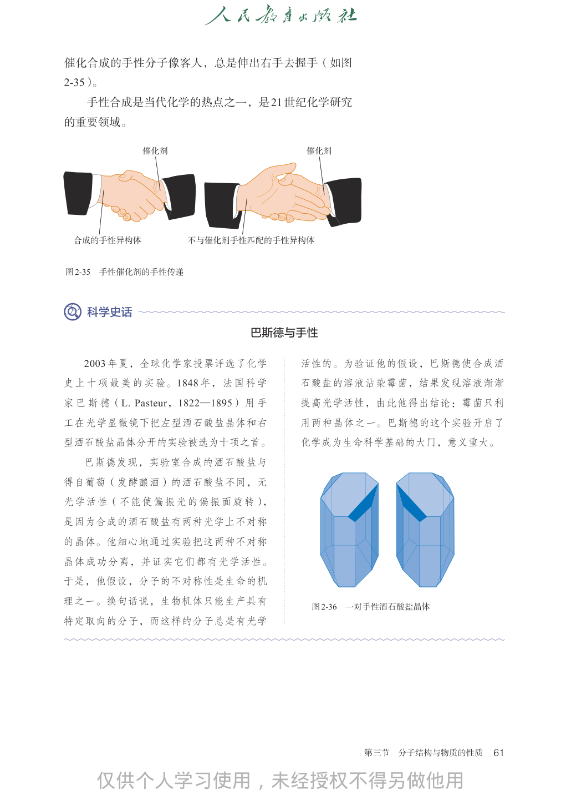

## RJ-CHEMISTRY-HSS2-068 对映晶体的分离与霉菌选择性利用实验

第二章 分子结构与性质 / 第三节 分子结构与物质的性质 / 三、分子的手性 · P64

在光学显微镜下，可以把左型酒石酸盐晶体和右型酒石酸盐晶体分开。实验室合成的酒石酸盐与得自葡萄（发酵酿酒）的酒石酸盐不同，无光学活性（不能使偏振光的偏振面旋转），是因为合成的酒石酸盐有两种光学上不对称的晶体。通过实验把这两种不对称晶体成功分离，并证实它们都有光学活性。

据此提出假设：分子的不对称性是生命的机理之一。换句话说，生物机体只能生产具有特定取向的分子，而这样的分子总是有光学活性的。为验证这一假设，使合成酒石酸盐的溶液沾染霉菌，结果发现溶液渐渐提高光学活性，由此得出结论：霉菌只利用两种晶体之一。

## RJ-CHEMISTRY-HSS2-069 晶体的分类与结构对性质的影响

第三章 晶体结构与性质 / 章引言 / 章引言 · P70

固体分晶体和非晶体两大类。晶体具有周期性的微观结构。你若能想象，二维的印花布图案是由原子、离子或分子等构成的，再把这种图案推演到三维空间里去，就如同晶体的微观结构了。晶体的微观基本单元称为晶胞，就好比蜂巢里的蜂室。晶体可简单地分为分子晶体、共价晶体、金属晶体和离子晶体四种类型。另外，还存在许多过渡晶体和混合型晶体。晶体的结构决定了晶体的性质。晶体的熔点、密度、硬度、延展性、溶解性、热分解性、化学反应性、生物活性……都与晶体结构密切相关。

## RJ-CHEMISTRY-HSS2-070 物质聚集状态与构成粒子

第三章 晶体结构与性质 / 第一节 物质的聚集状态与晶体的常识 / 一、物质的聚集状态 · P71

通过X射线衍射等实验手段，发现许多常见的晶体中并无分子。例如，氯化钠、石墨、二氧化硅、金刚石以及各种金属等。气态和液态物质也同样不一定都由分子构成。例如，等离子体是由电子、阳离子和电中性粒子（分子或原子）组成的整体上呈电中性的气态物质；又如，离子液体是熔点不高的仅由离子组成的液体物质。此外，还有更多的物质聚集状态，如晶态、非晶态，以及介乎晶态和非晶态之间的塑晶态、液晶态等。这些事实表明，图3-1描述的物质三态间的相互转化模型显然过于简单了。

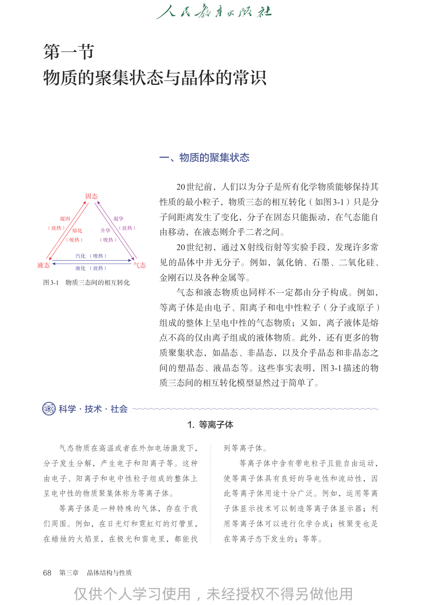

## RJ-CHEMISTRY-HSS2-071 等离子体的组成、性质和应用

第三章 晶体结构与性质 / 第一节 物质的聚集状态与晶体的常识 / 一、物质的聚集状态 · P71

气态物质在高温或者在外加电场激发下，分子发生分解，产生电子和阳离子等。这种由电子、阳离子和电中性粒子组成的整体上呈电中性的物质聚集体称为等离子体。等离子体是一种特殊的气体，存在于我们周围。例如，在日光灯和霓虹灯的灯管里，在蜡烛的火焰里，在极光和雷电里，都能找到等离子体。等离子体中含有带电粒子且能自由运动，使等离子体具有良好的导电性和流动性，因此等离子体用途十分广泛。例如，运用等离子体显示技术可以制造等离子体显示器；利用等离子体可以进行化学合成；核聚变也是在等离子态下发生的；等等。

## RJ-CHEMISTRY-HSS2-072 热致液晶、溶致液晶与液晶显示

第三章 晶体结构与性质 / 第一节 物质的聚集状态与晶体的常识 / 一、物质的聚集状态 · P72

苯甲酸胆甾酯加热达到熔点后，先呈浑浊态，再加热达一定温度时，浑浊态变透明清亮态。上述熔点至澄清点温度范围内的物质状态命名为液晶（如图3-2），后称热致液晶。相对于热致液晶，从溶液中获得的液晶称为溶致液晶，即胶束等。液晶是介于液态和晶态之间的物质状态，既具有液体的流动性、黏度、形变性等，又具有晶体的某些物理性质，如导热性、光学性质等，表现出类似晶体的各向异性。

实用液晶在常温下十分稳定。已经获得实际应用的热致液晶均为刚性棒状强极性（或易于极化的）分子，其分子有取向序，分子的长轴取向一致，但无位置序，分子可滑动（如图3-3）。此外，还有平板状、盘状、叶状分子等液晶。液晶已有广泛的应用。例如，手机、电脑和电视的液晶显示器，由于施加电场可使液晶的长轴取向发生不同程度的改变，从而显示数字、文字或图像。再如，合成高强度液晶纤维已广泛应用于飞机、火箭、坦克、舰船、防弹衣、防弹头盔等。

## RJ-CHEMISTRY-HSS2-073 晶体与非晶体、自范性及其条件

第三章 晶体结构与性质 / 第一节 物质的聚集状态与晶体的常识 / 二、晶体与非晶体 · P72-P73;P75

你是否知道固体有晶体和非晶体之分？绝大多数常见的固体是晶体，只有如玻璃、炭黑之类的物质属于非晶体（玻璃又称玻璃体，炭黑又称无定形体）。晶体与非晶体有什么本质的差异呢？

表3-1 晶体与非晶体的本质差异

晶体：有自范性（能自发呈现多面体外形），原子在三维空间里呈周期性有序排列。

非晶体：没有自范性（不能自发呈现多面体外形），原子排列相对无序。

晶体的自范性即晶体能自发地呈现多面体外形的性质。所谓自发过程，即自动发生的过程。不过，自发过程的实现，仍需要一定的条件。例如，水能自发地从高处流向低处，但不打开拦截水流的闸门，水库里的水就不能下泻。晶体呈现自范性的条件之一是晶体生长的速率适当。熔融态物质冷却凝固，有时得到晶体，但凝固速率过快，常常只得到肉眼看不到多面体外形的粉末或没有规则外形的块状物，甚至形成的只是非晶态（玻璃态）。最有趣的例子是天然的水晶球。水晶球是岩浆里熔融态的SiO2侵入地壳内的空洞冷却形成的。剖开水晶球，它的外层是看不到晶体外形的玛瑙，内层才是呈现晶体外形的水晶（如图3-4）。不同的是，玛瑙是熔融态SiO2快速冷却形成的，而水晶则是熔融态SiO2缓慢冷却形成的。

本质上，晶体的自范性是晶体中粒子在微观空间里呈现周期性的有序排列的宏观表象。相反，非晶体中粒子的排列则相对无序，因而无自范性（如图3-6）。

形成玛瑙的熔融态SiO₂由于含不同杂质而常有鲜艳的颜色，如红、橙、黄、绿、蓝，乃至黑色，当然，也有白色的。而水晶大多是无色透明的，含杂质时，才得到紫水晶或墨晶等。

## RJ-CHEMISTRY-HSS2-074 获得晶体的三条途径与实验3-1

第三章 晶体结构与性质 / 第一节 物质的聚集状态与晶体的常识 / 二、晶体与非晶体 · P73-P74

得到晶体一般有三条途径：（1）熔融态物质凝固；（2）气态物质冷却不经液态直接凝固（凝华）；（3）溶质从溶液中析出。如图3-5所示是三个典型例子：

【实验3-1】（1）用研钵把硫黄粉末研细，放入蒸发皿中，放在三脚架的铁圈上，用酒精灯加热至熔融态，自然冷却结晶后，观察实验现象。（2）在一个小烧杯里加入少量碘，用一个表面皿盖在小烧杯上，并在表面皿上加少量冷水。把小烧杯放在陶土网上小火加热，观察实验现象。（3）在250 mL烧杯中加入半杯饱和氯化钠溶液，用滴管滴入浓盐酸，观察实验现象。

许多固体粉末用肉眼看不到晶体外形，但在光学显微镜或电子显微镜下可观察到规则的晶体外形。这充分证明固体粉末仍是晶体，只因晶粒太小，肉眼看不到而已。

## RJ-CHEMISTRY-HSS2-075 大晶体的制备：单晶硅、磷酸二氢钾与CVD钻石

第三章 晶体结构与性质 / 第一节 物质的聚集状态与晶体的常识 / 二、晶体与非晶体 · P74

制备晶体的三种途径都可制得有重要价值的大晶体。例如，芯片的基质是单晶硅，它是由熔融态硅制备的，俗称“拉单晶”。用于制造激光器的KH2PO4大晶体是由水溶液结晶出来的。而可与天然钻石媲美的CVD宝石级钻石，则是由烷烃（如CH4）在微波炉里以等离子体分解出的碳通过化学气相沉积（简称CVD）得到的。

## RJ-CHEMISTRY-HSS2-076 晶体的各向异性与熔点

第三章 晶体结构与性质 / 第一节 物质的聚集状态与晶体的常识 / 二、晶体与非晶体 · P75

晶体的特点并不仅限于外形和内部质点排列的高度有序性，它们的许多物理性质，如强度、导热性、光学性质等，常常会表现出各向异性。例如，在水晶柱面上滴一滴熔化的石蜡，用一根红热的铁针刺中凝固的石蜡，你会发现石蜡在不同方向熔化的快慢不同。这是水晶导热性的各向异性造成的。所以，晶体的某些物理性质的各向异性同样反映了晶体内部质点排列的有序性，而且通过这些性质可以了解晶体的内部排列与结构的一些信息。而非晶体则不具有物理性质各向异性的特点。考察固体的某些性质，如熔点，可以间接地确定某一固体是否是晶体，因为晶体的熔点较固定，而非晶体则没有固定的熔点，熔化过程温度会发生变化。然而，区分晶体和非晶体最可靠的科学方法是对固体进行X 射线衍射实验。

## RJ-CHEMISTRY-HSS2-077 晶胞、无隙并置与均摊计数

第三章 晶体结构与性质 / 第一节 物质的聚集状态与晶体的常识 / 三、晶胞 · P76-P77

为了描述晶体在微观空间里原子的排列，无须画出千千万万个原子，只需在晶体微观空间里取出一个基本单元即可。这种描述晶体结构的基本单元叫做晶胞（如图3-8）。

常规的晶胞都是平行六面体。整块晶体可以看作是数量巨大的晶胞“无隙并置”而成；所谓“无隙”，是指相邻晶胞之间没有任何间隙；所谓“并置”，是指所有晶胞都是平行排列的，取向相同。例如，图3-8的右图是金属铜的一个晶胞，它是一个立方体，含4个铜原子。这张图里不是有14个铜原子吗？怎么说一个晶胞只含4个铜原子呢？原来，我们在观察晶胞图时，千万不能忘记，晶胞只是晶体微观空间结构里的一个基本单元，在它的上下、左右、前后无隙并置地排列着无数晶胞，而且所有晶胞的形状及其内部的原子种类、个数及几何排列（包括取向）是完全相同的。因而，晶胞的顶角原子是8 个晶胞共用的，晶胞棱上的原子是4个晶胞共用的，晶胞面上的原子是两个晶胞共用的（如图3-9）。因此，金属铜的一个晶胞的原子数＝8×(1/8)+6×(1/2)=4。

总之，晶胞是8个顶角相同、三套各4根平行棱分别相同、三套各两个平行面分别相同的最小平行六面体。

## RJ-CHEMISTRY-HSS2-078 X射线衍射鉴别晶体与测定晶体结构

第三章 晶体结构与性质 / 第一节 物质的聚集状态与晶体的常识 / 四、晶体结构的测定 · P78-P79

测定晶体结构最常用的仪器是X 射线衍射仪（如图3-12）。在晶体的X射线衍射实验中，当单一波长的X射线通过晶体时，Ｘ射线和晶体中的电子相互作用，会在记录仪上产生分立的斑点（如图3-13）或者明锐的衍射峰（如图3-14）。而在同一条件下摄取的非晶体图谱中却看不到分立的斑点或明锐的衍射峰。例如，石英玻璃（非晶态二氧化硅）和水晶（晶态二氧化硅）研成粉末摄取的X射线衍射图谱是不同的（如图3-14）。

通过晶体的X射线衍射实验获得衍射图后，经过计算可以从衍射图形获得晶体结构的有关信息，包括晶胞形状和大小、分子或原子在微观空间有序排列呈现的对称类型、原子在晶胞里的数目和位置等，以及结合晶体化学组成的信息推出原子之间的相互关系。例如，通过晶体X射线衍射实验，对乙酸晶体进行测定，可以得出乙酸晶胞，晶胞中含有4 个乙酸分子（如图3-15）。并且，测定晶胞中各个原子的位置（坐标），根据原子坐标，可以计算原子间的距离，判断出晶体中哪些原子之间存在化学键，确定键长和键角，从而，得出分子的空间结构（如图3-16）。

## RJ-CHEMISTRY-HSS2-079 分子晶体的组成、性质及典型物质

第三章 晶体结构与性质 / 第二节 分子晶体与共价晶体 / 一、分子晶体 · P81

只含分子的晶体称为分子晶体。例如，图3-11的碘晶体只含I2，属于分子晶体。在分子晶体中，相邻分子靠分子间作用力相互吸引。分子晶体有低熔点的特性。另外，你也不难理解分子晶体的硬度很小了。

哪些晶体属于分子晶体呢？较典型的分子晶体有：（1）所有非金属氢化物，如水、硫化氢、氨、氯化氢、甲烷等；（2）部分非金属单质，如卤素（X2）（如图3-11 的碘）、氧气（O2）、硫（S8）、氮气（N2）、白磷（P4）、碳60（C60）（如图3-17）等；（3）部分非金属氧化物，如CO2、P4O6、P4O10、SO2等；（4）稀有气体；（5）几乎所有的酸；（6）绝大多数有机物。

表3-2 某些分子晶体的熔点（℃）：氧气−218.3，氮气−210.1，白磷44.2，水0，硫化氢−85.6，甲烷−182，乙酸16.6，尿素132.7。

## RJ-CHEMISTRY-HSS2-080 分子密堆积、冰与干冰结构和密度的对比

第三章 晶体结构与性质 / 第二节 分子晶体与共价晶体 / 一、分子晶体 · P81-P82

大多数分子晶体的结构有如下特征：如果分子间作用力只是范德华力，若以一个分子为中心，其周围最多可以有12个紧邻的分子，分子晶体的这一特征称为分子密堆积，如图3-17 的碳60。然而，我们最熟悉的冰，水分子之间的主要作用力是氢键（当然也存在范德华力），从图3-18可见，在冰的晶体中，每个水分子周围只有4个紧邻的水分子。尽管氢键比共价键弱得多，不属于化学键，却跟共价键一样具有方向性，即氢键的存在迫使在四面体中心的每个水分子与四面体顶角方向的4个相邻水分子相互吸引。这一排列使冰晶体中的水分子的空间利用率不高，留有相当大的空隙，其密度比液态水的小。当冰刚刚融化为液态水时，热运动使冰的结构部分解体，水分子间的空隙减小，密度反而增大，超过4℃时，才由于热运动加剧，分子间距离加大，密度渐渐减小。

干冰的外观很像冰，硬度也跟冰相似，而熔点却比冰的低得多，在常压下极易升华。而且，由于干冰中的CO2 之间只存在范德华力，一个分子周围有12 个紧邻分子（如图3-19），密度比冰的高。干冰在工业上广泛用作制冷剂。

## RJ-CHEMISTRY-HSS2-081 镁在干冰中燃烧的实验

第三章 晶体结构与性质 / 第二节 分子晶体与共价晶体 / 一、分子晶体 · P83

取两块大小相同的干冰，在一块干冰中央挖一个小穴，撒入一些镁粉，用红热的铁棒把镁点燃，将另一块干冰盖上，你会看到镁粉在干冰内继续燃烧，像冰灯中装进一个电灯泡一样，发出耀眼的白光。（切勿用手接触干冰，以免冻伤！）这个实验不但证明了金属镁可以跟二氧化碳反应（2Mg+CO₂ —点燃→ 2MgO+C），而且也说明了干冰易升华的特性。

## RJ-CHEMISTRY-HSS2-082 天然气水合物与笼状结构

第三章 晶体结构与性质 / 第二节 分子晶体与共价晶体 / 一、分子晶体 · P83-P84

许多气体可以与水形成水合物晶体。氯可形成化学式为Cl₂·8H₂O的水合物晶体。海底和大陆冰川或永久冻土底部存在大量天然气水合物晶体。这种晶体的主要气体成分是甲烷，因而又称甲烷水合物。它的外形像冰，而且在常温常压下会迅速分解释放出可燃的甲烷，因而又称“可燃冰”。

在天然气水合物晶体中，有甲烷、乙烷、氮气、氧气、二氧化碳、硫化氢、稀有气体等，它们在水合物晶体里是装在以氢键相连的几个水分子构成的笼内，因而又称笼状化合物（如图3-20 上）。天然气水合物晶体中的水分子笼是多种多样的（如图3-20下）。假设天然气水合物的水笼穴里装的都是甲烷，甲烷水合物的化学式可表示为8CH4·46H2O，相当于CH4和H2O的物质的量比为1∶5.75。把甲烷水合物从海底提升到海平面，1 m³固体可释放164 m³（标准状况）甲烷气体。海底天然气水合物的密度与冰的十分接近，为0.92~0.93 g/cm³，用这个数据进行理论推算可知，甲烷分子并没有完全占据可被占据的笼穴，只占据了70％~90％的笼穴。

## RJ-CHEMISTRY-HSS2-083 共价晶体与金刚石的三维骨架结构

第三章 晶体结构与性质 / 第二节 分子晶体与共价晶体 / 二、共价晶体 · P84

有的晶体的微观空间里没有分子，共价晶体就是其中之一。金刚石是典型的共价晶体。天然的金刚石经常呈现规则多面体的外形，从这种外形（如图3-21）就可以想象，在金刚石晶体中，每个碳原子以4个共价单键对称地与相邻的4个碳原子结合，C—C—C夹角为109°28′，即金刚石中的碳采取sp³杂化轨道形成共价键三维骨架结构。金刚石里的C—C共价键的键长（154 pm）很短，键能（347.7 kJ/mol）很大，这一结构使金刚石在所有已知晶体中硬度最大，而且熔点（＞3 500 ℃）也很高。高硬度、高熔点是许多有共价键三维骨架结构的共价晶体的特性。

## RJ-CHEMISTRY-HSS2-084 二氧化硅晶体、螺旋结构与用途

第三章 晶体结构与性质 / 第二节 分子晶体与共价晶体 / 二、共价晶体 · P84-P85

SiO2 是另一种共价晶体。它是自然界含量最高的固态二元氧化物，熔点1 713 ℃，有多种结构，最常见的是低温石英。遍布海滩河岸的黄沙、带状的石英矿脉、花岗石里的白色晶体以及透明的水晶都是低温石英。在低温石英的结构中，顶角相连的硅氧四面体形成螺旋上升的长链（如图3-22），这一结构决定了它具有手性（左、右型）（如图3-23），被广泛用作压电材料，如制作石英手表。SiO2具有许多重要用途，是制造水泥、玻璃、单晶硅、硅光电池、芯片和光导纤维的原料。

## RJ-CHEMISTRY-HSS2-085 常见共价晶体及结构取代制备发光材料

第三章 晶体结构与性质 / 第二节 分子晶体与共价晶体 / 二、共价晶体 · P85

哪些晶体属于共价晶体呢？常见的共价晶体还有：（1）某些单质，如硼（B）、硅（Si）、锗（Ge）和灰锡（Sn）等；（2）某些非金属化合物，如碳化硅（SiC，俗称金刚砂）、Si3N4 等。近年来以Si3N4 为基础，用Al 取代部分Si，用O取代部分N而获得结构多样化的陶瓷，用于制作LED发光材料。

## RJ-CHEMISTRY-HSS2-086 莫氏硬度、共价晶体熔点和受力断裂

第三章 晶体结构与性质 / 第二节 分子晶体与共价晶体 / 二、共价晶体 · P85-P86

硬度是衡量固体软硬程度的指标。硬度有不同的标度，最普通的硬度标度是画痕硬度，即莫氏硬度，以固体互相刻画时出现刻痕的固体的硬度较低。金刚石不能被任何天然矿物刻画出刻痕，因而是最硬的。以金刚石的硬度为10，以另9 种天然矿物为代表，可将莫氏硬度分为十度，即：

应当指出，硬度大的物质不一定经得起锤击，如金刚石硬度最大，却很容易经锤击而破碎。物质经受锤击的性质属于延展性。

由于共价晶体中的共价键具有方向性，当受到大的外力作用时会发生原子错位而断裂。

表3-3 某些共价晶体的熔点和硬度：金刚石，熔点>3500 ℃、莫氏硬度10；氮化硼，3000 ℃、9.5；碳化硅，2700 ℃、9.5；石英，1710 ℃、7；硅，1410 ℃、6.5；锗，1211 ℃、6.0。

莫氏硬度十级代表矿物：金刚石10、刚玉9、黄玉8、石英7、正长石6、磷灰石5、萤石4、方解石3、石膏2、滑石1。

## RJ-CHEMISTRY-HSS2-087 天然金刚石的形成条件与表面稳定性

第三章 晶体结构与性质 / 第二节 分子晶体与共价晶体 / 二、共价晶体 · P86

经过琢磨的金刚石称为钻石，透光度高。纯净的金刚石无色透明，含杂质则呈蓝、黄、棕、绿、黑等色。天然金刚石是在离地表100～200 km深的地幔中形成的。在那里，温度为900～1300 ℃，压力为4.5×10⁹～6.0×10⁹ Pa。天然金刚石是火山爆发带到地表来的。火山爆发时形成的岩浆是传输金刚石的介质，它冷却形成的岩石即富含金刚石的金伯利岩。在地球表面，石墨比金刚石更稳定，但迅速上升到地表的火山岩浆急速冷却，使金刚石不能转化为石墨。

## RJ-CHEMISTRY-HSS2-088 高压与低压人工合成金刚石

第三章 晶体结构与性质 / 第二节 分子晶体与共价晶体 / 二、共价晶体 · P87

高压合成金刚石的原料是廉价的石墨。用高压釜施加高温高压并加入金属镍等金属催化剂，石墨可转化为金刚石（如图3-26）。此外，也可借爆炸产生的高温高压合成，但后者得到的金刚石颗粒细小，只能用作磨料。

低压合成：甲烷等简单的碳氢化合物跟大量氢气混合，在微波炉里形成低温低压的等离子体在硅等基质上沉积，能得到颗粒微小的金刚石的薄膜。已用这种方法获得了宝石级大钻石。

## RJ-CHEMISTRY-HSS2-089 金属晶体、金属键与电子气理论

第三章 晶体结构与性质 / 第三节 金属晶体与离子晶体 / 一、金属键与金属晶体 · P89

绝大多数金属在常温下都是晶体，称其为金属晶体。它们的结构就好像很多硬球一层一层很紧密地堆积，每一个金属原子的周围有较多相同的原子围绕着。在金属晶体中，原子之间以金属键相互结合。那么，金属键的本质是什么呢？描述金属键本质的最简单理论是“电子气理论”。该理论把金属键描述为金属原子脱落下来的价电子形成遍布整块晶体的“电子气”，被所有原子所共用，从而把所有的金属原子维系在一起。由此可见，金属晶体跟共价晶体一样，是一种“巨分子”。金属键的强度差别很大。例如，金属钠的熔点较低、硬度较小，而钨是熔点最高的金属，铬是硬度最大的金属，这是由于形成的金属键强弱不同。

## RJ-CHEMISTRY-HSS2-090 电子气理论对延展性、合金和导电性的解释

第三章 晶体结构与性质 / 第三节 金属晶体与离子晶体 / 一、金属键与金属晶体 · P89-P90

电子气理论还可以用来解释金属材料良好的延展性。当金属受到外力作用时，晶体中的各原子层就会发生相对滑动，但不会改变原来的排列方式（如图3-29），而且弥漫在金属原子间的电子气可以起到类似轴承中滚珠之间润滑剂的作用，所以金属有良好的延展性。当向金属晶体中掺入不同的金属或非金属原子时，就像在滚珠之间掺入了细小而坚硬的砂土或碎石一样，会使这种金属的延展性甚至硬度发生改变，这也是对金属材料形成合金以后性能发生改变的一种比较粗浅的解释。

电子气理论还十分形象地用电子气在电场中定向移动解释金属良好的导电性，还可用电子气中的自由电子在热的作用下与金属原子频繁碰撞解释金属的电导率随温度升高而降低的现象。

金属晶体中，除了纯金属，还有大量的合金。合金的组成和结构非常复杂多样。大多数合金以一种金属为主要组成，如以铁为主要成分的碳钢、锰钢、不锈钢等，以铜为主要成分的黄铜、青铜、白铜等。金属晶体有导电性，但能导电的物质不一定是金属。例如，石墨有导电性却属于非金属。还有一大类能导电的有机高分子化合物，也不属于金属。

## RJ-CHEMISTRY-HSS2-091 离子晶体的组成、作用力与性质

第三章 晶体结构与性质 / 第三节 金属晶体与离子晶体 / 二、离子晶体 · P90-P91

离子晶体是由阳离子和阴离子相互作用而形成的晶体。离子晶体种类繁多，结构多样，图3-30给出了NaCl和CsCl两种离子晶体的晶胞。

在NaCl和CsCl晶体中，离子间存在着较强的离子键，使离子晶体的硬度较大，难于压缩；而且，要使它们由固态变成液态或气态，需要较多的能量破坏这些较强的离子键。因此，NaCl和CsCl具有较高的熔点和沸点，如NaCl的熔点为801 ℃，沸点为1 413 ℃；CsCl的熔点为645 ℃，沸点为1 290 ℃。以上讨论了NaCl和CsCl两种离子晶体，实际上，大量离子晶体的阴离子或阳离子不是单原子离子，有的还存在电中性分子（如H2O、NH3等）。例如，CaCO3、K2SO4、(NH4)2SO4、CuSO4·5H2O、[Cu(NH3)4]SO4·H2O等，在这些离子晶体中还存在共价键、氢键等。（注：晶体中也存在范德华力，只是当能量份额很低时不提及。）然而，贯穿整个晶体的主要作用力仍是阴、阳离子之间的作用力。

## RJ-CHEMISTRY-HSS2-092 离子液体的组成、低熔点、性质与用途

第三章 晶体结构与性质 / 第三节 金属晶体与离子晶体 / 二、离子晶体 · P91-P92

离子晶体的熔点，有的很高，如CaO的熔点为2613 ℃，有的较低，如NH₄NO₃、Ca(H₂PO₄)₂的熔点分别为170 ℃、109 ℃。引入有机基团可降低离子化合物的熔点，如C₂H₅NH₃NO₃的熔点只有12 ℃，比NH₄NO₃低了158 ℃。室温或稍高于室温时呈液态的离子化合物被定义为离子液体。

大多数离子液体含有体积很大的阴、阳离子（如图3-31）。常见的阴离子如四氯铝酸根（AlCl₄⁻）、六氟磷酸根（PF₆⁻）、四氟硼酸根（BF₄⁻）等，常见的阳离子如季铵离子（R₄N⁺，即NH₄⁺的H被烃基R取代）、带烃基侧链的咪唑、嘧啶等有环状含氮结构的有机胺正离子等。

传统的有机溶剂大多易挥发，它们的蒸气大多有毒，而离子液体却有难挥发的优点，这是由于离子液体的粒子全都是带电荷的离子。

离子液体可用作溶剂。例如，有一种叫天丝的织物纤维，是将树木的纤维素分子溶于一种离子液体，滤去不溶的木质素后，加水析出纤维素分子组装成的再生植物纤维。离子液体有良好的导电性，用作电化学研究的电解质，并被开发为原电池的电解质。许多离子液体被用作有机合成的溶剂和催化剂，如合成药物。离子液体在生物化学等科研领域也有广泛应用。

两种蚂蚁打架，一种喷射碱性有机胺毒液，另一种喷射甲酸，两种物质相遇反应，得到含有机胺正离子和甲酸根负离子的黏稠液体，是发现于自然界的离子液体。

## RJ-CHEMISTRY-HSS2-093 过渡晶体与离子键成分

第三章 晶体结构与性质 / 第三节 金属晶体与离子晶体 / 三、过渡晶体与混合型晶体 · P92-P93

我们已经讨论了分子晶体、共价晶体、金属晶体和离子晶体等四类典型晶体。事实上，纯粹的典型晶体是不多的，大多数晶体是它们之间的过渡晶体。下面仅以离子晶体和共价晶体之间的过渡为例来说明。例如，第三周期前几种元素的氧化物中，化学键中离子键成分的百分数如表3-4。

表3-4 几种氧化物的化学键中离子键成分的百分数

Na₂O、MgO、Al₂O₃、SiO₂的离子键成分百分数依次为62%、50%、41%、33%。

从表3-4可知，表中的4种氧化物晶体中的化学键既不是纯粹的离子键，也不是纯粹的共价键，这些晶体既不是纯粹的离子晶体也不是纯粹的共价晶体，只是离子晶体与共价晶体之间的过渡晶体。偏向离子晶体的过渡晶体在许多性质上与纯粹的离子晶体接近，因而通常当作离子晶体来处理，如Na2O等。同样，偏向共价晶体的过渡晶体则当作共价晶体来处理，如Al2O3、SiO2等。第三周期后几种元素的氧化物的晶体类型又会怎样变化呢？P2O5、SO3、Cl2O7都是分子晶体，表明离子键成分的百分数更小了，而且共价键不再贯穿整个晶体，而是局限于晶体微观空间的一个个分子中了。四类晶体都有过渡型。

离子键的百分数是依据电负性的差值计算出来的，差值越大，离子键的百分数越大。

## RJ-CHEMISTRY-HSS2-094 石墨的混合型晶体结构与导电方向

第三章 晶体结构与性质 / 第三节 金属晶体与离子晶体 / 三、过渡晶体与混合型晶体 · P93

石墨不同于金刚石，它的碳原子不像金刚石的碳原子那样呈sp³杂化，而是呈sp²杂化，形成平面六元并环结构（如图3-32左）。因此，石墨晶体是层状结构的，层内的碳原子的核间距为142 pm，层间距离为335 pm，说明层间没有化学键相连，是靠范德华力维系的（如图3-32中）。石墨的二维结构内，每个碳原子的配位数为3，有一个未参与杂化的2p电子，它的原子轨道垂直于碳原子平面（如图3-32右）。

由于所有的p轨道相互平行而且相互重叠，使p轨道中的电子可在整个碳原子平面中运动。因此，石墨有类似金属晶体的导电性，而且，由于相邻碳原子平面之间相隔较远，电子不能从一个平面跳跃到另一个平面，所以石墨的导电性只能沿石墨平面的方向。像石墨这样的晶体，是一种混合型晶体。

## RJ-CHEMISTRY-HSS2-095 硅酸盐的阴离子结构与铝硅酸盐

第三章 晶体结构与性质 / 第三节 金属晶体与离子晶体 / 三、过渡晶体与混合型晶体 · P94

硅酸盐是地壳岩石的主要成分。硅酸盐的阴离子结构丰富多样，既有有限数目的硅氧四面体构建的简单阴离子，如SiO₄⁴⁻、Si₂O₇⁶⁻、(SiO₃)₆¹²⁻（六元环）等，也有以硅氧四面体为结构单元构成一维、二维、三维无限伸展的共价键骨架。金属离子则以离子键与阴离子或阴离子骨架结合。部分Si被Al取代则得到铝硅酸盐。

## RJ-CHEMISTRY-HSS2-096 纳米晶体、晶粒尺寸与熔点变化

第三章 晶体结构与性质 / 第三节 金属晶体与离子晶体 / 三、过渡晶体与混合型晶体 · P94-P95

纳米晶体是晶体颗粒尺寸在纳米（10⁻⁹ m）量级的晶体。纳米晶体相对于通常的晶体，在声、光、电、磁、热等性能上常会呈现新的特性，有广阔的应用前景。仅以熔点为例，当晶体颗粒小至纳米量级，熔点会下降。例如，金属铅的晶粒大小与熔点的关系如表3-5 和图3-34。

由此可见，晶体颗粒小于200 nm时，晶粒越小，金属铅的熔点越低。因此，我们通常说纯物质有固定的熔点，但当纯物质晶体的颗粒小于200 nm（或者250 nm）时，其熔点会发生变化。纳米晶体为什么会有不同于大块晶体的特性呢？主要原因是晶体的表面积增大。

表3-5 金属铅的晶粒大小与熔点：

|r/nm|5|10|20|40|60|80|100|120|140|160|180|200|
|---|---|---|---|---|---|---|---|---|---|---|---|---|
|T/K|34.7|144|294|420|473|502|520|533|542|549|554|559|

## RJ-CHEMISTRY-HSS2-097 明矾大晶体的制备与交替包覆

第三章 晶体结构与性质 / 第三节 金属晶体与离子晶体 / 三、过渡晶体与混合型晶体 · P96

2. 制备明矾晶体的实验步骤（1）在玻璃杯中放入比室温高10~20 ℃的水，并加入明矾晶体［KAl(SO4)2· 12H2O］，用筷子搅拌，直到有少量晶体不能再溶解。（2）待溶液自然冷却到比室温略高3~5 ℃时，把溶液倒入洁净的碗中，用硬纸片盖好，静置一夜。（3）从碗中选取2~3粒形状完整的小晶体作为晶核。将所选的晶核用细线轻轻系好。（4）把明矾溶液倒入玻璃杯中，向溶液中补充适量明矾，使其成为比室温高10~15 ℃的饱和溶液。待其自然冷却到比室温略高3~5 ℃时，把小晶体悬挂在玻璃杯中央（如图3-35左），注意不要使晶核接触杯壁。用硬纸片盖好玻璃杯，静置过夜。（5）每天把已形成的小晶体轻轻取出，重复第（4）项操作，直到晶体长到一定大小。（6）将所得明矾晶体放进铬钾矾的饱和溶液中，使铬钾矾晶体［KCr(SO4)2· 12H2O］在明矾晶体表面上生长，长到一定厚度后，再将所得晶体放到明矾饱和溶液中去，使铬钾矾晶体表面再覆盖一层明矾晶体。

## RJ-CHEMISTRY-HSS2-098 四水合铜离子、配位键与配合物

第三章 晶体结构与性质 / 第四节 配合物与超分子 / 一、配合物 · P98-P99

无水硫酸铜是白色的，但CuSO₄·5H₂O晶体却是蓝色的，这是为什么呢？

【实验3-2】下表中的少量固体溶于足量的水，观察实验现象并填写表格。

|固体|①CuSO₄|②CuCl₂·2H₂O|③CuBr₂|④NaCl|⑤K₂SO₄|⑥KBr|
|---|---|---|---|---|---|---|
|颜色|白色|绿色|深褐色|白色|白色|白色|
|哪些溶液呈天蓝色|||||||
|实验说明什么离子呈天蓝色，什么离子没有颜色|||||||

实验证明，上述实验中呈蓝色的物质是水合铜离子，可表示为[Cu(H₂O)₄]²⁺（如图3-37），叫做四水合铜离子。在四水合铜离子中，铜离子与水分子之间的化学键是由水分子提供孤电子对给予铜离子，铜离子接受水分子的孤电子对形成的，这类“电子对给予—接受”键被称为配位键。

通常把金属离子或原子（称为中心离子或原子）与某些分子或离子（称为配体或配位体）以配位键结合形成的化合物称为配位化合物，简称配合物。

## RJ-CHEMISTRY-HSS2-099 氨合铜配离子的形成与晶体析出实验

第三章 晶体结构与性质 / 第四节 配合物与超分子 / 一、配合物 · P99

【实验3-3】向盛有4 mL 0.1 mol/L CuSO4溶液的试管里滴加几滴1 mol/L氨水，首先形成难溶物，继续添加氨水并振荡试管，观察实验现象；再向试管中加入极性较小的溶剂（如加入8 mL 95%乙醇），并用玻璃棒摩擦试管壁，观察实验现象。

向硫酸铜溶液里逐滴加入氨水，形成难溶物的原因是氨水呈碱性，可与Cu²⁺形成难溶的氢氧化铜：

Cu²⁺+2NH₃·H₂O=Cu(OH)₂↓+2NH₄⁺

继续添加氨水，难溶物溶解，得到深蓝色的透明溶液；再加入乙醇后，析出深蓝色的晶体。得到的深蓝色晶体是[Cu(NH3)4]SO4·H2O。结构测定的实验证明，无论在加入氨水后得到的深蓝色的透明溶液中，还是在析出的深蓝色的晶体中，深蓝色都是由于存在[Cu(NH₃)₄]²⁺，它是Cu²⁺的另一种常见配离子，中心离子仍然是Cu²⁺，而配体是NH3，配位数为4。

Cu(OH)2 + 4NH3=[Cu(NH3)4](OH)2

在[Cu(NH₃)₄]²⁺里，NH₃的N给出孤电子对，Cu²⁺接受电子对，以配位键形成了[Cu(NH₃)₄]²⁺（如图3-40）。

## RJ-CHEMISTRY-HSS2-100 硫氰化铁配离子的形成与三价铁鉴定

第三章 晶体结构与性质 / 第四节 配合物与超分子 / 一、配合物 · P100

【实验3-4】向盛有少量0.1 mol/L FeCl₃溶液（或任何含Fe³⁺的溶液）的试管中滴加1滴0.1 mol/L硫氰化钾（KSCN）溶液，观察实验现象。

在实验中，将看到试管里溶液的颜色跟血液极为相似（如图3-41）。这是三价铁离子跟硫氰酸根离子（SCN⁻）形成配离子的颜色，而Fe²⁺跟SCN⁻不显红色。利用硫氰化铁配离子的颜色，可鉴定溶液中存在Fe³⁺；又由于该离子的颜色极似血液，常被用于电影特技和魔术表演。

## RJ-CHEMISTRY-HSS2-101 氯化银沉淀溶解与银氨配合物

第三章 晶体结构与性质 / 第四节 配合物与超分子 / 一、配合物 · P100

【实验3-5】向盛有少量0.1 mol/L NaCl 溶液的试管里滴几滴0.1 mol/L AgNO3溶液，产生难溶于水的白色的AgCl沉淀，再滴入1 mol/L氨水，振荡，观察实验现象。

通过实验我们看到，白色的AgCl沉淀消失，得到澄清的无色溶液，这是由于AgCl与NH3发生了如下反应：

AgCl + 2NH3 =[Ag(NH3)2] Cl

配位键的强度有大有小，有的配合物很稳定，有的很不稳定。许多过渡金属元素的离子对多种配体具有很强的结合力，因而，过渡金属配合物远比主族金属配合物多。

## RJ-CHEMISTRY-HSS2-102 天然配合物、卟啉配体与中心离子

第三章 晶体结构与性质 / 第四节 配合物与超分子 / 一、配合物 · P101

配合物广泛存在于自然界中，跟人类生活有密切的关系。例如，在人和动物体内起输送氧气作用的血红素，是Fe2+的配合物。配合物在生产和科学技术方面的应用也很广泛，例如，在医药科学、化学催化剂、新型分子材料等领域都有着广泛的应用。

叶绿素、血红素和维生素B12都是配合物，它们的配体大同小异，是一种称为卟啉的大环有机化合物，而中心离子分别是镁离子、亚铁离子和钴离子。图3-43是一种叶绿素的结构示意图（图中R为长链有机基团）。

## RJ-CHEMISTRY-HSS2-103 超分子、分子识别与杯酚分离C60和C70

第三章 晶体结构与性质 / 第四节 配合物与超分子 / 二、超分子 · P101-P102

超分子是由两种或两种以上的分子通过分子间相互作用形成的分子聚集体。超分子定义中的分子是广义的，包括离子。分子以什么样的作用形成超分子？说法很纷繁，有人将其概括为非共价键，有人则将其限于分子间作用力。超分子这种分子聚集体，有的是有限的，有的是无限伸展的。超分子的实例极多，如以下两个例子。第一个例子是分离C60和C70（如图3-44）。我们已经知道C60，应好理解C70比C60大点。将C60和C70的混合物加入一种空腔大小适配C60的“杯酚”中，“杯酚”像个碗似的把C60装起来而不能装下C70 ；加入甲苯溶剂，甲苯将未装入碗里的C70溶解了，过滤后分离C70 ；再向不溶物中加入氯仿，氯仿溶解“杯酚”而将不溶解的C60释放出来并沉淀。这是借助分子间力形成超分子的例子，这个例子反映出来的超分子的特性被称为“分子识别”。

## RJ-CHEMISTRY-HSS2-104 冠醚识别碱金属离子与超分子自组装

第三章 晶体结构与性质 / 第四节 配合物与超分子 / 二、超分子 · P101-P103

第二个例子是冠醚识别碱金属离子。冠醚是皇冠状的分子（如图3-45），可有不同大小的空穴适配不同大小的碱金属离子，如表3-6所示的例子。

|冠醚|冠醚空腔直径/pm|适合的粒子（直径/pm）|
|---|---|---|
|12-冠-4|120～150|Li⁺（152）|
|15-冠-5|170～220|Na⁺（204）|
|18-冠-6|260～320|K⁺（276）、Rb⁺（304）|
|21-冠-7|340～430|Cs⁺（334）|

以上例子描述的是超分子的重要特征——分子识别，超分子的另一重要特征是自组装，第二章第三节的“科学·技术·社会”栏目中提到的细胞和细胞器的双分子膜即为一例。

## RJ-CHEMISTRY-HSS2-105 简单离子与配离子的区别实验

第三章 晶体结构与性质 / 实验活动 简单配合物的形成 / 实验活动 简单配合物的形成 · P107

实验用品：试管、胶头滴管；硫酸铜溶液、氨水、硝酸银溶液、氯化钠溶液、氯化铁溶液、硫氰化钾溶液、K₃[Fe(CN)₆]溶液、蒸馏水、乙醇。

中心离子形成配合物后性质不同于原来的金属离子，具有新的化学特性。

简单离子与配离子的区别：

|实验步骤|实验现象|解释|
|---|---|---|
|（1）向盛有少量蒸馏水的试管里滴加2滴氯化铁溶液，然后再滴加2滴硫氰化钾溶液。|||
|（2）向盛有少量蒸馏水的试管里滴加2滴K₃[Fe(CN)₆]溶液，然后再滴加2滴硫氰化钾溶液。|||

