# 人教版物理八年级上册（根据2022年版课程标准修订）

## RJ-PHYSICS-8A-001 物理学的研究对象

开启科学探索之旅 / 开启科学探索之旅 · PDF P9

物理学是研究物质及其运动规律的一门科学，它涉及力、热、声、光、电等形形色色的物理现象，与人们的生活实际息息相关。

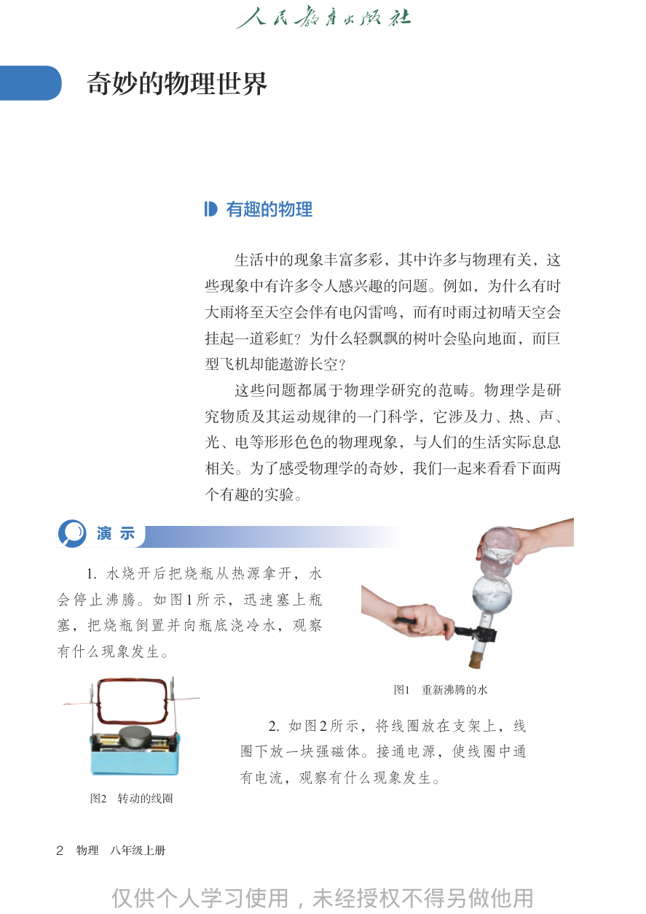

## RJ-PHYSICS-8A-002 重新沸腾的水与转动的线圈演示

开启科学探索之旅 / 开启科学探索之旅 · PDF P9

1. 水烧开后把烧瓶从热源拿开，水会停止沸腾。如图1 所示，迅速塞上瓶塞，把烧瓶倒置并向瓶底浇冷水，观察有什么现象发生。

2. 如图2所示，将线圈放在支架上，线圈下放一块强磁体。接通电源，使线圈中通有电流，观察有什么现象发生。

## RJ-PHYSICS-8A-003 放大镜与漏斗乒乓球实验

开启科学探索之旅 / 开启科学探索之旅 · PDF P10

1. 用放大镜看自己的指纹，再用放大镜看窗外的物体，你有什么发现？

如图3所示，取两个放大镜，一只手握住一个，通过两个放大镜看前面的物体（可调节两个放大镜间的距离），你又有什么发现？

2. 如图4所示，在倒置的漏斗里放一个乒乓球，用手指托住乒乓球，然后从漏斗口向下用力吹气，并将手指移开。乒乓球会下落吗？

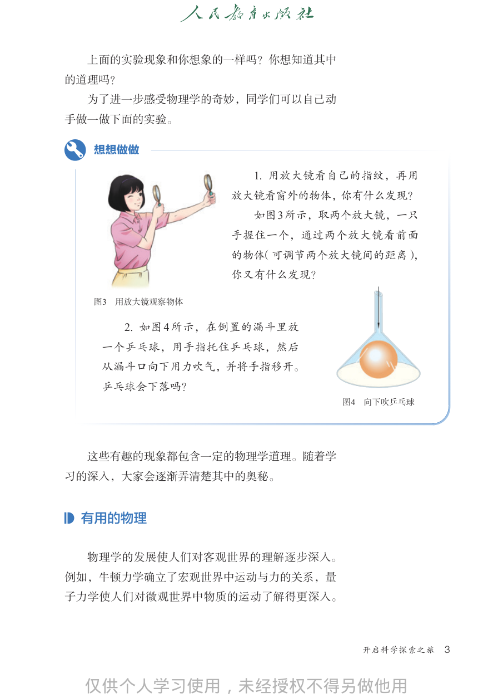

## RJ-PHYSICS-8A-004 科学探究与浮力研究的情境

开启科学探索之旅 / 开启科学探索之旅 · PDF P14

提出问题不是目的，解决问题才是根本。对于发现的问题，我们要想办法探究加以解决。人们探究并解决问题时，通常是根据已有的认识，对如何解决问题提出猜想，然后动手实验、收集证据，验证提出的猜想是否正确，最终找到解决问题的办法。例如，我们都有这样的体验：随着人体浸入水中的部分增大，感受到的浮力也变大（图8）。在探究浮力的规律时，可以据此提出相应的猜想，然后通过实验进行探究，检验猜想，得出规律。

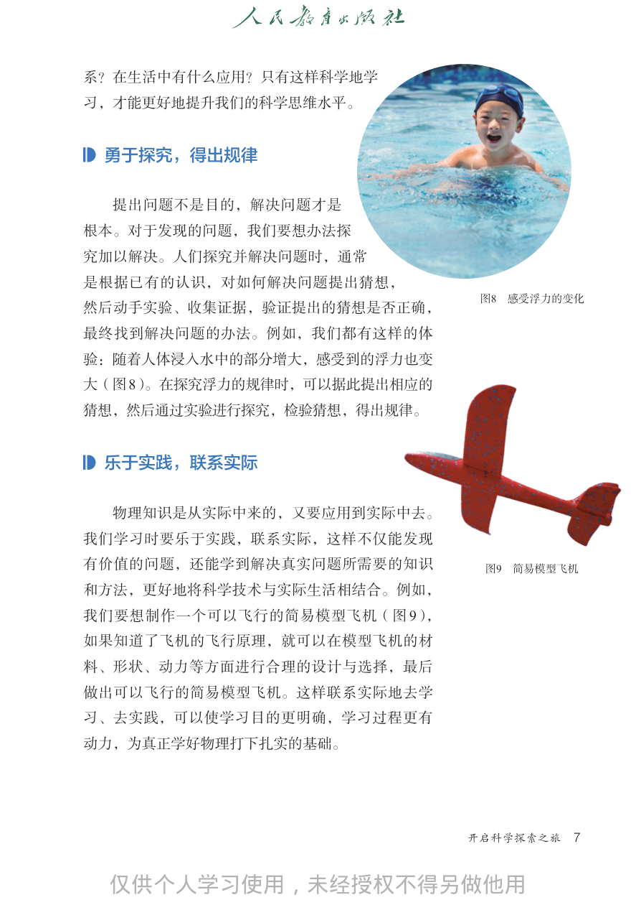

## RJ-PHYSICS-8A-005 摆的等时性及摆动快慢的实验

开启科学探索之旅 / 开启科学探索之旅 · PDF P15

教堂穹顶上的吊灯因风吹过不停地摆动，伽利略被摆动的节奏吸引住了（图10）。他发现，尽管吊灯的摆动幅度越来越小，但每次摆动的时间似乎相等。

伽利略决定仔细地观察。他知道脉搏的跳动是有规律的，于是便按着脉注视着吊灯的摆动，发现每往返摆动一次的时间的确相同。这使他又冒出一个疑问：假如吊灯受到一股强风吹动，摆得高了一些，以后每次摆动的时间还是一样的吗？回去后，他用铁块制成一个摆，把铁块拉到不同高度，用脉搏细心地测量摆动所用的时间。结果表明，每次摆动的时间仍然相同。尽管用脉搏测量时间并不精确，但已经可以证明他最初的想法是正确的，即不论摆动的幅度大些还是小些，完成一次摆动的时间是一样的。这在物理学中叫作摆的等时性。

后来，伽利略又把不同质量的铁块系在绳端作摆锤进行实验。他发现，只要用同一条摆绳，摆动一次的时间并不受摆锤质量的影响。随后伽利略又想，如果将绳缩短，会不会摆动得快些？于是他用相同的摆锤，用不同的绳长做实验，结果证明他的推测是对的。他得出了结论：摆绳越长，摆锤往复摆动一次的时间（称为周期）就越长。

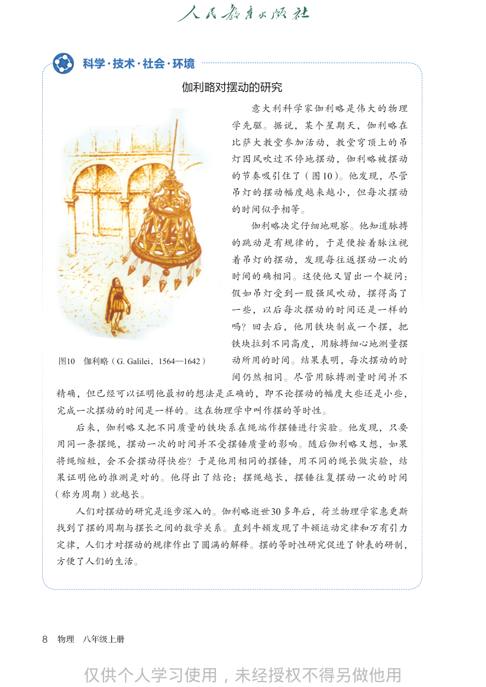

## RJ-PHYSICS-8A-006 测量、物理量与长度单位

第一章 机械运动 / 第1节 长度和时间的测量 · PDF P18-P19

在生产生活和科学研究中，经常要比较距离的远近、时间的长短、温度的高低……人们常常用自己的感觉器官去感知外界的情况。但是，仅凭感觉去判断，不一定正确，更谈不上准确。

为了正确地认识周围的世界，准确地把握事物的特点，人们发明了许多仪器和工具。这些仪器和工具能够帮助我们进行准确的测量。尺、钟表、温度计等，都是我们熟悉的测量仪器或工具。

**长度的单位**

测量任何物理量都必须首先规定它的单位（unit）。长度的基本单位是我们在小学已经学过的米（metre）。物理量的单位有国际通用的符号，在国际单位制中， 米的符号是m。成年人走两步的距离大约是1.5 m，课桌的高度大约是0.75 m。

比米大的单位有千米（km），比米小的单位有分米（dm）、厘米（cm）、 毫米（mm）、微米（µm）、纳米（nm）等。它们同米的关系是

1 km = 1 000 m = 10³ m

1 dm = 0.1 m = 10⁻¹ m

1 cm = 0.01 m = 10⁻² m

1 mm = 0.001 m = 10⁻³ m

1 μm = 0.000 001 m = 10⁻⁶ m

1 nm = 0.000 000 001 m = 10⁻⁹ m

长度、时间等可定性或定量描述的属性称为物理量。测量物理量的过程实际上是比较的过程，就是将一个待测的物理量与一个公认的标准量进行比较，这个标准量就是单位。

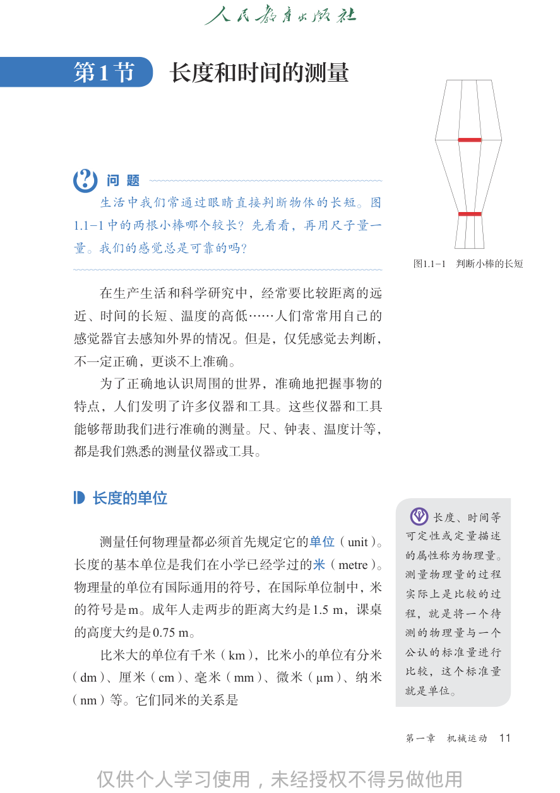

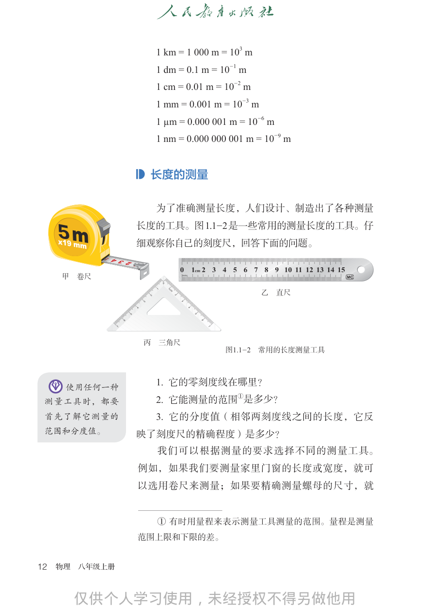

## RJ-PHYSICS-8A-007 长度测量工具、分度值与量程

第一章 机械运动 / 第1节 长度和时间的测量 · PDF P19-P20

**长度的测量**

为了准确测量长度，人们设计、制造出了各种测量长度的工具。图1.1-2是一些常用的测量长度的工具。仔细观察你自己的刻度尺，回答下面的问题。

1. 它的零刻度线在哪里？2. 它能测量的范围①是多少？3. 它的分度值（相邻两刻度线之间的长度，它反映了刻度尺的精确程度）是多少？

我们可以根据测量的要求选择不同的测量工具。例如，如果我们要测量家里门窗的长度或宽度，就可以选用卷尺来测量；如果要精确测量螺母的尺寸，就可以选用精确度比较高的测量工具进行测量，如游标卡尺（图1.1-3）等。

使用任何一种测量工具时，都要首先了解它测量的范围和分度值。

① 有时用量程来表示测量工具测量的范围。量程是测量范围上限和下限的差。

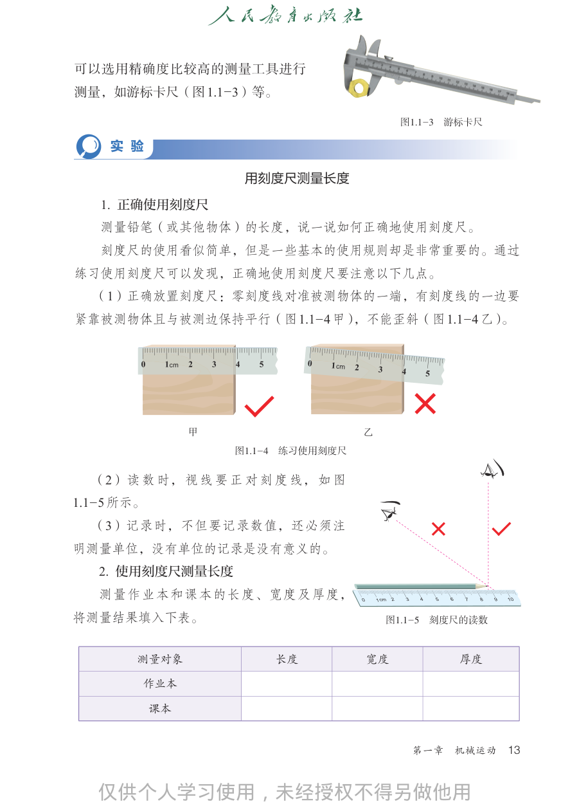

## RJ-PHYSICS-8A-008 用刻度尺测量长度

第一章 机械运动 / 第1节 长度和时间的测量 · PDF P20

**用刻度尺测量长度**

1. 正确使用刻度尺测量铅笔（或其他物体）的长度，说一说如何正确地使用刻度尺。刻度尺的使用看似简单，但是一些基本的使用规则却是非常重要的。通过练习使用刻度尺可以发现，正确地使用刻度尺要注意以下几点。

（1）正确放置刻度尺：零刻度线对准被测物体的一端，有刻度线的一边要紧靠被测物体且与被测边保持平行（图1.1-4甲），不能歪斜（图1.1-4乙）。

（2）读数时，视线要正对刻度线，如图1.1-5所示。

（3）记录时，不但要记录数值，还必须注明测量单位，没有单位的记录是没有意义的。

2. 使用刻度尺测量长度测量作业本和课本的长度、宽度及厚度，将测量结果填入下表。

| 测量对象 | 长度 | 宽度 | 厚度 |
| --- | --- | --- | --- |
| 作业本 |  |  |  |
| 课本 |  |  |  |

## RJ-PHYSICS-8A-009 常见物体的长度

第一章 机械运动 / 第1节 长度和时间的测量 · PDF P21

| 物体或距离 | 长度 |
| --- | --- |
| 链球菌半径 | (3~5)×10⁻⁷ m |
| 人头发丝直径 | 约7×10⁻⁵ m |
| 一张纸厚度 | 约10⁻⁴ m |
| 我国铁路标准轨距 | 1.435 m |
| 珠穆朗玛峰海拔 | 8 848.86 m |
| 地球半径 | 6.4×10⁶ m |
| 太阳半径 | 7.0×10⁸ m |
| 日地平均距离 | 1.5×10¹¹ m |

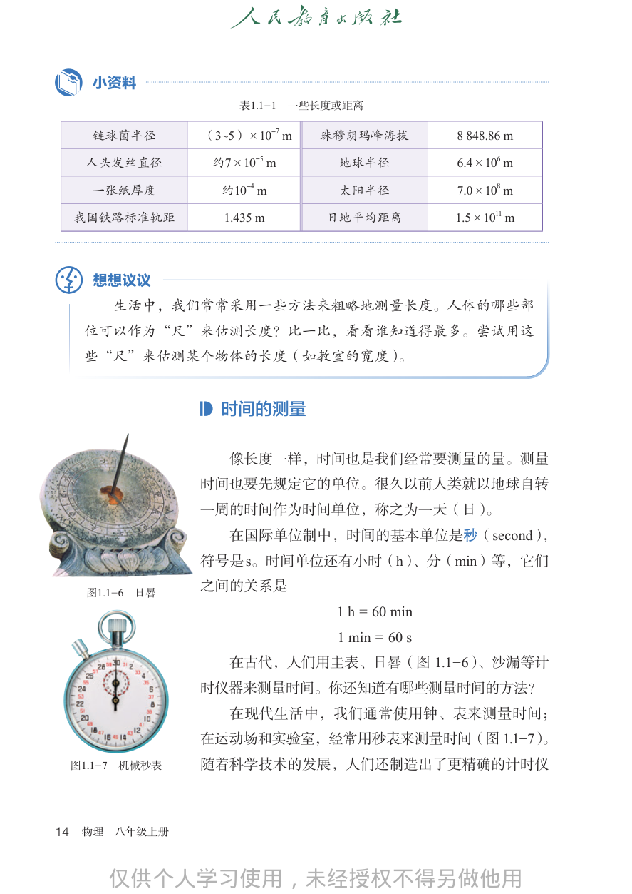

## RJ-PHYSICS-8A-010 时间的单位和测量工具

第一章 机械运动 / 第1节 长度和时间的测量 · PDF P21-P22

**时间的测量**

像长度一样，时间也是我们经常要测量的量。测量时间也要先规定它的单位。很久以前人类就以地球自转一周的时间作为时间单位，称之为一天（日）。

在国际单位制中，时间的基本单位是秒（second），符号是s。时间单位还有小时（h）、分（min）等，它们之间的关系是

1 h = 60 min

1 min = 60 s

在古代，人们用圭表、日晷（图 1.1-6）、沙漏等计时仪器来测量时间。你还知道有哪些测量时间的方法？

在现代生活中，我们通常使用钟、表来测量时间；在运动场和实验室，经常用秒表来测量时间（图 1.1-7）。随着科学技术的发展，人们还制造出了更精确的计时仪器，如铯原子钟。铯原子钟的精确度非常高，上千万年误差不超过1 s。

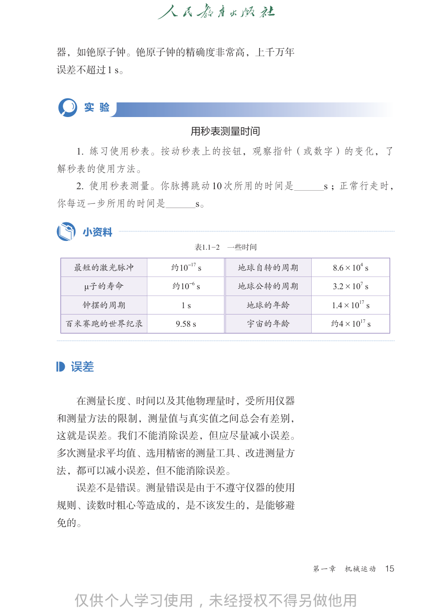

## RJ-PHYSICS-8A-011 用秒表测量时间

第一章 机械运动 / 第1节 长度和时间的测量 · PDF P22

**用秒表测量时间**

1. 练习使用秒表。按动秒表上的按钮，观察指针（或数字）的变化，了解秒表的使用方法。

2. 使用秒表测量。你脉搏跳动10次所用的时间是   s ； 正常行走时，你每迈一步所用的时间是   s。

## RJ-PHYSICS-8A-012 常见的时间尺度

第一章 机械运动 / 第1节 长度和时间的测量 · PDF P22

表1.1-2 一些时间

| 时间 | 数值 |
| --- | --- |
| 最短的激光脉冲 | 约10⁻¹⁷ s |
| μ子的寿命 | 约10⁻⁶ s |
| 钟摆的周期 | 1 s |
| 百米赛跑的世界纪录 | 9.58 s |
| 地球自转的周期 | 8.6×10⁴ s |
| 地球公转的周期 | 3.2×10⁷ s |
| 地球的年龄 | 1.4×10¹⁷ s |
| 宇宙的年龄 | 约4×10¹⁷ s |

## RJ-PHYSICS-8A-013 测量误差及其与错误的区别

第一章 机械运动 / 第1节 长度和时间的测量 · PDF P22

**误差**

在测量长度、时间以及其他物理量时，受所用仪器和测量方法的限制，测量值与真实值之间总会有差别，这就是误差。我们不能消除误差，但应尽量减小误差。多次测量求平均值、选用精密的测量工具、改进测量方法，都可以减小误差，但不能消除误差。

误差不是错误。测量错误是由于不遵守仪器的使用规则、读数时粗心等造成的，是不该发生的，是能够避免的。

## RJ-PHYSICS-8A-014 国际单位制

第一章 机械运动 / 第1节 长度和时间的测量 · PDF P23

**国际单位制**

长期以来，世界上不同地区（甚至同一地区的不同年代）选定的测量标准各不相同。例如，测量长度时，我国过去采用的单位是“尺”（古代的“尺”与现代的“尺”也不一样），一些欧洲、美洲国家采用的单位是“英尺”。这样，同一个物体的长度用不同的单位来表示，国际交流就会很不方便。

人们逐渐认识到，应当选取自然界中比较稳定、世界各国都能接受的事物作为测量标准。鉴于这种认识，国际计量组织制定了一套国际统一的单位，称之为国际单位制（SI），推荐各国使用。目前世界上大多数国家和地区已经采用国际单位制，我国的法定计量单位也是以国际单位制为基础制定的。

在国际单位制的基本单位中，长度的单位是米，时间的单位是秒。国际单位制还规定了其他基本单位，我们将在以后陆续学习。

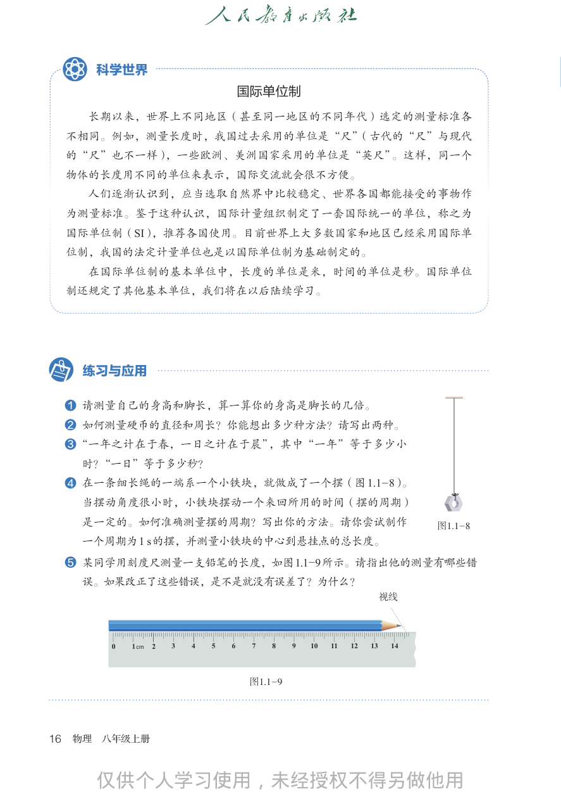

## RJ-PHYSICS-8A-015 机械运动

第一章 机械运动 / 第2节 运动的描述 · PDF P24

**机械运动**

夜空中的彗星、飞奔的猎豹、缓慢爬行的蜗牛……这些运动的物体都有一个共同的特点，就是它们的位置随时间不断地发生变化。在物理学中，我们把物体位置随时间的变化叫作机械运动（mechanical motion）。

机械运动是一种常见的运动，例如人的移动、江河的奔流、浩瀚太空中天体的运动、令人震撼的地壳运动（图1.2-2）等。机械运动是最简单的一种运动形式，是学习其他各种运动的基础。

运动是宇宙中最普遍的现象。除了机械运动，运动还有多种形式，如微观世界里分子、原子的运动，电磁运动，生机盎然的生命运动……宇宙中的万物都在以各种不同的形式运动着。

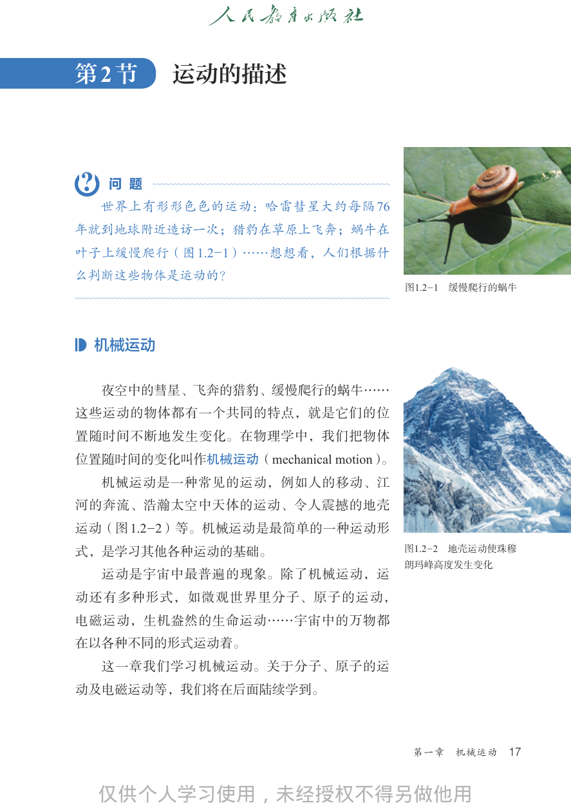

## RJ-PHYSICS-8A-016 参照物与运动和静止的相对性

第一章 机械运动 / 第2节 运动的描述 · PDF P25

**参照物**

要判断物体是否在运动，似乎是一件很容易的事。例如，公路上行驶的汽车是运动的，而路旁的树木是静止的。不过，事情就真的这么简单吗？

你也许有过这样的体验：两列列车并排停在站台上，你坐在车厢中向另一列列车的车厢观望。突然，你觉得自己乘坐的列车开始缓缓地前进了，但是，“驶过”了旁边列车的车尾你才发现，实际上你乘坐的列车还停在站台上，而旁边的列车却向相反方向开走了。这是怎么回事呢？

人们判断物体的运动和静止，总要选取某一个物体作为标准。如果一个物体的位置相对于这个标准发生了变化，就说它是运动的；如果没有变化，就说它是静止的。这个作为标准的物体叫作参照物。

在上面的例子中，如果以旁边的列车为参照物，你乘坐的列车就是运动的；如果以地面为参照物，你乘坐的列车就是静止的。

我们在判断一个物体是静止还是运动时，首先要选定参照物。参照物可以根据需要来选择。如果选择的参照物不同，描述同一个物体的运动情况时，结论一般也不一样。例如，如果以地面为参照物，房屋、桥梁、树木等物体都是静止的；如果以太阳为参照物，这些物体又都是运动的。在图1.2-3中，运水稻的车辆和联合收割机以同样快慢、向同一方向前进。如果以地面为参照物，它们都在运动；以它们中的任何一个为参照物，则另一个是静止的。可见，物体的运动和静止是相对的。

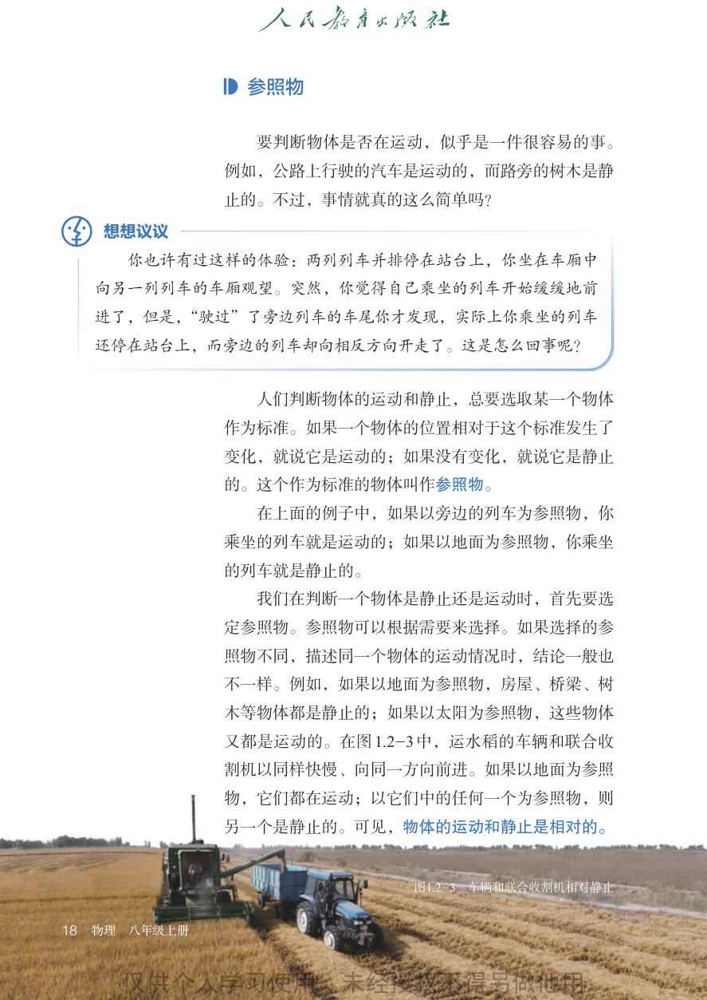

## RJ-PHYSICS-8A-017 比较运动快慢与速度

第一章 机械运动 / 第3节 运动的快慢 · PDF P27-P28

观看赛跑的某一瞬间，运动员跑过的时间相同，如果要比较谁跑得快，就要看谁跑过的路程长，也就是谁跑在前面。运动员到达终点时，他们都跑过了相同的路程，那么所用时间最短的运动员跑得最快。

**速度**

运动的物体，有的运动得快，有的运动得慢。比较物体运动的快慢有两种方法：一种是在相同的时间内，比较物体经过的路程，经过路程长的物体运动得快；另一种是在物体运动相同路程的情况下，比较它们所花的时间，所花时间短的物体运动得快。可见，表示运动快慢必须考虑路程和时间两个因素。

甲同学100 m跑的成绩为15 s，乙同学50 m跑的成绩为8 s。要知道他俩谁跑得快，应该怎么办？

在物理学中，为了比较物体运动的快慢，采用“相同时间比较路程” 的方法，也就是用物体运动的路程除以所用的时间。这样，在不同情况下，比较物体运动的快慢可以保证时间相同。我们把路程与时间之比叫作速度 （velocity）。

通常用字母v表示速度，s表示路程，t表示时间，那么有

v = s/t

速度是表示物体运动快慢的物理量。速度的单位由长度单位和时间单位组合而成。在国际单位制中，速度的单位是米每秒，符号是 m/s或m·s⁻¹ ，这种单位叫作组合单位。在交通运输中，速度的单位也常用千米每小时，符号是km/h或km·h⁻¹ 。这两个单位的关系是

1 m/s = 3.6 km/h

一些交通工具的速度表可以直接显示出速度 （图1.3-2）。

这里用路程与时间之比定义了速度，它的物理意义与路程、时间这两个物理量均不相同。在物理学中，常常用物理量之比来定义一个新的物理量，从而进行更深入的研究。

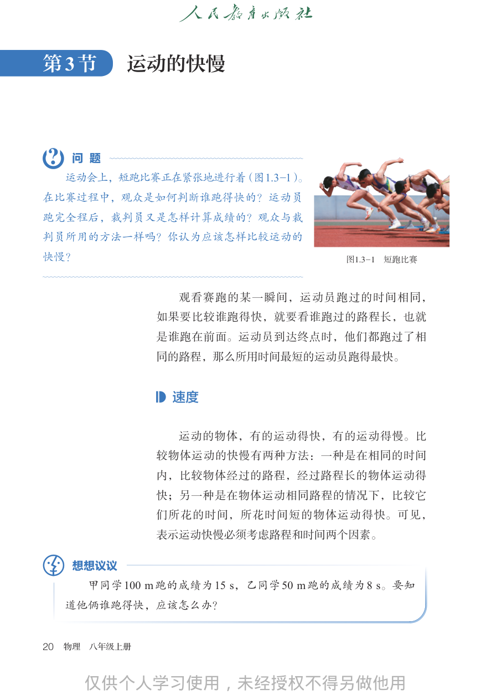

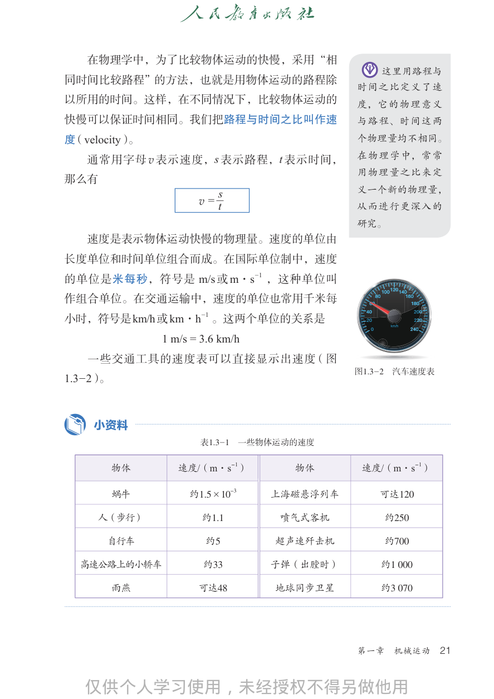

## RJ-PHYSICS-8A-018 常见物体的速度

第一章 机械运动 / 第3节 运动的快慢 · PDF P28

| 物体 | 速度/(m·s⁻¹) |
| --- | --- |
| 蜗牛 | 约1.5×10⁻³ |
| 人（步行） | 约1.1 |
| 自行车 | 约5 |
| 高速公路上的小轿车 | 约33 |
| 雨燕 | 可达48 |
| 上海磁悬浮列车 | 可达120 |
| 喷气式客机 | 约250 |
| 超声速歼击机 | 约700 |
| 子弹（出膛时） | 约1 000 |
| 地球同步卫星 | 约3 070 |

## RJ-PHYSICS-8A-019 匀速直线运动与变速运动的平均速度

第一章 机械运动 / 第3节 运动的快慢 · PDF P29-P30

**匀速直线运动**

物体所做的机械运动，按照运动路线的曲直可分为直线运动和曲线运动。直线运动，按照速度是否变化，又分为匀速直线运动和变速直线运动。

图1.3-3记录了两辆汽车在平直的公路上行驶时，在相同的时间内通过的路程。图甲中的汽车在平稳行驶的过程中，各段时间内的速度有什么特点？图乙中的汽车从静止开始前进，在各段时间内的速度有什么特点？

物体做直线运动时，如果它在相同的时间内通过的路程都相等，那么它在整个运动过程中的速度就保持不变。我们把物体沿着直线且速度不变的运动，叫作匀速直线运动（uniform rectilinear motion）。匀速直线运动是最简单的机械运动，它是研究其他复杂运动的基础。

物体做直线运动时，其速度的大小常常是变化的，即在相等的时间内通过的路程不相等，如图1.3-3乙中汽车的运动，这种运动叫作变速直线运动。变速直线运动比匀速直线运动复杂，如果只作粗略研究，也可以用v = s/t 来描述运动的快慢，这样算出来的速度叫作平均速度。人们平时说物体在某段时间内的速度或通过某段路程的速度，指的就是平均速度。

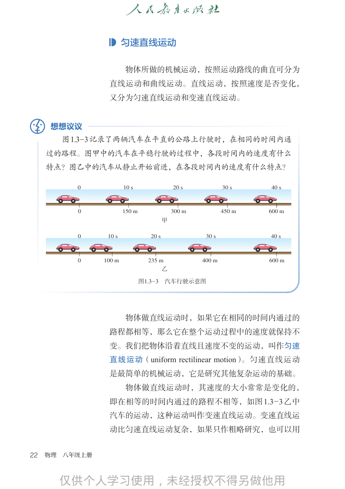

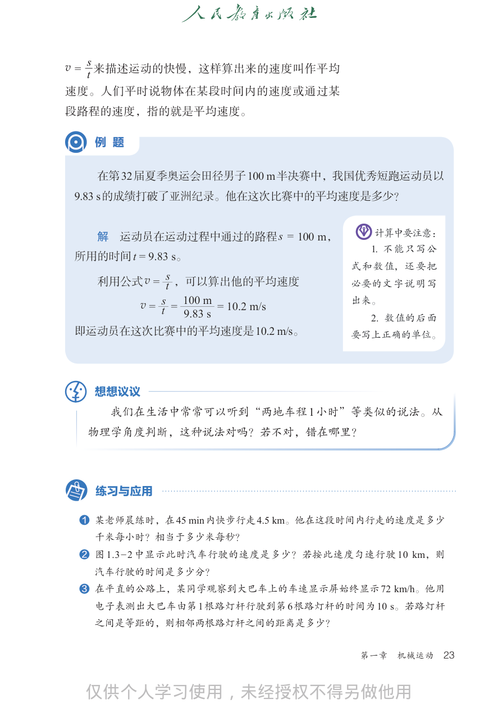

### 补充原例与原解

在第32届夏季奥运会田径男子100 m半决赛中，我国优秀短跑运动员以9.83 s的成绩打破了亚洲纪录。他在这次比赛中的平均速度是多少？

解 运动员在运动过程中通过的路程 s = 100 m，所用的时间 t = 9.83 s。

利用公式 v = s/t，可以算出他的平均速度

v = s/t = 100 m / 9.83 s = 10.2 m/s

即运动员在这次比赛中的平均速度是10.2 m/s。

## RJ-PHYSICS-8A-020 区间测速的原理

第一章 机械运动 / 第4节 速度的测量 · PDF P32

从公式v = s/t 可知，测算平均速度一般需要测量路程和时间两个物理量。在公路一段固定距离的路段两端分别放置一个摄像头，当车辆经过这两个摄像头时，都会被拍照。系统根据这两张照片的拍摄时刻就能算出车辆通过这段距离的时间，从而算出车辆的平均速度。这就是区间测速的原理。

请你想一想：应该怎样测量物体的速度？下面我们来实际测量一个沿斜面下滑的小车的平均速度。

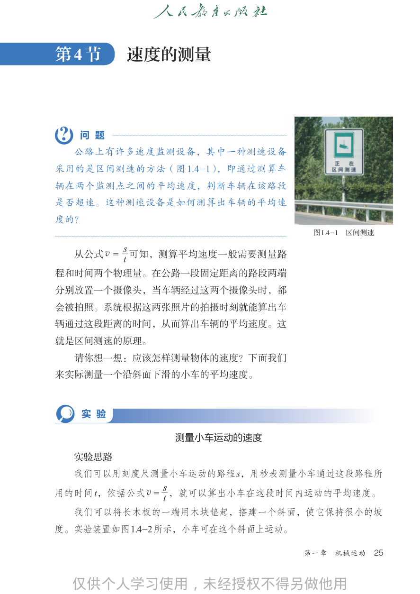

## RJ-PHYSICS-8A-021 测量小车运动速度的实验

第一章 机械运动 / 第4节 速度的测量 · PDF P32-P33

**测量小车运动的速度**

实验思路我们可以用刻度尺测量小车运动的路程s，用秒表测量小车通过这段路程所用的时间t，依据公式v = s/t ，就可以算出小车在这段时间内运动的平均速度。我们可以将长木板的一端用木块垫起，搭建一个斜面，使它保持很小的坡度。实验装置如图1.4-2所示，小车可在这个斜面上运动。

实验过程1. 把小车放在斜面顶端，金属片放在斜面底端，用刻度尺测出小车将要通过的路程s₁。

2. 用秒表测量小车从斜面顶端滑下到撞击金属片的时间t₁。3. 根据测得的s₁、t₁，利用公式v₁ = s₁/t₁ 算出小车通过斜面全程的平均速度v₁。4. 将金属片移至斜面的中部，测出小车从斜面顶端到金属片的距离s₂。5. 测出小车从斜面顶端滑过斜面上半段路程s₂所用的时间t₂，算出小车通过上半段路程s₂的平均速度v₂。

将实验中的相关数据填入右表中。

| 路程 | 运动时间 | 平均速度 |
| --- | --- | --- |
| s₁ = | t₁ = | v₁ = |
| s₂ = | t₂ = | v₂ = |

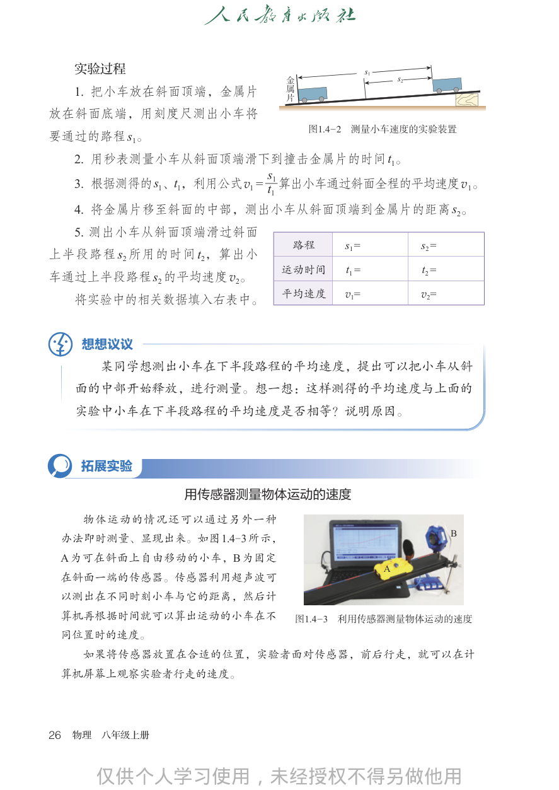

## RJ-PHYSICS-8A-022 用传感器测量物体运动的速度

第一章 机械运动 / 第4节 速度的测量 · PDF P33

**用传感器测量物体运动的速度**

物体运动的情况还可以通过另外一种办法即时测量、显现出来。如图1.4-3所示，A为可在斜面上自由移动的小车，B为固定在斜面一端的传感器。传感器利用超声波可以测出在不同时刻小车与它的距离，然后计算机再根据时间就可以算出运动的小车在不同位置时的速度。

如果将传感器放置在合适的位置，实验者面对传感器，前后行走，就可以在计算机屏幕上观察实验者行走的速度。

## RJ-PHYSICS-8A-023 超声波测距

第一章 机械运动 / 第4节 速度的测量 · PDF P34

**超声波测距**

在日常生活和生产中，我们通常用直尺、卷尺等工具来测量物体的长度。在工业生产和科学研究中，还会用到其他一些技术来测量距离，如超声波测距等。

超声波在空气中的传播速度约为340 m/s，它具有指向性好、反射能力强、能量集中等特点，因而经常被用于距离的测量、汽车倒车防撞、智能机器人等领域。

超声波测距的原理如图1.4-4所示。发射器向被测物发射超声波，在发射的同时开始计时。超声波传播过程中遇到被测物会被反射，接收器收到反射波就停止计时。根据计时器记录的时间及超声波传播的速度，仪器就能自动计算出发射点与被测物之间的距离。

如果被测物是运动的物体，超声波测量仪还可以测出物体移动的速度。

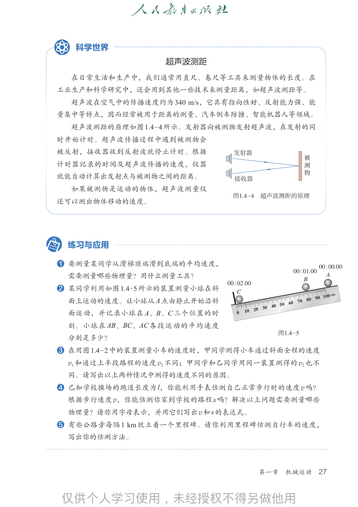

## RJ-PHYSICS-8A-024 声音的产生与声音的记录

第二章 声现象 / 第1节 声音的产生与传播 · PDF P39-P40

**声音的产生**

拨动绷紧的橡皮筋，一边听声音，一边观察橡皮筋的变化（图2.1-2）；边说话，边用手摸颈前喉头部分。

观察、体验、总结物体发声时的共同特征。

从上面的活动中可以发现，橡皮筋嗡嗡作响时，橡皮筋在振动；说话时声带在振动。大量的观察、分析表明，声音是由物体的振动（vibration）产生的。

物体振动发声的现象很多，你能说出一些发声现象的道理吗？比如，蝈蝈是怎么发声的？如果想让发声的物体不再发声，又该怎么做？

振动可以发声。如果将发声体的振动记录下来，需要时再让物体按照记录下来的振动规律去振动，就会产生与原来一样的声音，这样就可以将声音保存下来。早期机械唱片的表面有一圈圈不规则的沟槽（图2.1-3）。当唱片转动时，唱针随着划过的沟槽振动，这样就把记录的声音重现出来。随着技术的进步，人们还发明了用磁带、激光唱片和存储卡等记录并存储声音的方法。

方法点拨我们通过观察生活中一些与声音有关的现象，发现这些声音都是由振动产生的，由此得出“声音是由物体的振动产生的”这个一般性的结论。这里用到了归纳推理的方法。

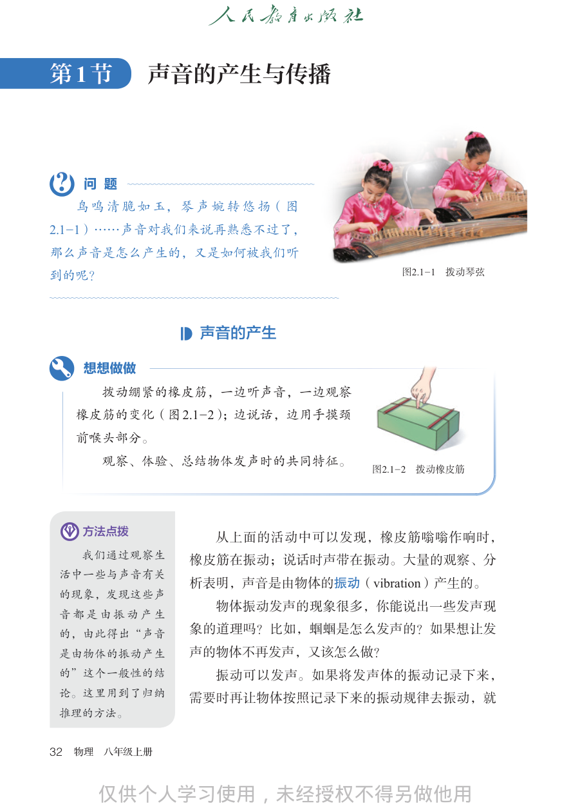

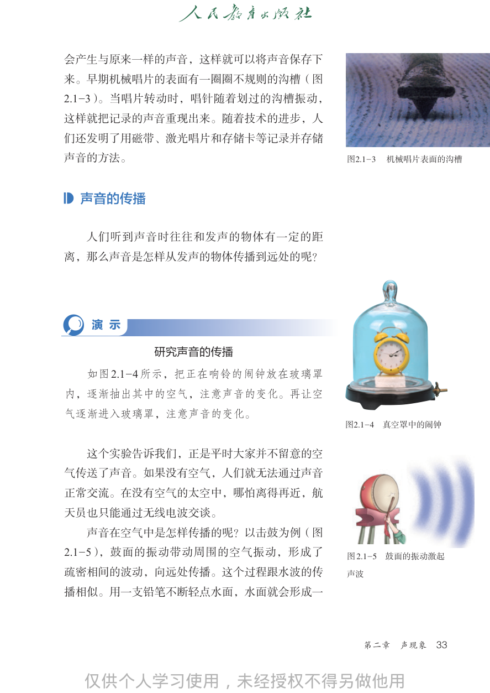

## RJ-PHYSICS-8A-025 声音的传播与介质

第二章 声现象 / 第1节 声音的产生与传播 · PDF P40-P41

**声音的传播**

人们听到声音时往往和发声的物体有一定的距离，那么声音是怎样从发声的物体传播到远处的呢？

**研究声音的传播**

如图2.1-4所示，把正在响铃的闹钟放在玻璃罩内，逐渐抽出其中的空气，注意声音的变化。再让空气逐渐进入玻璃罩，注意声音的变化。

这个实验告诉我们，正是平时大家并不留意的空气传送了声音。如果没有空气，人们就无法通过声音正常交流。在没有空气的太空中，哪怕离得再近，航天员也只能通过无线电波交谈。

声音在空气中是怎样传播的呢？以击鼓为例（图2.1-5），鼓面的振动带动周围的空气振动，形成了疏密相间的波动，向远处传播。这个过程跟水波的传播相似。用一支铅笔不断轻点水面，水面就会形成一圈一圈的水波，不断向远处传播。声音以波的形式传播着，因此我们把它叫作声波（sound wave）。

除了空气，还有没有其他物体可以传声呢？

如图2.1-6所示，用一张桌子做实验：请把你的耳朵贴在桌面上，让一位同学用手指甲轻刮桌子（不要让附近的同学听到声音）。由实验你能得出什么结论？

从这个实验可以发现，桌子也能传声。气体、固体可以传播声音，其实液体也可以传播声音。将要上钩的鱼，会被岸上的说话声或脚步声吓跑；在花样游泳比赛中，运动员在水中也能听到音乐。这些都是因为水能传播声音。

大量实验表明：声音的传播需要物质，物理学中把这样的物质叫作介质（medium）；传声的介质既可以是气体、固体，也可以是液体；真空不能传声。

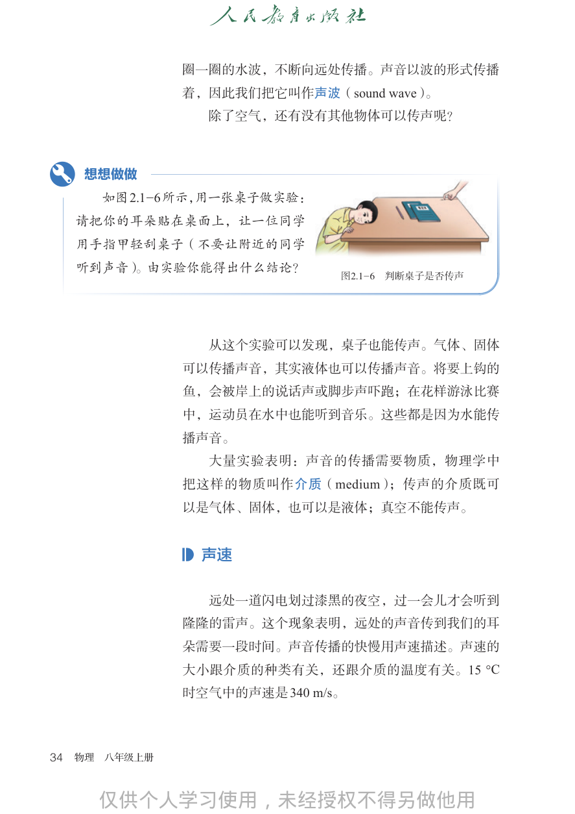

## RJ-PHYSICS-8A-026 声速及其影响因素

第二章 声现象 / 第1节 声音的产生与传播 · PDF P41-P42

**声速**

远处一道闪电划过漆黑的夜空，过一会儿才会听到隆隆的雷声。这个现象表明，远处的声音传到我们的耳朵需要一段时间。声音传播的快慢用声速描述。声速的大小跟介质的种类有关，还跟介质的温度有关。15 °C时空气中的声速是340 m/s。

表2.1-1 一些介质中的声速

| 介质 | 声速/(m·s⁻¹) |
| --- | --- |
| 空气（0 ℃） | 331 |
| 空气（15 ℃） | 340 |
| 空气（25 ℃） | 346 |
| 软木 | 500 |
| 煤油（25 ℃） | 1 324 |
| 水（常温） | 1 500 |
| 海水（25 ℃） | 1 531 |
| 冰 | 3 230 |
| 铜（棒） | 3 750 |
| 大理石 | 3 810 |
| 铝（棒） | 5 000 |
| 铁（棒） | 5 200 |

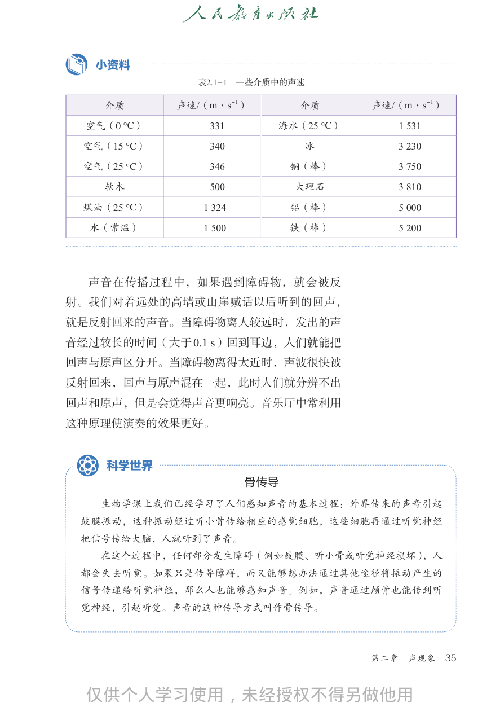

## RJ-PHYSICS-8A-027 回声及其与原声的区分

第二章 声现象 / 第1节 声音的产生与传播 · PDF P42

声音在传播过程中，如果遇到障碍物，就会被反射。我们对着远处的高墙或山崖喊话以后听到的回声，就是反射回来的声音。当障碍物离人较远时，发出的声音经过较长的时间（大于0.1 s）回到耳边，人们就能把回声与原声区分开。当障碍物离得太近时，声波很快被反射回来，回声与原声混在一起，此时人们就分辨不出回声和原声，但是会觉得声音更响亮。音乐厅中常利用这种原理使演奏的效果更好。

## RJ-PHYSICS-8A-028 骨传导及其实验

第二章 声现象 / 第1节 声音的产生与传播 · PDF P42-P43

**骨传导**

生物学课上我们已经学习了人们感知声音的基本过程：外界传来的声音引起鼓膜振动，这种振动经过听小骨传给相应的感觉细胞，这些细胞再通过听觉神经把信号传给大脑，人就听到了声音。

在这个过程中，任何部分发生障碍（例如鼓膜、听小骨或听觉神经损坏），人都会失去听觉。如果只是传导障碍，而又能够想办法通过其他途径将振动产生的信号传递给听觉神经，那么人也能够感知声音。例如，声音通过颅骨也能传到听觉神经，引起听觉。声音的这种传导方式叫作骨传导。

取两个棉花球塞住耳朵，用橡皮锤敲击音叉，这时你基本听不到音叉发出的声音；再把振动的音叉尾部先后抵在下巴（图2.1-7）、前额、耳后的骨头上，通过骨传导你能清楚地听到音叉发出的声音；一旦把音叉移开，马上就听不到声音了。一些失去听觉的人可以利用骨传导来听声音。骨传导不用空气传声，可以有效避免嘈杂环境的干扰，常应用在工业、战场等特殊场合中。而利用骨传导原理制成的助听器、耳机等更是在生活中得到了广泛的应用。

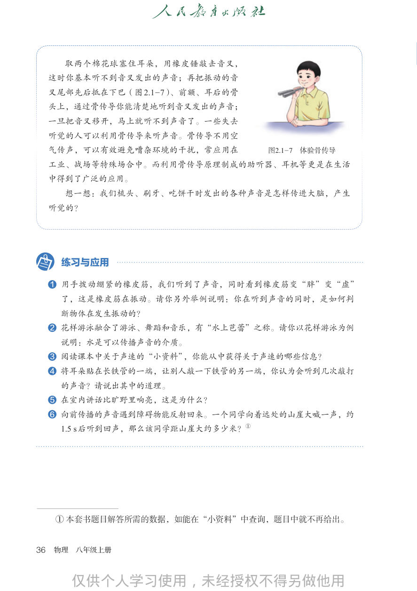

## RJ-PHYSICS-8A-029 音调、频率与声音波形的实验

第二章 声现象 / 第2节 声音的特性 · PDF P44-P46

**音调**

我们接触的各种声音，有的听起来音调（pitch）高，有的听起来音调低。声音为什么会有音调高低的不同？什么因素决定音调的高低？

如图2.2-2所示，将一把钢尺紧按在桌面上，使伸出桌边的部分较长。拨动钢尺，观察它的振动情况。逐渐缩短钢尺伸出的长度，重复前面的操作与观察。分析钢尺振动的快慢与它伸出的长度之间的关系。

当伸出的长度减小到一定程度时，拨动钢尺就能听到较为清楚的声音，注意听它的音调。继续缩短钢尺伸出的长度并拨动钢尺，注意音调的变化。分析钢尺发出声音的音调与它振动的快慢之间的关系。

物体振动得快，发出声音的音调就高；振动得慢，发出声音的音调就低。可见发声体振动的快慢是一个很重要的物理量，它决定着音调的高低。物理学中用物体振动的次数与所用时间之比——频率（frequency）来描述物体振动的快慢。频率决定声音的音调，频率高则音调高，频率低则音调低。频率的单位为赫兹（hertz），简称赫，符号为Hz。如果一个物体在1 s内振动100次，它的频率就是100 Hz。

为了直观地了解物体振动发声的情况，我们可以将声音的波形用示波器、计算机或手机等展现出来。

**观察声音的波形**

把音叉发出的声音信号输入示波器、计算机或手机（图2.2-3），观察声音的波形。换一个不同频率的音叉做实验，边听边观察它们的波形有何不同。

通过屏幕上的波形，我们可以发现：高音调的波形更密集一些，说明声音的频率较高；低音调的波形比较稀疏，说明声音的频率较低。

在研究音调时，我们用视觉、听觉等不同感官来搜集信息，也就是在观察。科学研究中，观察要有明确的观察目的，要真实而准确地记录观察到的信息。

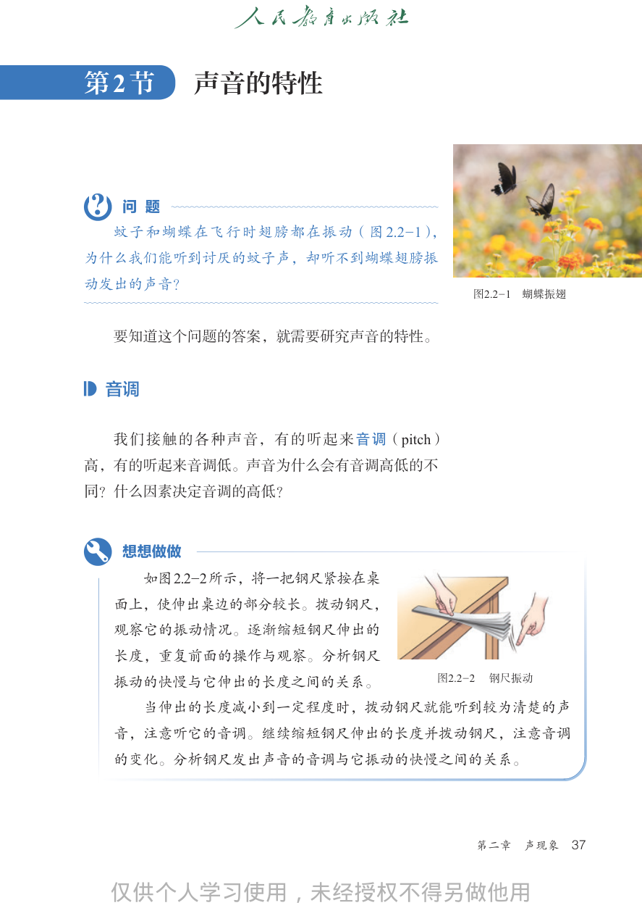

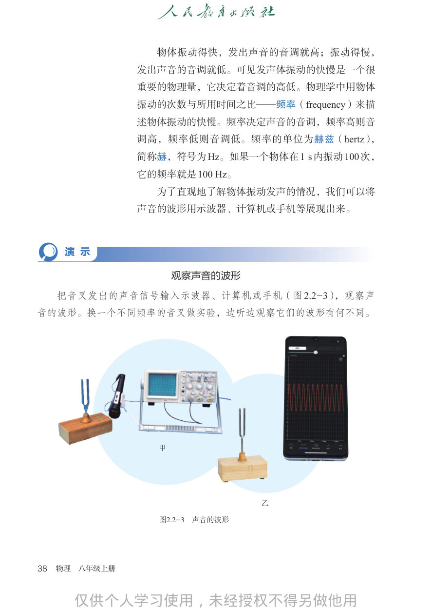

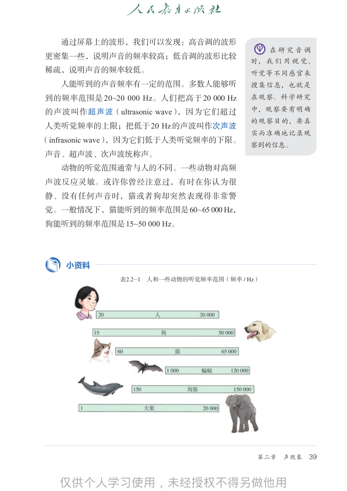

## RJ-PHYSICS-8A-030 人和动物的听觉范围、超声波和次声波

第二章 声现象 / 第2节 声音的特性 · PDF P46

人能听到的声音频率有一定的范围。多数人能够听到的频率范围是20~20 000 Hz。人们把高于20 000 Hz的声波叫作超声波（ultrasonic wave），因为它们超过人类听觉频率的上限；把低于20 Hz的声波叫作次声波（infrasonic wave），因为它们低于人类听觉频率的下限。声音、超声波、次声波统称声。

动物的听觉范围通常与人的不同。一些动物对高频声波反应灵敏。或许你曾经注意过，有时在你认为很静、没有任何声音时，猫或者狗却突然表现得非常警觉。一般情况下，猫能听到的频率范围是60~65 000 Hz，狗能听到的频率范围是15~50 000 Hz。

表2.2-1 人和一些动物的听觉频率范围（频率/Hz）

| 人或动物 | 听觉频率范围/Hz |
| --- | --- |
| 人 | 20~20 000 |
| 狗 | 15~50 000 |
| 猫 | 60~65 000 |
| 蝙蝠 | 1 000~120 000 |
| 海豚 | 150~150 000 |
| 大象 | 1~20 000 |

## RJ-PHYSICS-8A-031 响度、振幅及其影响因素的实验

第二章 声现象 / 第2节 声音的特性 · PDF P47

**响度**

声音有音调的不同，也有强弱的不同。例如，用力击鼓比轻轻击鼓产生的声音大。声音的强弱可以用响度（loudness）来衡量。声音的响度主要由什么因素决定呢？

**决定响度的因素**

如图2.2-4所示，使正在发声的音叉轻触系在细绳上的乒乓球，观察乒乓球被弹开的幅度。

使音叉发出不同响度的声音，重做上面的实验。想一想：乒乓球弹开的幅度与音叉振动的幅度有什么关系？响度与什么因素有关？

实验中，用橡皮锤使劲敲打音叉，声音的响度变大，乒乓球被弹开的幅度也增大，说明音叉振动的幅度增大。

物理学中用振幅（amplitude）来描述物体振动的幅度。物体的振幅越大，产生声音的响度越大。

人听到的声音是否响亮，除了跟发声体发声时的振幅有关，还跟人距离发声体的远近有关。声音是从发声体向四面八方传播的，越到远处越分散。因此，人距离发声体越远，听到的声音越小。

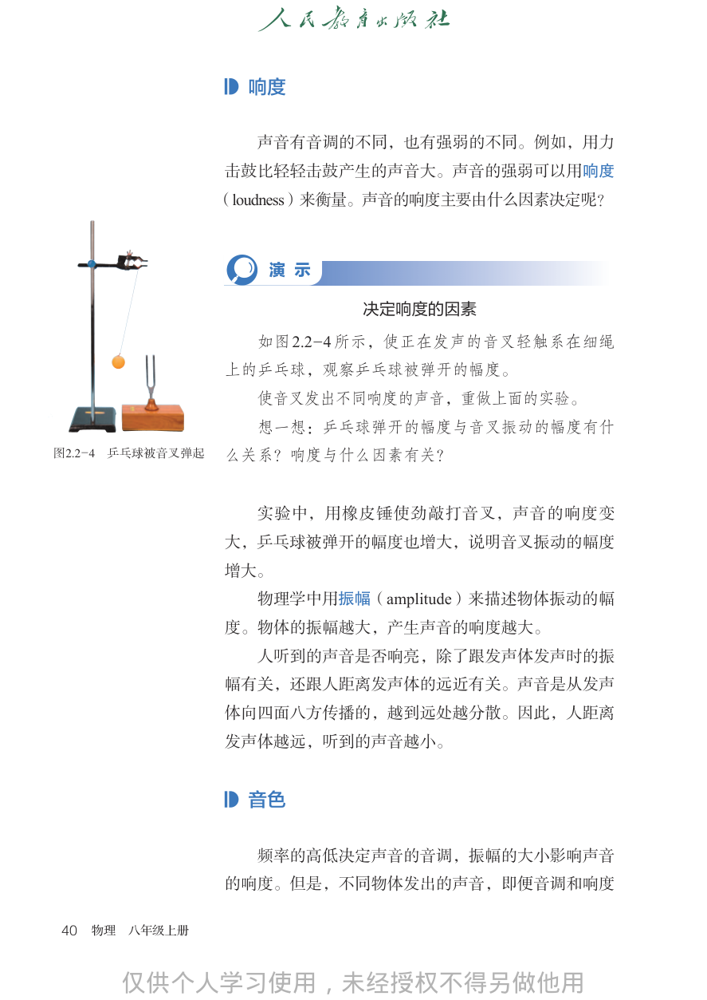

## RJ-PHYSICS-8A-032 音色与不同乐器声音波形的比较

第二章 声现象 / 第2节 声音的特性 · PDF P47-P48

**音色**

频率的高低决定声音的音调，振幅的大小影响声音的响度。但是，不同物体发出的声音，即便音调和响度相同，我们还是能够分辨出它们的不同。实际上声音还有一个十分重要的特性，它就是音色（tone quality）。不同发声体的材料、结构不同，发出声音的音色也就不同。

**比较不同乐器发出声音的波形**

下面分别是音叉、钢琴、长笛发出的相同音调声音的波形图（图2.2-5）。用计算机或手机播放这几个声音片段，边听边比较它们的波形有何异同。

观察上面声音的波形可以知道：不同乐器发出音调相同的声音，波形总体上的疏密程度是相同的，即频率相同；但是波的形状不同，即音色不同。

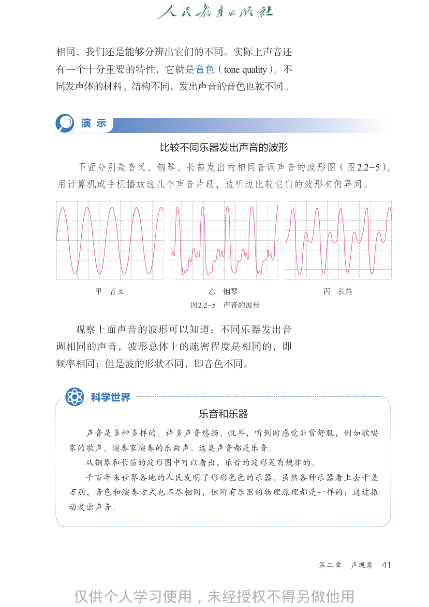

## RJ-PHYSICS-8A-033 乐音与打击、弦、管乐器的发声

第二章 声现象 / 第2节 声音的特性 · PDF P48-P49

**乐音和乐器**

声音是多种多样的。许多声音悠扬、悦耳，听到时感觉非常舒服，例如歌唱家的歌声、演奏家演奏的乐曲声。这类声音都是乐音。

从钢琴和长笛的波形图中可以看出，乐音的波形是有规律的。千百年来世界各地的人民发明了形形色色的乐器。虽然各种乐器看上去千差万别，音色和演奏方式也不尽相同，但所有乐器的物理原理都是一样的：通过振动发出声音。

乐器可以分为打击乐器、弦乐器和管乐器等不同类型。打击乐器 编钟、鼓、锣等乐器受到敲击时发生振动，产生声音。演奏编钟时，敲击大小不同的钟能发出不同音调的声音。击鼓时的力度越大，鼓面的振动幅度就越大，声音就越响亮。

弦乐器 古琴、琵琶、二胡、小提琴和钢琴等乐器通过弦的振动发声。长而粗的弦发声的音调低，短而细的弦发声的音调高。绷紧的弦发声的音调高，不紧的弦发声的音调低。弦的振动幅度越大，声音就越响。弦乐器通常有一个共鸣箱来使声音更洪亮。

管乐器 箫和笛等乐器，包含一段空气柱，吹奏时空气柱振动发声。手指按在不同的音孔上，就会改变空气柱的长度，从而改变音调。长的空气柱产生低音，短的空气柱产生高音。单簧管、双簧管和各种号也是常见的管乐器。

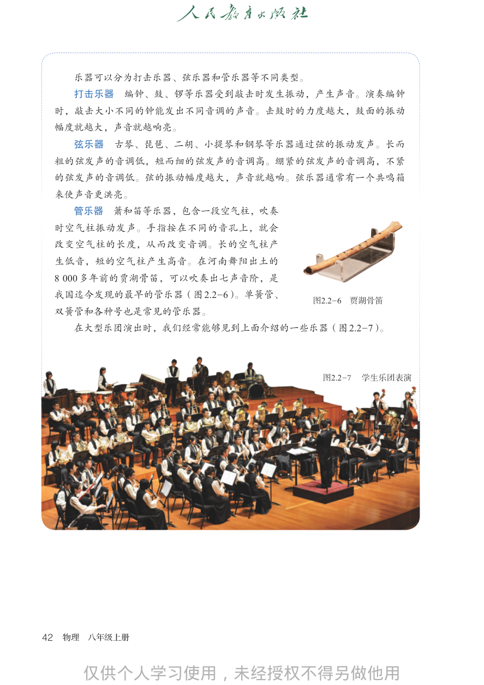

## RJ-PHYSICS-8A-034 声传递信息及回声定位的应用

第二章 声现象 / 第3节 声的利用 · PDF P51-P52

**声与信息**

不同的动物感受声波的频率范围不同。有些动物对高频声波的反应很灵敏，有些动物则容易感受到低频声波。大象就可以发出次声波，并通过次声波互相交流。

大自然的许多活动，如地震、火山爆发（图2.3-2）、台风、海啸等，都伴有次声波产生。一些机器在工作时，也会产生人耳听不到的次声波。次声波传播的距离很远，发生地震、台风、核爆炸时，即使在几千千米以外，使用灵敏的声学仪器也能接收到它们产生的次声波。处理这些信息，可以确定这些活动发生的方位和强度。

蝙蝠通常只在夜间出来活动、觅食，但它们不会撞到墙壁、树枝，并且能准确定位。它们的这些“绝技”靠的是什么？原来，蝙蝠在飞行时会发出超声波（图2.3-3），超声波碰到墙壁或昆虫时会反射回来，根据回声到来的方位和时间，蝙蝠就可以确定目标的位置。

蝙蝠采用的方法叫作回声定位。现在，利用这个方法制成的超声导盲仪可以探测前进道路上的障碍物，以便帮助视障人士出行。有的倒车雷达也是利用超声波来定位的（图2.3-4）。科学家利用这个方法还发明了声呐。利用声呐系统，人们可以探知海洋的深度，绘出水下数千米处的地形图，捕鱼时还可以获得水中鱼群的信息。

医生利用听诊器捕获人体内的声音信息来诊断疾病。而借助超声波，医生还可以准确地获得人体内部脏器的图像信息。医生用B型超声波诊断仪向就诊者体内发射超声波，然后接收体内脏器的反射波，反射波携带的信息经过处理后显示在屏幕上。这就是常说的“B 超”。在图2.3-5 中，医生正在用B 超查看胎儿的发育情况。中医诊病通过“望、闻、问、切”四个途径，其中“闻”也有听的意思。

在生产实践中，超声波检测技术应用很广。例如，利用超声波可以检测出锅炉有没有裂纹，甚至还可以知道裂纹有多大、多深。

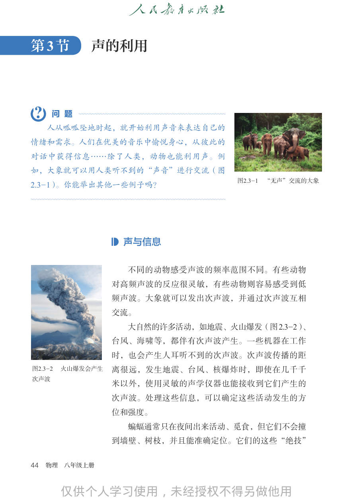

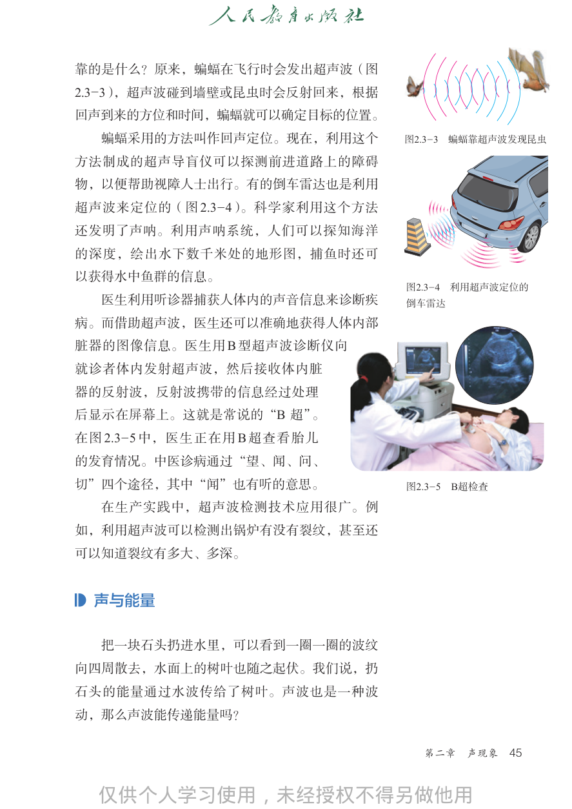

## RJ-PHYSICS-8A-035 声波传递能量的实验与应用

第二章 声现象 / 第3节 声的利用 · PDF P52-P53

**声与能量**

把一块石头扔进水里，可以看到一圈一圈的波纹向四周散去，水面上的树叶也随之起伏。我们说，扔石头的能量通过水波传给了树叶。声波也是一种波动，那么声波能传递能量吗？

**声波能否传递能量**

如图2.3-6所示，将扬声器对准烛焰，播放音乐，你看到了什么现象？这说明了什么问题？

扬声器旁的烛焰发生颤动，说明声波能传递能量。

声波传递能量的性质应用在社会生活的很多方面。例如，超声波常被用来清洗物体（图2.3-7）。把待清洗的物体放在清洗液里，超声波会引起液体激烈的振动，振动把物体上的污垢敲击下来而不会损坏被清洗的物体。医生常利用超声波振动除去人体内的某些结石：向结石发射超声波，结石会被击成细小的粉末，从而可以顺畅地排出体外。

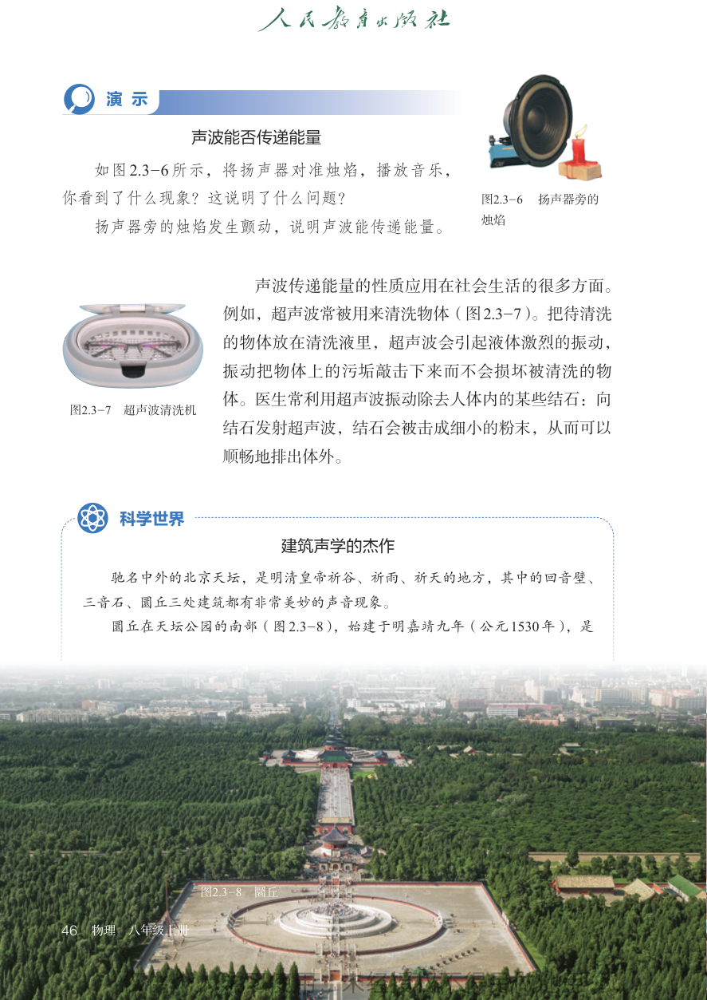

## RJ-PHYSICS-8A-036 圜丘声反射的声学原理

第二章 声现象 / 第3节 声的利用 · PDF P53-P54

圜丘在天坛公园的南部（图2.3-8），始建于明嘉靖九年（公元1530年），是一座分成三层的圆形平台，每层周边都有汉白玉栏板，每层平台的台面都由光滑的石板铺成。第三层台面高出地面约5 m，半径约为11.5 m，第三层中心是一块圆形大理石，俗称天心石。当你站在天心石上说话或唱歌时，你会觉得声音特别洪亮。但是站在天心石以外的人听起来，却没有这种感觉，站在天心石以外说话或唱歌，也没有这种感觉。

这种奇妙的现象是声音反射形成的音响效果。圜丘第三层台面中心略高（图2.3-9），四周微微向下倾斜。当有人在台面中心说话时，传向四周的声音有一部分被四周的石栏板反射，射到稍有倾斜的台面后又被反射到台面中心。因为圜丘第三层台面的半径仅约为11.5 m，从发声到回声返回台面中心所需的时间约为0.07 s，所以回声跟原来的声音混在一起，分辨不开，让人觉得声音格外响亮，似乎觉得还有声音从地下传来。

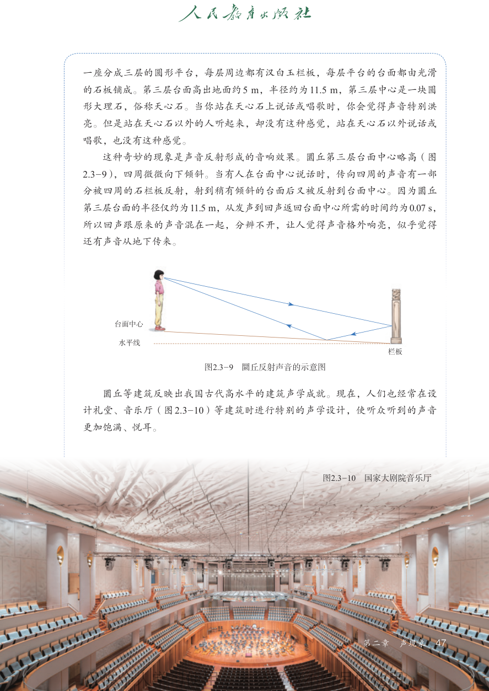

## RJ-PHYSICS-8A-037 噪声的含义及其波形实验

第二章 声现象 / 第4节 噪声的危害和控制 · PDF P56

**噪声的来源**

嘈杂的声音——噪声（noise）是严重影响我们生活的污染之一。从物理学的角度讲，发声体做无规则振动时会发出噪声。

**观察噪声的波形**

观察泡沫塑料块刮玻璃时产生的噪声的波形（图2.4-1），并与音叉发出的声音的波形作比较。

除了从物理学的角度，人们还常从环境保护的角度，把妨碍人们正常工作和生活的声音也称为噪声。例如，夜深人静时有人引吭高歌，这时的歌声就成了噪声。

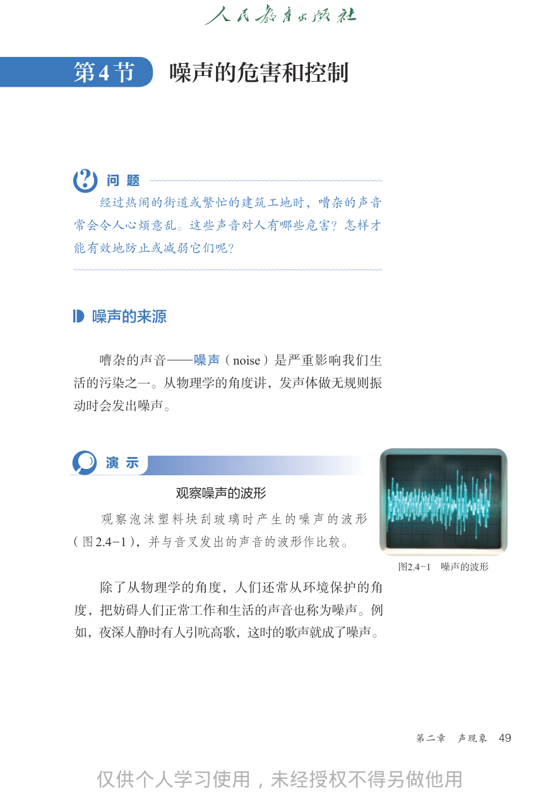

## RJ-PHYSICS-8A-038 分贝、噪声的危害与声音强弱等级

第二章 声现象 / 第4节 噪声的危害和控制 · PDF P57

**噪声的危害**

人们以分贝（decibel，符号是dB）为单位来表示人耳感知声音强弱的等级。0 dB是人刚能听到的最微弱的声音；30~40 dB 是较为理想的安静环境；70 dB 会干扰谈话，影响工作效率；长期生活在90 dB 以上的噪声环境中，听力会受到严重影响并产生神经衰弱、头疼、高血压等疾病；如果突然暴露在高达150 dB的噪声环境中，鼓膜会破裂出血，双耳完全失去听力。为了保护听力，声音不能超过90 dB ；为了保证工作和学习，声音不能超过70 dB ；为了保证休息和睡眠，声音不能超过50 dB。

表2.4-1 人对不同强度的声音的感觉

| 声音的来源 | 声音强弱的等级/dB | 主观感觉 |
| --- | --- | --- |
| 火箭、导弹发射 | 150 | 无法忍受 |
| 球磨机工作 | 120 | 感到疼痛 |
| 汽车鸣笛 | 100 | 很吵 |
| 一般车辆行驶 | 80 | 较吵 |
| 一般说话 | 60 | 较静 |
| 图书馆阅览室翻书 | 40 | 安静 |
| 风吹落叶沙沙声 | 10 | 极静 |

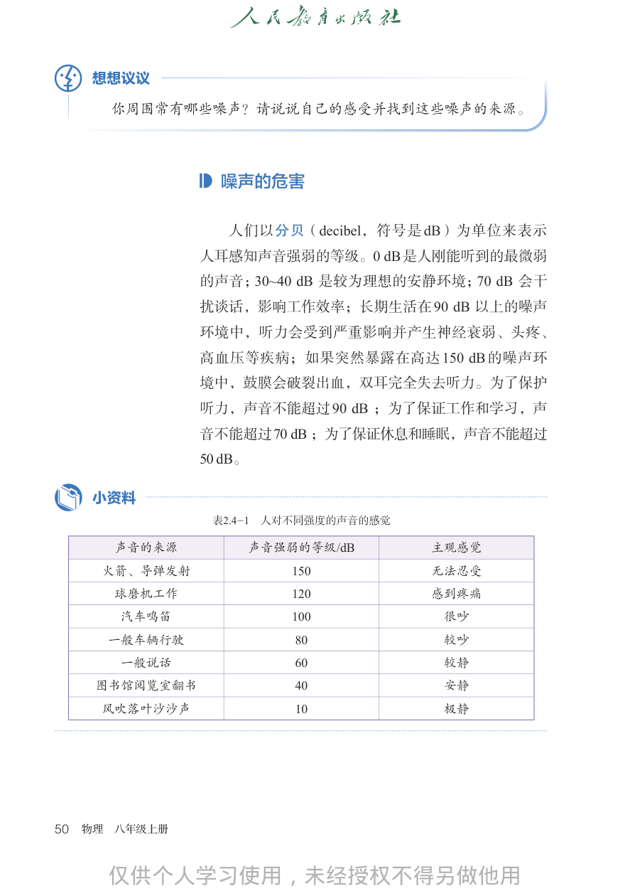

## RJ-PHYSICS-8A-039 控制噪声的三个环节

第二章 声现象 / 第4节 噪声的危害和控制 · PDF P58

**噪声的控制**

噪声会严重影响人们的工作和生活，控制噪声十分重要。我们知道，声音从产生到引起听觉有这样三个阶段：

声源的振动产生声音——空气等介质传播声音——振动经人耳引起听觉

因此，控制噪声也要从这三个方面着手，即：防止噪声产生——阻断噪声传播——防止噪声进入耳朵

图2.4-2中控制噪声的措施分别属于哪个方面？你还能列举出一些生活中采用不同方法控制噪声的实例吗？

由于噪声的危害，人们将噪声称为“隐形杀手”。现代的城市把控制噪声列为环境保护的重要项目之一。在需要安静环境的医院、学校和科学研究部门附近，常常有禁止鸣喇叭的标志（图2.4-3）。家用电器、机动车等在设计时都应考虑减小噪声对环境的影响。

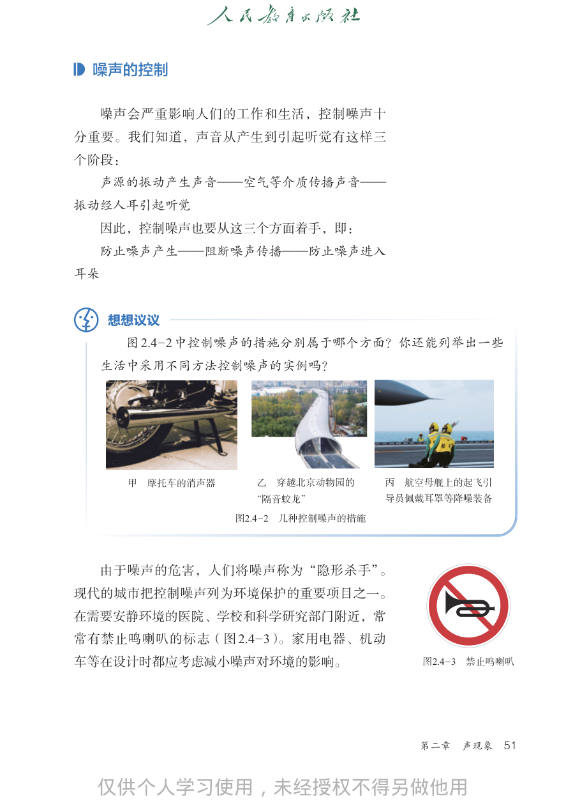

## RJ-PHYSICS-8A-040 隔音房间模型的制作与测试方法

第二章 声现象 / 第5节 跨学科实践：制作隔音房间模型 · PDF P60-P61

我们可以用包装盒或鞋盒充当“房间”，将一只闹钟放入其中模拟房间中发声的乐器或电视机。然后，在盒内的相应区域安装能够隔音的材料，制作隔音房间模型。

上网查阅资料，了解不同材料的隔音性能以及它们的特点，尽量从常见材料中选取合适的材料。在注意隔音性能的同时，也要尽量减小材料的厚度，最大限度地保证“房间”的空间。

测试时，通过手机或者计算机中的软件等先测量未作隔音处理时闹钟铃声的强弱，再测量经过隔音处理后闹钟铃声的强弱。通过比较前后的变化来评估模型的隔音性能。

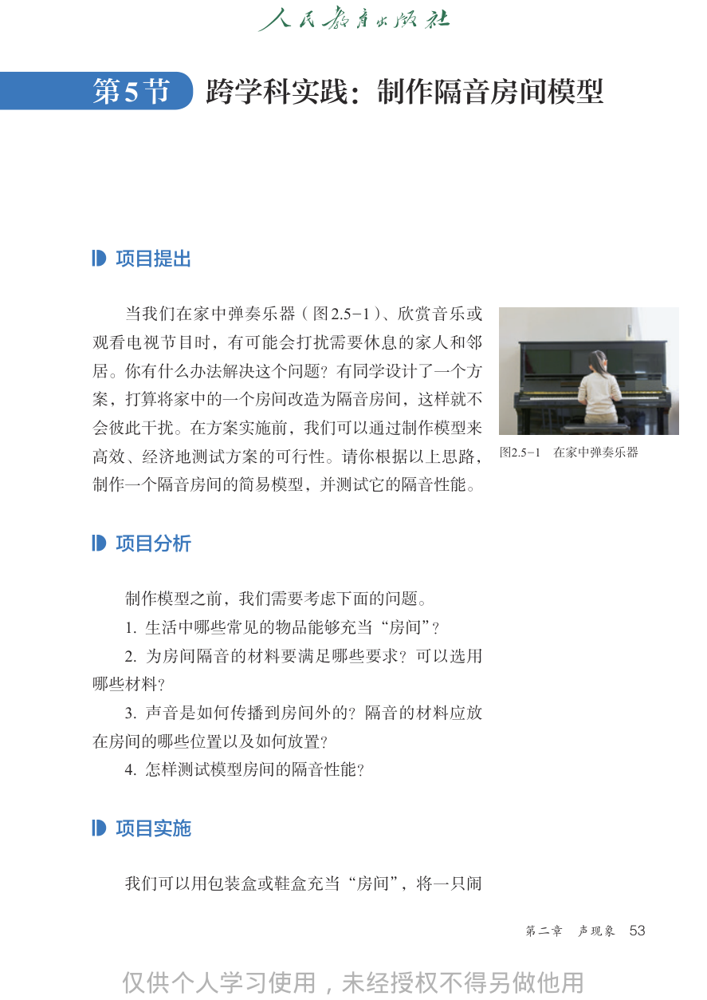

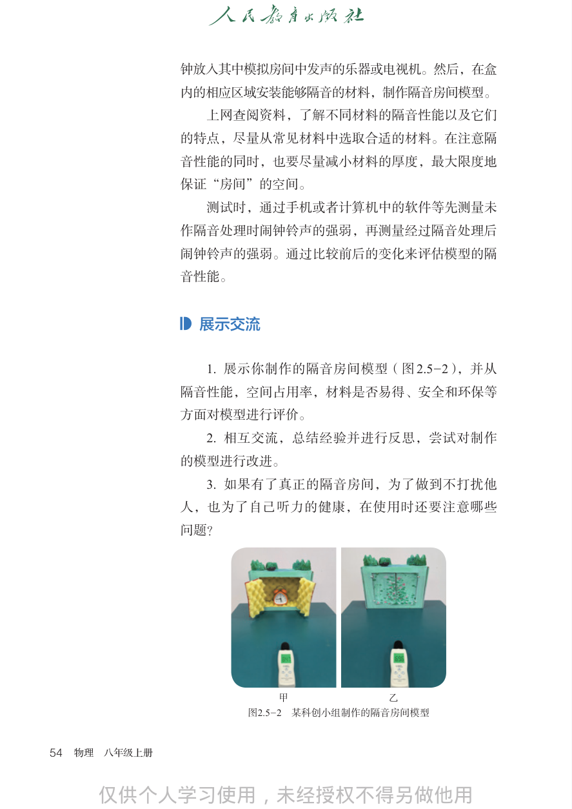

## RJ-PHYSICS-8A-041 温度与冷热感觉的实验

第三章 物态变化 / 第1节 温度 · PDF P65

把两只手指分别放入热水和冷水中。过一会儿，再把这两只手指同时放入温水中（图3.1-1）。手指对“温水”的冷热感觉相同吗？

**温度**

生活中，人们常常需要了解物体的冷热程度。物理学中通常用温度（temperature）来表示物体的冷热程度，热的物体温度高，冷的物体温度低。温度和人们的生活息息相关。

通过节前“问题”栏目中的实验你会发现，两只手指对同一杯“温水”的冷热感觉是不同的。这说明，要准确地判断物体的冷热程度，仅凭感觉是不行的。如何准确地了解和测量物体的温度呢？

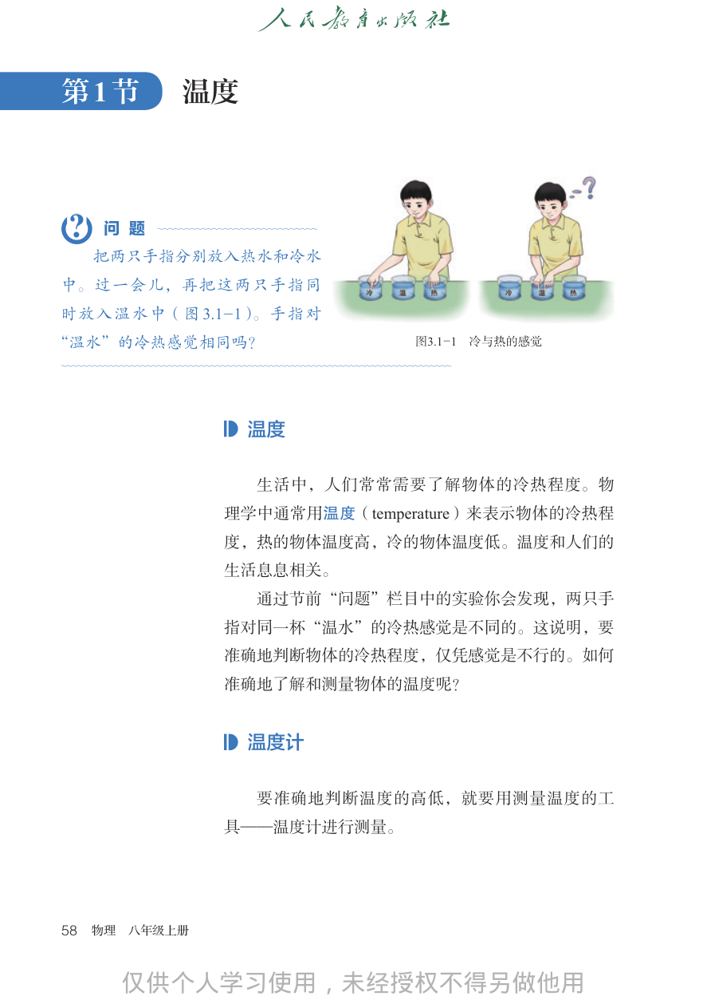

## RJ-PHYSICS-8A-042 温度计及液体温度计的原理

第三章 物态变化 / 第1节 温度 · PDF P65-P66

**温度计**

要准确地判断温度的高低，就要用测量温度的工具——温度计进行测量。

在小瓶里装满带颜色的水。给小瓶配一个橡皮塞，橡皮塞上插进一根透明的细管，使橡皮塞塞住瓶口，如图3.1-2所示。

将小瓶放入热水中，观察细管中水柱的位置，然后把小瓶放入冷水中，观察水柱的位置。

想一想：自制的温度计是根据什么原理测量温度的？要想测出具体的温度值，需要怎么做？

家庭和实验室里常用的液体温度计是根据液体热胀冷缩的规律制成的，里面的液体有的用酒精（乙醇），有的用煤油。

图3.1-3是几种温度计：甲为实验室用温度计，乙为寒暑表，丙为电子数显温度表。

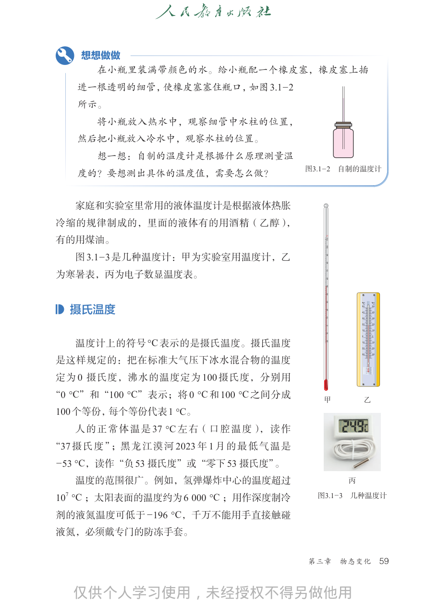

## RJ-PHYSICS-8A-043 摄氏温度的规定与读法

第三章 物态变化 / 第1节 温度 · PDF P66

**摄氏温度**

温度计上的符号°C表示的是摄氏温度。摄氏温度是这样规定的：把在标准大气压下冰水混合物的温度定为0 摄氏度，沸水的温度定为100 摄氏度，分别用“0 °C”和“100 °C”表示；将0 °C和100 °C之间分成100个等份， 每个等份代表1 °C。

人的正常体温是37 °C 左右（口腔温度），读作“37 摄氏度”； 黑龙江漠河2023 年1 月的最低气温是-53 °C，读作“负53 摄氏度”或“零下53 摄氏度”。

温度的范围很广。例如，氢弹爆炸中心的温度超过10⁷ °C ；太阳表面的温度约为6 000 °C ；用作深度制冷剂的液氮温度可低于-196 °C，千万不能用手直接触碰液氮，必须戴专门的防冻手套。

## RJ-PHYSICS-8A-044 温度计的使用与测量水温的实验

第三章 物态变化 / 第1节 温度 · PDF P67-P68

**温度计的使用**

使用温度计时，首先要看清它测量的范围。如果待测的温度过高或过低，超出了温度计所能测量的范围，就要换用一支范围合适的温度计，否则温度计可能会损坏，或者测不出温度。另外，还要看清温度计的分度值，也就是一个小格代表的值，以保证读数正确。

观察图3.1-3中的实验室用温度计和寒暑表，说出它们能测量的范围和分度值各是多少。为什么会这样设计？

**用温度计测量水的温度**

测量水的温度时，可以选用实验室用温度计。在测量前，思考图3.1-4中使用温度计的做法和读数方法，哪些是正确的，哪些是错误的，错误在哪里。

分别向烧杯中倒入冷水、温水和热水，用温度计测量它们的温度，记录测量结果。

通过以上实验，我们总结出正确使用实验室用温度计测量液体温度时的几个要点。

1. 温度计的玻璃泡应该全部浸入被测的液体中，不要碰到容器底或容器壁。

2. 温度计的玻璃泡浸入被测液体后要稍微等一会儿，待温度计的示数稳定后再读数。

3. 读数时温度计的玻璃泡要继续留在液体中，视线要与温度计中的液面相平。

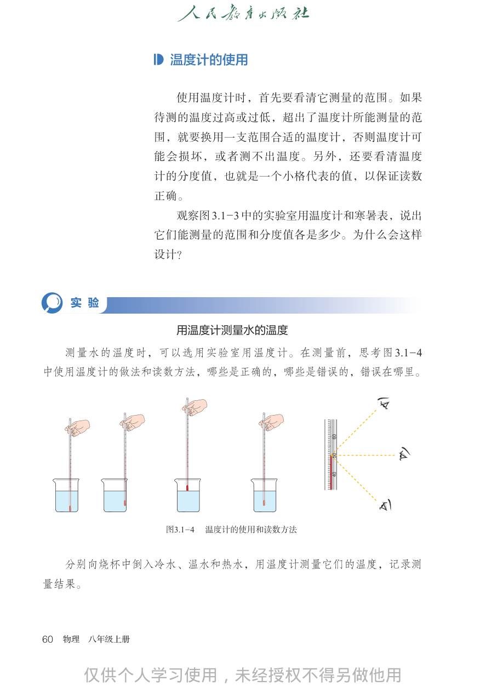

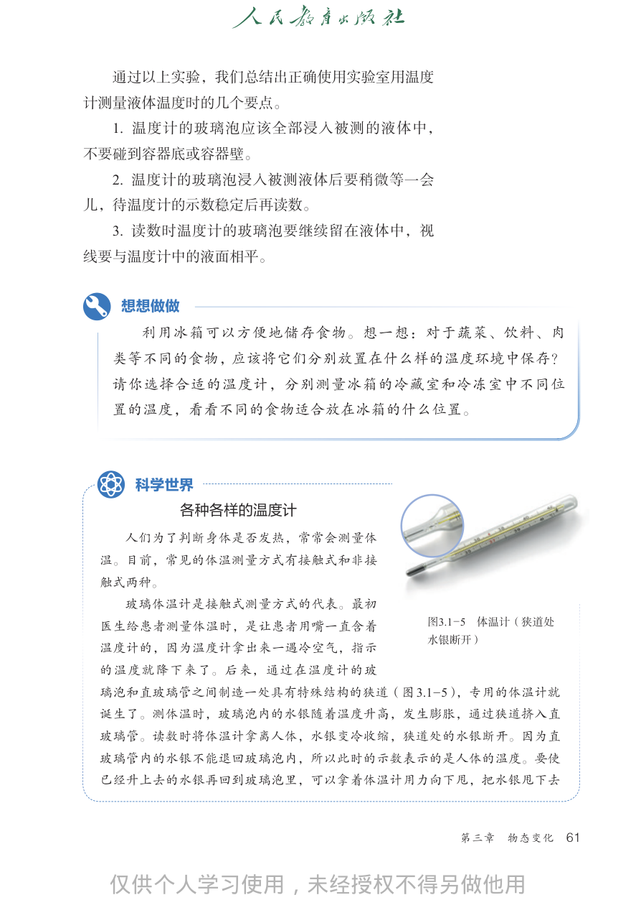

## RJ-PHYSICS-8A-045 体温计的结构、使用与电子体温计

第三章 物态变化 / 第1节 温度 · PDF P68-P69

**各种各样的温度计**

人们为了判断身体是否发热，常常会测量体温。目前，常见的体温测量方式有接触式和非接触式两种。

玻璃体温计是接触式测量方式的代表。最初医生给患者测量体温时，是让患者用嘴一直含着温度计的，因为温度计拿出来一遇冷空气，指示的温度就降下来了。后来，通过在温度计的玻璃泡和直玻璃管之间制造一处具有特殊结构的狭道（图3.1-5），专用的体温计就诞生了。测体温时，玻璃泡内的水银随着温度升高，发生膨胀，通过狭道挤入直玻璃管。读数时将体温计拿离人体，水银变冷收缩，狭道处的水银断开。因为直玻璃管内的水银不能退回玻璃泡内，所以此时的示数表示的是人体的温度。要使已经升上去的水银再回到玻璃泡里，可以拿着体温计用力向下甩，把水银甩下去（其他温度计不允许甩）。根据人体温度的变化情况，玻璃体温计的刻度范围通常为35~42 °C。

随着电子技术的发展，20 世纪70 年代出现了电子体温计。现在的电子体温计通过液晶屏可以直接显示体温（图3.1-6）。

无论是玻璃体温计还是电子体温计，都要接触人体，并需要一定的测量时间。新式红外体温计（又叫测温枪，图3.1-7）比玻璃体温计的使用更加卫生、便捷。只要把“枪口”对准被测对象，打开开关，“枪尾”的显示屏上就能直接显示温度。因此，这种非接触式测温方式应用更为广泛。

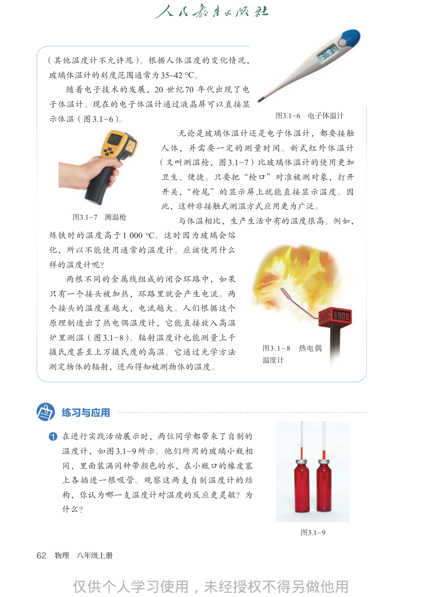

## RJ-PHYSICS-8A-046 热电偶温度计与辐射温度计

第三章 物态变化 / 第1节 温度 · PDF P69

与体温相比，生产生活中有的温度很高。例如，炼铁时的温度高于1 000 °C。这时因为玻璃会熔化，所以不能使用通常的温度计。应该使用什么样的温度计呢？

两根不同的金属线组成的闭合环路中，如果只有一个接头被加热，环路里就会产生电流。两个接头的温度差越大，电流越大。人们根据这个原理制造出了热电偶温度计，它能直接放入高温炉里测温（图3.1-8）。辐射温度计也能测量上千摄氏度甚至上万摄氏度的高温。它通过光学方法测定物体的辐射，进而得知被测物体的温度。

## RJ-PHYSICS-8A-047 物质三态与物态变化

第三章 物态变化 / 第2节 熔化和凝固 · PDF P71

**物态变化**

固态、液态和气态是物质常见的三种状态。天气热的时候，从冰柜中拿出的冰，一会儿就变成了水，再过一段时间水干了，变成看不见的水蒸气，跑得无影无踪。随着温度的变化，物质会在固、液、气三种状态之间变化。通常呈固态的铝、铜、铁等金属，在温度很高时也会变成液态、气态；通常呈气态的氧气、氮气、氢气等，在温度很低时也会变成液态、固态。物质各种状态间的变化叫作物态变化。

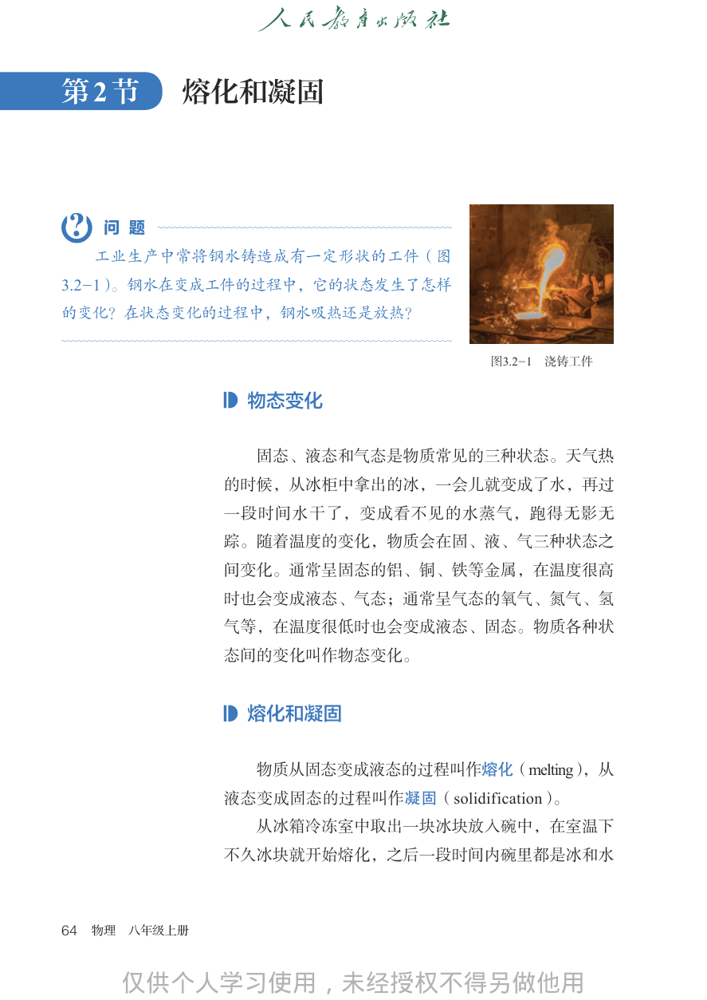

## RJ-PHYSICS-8A-048 熔化和凝固的定义与冰的熔化情境

第三章 物态变化 / 第2节 熔化和凝固 · PDF P71-P72

**熔化和凝固**

物质从固态变成液态的过程叫作熔化（melting），从液态变成固态的过程叫作凝固（solidification）。

从冰箱冷冻室中取出一块冰块放入碗中，在室温下不久冰块就开始熔化，之后一段时间内碗里都是冰和水混合在一起的情况。如果用温度计测量，就会发现尽管冰在逐渐熔化变少，但水的温度并没有升高。这是怎么回事？想一想：其他物质熔化时的温度是否也不变？

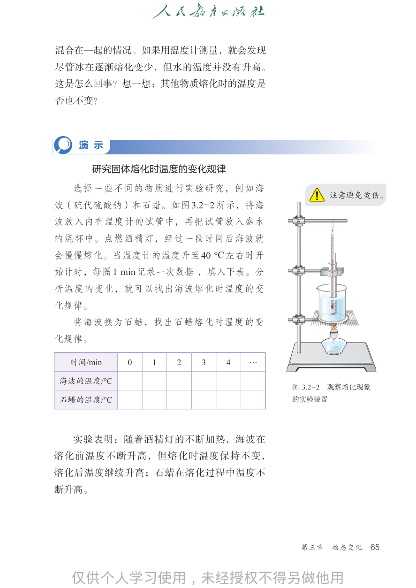

## RJ-PHYSICS-8A-049 研究海波和石蜡熔化温度变化的实验

第三章 物态变化 / 第2节 熔化和凝固 · PDF P72-P73

**研究固体熔化时温度的变化规律**

选择一些不同的物质进行实验研究，例如海波（硫代硫酸钠）和石蜡。如图3.2-2所示，将海波放入内有温度计的试管中，再把试管放入盛水的烧杯中。点燃酒精灯，经过一段时间后海波就会慢慢熔化。当温度计的温度升至40 °C左右时开始计时，每隔1 min记录一次数据 ，填入下表。分析温度的变化，就可以找出海波熔化时温度的变化规律。

将海波换为石蜡，找出石蜡熔化时温度的变化规律。

| 时间/min | 0 | 1 | 2 | 3 | 4 | … |
| --- | --- | --- | --- | --- | --- | --- |
| 海波的温度/℃ |  |  |  |  |  |  |
| 石蜡的温度/℃ |  |  |  |  |  |  |

实验表明：随着酒精灯的不断加热，海波在熔化前温度不断升高，但熔化时温度保持不变，熔化后温度继续升高；石蜡在熔化过程中温度不断升高。

注意避免烫伤。

除了通过表格，我们还可以采用图像分析的方法总结海波和石蜡熔化时的温度变化规律。图像可以很直观地表现出一个物理量（如温度）随另一个物理量（如时间）变化的情况。图3.2-3 和图3.2-4 中的纵轴表示温度，温度的数值已经标出；横轴表示时间，请你自己将数值写上。根据上表中各个时刻的温度在坐标纸上描点，然后将这些点用平滑曲线连接起来，就能得到熔化时温度随时间变化的图像。

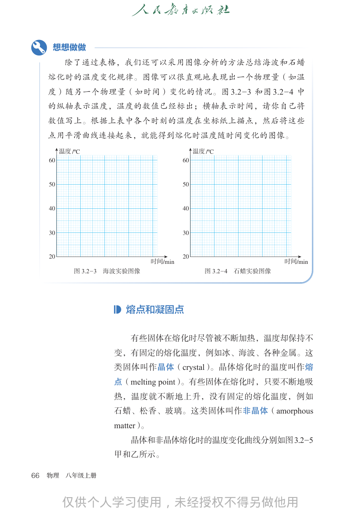

## RJ-PHYSICS-8A-050 晶体、非晶体、熔点和凝固点

第三章 物态变化 / 第2节 熔化和凝固 · PDF P73-P74

**熔点和凝固点**

有些固体在熔化时尽管被不断加热，温度却保持不变，有固定的熔化温度，例如冰、海波、各种金属。这类固体叫作晶体（crystal）。晶体熔化时的温度叫作熔点（melting point）。有些固体在熔化时，只要不断地吸热，温度就不断地上升，没有固定的熔化温度，例如石蜡、松香、玻璃。这类固体叫作非晶体（amorphous matter）。

晶体和非晶体熔化时的温度变化曲线分别如图3.2-5甲和乙所示。

液体凝固形成晶体时也有固定的凝固温度（图3.2-6 甲），这个温度叫作凝固点（solidifying point）。同一种物质的凝固点和它的熔点相同。液体凝固形成非晶体时没有固定的凝固温度（图3.2-6 乙）。

表3.2-1 一些晶体的熔点（标准大气压）

| 晶体 | 熔点/℃ |
| --- | --- |
| 钨 | 3 410 |
| 铁 | 1 538 |
| 铜 | 1 083 |
| 金 | 1 064 |
| 铝 | 660 |
| 铅 | 328 |
| 锡 | 232 |
| 固态碘 | 114 |
| 萘 | 80.5 |
| 海波 | 48 |
| 冰 | 0 |
| 固态水银 | −39 |
| 固态酒精 | −117 |
| 固态氮 | −210 |
| 固态氧 | −218 |
| 固态氢 | −259 |

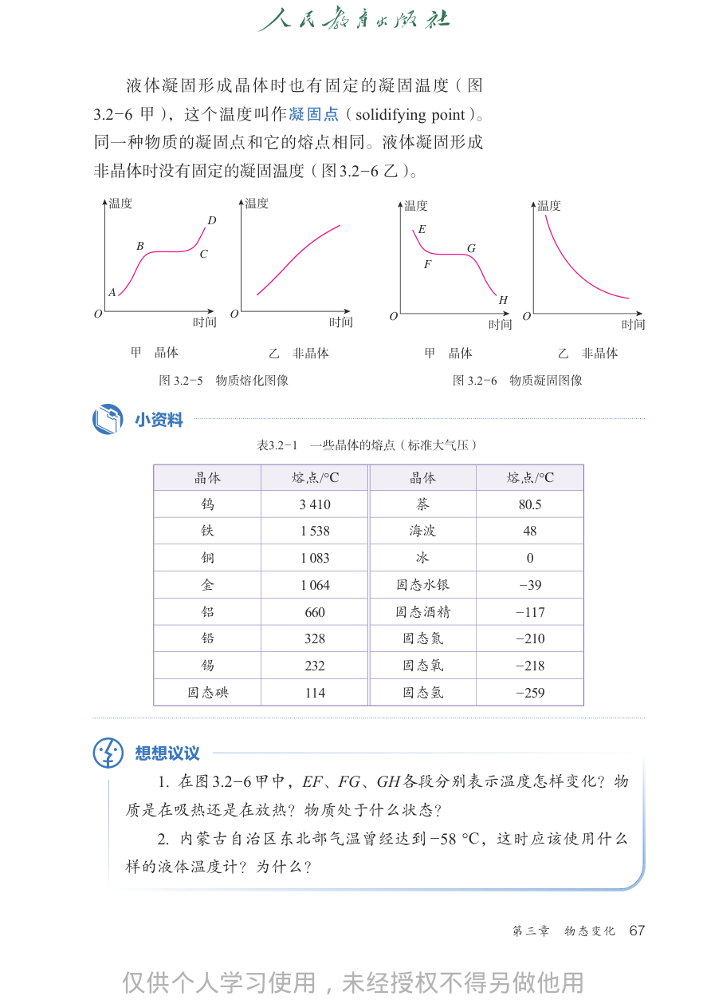

## RJ-PHYSICS-8A-051 熔化吸热与凝固放热及应用

第三章 物态变化 / 第2节 熔化和凝固 · PDF P75

**熔化吸热  凝固放热**

晶体在熔化时虽然温度不变，但是必须对它继续加热，熔化过程才能完成，这表明晶体在熔化时吸热。反过来，液体在凝固成晶体时放热，但是温度不变。非晶体在熔化或凝固过程中也吸热或放热，但是温度改变。

夏天，如果我们要喝冰凉的饮料，往往会在饮料中加上几块冰，而不是直接加冷水（图 3.2-7）。一方面是因为冰块的温度更低，另一方面是因为冰块在熔化成水的过程中吸热，从而可以使饮料的温度下降得更多。

在北方的冬天，为了很好地保存蔬菜，人们通常会在菜窖里放几桶水，这样可以利用水凝固成冰时放出的热使菜窖内的温度不会太低。

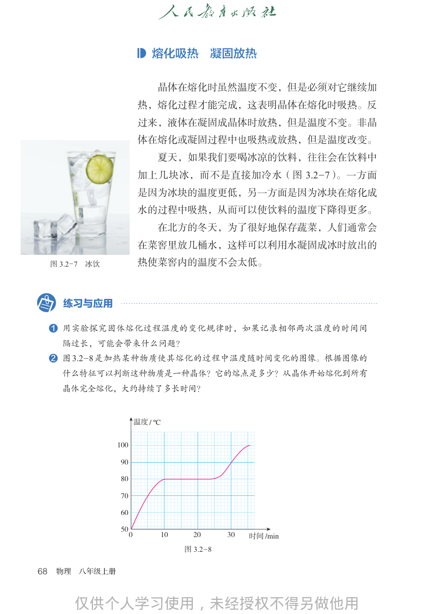

## RJ-PHYSICS-8A-052 汽化和液化及酒精物态变化的实验

第三章 物态变化 / 第3节 汽化和液化 · PDF P77

在塑料袋中滴入几滴酒精，将塑料袋挤瘪，排出空气后用绳把袋口扎紧（图3.3-1），然后放入开水中。你会看到塑料袋有什么变化？从开水中拿出塑料袋，过一会儿它又有什么变化？在整个过程中，酒精的状态发生了哪些变化？

从实验中我们可以看到，挤瘪的塑料袋受热后膨胀，降温后重新变瘪。这是因为，塑料袋中的液态酒精受热后变成了气态酒精，降温后气态酒精又变成了液态酒精。物质的液态和气态可以相互转化。物质从液态变为气态的过程叫作汽化（vaporization），从气态变为液态的过程叫作液化（liquefaction）。

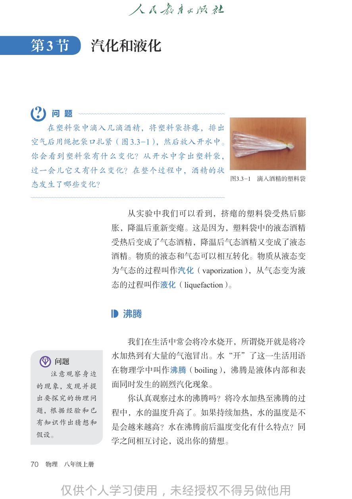

## RJ-PHYSICS-8A-053 沸腾、沸点与水沸腾前后温度变化的实验

第三章 物态变化 / 第3节 汽化和液化 · PDF P77-P79

**沸腾**

我们在生活中常会将冷水烧开，所谓烧开就是将冷水加热到有大量的气泡冒出。水“开”了这一生活用语在物理学中叫作沸腾（boiling），沸腾是液体内部和表面同时发生的剧烈汽化现象。

你认真观察过水的沸腾吗？将冷水加热至沸腾的过程中，水的温度升高了。如果持续加热，水的温度是不是会越来越高？水在沸腾前后温度变化有什么特点？同学之间相互讨论，说出你的猜想。

**探究水在沸腾前后温度变化的特点**

实验思路与上一节的固体熔化实验类似，我们可以通过将水加热至沸腾，测量水的温度，根据记录的数据绘制图像，得出水在沸腾前后温度变化的特点。

实验过程如图3.3-2所示，用酒精灯（或家庭常用的电磁炉、电热水壶等）将水加热，使其沸腾。用实验室用温度计测量水温，当水温接近90 °C时开始计时，每隔0.5 min读数一次并将温度填入下表中，直到水沸腾4~5 min后为止。

实验结论通过上表，你能直接看出水在沸腾前后温度变化的特点吗？为了进一步发现规律，我们还可以在图3.3-3中绘制水沸腾前后温度与时间关系的图像。

注意避免烫伤。

| 时间/min | 0 | 0.5 | 1 | 1.5 | 2 | 2.5 | 3 | … |
| --- | --- | --- | --- | --- | --- | --- | --- | --- |
| 温度/℃ |  |  |  |  |  |  |  |  |

根据你对实验数据的整理和分析，总结水在沸腾前后温度变化的特点：________。将你的实验思路与实验过程、实验结论等写成科学探究报告，与其他同学交流，进一步完善你的实验。

实验表明，水在沸腾前，温度不断升高；水在沸腾后，温度保持不变。从实验中还可以看到，水的沸腾是一种剧烈的汽化现象。这时形成的大量气泡不断上升、变大，到水面破裂开来，里面的水蒸气散发到空气中。在沸腾的过程中，虽然水的温度保持不变，但要用酒精灯持续加热，所以说水在沸腾的过程中不断吸热。

各种液体沸腾时都有确定的温度，这个温度叫作沸点（boiling point）。不同液体的沸点不同。液体在沸腾的过程中不断吸热。家里煮饺子、蒸馒头时，在水沸腾后仍然要继续加热，就是为了使水能够继续吸热，保持沸腾。

## RJ-PHYSICS-8A-054 常见液体的沸点

第三章 物态变化 / 第3节 汽化和液化 · PDF P79

表3.3-1 一些液体的沸点（标准大气压）

| 液体 | 沸点/℃ |
| --- | --- |
| 液态铁 | 2 750 |
| 液态铅 | 1 740 |
| 水银 | 357 |
| 液态碘 | 184 |
| 甲苯 | 111 |
| 水 | 100 |
| 酒精 | 78 |
| 液态氨 | −33 |
| 液态氧 | −183 |
| 液态氮 | −196 |
| 液态氢 | −253 |
| 液态氦 | −269 |

## RJ-PHYSICS-8A-055 纸锅烧水实验

第三章 物态变化 / 第3节 汽化和液化 · PDF P80

着火点是物质可以燃烧的最低温度。纸的着火点大约是183 °C，就是说，当纸的温度达到183 °C时，它会燃烧起来，而火焰温度通常比纸的着火点高得多。想一想：我们能用纸做的锅在火上把水烧开吗？

取一张光滑的厚纸，照图3.3-4那样做成一个小纸锅。小纸锅里装些水，放到火上加热。注意不要让火苗烧到水面以上的纸。过一会儿水就会沸腾，而小纸锅不会燃烧。

实际做一做，说一说小纸锅为什么不会燃烧。

## RJ-PHYSICS-8A-056 蒸发及影响蒸发快慢的因素

第三章 物态变化 / 第3节 汽化和液化 · PDF P80

**蒸发**

生活中我们会发现，洒在地上的水过一会儿就不见了，晾在太阳下的湿衣服不久后也干了。水为什么会不见了呢？这是因为，虽然没有达到沸点，但是水也发生了汽化，变成了气体。这种在任何温度下都能发生的汽化现象叫作蒸发（evaporation）。

蒸发只发生在液体的表面。要加快液体的蒸发，可以升高液体的温度，增大液体的表面积，加快液体表面上的空气流动；而要减慢蒸发，应该采取相反的措施。

蒸发和沸腾是汽化的两种形式。

## RJ-PHYSICS-8A-057 蒸发吸热的实验与应用

第三章 物态变化 / 第3节 汽化和液化 · PDF P80-P81

你可能有过用医用酒精擦拭皮肤消毒的经历。把酒精擦在手背上，手背有什么感觉？这可能是什么原因引起的？

把酒精反复涂在温度计的玻璃泡上，用扇子扇，温度计的示数有什么变化？如果温度计上不涂酒精，用扇子扇，温度计的示数会变化吗？

手背擦上酒精后，随着酒精的蒸发，人会感到擦酒精的位置变凉。这是因为酒精在蒸发过程中吸热，致使酒精及与酒精接触的物体温度下降。夏天向地面上洒水会感到凉快，是利用水在蒸发时吸热来降低温度的。人们在高温的天气里大汗淋漓，是人体自我保护的生理现象，汗液蒸发吸热，使体温不致升得太高。

## RJ-PHYSICS-8A-058 液化的方法、现象与放热

第三章 物态变化 / 第3节 汽化和液化 · PDF P81

**液化**

在北方的冬天，可以看到户外的人不断呼出“白气”，这是呼出的水蒸气遇到冷空气凝结成的小雾滴；戴眼镜的人从寒冷的室外进入温暖的室内，镜片会蒙上一层小水珠，这是室内空气中的水蒸气遇到冷镜片凝结成的。清晨，人们有时会看到路边的草、树叶或昆虫身上结有露珠（图3.3-5），这是空气中的水蒸气遇冷凝结成的小水滴。

实验表明，所有气体在温度降到足够低时都可以液化。另外，在一定的温度下，压缩气体的体积也可以使气体液化。将气体液化的最大好处是体积缩小，便于储存和运输。火箭中用作燃料和助燃剂的氢和氧，都是以液体状态装在火箭里的。有些家庭利用石油加工时产生的可燃气体做饭，这些气体也是液化后储存在钢瓶内的，称作液化石油气（图3.3-6）。

液体汽化时要吸热，与此相反，气体液化时要放热。烧水、做饭的时候，水蒸气引起的烫伤往往比开水烫伤更严重，这是因为水蒸气和开水的温度虽然差不多，但是水蒸气液化的时候还要放出大量的热。

## RJ-PHYSICS-8A-059 电冰箱与冻土热棒的制冷原理

第三章 物态变化 / 第3节 汽化和液化 · PDF P82

**青藏高原上的“冰箱”**

我国的青藏铁路是世界上海拔最高的铁路。铁路穿过多年冻土区时，为了减小冻土因融化对路基产生的影响，需要使冻土保持低温。你知道工程师是采用了什么技术攻克这个难题的吗？在回答这个问题前，我们先来了解一下电冰箱制冷的原理。

电冰箱利用制冷剂作为热的“搬运工”，把冰箱里的“热”“搬运”到冰箱的外面。制冷剂采用既容易汽化又容易液化的物质，汽化时它吸热，液化时它放热。图3.3-7是一种电冰箱的构造和原理图。液态制冷剂经过很细的毛细管进入冰箱内冷冻室的管子，在这里汽化、吸热，使冰箱内温度降低。之后，生成的蒸气又被压缩机压入冷凝器，在这里液化并把从冰箱内带来的热通过冰箱壁上的管子放出。制冷剂这样循环流动，冰箱冷冻室里就可以保持相当低的温度。

电冰箱通过压缩机使制冷剂不断地液化和汽化而获得低温，热管技术不使用压缩机也能达到同样的目的。在青藏铁路工程中，为了保证多年冻土区路基的稳定性，铁路两侧竖立了许多热管。这种热管又被称为热棒（图3.3-8）。热棒是封闭的中空长棒，里面一般填充低沸点的液态氨作为“制冷剂”。如图3.3-9所示，热棒的下端插在冻土中，液态氨从冻土中吸热汽化成气态氨。在寒冷的季节，气态氨上升到热棒的上端，通过散热片向空气中放热，变回液态氨，又沉入棒底。如此循环，冻土中的热不断被散发出去，热棒就可以像“冰箱”一样使地下冻土层温度降低、厚度增加。即使到了暖季，热棒中的气态氨不会变回液态氨，热棒不再工作，冻土也不会完全融化。这样，冻土层因温度变化对路基产生的影响就变小了。

## RJ-PHYSICS-8A-060 升华和凝华及碘的物态变化实验

第三章 物态变化 / 第4节 升华和凝华 · PDF P84-P85

如图3.4-1所示，封闭的玻璃容器中有少量碘颗粒，先向容器浇热水，容器中有什么变化？然后向容器浇冷水，容器中又有什么变化？

由实验可以看到，固态的碘受热后，容器内充满了紫色的碘蒸气；碘蒸气遇冷后变成了固态的碘。

**升华和凝华**

生活中，物质可以由固态变成液态再变成气态，或由气态变成液态再变成固态，也可以由固态直接变成气态，或由气态直接变成固态。物理学中将物质从固态直接变成气态的过程叫作升华（sublimation），从气态直接变成固态的过程叫作凝华（deposition）。

衣柜里防虫用的樟脑片，过一段时间会变小，最后不见了，这就是一种升华现象。冬天，晾在室外的湿衣服会结成冰，但结冰的衣服也会慢慢变干，这也是因为冰直接升华为水蒸气了。

我国北方秋、冬两季，有时地面和屋顶出现霜、窗玻璃上出现冰花（图3.4-2）、树枝上出现雾凇，这些都是凝华现象。

像熔化和汽化一样，升华也要吸热；像凝固和液化一样，凝华也会放热。因此，在运输食品的时候，为了防止食品腐烂变质，可以利用干冰（固态二氧化碳）的升华来吸热降温。

## RJ-PHYSICS-8A-061 水循环中的物态变化

第三章 物态变化 / 第4节 升华和凝华 · PDF P85-P86

通过水的三态变化，地球上的水在不停地循环（图3.4-4）：阳光照在海面上，海水吸热蒸发成为水蒸气，上升到空中；当水蒸气上升到高空以后，与冷空气接触，水蒸气便液化成为小水滴，大量的小水滴悬浮在高空中，就形成了云；小水滴相互聚集，就会形成大水滴下降成为雨；如果在高空遇到更加寒冷的气流，小水滴就会凝固成小冰珠，最后有可能形成冰雹降落到地面；冬天，水蒸气在寒冷的高空急剧降温，从而凝华成微小的冰晶，这些冰晶聚集起来，就变成雪花飘落大地；这些天空的降水落到地面，一部分直接变为小溪，另一部分渗入地下，涌出地表后变成股股清泉，许多小溪汇合，形成江河，又注入大海。

## RJ-PHYSICS-8A-062 水资源的分布

第三章 物态变化 / 第4节 升华和凝华 · PDF P86

水是人类生存环境的重要组成部分。地球表面的70%以上是海洋。虽然地球表面大部分被水覆盖，但是其中海水约占97%，江河湖泊、土壤、岩层和冰川中的淡水约占3%，而能够供人类直接利用的淡水资源更是仅占淡水资源的0.3%。

## RJ-PHYSICS-8A-063 观察易拉罐下部结霜的实验

第三章 物态变化 / 第4节 升华和凝华 · PDF P87

如图3.4-6所示，将冰块放于易拉罐中并加入适量的盐。用筷子搅拌大约半分钟，用温度计测量罐中冰与盐水混合物的温度，可以看到混合物的温度低于0 °C。这时观察易拉罐的下部和底部，就会发现白霜（图3.4-7）。

## RJ-PHYSICS-8A-064 烹饪方式与沸腾后火力调整的原理

第三章 物态变化 / 第5节 跨学科实践：探索厨房中的物态变化问题 · PDF P89-P90

由于食用油和水的沸点差异就会形成炸、煮和蒸等不同的烹饪方式。

以煮饺子（图3.5-2）为例，从上表中我们知道，煮饺子时会观察到水的汽化和液化现象。要煮熟饺子，是需要一定时间的。虽然加大火力可以加快水的沸腾，但是水沸腾后仍然大火加热并不会使饺子更快煮熟。这是因为水在沸腾后温度保持不变，继续使用大火只会加速水的汽化，浪费水和燃料。因此，在水沸腾后，应将大火改为小火。

此外，由于水蒸气变成同温度的热水时要放出大量的热，所以锅中冒出的水蒸气造成的烫伤要比热水烫伤更严重。因此，在水煮沸时，若要揭开锅盖须注意避开水蒸气，以免烫伤。

## RJ-PHYSICS-8A-065 光源

第四章 光现象 / 第1节 光的直线传播 · PDF P95-P96

在晴朗的日子里，白天，灿烂的阳光普照大地；夜晚，闪烁的星光点缀漆黑的夜空。太阳以及我们看到的绝大多数星星是恒星，宇宙中的恒星都能发光。有的动物也可以发光。夏天的夜晚，常有淡淡的绿光在草丛中闪烁，那是萤火虫在发光。在大海深处，水母、灯笼鱼、斧头鱼等发出的光，使幽深的海洋世界显得更加神秘。

所有这些能够发光的物体都是光源。现代社会中有很多人造光源，如图4.1-1丙中的发光二极管（LED）灯。你周围有哪些人造光源？

## RJ-PHYSICS-8A-066 光的直线传播及水和玻璃中的传播实验

第四章 光现象 / 第1节 光的直线传播 · PDF P96

**光的直线传播**

在有薄雾的天气，可以看到透过树丛的光束是直的（图4.1-2）；从汽车前灯射出的光束是直的；电影放映机射向银幕的光束也是直的。这些现象说明，光在空气中是沿直线传播的。光在空气中沿直线传播，那么它在液体、固体中是不是也沿直线传播呢？

**光在水和玻璃中的传播**

如图4.1-3甲所示，向盛水的玻璃水槽内滴几滴牛奶，搅拌均匀后，用激光笔将一束光射到水中，观察光在水中的传播径迹。

如图4.1-3乙所示，用激光笔将一束光射到玻璃砖中，观察光在玻璃中的传播径迹。

实验表明，光在水、玻璃中也是沿直线传播的。空气、水和玻璃等透明物质可以作为光传播的介质，光在同种均匀介质中沿直线传播。

## RJ-PHYSICS-8A-067 光线与激光引导掘进方向

第四章 光现象 / 第1节 光的直线传播 · PDF P97

为了表示光的传播情况，我们通常用一条带有箭头的直线表示一束光传播的径迹和方向（图4.1-4）。这样的直线叫作光线（light ray）。

由于光沿直线传播，所以在开凿隧道时，工人可以用激光束引导掘进机，使掘进机沿直线前进，保证隧道方向不出偏差（图4.1-5）。

## RJ-PHYSICS-8A-068 小孔成像实验

第四章 光现象 / 第1节 光的直线传播 · PDF P97

如图4.1-6所示，在一个空罐的底部中央打一个小孔，再用一片半透明的塑料膜蒙在空罐的口上，并用橡皮筋固定。将小孔对着烛焰，观察烛焰在薄膜上所成的像；改变烛焰到小孔的距离，观察烛焰成像的情况；描述小孔成像的特点。

从烛焰的不同位置发出的光穿过小孔后是怎样传播的？试着在图4.1-7中画一画，也许能帮助你解释为什么能成这样的像。

## RJ-PHYSICS-8A-069 光的传播速度

第四章 光现象 / 第1节 光的直线传播 · PDF P98

**光的传播速度**

打雷和闪电在远处同时同地发生，但是我们总是先看见闪电，后听到雷声。这表明，光比声音传播得快。

与声音不同，光不仅可以在空气、水等物质中传播，而且可以在真空中传播，光在真空中1 s 能传播299 792 458 m。在物理学中，真空中的光速用字母c表示，c = 2.997 924 58×10⁸ m/s。在通常情况下，真空中的光速可以近似取

c = 3×10⁸ m/s = 3×10⁵ km/s

光在空气中的速度非常接近c。光在水中的速度约为 (3/4)c，在玻璃中的速度约为 (2/3)c。

## RJ-PHYSICS-8A-070 光年与观察遥远天体

第四章 光现象 / 第1节 光的直线传播 · PDF P98-P99

宇宙中恒星间的距离都非常大。为了表达方便，天文学家使用了一个非常大的距离单位——光年，它等于光在真空中传播1年所经过的距离。牛郎星和织女星的距离就是16光年。

离太阳系最近的恒星是半人马座的比邻星，它距离我们4.2光年。也就是说，我们现在观测到的比邻星的光，是它在4.2年前发出的，经过了4年多才到达我们的眼睛。

银河系是由超过1 000 亿颗恒星组成的星系。在银河系之外，离我们最近的星系是大麦哲伦云，它距离我们约16 万光年。秋天的夜晚可以在东北方向的天空找到一个亮斑，看起来像个纺锤，那就是仙女星系（图4.1-8）。它是北半球可用肉眼看到的银河外星系，与我们的距离约是250万光年。

光——宇宙的使者，不仅告诉我们宇宙的现在，还在告诉我们遥远的过去。

## RJ-PHYSICS-8A-071 光的反射定律及探究实验

第四章 光现象 / 第2节 光的反射 · PDF P100-P102

**光的反射定律**

光遇到桌面、水面以及其他许多物体的表面都会发生反射（reflection）。我们能够看见不发光的物体，就是因为物体反射的光进入了我们的眼睛（图4.2-2），那么，光发生反射时遵循什么规律？也就是说，反射光是沿着什么方向射出的？

**探究光的反射定律**

实验思路当光发生反射现象时，每一束反射光对应着一束入射光。因此，要探究光反射时的规律，就要找到反射光与入射光的位置关系。要找到这个关系应该测量哪些角度？选用什么样的器材？如何测量呢？说说你的想法。

我们可以把一块平面镜放在水平桌面上，再把一张用来显示光的传播路径的纸板竖直地立在平面镜上，纸板上的直线ON垂直于镜面，如图4.2-3所示。

实验中应注意使光沿不同角度入射，经过多次测量，分析实验数据，找出反射光与入射光之间的位置关系。

实验过程1. 使一束光贴着纸板沿某一个角度射到O点，经平面镜反射，沿另一个方向射出。在纸板上用笔描出入射光EO和反射光OF。改变光束入射的角度，观察反射光的方向是否改变。多做几次，换用不同颜色的笔记录每次光的径迹。取下纸板，用量角器测量ON两侧的∠i和∠r，将数据记录在下表中。

| 序号 | ∠i | ∠r |
| --- | --- | --- |
| 1 |  |  |
| 2 |  |  |
| 3 |  |  |
| … |  |  |

2. 纸板ENF 是用两块纸板连接起来的。把纸板NOF 向前折或向后折（图4.2-4），在纸板上还能看到反射光吗？

实验结论关于光的反射，你发现了什么规律？请尝试总结：________。

注意避免激光射入眼睛。

经过入射点O 并垂直于反射面的直线ON 叫作法线，入射光线与法线的夹角i叫作入射角，反射光线与法线的夹角r叫作反射角（图4.2-5）。

经过大量实验，人们归纳出如下规律：在反射现象中，反射光线、入射光线和法线在同一平面内；反射光线和入射光线分别位于法线两侧；反射角等于入射角。这就是光的反射定律（law of reflection）。光热电站的定日镜就是利用这个规律将太阳光反射到吸热塔顶端的。

## RJ-PHYSICS-8A-072 反射光路的可逆性

第四章 光现象 / 第2节 光的反射 · PDF P102

**光路的可逆性**

在上面的实验中，如果让光逆着反射光的方向射到镜面，那么，它被反射后就会逆着原来的入射光的方向射出（图4.2-6）。这表明，在反射现象中，光路可逆。

生活中有很多现象可以说明光路的可逆性。例如，如果你在一块平面镜中看到了一位同学的眼睛，那么这位同学也一定会通过这面镜子看到你的眼睛。

## RJ-PHYSICS-8A-073 镜面反射与漫反射

第四章 光现象 / 第2节 光的反射 · PDF P102-P103

**镜面反射和漫反射**

阳光射到镜子上，迎着反射光的方向可以看到刺眼的光，而在其他方向却看不到反射的阳光。如果阳光射到白纸上，那么无论从哪个方向看，都能看到纸被照亮了，但不会感到刺眼。这是为什么？

原来，镜面很平整、光滑，一束平行光照射到镜面上后，会被平行地反射（图4.2-7甲）。这种反射叫作镜面反射（mirror reflection）。而看上去很平的白纸，如果在显微镜下观察，可以看到实际是凹凸不平的。凹凸不平的表面会把一束平行光向着四面八方反射（图4.2-7 乙）。这种反射叫作漫反射（diffuse reflection）。正是由于桌椅、书本等物体会对照射到其上的光产生漫反射，我们才可以从不同方向看到它们。

现在，城市里越来越多的高楼大厦采用玻璃幕墙、磨光的大理石作为装饰。当强烈的太阳光照射到这些光滑的表面时，就会发生镜面反射，炫目的光干扰人们的正常生活，造成“光污染”。

## RJ-PHYSICS-8A-074 平面镜成像特点与探究实验

第四章 光现象 / 第3节 平面镜成像 · PDF P105-P107

当你照镜子的时候可以在镜子里看到另外一个“你”，镜子里的这个 “人”就是你的像（image）。国家大剧院的倒影实际上就是大剧院在水中的像。这个像有什么特点呢？物体在镜子里的像是如何形成的？

**平面镜成像的特点**

**探究平面镜成像的特点**

实验思路探究平面镜成像的特点，关键是要确定像的位置和大小。如何设计这个实验呢？我们可以按如下思路进行探究。

用一块玻璃板作为平面镜，把一支点燃的蜡烛放在玻璃板的前面，可以看到它在玻璃板后面的像。再拿一支外形相同但未点燃的蜡烛，在玻璃板后面移动，直到看上去它的位置与像的位置重合。这个位置就是前面那支蜡烛的像的位置。

确定了像的位置，再比较像跟物体的位置和大小的关系，这样就可以得到平面镜成像的特点了。

实验过程1. 如图4.3-2所示，在桌面上铺一张纸，纸上竖立一块玻璃板。沿着玻璃板在纸上画一条直线，代表平面镜的位置。将点燃的蜡烛放置在玻璃板前，通过移动未点燃的蜡烛，找到点燃蜡烛的像的位置，在纸上标记蜡烛和像的位置。测量蜡烛和像到平面镜的距离，记录在下表中。

2. 移动点燃的蜡烛，多做几次实验。实验时注意观察点燃蜡烛的像的大小是否随蜡烛位置的改变而变化。

| 序号 | 蜡烛到平面镜的距离/cm | 蜡烛的像到平面镜的距离/cm |
| --- | --- | --- |
| 1 |  |  |
| 2 |  |  |
| 3 |  |  |
| … |  |  |

3. 换用长度不同的蜡烛，再做几次实验。实验时注意观察蜡烛像的大小和蜡烛的大小是否相同。

实验结论请根据你的实验情况，总结平面镜成像的特点：________。

在以上实验中，玻璃板后面并没有点燃的蜡烛，但我们却看到了玻璃板后面点燃蜡烛的像。请你试着用光屏承接玻璃板后面的像，观察光屏上能否看到点燃蜡烛的像。

在实验中，我们用光屏并没有承接到蜡烛的像，这样的像叫作虚像。

精确的实验表明：平面镜所成的像为虚像，其大小与物体的大小相等，像和物体到平面镜的距离相等，像和物体的连线与镜面垂直。

利用数学课中有关对称的知识，平面镜成像的规律也可以表述为：平面镜所成的像为虚像，像与物体关于镜面对称。

## RJ-PHYSICS-8A-075 平面镜成虚像的原理

第四章 光现象 / 第3节 平面镜成像 · PDF P107

**平面镜成虚像的原理**

在图4.3-3中，光源S向四处发光，一些光经平面镜反射后进入了人的眼睛，引起视觉。由于有光沿直线传播的经验，人会感觉这些光好像是从进入人眼光线的反向延长线的交点S′处发出的。S′就是S在平面镜中的像。由于平面镜后并不存在光源S′，进入眼睛的光并非真正来自S′，所以把S′叫作虚像。

## RJ-PHYSICS-8A-076 平面镜的应用

第四章 光现象 / 第3节 平面镜成像 · PDF P108

现代生活中人们更离不开镜子，平面镜在各行各业中都有广泛的应用。医生用来检查牙齿的口镜就是平面镜，早期军事上的潜望镜主要是由两块平面镜组成的。

## RJ-PHYSICS-8A-077 凸面镜和凹面镜及其应用

第四章 光现象 / 第3节 平面镜成像 · PDF P108

**凸面镜和凹面镜**

除了平面镜，生活中也常见到凸面镜和凹面镜。不锈钢勺子的里、外两个表面就相当于凹面镜和凸面镜（图4.3-5）。

凸面镜和凹面镜在实际中有很多应用。例如，汽车的后视镜和街头路口的反光镜（图4.3-6）都是凸面镜。凸面镜能起到扩大视野的作用。

汽车前灯的反光装置（图4.3-7）则相当于凹面镜，有了它，射出的光接近于平行光。

利用凹面镜制成的太阳灶（图4.3-8）可以会聚太阳光用来烧水、煮饭，既节省燃料，又不污染环境。凹面镜的面积越大，会聚的太阳光越多，温度也就越高。大的太阳炉甚至可以用来熔化金属。

## RJ-PHYSICS-8A-078 光的折射及研究实验

第四章 光现象 / 第4节 光的折射 · PDF P110-P111

在一个空碗中放一枚硬币。请你慢慢蹲下，当低至某一个观察位置时，就无法看到硬币了。但如果你慢慢往碗中倒水，在同一个观察位置就又能看到碗中的硬币了（图4.4-1）。这是为什么呢？

**光的折射**

我们说光沿直线传播，是指光在同一种均匀介质中传播的情形。如果光从一种介质进入另一种介质，例如，从空气进入水或玻璃时，情况又会怎样呢？让我们通过实验来研究。

**研究光的折射现象**

让一束光从空气斜射入水中（图4.4-2），观察光束在空气中和水中的径迹。光束进入水中以后传播方向是否发生了偏折？向哪个方向偏折？

改变光束从空气射入水中的角度，多做几次，观察光束在空气中和水中的径迹。

由实验可以发现，光从空气斜射入水中时，传播方向发生了偏折，这种现象叫作光的折射（refraction）。如图4.4-3 所示，以经过入射点O 并垂直于水面的直线ON作为法线，入射光线与法线的夹角i叫作入射角，折射光线与法线的夹角r叫作折射角。

当光从空气斜射入水中或玻璃中时，折射光线向法线方向偏折，折射角小于入射角。当入射角增大时，折射角也增大。当光从空气垂直射入水中或玻璃中时，传播方向不变。

如果让光逆着折射光的方向从水或玻璃射入空气中，可以看到，进入空气中的折射光逆着原来入射光的方向射出。也就是说，在折射现象中，光路可逆。

## RJ-PHYSICS-8A-079 池水变浅、硬币出现与叉鱼的折射解释

第四章 光现象 / 第4节 光的折射 · PDF P111-P112

**生活中的折射现象**

清澈见底、看起来不过齐腰深的池水，不会游泳的人千万不要贸然下去，因为它的实际深度会超过你看到的深度，可能会使你惊慌失措而发生危险。为什么池水看起来比实际的浅呢？这是因为池底某点反射的光从水中斜射向空气时会发生偏折，逆着折射光看去，就会感觉这点的位置升高了（图4.4-4），即池水看起来比实际的浅。利用同样的道理，还可以解释节前“问题”栏目中的现象。

鱼儿在清澈的水中游动，可以看得很清楚（图4.4-5）。然而，沿着你看见鱼的方向去叉它，却叉不到。有经验的渔民都知道，只有瞄准鱼的下方才能叉到鱼。

## RJ-PHYSICS-8A-080 海市蜃楼的成因

第四章 光现象 / 第4节 光的折射 · PDF P112

我们已经知道，光在同种均匀的介质中沿直线传播。如果介质疏密不均，光就不会沿直线传播，而会发生折射。海市蜃楼是一种由光的折射产生的现象，多发生在夏天的海面上。夏天空气较热，但是海水比较凉，海面附近底层空气的温度比上层的低。空气热胀冷缩，上层的空气比底层的空气稀疏。来自地平线以下远处物体的光，本来不能到达我们的眼中，但有一些射向空中的光，由于不同高度空气的疏密不同而发生弯曲，逐渐弯向地面（图4.4-6），进入观察者的眼睛。观察者逆着光望去，就看见了远处的物体。

## RJ-PHYSICS-8A-081 光的色散及三棱镜实验

第四章 光现象 / 第5节 光的色散 · PDF P114-P115

**色散**

**观察光的色散**

让一束太阳光照射到三棱镜上（图4.5-1）。从三棱镜射出的光有什么变化？

太阳光是白光，它射入、射出棱镜会发生折射，被分解成各种颜色的光，这种现象叫作光的色散（dispersion）。如果用一个白屏来承接，在白屏上就形成一条彩色的光带，颜色依次是红、橙、黄、绿、蓝、靛、紫。这说明，白光是由各种色光混合而成的。彩虹就是太阳光在传播过程中遇到空气中的水滴，经反射、折射后产生的现象。

## RJ-PHYSICS-8A-082 水和平面镜的色散实验

第四章 光现象 / 第5节 光的色散 · PDF P115

如果没有三棱镜，也可以用如图4.5-2所示的装置来进行光的色散实验。在深盘中盛一些水，盘边斜放一块平面镜，使镜的下部浸入水中。让一束阳光照射在水下的平面镜上，并反射到白墙或白纸上。观察墙壁或白纸上反射光的颜色。

## RJ-PHYSICS-8A-083 色光混合与色光三原色

第四章 光现象 / 第5节 光的色散 · PDF P115

**色光的混合**

人们发现，把红、绿、蓝三种色光按不同比例混合，就可以看到各种颜色，因此把红、绿、蓝叫作色光的三原色（图4.5-3）。我们看到的电视机、计算机显示器或手机屏幕上的丰富色彩就是由三原色光混合而成的（图4.5-4）。

## RJ-PHYSICS-8A-084 可见光谱、红外线及其应用

第四章 光现象 / 第5节 光的色散 · PDF P116

**看不见的光**

三棱镜把太阳光分解成不同颜色的光，它们按照一定的顺序排列，形成太阳的可见光谱（图4.5-5）。

太阳的能量主要以光的形式辐射到地球。如果把非常灵敏的温度计分别放到色散后不同颜色的光处，都能够检测到温度的上升。值得注意的是，在可见光谱的红端以外的部分，温度也会上升，说明这里也有能量辐射，只不过人眼看不见。我们把红端之外的辐射叫作红外线（infrared ray）。

一个物体，当它的温度升高时，尽管看起来外表还跟原来一样，但它辐射的红外线却会增强。人生病的时候，局部皮肤的温度异常，利用红外相机给皮肤拍照并与健康人的照片（图4.5-6）对比，有助于诊断疾病。夜间人的体温比野外草木、岩石的温度高，人体辐射的红外线比它们强。人们根据这个道理制成了红外线夜视仪。 红外线还可以用来遥控。电视机遥控器的前端有一个发光二极管，按下不同的键时，可以发出不同的红外线脉冲，以实现对电视机的控制。

## RJ-PHYSICS-8A-085 紫外线的作用与危害

第四章 光现象 / 第5节 光的色散 · PDF P116-P117

在可见光谱的紫端以外，还有一种看不见的光，叫作紫外线（ultraviolet ray）。紫外线也和人类生活有非常重要的关系。适当的紫外线照射对于骨骼的生长和身体健康的许多方面都有好处。紫外线能杀死微生物。在医院的手术室、病房里，常用紫外线灯来消毒。紫外线能使荧光物质发光。在钞票或商标的某些位置用荧光物质印上标记，可以在紫外线下识别，这是一种有效的防伪措施（图4.5-7）。

过量的紫外线照射对人体有害，轻则使皮肤粗糙，重则引起皮肤癌。

不要盯着点亮的紫外线灯看。

## RJ-PHYSICS-8A-086 凸透镜、凹透镜、主光轴和光心

第五章 透镜及其应用 / 第1节 透镜 · PDF P121-P122

**凸透镜和凹透镜**

照相机、投影仪、显微镜等光学仪器都是利用透镜（lens）工作的。眼镜中的镜片也是透镜。如果仔细观察，你会发现眼镜镜片的中间和边缘的厚薄不一样。远视镜片中间厚、边缘薄，这样的镜片是凸透镜（convex lens），如图5.1-2甲所示；近视镜片中间薄、边缘厚，这样的镜片是凹透镜（concave lens），如图5.1-2乙所示。一般透镜的两个表面中至少有一个表面是球面的一部分。如果透镜的厚度远小于球面的半径，这种透镜就叫作薄透镜。

如图5.1-3所示，通过两个球面球心的直线叫作主光轴。主光轴上有个特殊的点，通过这个点的光传播方向不变，这个点叫作透镜的光心（optical center）。薄透镜的光心可以认为就在透镜的中心。

## RJ-PHYSICS-8A-087 透镜对光的作用及演示实验

第五章 透镜及其应用 / 第1节 透镜 · PDF P122-P123

**透镜对光的作用**

许多同学可能做过这样的游戏：将放大镜正对着太阳光，再把一张纸放在它的另一侧，调整放大镜与纸的距离，纸上会出现一个很小、很亮的光斑（图5.1-4）。

光斑处的温度很高，如果长时间照射，纸会被烤焦。这个现象提示我们：放大镜能把光会聚起来。放大镜是凸透镜，看来凸透镜对光有会聚作用。凹透镜也能使光会聚吗？

下面我们通过实验来仔细研究这两种透镜对光的作用。

**两种透镜对光的作用**

1. 让平行于透镜主光轴的几束光射向凸透镜，观察光通过透镜后的偏折方向（图5.1-5）。

2. 让平行于透镜主光轴的几束光射向凹透镜，观察光通过透镜后的偏折方向（图5.1-6）。

实验表明：凸透镜对光有会聚作用，凹透镜对光有发散作用。因此，凸透镜又叫作会聚透镜，凹透镜又叫作发散透镜。

## RJ-PHYSICS-8A-088 凸透镜的焦点、焦距与会聚能力

第五章 透镜及其应用 / 第1节 透镜 · PDF P123

**焦点和焦距**

通过实验还可以发现，凸透镜能使跟主光轴平行的光会聚在主光轴上的一点，这个点叫作凸透镜的焦点（focus）。焦点到凸透镜光心的距离叫作焦距（focal length）。凸透镜两侧各有一个焦点，两侧的两个焦距相等。跟主光轴平行的光通过凸透镜的光路如图5.1-7所示。图中F表示焦点，f表示焦距。凸透镜的焦距越小，对光的会聚作用越强。

## RJ-PHYSICS-8A-089 照相机的成像原理

第五章 透镜及其应用 / 第2节 生活中的透镜 · PDF P125-P126

**照相机**

照相机的镜头由一组透镜组成，它们组合在一起相当于一个凸透镜。来自物体（人或景物）上每一点的光经过胶片照相机的镜头后都在胶片上会聚成一点，所有会聚的点就形成了被照物体的像（图5.2-2甲）。照相时，物体离照相机镜头比较远，像是缩小、倒立的（图5.2-2乙）。早期照相馆里，摄影师取景时看到的像就是缩小、倒立的。现在的照相机利用光学或电子技术，把倒立的像转变成正立的，便于观察。

胶片照相机的胶片上涂着一层对光敏感的物质，这种物质在受到光的照射后发生化学变化，物体的像就被记录在胶片上。现在生活中常使用数码照相机，数码照相机用一种电荷耦合器件作为感光元件代替胶片。这种电荷耦合器件能把光信号转换成电信号，从而更方便地记录物体的像。

## RJ-PHYSICS-8A-090 模型照相机的制作与观察实验

第五章 透镜及其应用 / 第2节 生活中的透镜 · PDF P126

用硬纸板做两个粗细相差很小的纸筒，使一个纸筒刚好能够套入另一个纸筒内，并能前后滑动。在一个纸筒的一端嵌上一个焦距为5~10 cm的凸透镜，在另一个纸筒的一端蒙上一层半透明薄膜。这样就做成了模型照相机（图5.2-3）。

在较暗的室内，把凸透镜对着明亮的室外，拉动纸筒，改变凸透镜和薄膜间的距离，就可以在薄膜上看到室外景物清晰的像。如果把薄膜换成感光胶片，就可以得到照相底片了。

观察时请注意：薄膜上的景物是不是倒立的？

## RJ-PHYSICS-8A-091 投影仪成像及观察实验

第五章 透镜及其应用 / 第2节 生活中的透镜 · PDF P126-P127

**投影仪**

投影仪也是利用凸透镜来成像的。

**观察投影仪成像**

把投影仪上的平面镜（反光镜）取下，将投影片放到载物台上，调节镜头，在天花板上就能得到投影片上图案清晰的像（图5.2-4）。观察像的大小、正倒。

投影仪的镜头是一个凸透镜，来自投影片（物体）的光，通过凸透镜后会聚在天花板上，形成图案的像。物体离投影仪镜头比较近，像是放大、倒立的。

现在会议室、教室用的投影仪（图5.2-5），通常与计算机相连，计算机上的字或图通过投影仪被放大，其原理和上面介绍的投影仪类似。

## RJ-PHYSICS-8A-092 放大镜成像

第五章 透镜及其应用 / 第2节 生活中的透镜 · PDF P127

**放大镜**

生活中常用的放大镜也是一个凸透镜，它是最常用的光学仪器之一。把放大镜放在物体跟眼睛之间，适当调整距离，我们就能看清物体的细微之处。这时我们看到的像是放大、正立的（图5.2-6）。

## RJ-PHYSICS-8A-093 实像与虚像及其光路区别

第五章 透镜及其应用 / 第2节 生活中的透镜 · PDF P127-P128

**实像和虚像**

照相机和投影仪所成的像，是光通过凸透镜后会聚而成的。如果把光屏放在像的位置，就能够承接到所成的像。这种像叫作实像。凸透镜所成的实像是来自物体的光会聚而成的，它和物体分别位于凸透镜的两侧（图5.2-7）。

平面镜所成的像是虚像，放大镜所成的像也是虚像。凸透镜成虚像时，通过凸透镜出射的光没有会聚，光屏不能承接到所成的像。只是人眼逆着出射光的方向看去，感到光是从虚像的位置发出的，物体和虚像位于凸透镜的同侧（图5.2-8）。

## RJ-PHYSICS-8A-094 凸透镜成像规律及探究实验

第五章 透镜及其应用 / 第3节 凸透镜成像的规律 · PDF P129-P131

照相机和投影仪都成倒立的实像，所不同的是：物体通常离照相机的镜头比较远，成缩小的实像；物体离投影仪的镜头比较近，成放大的实像。物体离放大镜比较近，成放大、正立的虚像。可见，像的虚实、大小、正倒与物体到凸透镜的距离（物距）有关系。

像的虚实、大小、正倒与物距有怎样的关系呢？

**探究凸透镜成像的规律**

实验思路为探究凸透镜成像的规律，我们可以把物体放在距凸透镜较远的地方，然后逐渐移近（图5.3-1），把每次观察到的物距以及像的虚实、大小、正倒等情况都记录在表格中，比较实验数据，看看像的虚实、大小、正倒与物距有什么关系，寻找其中的规律。

实验过程用发光二极管作为发光物体，一块白色的硬纸板作为光屏，调节发光物体、凸透镜和光屏，使它们的中心高度相同，研究发光物体的成像情况（图5.3-2）。

把发光物体放在较远处，移动光屏，使光屏上呈现清晰的实像。观察实像的大小和正倒，测出物距和像距（像到凸透镜的距离）。

把发光物体向凸透镜移近几厘米，放好后重复以上操作。继续向凸透镜移动发光物体并调整光屏的位置，重复以上操作，你总能在光屏上得到发光物体的像吗？当在光屏上看不到发光物体的像时，可以撤去光屏，从光屏一侧向凸透镜方向看去，观察发光物体的像。此时发光物体和它的像在什么位置？

记录凸透镜的焦距f，把实验中得到的数据和观察的结果填入下表。每个小组可以自己选择适当的物距，并与各小组共享测量的数据。

| 物距/cm | 像的虚实 | 像的大小 | 像的正倒 | 像距/cm |
| --- | --- | --- | --- | --- |
|  |  |  |  |  |
|  |  |  |  |  |
|  |  |  |  |  |
|  |  |  |  |  |
|  |  |  |  |  |
|  |  |  |  |  |

实验结论分析上表的记录，回答下列问题，找出凸透镜成像的规律。1. 像的虚实：凸透镜在什么条件下成实像？在什么条件下成虚像？2. 像的大小：凸透镜在什么条件下成缩小的实像？在什么条件下成放大的实像？有没有缩小的虚像？

3. 像的正倒：凸透镜在什么条件下成正立的像？在什么条件下成倒立的像？由于凸透镜对光的偏折程度与透镜的焦距f有关系，因此在描述物距和像距的数据时，建议用焦距f作为参照距离，这样或许更有利于凸显凸透镜成像的规律。

根据你对以上问题的思考，请总结凸透镜成像的规律：________。

实验表明：当物距大于2 倍焦距时，凸透镜成倒立、缩小的实像；当物距等于2倍焦距时，凸透镜成倒立、等大的实像；当物距小于2倍焦距、大于焦距时，凸透镜成倒立、放大的实像；当物距小于焦距时，凸透镜成正立、放大的虚像。这就是凸透镜成像的规律。

## RJ-PHYSICS-8A-095 眼睛的成像与调节

第五章 透镜及其应用 / 第4节 眼睛和眼镜 · PDF P133-P134

**眼睛**

眼球好像一架照相机，晶状体和角膜的共同作用相当于一个凸透镜，把来自物体的光会聚在视网膜上，形成物体的像。视网膜上的感光细胞受到光的刺激产生信号，视神经把这个信号传输给大脑，我们就看到了物体。眼睛通过睫状体来改变晶状体的形状：当睫状体放松时，晶状体比较薄，远处物体射来的光刚好会聚在视网膜上，眼睛可以看清远处的物体（图5.4-2甲）；当睫状体收缩时，晶状体变厚，对光的偏折能力变大，近处物体射来的光会聚在视网膜上，眼睛就可以看清近处的物体（图5.4-2乙）。

依靠眼睛调节所能看清的最远和最近的两个极限点分别叫作远点和近点。正常眼睛的远点在无限远处，近点在大约10 cm处。正常眼睛观察近处物体时，最清晰而又不疲劳的距离大约是25 cm，这个距离叫作明视距离。

## RJ-PHYSICS-8A-096 近视眼及其矫正

第五章 透镜及其应用 / 第4节 眼睛和眼镜 · PDF P134

**近视眼及其矫正**

近视眼只能看清近处的物体，看不清远处的物体。形成近视眼的原因是晶状体太厚，折光能力太强，或者眼球在前后方向上太长，因此来自远处某点的光会聚在视网膜前，到达视网膜时已经不是一点而是一个模糊的光斑了（图5.4-3甲）。利用凹透镜能使光发散的特点，在眼睛前面放一个合适的凹透镜，就能使来自远处物体的光会聚在视网膜上（图5.4-3乙）。

## RJ-PHYSICS-8A-097 远视眼及其矫正

第五章 透镜及其应用 / 第4节 眼睛和眼镜 · PDF P134-P135

**远视眼及其矫正**

远视眼只能看清远处的物体，看不清近处的物体。形成远视眼的原因是晶状体太薄，折光能力太弱，或者眼球在前后方向上太短，因此来自近处某点的光还没有会聚成一点就到达视网膜了，在视网膜上形成一个模糊的光斑（图5.4-4甲）。凸透镜能使光会聚，在眼睛前面放一个合适的凸透镜，就能使来自近处物体的光会聚在视网膜上（图5.4-4乙）。

通常人们上了年纪以后，睫状体对晶状体的调节能力减弱，太近、太远的物体都看不清楚。

## RJ-PHYSICS-8A-098 透镜焦度与眼镜的度数

第五章 透镜及其应用 / 第4节 眼睛和眼镜 · PDF P135

透镜焦距 f 的长短标志着折光本领的大小。焦距越短，折光本领越大。通常把透镜焦距的倒数叫作透镜焦度，用 Φ 表示，即

Φ = 1/f

如果某透镜的焦距是0.5 m，它的焦度就是

Φ = 1/(0.5 m) = 2 m⁻¹

如果远视很严重，眼镜上凸透镜的折光本领应该大一些，透镜焦度就要大一些。平时说的眼镜片的度数，就是镜片的透镜焦度乘100的值。例如，100度远视镜片的透镜焦度是1 m⁻¹，它的焦距是1 m。

凸透镜（远视镜片）的度数是正数，凹透镜（近视镜片）的度数是负数。

## RJ-PHYSICS-8A-099 望远镜的目镜、物镜、视角与放大倍率

第五章 透镜及其应用 / 第5节 跨学科实践：制作望远镜 · PDF P137-P138

1. 了解望远镜的基本原理望远镜有不同的类型，其中有一种望远镜是由两组凸透镜组成的。靠近眼睛的叫作目镜，靠近被观测物体的叫作物镜（图5.5-2）。物镜的作用是使远处的物体在焦点附近成实像，目镜相当于一个放大镜，用来把这个像放大。

细心的同学可能会有疑问：物体距离物镜很远，它的像却离物镜很近，根据前面探究的结果，这样所成的像是缩小的，为什么使用望远镜观察物体时会感到物体被放大了呢？

原来，我们能不能看清一个物体，它对我们的眼睛所成“视角”（图5.5-3）的大小十分重要。视角的大小不仅和物体本身的大小有关，还和物体到眼睛的距离有关。望远镜的物镜所成的像虽然比原来的物体小，但它离我们的眼睛很近，再加上目镜的放大作用，视角就可以变得很大。

进一步的分析表明，像图5.5-2这样的望远镜的放大倍率为物镜的焦距与目镜的焦距之比。

## RJ-PHYSICS-8A-100 简易望远镜的设计、制作与调试

第五章 透镜及其应用 / 第5节 跨学科实践：制作望远镜 · PDF P138-P140

（1）确定望远镜的放大倍率自制的望远镜可以采用单片的凸透镜作为目镜和物镜。为了让成像质量好一些，其放大倍率不宜过大，取放大倍率为2~3倍即可。

（2）选择物镜和目镜望远镜的物镜和目镜可以选择老人阅读用放大镜的镜片，也可以使用老花镜的镜片，还可以直接购买凸透镜。利用本章所学知识测量凸透镜的焦距，并根据放大倍率的要求，选择适当焦距的凸透镜分别作为物镜和目镜。

在选择两块凸透镜时，除了需要满足焦距的要求，物镜的直径还要比目镜的直径大一些。测量凸透镜的直径，以便制作直径合适的镜筒。

由此，应选择焦距较长、直径较大的凸透镜作为物镜，焦距较短、直径较小的凸透镜作为目镜。

（3）设计镜筒在用望远镜对不同远近的物体进行观察时，需要调节两块凸透镜间的距离。如图5.5-4所示，镜筒可以设计成两段，让物镜的镜筒较目镜的镜筒粗一些，这样套在一起，便于在使用时调节。观察最远处的物体时，两块凸透镜间的距离约等于两块凸透镜的焦距之和；观察较近处的物体时，两块凸透镜间的距离要稍大一些。

3. 制作及调试望远镜（1）制作根据所选凸透镜的焦距和直径制作镜筒。例如，可以选用如图5.5-5所示的两块凸透镜。其中，物镜的焦距约为20 cm，直径约为5 cm ；目镜的焦距约为10 cm，直径约为4 cm。想一想：对于图5.5-4的制作方案，你有没有办法减小望远镜两个镜筒间的缝隙？另外，还应注意每段镜筒的长度需合适，以便留出前后调节的空间。

制作时，根据凸透镜的焦距、直径等数据，以及对镜筒长度的要求，我们可以利用现成的圆筒状物品（如装羽毛球的筒），也可以通过截取适当尺寸的长方形纸板（如瓦楞纸板或其他材料），并把它卷起来制成镜筒（图5.5-6）。

此外，还要考虑如何把物镜和目镜方便地固定在镜筒上。

（2）试用与调整把目镜镜筒插入物镜镜筒内，把目镜放到眼前，通过望远镜观察远处的物体。在观察时要通过对镜筒长度的调节，改变物镜与目镜间的距离，直到在望远镜中看到远处物体清晰的像为止。

## RJ-PHYSICS-8A-101 银河系、太阳系和行星运行

第五章 透镜及其应用 / 第5节 跨学科实践：制作望远镜 · PDF P142

通过对宇宙的不懈探索，我们现在知道，宇宙中拥有上千亿个星系，银河系只是这上千亿个星系中的一个。银河系异常巨大，一束光穿越银河系需要约10万年的时间。太阳不过是银河系中几千亿颗恒星中的一员（图5.5-9）。太阳周围有水星、金星、地球、火星、木星、土星、天王星、海王星等行星绕它运行，地球在离太阳比较近的第三条轨道上。此外，还有若干其他天体绕太阳转动。

## RJ-PHYSICS-8A-102 质量的定义与单位

第六章 质量与密度 / 第1节 质量 · PDF P146

**质量**

一把铁锤比一枚铁钉所含的物质多，一杯水比一桶水所含的物质少。物体所含物质的多少叫作质量（mass），通常用字母m表示。

质量的基本单位是千克，符号是kg。常用的比千克小的单位有克（g）、毫克（mg），比千克大的单位有吨（t）。它们之间的关系是

1 g = 10⁻³ kg

1 mg = 10⁻³ g = 10⁻⁶ kg

1 t = 10³ kg

## RJ-PHYSICS-8A-103 常见物体的质量

第六章 质量与密度 / 第1节 质量 · PDF P147

表6.1-1 一些物体的质量

| 物体 | 质量/kg |
| --- | --- |
| 大头针 | 约8.0×10⁻⁵ |
| A4打印纸 | 约4×10⁻³ |
| 鸡蛋 | 约5×10⁻² |
| 排球 | 约2.6×10⁻¹ |
| 蓝鲸 | 可达1.8×10⁵ |
| 超大的集装箱船 | 可达2.3×10⁸ |
| 地球 | 约6.0×10²⁴ |
| 太阳 | 约2.0×10³⁰ |

## RJ-PHYSICS-8A-104 质量与形状、物态和位置无关

第六章 质量与密度 / 第1节 质量 · PDF P147

在下面这几种情况中，物体的质量是否发生了变化？

1. 钢锭被轧成钢板。2. 冰块熔化成水。3. 把“冰墩墩”从地面带到空间站（图6.1-2）。

钢锭被轧成钢板，虽然形状变了，但是所含钢的多少并没有变，因此质量也不会变；一块冰熔化成水，虽然物态变了，但是质量不变；“冰墩墩”无论是在地面上还是被带上空间站，它的质量都不会改变。物体的质量不随它的形状、物态和位置而改变。

## RJ-PHYSICS-8A-105 质量测量工具与托盘天平的使用要求

第六章 质量与密度 / 第1节 质量 · PDF P147-P148

**质量的测量工具**

我们到市场买蔬菜、水果或粮食，售货员通常要用秤来称量货物的质量（图6.1-3）。

在学校的实验室常用天平称质量。下面，我们将一边学习，一边操作，练习使用托盘天平。

**托盘天平的使用**

为了不使天平损坏，在操作之前要注意下面的几条要求。

1. 每个天平都有自己的“称量”，也就是它所能称的最大质量。被测物体的质量不能超过称量。

2. 向盘中加减砝码时要用镊子，不能用手接触砝码，不能把砝码弄湿、 弄脏。

3. 潮湿的物体和化学试剂不能直接放到天平的托盘中。

请你逐条分析，如果不按这些要求做，会出现什么问题。

## RJ-PHYSICS-8A-106 用托盘天平测量物体质量的实验

第六章 质量与密度 / 第1节 质量 · PDF P149

**用托盘天平测量物体的质量**

观察托盘天平的结构（图6.1-4），边思考边练习使用托盘天平测量物体的质量。

1. 把托盘天平放在水平的桌面上。2. 把游码移到标尺左端的零刻度线处，调节横梁上的平衡螺母，使指针指在分度盘的中线处，这时横梁水平平衡。

3. 把被测物体放在左盘中，在右盘中加减砝码，并调节游码在标尺上的位置，直到横梁恢复水平平衡。这时盘中砝码的总质量加上游码左端在标尺上所对应的质量，就等于被测物体的质量。

用天平称出橡皮、铅笔的质量。如果要用天平称出小瓶中水或粉状物体（例如食盐）的质量，该如何称量？

上面所用的天平是一种机械天平，现在也常用电子天平来测量质量。有的电子天平精确度很高，对5×10⁻¹¹ kg 大小的质量（相当于一个红细胞的质量）都能反映出来。

## RJ-PHYSICS-8A-107 物质质量与体积关系的探究实验

第六章 质量与密度 / 第2节 密度 · PDF P151-P152

**物质的质量与体积的关系**

为了解决上面的问题，我们可以思考一下：如果一个铝块的体积是另一个铝块的2倍、3倍……那么它的质量也是另一个的2倍、3倍……吗？也就是说，同种物质的质量与它的体积成正比吗？

**探究物质的质量与体积的关系**

实验思路要探究物质的质量与体积的关系，我们可以先根据生活中的经验提出猜想，再选用相同物质组成的不同大小的物体做实验。例如，取大小不同、外形规则的若干铝块（不同的实验组可选择铁块或木块）做实验。用天平测出不同铝块的质量，想办法得出不同铝块的体积。根据实验数据，研究铝块的质量与体积的关系。

实验过程测量被测物体的质量和体积，把实验数据填写到下面设计的表格中。

| 被测物体 | m/g | V/cm³ |
| --- | --- | --- |
| 铝块1 |  |  |
| 铝块2 |  |  |
| 铝块3 |  |  |
| 铝块4 |  |  |
| …… |  |  |

实验结论以体积V为横坐标，以质量m为纵坐标（图6.2-2），在坐标纸上描点，再把这些点连起来，看看它们是否大致在一条直线上。通过所作的图像，可以直观地看到铝块的质量与体积的关系。你从中能得出什么结论？与你的猜想一样吗？

结论：铝块的质量与体积                           。

在上面的探究中，铝块的质量与体积之比不变。铁块或木块的质量与体积之比是否也是不变的？这个比值跟铝块的一样吗？

## RJ-PHYSICS-8A-108 密度的定义、公式和单位

第六章 质量与密度 / 第2节 密度 · PDF P152-P154

**密度**

同种物质的质量与体积之比是一定的，物质不同，这个比值一般也不同。在物理学中，某种物质组成的物体的质量与它的体积之比叫作这种物质的密度（density）。如果用 ρ 表示密度、m表示质量、V表示体积，那么用公式表示就是

ρ = m/V

密度 ρ 的单位是由质量单位和体积单位组成的。在国际单位制中，密度的单位是千克每立方米，符号是kg/m³。有时候也用克每立方厘米作为密度的单位，符号是g/cm³。这两个密度单位的关系是

1 g/cm³ = 1×10³ kg/m³

### 补充原例与原解

已知铝棒的直径 d 为0.1 m，长 l 为2.5 m，铝棒的质量是多少？

解 铝棒的体积

V = π(d/2)²l = 3.14×(0.1 m/2)²×2.5 m = 0.02 m³

根据公式 ρ = m/V，有

m铝 = ρ铝V = 2.7×10³ kg/m³×0.02 m³ = 54 kg

铝棒的质量是54 kg。

## RJ-PHYSICS-8A-109 常见固体、液体和气体的密度

第六章 质量与密度 / 第2节 密度 · PDF P153

表6.2-1 一些固体的密度（常温常压）

| 物质 | 密度/(kg·m⁻³) |
| --- | --- |
| 金 | 19.3×10³ |
| 铅 | 11.3×10³ |
| 银 | 10.5×10³ |
| 铜 | 8.9×10³ |
| 铁 | 7.9×10³ |
| 铝 | 2.7×10³ |
| 花岗岩 | (2.6~2.8)×10³ |
| 冰（0 ℃） | 0.9×10³ |
| 蜡 | 0.9×10³ |
| 干松木 | 0.5×10³ |

表6.2-2 一些液体的密度（常温常压）

| 物质 | 密度/(kg·m⁻³) |
| --- | --- |
| 水银 | 13.6×10³ |
| 硫酸 | 1.8×10³ |
| 海水 | 1.03×10³ |
| 纯水 | 1.0×10³ |
| 酒精 | 0.8×10³ |
| 汽油 | 0.71×10³ |

表6.2-3 一些气体的密度（0 ℃，标准大气压）

| 物质 | 密度/(kg·m⁻³) |
| --- | --- |
| 二氧化碳 | 1.98 |
| 氧气 | 1.43 |
| 空气 | 1.29 |
| 一氧化碳 | 1.25 |
| 氦气 | 0.18 |
| 氢气 | 0.09 |

## RJ-PHYSICS-8A-110 密度与温度、水的反常膨胀

第六章 质量与密度 / 第2节 密度 · PDF P154

**密度与温度**

温度能够改变物质的密度。在常见的物质中，气体的热胀冷缩最显著，它的密度受温度的影响也最大。一般固体、液体的热胀冷缩不像气体那样明显，因而它们的密度受温度的影响比较小。

在我国的北方，冬天对自来水管的保护十分重要。如果保护不好，水管内的水结了冰，不仅影响正常的生活用水，有时还会把水管冻裂，造成设备的损坏。水管为什么会被冻裂？从密度表中，我们可以看到冰的密度比水的密度小，因此水冻成冰后体积增大，这样就把水管胀裂了。

一般来说，同种物质温度越高密度越小，遵从热胀冷缩的规律，但是水比较特殊。水在4 ℃时密度最大。温度高于4 ℃时，随着温度的升高，水的密度越来越小；温度低于4 ℃时，随着温度的降低，水的密度也越来越小。水凝固成冰时体积变大，密度变小。图6.2-3 为冬天湖水温度分布示意图。在寒冷的冬天，湖面封冻了，较深湖底的水却有可能保持4 ℃的水温，鱼儿仍然可以自由自在地游动呢！

## RJ-PHYSICS-8A-111 量筒的使用与测量盐水密度的实验

第六章 质量与密度 / 第3节 测量液体和固体的密度 · PDF P156

**测量盐水的密度**

实验思路

首先测出盐水的质量和体积，然后通过公式 ρ = m/V 就能计算出盐水的密度。对于液体，我们可以用量筒直接测量它的体积。这需要我们先了解一下量筒的使用方法。

1. 观察你所用的量筒是以什么单位标度的，量筒的最大测量值是多少，量筒的分度值是多少。

2. 如图6.3-2所示，读数时，视线要与液面相平。

实验过程

一杯水因溶入不同质量的盐而密度不同。自己用盐和水配制一杯盐水，利用天平测量盐水的质量，利用量筒测量盐水的体积。将测量数据及计算结果记录在下表中。

| 杯和盐水的质量 m₁/g | 杯和剩余盐水的质量 m₂/g | 量筒中盐水的质量 m(=m₁−m₂)/g | 量筒中盐水的体积 V/cm³ | 盐水的密度 ρ/(g·cm⁻³) |
| --- | --- | --- | --- | --- |
|  |  |  |  |  |

## RJ-PHYSICS-8A-112 测量不吸水小石块密度的实验

第六章 质量与密度 / 第3节 测量液体和固体的密度 · PDF P157

**测量小石块的密度**

实验思路

小石块是形状不规则的固体，怎样测出它的体积呢？图6.3-3给出了一种用量筒测量固体体积的方法。请你描述这种方法，并与同学交流。

测出不吸水的小石块的体积和质量，就可以利用公式 ρ = m/V 得到小石块的密度了。

实验过程

1. 用天平测量小石块的质量，并将数据记录在自己设计的表格中。

2. 用量筒测量小石块的体积，并记录数据。

3. 根据公式 ρ = m/V 求出小石块的密度。

## RJ-PHYSICS-8A-113 利用密度差异发现气体成分

第六章 质量与密度 / 第3节 测量液体和固体的密度 · PDF P157

19世纪末，英国物理学家瑞利在精确测量各种气体的密度时，发现从空气中取得的氮的密度是1.257 2 kg/m³，而从氨中取得的氮的密度却是1.250 5 kg/m³。虽经多次重复测量，但仍然存在这个令人奇怪的差异。

后来，他与化学家拉姆塞合作，于1894年在从空气中取得的氮里，分离出另一种当时还不知道的气体——氩，这个谜才解开了。原来，氩的密度较大，空气中的氮混有少量氩，它的密度就比从氨中取得的纯氮的密度稍大一点儿。

## RJ-PHYSICS-8A-114 利用密度求质量与巨石质量的计算

第六章 质量与密度 / 第4节 密度的应用 · PDF P159-P160

矗立在天安门广场的人民英雄纪念碑（图6.4-1），碑身高37.94 m，由413块花岗岩石块砌成。碑心石由一整块花岗岩经多次加工而成，当这块花岗岩被加工成长14.7 m、宽2.9 m、厚1.0 m的长方体巨石时，它的质量约为多少？

根据公式 ρ = m/V，可以推导出 m = ρV。物体的质量等于它的密度与体积的乘积。因此，知道了物体的体积，查出组成物质的密度，就可以算出物体的质量。对于不易直接称量质量的庞大物体，这种办法很方便。

节前“问题”栏目中已经给出巨石的长l₁、宽l₂、厚l₃，巨石的体积就可以计算出来，即

V = l₁l₂l₃

= 14.7 m×2.9 m×1.0 m

= 42.6 m³

查表，取花岗岩的密度 ρ = 2.8×10³ kg/m³，把数据代入公式，就可以得到巨石的质量

m = ρV

= 2.8×10³ kg/m³×42.6 m³

= 119.3×10³ kg

= 119.3 t

## RJ-PHYSICS-8A-115 利用密度求体积与金箔面积的计算

第六章 质量与密度 / 第4节 密度的应用 · PDF P160

根据公式 ρ = m/V，可以推导出 V = m/ρ。利用这个公式，知道了物体的质量，查出组成物质的密度，就可以算出物体的体积。对于形状不规则或不便于直接测量体积的物体，这是一种很方便的求体积的办法。

修缮某文物需要使用厚度为0.15 μm的金箔，这种金箔主要由黄金制成（图6.4-2）。假设没有损耗，那么10 g的黄金能修缮多大面积？

查表，把金的密度 ρ = 19.3×10³ kg/m³ 代入公式，可以得到10 g黄金的体积

V = m/ρ = (10×10⁻³ kg)/(19.3×10³ kg/m³) = 5.2×10⁻⁷ m³

由于所用金箔的厚度 d = 0.15 μm，则能修缮的面积

S = V/d = (5.2×10⁻⁷ m³)/(0.15×10⁻⁶ m) = 3.5 m²

## RJ-PHYSICS-8A-116 利用密度鉴别物质及其限制

第六章 质量与密度 / 第4节 密度的应用 · PDF P160-P161

**利用密度鉴别物质**

如果测出由某种物质组成的物体的密度，再把测得的密度跟密度表中各种物质的密度比较一下，就可以知道该物体可能是由什么物质构成的了。

体育锻炼用的一个实心“铅球”的质量是4 kg，经测量知道它的体积是0.57 dm³。这个球是用纯铅制造的吗？

要想知道制造铅球的材料是否为纯铅，可以先求出它的密度，再与纯铅的密度进行比较。

此铅球的密度

ρ = m/V = (4 kg)/(0.57×10⁻³ m³) = 7.0×10³ kg/m³

查表可知铅的密度是11.3×10³ kg/m³，可见这个铅球不是纯铅制成的。

银饰品深受人们喜爱（图6.4-3），但是银饰品不一定都用纯银制成。有些银饰品的成分除银之外, 还可能有铜、镍等。通过测量密度可以对其是否为纯银作出初步判断。

不同物质的密度可能是相同的。例如，酒精和煤油都是液体，它们的密度都是0.8×10³ kg/m³，但是通过气味可以区分它们。因此，要准确地鉴别物质，常常需要多种方法并用。

## RJ-PHYSICS-8A-117 密度与材料选择

第六章 质量与密度 / 第4节 密度的应用 · PDF P161

密度是物质的基本性质之一，每种物质都有自己的密度。密度在我们的社会生活中还有其他重要的应用。例如，通过对样品密度等信息的采集，可以确定它的种类及经济价值。鉴定牛奶、酒的品质，都要用到密度的知识。

很多材料的选择需要考虑物质的密度。例如，拍摄电影时的石头道具使用密度很小的泡沫塑料制成；机床底座则需要用坚固、密度大的材料制成；飞机的外壳常采用高强度、低密度的合金或新型合成材料制成；超过百米的海上风力发电机的叶片采用了具有密度小、强度高、耐腐蚀、抗疲劳等优异性能的碳纤维材料（图6.4-4）。

## RJ-PHYSICS-8A-118 材料的物理性质及气凝胶的性能

第六章 质量与密度 / 第4节 密度的应用 · PDF P162

我们周围的生活用品是由各种材料制成的：金属、陶瓷、玻璃、塑料，等等。一般来说，不同的材料具有不同的物理性质。除密度不同外，材料的导电性、磁性、弹性、硬度、延展性等也往往各不相同。在生产生活中，人们利用各种材料的特性，设计出所需的物品。

青铜是由铜、锡等元素组成的合金，它的熔点低、硬度高、耐用性强。

20世纪，各种新材料层出不穷。例如，气凝胶（图6.4-7）是当今世界上密度最小的固体。这种新材料具有隔热、耐高温等性能，在新能源汽车、航空航天等领域有多种用途。

