# 人教版物理八年级下册（根据2022年版课程标准修订）

## RJ-PHYSICS-8B-001 力、施力物体与受力物体及力的单位

第七章 力 / 第1节 力 · PDF P7

**力**

撑篙时，艄公给篙施加了一个力（force）。在生活中，我们经常要用“力”来完成一定的任务。人推车时，人用了力，车受到了力；手拉弹簧时，人用了力，弹簧受到了力。人可以对物体施力，物体也可以对别的物体施力。推土机推土时，推土机对土施力；磁体吸引铁钉时，磁体对铁钉施力。

为了研究问题的方便，在物理学中常把生活中所说的“推”“拉”“吸引”等概括为“作用”。这样，我们就可以说，力是物体对物体的作用。发生作用的两个物体，一个是施力物体，另一个是受力物体。人推车时，人是施力物体，车是受力物体。

在物理学中，力用符号F表示，它的单位是牛顿（newton），简称牛，符号是N。托起两枚鸡蛋所用的力大约是1 N。

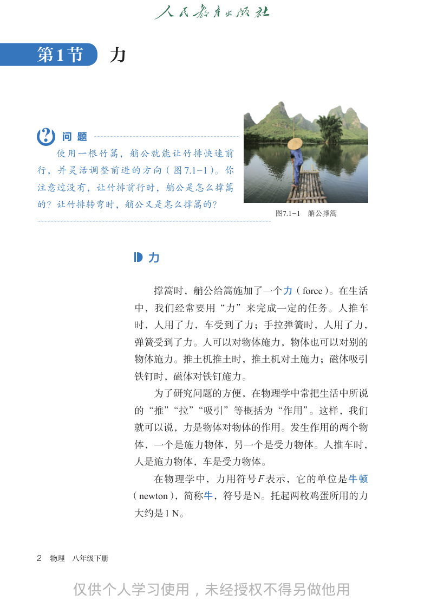

## RJ-PHYSICS-8B-002 力的作用效果

第七章 力 / 第1节 力 · PDF P8

**力的作用效果**

用力按橡皮泥（图7.1-2），可以观察到橡皮泥的形状发生了变化。用力拉或压弹簧，可以观察到弹簧的形状（长度）也发生了变化（图7.1-3）。这些实验现象表明，力可以使物体发生形变。

力除了可以使物体发生形变，还有其他作用效果吗？

**观察磁体对小铁球的作用**

1. 一个小铁球静止在水平桌面上，当一个磁体靠近它时，会出现什么现象？

2. 让小铁球从斜面上滚下，沿着它的运动方向放一个磁体（图7.1-4甲），观察小铁球运动的变化情况。

3. 再次让小铁球从斜面上滚下，在它运动路径的侧旁放一个磁体（图7.1-4乙），观察小铁球运动的变化情况。

在物理学中，物体由静止开始运动或由运动变为静止、物体运动的快慢或方向发生改变，这几种情况都是物体的运动状态发生了变化。上面的实验现象表明，力可以改变物体的运动状态。

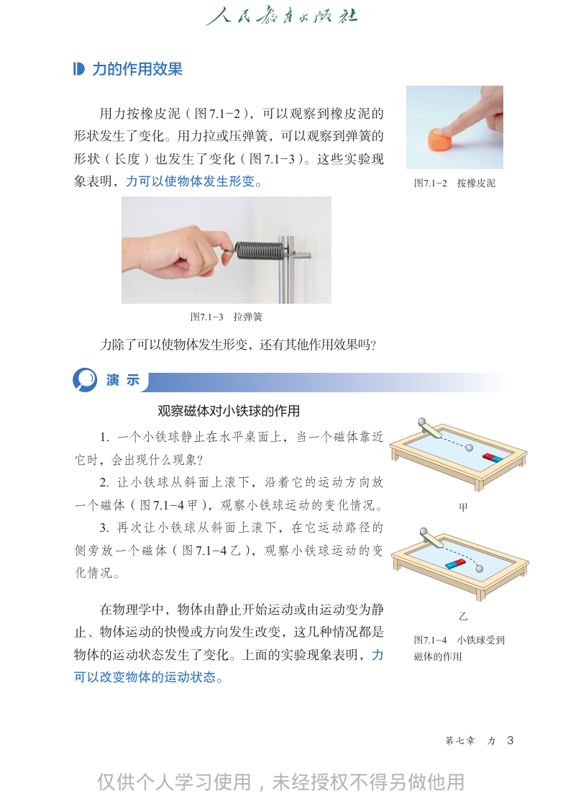

## RJ-PHYSICS-8B-003 力的三要素和力的示意图

第七章 力 / 第1节 力 · PDF P9

**力的三要素和力的示意图**

用力越大，弹簧被拉得越长（或被压得越短）；踢足球时，用力的大小和方向都会影响足球的运动状态。更多的事实告诉我们：力的大小、方向不同，作用效果就不同。除了大小和方向，还有什么会影响力的作用效果？

如图7.1-5所示，分别在A、B、C处用同样大小的力推门，感受手推门的难易程度有什么不同。

关门时，越靠近门轴推门，门就越不容易关上。可见，除了力的大小和方向，力的作用点也会影响力的作用效果。我们把力的大小、方向、作用点叫作力的三要素。

在研究力的问题时，怎样简单、方便地表示力？物理学中通常用一条带箭头的线段表示力。如图7.1-6所示，在受力物体上沿着力的方向画一条线段，在线段的末端画一个箭头表示力的方向，线段的起点或终点表示力的作用点。这种表示力的方式通常称为力的示意图。在同一幅图中，力越大，线段应该越长。有时还可以在力的示意图上用数值和单位标出力的大小。于是，这样一条带箭头的线段就把力的大小、方向、作用点都表示出来了。

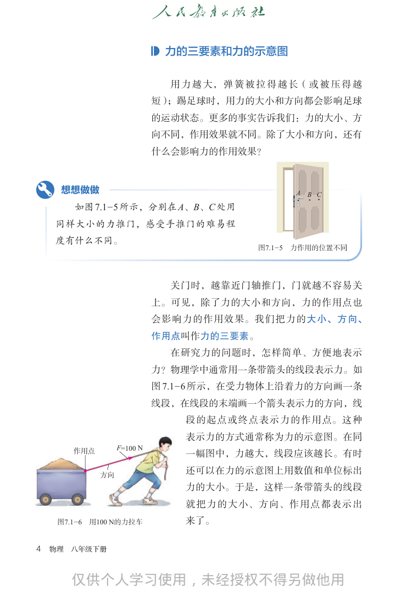

## RJ-PHYSICS-8B-004 力的作用是相互的

第七章 力 / 第1节 力 · PDF P10

**力的作用是相互的**

我们向上提桶时，会感觉到手受到桶向下的拉力（图7.1-7）。可见，手对桶施加一个向上的力的同时，桶对手也施加了一个向下的力。

1. 如图7.1-8所示，在靠得较近的甲、乙两辆小车上分别放一个磁体，松手后观察发生的现象。

2. 让一位同学穿上旱冰鞋推墙（图7.1-9），观察发生的现象。

在图7.1-8中，松开手后，可以看到甲、乙两辆小车会同时向相反的方向运动。这说明，甲车对乙车施力的同时，乙车对甲车也施加了力。甲车对乙车施力时，甲车是施力物体，乙车是受力物体；乙车对甲车施力时，乙车是施力物体，甲车是受力物体。在图7.1-9中，人用手向前推墙时，墙受到手的推力，同时墙也对手施加了一个向后的力，因此人向后运动。更多的实例表明，一个物体对另一个物体施力时，另一个物体也同时对它施加了方向相反的力。也就是说，物体间力的作用是相互的。

方法点拨人们通过分析物体间“推”“拉”等现象，寻找它们的共同属性，将其抽象概括为“作用”，从作用效果、作用是相互的等方面，进一步抓住它们的本质特征，建立了力的概念。

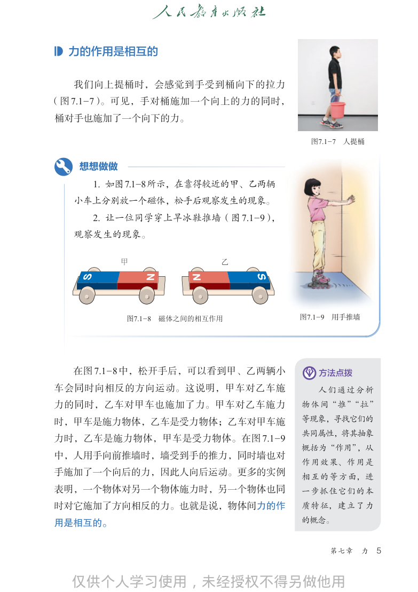

## RJ-PHYSICS-8B-005 弹性、弹力与弹性限度

第七章 力 / 第2节 弹力 · PDF P12

撑竿跳高运动员先将撑竿压弯，松手后，撑竿会恢复原状。如果我们轻压一把直尺，使它发生形变，撤去压力后，直尺会恢复原状。把橡皮筋拉长，松手后，橡皮筋会恢复原状。

**弹力**

撑竿、直尺、橡皮筋等物体在受力时会发生形变，不受力时又恢复原来的形状，物体的这种性质叫作弹性。我们把直尺压弯、把橡皮筋拉长时，可以感受到它们对手有力的作用。发生形变的物体，要恢复原状，对与它接触的物体会产生力的作用，这种力叫作弹力（elastic force）。放在桌面上的水杯受到桌面对它的支持力，支持力是弹力；桌面受到水杯的压力，压力也是弹力。

物体的弹性有一定的限度，超过这个限度物体就不能恢复原来的形状。因此，使用弹簧时不能超过它的弹性限度，否则会损坏弹簧。

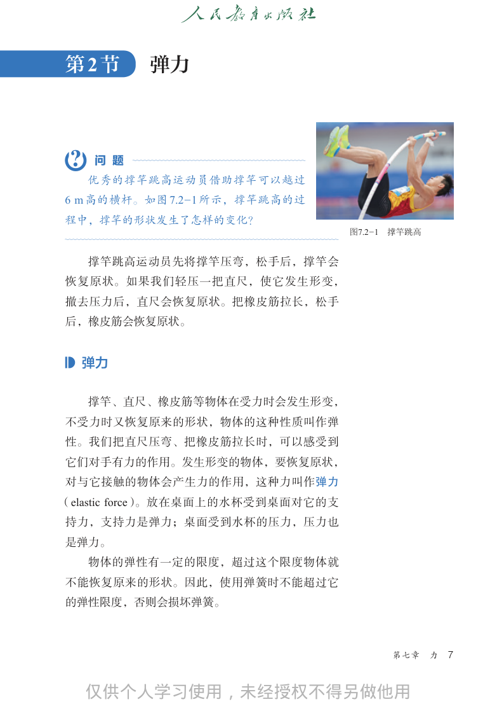

## RJ-PHYSICS-8B-006 弹簧测力计的原理与使用

第七章 力 / 第2节 弹力 · PDF P13-P14

**弹簧测力计**

测量力的大小的工具叫作测力计。在弹性限度内，弹簧受到的拉力越大，弹簧的伸长量就越大。利用这个道理做成的测力计，叫作弹簧测力计。在物理实验室中常用的几种弹簧测力计如图7.2-2 所示。

使用弹簧测力计的时候，首先要看清它的测量范围。加在弹簧测力计上的力不允许超过它的最大测量值，否则会损坏弹簧测力计。

下面让我们通过实验，学习弹簧测力计的使用方法。

**用弹簧测力计测量力**

1. 观察弹簧测力计的测量范围，并认清它的每个小格表示多少牛。2. 检查弹簧测力计的指针是否指在零刻度线上，如果不在，调节弹簧测力计，使指针与零刻度线重合。

3. 用手拉弹簧测力计的挂钩，分别使指针指到1 N、3 N、5 N的位置，感受1 N、3 N、5 N 的力。

4. 测量拉力。（1）把文具袋悬挂在弹簧测力计的挂钩上，观察弹簧测力计的示数，测得拉力F₁ =    。

（2）用弹簧测力计沿水平方向拖动桌面上的文具袋，观察弹簧测力计的示数，测得拉力F₂ =   。

5. 总结使用弹簧测力计时应该注意的几点操作要求。

除了图7.2-2所示的几种弹簧测力计，人们还制造了其他种类的测力计（图7.2-3）。各种各样的测力计被广泛应用于生活、生产和科学实验中。

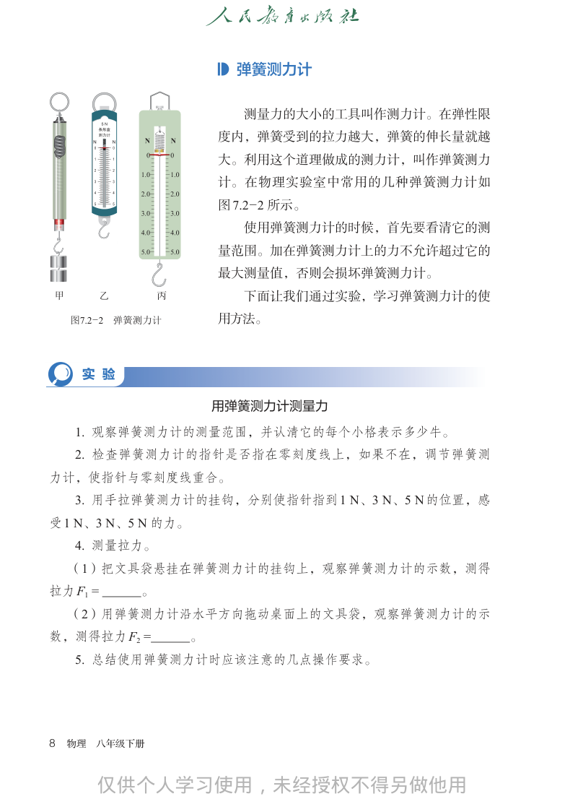

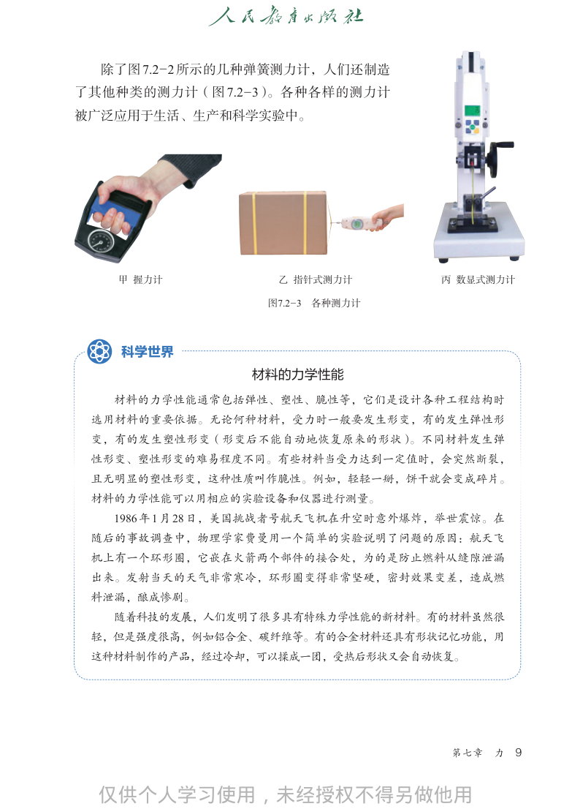

## RJ-PHYSICS-8B-007 材料的力学性能

第七章 力 / 第2节 弹力 · PDF P14

**材料的力学性能**

材料的力学性能通常包括弹性、塑性、脆性等，它们是设计各种工程结构时选用材料的重要依据。无论何种材料，受力时一般要发生形变，有的发生弹性形变，有的发生塑性形变（形变后不能自动地恢复原来的形状）。不同材料发生弹性形变、塑性形变的难易程度不同。有些材料当受力达到一定值时，会突然断裂，且无明显的塑性形变，这种性质叫作脆性。例如，轻轻一掰，饼干就会变成碎片。材料的力学性能可以用相应的实验设备和仪器进行测量。

随着科技的发展，人们发明了很多具有特殊力学性能的新材料。有的材料虽然很轻，但是强度很高，例如铝合金、碳纤维等。有的合金材料还具有形状记忆功能，用这种材料制作的产品，经过冷却，可以揉成一团，受热后形状又会自动恢复。

## RJ-PHYSICS-8B-008 重力及其来源

第七章 力 / 第3节 重力 · PDF P16

向空中撒开的渔网，会飘落到水里（图7.3-1）；向上抛出的石块，最终也会落向地面……你知道这是什么原因吗？

**重力**

在生活中，你可以随处发现像上面一样的例子。这些现象的产生，是因为地球对它附近的物体有吸引作用。由于地球的吸引而使物体受到的力叫作重力（gravity），通常用字母G表示。地球附近的所有物体都受到重力的作用。

山间的溪水受到重力的作用，会由高处流向低处。飞机投放的物资受到重力的作用，会落向地面。你能举出几个例子来证明重力的存在吗？如果没有重力，我们的生活会是什么样子？

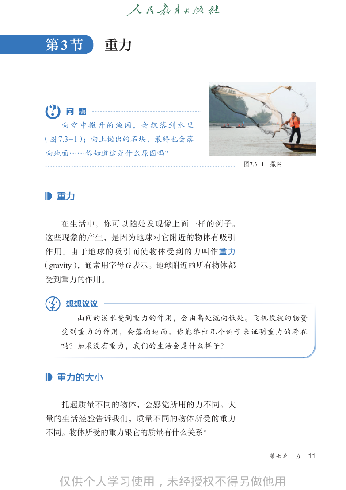

## RJ-PHYSICS-8B-009 探究重力与质量的关系及重力计算

第七章 力 / 第3节 重力 · PDF P16-P18

**重力的大小**

托起质量不同的物体，会感觉所用的力不同。大量的生活经验告诉我们，质量不同的物体所受的重力不同。物体所受的重力跟它的质量有什么关系？

我们可以通过实验，测量物体所受的重力和它的质量，找出二者之间的关系。

**探究重力的大小跟质量的关系**

实验思路要测量物体所受的重力，可以将物体悬挂在弹簧测力计上，当物体静止时，弹簧测力计的示数等于物体所受重力的大小。实验时，既可以用天平测量物体的质量，也可以选用已知质量的物体作为被测物体。最后根据测量结果找出重力跟质量的关系。

实验过程如图7.3-2 所示，将已知质量的钩码挂在弹簧测力计上，当钩码静止时读取弹簧测力计的示数，记录在下表中。

| 序号 | 1 | 2 | 3 | 4 | 5 | 6 |
| --- | --- | --- | --- | --- | --- | --- |
| 质量 m/kg | | | | | | |
| 重力 G/N | | | | | | |

换用数量不同的钩码，测出它们所受的重力，多做几组实验，并记录数据。

实验结论在图7.3-3 中，以质量为横坐标、以重力为纵坐标描点，连接这些点。

根据实验所得的图像，请你分析：物体所受的重力跟它的质量之间有什么关系？

精确的实验表明，物体所受的重力跟它的质量成正比。如果用G表示重力、m表示质量、g表示重力与质量之比，那么地球附近的物体所受的重力跟它的质量之间的关系可以写成 $g=\frac{G}{m}$  ，即

G = mg

公式中重力的单位是牛，质量的单位是千克，因此g的单位是牛每千克，符号是N/kg。其中

g = 9.8 N/kg

在粗略计算时，g可以取10 N/kg。

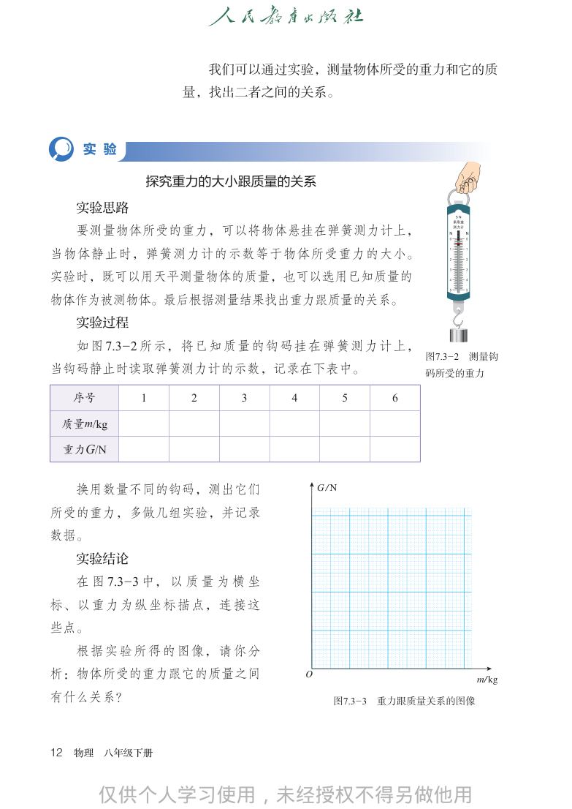

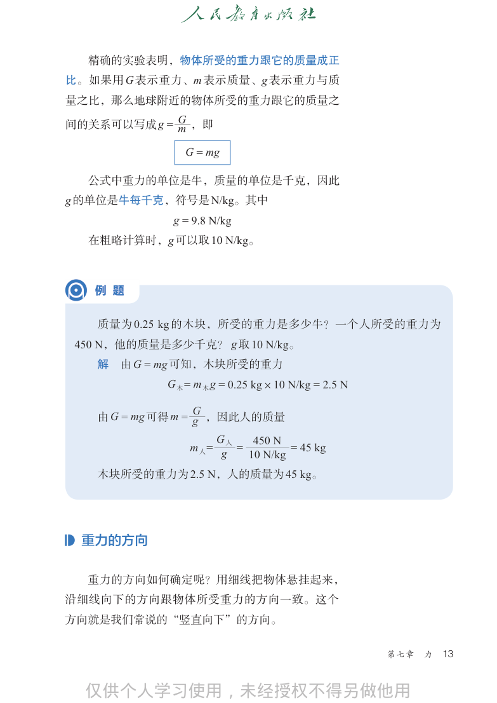

### 补充原例与原解

质量为0.25 kg的木块，所受的重力是多少牛？一个人所受的重力为450 N，他的质量是多少千克？g取10 N/kg。

解 由G=mg可知，木块所受的重力

$G_{木}=m_{木}g=0.25\,\mathrm{kg}\times10\,\mathrm{N/kg}=2.5\,\mathrm N$

由G=mg可得$m=\frac{G}{g}$，因此人的质量

$m_{人}=\frac{G_{人}}{g}=\frac{450\,\mathrm N}{10\,\mathrm{N/kg}}=45\,\mathrm{kg}$

木块所受的重力为2.5 N，人的质量为45 kg。

## RJ-PHYSICS-8B-010 重力的方向与铅垂线

第七章 力 / 第3节 重力 · PDF P18-P19

**重力的方向**

重力的方向如何确定呢？用细线把物体悬挂起来，沿细线向下的方向跟物体所受重力的方向一致。这个方向就是我们常说的“竖直向下”的方向。

建筑工人在砌墙时常常利用铅垂线来确定竖直方向（图7.3-4），以此来检查所砌的墙壁是否竖直。

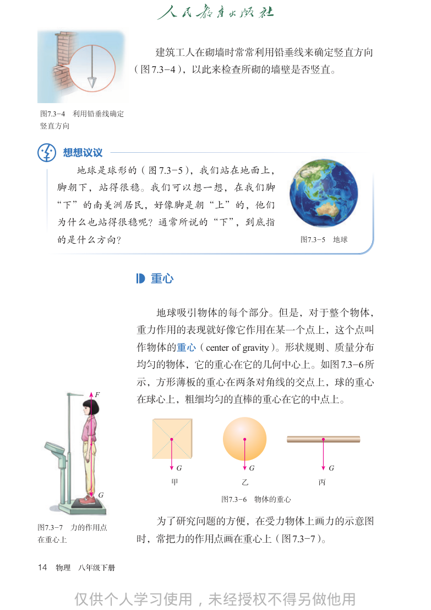

## RJ-PHYSICS-8B-011 重心与重力示意图

第七章 力 / 第3节 重力 · PDF P19

**重心**

地球吸引物体的每个部分。但是，对于整个物体，重力作用的表现就好像它作用在某一个点上，这个点叫作物体的重心（center of gravity）。形状规则、质量分布均匀的物体，它的重心在它的几何中心上。如图7.3-6所示，方形薄板的重心在两条对角线的交点上，球的重心在球心上，粗细均匀的直棒的重心在它的中点上。

为了研究问题的方便，在受力物体上画力的示意图时，常把力的作用点画在重心上（图7.3-7）。

## RJ-PHYSICS-8B-012 万有引力

第七章 力 / 第3节 重力 · PDF P20

实际上，宇宙间的物体，大到天体，小到尘埃，都存在互相吸引的力，这就是牛顿提出的万有引力（universal gravitation）。正是地球对它附近物体的引力，使水向低处流、抛出的石块落向地面……

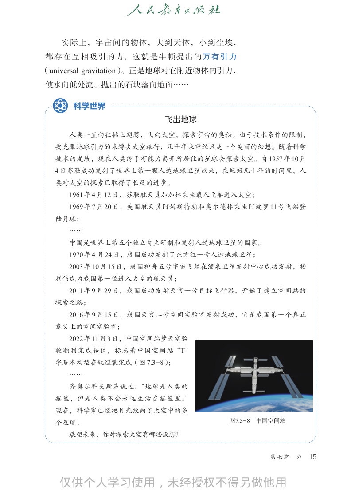

## RJ-PHYSICS-8B-013 阻力对物体运动的影响实验与推理

第八章 运动和力 / 第1节 牛顿第一定律 · PDF P24-P25

**阻力对物体运动的影响**

自古以来，就有很多人认为：要使一个物体持续运动，就必须对它施加力的作用；如果这个力被撤掉，物体就会停止运动。这与我们玩滑板车时的体验是一致的。然而，伽利略认为：物体的运动并不需要力来维持，运动的物体之所以会停下来，是因为受到了阻力。

到底哪个说法正确呢？谈谈你的看法。下面我们通过实验来研究这个问题。

**阻力对物体运动的影响**

如图8.1-2 所示，将棉布铺在水平木板上，让小车从斜面顶端由静止滑下，观察小车在棉布上滑行的距离；去掉木板上的棉布，再次让小车从斜面顶端由静止滑下，观察小车在木板上滑行的距离。

由实验可以看出，去掉木板上的棉布，运动的小车所受的阻力减小，向前滑行的距离变大。设想一下，如果进一步减小小车所受的阻力，它能否滑行更远的距离？

伽利略对类似的实验进行了分析，并进一步推测：如果运动的物体受到的阻力为0，速度就不会减小，物体将以恒定不变的速度永远运动下去。

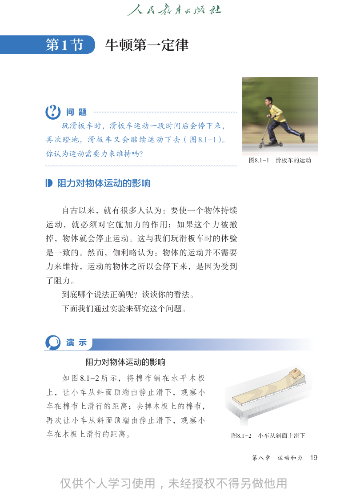

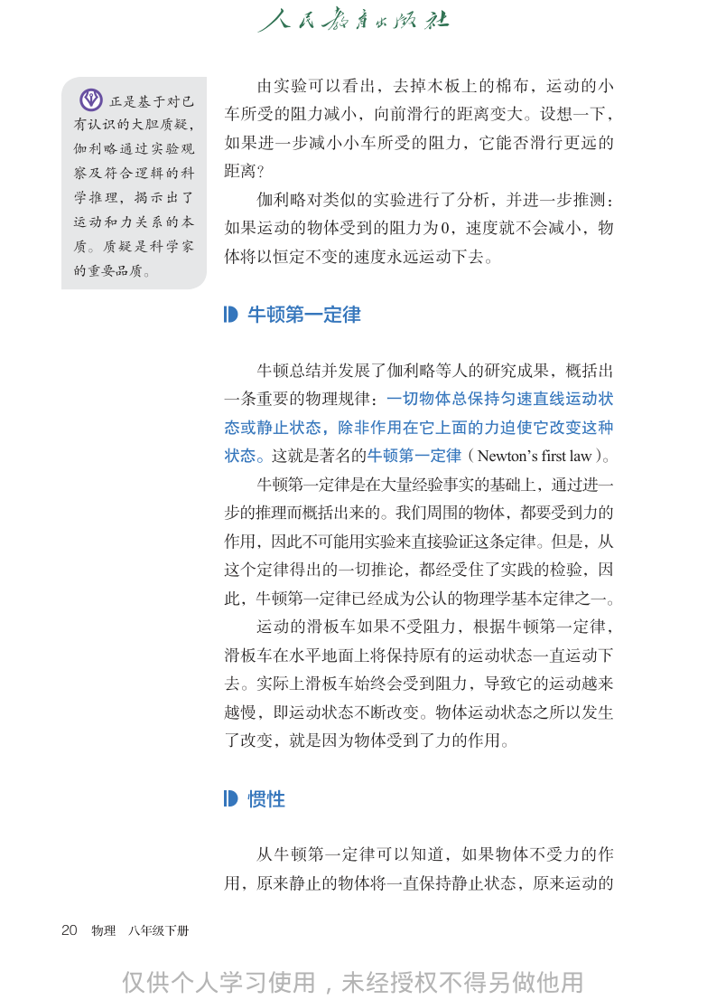

## RJ-PHYSICS-8B-014 牛顿第一定律

第八章 运动和力 / 第1节 牛顿第一定律 · PDF P25

**牛顿第一定律**

牛顿总结并发展了伽利略等人的研究成果，概括出一条重要的物理规律：一切物体总保持匀速直线运动状态或静止状态，除非作用在它上面的力迫使它改变这种状态。这就是著名的牛顿第一定律（Newton’s first law）。

牛顿第一定律是在大量经验事实的基础上，通过进一步的推理而概括出来的。我们周围的物体，都要受到力的作用，因此不可能用实验来直接验证这条定律。但是，从这个定律得出的一切推论，都经受住了实践的检验，因此，牛顿第一定律已经成为公认的物理学基本定律之一。

运动的滑板车如果不受阻力，根据牛顿第一定律，滑板车在水平地面上将保持原有的运动状态一直运动下去。实际上滑板车始终会受到阻力，导致它的运动越来越慢，即运动状态不断改变。物体运动状态之所以发生了改变，就是因为物体受到了力的作用。

## RJ-PHYSICS-8B-015 惯性及其表现

第八章 运动和力 / 第1节 牛顿第一定律 · PDF P25-P27

**惯性**

从牛顿第一定律可以知道，如果物体不受力的作用，原来静止的物体将一直保持静止状态，原来运动的物体将保持其速度沿直线一直运动下去。物体这种保持原来匀速直线运动状态或静止状态的性质叫作惯性（inertia）。因此，牛顿第一定律又被称为惯性定律。

1. 如图 8.1-3所示，拨动簧片，把小球与支座之间的金属片弹出时，小球并没有随金属片飞出。你能说说发生这个现象的原因吗？

2. 行驶中的汽车突然刹车时，乘客的身体会向前倾；汽车突然开动时，乘客的身体会向后仰。想一想，身体向前倾、向后仰的原因是什么？

金属片被弹出时，上面的小球由于惯性要保持原来的静止状态，所以不会随金属片飞出。汽车突然刹车时，乘客的脚已随车慢下来，而身体的上部由于惯性要保持原来运动的状态，因此身体会向前倾。同样的道理，当汽车突然开动时，乘客的脚已随车开始运动，而身体的上部由于惯性要保持原来静止的状态，因此身体会向后仰。

生活中的大量事实都表明，一切物体都具有惯性。惯性是物体的固有属性，跟物体的受力情况及运动状态无关。

在生活中，人们常常利用物体的惯性。例如，跳远运动员快速助跑后，飞身一跃，利用自身的惯性，在空中继续前进；锤子的锤头松了，人们常用撞击锤柄下端的方法使锤头紧套在锤柄上（图8.1-4），这是因为锤柄突然停止时，锤头由于惯性会继续向下运动，这样锤头就会牢牢地套在锤柄上了。

惯性有时也会给人们带来危害，需要防范。例如，交通工具必须配备刹车系统，行驶时要保持一定的安全距离；乘客与驾驶员必须系上安全带，以免造成危险。

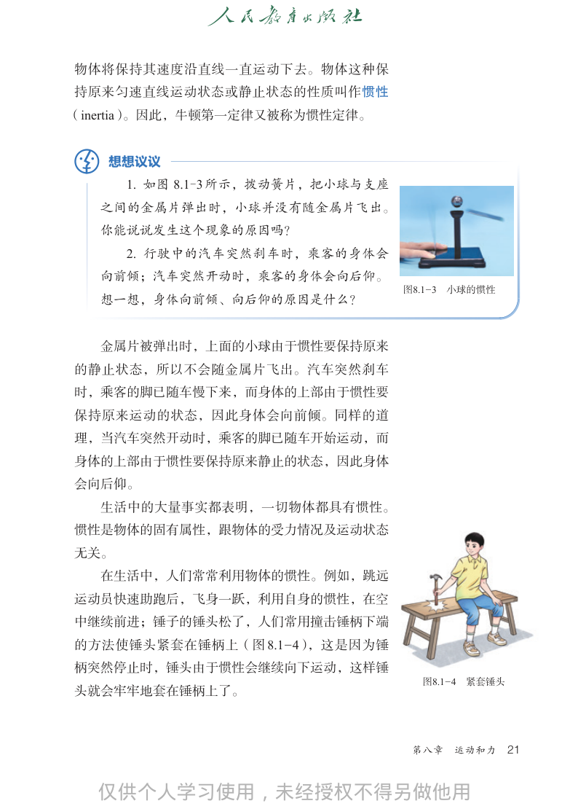

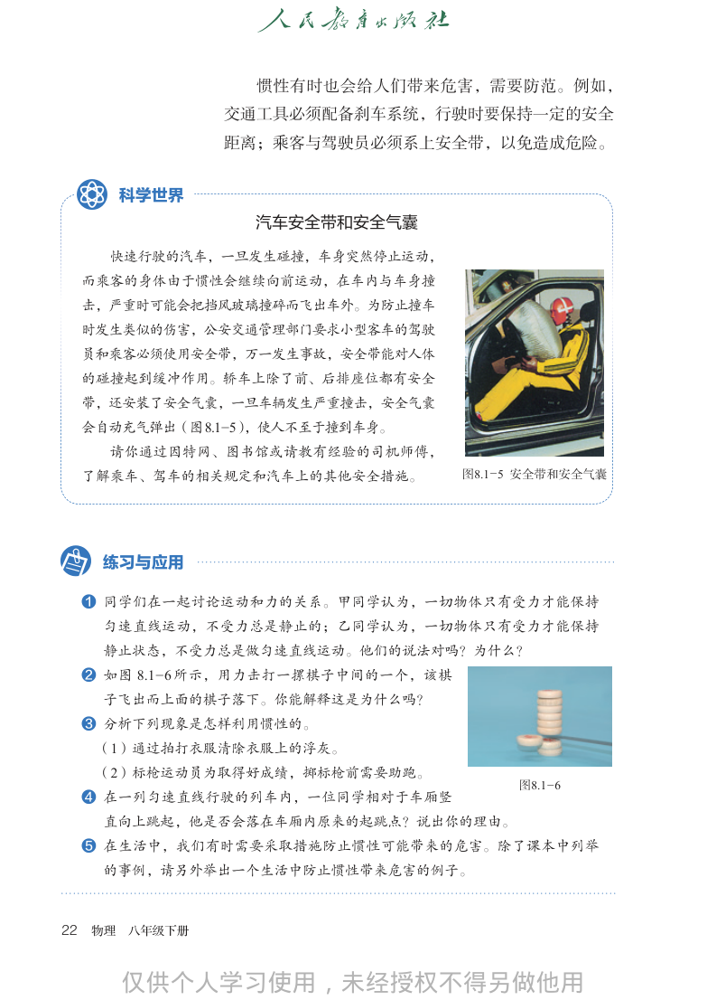

## RJ-PHYSICS-8B-016 汽车安全带和安全气囊的作用

第八章 运动和力 / 第1节 牛顿第一定律 · PDF P27

**汽车安全带和安全气囊**

快速行驶的汽车，一旦发生碰撞，车身突然停止运动，而乘客的身体由于惯性会继续向前运动，在车内与车身撞击，严重时可能会把挡风玻璃撞碎而飞出车外。为防止撞车时发生类似的伤害，公安交通管理部门要求小型客车的驾驶员和乘客必须使用安全带，万一发生事故，安全带能对人体的碰撞起到缓冲作用。轿车上除了前、后排座位都有安全带，还安装了安全气囊，一旦车辆发生严重撞击，安全气囊会自动充气弹出（图8.1-5），使人不至于撞到车身。

## RJ-PHYSICS-8B-017 平衡状态与二力平衡

第八章 运动和力 / 第2节 二力平衡 · PDF P28

通过上节的学习我们知道，一切物体在没有受到力的作用时，总保持静止状态或匀速直线运动状态。然而我们周围的物体都受到力的作用，不受力的物体是不存在的。在受力的情况下，物体有时也会保持静止或匀速直线运动状态，即运动状态不变。

如图8.2-2 所示，桌面上的花瓶、天花板上悬挂的吊灯、在平直道路上匀速行驶的汽车，虽然它们都受到力的作用，但却保持静止或匀速直线运动状态。物体受到几个力作用时，如果保持静止或匀速直线运动状态，我们就说这几个力相互平衡，物体处于平衡状态。

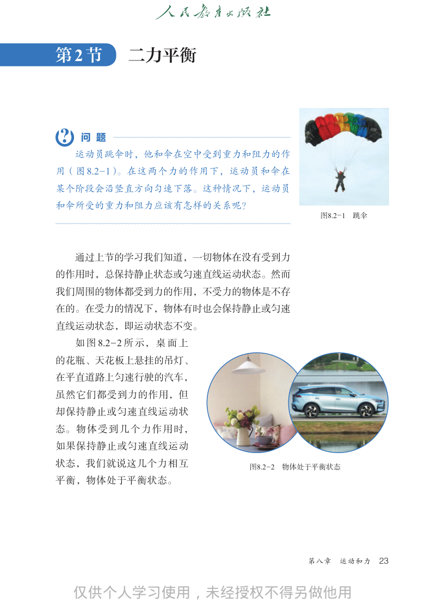

## RJ-PHYSICS-8B-018 探究二力平衡的条件

第八章 运动和力 / 第2节 二力平衡 · PDF P29-P30

**二力平衡的条件**

在物体受力并处于平衡状态的各种情况中，物体在两个力作用下保持平衡是最简单的。下面让我们通过实验来研究这个问题。

**探究二力平衡的条件**

实验思路要想找到物体在两个力作用下处于平衡状态时两个力之间的关系，应该先想办法在物体上施加两个力使物体平衡，然后在物体平衡时测量这两个力，看看这两个力之间存在怎样的关系。

你准备怎样做这个实验？请你和同学讨论，设计可行的方案。实验过程我们可以用如图8.2-3所示的装置进行实验。把小车放在光滑的水平桌面上，向挂在小车两端的托盘里加钩码。观察小车在什么条件下会保持运动状态不变。

1. 使两个托盘里的钩码质量不相等；2. 使两个托盘里的钩码质量相等；3. 保持两个托盘里的钩码质量相等，把小车在水平桌面上扭转一个角度后释放；

……请把实验条件和现象记录在下表中。

| 大小 | 方向 | 是否在同一直线上 | 小车的运动状态是否改变 |
| --- | --- | --- | --- |
| 不相等 | | | |
| 相等 | | | |
| 相等 | | | |
| …… | | | |

实验结论与其他同学交流讨论实验结果，总结二力平衡的条件。

进一步的研究表明：作用在同一个物体上的两个力，如果大小相等、方向相反，并且在同一直线上，这两个力就彼此平衡。这就是二力平衡的条件。

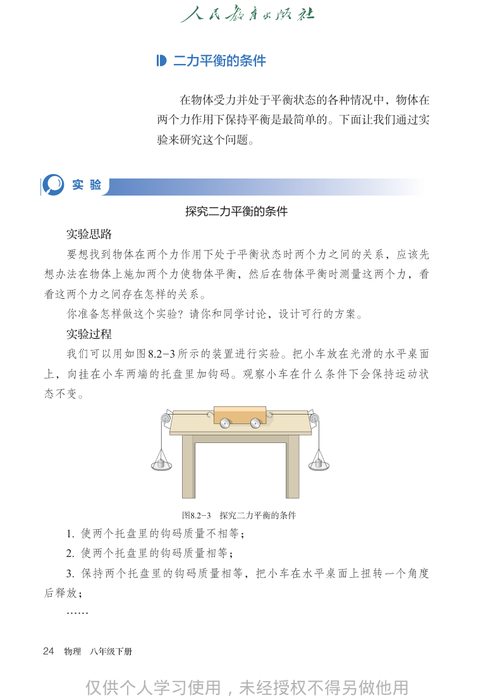

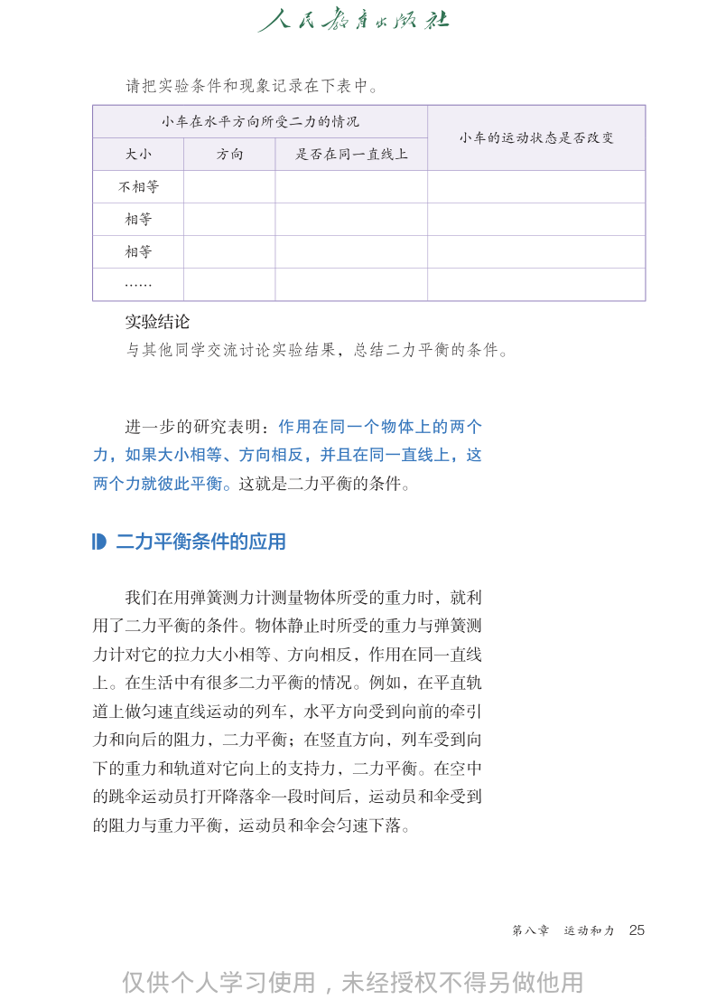

## RJ-PHYSICS-8B-019 二力平衡条件的应用

第八章 运动和力 / 第2节 二力平衡 · PDF P30

**二力平衡条件的应用**

我们在用弹簧测力计测量物体所受的重力时，就利用了二力平衡的条件。物体静止时所受的重力与弹簧测力计对它的拉力大小相等、方向相反，作用在同一直线上。在生活中有很多二力平衡的情况。例如，在平直轨道上做匀速直线运动的列车，水平方向受到向前的牵引力和向后的阻力，二力平衡；在竖直方向，列车受到向下的重力和轨道对它向上的支持力，二力平衡。在空中的跳伞运动员打开降落伞一段时间后，运动员和伞受到的阻力与重力平衡，运动员和伞会匀速下落。

## RJ-PHYSICS-8B-020 摩擦力与滑动摩擦力的测量

第八章 运动和力 / 第3节 摩擦力 · PDF P32-P33

**摩擦力**

两个相互接触的物体，当它们相对滑动时，在接触面上会产生一种阻碍相对运动的力，这种力叫作滑动摩擦力（friction force）。

相互接触的物体的两个面，有时用肉眼看起来很光滑，但是放到显微镜下观察，就会发现接触面是凹凸不平的（图8.3-2）。当相互接触的物体发生相对滑动时，就会彼此阻碍，产生滑动摩擦力。

如何测量滑动摩擦力的大小呢？如图8.3-3 所示，用弹簧测力计水平拉动木块，使它沿水平长木板做匀速直线运动。此时，我们读出弹簧测力计所测的拉力，就可以得到木块与长木板之间的滑动摩擦力的大小。

为了测量滑动摩擦力，要用弹簧测力计水平拉动木块。想一想，为什么要使木块做匀速直线运动？

在手掌压在桌面上滑动的过程中，压力越大，手掌受到的阻碍越大；桌面越粗糙，滑起来越费力。影响滑动摩擦力大小的因素有哪些？还有哪些生活经验支持你的猜想？下面让我们通过实验来研究这个问题。

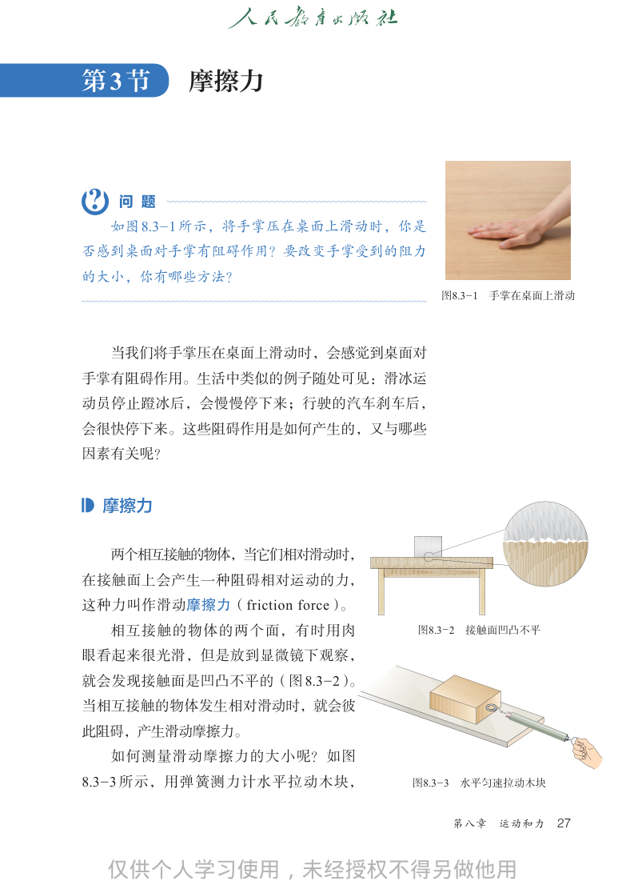

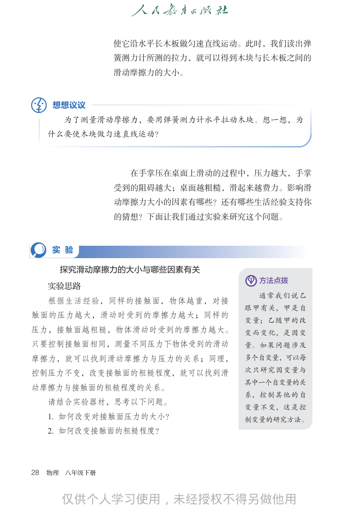

## RJ-PHYSICS-8B-021 探究滑动摩擦力大小的影响因素

第八章 运动和力 / 第3节 摩擦力 · PDF P33-P34

**探究滑动摩擦力的大小与哪些因素有关**

实验思路根据生活经验，同样的接触面，物体越重，对接触面的压力越大，滑动时受到的摩擦力越大；同样的压力，接触面越粗糙，物体滑动时受到的摩擦力越大。只要控制接触面相同，测量不同压力下物体受到的滑动摩擦力，就可以找到滑动摩擦力与压力的关系；同理，控制压力不变，改变接触面的粗糙程度，就可以找到滑动摩擦力与接触面的粗糙程度的关系。

请结合实验器材，思考以下问题。1. 如何改变对接触面压力的大小？2. 如何改变接触面的粗糙程度？

方法点拨通常我们说乙跟甲有关，甲是自变量；乙随甲的改变而变化，是因变量。如果问题涉及多个自变量，可以每次只研究因变量与其中一个自变量的关系，控制其他的自变量不变，这是控制变量的研究方法。

实验过程可以通过图8.3-4所示的实验验证你的猜想。

1. 用弹簧测力计水平拉动木块，使它沿水平长木板匀速滑动，测出木块与长木板之间的滑动摩擦力。

2. 在木块上放不同数量的钩码，改变压力，测量滑动摩擦力。3. 换用材料相同但表面粗糙的长木板，保持压力不变，测量滑动摩擦力。……自己设计表格，记录测量数据。

实验结论通过这个实验，你得出了什么结论？与其他同学交流，完善你的结论。

实验中，你遇到了什么困难？跟同学讨论，能否对实验方案进行优化。

大量实验表明：滑动摩擦力的大小与接触面所受的压力有关，接触面受到的压力越大，滑动摩擦力越大；滑动摩擦力的大小还与接触面的粗糙程度有关，接触面越粗糙，滑动摩擦力越大。另外，滑动摩擦力的大小还与接触面的材料有关。

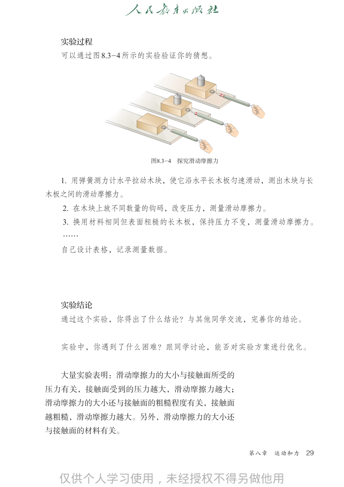

## RJ-PHYSICS-8B-022 摩擦的利用与防止

第八章 运动和力 / 第3节 摩擦力 · PDF P35

**摩擦的利用与防止**

许多情况下摩擦是有用的，人们常常设法增大它。例如，人走路时要利用鞋底与地面间的摩擦。摩擦在很多情况下又是有害的。例如，机器工作时，运动的部件间要产生摩擦。这种摩擦不但白白消耗动力，而且使机器磨损，这时就要设法减小摩擦。

图8.3-5的三幅图中，哪些是要增大摩擦的？哪些是要减小摩擦的？通过什么方法增大或减小摩擦？

根据影响摩擦力大小的因素我们知道：可以通过改变压力或接触面的粗糙程度等来改变摩擦力的大小。要让自行车更快地停下来，可以用力捏闸（图8.3-5甲）；体操运动员上器械前，会在手上涂防滑粉（图8.3-5乙）。这些都是通过增大压力或增大接触面的粗糙程度来增大摩擦的例子。在冰壶运动中（图8.3-5丙），运动员是通过减小接触面的粗糙程度来减小摩擦的。

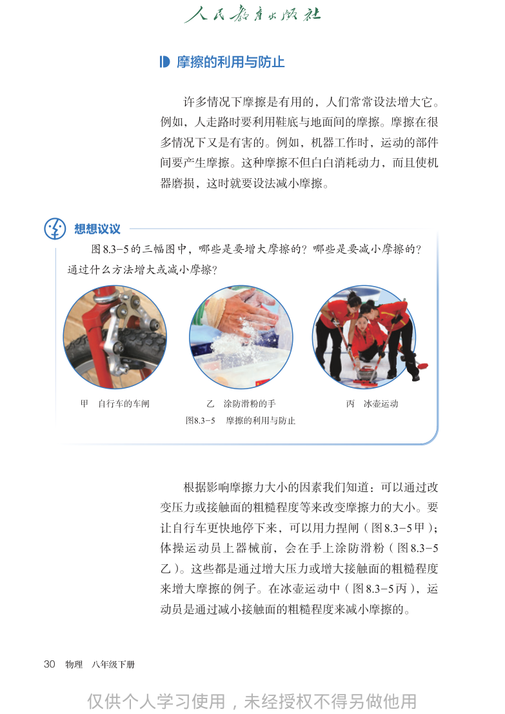

## RJ-PHYSICS-8B-023 减小摩擦的方法

第八章 运动和力 / 第3节 摩擦力 · PDF P36

**减小摩擦的方法**

我国古人很早就发现用滚动代替滑动可以大大减小摩擦，如人们常常利用滚木移动巨石、巨木等（图8.3-6）。如图8.3-7 所示，滚动轴承的内圈紧套在轴上，外圈固定在轮上，两圈之间装着许多光滑的钢球或钢柱。轮转动时带动外圈转动，钢球或钢柱在内外圈之间滚动，摩擦就大大减小了。现在许多机器的转动部分都安装了滚动轴承（图8.3-8）。自行车的前、后轮都是安装在滚动轴承上的，你看过它的结构吗？

使两个互相接触的表面分离，也能减小摩擦。给门轴上的合页加润滑剂可以在两个表面之间形成油膜，使它们互不接触，这样就减小了摩擦。气垫船利用压缩空气使船体与水面脱离接触（图8.3-9），可以大大减小摩擦。

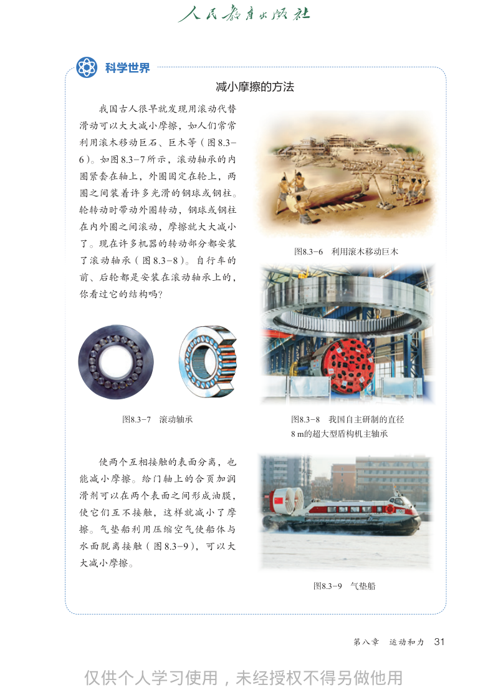

## RJ-PHYSICS-8B-024 合力与力的合成

第八章 运动和力 / 第4节 同一直线上二力的合成 · PDF P38

**力的合成**

两个小孩共同提起一桶水，可以使水桶保持静止状态；一个大人单独提起同一桶水，也能使水桶保持静止状态。看起来，一个大人和两个小孩施加在水桶上的力，产生的作用效果是相同的。如果一个力单独作用的效果与几个力共同作用的效果相同，这个力就叫作那几个力的合力（resultant force）。 在物理学中，求几个力合力的过程叫作力的合成（composition of forces）。

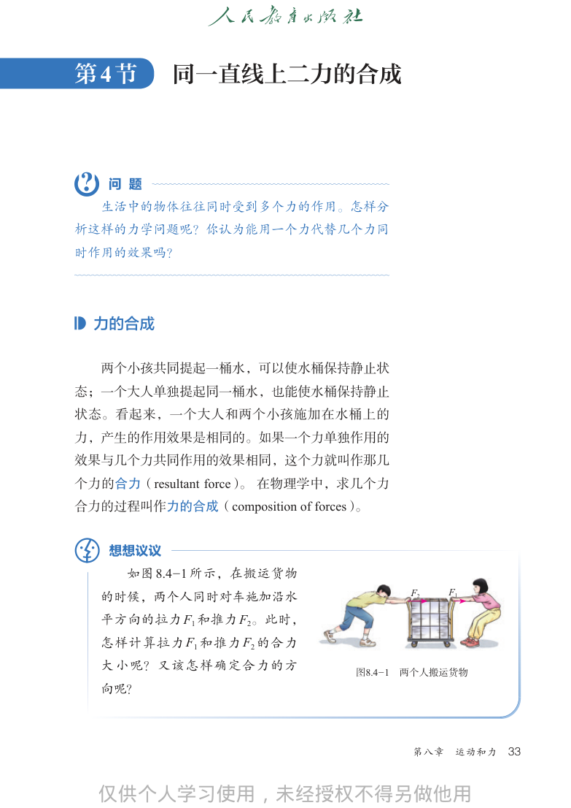

## RJ-PHYSICS-8B-025 同一直线上二力合成的实验与规律

第八章 运动和力 / 第4节 同一直线上二力的合成 · PDF P39-P40

**同一直线上二力的合成**

要研究多个力的合成问题，可以从简单的情况入手。同一直线上二力合成的情况最简单，下面让我们通过实验来研究。

**研究同一直线上二力的合成**

1. 如图8.4-2所示，将橡皮筋一端固定，另一端与小圆环相连。把两个弹簧测力计分别通过细绳与小圆环相连后，沿水平方向向右拉橡皮筋，将小圆环拉至O点，标记下此时小圆环的位置，并记录两个弹簧测力计的示数F₁、F₂。

2. 只用一个弹簧测力计拉橡皮筋，将小圆环再次拉到O点，记下弹簧测力计的示数F合 。

改变拉力F₁、F₂的大小，多做几次实验。将F合与F₁、F₂的示数进行比较，并分析F合与F₁、F₂方向的关系。

3. 如图8.4-3所示，用两个弹簧测力计沿相反的方向水平拉橡皮筋，标记下此时小圆环的位置O′点，并记下两个弹簧测力计的示数F₁′、F₂′ 。

4. 再用一个弹簧测力计将小圆环拉到O′点，记下弹簧测力计的示数F合′。

改变拉力F₁′、F₂′的大小，多做几次实验。将F合′与F₁′、F₂′的示数进行比较，并分析F合′与F₁′、F₂′方向的关系。

大量实验研究表明：同一直线上的两个力，如果方向相同，合力的大小等于这两个力的大小之和，合力的方向与这两个力的方向相同；如果方向相反，合力的大小等于这两个力的大小之差，合力的方向与较大的力方向一致。

知道了同一直线上二力合成的规则，就可以分析物体在同一直线上受两个力作用的问题了。例如，行驶在平直轨道上的列车，如果牵引力与阻力大小相等，则合力等于0，二力平衡，列车将做匀速直线运动；如果牵引力小于阻力，合力不为0，方向与列车前进方向相反，列车将逐渐慢下来。

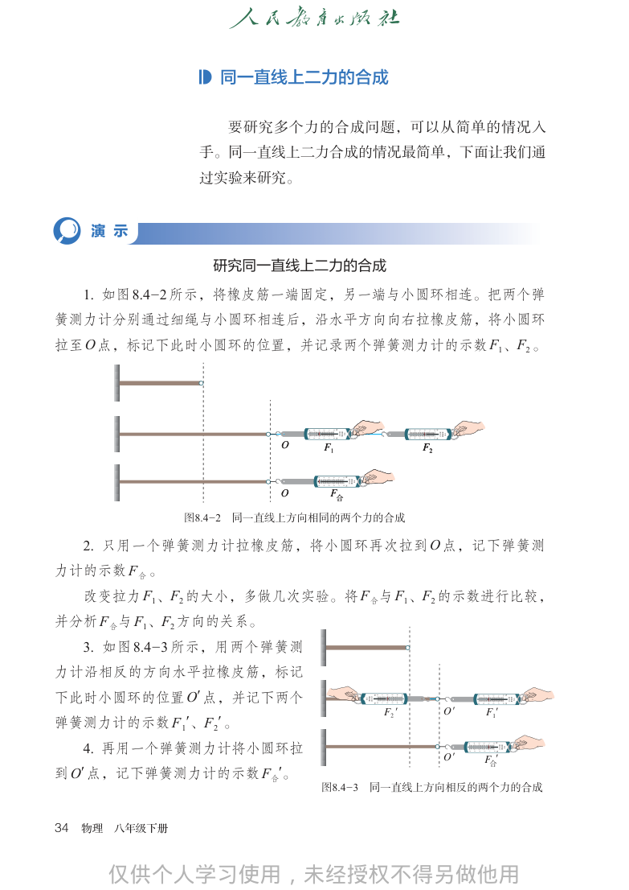

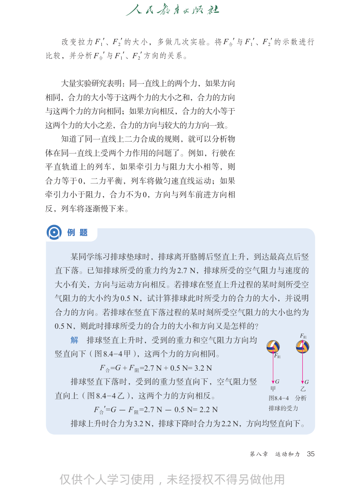

### 补充原例与原解

某同学练习排球垫球时，排球离开胳膊后竖直上升，到达最高点后竖直下落。已知排球所受的重力约为2.7 N，排球所受的空气阻力与速度的大小有关，方向与运动方向相反。若排球在竖直上升的过程中某时刻所受空气阻力的大小约为0.5 N，试计算排球此时所受力的合力的大小，说明合力的方向。若排球在竖直下落过程的某时刻所受空气阻力的大小也约为0.5 N，则此时排球所受力的合力的大小和方向又是怎样的？

解 排球竖直上升时，受到的重力和空气阻力方向均竖直向下（图8.4-4甲），这两个力的方向相同。

$F_{合}=G+F_{阻}=2.7\,\mathrm N+0.5\,\mathrm N=3.2\,\mathrm N$

排球竖直下落时，受到的重力竖直向下，空气阻力竖直向上（图8.4-4乙），这两个力的方向相反。

$F'_{合}=G-F_{阻}=2.7\,\mathrm N-0.5\,\mathrm N=2.2\,\mathrm N$

排球上升时合力为3.2 N，排球下降时合力为2.2 N，方向均竖直向下。

## RJ-PHYSICS-8B-026 压力作用效果的探究与压强

第九章 压强 / 第1节 压强 · PDF P45-P47

如图9.1-1 所示，两个人对雪地的压力是差不多的，然而一个人的脚陷进雪里，另一个人却没有。看来压力对雪地的作用效果并不只跟压力的大小有关。请你想一想，还可能跟什么因素有关？

**压强**

雪地里的两个人对雪地的压力虽然差不多，但受力面积不同，可见受力面积是影响压力作用效果的一个重要因素。自然界中的很多动物似乎也“知道”这个道理。图9.1-2是一头北极熊爬过薄冰时的情景，到达冰面时，也许它“知道”自己对冰面的压力很大，于是趴在冰面上爬过薄冰，从而增大受力面积，避免冰面被压破。

下面我们通过实验来研究影响压力作用效果的因素。

**压力和受力面积对海绵形变的影响**

如图9.1-3所示，图甲中小桌放在软的海绵上，图乙中桌面上放一个钩码，图丙中小桌的桌面朝下，其上也放一个钩码。观察三次实验中海绵的形变情况。

考虑海绵所受小桌对它的压力和受力面积两个因素，图甲和图乙相比，哪个因素相同，哪个因素不同？图乙和图丙相比，哪个因素相同，哪个因素不同？

想一想，从上面的实验中你能得出什么结论？

实验结果表明，海绵在压力作用下的形变情况不仅跟压力的大小有关，而且跟受力面积有关。在物理学中，物体所受压力的大小与受力面积之比叫作压强（pressure）。

如果用 p表示压强、F表示压力、S表示物体的受力面积，那么有

$p=\frac{F}{S}$

在国际单位制中，力的单位是牛，面积的单位是平方米，压强的单位则是牛每平方米，它有一个专门的名称叫作帕斯卡（pascal），简称帕，符号是Pa。

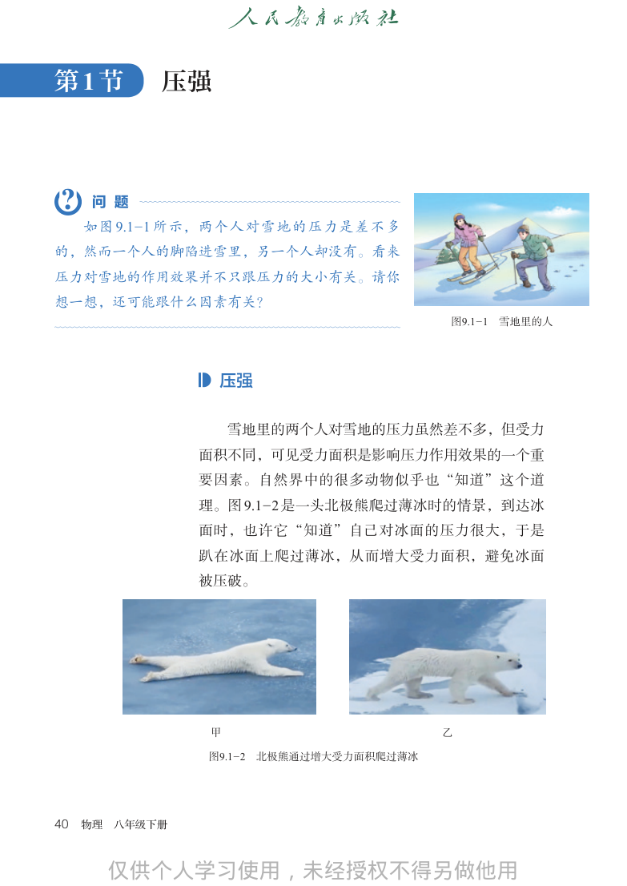

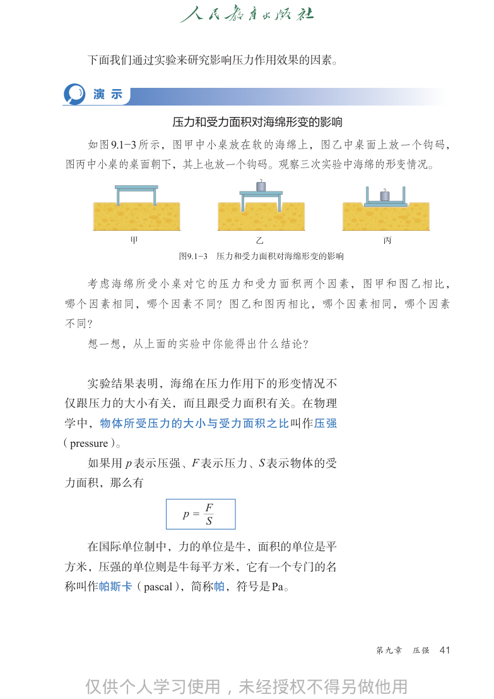

### 补充原例与原解

水平桌面上静止放一本书，书所受的重力为3 N，与桌面的接触面积为5×10⁻² m²，计算书对桌面的压强。

解 静止在桌面上的书对桌面的压力等于它所受的重力，即

$F=G=3\,\mathrm N$

桌面的受力面积

$S=5\times10^{-2}\,\mathrm{m^2}$

所以压强

$p=\frac{F}{S}=\frac{3\,\mathrm N}{5\times10^{-2}\,\mathrm{m^2}}=60\,\mathrm{Pa}$

书对桌面的压强为60 Pa。

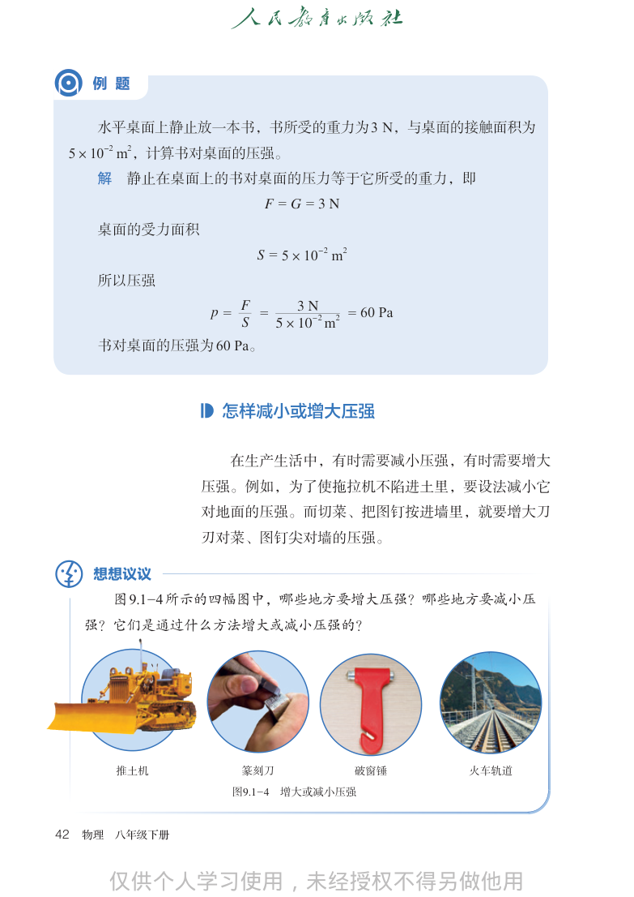

## RJ-PHYSICS-8B-027 减小和增大压强的方法

第九章 压强 / 第1节 压强 · PDF P47-P48

**怎样减小或增大压强**

在生产生活中，有时需要减小压强，有时需要增大压强。例如，为了使拖拉机不陷进土里，要设法减小它对地面的压强。而切菜、把图钉按进墙里，就要增大刀刃对菜、图钉尖对墙的压强。

图9.1-4所示的四幅图中，哪些地方要增大压强？哪些地方要减小压强？它们是通过什么方法增大或减小压强的？

要增大压强，可以增大压力或者减小受力面积；要减小压强，可以减小压力或者增大受力面积。推土机的推土铲刃、篆刻刀的刀口做得很锋利，破窗锤的敲击端做成锥状，这些都是通过减小受力面积来增大压强的；火车轨道下面铺放枕木，推土机用宽大的履带来支承，这些都是通过增大受力面积来减小压强的。

任何物体所能承受的压强都有一定的限度，超过这个限度，物体就会被损坏。例如，货车超载，就很容易把公路的路面压坏。交通管理部门通过限定每个车轴平均承载的质量来控制货车对路面压强的大小（图9.1-5），运送大型设备的平板货车就有很多车轴（图9.1-6）。

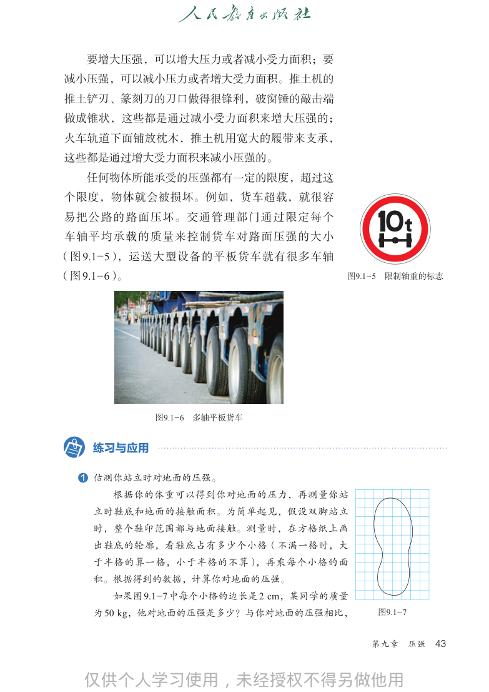

## RJ-PHYSICS-8B-028 液体压强的特点及探究实验

第九章 压强 / 第2节 液体的压强 · PDF P50-P52

**液体压强的特点**

如图9.2-1所示，液体能从容器侧壁的孔中喷出，说明液体对侧壁有压强；喷泉中的水柱能向上喷出，说明液体内部向上也有压强。由于液体具有流动性，液体内向各个方向都有压强。液体内部压强的大小有什么特点呢？

由图9.2-1的实验可以看到，随着液体的喷出，容器中液面的高度逐渐下降，从容器侧壁孔中喷出的液体射得越来越近，由此想到液体压强的大小可能与深度有关；同样的两个容器，分别装满水和酒精，水比酒精重，所以水比酒精对容器底部的压强更大，由此想到液体压强的大小可能与液体的密度有关。

图9.2-2 是测量液体内部压强的仪器。它的探头是由空金属盒蒙上橡皮膜构成的。如果液体内部存在压强，放在液体里的橡皮膜就会发生形变，U 形管左右两侧的液面就会产生高度差，高度差的大小反映了橡皮膜所受压强的大小。

下面我们通过实验研究液体的压强与哪些因素有关。

**探究液体压强与哪些因素有关**

实验思路可以用图9.2-2所示的仪器探究液体的压强。改变探头的方向，就能探究液体内部各个方向的压强；改变探头的深度或把探头放在其他液体中，就能探究液体压强与深度、液体密度等因素的关系。

实验过程1. 把探头放进盛水的容器中，看看水内部是否存在压强。保持探头在水中的深度不变，改变探头的方向，看看同一深度各个方向的压强是否相等（图9.2-3）。

2. 增大探头在水中的深度，看看水内部的压强与深度有什么关系。3. 换用密度不同的液体（如酒精、盐水等），看看在深度相同时，液体内部的压强是否与液体的密度有关。

实验结论根据以上实验，你能得出什么结论？

大量实验表明，液体内部压强的大小具有这样的特点：在液体内部的同一深度，向各个方向的压强都相等；深度越大，压强越大；液体内部压强的大小还与液体的密度有关，在深度相同时，液体的密度越大，压强越大。

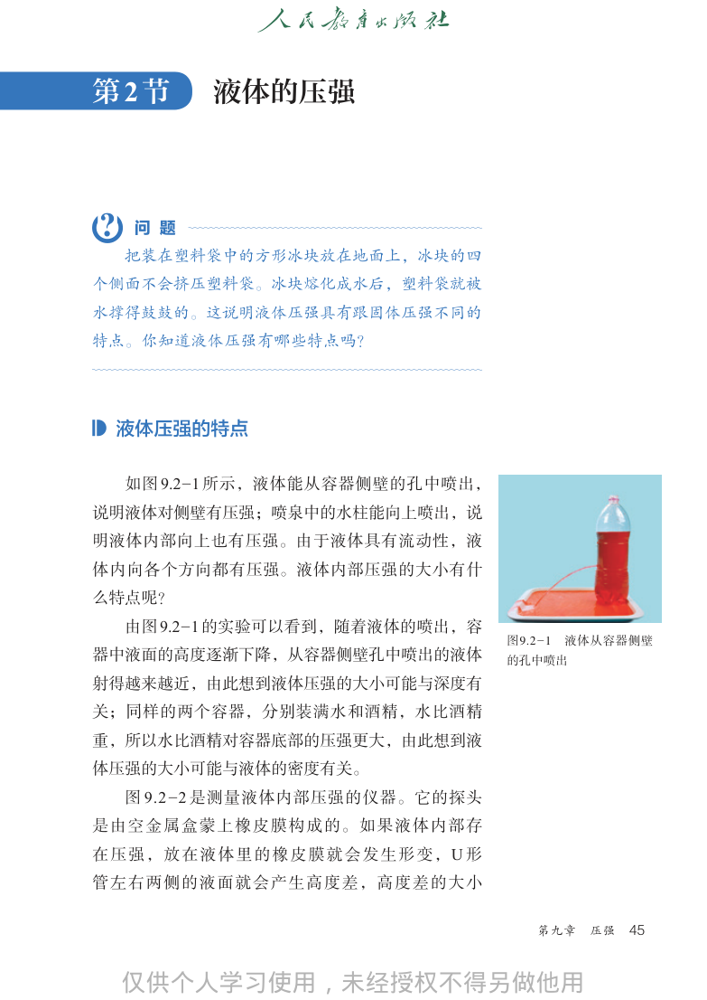

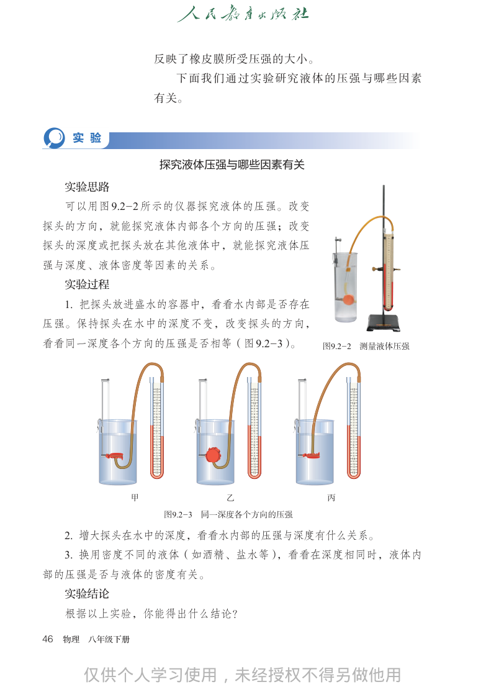

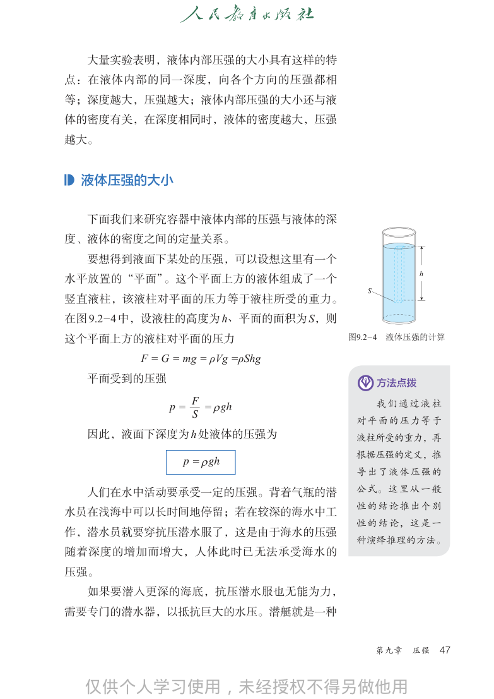

## RJ-PHYSICS-8B-029 液体压强公式的推导与应用

第九章 压强 / 第2节 液体的压强 · PDF P52-P53

**液体压强的大小**

下面我们来研究容器中液体内部的压强与液体的深度、液体的密度之间的定量关系。

要想得到液面下某处的压强，可以设想这里有一个水平放置的“平面”。这个平面上方的液体组成了一个竖直液柱，该液柱对平面的压力等于液柱所受的重力。在图9.2-4中，设液柱的高度为h、平面的面积为S，则这个平面上方的液柱对平面的压力

F = G = mg = ρVg =ρShg

平面受到的压强

$p=\frac{F}{S}=\rho gh$

因此，液面下深度为h处液体的压强为

p = ρgh

人们在水中活动要承受一定的压强。背着气瓶的潜水员在浅海中可以长时间地停留；若在较深的海水中工作，潜水员就要穿抗压潜水服了，这是由于海水的压强随着深度的增加而增大，人体此时已无法承受海水的压强。

方法点拨我们通过液柱对平面的压力等于液柱所受的重力，再根据压强的定义，推导出了液体压强的公式。这里从一般性的结论推出个别性的结论，这是一种演绎推理的方法。

### 补充原例与原解

有人说，设想你在万米深的“奋斗者”号全海深载人潜水器中把一只脚伸到外面的海水里，海水对你脚背的压力相当于2 000个人所受的重力！海水的压力果真有这么大吗？请通过估算加以说明。

解 因为是估算，海水的密度可以取ρ=1×10³ kg/m³，g取10 N/kg。脚背宽度取8~10 cm，脚背长度取12~15 cm，则脚背面积为96~150 cm²，近似取S=120 cm²=1.2×10⁻² m²。

万米深处海水的压强

$p=\rho gh=1\times10^3\,\mathrm{kg/m^3}\times10\,\mathrm{N/kg}\times10^4\,\mathrm m=10^8\,\mathrm{Pa}$

脚背所受的压力

$F=pS=10^8\,\mathrm{Pa}\times1.2\times10^{-2}\,\mathrm{m^2}=1.2\times10^6\,\mathrm N$

一个成年人的质量约为60 kg，所受的重力

$G=mg=60\,\mathrm{kg}\times10\,\mathrm{N/kg}=6\times10^2\,\mathrm N$

假设脚背所受的压力相当于n个成年人所受的重力，则

$n=\frac{1.2\times10^6\,\mathrm N}{6\times10^2\,\mathrm N}=2\,000$

估算结果表明，在万米深的海底，海水对脚背的压力确实相当于2 000个人所受的重力。

利用公式p=ρgh计算的时候，密度ρ的单位要用kg/m³，深度h的单位要用m，计算出的压强p的单位才是Pa。

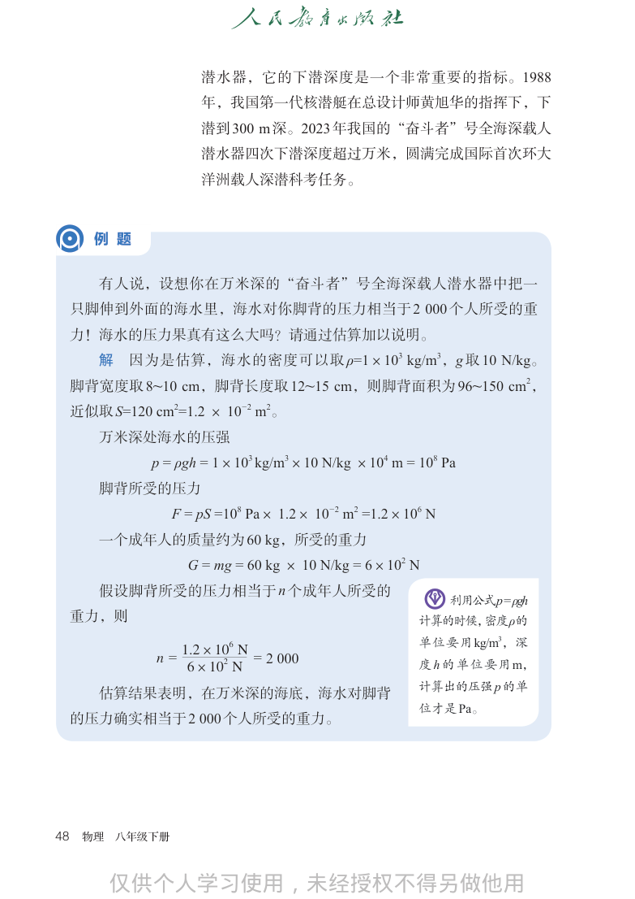

## RJ-PHYSICS-8B-030 连通器及其液面相平的原因

第九章 压强 / 第2节 液体的压强 · PDF P54

**连通器**

上端开口、下端连通的容器叫作连通器，如图9.2-5所示。如果连通器内装有相同的液体，液体不流动时，连通器各部分容器中液面的高度总是相同的。这是为什么呢？

如图9.2-6所示，想象在连通器底部液体中有一个竖直方向的很薄的液片，我们把它作为研究对象。液片两侧受到的压力分别是F₁和F₂，液片静止时，由二力平衡可知F₁＝F₂。设液体密度为ρ、液片面积为S、连通器两侧液面的高度分别为h₁和h₂，则ρgh₁S＝ρgh₂S，由此可得h₁＝h₂。这表明当液体不流动时，连通器各部分容器中液面的高度总是相同的。

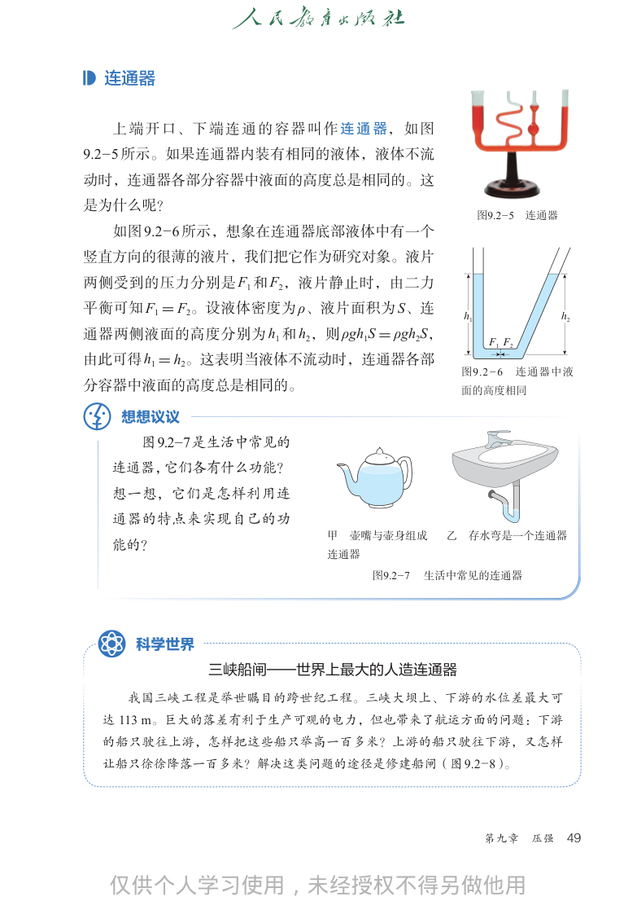

## RJ-PHYSICS-8B-031 船闸的工作过程

第九章 压强 / 第2节 液体的压强 · PDF P54-P55

三峡大坝上、下游的水位差最大可达113 m。巨大的落差有利于生产可观的电力，但也带来了航运方面的问题：下游的船只驶往上游，怎样把这些船只举高一百多米？上游的船只驶往下游，又怎样让船只徐徐降落一百多米？解决这类问题的途径是修建船闸（图9.2-8）。

船闸由闸室和上、下游闸门以及上、下游阀门组成。图9.2-9描述了一艘轮船由上游通过船闸驶往下游的情况。

甲 关闭下游阀门B，打开上游阀门A，闸室和上游水道构成了一个连通器。

乙 闸室水面上升到跟上游水面相平后，打开上游闸门C，船驶入闸室。

丙 关闭上游闸门C和阀门A，打开下游阀门B，闸室和下游水道构成了一个连通器。

丁 闸室水面下降到跟下游水面相平后，打开下游闸门D，船驶向下游。

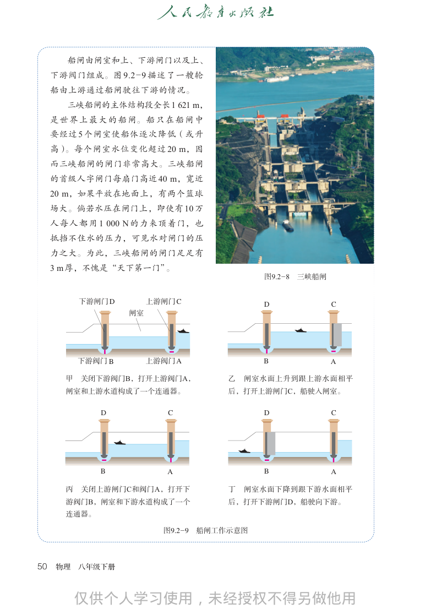

## RJ-PHYSICS-8B-032 大气压强的存在及验证

第九章 压强 / 第3节 大气压强 · PDF P57

生活中有很多现象可以让我们感受到大气压强的存在，下面我们通过实验来研究这个问题。

**大气压强的存在**

如图9.3-1甲所示，挤压出空气的吸盘能吸附在光滑的墙面上并能承载重物，这是因为大气把吸盘压在墙面上。怎样证明这个想法呢？

如果吸盘与墙面之间与大气连通，吸盘内外的大气压强相等，吸盘就不可能吸附在墙面上。我们可以在吸盘上扎一个小孔，这时就会发现，无论怎样用力压吸盘，松开手后它都不会吸附在墙面上。

如图9.3-1乙所示，把一端封闭的塑料管装满水，用硬纸片盖住管口，管口朝下水也不会流出来，这是大气向上压着纸片造成的。你能证明这个想法吗？

大量实验证明，大气压强确实是存在的。大气压强简称大气压（atmospheric pressure ）。

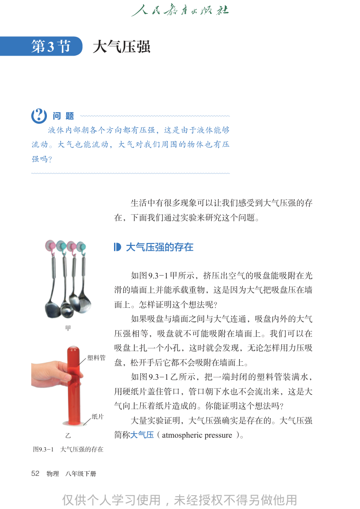

## RJ-PHYSICS-8B-033 托里拆利实验与标准大气压

第九章 压强 / 第3节 大气压强 · PDF P58-P59

**大气压的测量**

在铁桶内放少量的水，用火加热。水沸腾之后把桶口堵住，然后浇上冷水。在大气压的作用下，铁桶被压扁了（图9.3-2）。大气压究竟有多大？在图9.3-1乙中，大气压可以把纸片上的液柱托住。根据大气压所能托起液柱的最大高度，我们就能精确地测出大气压的数值。

**大气压的测量（录像）**

如图9.3-3所示，在长约为1 m、一端封闭的玻璃管里灌满水银，用手指将管口堵住，然后倒插在水银槽中。放开手指，管内水银面下降到一定高度时就不再下降，这时管内外水银面高度差约为760 mm。把玻璃管倾斜，高度差不发生变化。

实验中玻璃管内水银面的上方是真空，管外水银面的上方是空气，因此，是大气压支持管内这段水银柱不会落下，大气压的数值等于这段水银柱产生的压强。这个实验最早是由意大利科学家托里拆利做的，他测得管内外水银面的高度差为760 mm，通常把这样大小的大气压叫作标准大气压，用p₀表示。

$p_0=\rho gh=13.6\times10^3\,\mathrm{kg/m^3}\times9.8\,\mathrm{N/kg}\times0.76\,\mathrm m=1.013\times10^5\,\mathrm{Pa}$

在粗略计算中，标准大气压可以取1×10⁵ Pa。

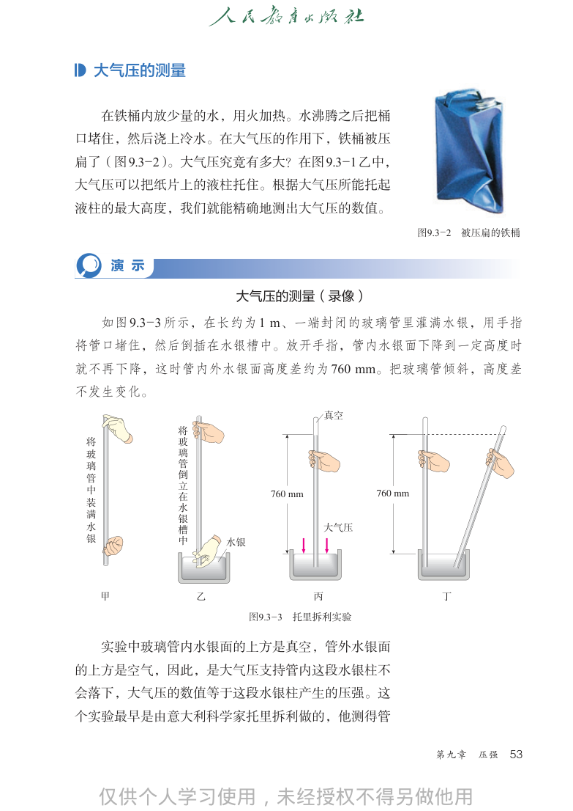

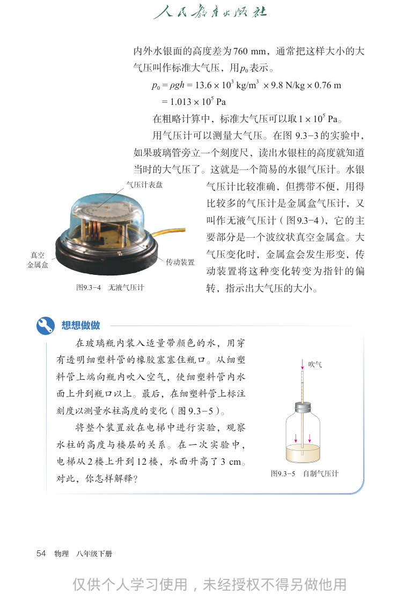

## RJ-PHYSICS-8B-034 气压计的构造与测量原理

第九章 压强 / 第3节 大气压强 · PDF P59

用气压计可以测量大气压。在图 9.3-3的实验中，如果玻璃管旁立一个刻度尺，读出水银柱的高度就知道当时的大气压了。这就是一个简易的水银气压计。水银气压计比较准确，但携带不便，用得比较多的气压计是金属盒气压计，又叫作无液气压计（图9.3-4），它的主要部分是一个波纹状真空金属盒。大气压变化时，金属盒会发生形变，传动装置将这种变化转变为指针的偏转，指示出大气压的大小。

## RJ-PHYSICS-8B-035 自制气压计与高度对气压和沸点的影响

第九章 压强 / 第3节 大气压强 · PDF P59-P60

在玻璃瓶内装入适量带颜色的水，用穿有透明细塑料管的橡胶塞塞住瓶口。从细塑料管上端向瓶内吹入空气，使细塑料管内水面上升到瓶口以上。最后，在细塑料管上标注刻度以测量水柱高度的变化（图9.3-5）。

将整个装置放在电梯中进行实验，观察水柱的高度与楼层的关系。在一次实验中，电梯从2 楼上升到12 楼，水面升高了3 cm。对此，你怎样解释？

实验结果表明，随着高度的增加，细塑料管中水柱的高度会逐渐升高，这表明瓶外的大气压在逐渐减小。在海拔3 000 m 以内，每升高10 m，大气压大约减小100 Pa。

水的沸点在标准大气压下是100 °C，随着大气压的减小，水的沸点也会降低。在我国的青藏高原，大部分地区水的沸点低于90 °C。有的哨所海拔五千多米，水的沸点不足85 °C，这样的温度，连面条也煮不熟。战士们在日常生活中必须使用压力锅做饭（图9.3-6）。

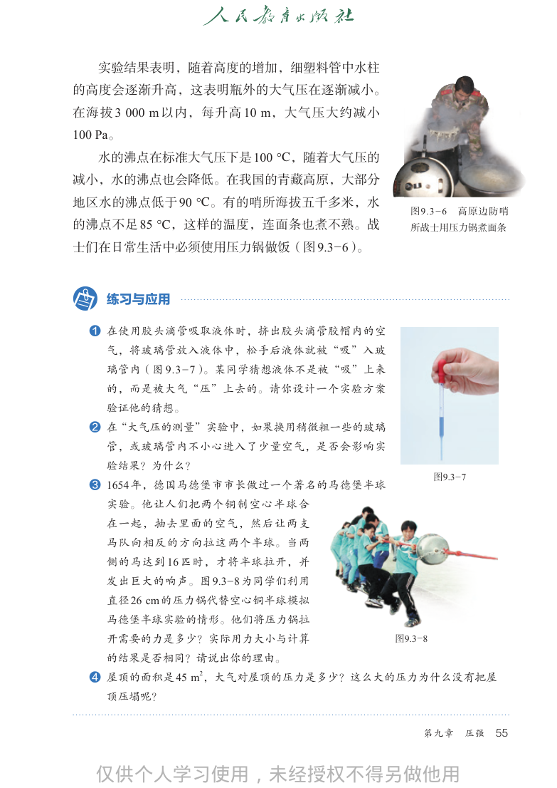

## RJ-PHYSICS-8B-036 活塞式抽水机的工作原理

第九章 压强 / 第4节 跨学科实践：制作简易活塞式抽水机 · PDF P61-P62

取一个注射器，把针头插到装有水的盆中，向上拉动活塞，就能看到水从低处升到高处。如果向下压活塞，水就会被压回盆中。怎样才能不断地将水提升到高处呢？

活塞式抽水机就巧妙地解决了这个问题。图9.4-2是活塞式抽水机工作原理的示意图。其中，活塞跟筒壁紧密接触同时又可以上下移动，A、B 是只能向上开启的阀门。使用时，若提起活塞，阀门A受到大气压的作用而关闭，活塞的下面空气稀薄，气压小于外界的大气压。于是，低处的水受到大气压的作用推开阀门 B 进入圆筒（图9.4-2甲）；当压下活塞时，阀门 B 被水压下而关闭，水受阻不能向下流动，于是冲开阀门 A 进入圆筒的上部（图9.4-2乙）；再提起活塞时，活塞上面的水迫使阀门A 关闭，水从出水管流出。与此同时，低处的水又在大气压的作用下推开阀门 B 而进入圆筒（图9.4-2丙）。这样，活塞不停地上下移动，水就从管口连续不断地流出。

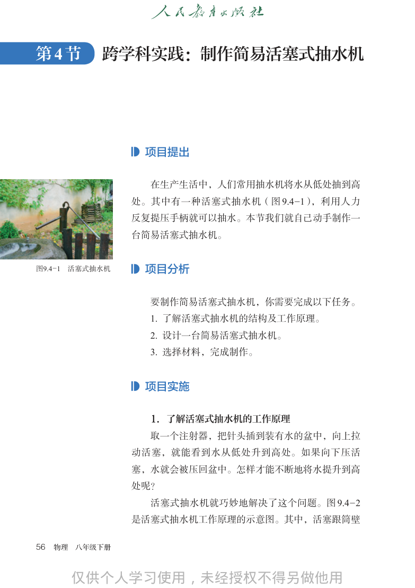

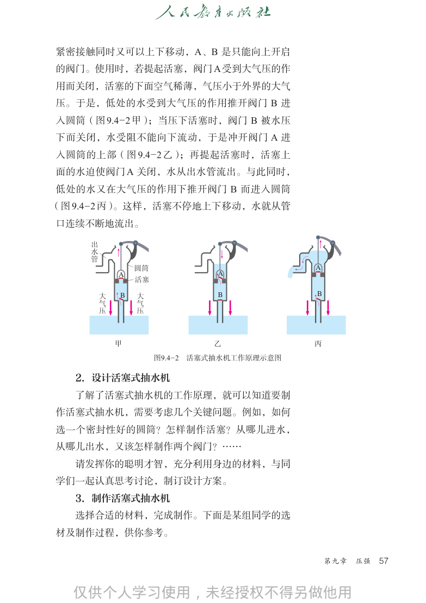

## RJ-PHYSICS-8B-037 简易活塞式抽水机的材料与制作

第九章 压强 / 第4节 跨学科实践：制作简易活塞式抽水机 · PDF P62-P63

3. 制作活塞式抽水机选择合适的材料，完成制作。下面是某组同学的选材及制作过程，供你参考。

材料：一个用来装洗涤液的空瓶子，一根筷子，一块塑料片，一个玻璃球，一块橡皮膏，一根塑料管。

如图9.4-3所示，剪下瓶子的瓶底，把瓶子上部作为抽水机的圆筒。把瓶底再略剪一小部分作为活塞，使瓶底的外径能与瓶子的内径相吻合。

在瓶子的侧壁上打一个出水口，插上一段塑料管作为出水管（图9.4-4）。拔掉瓶盖上的小帽，把瓶口作为进水口。

在活塞上打两个孔A、B，中间的孔A用来固定筷子。用橡皮膏把塑料片的一边粘在活塞上，使塑料片能盖住孔B，作为一个阀门（图9.4-5）。把玻璃球放到瓶子里作为另一个阀门。

装上活塞，抽水机就组装好了（图9.4-6）。将瓶口朝下浸入水中，上下拉动活塞，抽水机就会把水抽上来。

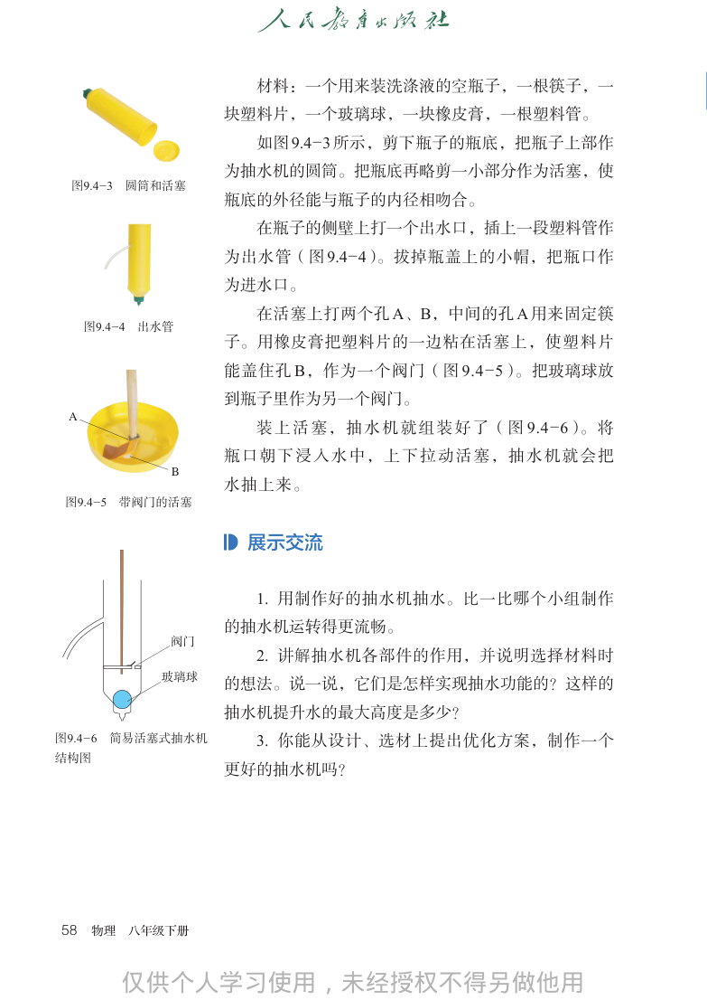

## RJ-PHYSICS-8B-038 流体压强与流速的关系及纸条实验

第九章 压强 / 第5节 流体压强与流速的关系 · PDF P64-P65

手持一张纸条，纸条由于受到重力的作用，会自然下垂。如果在纸条上方朝水平方向吹气，你认为纸条会如何运动？为什么？

**流体压强与流速的关系**

我们发现，朝水平方向吹气时，纸条会向上运动；一旦停止吹气，纸条就会下垂。纸条向上运动，说明吹气后其上、下表面受力情况发生了变化。吹气前、后纸条下方气压变化不大，纸条向上运动，说明纸条上方气压变小。这会使我们想到：空气流动起来的压强比静止时的压强小，气体的压强是不是跟其流速有关系？

物理学中把具有流动性的液体和气体统称为流体。前面我们学过了液体内部的压强和大气压，它们都是流体静止时的压强，下面我们继续研究流体流动起来后，其压强与流速的关系。

如图9.5-1所示，手握两张纸，让纸自然下垂。从两张纸的中间向下吹气，这两张纸会怎样运动？

尝试解释纸的运动。

可以发现，向下吹气时，两张纸向中间靠拢。吹气时，两张纸外部的大气压力没有发生大的变化，两张纸向中间靠拢，说明中间的气体向外的压力变小了。纸两侧的面积一样，压力小，说明压强也小。由此可以得出：空气流动时的压强比静止时的压强小。

更多的实验结果表明，在气体和液体中，流速越大的位置，压强越小。

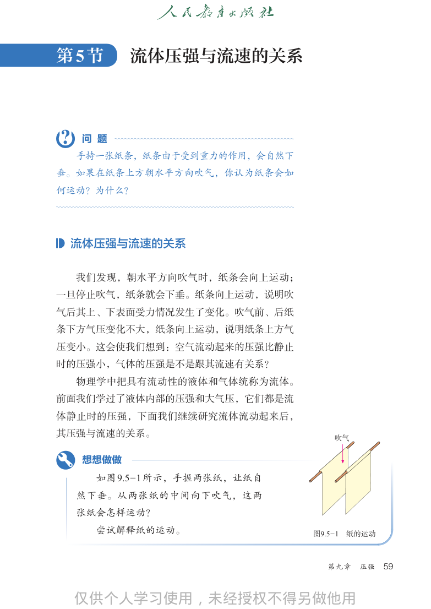

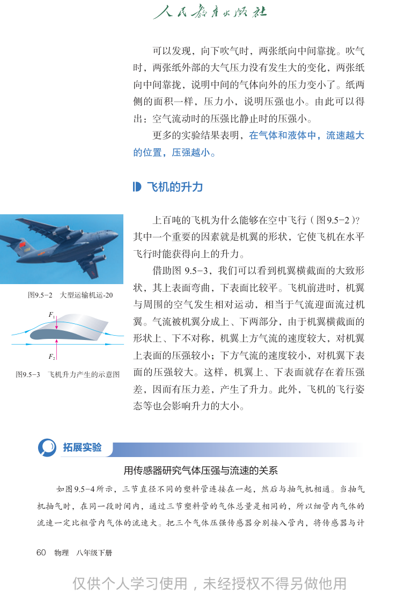

## RJ-PHYSICS-8B-039 飞机升力的产生

第九章 压强 / 第5节 流体压强与流速的关系 · PDF P65

**飞机的升力**

上百吨的飞机为什么能够在空中飞行（图9.5-2）？其中一个重要的因素就是机翼的形状，它使飞机在水平飞行时能获得向上的升力。

借助图 9.5-3，我们可以看到机翼横截面的大致形状，其上表面弯曲，下表面比较平。飞机前进时，机翼与周围的空气发生相对运动，相当于气流迎面流过机翼。气流被机翼分成上、下两部分，由于机翼横截面的形状上、下不对称，机翼上方气流的速度较大，对机翼上表面的压强较小；下方气流的速度较小，对机翼下表面的压强较大。这样，机翼上、下表面就存在着压强差，因而有压力差，产生了升力。此外，飞机的飞行姿态等也会影响升力的大小。

## RJ-PHYSICS-8B-040 用传感器研究气体压强与流速的关系

第九章 压强 / 第5节 流体压强与流速的关系 · PDF P65-P66

**用传感器研究气体压强与流速的关系**

如图9.5-4所示，三节直径不同的塑料管连接在一起，然后与抽气机相通。当抽气机抽气时，在同一段时间内，通过三节塑料管的气体总量是相同的，所以细管内气体的流速一定比粗管内气体的流速大。把三个气体压强传感器分别接入管内，将传感器与计算机相连，从计算机上就可以读出三个位置气体压强的数值。看看是不是气体流速大的地方压强小。

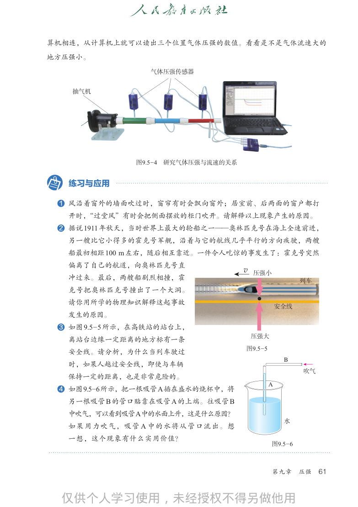

## RJ-PHYSICS-8B-041 浮力及称重法测量浮力

第十章 浮力 / 第1节 浮力 · PDF P69-P70

**浮力**

游船、鸭子、冰山都受到重力的作用，但却没有因此而沉入水底，这表明水对它们有一个向上托起的力。浸在液体中的物体受到向上的力，这个力叫作浮力（buoyancy force）。

漂浮在水面的物体受到浮力，浸没在水中的物体也受到浮力吗？例如，图10.1-2中，沉入水底的石块会受到浮力吗？如果浸没在水中的物体会受到浮力的话，怎样测量此时浮力的大小呢？

**测量浸没在水中的铝块所受的浮力**

1. 如图10.1-3甲所示，在弹簧测力计下悬挂一个铝块，铝块静止时，读出弹簧测力计的示数，这就是铝块所受重力的大小。

2. 把铝块浸没在水中（图10.1-3乙），铝块静止时，看看弹簧测力计的示数有什么变化。

想一想，为什么示数会有变化，它说明了什么问题？算一算，弹簧测力计的示数变化了多少？

3. 改变铝块在水中浸没的深度（图10.1-3丙），看看示数是否有变化。

从以上实验步骤1、2可以看到，铝块浸没在水中后，弹簧测力计的示数减小了，说明浸没在水中的铝块受到了浮力的作用。图10.1-3甲、乙中弹簧测力计示数之差，就是浮力的大小。

从实验步骤2、3可以看到，弹簧测力计的示数没有变化，说明浸没在水中的铝块所受浮力的大小，跟铝块所到达的深度没有关系。

浸没在水中的铝块受到三个力（图10.1-4）：重力G、弹簧测力计的拉力F拉和浮力F浮。在这三个力的作用下铝块处于平衡状态。把F拉和F浮的合力设为F合，这样就可以认为铝块受F合和G两个力的作用。你能证明F浮 = G - F拉吗？

“浸没”指物体完全处在液面下方。

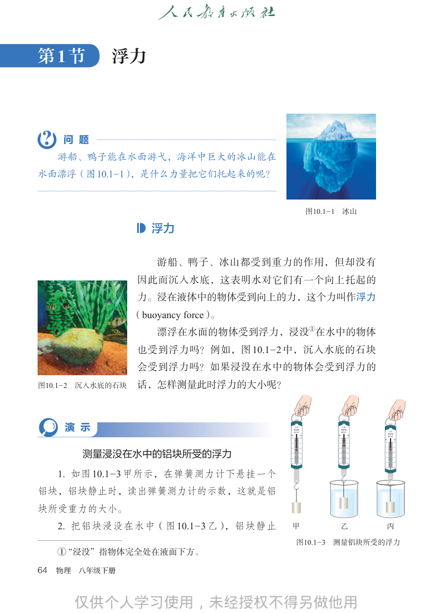

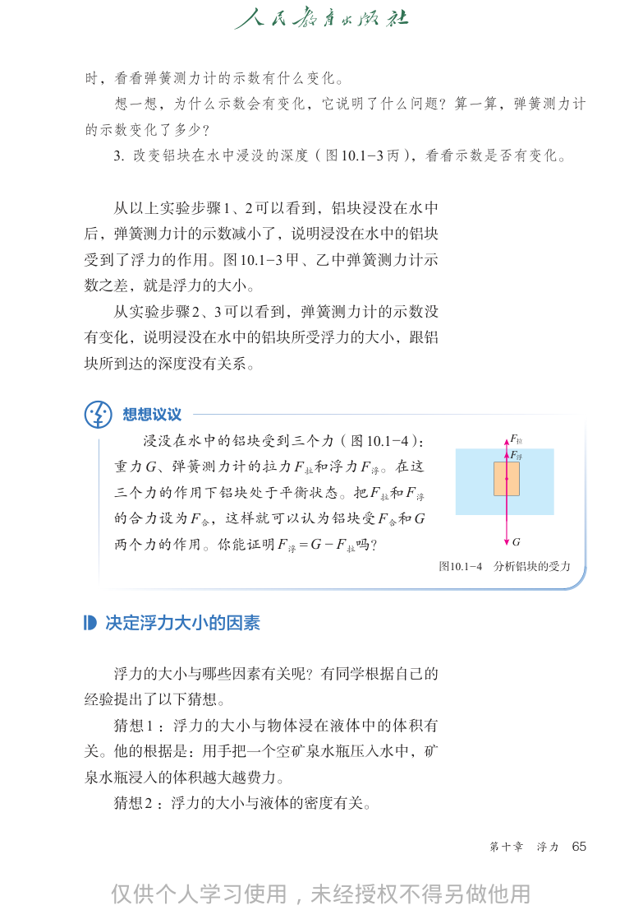

## RJ-PHYSICS-8B-042 探究浮力大小的影响因素

第十章 浮力 / 第1节 浮力 · PDF P70-P71

**决定浮力大小的因素**

浮力的大小与哪些因素有关呢？有同学根据自己的经验提出了以下猜想。

猜想1 ：浮力的大小与物体浸在液体中的体积有关。他的根据是：用手把一个空矿泉水瓶压入水中，矿泉水瓶浸入的体积越大越费力。

猜想2 ：浮力的大小与液体的密度有关。

你同意以上猜想吗？请说出你的根据。你还有哪些猜想？请说出猜想的根据。

**探究浮力的大小与哪些因素有关**

实验思路由以上猜想，浮力的大小可能与物体浸在液体中的体积、液体的密度等因素有关。要探究浮力的大小是否与这些量有关，需要逐次探究，每次探究浮力的大小与其中一个量的关系，其他量要保持不变。

实验过程1. 为探究浮力的大小是否与物体浸在液体中的体积有关，可以逐渐增大物体浸在液体中的体积，观察和记录浮力大小的变化，如图10.1-5所示。

2. 为探究浮力的大小是否与液体的密度有关，可以把同一个物体浸没在不同的液体中，测量并记录浮力的大小。

还可以用控制变量的方法检验其他猜想。实验结论根据以上实验，你得出了什么结论？

实验结果表明：物体在液体中所受浮力的大小，与它浸在液体中的体积有关，与液体的密度有关；物体浸在液体中的体积越大，液体的密度越大，所受的浮力就越大。

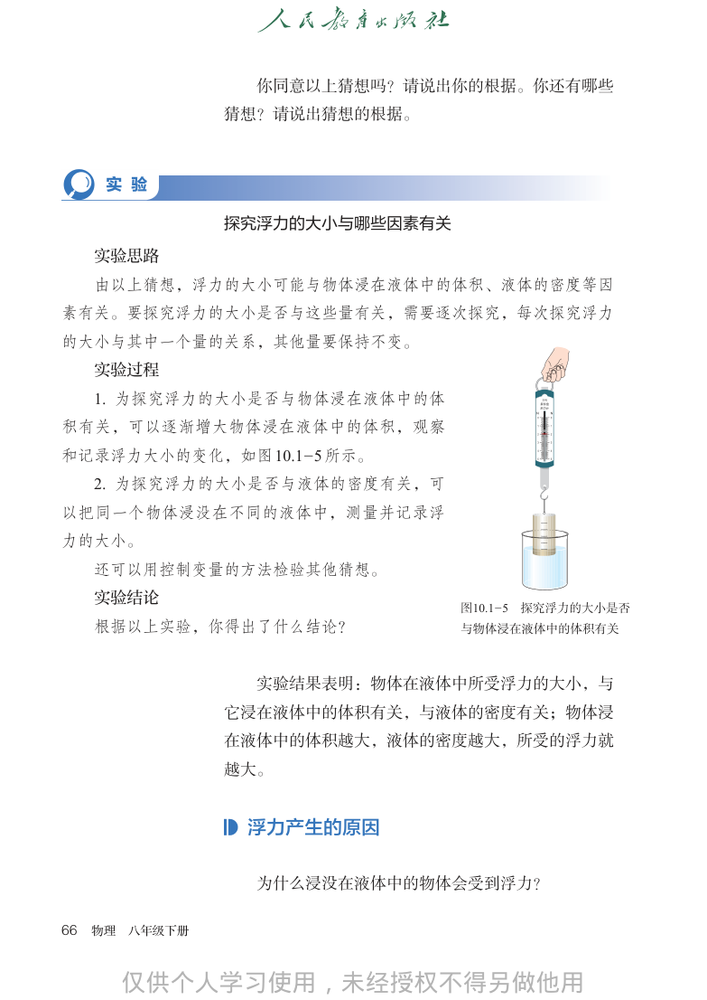

## RJ-PHYSICS-8B-043 浮力产生的原因

第十章 浮力 / 第1节 浮力 · PDF P71-P72

**浮力产生的原因**

为什么浸没在液体中的物体会受到浮力？

这是因为液体内部存在压强，而且深度不同，其压强不同。如图10.1-6所示，我们研究浸没在液体中的长方体的受力情况。长方体两个相对的侧面所受液体的压力相互平衡，物体水平方向所受力的合力为0。长方体上、下表面所处的深度分别记为h₁、h₂，h₂ > h₁，因此，液体对长方体下表面的压强要大于液体对上表面的压强。考虑到长方体上、下表面的受力面积是相同的，所以，液体对长方体向上的压力F₂大于液体对它向下的压力F₁。浸没在液体中的物体，其上、下表面受到液体对它的压力不同，这就是浮力产生的原因。

## RJ-PHYSICS-8B-044 排开液体与浮力的关系分析

第十章 浮力 / 第2节 阿基米德原理 · PDF P73-P74

据说两千多年以前，古希腊学者阿基米德（图10.2-1）为了鉴定王冠是否是用纯金制成的，要测量王冠的体积，冥思苦想很久都没有结果。一天，当他跨进盛满水的浴缸洗澡时，看见浴缸里的水向外溢，突然想到：物体浸在液体中的体积，不就是物体排开液体的体积吗？由此他解决了王冠的鉴定问题。

我们可以在阿基米德灵感的启示下，进一步思考。如果用物体排开液体的体积取代物体浸在液体中的体积，上节探究的结果就可以说成：物体排开液体的体积越大、液体的密度越大，所受的浮力就越大。而排开液体的体积与液体密度的乘积就是排开液体的质量，所以上面的结论又可以说成：物体排开液体的质量越大，所受的浮力越大。又由于物体所受的重力和它的质量是成正比的，因此可以想到：物体在液体中所受的浮力与它排开液体所受的重力有直接的关系。

## RJ-PHYSICS-8B-045 探究阿基米德原理

第十章 浮力 / 第2节 阿基米德原理 · PDF P74-P76

**浮力的大小**

下面我们用实验来探究物体所受的浮力与它排开液体所受的重力之间的定量关系。

**探究浮力的大小与排开液体所受重力的关系**

实验思路本实验需要先测量两个量：物体所受的浮力和物体排开液体所受的重力，然后分析它们的关系。

1. 怎样测量物体所受浮力的大小？2. 怎样测量物体排开液体所受的重力？3. 如果要减小实验误差，应该怎样设计实验操作的顺序？实验过程以下是用溢水杯和弹簧测力计进行操作的一种实验方案。1. 用弹簧测力计测量空桶所受的重力（图10.2-2甲）。

2. 用弹簧测力计悬挂一个物体，读出物体在空气中（图10.2-2乙）和浸在水中（图10.2-2丙）静止时弹簧测力计的示数，计算物体在水中所受浮力的大小。同时用小桶将排开的水收集起来。

3. 用弹簧测力计测量装水小桶所受的重力（图10.2-2丁），计算排开的水所受的重力。

把测量的实验数据记录在下表中。

| 序号 | 小桶所受的重力 G桶/N | 物体所受的重力 G物/N | 物体在水中时弹簧测力计的示数 F拉/N | 小桶和排开水所受的总重力 G总/N | 浮力 F浮/N | 排开的水所受的重力 G排/N |
| --- | --- | --- | --- | --- | --- | --- |
| 1 | | | | | | |
| 2 | | | | | | |
| 3 | | | | | | |
| … | | | | | | |

实验结论根据实验数据，看看物体所受浮力的大小与它排开的水所受的重力有什么关系。

大量的实验结果表明，浸在液体中的物体受到向上的浮力，浮力的大小等于它排开的液体所受的重力。这就是著名的阿基米德原理。用公式表示就是

F浮 = G排

根据上一节所学的浮力产生的原因，通过进一步分析，也可以得出以上结论。

阿基米德原理不仅适用于液体，也适用于气体。

### 补充原例与原解

有一杯水、一杯盐水和一块重0.22 N、密度为1.1×10³ kg/m³的塑料块。

（1）该塑料块浸没在水中时所受的浮力是多少？

（2）若该塑料块在盐水中是漂浮的，浸在盐水中的体积是塑料块总体积的90%，则盐水的密度是多少？g取10 N/kg。

解 （1）根据塑料块所受的重力可以求得它的质量，再由体积、质量和密度的关系式就可以求得它的体积。

塑料块的质量

$m_{塑料}=\frac{G_{塑料}}{g}=\frac{0.22\,\mathrm N}{10\,\mathrm{N/kg}}=0.022\,\mathrm{kg}$

塑料块的体积

$V_{塑料}=\frac{m_{塑料}}{\rho_{塑料}}=\frac{0.022\,\mathrm{kg}}{1.1\times10^3\,\mathrm{kg/m^3}}=2\times10^{-5}\,\mathrm{m^3}$

浸没在水中的塑料块的体积V塑料等于它排开水的体积V排。根据阿基米德原理，塑料块受到浮力的大小等于它排开的水所受的重力

$F_{浮}=G_{排}=m_{水}g=\rho_{水}V_{排}g=1\times10^3\,\mathrm{kg/m^3}\times2\times10^{-5}\,\mathrm{m^3}\times10\,\mathrm{N/kg}=0.2\,\mathrm N$

（2）塑料块在盐水中是漂浮的，处于平衡状态，因此它所受浮力的大小等于它所受的重力，为0.22 N。根据阿基米德原理，可以求得排开盐水的质量。再由体积、质量和密度的关系式就可以求得盐水的密度。即

$m_{盐水}=\frac{G_{盐水}}{g}=\frac{0.22\,\mathrm N}{10\,\mathrm{N/kg}}=0.022\,\mathrm{kg}$

盐水密度

$\rho_{盐水}=\frac{m_{盐水}}{V_{盐水}}=\frac{0.022\,\mathrm{kg}}{2\times10^{-5}\,\mathrm{m^3}\times90\%}=1.22\times10^3\,\mathrm{kg/m^3}$

该塑料块浸没在水中所受的浮力为0.2 N。盐水的密度为1.22×10³ kg/m³。

## RJ-PHYSICS-8B-046 物体的浮沉条件

第十章 浮力 / 第3节 物体的浮沉条件及应用 · PDF P78-P79

由静止释放的物体如何运动，取决于它所受力的合力。要分析浸没在液体中的物体向哪个方向运动，需要分析它所受力的合力的方向。

**物体的浮沉条件**

浸没在液体中的物体受到两个力：竖直向下的重力和竖直向上的浮力。根据物体所受浮力与重力大小关系的不同，由静止释放的物体，其浮沉存在三种情况。

当浮力F大于重力G时（图10.3-1甲），二力的合力方向向上，物体由静止开始上浮；当浮力F等于重力G时（图10.3-1乙），二力的合力为0，物体保持悬浮状态；当浮力F小于重力G时（图10.3-1丙），二力的合力方向向下，物体由静止开始下沉。

由于浸没在液体中的物体排开液体的体积跟物体自身的体积相等，因此物体的浮沉情况也可以用物体的密度跟液体密度的大小关系来判断。

浸没在液体中的物体由静止释放，如果它的密度小于液体的密度，物体将上浮；如果它的密度等于液体的密度，物体可以悬浮在液体内；如果它的密度大于液体的密度，物体将下沉。人们正是根据这个道理，在用盐水选种时，清除掉漂浮的不饱满的种子，保留下沉的饱满种子。

如图10.3-2所示，将新鲜的鸡蛋分别浸没在盛有水和盐水的容器中，观察鸡蛋在容器中的位置。

## RJ-PHYSICS-8B-047 轮船的排水量与漂浮原理

第十章 浮力 / 第3节 物体的浮沉条件及应用 · PDF P79-P80

轮船 轮船是用钢铁制造的，钢铁的密度远大于水，怎样用沉重的钢铁制成可以承载很多货物的船呢？

橡皮泥的密度比水大，它在水中会下沉。根据阿基米德原理，怎样把橡皮泥做成一条小船，使它能漂浮在水面，并能承载重物（图10.3-4）？

把橡皮泥捏成瓢状放在水面，虽然它所受的重力没有改变，但是它排开的水的体积变大，因而受到较大的浮力，所以能漂浮在水面上。轮船就是根据这个道理制造的。轮船的大小通常用排水量来表示。排水量就是轮船装满货物时排开水的质量。例如，我国首艘航空母舰辽宁舰（图10.3-5）的排水量约为6万吨，表示辽宁舰满载时，舰载机和舰身的质量之和约为6万吨。

## RJ-PHYSICS-8B-048 潜水艇的浮沉

第十章 浮力 / 第3节 物体的浮沉条件及应用 · PDF P80

潜水艇 潜水艇能潜入水下航行。它的艇身内有水舱（图10.3-6），向水舱充水时，潜水艇变重，逐渐潜入水中。当水舱充水后潜水艇所受的重力等于浮力时，它可以悬浮在水中。当用压缩空气将水舱里的水排出一部分时，潜水艇变轻，从而上浮。

实际航行时，上浮和下潜的过程中潜水艇要开动推进器加快上浮和下潜的速度。

## RJ-PHYSICS-8B-049 气球和飞艇的升空原理

第十章 浮力 / 第3节 物体的浮沉条件及应用 · PDF P80

气球和飞艇 如果气球里充的是密度小于空气的气体，那么气球就可以飘在空中。例如，节日放飞的气球、携带气象仪器的高空探测气球，充的是氦气；体育、娱乐活动用的热气球，充的是被燃烧器加热而体积膨胀的热空气（图10.3-7）。

为了能定向航行，人们还制成了飞艇：在大气囊下面装了带螺旋桨的发动机和载人、装货的吊篮。

## RJ-PHYSICS-8B-050 密度计的构造与使用

第十章 浮力 / 第3节 物体的浮沉条件及应用 · PDF P81

密度计图10.3-9是一种密度计，它可以漂浮在不同液体中测量液体的密度，在酿酒、石油、化工以及农业选种等方面有广泛应用。这种密度计通常中间有一个体积较大的玻璃泡。密度计下方装着金属颗粒作为配重，使密度计漂浮时能保持竖直姿态。密度计上方为细玻璃管，它的内部标有刻度，测量时可以根据液面所处的位置直接读出液体的密度值。

## RJ-PHYSICS-8B-051 微型密度计的设计依据及估算

第十章 浮力 / 第4节 跨学科实践：制作微型密度计 · PDF P82-P84

消毒酒精的密度约为0.87×10³ kg/m³。用密度计测量酒精的密度，是一种初步判断酒精是否合格的简单方法。不过常用的密度计体积较大，很难放入小瓶酒精中进行测量（图10.4-1）。

如果能设计和制作一个微型密度计，测量时只需把微型密度计放入小瓶中，就能方便、快速地判断酒精是否合格。

1. 设计（1）基本思路如图10.4-2所示，把塑料吸管的下端用蜡封口并缠上铜丝，设法让它能竖直漂浮在水面上。这就是一个最简单的密度计。

自制密度计放入盛酒精的小瓶后，可能会触碰瓶底，还可能会使酒精溢出。另外，它漂浮在不同密度的酒精中时，作为标度杆的吸管因直径太大，可能会造成液面在吸管上的位置变化很小，使我们难以判断酒精密度的大小。怎样解决这两个问题呢？

密度计所受浮力的大小等于它所受的重力，浮力的大小决定了排开酒精的体积。吸管的直径影响了液面在吸管上位置的变化。看来，要设计符合要求的密度计，应该着重考虑两个因素：一个是密度计的质量，另一个是标度杆的直径。

（2）估算密度计的质量对于100 mL 的小瓶酒精来说，若用微型密度计测量时排开1~2 mL的酒精，一般不会导致酒精溢出。1~2 mL酒精的质量为1 g左右，因此我们设计的微型密度计的质量也应为1 g左右。

（3）估算标度杆的直径可以认为消毒酒精的密度为0.86×10³~0.88×10³ kg/m³是合格的。如图10.4-3 所示，若密度计漂浮在0.86×10³ kg/m³的酒精中，液面位于标度杆的A位置；漂浮在0.88×10³ kg/m³的酒精中，液面位于标度杆的B位置，则测量时液面位于A、B之间的酒精都是合格的。A、B间的长度过小，不便于观察者分辨。为此，可设定A、B间的长度不少于4 mm。

这样，根据圆柱体的体积公式，就可以计算标度杆的横截面积和直径了。通过估算，可以知道标度杆的横截面积约为0.07 cm²，直径约为3 mm。（4）设计微型密度计的结构为了使微型密度计能在酒精中竖直漂浮，需要在标度杆下部增加配重（如缠上一些铜丝），但增加了配重的标度杆放在酒精中会下沉，因此还要在标度杆上固定一个浮子来增大浮力。这样，微型密度计由标度杆、浮子和配重三部分组成（图10.4-4），配重位于最下方。

## RJ-PHYSICS-8B-052 微型密度计的选材、制作与标记

第十章 浮力 / 第4节 跨学科实践：制作微型密度计 · PDF P84-P85

2. 制作（1）选择材料浮子可以用小泡沫塑料球作为浮子，也可以截一段稍粗点的塑料管，将其两头封口作为浮子。

标度杆直径约为3 mm的细塑料管、做棉签的实心塑料杆以及细的圆珠笔芯等，都可以用来做标度杆。

配重可以在实心塑料杆下端缠上若干圈铜丝，或者在空心的细塑料管下端插入一段粗铁丝作为配重。改变铜丝或铁丝的长度就可以调节配重。

（2）制成作品大家可以团队协作，发挥各自的聪明才智，选择合适的浮子、标度杆和配重，完成微型密度计的制作。

下面的制作方案供同学们参考。用制作棉签的实心塑料杆（直径约为3 mm）作为标度杆，塑料杆中部套一个直径约1.2 cm的泡沫塑料球作为浮子，下端绕有铜丝作为配重，初步做成一个微型密度计（图10.4-5）。

把这个密度计漂浮在水中调节配重。改变铜丝的长度，使密度计在水中漂浮时浮子浸没在水中，水面上方露出一段标度杆。

把调好配重的微型密度计放入标准消毒酒精中。待微型密度计静止时，依据液面的位置在标度杆上做一个记号。最后，用4 mm宽的彩色胶布中心对着记号贴在塑料杆上，微型密度计就做好了（图10.4-6）。

## RJ-PHYSICS-8B-053 力学中的功及做功条件

第十一章 功和机械能 / 第1节 功 · PDF P89-P91

如图11.1-1所示，叉车要把货物从地面搬到车上。在这个过程中，叉车除了要对货物施加力，还需要怎样做才能完成这个任务？

**力学中的功**

很明显，叉车要完成这个任务，除了用力托起货物，还需要使货物在这个力的方向上移动一段距离。也就是说，在叉车举高货物的过程中，货物受到一个向上的力F的作用，并且在这个力的作用下，向上移动了一段距离s（图11.1-2），力F作用的成效体现在货物被举高了。对于这种情况，物理学中就说叉车托起货物的力做了功（work）。

通常而言，如果一个力作用在物体上，物体在这个力的方向上移动了一段距离，就说这个力对物体做了功。

作用在物体上的力越大、物体在力的方向上移动的距离越远，力所做的功也就越多。力学中，功等于力与物体在力的方向上移动的距离的乘积。

如果用F表示力、s表示在力的方向上移动的距离、W表示功，则功的表达式为

W = Fs

在国际单位制中，力的单位是牛，距离的单位是米，则功的单位是牛米，它有一个专门的名称叫作焦耳（joule），简称焦，符号是J。

如图11.1-3所示，一个人搬石头时，搬而未起，人对石头的力是否做功？如图11.1-4所示，一个人推车在水平方向上前行，人对车的推力是否做功？

搬石头时，人对石头施加了向上的力，但石头没有在力的方向上移动距离，人对石头的力没有做功。人推车时，人对车施加了推力，车在推力的方向上移动了距离，人对车的推力做了功。

有时为了叙述方便，某个力做功往往也说成施力的物体做了功。如人推车，推力做了功，也常说人做了功。

### 补充原例与原解

目前，我国正在大力推广装配式建筑。这种建筑方式不仅施工效率高，还能大幅降低能耗，避免现场粉尘、泥浆等的污染，实现绿色施工（图11.1-5）。g取10 N/kg。

（1）把质量为1.5 t的构件匀速提升到30 m高的楼顶，竖直向上的拉力做了多少功？

（2）依据需要，又将这个构件沿水平方向匀速移动了3 m。在水平运动阶段，竖直向上的拉力又做了多少功？

解 （1）构件在竖直方向上做匀速直线运动，构件所受的拉力与重力大小相等，即

$F=G=mg=1.5\times10^3\,\mathrm{kg}\times10\,\mathrm{N/kg}=1.5\times10^4\,\mathrm N$

构件在竖直方向上移动的距离

$s=30\,\mathrm m$

所以，拉力做的功

$W=Fs=1.5\times10^4\,\mathrm N\times30\,\mathrm m=4.5\times10^5\,\mathrm J$

（2）拉力的方向竖直向上。构件在水平方向上移动了3 m，但在竖直方向上没有移动距离，即s′=0。所以，拉力做的功

$W'=Fs'=0$

在竖直上升阶段，拉力做的功为4.5×10⁵ J。在水平运动阶段，拉力做的功为0。

## RJ-PHYSICS-8B-054 功率的定义、公式和单位

第十一章 功和机械能 / 第2节 功率 · PDF P93-P95

**功率**

不同的物体若做相同的功，则用时短的物体做功快；若做功的时间相同，则做功多的物体做功快。

在生产生活中我们遇到更多的情况是，做功的多少和做功的时间都不相同。在这些情况下，又该怎样比较做功的快慢呢？

就像用路程与时间之比来比较运动的快慢一样，我们可以用功与做功所用时间之比来比较做功的快慢。在物理学中，用功率表示做功的快慢。功与做功所用时间之比叫作功率（power）。如果用W表示某个力做的功、t表示做这些功所用的时间、P表示这个力做功的功率，则功率的表达式为

$P=\frac{W}{t}$

功率的单位由功的单位和时间的单位组合而成。在国际单位制中，功的单位是焦耳，时间的单位是秒，则功率的单位是焦耳每秒，它有个专门的名称叫作瓦特（watt），简称瓦，符号是W。工程技术上还常用千瓦（kW）作为功率的单位。

1 kW = 10³ W

物体做功的功率相差很大。例如，优秀运动员短时间运动的功率约为一千瓦；小型客车发动机的功率为数十千瓦至数百千瓦；盾构机、内燃机车发动机的功率为数千千瓦；电力机车、万吨级远洋货轮发动机的功率可超过一万千瓦；我国的长征五号运载火箭发动机的功率超过一百万千瓦。

### 补充原例与原解

大石头的质量为6 t，起重机在15 s内将大石头沿竖直方向匀速提升1 m（图11.2-1），起重机提升大石头的功率是多少？g取10 N/kg。

解 因为匀速提升，起重机提升大石头的拉力与大石头所受的重力相等，即

$F=G=mg=6\times10^3\,\mathrm{kg}\times10\,\mathrm{N/kg}=6\times10^4\,\mathrm N$

大石头在拉力的方向上移动的距离

$s=1\,\mathrm m$

所以拉力做的功

$W=Fs=6\times10^4\,\mathrm N\times1\,\mathrm m=6\times10^4\,\mathrm J$

功率

$P=\frac{W}{t}=\frac{6\times10^4\,\mathrm J}{15\,\mathrm s}=4\times10^3\,\mathrm W$

起重机提升大石头的功率是4×10³ W。

## RJ-PHYSICS-8B-055 能量与做功的关系

第十一章 功和机械能 / 第3节 动能和势能 · PDF P96

**能量**

从高处落下的西瓜皮可以砸坏车顶，压缩的弹簧能将小球弹起，湍急的流水能推动水车（图11.3-1），处于高处的西瓜皮、压缩的弹簧、流水都能做功。物体能够对外做功，我们就说这个物体具有能量（energy），简称能。能量的单位与功的单位相同，也是焦耳。

一般来说，一个物体能够做的功越多，表示这个物体的能量越大。

## RJ-PHYSICS-8B-056 动能及其影响因素的实验

第十一章 功和机械能 / 第3节 动能和势能 · PDF P96-P98

**动能**

运动的钢球碰到木块上，木块被撞走，钢球对木块做了功。钢球能够做功，表明钢球具有能量。物体由于运动而具有的能，叫作动能（kinetic energy）。一切运动的物体都具有动能。

动能的大小跟哪些因素有关呢？我们通过下面的实验来研究这个问题。

**研究物体的动能跟哪些因素有关**

如图11.3-2所示，钢球从斜槽上高为h处滚下，在水平面上运动。运动的钢球碰上木块后，将木块撞出的距离为s。在同样的水平面上，木块被撞得越远，说明钢球对木块做的功就越多。木块被撞的远近反映了钢球动能的大小。

1. 让同一个钢球分别从不同的高度由静止开始滚下，钢球运动到水平面时的快慢一样吗？哪次木块被撞得远？

实验表明，钢球从高处滚下，高度越高，钢球运动到水平面时速度越    ，木块被撞得越    。所以，质量相同时，钢球的速度越大，动能越    。

2. 让质量不同的钢球从同一高度由静止开始滚下。哪个钢球把木块撞得远？

实验表明，速度相同时，质量越    的钢球将木块撞得越远。所以，钢球的速度相同时，质量越大，动能越    。

大量实验表明：质量相同的物体，运动的速度越大，它的动能越大；运动速度相同的物体，质量越大，它的动能也越大。

车型不同，车的质量往往也不同。如果车的行驶速度相同，质量大的车，动能大，行驶时危险性就大。因此，在同样的道路上，交通管理部门会对不同车型设定不同的最高行驶速度。

## RJ-PHYSICS-8B-057 重力势能及其影响因素

第十一章 功和机械能 / 第3节 动能和势能 · PDF P98

**势能**

打桩机在工作时（图11.3-4），把重锤高高举起，重锤落下就可以把桩打入地下，重锤对桩做了功。这说明高处的重锤具有能量。在地球表面附近，物体由于受到重力并处在一定高度时所具有的能，叫作重力势能。物体的质量越大，位置越高，它的重力势能就越大。例如，如果想让水力发电站发出更多的电，就要想办法储存更多的水，将水位提得更高，尽量增大水的重力势能。

## RJ-PHYSICS-8B-058 弹性势能与势能

第十一章 功和机械能 / 第3节 动能和势能 · PDF P99

发生形变的物体在恢复原状时可以做功，因此也具有能量。例如，发生形变的网球拍能将网球弹出，具有能量（图11.3-6）；拉弯的弓能将箭射出，具有能量（图11.3-7）；被压弯的跳板能将运动员弹起，具有能量……物体由于发生弹性形变而具有的能叫作弹性势能。射箭时弓的形变越大，箭射得越远。物体的弹性形变越大，它具有的弹性势能就越大。

重力势能和弹性势能是常见的两种势能（potential energy）。

## RJ-PHYSICS-8B-059 机械能、相互转化及守恒条件

第十一章 功和机械能 / 第4节 机械能及其转化 · PDF P101-P103

把一个铁锁用绳子悬挂起来，将铁锁拉到你的鼻子附近，稳定后松手，铁锁向前摆去（图11.4-1）。你认为铁锁摆回时会打到你的鼻子吗？

松手后，铁锁离你而去，且速度的大小不断变化，到达左侧最高点后，铁锁又向你运动，接近你的鼻子之后，又会离你而去，循环往复。在这个过程中，铁锁的运动快慢在变化，说明动能在发生变化。同时，铁锁的高度也在变化，说明铁锁的重力势能也在发生变化。但铁锁并不会碰到你的鼻子，这是什么原因呢？

**机械能及其转化**

在物理学中，把动能、重力势能和弹性势能统称为机械能（mechanical energy）。例如，飞行中的飞机因为它在运动而具有动能，又因为它处于高空而具有重力势能，把这两种能量加在一起，就可以得到它的总机械能。

一个苹果从高处下落，高度变小了，它的重力势能变小了；另外，苹果的速度越来越大，说明苹果的动能变大了。这说明，苹果的重力势能转化成了它的动能。弯弓射箭时，弓的弹性势能转化成了箭的动能；蹦床运动员从高处落下（图11.4-2），在与蹦床床面将要接触时，具有一定的动能，与蹦床床面接触后，床面发生弹性形变，运动员的动能转化成蹦床的弹性势能。也就是说，动能和势能可以相互转化。

1. 观察滚摆的运动（图11.4-3甲），讨论滚摆在运动过程中动能和势能是如何转化的。

2. 如图11.4-3乙所示，分析小球在摆动过程中动能和势能的相互转化。

在图11.4-3 甲中，滚摆下降时，它的重力势能越来越小，动能越来越大，重力势能转化为动能。滚摆上升时，它的动能越来越小，重力势能越来越大，动能转化为重力势能。

在图11.4-3乙中，小球从A点下落到B点，重力势能逐渐转化成动能，到最低点B时动能最大，之后又从B点上升到C点，动能逐渐转化成重力势能。

大量研究结果表明，如果只有动能和势能相互转化，尽管动能、势能的大小会变化，但动能和势能的总和不变，或者说，机械能是守恒的。

节前“问题”栏目中，在运动过程中铁锁的动能和重力势能相互转化，但它们的总和不变（忽略空气阻力）。所以，铁锁在摆回时，不会打到鼻子。

## RJ-PHYSICS-8B-060 水能和风能的利用

第十一章 功和机械能 / 第4节 机械能及其转化 · PDF P103-P104

**水能和风能的利用**

地球上，海水朝夕涨落，江河日夜奔腾；有时微风拂面，有时狂风劲吹。从能量的角度看，自然界的流水和风都是具有大量机械能的天然资源。让水流冲击水轮转动，用来汲水、磨粉；靠风力鼓起帆来推动船航行。

人们修筑拦河坝来提高上游的水位，在坝底安装水轮机。将发电机装在水轮机的上面，并把它们的轴连接在一起，由水轮机带动发电机发电（图11.4-4）。一定量的水，上、下水位差越大，水的重力势能越大，能发出的电就越多。

风能也可以用来发电，风吹动风车，带动发电机发电。在风力资源丰富的地区，可以同时安装几十台到几百台风力发电机，组成“风车田”，联网供电。

## RJ-PHYSICS-8B-061 抽水蓄能电站的能量转换

第十一章 功和机械能 / 第4节 机械能及其转化 · PDF P104

**抽水蓄能电站**

在生产生活中，人们用电的情况时常会发生变化。有时电力系统发出的电无法得到使用，电网又没办法储存，既造成大量的浪费，又影响供电系统的安全。

如图11.4-5所示，抽水蓄能电站建有上、下两座水库，两座水库互通，水流双向运行。抽水蓄能电站利用电力负荷低谷时的电能抽水至上水库，在电力负荷高峰期再放水至下水库，进行发电。这样的抽水蓄能电站可以提升电力系统的灵活调节能力，具有调峰、填谷、储能等功能，能提高电网运行的稳定性，为实现新能源安全可靠替代传统能源、推动绿色低碳发展提供条件。因此，抽水蓄能电站也被称为“超级充电宝”。

## RJ-PHYSICS-8B-062 杠杆与支点、动力、阻力及力臂

第十二章 简单机械 / 第1节 杠杆 · PDF P109

观察图12.1-1 中的跷跷板、羊角锤和开瓶器等机械，你认为这些机械有什么共同的特点呢？

**杠杆**

可以看到，这些机械工作时都会绕着一个点转动。一根硬棒，在力的作用下能绕着固定点转动，这根硬棒就是一个杠杆（lever）。杠杆是最简单的机械之一。

在了解杠杆的作用之前，我们参照图12.1-2中的撬棒先熟悉几个名词。

支点：杠杆可以绕其转动的点（O点）；动力：使杠杆转动的力（F₁）；阻力：阻碍杠杆转动的力（F₂）；动力臂：从支点O到动力F₁作用线的距离（l₁）；阻力臂：从支点O到阻力F₂作用线的距离（l₂）。

方法点拨“硬棒”和“能绕着固定点转动”是杠杆的两个关键特征。“硬”是指不考虑发生形变，是一种理想情况，杠杆是一种理想模型。理想模型是人们分析物理问题的基础。

## RJ-PHYSICS-8B-063 探究杠杆的平衡条件

第十二章 简单机械 / 第1节 杠杆 · PDF P110-P112

**杠杆的平衡条件**

当杠杆在动力和阻力的作用下静止时，我们就说杠杆平衡了。在杠杆的使用中，杠杆的平衡状态是一种常见而且重要的状态。杠杆在满足什么条件时才会平衡？

**探究杠杆的平衡条件**

实验思路探究杠杆的平衡条件，就是要找到影响杠杆平衡的各种因素并确定它们之间的关系。

容易想到：杠杆支点两侧所受的动力、阻力，以及动力臂、阻力臂都会影响杠杆的平衡，所以应该找出这四个量之间的关系。

我们可以先保持杠杆一侧的两个量不变，如左侧的阻力和阻力臂，改变另一侧的两个量，即右侧的动力和动力臂。然后再保持右侧的动力和动力臂不变，改变左侧的阻力和阻力臂。综合分析后找出动力、动力臂、阻力、阻力臂这四个量之间的关系。

实验过程调节杠杆两端的螺母，使杠杆保持水平并静止，达到平衡状态。

1. 如图12.1-3 所示，给杠杆两侧挂上不同数量的钩码，移动钩码的位置，使杠杆重新在水平位置平衡。这时杠杆两侧受到的作用力的大小等于各自钩码所受的重力的大小。

2. 把右侧钩码对杠杆施的力记为动力F₁，左侧钩码对杠杆施的力记为阻力F₂ ；测出杠杆平衡时的动力臂l₁和阻力臂l₂ ；把F₁、F₂、l₁、l₂的数据填入下表。

| 序号 | 动力 F₁/N | 动力臂 l₁/m | 阻力 F₂/N | 阻力臂 l₂/m |
| --- | --- | --- | --- | --- |
| 1 | | | | |
| 2 | | | | |
| 3 | | | | |
| 4 | | | | |
| 5 | | | | |
| 6 | | | | |
| … | | | | |

3. 保持阻力F₂和阻力臂l₂不变，改变动力F₁，相应调节动力臂l₁的大小，再做几次实验，把数据填入下表。

4. 保持动力F₁和动力臂l₁不变，改变阻力F₂，相应调节阻力臂l₂的大小，再做几次实验，把数据填入下表。

实验结论分析表中的数据，找出它们之间的关系。

实验结果表明，要使杠杆平衡，需要满足以下条件：

动力×动力臂=阻力×阻力臂或写为

F₁l₁= F₂l₂

这个平衡条件就是阿基米德发现的杠杆原理。

### 补充原例与原解

动物园内，一位物理老师利用一个小小的弹簧测力计，就测出了一头大象的质量（图12.1-5甲）。测量时用一根长度为12 m的槽钢作为杠杆。如图12.1-5乙所示，吊钩固定于槽钢的中点O。当槽钢水平静止时，弹簧测力计的示数F₁为200 N。测得l₁为6 m，l₂为4 cm。若不计铁笼的质量，请估算大象的质量。g取10 N/kg。

解 人通过弹簧测力计对杠杆的拉力为动力F₁=200 N，动力臂l₁=6 m；不计铁笼的质量，则大象对杠杆的拉力为阻力F₂，它等于大象所受的重力G，阻力臂l₂=4 cm=0.04 m。

根据杠杆的平衡条件F₁l₁=F₂l₂，有

$F_2=\frac{F_1l_1}{l_2}=\frac{200\,\mathrm N\times6\,\mathrm m}{0.04\,\mathrm m}=3\times10^4\,\mathrm N$

大象的质量

$m=\frac{G}{g}=\frac{F_2}{g}=\frac{3\times10^4\,\mathrm N}{10\,\mathrm{N/kg}}=3\times10^3\,\mathrm{kg}=3\,\mathrm t$

大象的质量是3 t。

## RJ-PHYSICS-8B-064 等臂、省力与费力杠杆

第十二章 简单机械 / 第1节 杠杆 · PDF P113

**生活中的杠杆**

我们身边有很多杠杆。例如，称量物体的天平、撬石头的撬棒、划船用的船桨……仔细观察这些杠杆，看看它们各自的动力臂和阻力臂有什么关系。

等臂杠杆 天平的动力臂与阻力臂相等，是一种等臂杠杆。

省力杠杆利用图12.1-2中的撬棒，只要用很小的力，就能撬动很重的石头。它的动力臂比阻力臂长，这类杠杆是省力杠杆。这类杠杆虽然省力，但是动力作用点移动的距离比阻力作用点移动的距离大，省了力，却费了距离。

费力杠杆注意观察图12.1-6中赛艇的船桨，它也是一种杠杆。人坐在船上观察，划船时船桨的轴是不动的，所以，轴的位置是支点。手加在桨上的动力比水对桨的阻力大，但是手只要移动较小的距离，就能使桨在水中移动较大的距离。这类杠杆的特点是，杠杆的动力臂比阻力臂短，动力比阻力大，所以这类杠杆是费力杠杆。这类杠杆动力作用点移动的距离比阻力作用点移动的距离小，虽然费力，但省了距离。

## RJ-PHYSICS-8B-065 桔槔、踏碓和水碓的工作原理

第十二章 简单机械 / 第1节 杠杆 · PDF P114

桔槔（图12.1-7）是古代的取水工具。人们在井边竖一根立木，或就地利用树杈，架上一根横木，横木的一端绑上大石块，另一端系绳和水桶。不取水时，石头位置较低；当要取水时，人借助体重向下用力将横木系水桶的一端往下拉，另一端大石块的位置则上升。当水桶装满水后，就让另一端的大石块下降，通过杠杆的作用，将水桶提升。因此，使用这种提水工具时可以减轻劳动强度。

踏碓（图12.1-8）是古代的舂米工具，由杵臼演变而来，也运用了杠杆原理。用柱子架起一根木杠，木杠的一端装一块大石头，用脚连续踩踏木杠的另一端，石头就连续起落，去掉石臼中稻谷的皮。在踏碓的基础上，人们又发明了利用水力的水碓（图12.1-9），水碓的原动轮是一个大型卧式水轮，轮的轴上装有一排互相错开的拨板，用以拨动碓杆，碓杆的一端装有碓头，水轮转动时，就使几个碓头相继舂米。它不仅用于粮食加工，还用于舂碎香料、陶土等。

## RJ-PHYSICS-8B-066 杆秤的构造与称量方法

第十二章 简单机械 / 第2节 跨学科实践：制作简易杆秤 · PDF P116

**项目分析**

杆秤由带有秤星的秤杆、秤砣（砝码）、秤盘、提纽等组成（图12.2-1）。称量时将被称物体放在秤盘中，移动系秤砣的挂绳使秤杆平衡，根据挂绳所处的位置就可以读出被称物体的质量。

## RJ-PHYSICS-8B-067 简易杆秤的制作和刻度标定

第十二章 简单机械 / 第2节 跨学科实践：制作简易杆秤 · PDF P117

图12.2-2是某同学制作的杆秤，下面是他的制作过程，供参考。

材料：一根长度约为40 cm 的木制筷子，一个小盆，一个20 g钩码，一个100 g砝码，细线若干，一把刻度尺，一支记号笔等。

1. 在筷子的一端刻一个槽A，在距离槽A稍近处再刻一个槽B。把小盆挂在槽A处作为秤盘，在槽B处系一根细线作为提纽。

2. 用细线系一个20 g的钩码，作为秤砣。调节秤砣的位置使秤杆平衡，这时细线在秤杆上的位置为秤的定盘星O，用记号笔标记此位置。

3. 在秤盘中放100 g砝码，手提提纽，并调节秤砣的位置使秤杆平衡。此时，标记秤砣细线在秤杆上的位置C，并记为100 g。在定盘星O到C之间均匀地画上49条刻度线，每一格就表示2 g。

## RJ-PHYSICS-8B-068 定滑轮、动滑轮及其特点实验

第十二章 简单机械 / 第3节 滑轮 · PDF P118-P119

除了杠杆，滑轮（pulley）也是一种常用的简单机械，它的主要部分是一个能绕轴自由转动、周边有槽的轮子。

**定滑轮和动滑轮**

高高的旗杆矗立在操场上。旗手缓缓向下拉绳子，旗子就会徐徐上升。这是因为旗杆顶部有一个滑轮（图12.3-2），它的轴固定不动，这种滑轮叫作定滑轮。

电动起重机中有一种滑轮（图12.3-3），它的轴可以随被吊物体一起运动，当电动机转动并收绳子时，物体和滑轮就被提起，这种滑轮叫作动滑轮。

请你说出一些在生产生活中使用定滑轮和动滑轮的实例。

下面让我们通过实验来研究定滑轮和动滑轮的特点。

**研究定滑轮和动滑轮的特点**

参考图12.3-4，分别安装定滑轮（图12.3-4 乙）和动滑轮（图12.3-4丙）进行实验。记录实验时弹簧测力计拉力的大小和方向，以及弹簧测力计和钩码移动的距离。

通过分析滑轮拉起重物的实验数据，研究下面几个问题。

1. 使用定滑轮、动滑轮是否省力（或费力）？

2. 使用定滑轮、动滑轮是否省距离（或需要移动更大的距离）？

3. 什么情况下使用定滑轮，什么情况下使用动滑轮？

实验结果表明：使用定滑轮不省力，但可以改变力的方向；使用动滑轮可以省力，但不能改变力的方向，而且费距离。

## RJ-PHYSICS-8B-069 滑轮组及省力条件

第十二章 简单机械 / 第3节 滑轮 · PDF P119-P120

**滑轮组**

如果既需要改变力的方向，又需要省力，单独使用定滑轮或动滑轮都无法满足我们的需要。在实际应用中，人们常常把定滑轮和动滑轮组合在一起，构成滑轮组。利用滑轮组不仅可以改变力的方向，还可以改变力的大小，用较小的力提升较重的物体。

图12.3-5是由一个动滑轮和一个定滑轮组成的滑轮组。图12.3-5甲中的重物由三段绳子通过动滑轮吊着，每段绳子都要承担物重。用这个滑轮组提起重物时，如果忽略动滑轮的自重、绳重及摩擦，只要用物重$\frac{1}{3}$的力就可以提起重物。用滑轮组提起重物时，动滑轮上有几段绳子承担物重，提起重物的力就是物重的几分之一。

## RJ-PHYSICS-8B-070 轮轴和斜面

第十二章 简单机械 / 第3节 滑轮 · PDF P120

**轮轴和斜面**

轮轴轻轻转动门把手，就可以把门锁打开；司机用不大的力转动方向盘，在轴上就能产生较大的力使汽车转弯。门把手、方向盘等属于又一类简单机械——轮轴。它们由具有共同转动轴的大轮和小轮组成。通常把大轮叫作轮，把小轮叫作轴。图12.3-6是一些轮轴的实例，请你指出它们的“轮”和“轴”。

你能举出一些在生产生活中利用轮轴的例子吗？

斜面 人们往卡车上装载较重的货物时，常常会在车尾斜搭一块木板，将货物沿着木板往上推（图12.3-7），这样比直接向上抬起货物省力很多。这块倾斜的木板就是斜面。斜面是与水平面成一定角度的平面，也是一种简单机械。同样的高度，斜面的倾角越小，斜面就越长，也就越省力。高山的盘山坡道、物料运输机中的斜面传送带等，都是斜面的应用。

你能举出一些在生产生活中利用斜面的例子吗？

## RJ-PHYSICS-8B-071 有用功、额外功和总功及机械不省功

第十二章 简单机械 / 第4节 机械效率 · PDF P122-P123

利用机械帮助我们工作，会给我们带来极大的方便。有的机械可以省力，有的机械可以省距离。利用滑轮组提升重物，绳端拉力所做的功与滑轮组对重物所做的功相同吗？

**有用功和额外功**

为了回答这个问题，我们可以通过一个简单的实验来进行研究。

**研究使用动滑轮是否省功**

1. 如图12.4-1甲所示，用弹簧测力计将钩码缓慢地提升一定的高度，计算拉力所做的功。

2. 如图12.4-1乙所示，用弹簧测力计并借助一个动滑轮将同样的钩码缓慢地提升相同的高度，计算弹簧测力计的拉力所做的功。

这两次拉力所做的功相同吗？为什么？

实验结果表明，虽然在两次实验中钩码被提升了相同的高度，但第二次实验中拉力做的功要多一些。

在第二次实验中，将钩码提升一定的高度是我们的工作目的，动滑轮对钩码的拉力所做的功叫作有用功，用W有用表示。弹簧测力计的拉力所做的功，叫作总功，用W总表示。用动滑轮提升钩码时，我们还不可避免地要克服动滑轮本身所受的重力以及摩擦力等因素的影响而多做一些功，这部分功叫作额外功，用W额外表示。总功等于有用功与额外功之和，即

W总= W有用+W额外

大量实验表明，动力对机械所做的功（总功）总是大于机械对外所做的功（有用功）。事实上，使用任何机械都不能省功。

## RJ-PHYSICS-8B-072 机械效率的定义、公式及取值

第十二章 简单机械 / 第4节 机械效率 · PDF P123-P124

**机械效率**

在保证所做有用功一定的情况下，人们总是希望额外功越少越好，即额外功在总功中所占的比例越小越好，也就是有用功在总功中所占的比例越大越好。物理学中，将有用功跟总功的比值叫作机械效率。如果用η 表示机械效率，那么有

$\eta=\frac{W_{有用}}{W_{总}}$

有用功总是小于总功，所以机械效率总是小于1。机械效率通常用百分数表示。起重机的机械效率一般为40%~50%，抽水机的机械效率一般为60%~80%。

### 补充原例与原解

起重机把质量为0.5 t的重物匀速提升了3 m，而它的电动机所做的功是3.4×10⁴ J，起重机的机械效率是多少？g取10 N/kg。

解 起重机匀速提升重物所用的力与物体所受的重力大小相等

$F=G=mg=0.5\times10^3\,\mathrm{kg}\times10\,\mathrm{N/kg}=5\times10^3\,\mathrm N$

起重机提升重物所做的功是有用功

$W_{有用}=Fh=5\times10^3\,\mathrm N\times3\,\mathrm m=1.5\times10^4\,\mathrm J$

起重机的电动机所做的功是总功

$W_{总}=3.4\times10^4\,\mathrm J$

因此，起重机的机械效率

$\eta=\frac{W_{有用}}{W_{总}}=\frac{1.5\times10^4\,\mathrm J}{3.4\times10^4\,\mathrm J}=0.44=44\%$

这台起重机的机械效率为44%。

## RJ-PHYSICS-8B-073 测量滑轮组的机械效率

第十二章 简单机械 / 第4节 机械效率 · PDF P124-P125

**测量滑轮组的机械效率**

实验思路要想测量滑轮组的机械效率，就要想办法找出使用滑轮组工作时的有用功和总功，然后求出二者的比值。本实验可以测量如图12.4-2所示滑轮组的机械效率，请根据此实验装置思考：要想知道有用功和总功，需要测量哪些量？

实验过程根据实验思路中的分析，可以像下面这样进行实验。1. 用弹簧测力计测量钩码所受的重力G并填入后面的表格中 。

2. 按照图12.4-2安装滑轮组，分别记下钩码和绳端（弹簧测力计挂钩底部）的位置。

3. 缓慢拉动弹簧测力计，使钩码升高，读出拉力F，用刻度尺测出钩码提升的高度h和绳端移动的距离s，将这三个量填入下表。

4. 算出有用功W有用、总功W总、机械效率η 并填入下表。

改变钩码的数量，重复上面的实验。

| 序号 | 钩码所受的重力 G/N | 提升的高度 h/m | 有用功 W有用/J | 拉力 F/N | 绳端移动的距离 s/m | 总功 W总/J | 机械效率 η |
| --- | --- | --- | --- | --- | --- | --- | --- |
| 1 | | | | | | | |
| 2 | | | | | | | |
| 3 | | | | | | | |

## RJ-PHYSICS-8B-074 提高机械效率的方法

第十二章 简单机械 / 第4节 机械效率 · PDF P125

提高机械效率可以充分发挥机械设备的作用，对节能减排、提高经济效益有重要的意义。提高机械效率的主要办法是改进结构，使机械设备更合理、更轻巧。在使用中按照技术规程经常保养，使机械设备处于良好的状态，对于保持和提高机械效率也有重要作用。

