# 人教版高中物理 选择性必修第三册

## RJ-PHYSICS-SEL3-001 热学

第一章 分子动理论 / 章引言 · P6

热学就是研究物质热运动规律及其应用的一门学科，是物理学的一个重要组成部分。

## RJ-PHYSICS-SEL3-002 物体是由大量分子组成的

第一章 分子动理论 / 1 分子动理论的基本内容 · P7-P8

我们在初中已经学过，物体是由大量分子组成的。需要指出的是：在研究物质的化学性质时，我们认为组成物质的微粒是分子、原子或者离子。但是，在研究物体的热运动性质和规律时，不必区分它们在化学变化中所起的不同作用，而把组成物体的微粒统称为分子。

我们知道，1 mol水中含有水分子的数量就达6.02×10²³个。这足以表明，组成物体的分子是大量的。人们用肉眼无法直接看到分子，就是用高倍的光学显微镜也看不到。直至1982年，人们研制了能放大几亿倍的扫描隧道显微镜，才观察到物质表面原子的排列。图1.1-1是我国科学家用扫描隧道显微镜拍摄的石墨表面的原子，图中每个亮斑都是一个碳原子。

1 mol的任何物质都含有相同的粒子数，这个数量用阿伏加德罗常数表示，即$N_A$＝6.022 140 76×10²³ mol⁻¹。

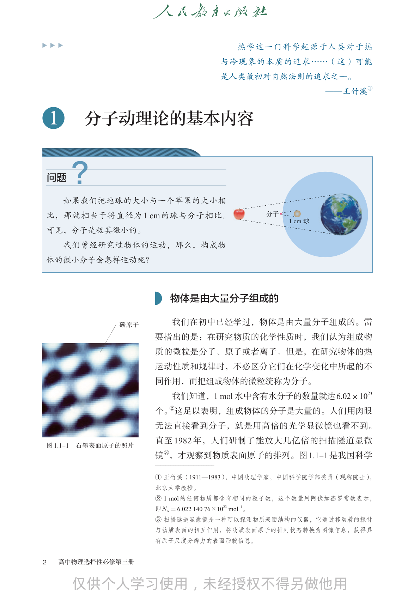

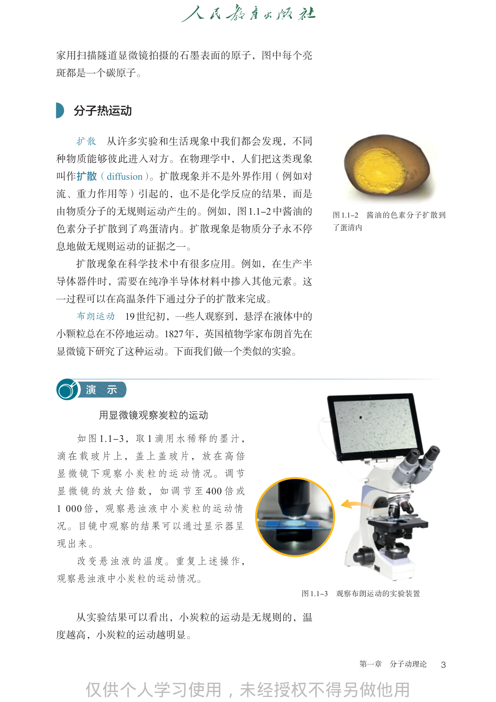

## RJ-PHYSICS-SEL3-003 扫描隧道显微镜

第一章 分子动理论 / 1 分子动理论的基本内容 · P7

扫描隧道显微镜是一种可以探测物质表面结构的仪器，它通过移动着的探针与物质表面的相互作用，将物质表面原子的排列状态转换为图像信息，获得具有原子尺度分辨力的表面形貌信息。

## RJ-PHYSICS-SEL3-004 扩散

第一章 分子动理论 / 1 分子动理论的基本内容 · P8

扩散 从许多实验和生活现象中我们都会发现，不同种物质能够彼此进入对方。在物理学中，人们把这类现象叫作扩散（diffusion）。扩散现象并不是外界作用（例如对流、重力作用等）引起的，也不是化学反应的结果，而是由物质分子的无规则运动产生的。例如，图1.1-2中酱油的色素分子扩散到了鸡蛋清内。扩散现象是物质分子永不停息地做无规则运动的证据之一。

扩散现象在科学技术中有很多应用。例如，在生产半导体器件时，需要在纯净半导体材料中掺入其他元素。这一过程可以在高温条件下通过分子的扩散来完成。

## RJ-PHYSICS-SEL3-005 布朗运动及其微观解释

第一章 分子动理论 / 1 分子动理论的基本内容 · P8-P9

布朗运动　19世纪初，一些人观察到，悬浮在液体中的小颗粒总在不停地运动。1827年，英国植物学家布朗首先在显微镜下研究了这种运动。下面我们做一个类似的实验。

演    示

用显微镜观察炭粒的运动

如图1.1-3，取1 滴用水稀释的墨汁，滴在载玻片上，盖上盖玻片，放在高倍显微镜下观察小炭粒的运动情况。调节显微镜的放大倍数，如调节至400 倍或1 000 倍，观察悬浊液中小炭粒的运动情况。目镜中观察的结果可以通过显示器呈现出来。

改变悬浊液的温度。重复上述操作，观察悬浊液中小炭粒的运动情况。

从实验结果可以看出，小炭粒的运动是无规则的，温度越高，小炭粒的运动越明显。

如果在显微镜下追踪一颗小炭粒的运动，每隔30 s 把炭粒的位置记录下来，然后用线段把这些位置按时间顺序依次连接起来，便可以得到一条类似于图1.1-4中某一颗微粒运动的位置连线。这表明微粒的运动是无规则的。实际上，就是在30 s内，微粒的运动也是极不规则的。

当时布朗观察的是悬浮在水中的花粉微粒。他起初认为，微粒的运动不是外界因素引起的，而是其自发的运动。

是不是因为植物有生命才产生了这样的运动？布朗用当时保存了上百年的植物标本，取其微粒进行实验，他还用了一些没有生命的无机物粉末进行实验。结果是，不管哪一种微粒，只要足够小，就会发生这种运动；微粒越小，运动就越明显。这说明微粒的运动不是生命现象。后人把悬浮微粒的这种无规则运动叫作布朗运动（Brownian motion）。

如图1.1-5，在显微镜下看起来连成一片的液体，实际上是由许许多多分子组成的，液体分子不停地做无规则运动，不断地撞击微粒。在某一瞬间，微粒在某个方向受到的撞击作用较强；在下一瞬间，微粒受到另一方向的撞击作用较强，这样就引起了微粒无规则的运动。

悬浮在液体中的微粒越小，在某一瞬间跟它相撞的液体分子数越少，撞击作用的不平衡性就表现得越明显，并且微粒越小，它的质量越小，其运动状态越容易被改变，因而，布朗运动越明显。如果悬浮在液体中的微粒很大，在某一瞬间跟它相撞的分子数很多，各个方向的撞击作用接近平衡，这时就很难观察到布朗运动了。

分子的无规则运动无法直接观察。悬浮微粒的无规则运动并不是分子的运动，但这一现象可以间接地反映液体分子运动的无规则性。

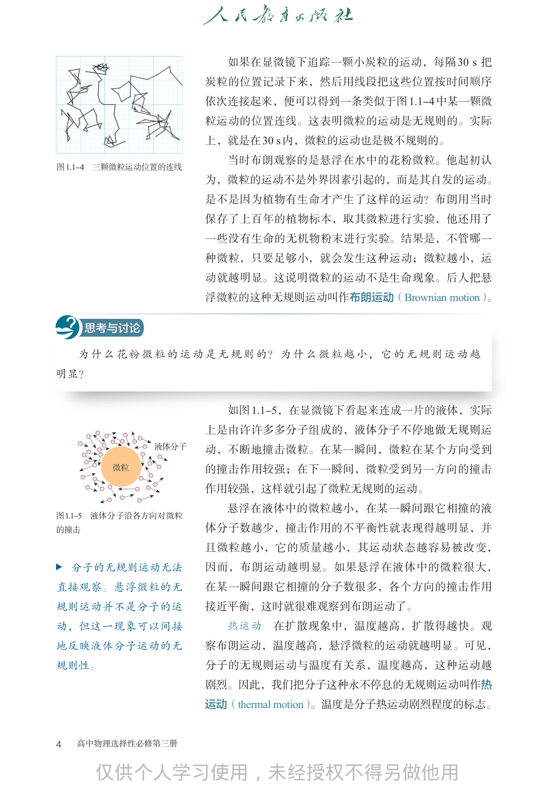

## RJ-PHYSICS-SEL3-006 分子热运动与温度

第一章 分子动理论 / 1 分子动理论的基本内容 · P9

热运动 在扩散现象中，温度越高，扩散得越快。观察布朗运动，温度越高，悬浮微粒的运动就越明显。可见，分子的无规则运动与温度有关系，温度越高，这种运动越剧烈。因此，我们把分子这种永不停息的无规则运动叫作热运动（thermal motion）。温度是分子热运动剧烈程度的标志。

## RJ-PHYSICS-SEL3-007 分子间的作用力

第一章 分子动理论 / 1 分子动理论的基本内容 · P10

分子间的作用力

气体很容易被压缩，说明气体分子之间存在着很大的空隙。固体或液体不容易被压缩，那么，分子之间还会有空隙吗？

做一做

向A、B 两个量筒中分别倒入50 mL 的水和酒精（图1.1-6甲），然后再将A量筒中的水倒入B量筒中，观察混合后液体的体积（图1.1-6乙）。它说明了什么问题？

水和酒精混合后的总体积变小了。这表明液体分子间存在着空隙。再如，压在一起的金块和铅块，各自的分子能扩散到对方的内部，这表明固体分子之间也存在着空隙。

分子间有空隙，大量分子却能聚集在一起，这说明分子之间存在着相互作用力。

当用力拉伸物体时，物体内各部分之间要产生反抗拉伸的作用力，此时分子间的作用力表现为引力。

当用力压缩物体时，物体内各部分之间会产生反抗压缩的作用力，此时分子间的作用力表现为斥力。

分子之间的引力或斥力都跟分子间距离有关，那么，它们之间有怎样的关系呢？

研究表明，分子间的作用力F跟分子间距离r的关系如图1.1-7所示。

当r < $r_0$ 时，分子间的作用力F 表现为斥力。

当r＝$r_0$ 时，分子间的作用力F为0，这个位置称为平衡位置。

当r > $r_0$ 时，分子间的作用力F 表现为引力。

那么，分子间为什么有相互作用力呢？

我们知道，分子是由原子组成的。原子内部有带正电的原子核和带负电的电子。分子间的作用力就是由这些带电粒子的相互作用引起的。

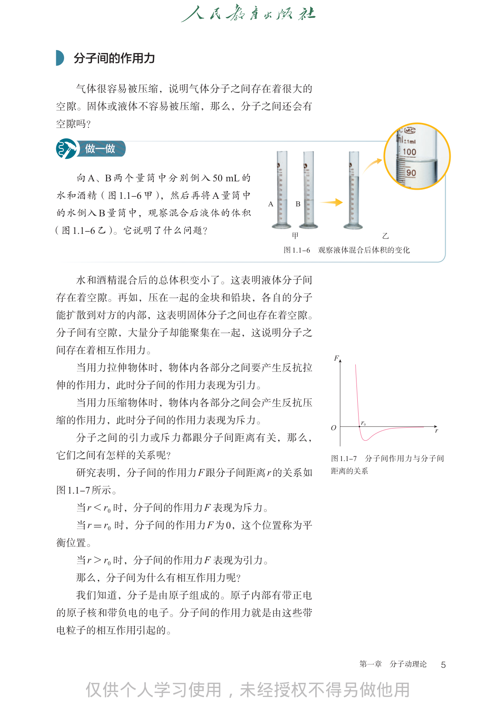

## RJ-PHYSICS-SEL3-008 分子动理论与统计规律

第一章 分子动理论 / 1 分子动理论的基本内容 · P11

我们已经知道：物体是由大量分子组成的，分子在做永不停息的无规则运动，分子之间存在着相互作用力。这就是分子动理论的基本内容。

在热学研究中常常以这样的基本内容为出发点，把物质的热学性质和规律看作微观粒子热运动的宏观表现。这样建立的理论叫作分子动理论（molecular kinetic theory）。

由于分子热运动是无规则的，所以，对于任何一个分子而言，在每一时刻沿什么方向运动，以及运动的速率等都具有偶然性；但是对于大量分子的整体而言，它们的运动却表现出规律性。在本章第3节我们将研究分子运动速率的分布规律。

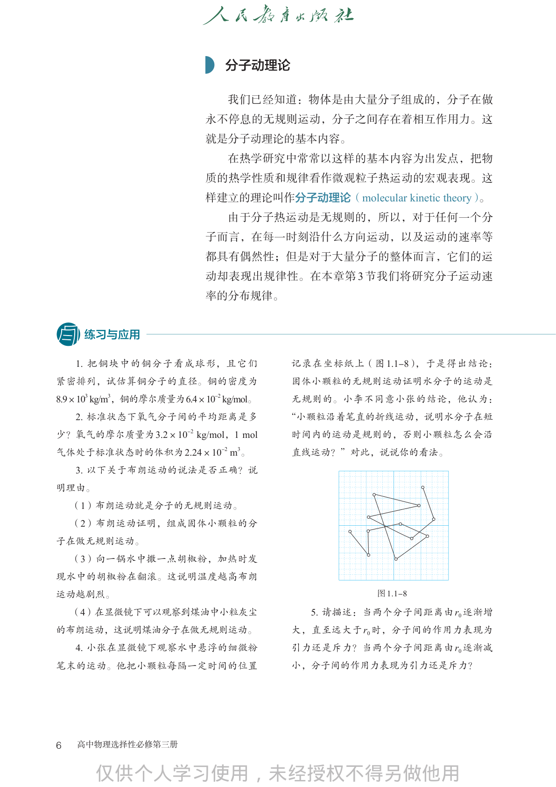

## RJ-PHYSICS-SEL3-009 用油膜法估测油酸分子的大小

第一章 分子动理论 / 2 实验：用油膜法估测油酸分子的大小 · P12-P14

实验思路

为了估测油酸分子的大小，我们把1滴油酸滴在水面上，水面上会形成一层油膜，油膜是由单层油酸分子（C₁₇H₃₃COOH）中的烃基C₁₇H₃₃—组成的。

尽管油酸分子有着复杂的结构和形状，分子间也存在着间隙，但在估测其大小时，可以把它简化为球形处理，并认为它们紧密排布（图1.2-1）。测出油膜的厚度d，它就相当于分子的直径。

实验中，为了使油酸充分展开，获得一块单分子油膜，我们需要将油酸在酒精中稀释后再滴入水中。这样的油酸酒精溶液滴在水面上，溶液中的酒精将溶于水并很快挥发，从而获得纯油酸形成的油膜。

这里可以粗略地认为，油膜的厚度d等于1滴油酸酒精溶液中纯油酸的体积V与它在水面上摊开的面积S之比。

物理量的测量

1. 测量1滴油酸酒精溶液中纯油酸的体积V。

配制一定浓度的油酸酒精溶液。用注射器吸取一段油酸酒精溶液，由注射器上的刻度读取该段溶液的总体积，再把它一滴一滴地滴入烧杯中（图1.2-2），记下液滴的总滴数。用它们的总体积除以总滴数，得到1滴油酸酒精溶液的体积，再计算其所含纯油酸的体积V。

2. 测量1滴油酸酒精溶液在水面上形成的油膜面积S。

在浅盘里盛上水，一只手捏住盛有爽身粉的布袋，另一只手拍打，将爽身粉均匀地撒在水面上（图1.2-3甲）。然后，用注射器向水面上滴1滴油酸酒精溶液（图1.2-3乙），油酸立即在水面散开，形成一块油膜。油膜上没有爽身粉，可以清楚地看出它的轮廓（图1.2-3丙）。待油膜形状稳定后，将事先准备好的带有坐标方格的玻璃板放在浅盘上，在玻璃板上描下薄膜的形状（图1.2-3丁）。

根据画有油膜轮廓的玻璃板上的坐标方格，计算轮廓范围内正方形的个数，不足半个的舍去，多于半个的算一个。然后，把正方形的个数乘单个正方形的面积就得到油膜的面积S。

数据分析

用1滴油酸酒精溶液中纯油酸的体积V和该油膜面积S计算出油膜厚度，即油酸分子的直径

$$d=\frac{V}{S}$$

大量实验结果表明，尽管所用的测定分子大小的方法不同，测出的结果也有差异，但数量级是一致的。除了一些有机物质的大分子外，多数分子大小的数量级为10⁻¹⁰ m。

油酸分子中的一部分是羧基—COOH，它对水有较强的亲合力；而另一部分烃基C₁₇H₃₃—对水没有亲合力，要冒出水面。因此，油酸分子会一个个地直立在水面上形成单分子油膜。

可以向1 mL油酸中加酒精，直至总量达到500 mL。

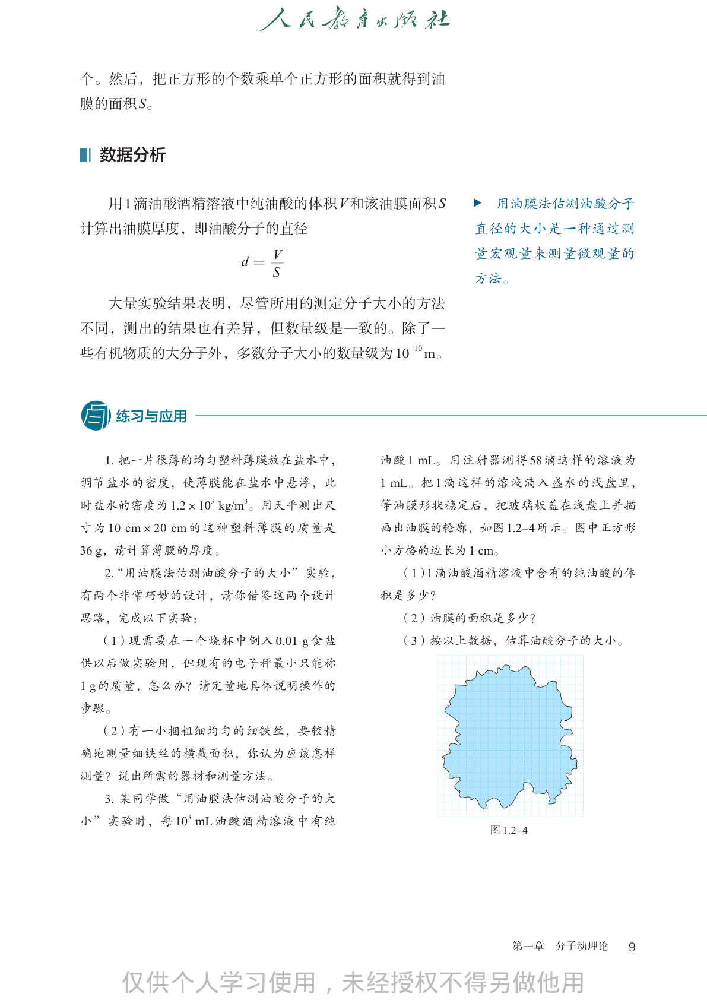

## RJ-PHYSICS-SEL3-010 统计规律

第一章 分子动理论 / 3 分子运动速率分布规律 · P15

伽尔顿板的上部规则地钉有铁钉，下部用竖直隔板隔成等宽的狭槽，从顶部入口投入一个小球时，小球落入某个狭槽是偶然的。如果投入大量的小球，就可以看到，最后落入各狭槽的小球数目是不相等的。靠近入口的狭槽内的小球数目多，远离入口的狭槽内小球的数目少。重复几次实验会发现，其分布情况遵从一定的规律。

在一定条件下，若某事件必然出现，这个事件叫作必然事件；若某事件不可能出现，这个事件叫作不可能事件。

若在一定条件下某事件可能出现，也可能不出现，这个事件叫作随机事件。大量随机事件的整体往往会表现出一定的规律性，这种规律就叫作统计规律（statistical regularity）。

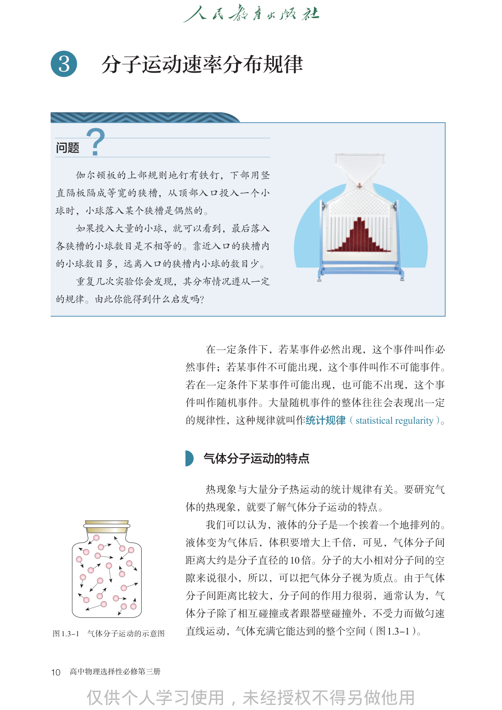

## RJ-PHYSICS-SEL3-011 气体分子运动的特点

第一章 分子动理论 / 3 分子运动速率分布规律 · P15-P16

热现象与大量分子热运动的统计规律有关。要研究气体的热现象，就要了解气体分子运动的特点。

我们可以认为，液体的分子是一个挨着一个地排列的。

液体变为气体后，体积要增大上千倍，可见，气体分子间距离大约是分子直径的10倍。分子的大小相对分子间的空隙来说很小，所以，可以把气体分子视为质点。由于气体分子间距离比较大，分子间的作用力很弱，通常认为，气体分子除了相互碰撞或者跟器壁碰撞外，不受力而做匀速直线运动，气体充满它能达到的整个空间（图1.3-1）。

虽然气体分子的分布比液体稀疏，但分子的数密度仍然十分巨大，分子之间频繁地碰撞，每个分子的速度大小和方向频繁地改变。分子的运动杂乱无章，在某一时刻，向着任何一个方向运动的分子都有，而且向各个方向运动的分子数目几乎相等。当然，这里说的数目相等，是针对大量分子而言的，实际数目会有微小的差别，由于分子数极多，其差别完全可以忽略。

分子的个数与它们所占空间体积之比叫作分子的数密度，通常用n 表示。

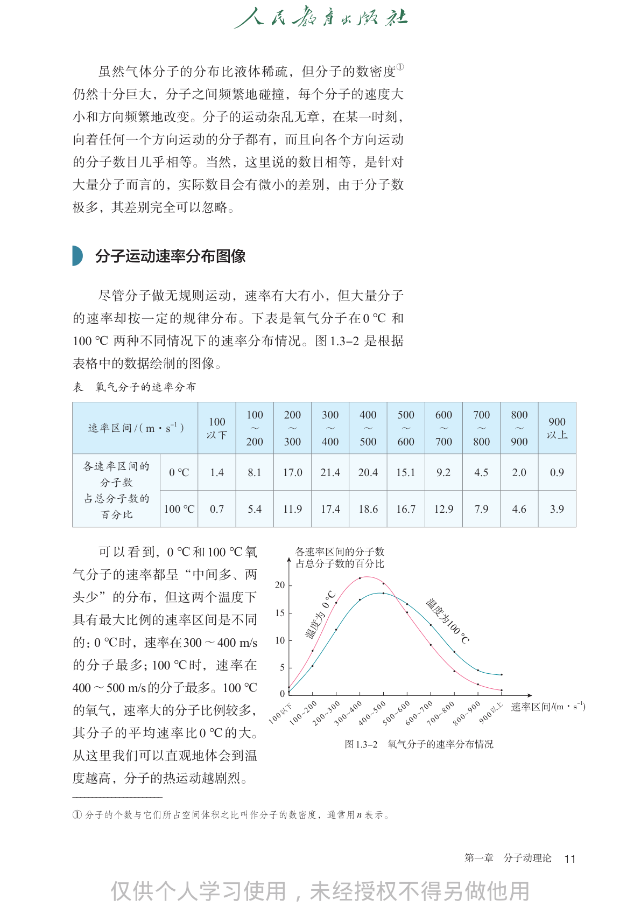

## RJ-PHYSICS-SEL3-012 分子运动速率分布规律

第一章 分子动理论 / 3 分子运动速率分布规律 · P16

尽管分子做无规则运动，速率有大有小，但大量分子的速率却按一定的规律分布。下表是氧气分子在0 ℃ 和100 ℃ 两种不同情况下的速率分布情况。图1.3-2 是根据表格中的数据绘制的图像。

|速率区间/(m·s⁻¹)|100以下|100～200|200～300|300～400|400～500|500～600|600～700|700～800|800～900|900以上|
|---|---|---|---|---|---|---|---|---|---|---|
|0 ℃各区间分子数占总分子数的百分比|1.4|8.1|17.0|21.4|20.4|15.1|9.2|4.5|2.0|0.9|
|100 ℃各区间分子数占总分子数的百分比|0.7|5.4|11.9|17.4|18.6|16.7|12.9|7.9|4.6|3.9|

可以看到，0 ℃和100 ℃氧气分子的速率都呈“中间多、两头少”的分布，但这两个温度下具有最大比例的速率区间是不同的：0 ℃时，速率在300～400 m/s的分子最多；100 ℃时，速率在400～500 m/s的分子最多。100 ℃的氧气，速率大的分子比例较多，其分子的平均速率比0 ℃的大。

从这里我们可以直观地体会到温度越高，分子的热运动越剧烈。

## RJ-PHYSICS-SEL3-013 气体压强的微观解释及豆粒模拟演示

第一章 分子动理论 / 3 分子运动速率分布规律 · P17-P18

从分子动理论的观点来看，气体对容器的压强源于气体分子的热运动，当它们飞到器壁时，就会跟器壁发生碰撞（可视为弹性碰撞），就是这个撞击对器壁产生了作用力，从而产生了压强。如图1.3-3甲，选择一个与器壁发生正碰的气体分子为研究对象，由于是弹性碰撞，所以气体分子与器壁碰撞前后的动量大小为mv，方向相反（图1.3-3乙），气体分子受到的冲量为

$$F\Delta t=-mv-mv=-2mv$$

气体分子受到的作用力为

$$F=-\frac{2mv}{\Delta t}$$

根据牛顿第三定律，器壁受到的作用力为

$$F'=\frac{2mv}{\Delta t}$$

同理，我们也可以求出气体分子与器壁发生斜碰时分子给器壁的作用力。

气体对容器的压强是大量气体分子不断撞击器壁的结果。或许有人会问，这种撞击是不连续的，为什么器壁受到的作用力却是均匀不变的呢？下面我们用豆粒模拟气体分子做一个实验。

模拟气体压强产生的机理

把一颗豆粒拿到台秤上方约20 cm的位置，放手后使它落在秤盘上，观察秤的指针的摆动情况。

再从相同高度把100 颗或者更多的豆粒均匀连续地倒在秤盘上（图1.3-4），观察指针的摆动情况。

使这些豆粒从更高的位置落在秤盘上，观察指针的摆动情况。

实验表明，单颗豆粒给秤盘的压力很小，作用时间也很短，但是大量的豆粒对秤盘的频繁碰撞，就对秤盘产生了一个持续的均匀的压力。

可见，对于单个分子来说，这种撞击是间断的、不均匀的，但是对于大量分子总的作用来说，就表现为连续的和均匀的了。器壁单位面积上受到的压力，就是气体的压强。

从微观角度来看，气体分子的数量是巨大的。一方面，若某容器中气体分子的平均速率越大，单位面积上气体分子与器壁的碰撞对器壁的作用力就越大；另一方面，若容器中气体分子的数密度大，在单位时间内，与单位面积器壁碰撞的分子数就多，平均作用力也会较大。

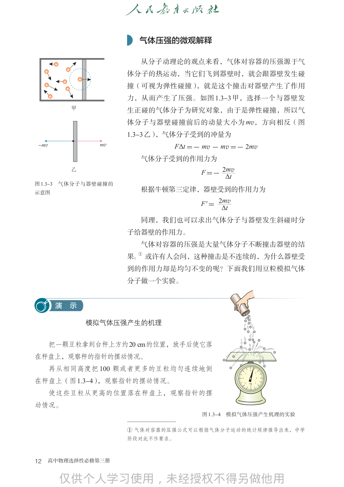

## RJ-PHYSICS-SEL3-014 分子动能和分子热运动的平均动能

第一章 分子动理论 / 4 分子动能和分子势能 · P19

分子不停地做无规则运动，那么，像一切运动着的物体一样，做热运动的分子也具有动能，这就是分子动能。

物体中分子热运动的速率大小不一，所以各个分子的动能也有大有小，而且在不断改变。在热现象的研究中，我们关心的是组成系统的大量分子整体表现出来的热学性质，因而，这里重要的不是系统中某个分子的动能大小，而是所有分子的动能的平均值。这个平均值叫作分子热运动的平均动能。

温度升高时，分子的热运动加剧，温度越高，分子热运动的平均动能越大。温度越低，分子热运动的平均动能越小。因此，可以得出结论：物体温度升高时，分子热运动的平均动能增加。这样，分子动理论使我们懂得了温度的微观含义。

过去我们说，“温度是分子热运动剧烈程度的标志”，现在就能进一步说，“物体的温度是它的分子热运动的平均动能的标志”。

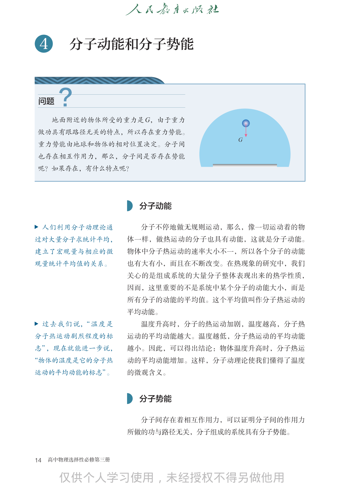

## RJ-PHYSICS-SEL3-015 分子势能

第一章 分子动理论 / 4 分子动能和分子势能 · P19-P20

分子间存在着相互作用力，可以证明分子间的作用力所做的功与路径无关，分子组成的系统具有分子势能。

如图1.4-1，设两个分子相距无穷远，我们可以规定它们的分子势能为0。让一个分子A不动，另一个分子B从无穷远处逐渐靠近A。在这个过程中，分子间的作用力（图1.4-2甲）做功，分子势能的大小发生改变。

当分子B向分子A靠近，分子间距离r大于 $r_0$ 时，分子间的作用力表现为引力，力的方向与分子的位移方向相同，分子间的作用力做正功，分子势能减小。

当分子间距离r减小到r0时，分子间的作用力为0，分子势能减到最小。

越过平衡位置r0后，分子B继续向分子A靠近，分子间的作用力表现为斥力，力的方向与分子的位移方向相反，分子间的作用力做负功，分子势能增大。

可见，分子势能的大小是由分子间的相对位置决定的。

由以上分析可知，如果选定分子间距离r为无穷远时的分子势能$E_p$为0，则分子势能$E_p$随分子间距离r变化的情况如图1.4-2乙所示。分子势能$E_p$随分子间距离r的变化有最小值，即当 r ＝ $r_0$ 时，分子势能最小。

物体的体积变化时，分子间距离将发生变化，因而分子势能随之改变。可见，分子势能与物体的体积有关。

两个分子相距无穷远是指它们之间几乎没有相互作用时的距离。

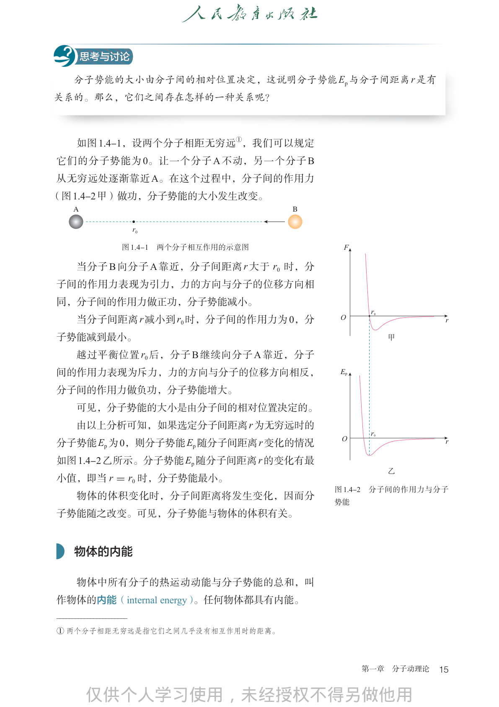

## RJ-PHYSICS-SEL3-016 物体的内能及其与机械能的区别

第一章 分子动理论 / 4 分子动能和分子势能 · P20-P21

物体中所有分子的热运动动能与分子势能的总和，叫作物体的内能（internal energy）。任何物体都具有内能。

分子热运动的平均动能与温度有关，分子势能与物体的体积有关。一般说来，物体的温度和体积变化时它的内能都会随之改变。

应当指出，组成物体的分子在做无规则的热运动，具有热运动的动能，它是内能的一部分；同时物体还可能做整体的运动，因此，还会具有动能，这是机械能的一部分。后者是由物体的机械运动决定的，它对物体的内能没有贡献。

## RJ-PHYSICS-SEL3-017 热力学系统、状态参量与平衡态

第二章 气体、固体和液体 / 1 温度和温标 · P24-P25

研究某一容器中气体的热学性质，其研究对象是容器中的大量分子组成的系统，这在热学中叫作一个热力学系统（thermodynamic system），简称系统。系统之外与系统发生相互作用的其他物体统称外界。例如，用酒精灯加热容器中的气体，把气体作为研究对象，它就是一个热力学系统，而容器和酒精灯就是外界。

在力学中，为描述物体（质点）的运动状态，我们使用了物体的位置和速度这两个物理量。在热学中，为确定系统的状态，也需要用到一些物理量，这些物理量叫作系统的状态参量（state parameter）。例如，为了确定系统的空间范围，要用到体积V，这是一个几何参量；为了确定外界与系统之间或系统内部各部分之间力的作用，要用到压强p，这是一个力学参量；而要确定系统的冷热程度，就要用到一个热学参量——温度T。

要定量地描述系统的状态往往很难，因为有时系统的参量会随时间变化。然而在没有外界影响的情况下，只要经过足够长的时间，系统内各部分的状态参量就能够达到稳定状态。这种状态叫作平衡态（equilibrium state），否则就是非平衡态。当系统处于平衡态时，系统所有状态参量都不随时间变化，我们就能比较准确地描述系统的状态。

在中学阶段，我们主要处理平衡态的问题。

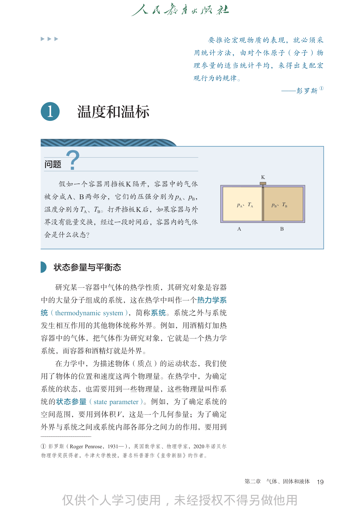

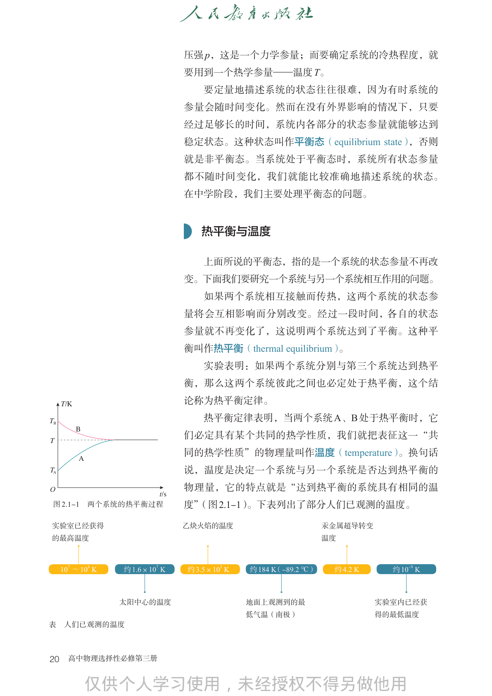

## RJ-PHYSICS-SEL3-018 热平衡、热平衡定律与温度

第二章 气体、固体和液体 / 1 温度和温标 · P25

上面所说的平衡态，指的是一个系统的状态参量不再改变。下面我们要研究一个系统与另一个系统相互作用的问题。

如果两个系统相互接触而传热，这两个系统的状态参量将会互相影响而分别改变。经过一段时间， 各自的状态参量就不再变化了，这说明两个系统达到了平衡。这种平衡叫作热平衡（thermal equilibrium）。

实验表明：如果两个系统分别与第三个系统达到热平衡，那么这两个系统彼此之间也必定处于热平衡，这个结论称为热平衡定律。

热平衡定律表明，当两个系统A、B处于热平衡时，它们必定具有某个共同的热学性质，我们就把表征这一“共同的热学性质”的物理量叫作温度（temperature）。换句话说，温度是决定一个系统与另一个系统是否达到热平衡的物理量，它的特点就是“达到热平衡的系统具有相同的温度”（图2.1-1）。下表列出了部分人们已观测的温度。

## RJ-PHYSICS-SEL3-019 温度计、摄氏温标和热力学温标

第二章 气体、固体和液体 / 1 温度和温标 · P26

如果要定量地描述温度，就必须有一套方法，这套方法就是温标（thermometric scale）。

确定一个温标时首先要选择一种测温物质，根据这种物质的某个特性来制造温度计。例如，可以根据水银的热膨胀来制造水银温度计，这时我们规定细管中水银柱的高度与温度的关系是线性关系。还可以根据气体压强随温度的变化来制造气体温度计（图2.1-2），等等。

确定了测温物质和它用以测温的某种性质之后， 还要确定温度的零点和分度的方法。例如，摄氏温标曾经规定，标准大气压下冰的熔点为0 ℃，水的沸点为100 ℃；并据此把玻璃管上0 ℃刻度与100 ℃刻度之间均匀分成100等份，每份算作1 ℃。

现代科学中用得更多的是热力学温标。热力学温标表示的温度叫作热力学温度（thermodynamic temperature），它是国际单位制中七个基本物理量之一，用符号T 表示，单位是开尔文（kelvin），简称开，符号为K。

1960年，国际计量大会确定了摄氏温标与热力学温标的关系：摄氏温标由热力学温标导出，摄氏温标所确定的温度用t 表示，它与热力学温度T 的关系是

$$T=t+273.15\,\mathrm{K}$$

根据国家标准，在表示温度差的时候可以用摄氏度（℃）代替开尔文（K），即1 ℃与1 K 相等。因此这个式子中T的单位用K，t的单位用℃。

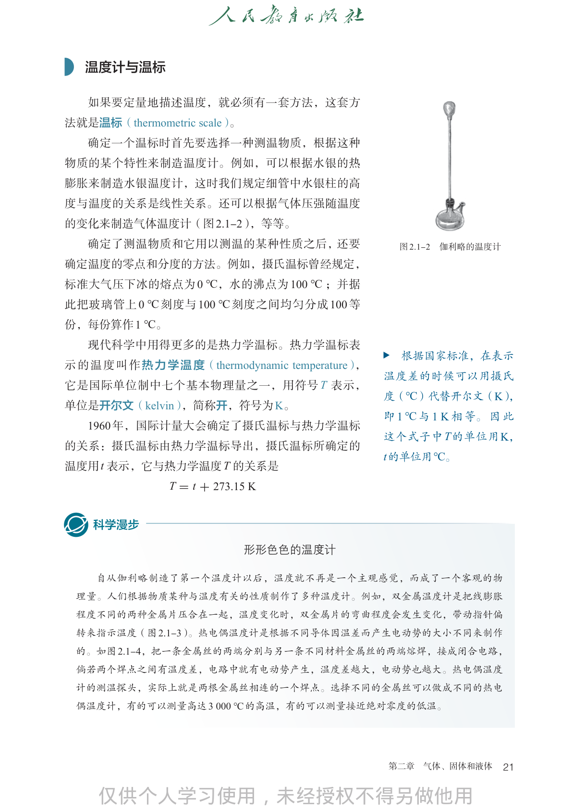

## RJ-PHYSICS-SEL3-020 不同温度计的测温原理

第二章 气体、固体和液体 / 1 温度和温标 · P26-P27

形形色色的温度计

自从伽利略制造了第一个温度计以后，温度就不再是一个主观感觉，而成了一个客观的物理量。人们根据物质某种与温度有关的性质制作了多种温度计。例如，双金属温度计是把线膨胀程度不同的两种金属片压合在一起，温度变化时，双金属片的弯曲程度会发生变化，带动指针偏转来指示温度（图2.1-3）。热电偶温度计是根据不同导体因温差而产生电动势的大小不同来制作的。如图2.1-4，把一条金属丝的两端分别与另一条不同材料金属丝的两端熔焊，接成闭合电路，倘若两个焊点之间有温度差，电路中就有电动势产生，温度差越大，电动势也越大。热电偶温度计的测温探头，实际上就是两根金属丝相连的一个焊点。选择不同的金属丝可以做成不同的热电偶温度计，有的可以测量高达3 000 ℃的高温，有的可以测量接近绝对零度的低温。

电阻温度计是根据金属的电阻率随温度的升高而变化的原理制成的。常见的金属电阻温度计有铂电阻温度计和铜电阻温度计，铂电阻温度计是目前最精确的温度计。热敏电阻温度计是利用某些半导体材料制作的，其电阻随温度的变化比导体更明显，但热敏电阻的稳定性差，主要用于低精度的测量。

压力表式温度计是根据气体压强随温度变化的规律制作的。某些铁磁性物质的磁性强弱跟温度有关，磁性的强弱便可以成为温度的标志。声音的传播速度跟介质的温度有关，声速也可以成为温度的标志。有些晶体（如石英）的固有频率跟温度有关，频率也可以成为温度的标志。根据这个思路，磁温度计、声速温度计、频率温度计等都相继制成，而且发挥着各自的作用。

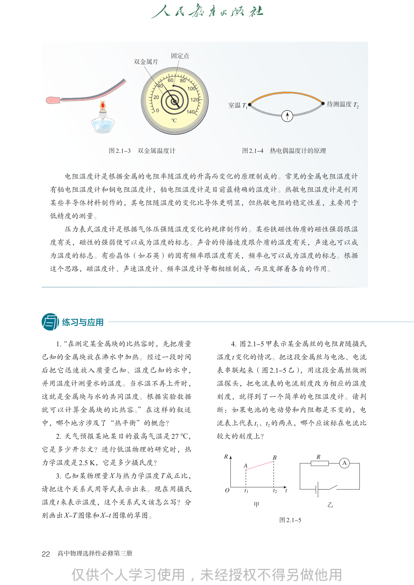

## RJ-PHYSICS-SEL3-021 等温变化与探究气体等温变化的规律

第二章 气体、固体和液体 / 2 气体的等温变化 · P28-P29

我们首先研究一种特殊的情况：一定质量的气体，在温度不变的条件下，其压强与体积变化时的关系。我们把这种变化叫作气体的等温变化。

实    验

探究气体等温变化的规律

实验思路针对气体的研究，可以先选定一个热力学系统，比如一定质量的空气，在温度不变的情况下，测量气体在不同体积时的压强，再分析气体压强与体积的关系。为此，我们需要一个既能改变气体体积，又能测出与体积相对应的气体压强的封闭容器。

下面我们利用如图2.2-1所示的装置进行实验。注射器下端的开口有橡胶套，它和柱塞一起把一段空气柱封闭。

本实验的研究对象是什么？怎样操作可以保证温度不发生明显的变化？

物理量的测量实验中，我们需要测量空气柱的体积V和空气柱的压强p，具体操作如下。

空气柱的长度l 可以通过刻度尺读取，空气柱的长度l与横截面积S的乘积就是它的体积V。空气柱的压强p可以从与注射器内空气柱相连的压力表读取。

把柱塞缓慢地向下压或向上拉，读取空气柱的长度与压强的几组数据。

数据分析一定质量气体等温变化的压强 p与体积V的关系，可以用 p-V图像来呈现。用采集的各组数据在坐标纸上描点，绘制曲线，由于它描述的是温度不变时气体压强与体积的关系，因此称它为等温线。若你绘制的p-V图像类似于双曲线（图2.2-2），那么，空气柱的压强是否跟体积成反比呢？

我们可以进一步通过图像来检验这个猜想。再以压强p为纵坐标，以体积的倒数为横坐标，把采集的各组数据在坐标纸上描点。如果p–(1/V)图像中的各点位于过原点的同一条直线上（图2.2-3），就说明压强跟体积的倒数成正比，即压强与体积成反比。如果不在同一条直线上，我们再尝试其他关系。

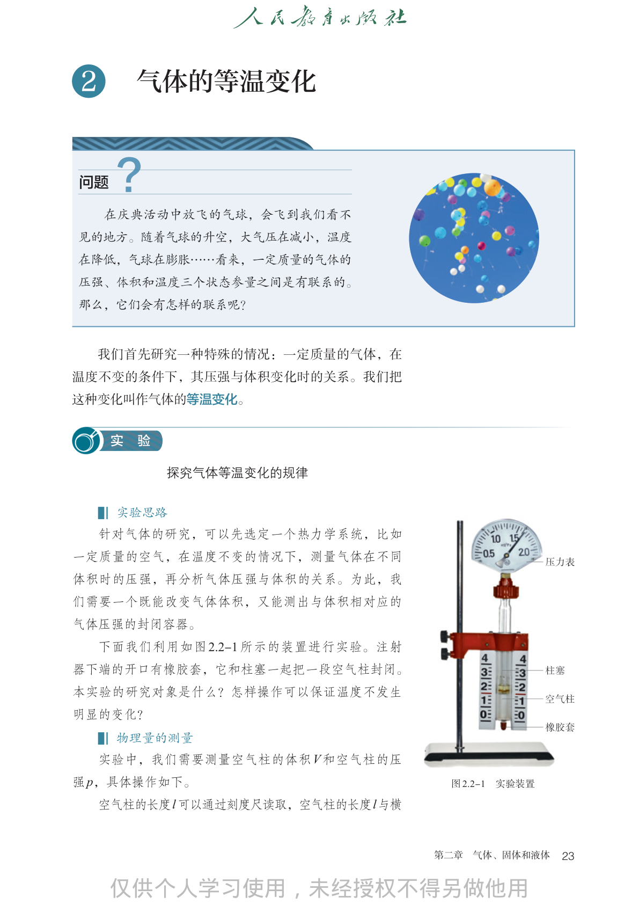

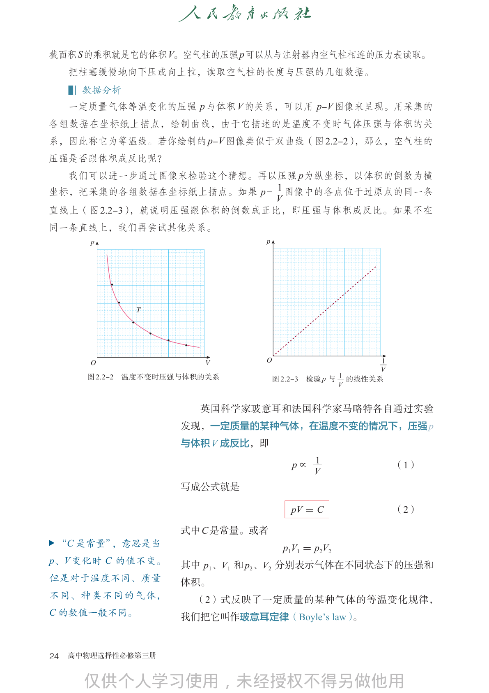

## RJ-PHYSICS-SEL3-022 玻意耳定律

第二章 气体、固体和液体 / 2 气体的等温变化 · P29

英国科学家玻意耳和法国科学家马略特各自通过实验发现，一定质量的某种气体，在温度不变的情况下，压强p与体积V成反比，即

$$p\propto\frac{1}{V}$$

写成公式就是

$$pV=C$$

式中C是常量。或者

$$p_1V_1=p_2V_2$$

其中p₁、V₁和p₂、V₂分别表示气体在不同状态下的压强和体积。pV＝C反映了一定质量的某种气体的等温变化规律，我们把它叫作玻意耳定律（Boyle’s law）。

“C是常量”，意思是当p、V变化时C的值不变。但是对于温度不同、质量不同、种类不同的气体，C的数值一般不同。

## RJ-PHYSICS-SEL3-023 用传感器探究气体等温变化的规律

第二章 气体、固体和液体 / 2 气体的等温变化 · P30

如图2.2-4，研究对象是注射器中的空气柱。

气体压强传感器通过塑料管与注射器相连。由注射器壁上的刻度可以读出气体的体积V ；由压强传感器测得的压强值p在计算机屏幕上可以实时显示。这样就可以获得不同体积时气体压强的数值。由计算机作出气体的p-V图像，就可以判断p与V是否具有反比例函数的关系。

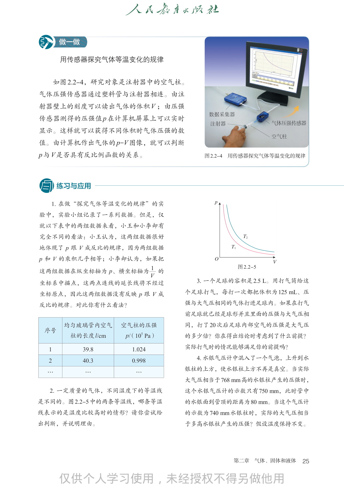

## RJ-PHYSICS-SEL3-024 气体的等压变化与盖—吕萨克定律

第二章 气体、固体和液体 / 3 气体的等压变化和等容变化 · P31

烧瓶上通过橡胶塞连接一根玻璃管，向玻璃管中注入一段水柱。用手捂住烧瓶，会观察到水柱缓慢向外移动。

实验表明，在保持气体的压强不变的情况下，一定质量气体的体积随温度的升高而增大。

一定质量的某种气体，在压强不变时，体积随温度变化的过程叫作气体的等压变化。

我们可以用实验研究一定质量的某种气体在压强不变的情况下，其体积V与热力学温度T的关系。实验表明，在V-T 图像中，等压线是一条过原点的直线（图2.3-1）。

法国科学家盖-吕萨克首先通过实验发现了这一线性关系，这个规律可以表述为：一定质量的某种气体，在压强不变的情况下，其体积V 与热力学温度T 成正比，即

$$V=CT\tag{1}$$

其中C是常量。或者

$$\frac{V_1}{T_1}=\frac{V_2}{T_2}$$

其中V1、$T_1$ 和V2、T2分别表示气体在不同状态下的体积和热力学温度。（1）式反映了一定质量的某种气体的等压变化规律，我们把它叫作盖-吕萨克定律（Gay-Lussac’s law）。

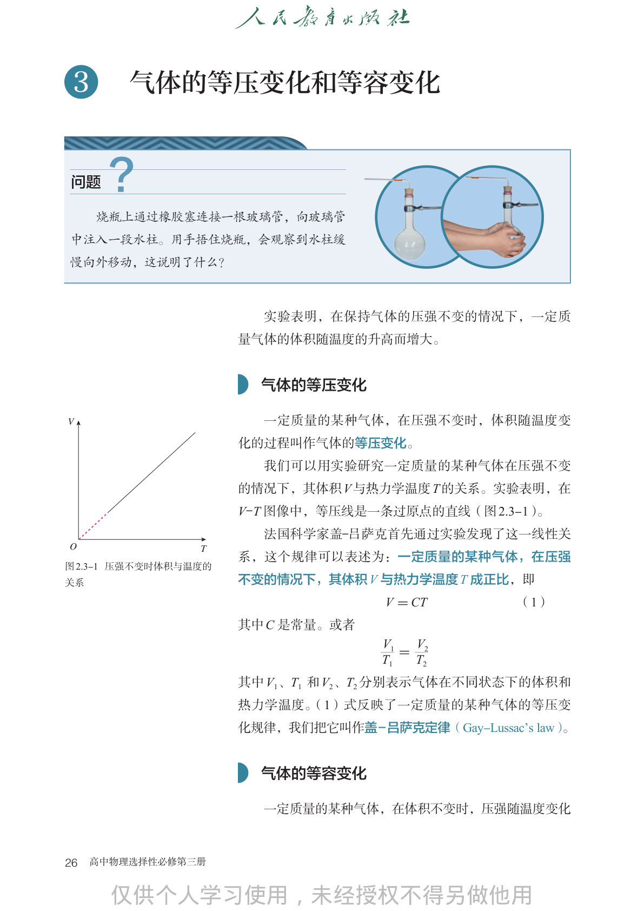

## RJ-PHYSICS-SEL3-025 气体的等容变化与查理定律

第二章 气体、固体和液体 / 3 气体的等压变化和等容变化 · P31-P33

一定质量的某种气体，在体积不变时，压强随温度变化的过程叫作气体的等容变化。

图2.3-2是气体等容变化时压强与温度的关系图像。从图2.3-2甲可以看出，在等容变化过程中，压强p与摄氏温度t是一次函数关系，不是简单的正比例关系。但是，如果把直线AB延长至与横轴相交（图2.3-2乙），把交点作为坐标原点，建立新的坐标系（图2.3-2丙），那么，这时的压强与温度的关系就是正比例关系了。

法国科学家查理在分析了实验事实后发现，当一定质量的气体体积一定时，各种气体的压强与温度之间都有线性关系。

可以证明，气体的压强不太大、温度不太低时，图2.3-2丙中坐标原点代表的温度就是热力学温度的0 K，也称绝对零度。所以说，在 p–T 图像中，一定质量的某种气体的等容线是一条通过坐标原点的直线。这时，这个规律可以表述为：

一定质量的某种气体，在体积不变的情况下，压强 p 与热力学温度 T 成正比，即p∝T。写成等式的形式就是

$$p=CT\tag{2}$$

其中C是常量。或者

$$\frac{p_1}{T_1}=\frac{p_2}{T_2}$$

其中p1、$T_1$ 和p2、$T_2$ 分别表示气体在不同状态下的压强和热力学温度。（2）式反映了一定质量的某种气体的等容变化规律，我们把它叫作查理定律（Charles’ law）。

在我们的计算中，相当于大气压几倍的压强都可以算作“压强不太大”，零下几十摄氏度的温度也可以算作“温度不太低”。

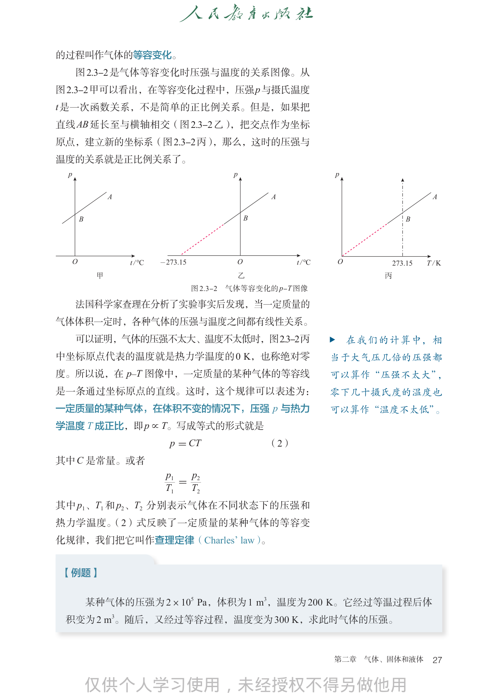

### 补充原例与原解

某种气体的压强为2×10⁵ Pa，体积为1 m³，温度为200 K。它经过等温过程后体积变为2 m³。随后，又经过等容过程，温度变为300 K，求此时气体的压强。

分析　封闭容器中的气体，在状态变化中气体质量不变。气体开始时的压强、体积和温度分别为p₁、V₁、T₁，经过等温过程变为p、V、T，再经过等容过程变为p₂、V₂、T₂。我们可以分别运用玻意耳定律和查理定律求解。

解　根据玻意耳定律，有

$$T_1=T,\quad p_1V_1=pV$$

根据查理定律，有

$$V=V_2,\quad \frac{p}{T}=\frac{p_2}{T_2}$$

联立上述各式可得

$$\frac{p_1V_1}{T_1}=\frac{p_2V_2}{T_2}$$

$$p_2=\frac{p_1V_1T_2}{V_2T_1}=\frac{2\times10^5\times1\times300}{2\times200}\,\mathrm{Pa}=1.5\times10^5\,\mathrm{Pa}$$

等温和等容变化后气体的压强为1.5×10⁵ Pa。

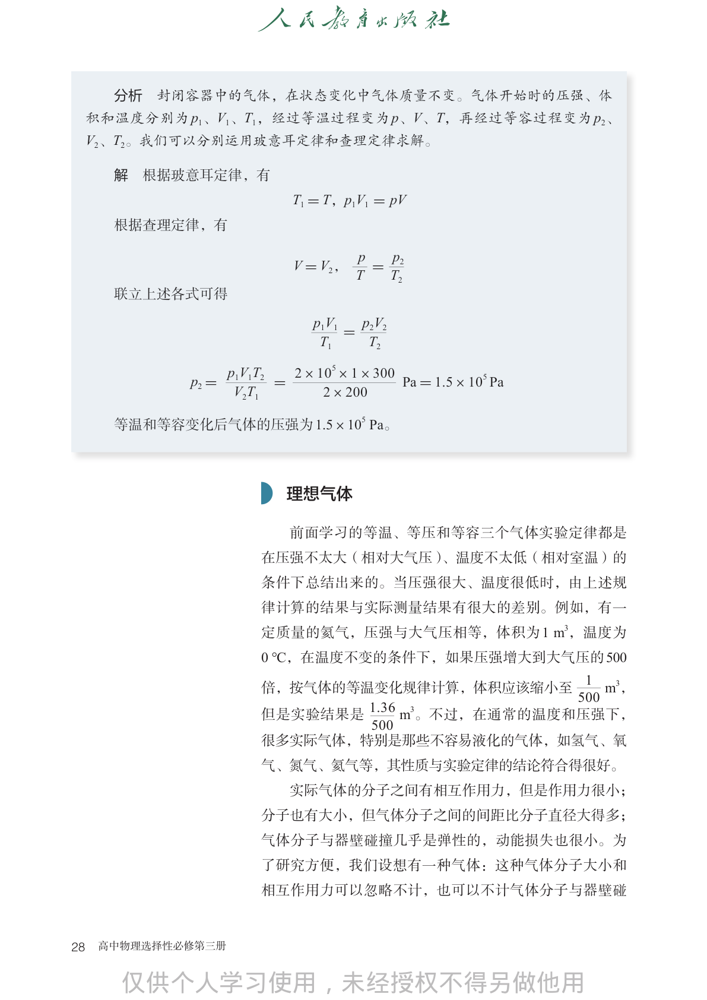

## RJ-PHYSICS-SEL3-026 理想气体与气体实验定律的适用条件

第二章 气体、固体和液体 / 3 气体的等压变化和等容变化 · P33-P34

前面学习的等温、等压和等容三个气体实验定律都是在压强不太大（相对大气压）、温度不太低（相对室温）的条件下总结出来的。当压强很大、温度很低时，由上述规律计算的结果与实际测量结果有很大的差别。例如，有一定质量的氦气，压强与大气压相等，体积为1 m³，温度为0 ℃，在温度不变的条件下，如果压强增大到大气压的500倍，按气体的等温变化规律计算，体积应该缩小至$\frac{1}{500}\,\mathrm{m^3}$，但是实验结果是$\frac{1.36}{500}\,\mathrm{m^3}$。不过，在通常的温度和压强下，很多实际气体，特别是那些不容易液化的气体，如氢气、氧气、氮气、氦气等，其性质与实验定律的结论符合得很好。

实际气体的分子之间有相互作用力，但是作用力很小；

分子也有大小，但气体分子之间的间距比分子直径大得多；

气体分子与器壁碰撞几乎是弹性的，动能损失也很小。为了研究方便，我们设想有一种气体：这种气体分子大小和相互作用力可以忽略不计，也可以不计气体分子与器壁碰撞的动能损失。这样的气体在任何温度、任何压强下都遵从气体实验定律，我们把它叫作理想气体（ideal gas）。按照这种理想情况下得出的物理规律能很好地解释实际气体的热学性质。在温度不低于零下几十摄氏度、压强不超过大气压的几倍时，把实际气体当成理想气体来处理，误差很小。

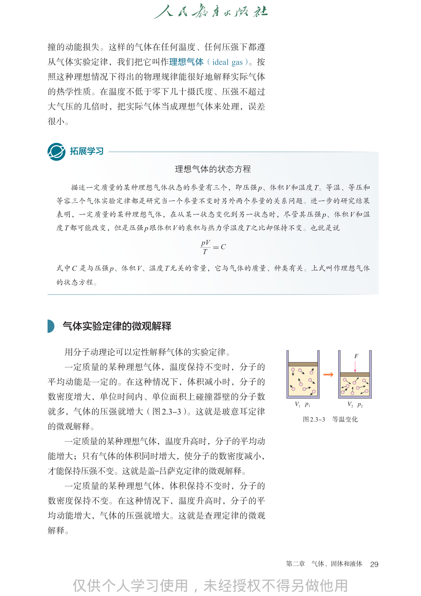

## RJ-PHYSICS-SEL3-027 理想气体的状态方程

第二章 气体、固体和液体 / 3 气体的等压变化和等容变化 · P34

描述一定质量的某种理想气体状态的参量有三个，即压强p、体积V和温度T。等温、等压和等容三个气体实验定律都是研究当一个参量不变时另外两个参量的关系问题。进一步的研究结果表明，一定质量的某种理想气体，在从某一状态变化到另一状态时，尽管其压强p、体积V和温度T都可能改变，但是压强p跟体积V的乘积与热力学温度T之比却保持不变。也就是说

$$\frac{pV}{T}=C$$

式中C 是与压强p、体积V、温度T无关的常量，它与气体的质量、种类有关。上式叫作理想气体的状态方程。

## RJ-PHYSICS-SEL3-028 气体实验定律的微观解释

第二章 气体、固体和液体 / 3 气体的等压变化和等容变化 · P34

用分子动理论可以定性解释气体的实验定律。

一定质量的某种理想气体，温度保持不变时，分子的平均动能是一定的。在这种情况下，体积减小时，分子的数密度增大，单位时间内、单位面积上碰撞器壁的分子数就多，气体的压强就增大（图2.3-3）。这就是玻意耳定律的微观解释。

一定质量的某种理想气体，温度升高时，分子的平均动能增大；只有气体的体积同时增大，使分子的数密度减小，才能保持压强不变。这就是盖-吕萨克定律的微观解释。

一定质量的某种理想气体，体积保持不变时，分子的数密度保持不变。在这种情况下，温度升高时，分子的平均动能增大，气体的压强就增大。这就是查理定律的微观解释。

## RJ-PHYSICS-SEL3-029 理想模型

第二章 气体、固体和液体 / 3 气体的等压变化和等容变化 · P35

在科学研究中，理想模型是为了便于研究问题而对研究对象进行理想化抽象的过程。实际问题往往比较复杂，影响的因素很多，直接研究它们会比较困难或几乎不能研究。科学研究中总是抓住研究对象的主要特征，忽略次要因素，对研究对象进行理想化抽象。运用这种方法，人们就可以用模型来表示研究对象，使研究变得简单、有效，从而便于人们去认识和把握问题的本质。应该说，理想模型在现实中并不存在，但是通过它可以对实际问题进行本质探讨，并得到有价值的结论。物理学中通过抽象方法构建的理想模型有很多，例如，质点、点电荷、单摆、弹簧振子、理想变压器、理想气体等。

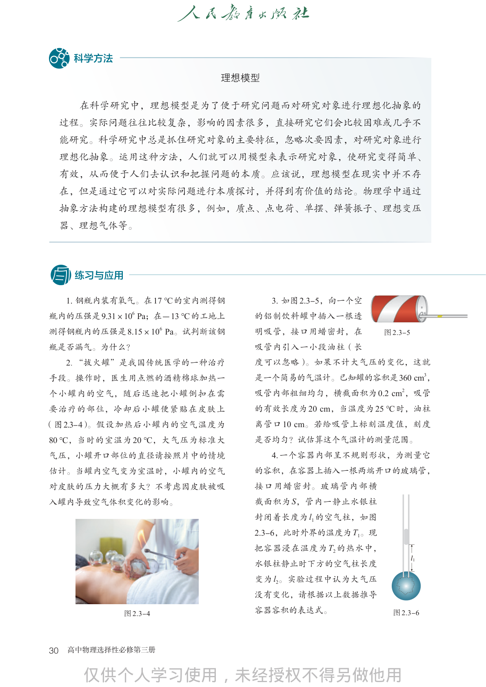

## RJ-PHYSICS-SEL3-030 晶体、非晶体与各向异性

第二章 气体、固体和液体 / 4 固体 · P36-P37

我们常见的固体，有些是晶体，有些是非晶体。

石英、云母、明矾、食盐、硫酸铜、味精等是晶体。

雪花是水蒸气凝华时形成的晶体，它们都具有相似的几何形状，即图案中都有六个角（图2.4-1）。食盐晶体是正六面体形，明矾晶体总是八面体形，天然石英晶体（俗称水晶）的中间是一个六棱柱，两端是六棱锥（图2.4-2）。这些晶体有天然的、规则的几何形状（图2.4-3）。

玻璃、蜂蜡、松香、沥青、橡胶等是非晶体。非晶体没有规则的外形。

除了形状是否规则外，晶体和非晶体在物理性质上也有所不同。我们在初中已经学过，晶体具有确定的熔点，非晶体没有确定的熔化温度，这就是区别之一。此外，其他物理性质也有差异。

实    验

观察玻璃和云母片上石蜡熔化区域的形状

把熔化了的石蜡薄薄地涂在薄玻璃片和单层云母片上，再将烙铁通电烧热，然后用烙铁头分别接触玻璃片和云母片的背面（图2.4-4）。观察玻璃片和云母片石蜡熔化区域的形状（图2.4-5）。

石蜡熔化区域形状的不同说明了什么？

从实验结果可以看出，玻璃片上石蜡熔化区域的形状近似于圆形，表明玻璃沿各个方向的导热性能相同；云母片上石蜡熔化区域的形状呈椭圆形，表明云母沿不同方向的导热性能不同。还有些晶体沿不同方向的导电性能不同；

而有些晶体沿不同方向的光学性质不同，这类现象叫作各向异性（anisotropy）。如图2.4-6，方解石晶体是各向异性的晶体，它能把光分解为两束光而沿不同方向折射，形成双折射现象。非晶体沿各个方向的物理性质都是一样的，这叫作各向同性（isotropy）。

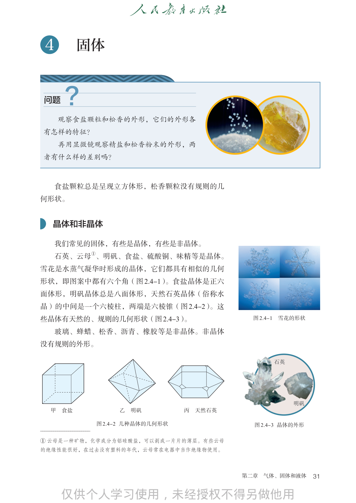

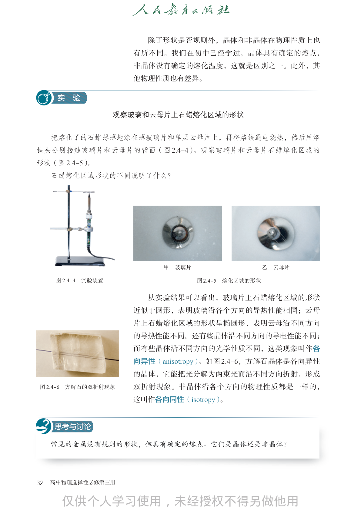

## RJ-PHYSICS-SEL3-031 单晶体和多晶体

第二章 气体、固体和液体 / 4 固体 · P38

从金属的显微图样中可以看到，它是由许多细小的晶粒组成的（图2.4-7）。每个晶粒都是一个小的单晶体（monocrystal），有规则的形状且各向异性。

但是，由于这些小的单晶体的取向杂乱无章，所以金属没有确定的几何形状，也不显示各向异性，仅保留了在一定压强下具有确定熔点的特征，我们把它称为多晶体（polycrystal）。蔗糖受潮后粘在一起形成的糖块，看起来没有确定的几何形状。但是用放大镜观看，仍可以发现组成糖块的一个个晶体粒。粘在一起的糖块也是多晶体，单个的蔗糖晶体颗粒是单晶体。

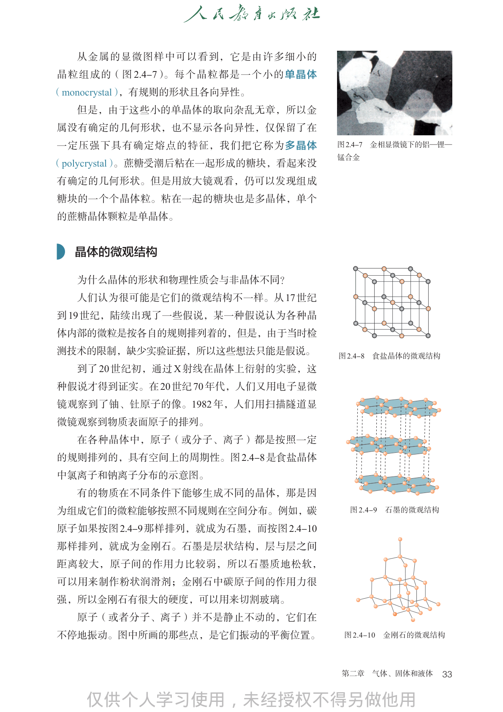

## RJ-PHYSICS-SEL3-032 晶体的微观结构及晶体与非晶体的转化

第二章 气体、固体和液体 / 4 固体 · P38-P39

在各种晶体中，原子（或分子、离子）都是按照一定的规则排列的，具有空间上的周期性。图2.4-8是食盐晶体中氯离子和钠离子分布的示意图。

有的物质在不同条件下能够生成不同的晶体，那是因为组成它们的微粒能够按照不同规则在空间分布。例如，碳原子如果按图2.4-9那样排列，就成为石墨，而按图2.4-10那样排列，就成为金刚石。石墨是层状结构，层与层之间距离较大，原子间的作用力比较弱，所以石墨质地松软，可以用来制作粉状润滑剂；金刚石中碳原子间的作用力很强，所以金刚石有很大的硬度，可以用来切割玻璃。

原子（或者分子、离子）并不是静止不动的，它们在不停地振动。图中所画的那些点，是它们振动的平衡位置。

同种物质也可能以晶体和非晶体两种不同的形态出现，也就是说，物质是晶体还是非晶体，并不是绝对的。

例如，天然石英晶体熔化以后再凝固就变成了石英玻璃，而石英玻璃是非晶体（图 2.4-11）。有些非晶体在一定条件下也可以转化为晶体。

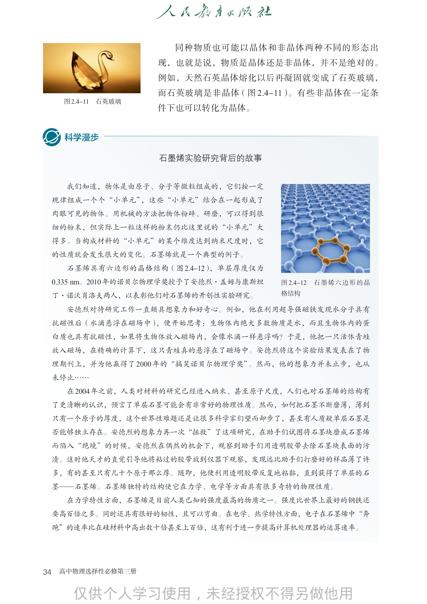

## RJ-PHYSICS-SEL3-033 石墨烯的结构和物理性质

第二章 气体、固体和液体 / 4 固体 · P39

我们知道，物体是由原子、分子等微粒组成的，它们按一定规律组成一个个“小单元”，这些“小单元”结合在一起形成了肉眼可见的物体。用机械的方法把物体粉碎、研磨，可以得到很细的粉末，但实际上一粒这样的粉末仍比这里说的“小单元”大得多。当构成材料的“小单元”的某个维度达到纳米尺度时，它的性质就会发生很大的变化。石墨烯就是一个典型的例子。

石墨烯具有六边形的晶格结构（图2.4-12），单一层厚度仅为0.335 nm。

石墨烯独特的结构使它在力学、电学等方面具有很多奇特的物理性质。在力学特性方面，石墨烯是目前人类已知的强度最高的物质之一。强度比世界上最好的钢铁还要高百倍之多。同时还具有很好的韧性，且可以弯曲。在电学、热学特性方面，电子在石墨烯中“奔跑”的速率比在硅材料中高出数十倍甚至上百倍，这有利于进一步提高计算机处理器的运算速率。

## RJ-PHYSICS-SEL3-034 液体表面张力及肥皂膜实验

第二章 气体、固体和液体 / 5 液体 · P41-P42

我们发现：一些昆虫可以停在水面上（图2.5-1）；

叶面上的露珠呈球形……这些现象表明，液体表面可能具有与内部不同的性质。

实    验观察肥皂膜和棉线的变化

1. 把一条细棉线的两端分别系在铁丝环的两侧，要使棉线处于略为松弛的状态。然后将铁丝环浸入肥皂液里，再拿出来时环上就留下了一层肥皂液的薄膜。这时薄膜上的棉线仍是松弛的（图2.5-2甲）。用烧热的针刺破棉线一侧的薄膜（图2.5-2乙），观察薄膜和棉线发生的变化。

2. 把一个棉线圈系在铁丝环上，使环上布满肥皂液的薄膜，这时膜上的棉线圈仍是松弛的（图2.5-2丙）。用烧热的针刺破棉线圈里的薄膜，观察棉线圈外的薄膜和棉线圈发生的变化（图2.5-2丁）。

观察结果表明，用烧热的针刺破棉线某一侧的薄膜后，另一侧肥皂膜就会立即收缩把松弛的棉线绷紧，并且始终向着肥皂膜一侧收缩，液体的表面具有收缩趋势。

为什么液体表面具有收缩趋势呢？原来，液体表面有一层跟气体接触的薄层，叫作表面层。表面层与液体内部的微观结构不同（图2.5-3甲）。在第一章我们已经了解了分子间的作用力跟分子间距离的关系问题。在液体内部，分子间平均距离r略小于r0，分子间的作用力表现为斥力；在表面层，分子比较稀疏，分子间距离r略大于r0，分子间的作用力表现为引力。设想在液体表面画一条分界线MN，把液体表面分为1、2两部分，MN两侧的液体之间存在着一对与MN垂直、大小相等、方向相反的作用力（图2.5-3乙）。由于MN是任意画的，所以这种力在液体表面层内的各个方向上都存在，力的方向总是跟液面相切，且与分界线垂直。这种力使液体表面绷紧，叫作液体的表面张力（surface tension）。

如果液面是曲面，这种作用力与液体表面相切。

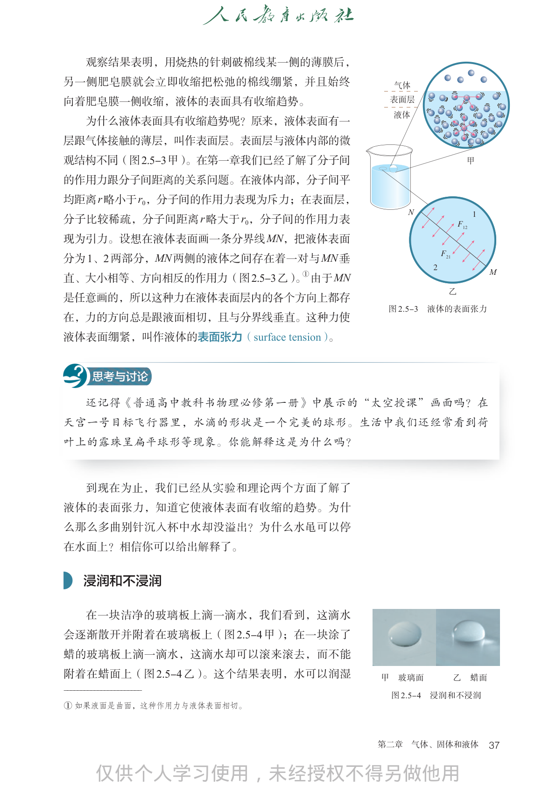

## RJ-PHYSICS-SEL3-035 浸润和不浸润

第二章 气体、固体和液体 / 5 液体 · P42-P43

在一块洁净的玻璃板上滴一滴水，我们看到，这滴水会逐渐散开并附着在玻璃板上（图2.5-4甲）；在一块涂了蜡的玻璃板上滴一滴水，这滴水却可以滚来滚去，而不能附着在蜡面上（图2.5-4乙）。这个结果表明，水可以润湿玻璃，但水不能润湿蜡。

一种液体会润湿某种固体并附着在固体的表面上，这种现象叫作浸润；一种液体不会润湿某种固体，也就不会附着在这种固体的表面，这种现象叫作不浸润。当液体和与之接触的固体的相互作用比液体分子之间的相互作用强时，液体能够浸润固体。反之，液体则不浸润固体。

一种液体是否浸润某种固体，与这两种物质的性质都有关系。例如，水银不浸润玻璃，但浸润铅。如果把水银滴到干净的铅板上，水银就会附着在铅板上，很难擦去。

液体放在玻璃管中，液面与管壁接触的位置是弯曲的，但有的向上弯，有的向下弯（图2.5-5）。这也是浸润与不浸润两种现象的区别。

## RJ-PHYSICS-SEL3-036 毛细现象及观察实验

第二章 气体、固体和液体 / 5 液体 · P43-P44

将内径不同、两端开口的洁净细玻璃管竖直插入水中（图2.5-6甲），观察细玻璃管中液面的高度；再将另一组内径不同、两端开口的塑料笔芯竖直插入水中（图2.5-6乙），观察笔芯中液面的高度。

实验结果表明，洁净细玻璃管内的液面比水面高；塑料笔芯内的液面比水面低。管的内径越小，上述现象就越明显。像这样浸润液体在细管中上升的现象，以及不浸润液体在细管中下降的现象，称为毛细现象（capillarity）。

由于液体浸润管壁，液面呈图2.5-7所示的形状，液面弯曲。液体表面张力形成向上的拉力，这个力使管中液体向上运动。当管中液体上升到一定高度时，液体所受重力与这个使它向上的力平衡，液面稳定在一定的高度。

有些物体内部有许多细小的孔道，孔道起到了毛细管的作用。例如，土壤里有很多毛细管，地下的水分可以沿着它们上升到地面。如果要保存地下的水分，就要把地面的土壤锄松（图2.5-8），破坏这些土壤里的毛细管。相反，如果想把地下的水分引上来，就不仅要保持土壤里的毛细管，而且还要使它们变得更细，这时就要用磙子压紧土壤。

## RJ-PHYSICS-SEL3-037 液晶

第二章 气体、固体和液体 / 5 液体 · P44-P45

液晶在现代生活中扮演着重要角色，广泛应用于手机屏幕、平板电视等显示设备中。为什么“液体”和“晶体”联系在一起了？液晶到底是什么物质？

构成液晶的分子为有机分子，大多为棒状，其棒长多为棒直径的5倍以上。这种长棒状的分子结构，使分子集合体中的分子在没有外界干扰的情况下趋向相互平行排列。

液晶具有液体的流动性，但在低温时液晶会凝固成结晶态（图2.5-9甲），不仅分子的取向是有序的，而且分子重心的位置也是有序的。如果把结晶态分子的有序排列程度定为1的话，则当温度升高时，晶体中分子的热运动增强，使分子重心位置的有序性消失，转为液晶态（图2.5-9乙），分子取向有序程度也下降为0.6。当温度进一步升高时，分子取向有序性也消失，完全进入无序的状态，变成液态（图2.5-9丙）。

可见，液晶是介于固态和液态之间的一种物质状态。

液晶态既具有液体的流动性，又在一定程度上具有晶体分子的规则排列的性质。有些物质在特定的温度范围之内具有液晶态；另一些物质，在适当的溶剂中溶解时，在一定的浓度范围具有液晶态。

分子取向排列的液晶具有光学各向异性，具体地说，沿分子长轴方向上的折射率不同于沿短轴的。入射光的偏振方向与液晶分子长轴的方向成不同夹角时，液晶对光的折射率不同。因此，一束非偏振光射入液晶层后再射出时，由于液晶折射率的各向异性会产生两束光程不同的光。这样两束光在出射点处矢量叠加（等效于干涉），我们在显微镜下就可以观察到某种色光。

液晶的研究在生命科学中也有应用。例如，某些物质在水溶液中能够形成薄片状液晶，而这正是生物膜的主要构成部分。目前在实验室中已经可以利用这样的人造生物膜研究离子的渗透性，从而了解机体对药物的吸收等生理过程。另外，在脑、肌肉和视网膜等多种人体组织中都发现了液晶结构，有关液晶的研究已经成为物理科学与生命科学的一个重要结合点。

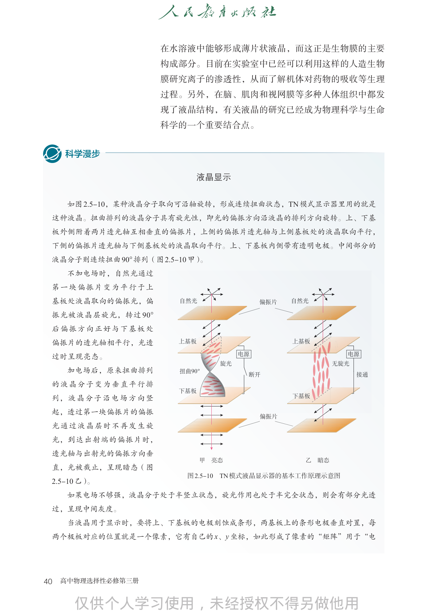

## RJ-PHYSICS-SEL3-038 液晶显示的基本原理

第二章 气体、固体和液体 / 5 液体 · P45-P46

如图2.5-10，某种液晶分子取向可沿轴旋转，形成连续扭曲状态，TN模式显示器里用的就是这种液晶。扭曲排列的液晶分子具有旋光性，即光的偏振方向沿液晶的排列方向旋转。上、下基板外侧附着两片透光轴互相垂直的偏振片，上侧的偏振片透光轴与上侧基板处的液晶取向平行，下侧的偏振片透光轴与下侧基板处的液晶取向平行。上、下基板内侧带有透明电极。中间部分的液晶分子则连续扭曲90°排列（图2.5-10甲）。

不加电场时，自然光通过第一块偏振片变为平行于上基板处液晶取向的偏振光，偏振光被液晶层旋光，转过90°后偏振方向正好与下基板处偏振片的透光轴相平行，光透过时呈现亮态。

加电场后，原来扭曲排列的液晶分子变为垂直平行排列，液晶分子沿电场方向竖起，透过第一块偏振片的偏振光通过液晶层时不再发生旋光，到达出射端的偏振片时，透光轴与出射光的偏振方向垂直，光被截止，呈现暗态（图2.5-10乙）。

如果电场不够强，液晶分子处于半竖立状态，旋光作用也处于半完全状态，则会有部分光透过，呈现中间灰度。

当液晶用于显示时，要将上、下基板的电极刻蚀成条形，两基板上的条形电极垂直对置，每两个极板对应的位置就是一个像素，它有自己的x、y坐标，如此形成了像素的“矩阵”用于“电寻址”（图2.5-11）。选通的像素为开态，未选通的像素为关态。为了具有彩色显示，每一个像素又分为三个子像素对应红、蓝、绿三基色彩色滤光膜。对三个子像素的光强分别进行调制，通过三基色混色获得彩色显示。这就是液晶显示器的基本工作原理。

液晶显示器轻便、节能且只需低压（小于5 V）驱动，目前已经广泛应用在便携式设备上。

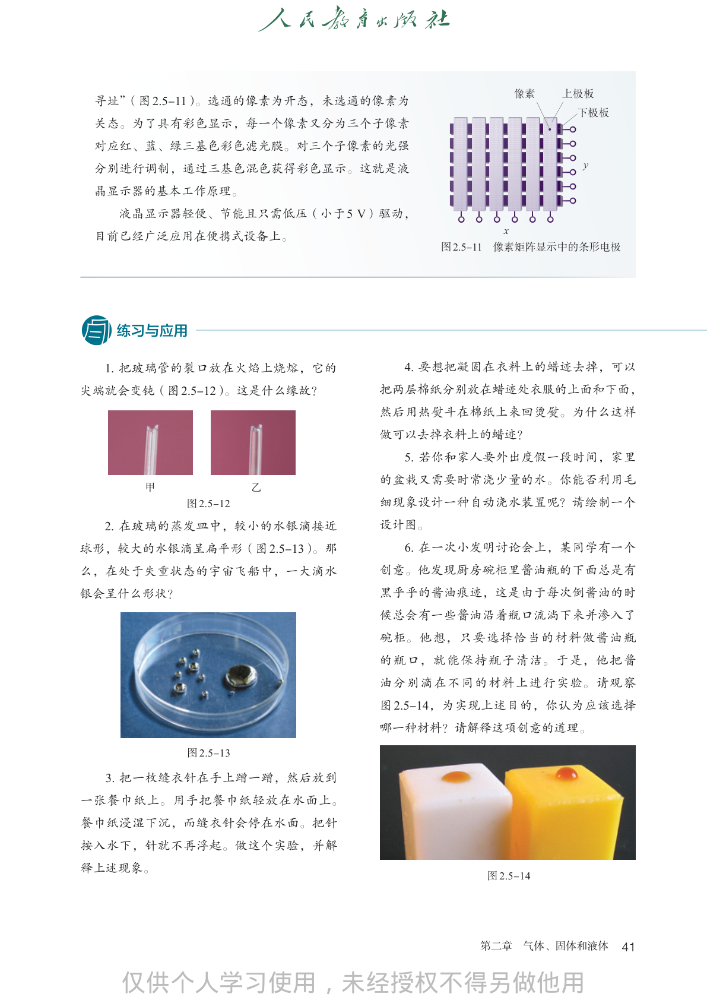

## RJ-PHYSICS-SEL3-039 焦耳实验、绝热过程与内能

第三章 热力学定律 / 1 功、热和内能的改变 · P51-P53

在焦耳研究功与热等效性的许多实验中，有两个最具代表性。一个是让重物下落带动叶片搅拌容器中的水，引起水温上升；另一个是通过电流的热效应给水加热。

实验1 如图3.1-1，用绝热性能良好的材料制作容器，容器中安装着叶片组成的搅拌器。重物下落时带动叶片转动，搅拌容器中的水，水由于摩擦而温度上升。

在这个过程中，系统不从外界吸热，也不向外界放热，这样的过程叫作绝热过程（adiabatic process）。

焦耳的多次实验测量表明，尽管各次悬挂重物的质量不同，下落的高度也不一样，但只要重力所做的功相同，容器内水温上升的数值都是相同的，即系统状态的变化是相同的。

实验2 如图3.1-2，让正在下降的重物带动发电机发电，电流通过浸在液体中的电阻丝，由电流的热效应给液体加热，使液体温度上升。

多次实验结果表明，对于同一个系统，如果过程是绝热的，那么不管通过电阻丝的电流或大或小、通电时间或长或短，只要所做的电功相等，则系统温度上升的数值是相同的，即系统的状态就发生了同样的变化。

焦耳的这些实验表明，在各种不同的绝热过程中，如果使系统从状态1 变为状态2，所需外界做功的数量是相同的。也就是说，要使系统状态通过绝热过程发生变化，做功的数量只由过程始末两个状态1、2 决定，而与做功的方式无关。那么，必定存在一个描述系统状态的物理量，这个物理量的变化与做功相关。例如，在力学中，重力做的功仅由物体的起点和终点两个位置决定，而与物体的运动路径无关。根据这一事实人们认识到，物体具有重力势能。物体在两个位置间的重力势能之差等于物体在这两个位置间移动时重力所做的功。

与此类似，在热力学系统的绝热过程中，外界对系统做的功仅由过程的始末两个状态决定，不依赖于做功的具体过程和方式。这就使我们认识到，任何一个热力学系统必定存在一个只依赖于系统自身状态的物理量，这个物理量在两个状态间的差别与外界在绝热过程中对系统做的功相联系。鉴于功是能量变化的量度，所以这个物理量必定是系统的一种能量，我们把它称为系统的内能。

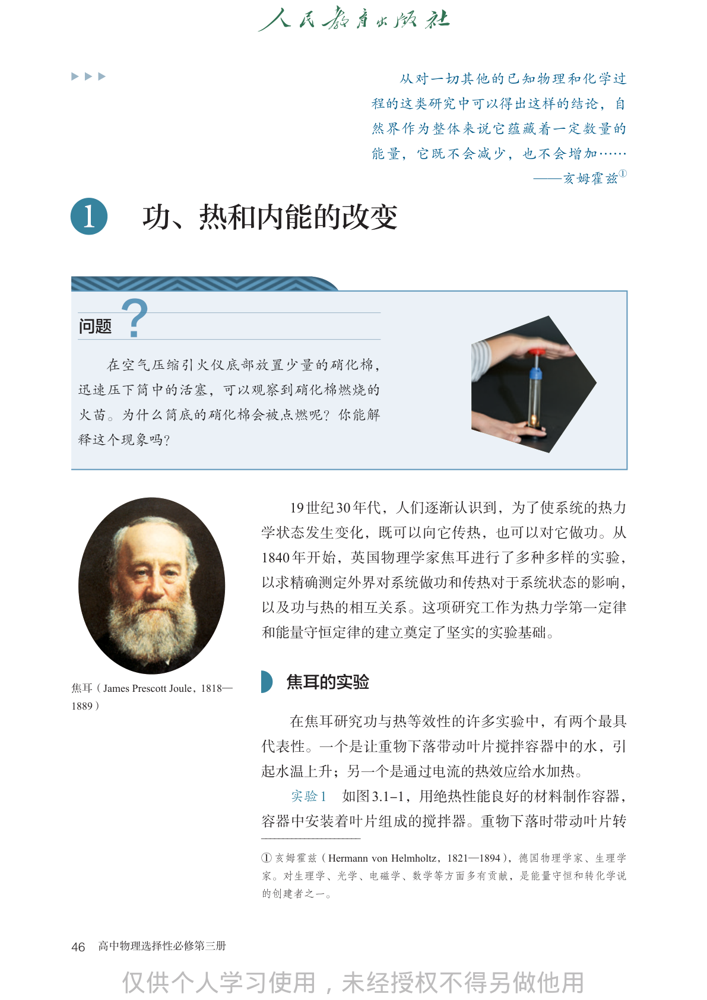

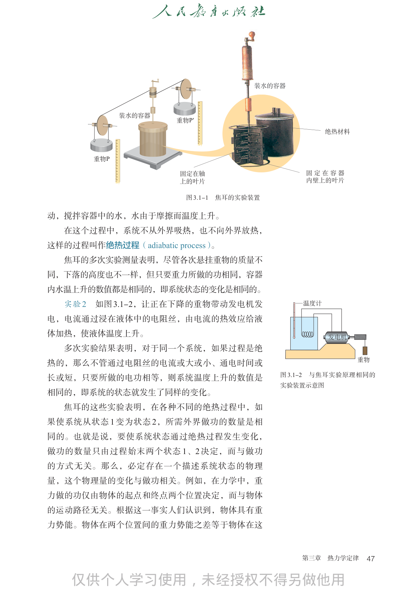

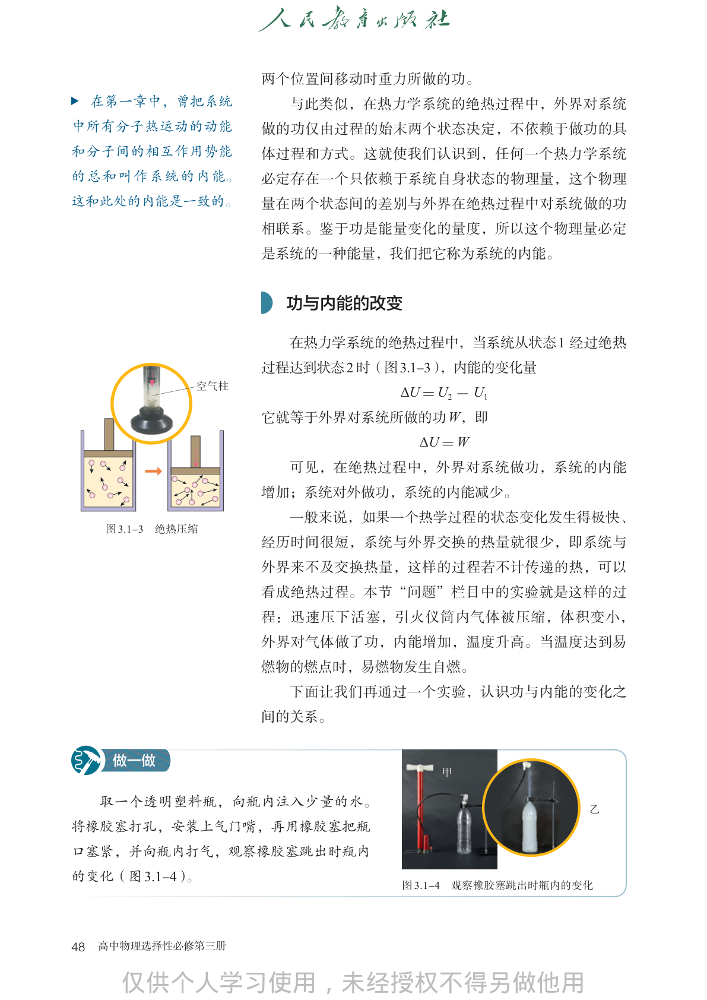

## RJ-PHYSICS-SEL3-040 功与内能的改变及绝热膨胀实验

第三章 热力学定律 / 1 功、热和内能的改变 · P51;P53-P54

在空气压缩引火仪底部放置少量的硝化棉，迅速压下筒中的活塞，可以观察到硝化棉燃烧的火苗。

在热力学系统的绝热过程中，当系统从状态1 经过绝热过程达到状态2 时（图3.1-3），内能的变化量ΔU＝$U_2$ －U1它就等于外界对系统所做的功W，即

$$\Delta U=W$$

可见，在绝热过程中，外界对系统做功，系统的内能增加；系统对外做功，系统的内能减少。

一般来说，如果一个热学过程的状态变化发生得极快、经历时间很短，系统与外界交换的热量就很少，即系统与外界来不及交换热量，这样的过程若不计传递的热，可以看成绝热过程。本节“问题”栏目中的实验就是这样的过程：迅速压下活塞，引火仪筒内气体被压缩，体积变小，外界对气体做了功，内能增加，温度升高。当温度达到易燃物的燃点时，易燃物发生自燃。

下面让我们再通过一个实验，认识功与内能的变化之间的关系。

取一个透明塑料瓶，向瓶内注入少量的水。

将橡胶塞打孔，安装上气门嘴，再用橡胶塞把瓶口塞紧，并向瓶内打气，观察橡胶塞跳出时瓶内的变化（图3.1-4）。

当橡胶塞跳出时，瓶内出现白雾。以瓶内气体为研究对象，橡胶塞跳出后，瓶内的气体迅速膨胀，系统对外做功，因此，气体的内能迅速减少，瓶内气体温度迅速下降，瓶内水蒸气液化，就会出现大量的雾状小水滴。

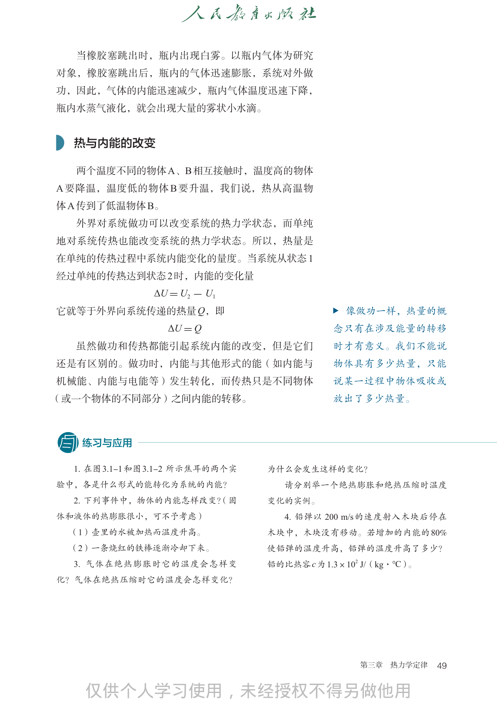

## RJ-PHYSICS-SEL3-041 热与内能的改变

第三章 热力学定律 / 1 功、热和内能的改变 · P54

两个温度不同的物体A、B相互接触时，温度高的物体A要降温，温度低的物体B要升温，我们说，热从高温物体A传到了低温物体B。

外界对系统做功可以改变系统的热力学状态，而单纯地对系统传热也能改变系统的热力学状态。所以，热量是在单纯的传热过程中系统内能变化的量度。当系统从状态1经过单纯的传热达到状态2时，内能的变化量ΔU＝$U_2$ －U1它就等于外界向系统传递的热量Q，即

$$\Delta U=Q$$

虽然做功和传热都能引起系统内能的改变，但是它们还是有区别的。做功时，内能与其他形式的能（如内能与机械能、内能与电能等）发生转化，而传热只是不同物体（或一个物体的不同部分）之间内能的转移。

像做功一样，热量的概念只有在涉及能量的转移时才有意义。我们不能说物体具有多少热量，只能说某一过程中物体吸收或放出了多少热量。

## RJ-PHYSICS-SEL3-042 热力学第一定律

第三章 热力学定律 / 2 热力学第一定律 · P55

汽缸内有一定质量的气体，压缩气体的同时给汽缸加热。

焦耳的实验一方面表明，以不同的方式对系统做功时，只要系统始末两个状态是确定的，做功的数量就是确定的；

另一方面也向我们表明，为了改变系统的状态，做功和传热这两种方法是等价的。也就是说，一定数量的功与确定数量的热相对应。

我们在上节课已经知道，单纯地对系统做功（热力学系统的绝热过程），内能的变化量与功的关系是

$$\Delta U=W$$

单纯地对系统传热，则内能的变化量与传递热量的关系是

$$\Delta U=Q$$

既然

做功与传热对改变系统的内能是等价的，那么，当外界既对系统做功又对系统传热时，内能的变化量就应该是

$$\Delta U=Q+W$$

也就是说

，一个热力学系统的内能变化量等于外界向它传递的热量与外界对它所做的功的和。这个关系叫作热力学第一定律（first law of thermodynamics）。

可见，“问题”栏目中的汽缸内气体内能的变化量等于活塞对气体所做的功与通过加热向汽缸内气体传递的热量之和。

## RJ-PHYSICS-SEL3-043 热力学第一定律中功与热量的正负及应用

第三章 热力学定律 / 2 热力学第一定律 · P56-P57

在运用热力学第一定律解决问题时，需要首先确定研究对象。对于公式ΔU＝Q＋W，我们可以这样理解：外界对系统做功有助于系统内能的增加，因此，外界对系统做功时，W 取正值；而系统对外界做功时，W取负值。同理，外界对系统传递热量有助于系统内能的增加，因此，外界对系统传递的热量Q 取正值；而系统向外界传递的热量Q就取负值。

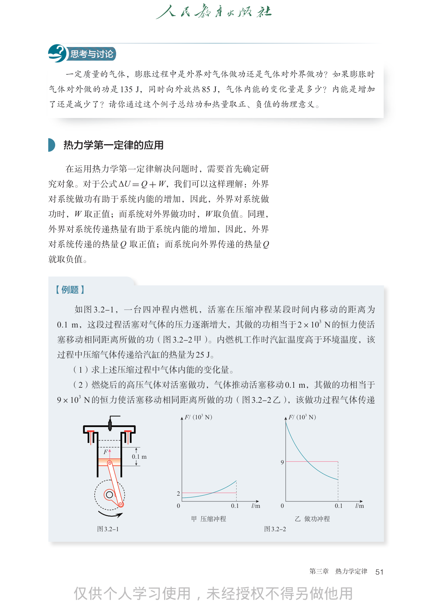

### 补充原例与原解

如图3.2-1，一台四冲程内燃机，活塞在压缩冲程某段时间内移动的距离为0.1 m，这段过程活塞对气体的压力逐渐增大，其做的功相当于2×10³ N的恒力使活塞移动相同距离所做的功（图3.2-2甲）。内燃机工作时汽缸温度高于环境温度，该过程中压缩气体传递给汽缸的热量为25 J。

（1）求上述压缩过程中气体内能的变化量。

（2）燃烧后的高压气体对活塞做功，气体推动活塞移动0.1 m，其做的功相当于9×10³ N的恒力使活塞移动相同距离所做的功（图3.2-2乙），该做功过程气体传递给汽缸的热量为30 J，求此做功过程气体内能的变化量。

分析　以汽缸内气体为研究对象，在第（1）问中，活塞压缩气体的过程是外界对系统做功，则外界对气体所做的功W₁为正值；在第（2）问中，气体膨胀推动活塞的过程是系统对外界做功，则外界对气体所做的功W₂为负值。在两种情况下，气体都把热量传递给了汽缸，都属于放热，因此外界向气体传递的热量Q₁、Q₂均为负值。

解　（1）在压缩过程中，外界对气体做功，有

$$W_1=F_1l_1=2\times10^3\times0.1\,\mathrm{J}=200\,\mathrm{J}$$

根据热力学第一定律，气体内能的变化量

$$\Delta U_1=W_1+Q_1=200\,\mathrm{J}-25\,\mathrm{J}=175\,\mathrm{J}$$

（2）在膨胀过程中，气体对外界做功，有

$$W_2=F_2l_2=-9\times10^3\times0.1\,\mathrm{J}=-900\,\mathrm{J}$$

根据热力学第一定律，气体内能的变化量

$$\Delta U_2=W_2+Q_2=-900\,\mathrm{J}-30\,\mathrm{J}=-930\,\mathrm{J}$$

汽缸内气体在压缩过程中内能增加了175 J，在膨胀做功过程中气体内能减少了930 J。

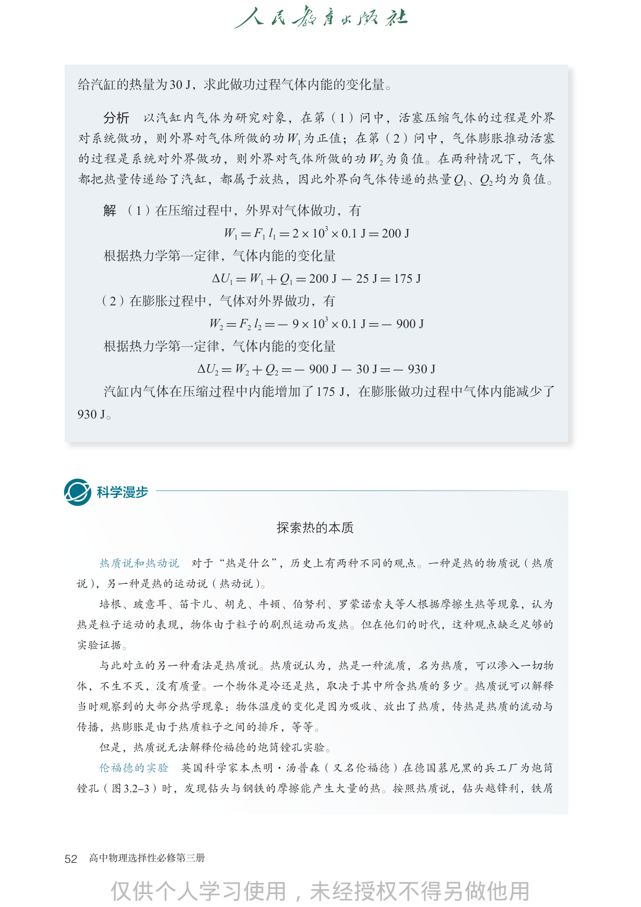

## RJ-PHYSICS-SEL3-044 热的本质与钻孔实验的证据

第三章 热力学定律 / 2 热力学第一定律 · P57-P58

热质说和热动说 对于“热是什么”，历史上有两种不同的观点。一种是热的物质说（热质说），另一种是热的运动说（热动说）。

培根、玻意耳、笛卡儿、胡克、牛顿、伯努利、罗蒙诺索夫等人根据摩擦生热等现象，认为热是粒子运动的表现，物体由于粒子的剧烈运动而发热。但在他们的时代，这种观点缺乏足够的实验证据。

与此对立的另一种看法是热质说。热质说认为，热是一种流质，名为热质，可以渗入一切物体，不生不灭，没有质量。一个物体是冷还是热，取决于其中所含热质的多少。热质说可以解释当时观察到的大部分热学现象：物体温度的变化是因为吸收、放出了热质，传热是热质的流动与传播，热膨胀是由于热质粒子之间的排斥，等等。

但是，热质说无法解释伦福德的炮筒镗孔实验。

伦福德的实验 英国科学家本杰明·汤普森（又名伦福德）在德国慕尼黑的兵工厂为炮筒镗孔（图3.2-3）时，发现钻头与钢铁的摩擦能产生大量的热。按照热质说，钻头越锋利，铁屑切得越小，它们能保存住的热质就越少，释放的热质就越多，用来冷却的水沸腾得也就越快。然而，伦福德注意到，在钻头已经变钝时照旧要产生大量的热。不但如此，他发现在钻孔加工中热量似乎是取之不尽的。

伦福德进行了反复的观察和实验，终于在1798 年公布了他的研究成果。他明确指出：在这些实验中被激发出来的热，除了把它看作“运动”之外，似乎很难看作其他任何东西。

## RJ-PHYSICS-SEL3-045 能量的不同形式与转化

第三章 热力学定律 / 3 能量守恒定律 · P59

人类对能量的认识 能量的概念是人类在对物质运动规律进行长期探索中建立起来的。所有自然现象都涉及能量，人类的任何活动都离不开能量。能量具有不同的形式，有描述热运动的内能、描述机械运动的机械能、描述光辐射的光能，等等。不同形式的运动都可以用能量来描述。

也就是说，我们可以用能量的观念把热、电、光、磁等都统一起来描述。

在认识自然的进程中，科学家慢慢知道了要用联系的观点去观察自然。例如，机械能的各种形式之间可以相互转化，电和磁可以相互转化，热和电也可以相互转化……

## RJ-PHYSICS-SEL3-046 化学反应总放热量与反应步骤

第三章 热力学定律 / 3 能量守恒定律 · P60

俄国化学家盖斯的研究发现，任何一个化学反应，不论是一步完成，还是分几步完成，放出的总热量相同。这表明一个系统（即参加化学反应的几种物质）存在着一个与热量相关的物理量，在一个确定的化学反应中这个量是不变的。

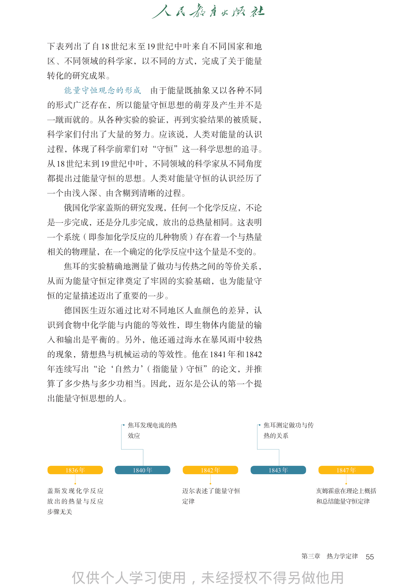

## RJ-PHYSICS-SEL3-047 能量守恒定律

第三章 热力学定律 / 3 能量守恒定律 · P61

在力学中，当系统只有重力和弹力做功时，系统的动能与势能会发生相互转化，而动能与势能的总量保持不变，这就是机械能守恒定律。

在热力学领域内，做功和传热可以改变系统的内能，即系统内能与系统外的能量会发生转化或转移，但能的总量不会改变。热力学第一定律，实际上就是内能与其他能量发生转化时的能量守恒定律。

能量守恒定律可以表述为：能量既不会凭空产生，也不会凭空消失，它只能从一种形式转化为其他形式，或者从一个物体转移到别的物体，在转化或转移的过程中，能量的总量保持不变。

能量守恒是自然界的普遍规律。根据能量守恒定律，物理学发现和解释了很多科学现象。

能量守恒的观念也在不断地发展，相对论建立以后，基本粒子的研究使我们认识到，能量其实是与质量相关联的一个物理量。

## RJ-PHYSICS-SEL3-048 饮水小鸭的工作原理与永动机不可能制成

第三章 热力学定律 / 3 能量守恒定律 · P62

“问题”栏目中的饮水小鸭不是永动机。小鸭的头和身由两个玻璃球构成，并通过细玻璃管相连。下球盛有一些乙醚，上球连同尖嘴被吸水毛毡包起来。那么，它是靠什么来维持工作的呢？原来小鸭头部的毛毡“饮水”后，水蒸发导致头部温度降低。上段玻璃管中的乙醚蒸气被液化，压强减小，液柱上升（图3.3-1 甲），小鸭重心上移，直到小鸭倾倒。处于倾倒位置的小鸭，头部再次被浸湿，同时上下玻璃球内的气体相通，压强相等，乙醚流回下玻璃球内（图3.3-1乙），重心下移，小鸭站立。如此循环往复。实际上，小鸭在此过程中从周围环境中吸收了热量，才得以持续工作下去。

任何动力机械的作用都是把其他形式的能转化为机械能。内燃机把燃料的化学能转化为燃气的内能然后再转化为机械能，电动机把电能转化为机械能……如果没有燃料、电流或其他动力的输入，能量从哪里来呢！永动机的思想违背了能量守恒定律，所以是不可能制成的。

## RJ-PHYSICS-SEL3-049 宏观过程的方向性与热力学第二定律的克劳修斯表述

第三章 热力学定律 / 4 热力学第二定律 · P64-P65

能量守恒定律告诉我们，在自然界发生的一切过程中能量都是守恒的，一个导致能量创生或能量消失的过程是不可能出现的。然而，并不是所有符合能量守恒定律的宏观过程都能自发地进行。

无数事实告诉我们，凡是实际的过程，只要涉及热现象，如物体间的传热、气体的膨胀、扩散、有摩擦的机械运动……都有特定的方向性。这些过程可以自发地朝某个方向进行，例如，热由高温物体传向低温物体，而相反的过程，即使不违背能量守恒定律，我们也从未见到它们会自发地进行。这就是说，一切与热现象有关的宏观自然过程都是不可逆的。

在物理学中，反映宏观自然过程的方向性的定律就是热力学第二定律（second law of thermodynamics）。

热力学第二定律的克劳修斯表述   德国物理学家克劳修斯在1850年提出：热量不能自发地从低温物体传到高温物体。这是热力学第二定律的克劳修斯表述。

这里阐述的是传热的方向性。在这个表述中，“自发”二字指的是：当两个物体接触时，不需要任何第三者的介入、不会对任何第三者产生任何影响，热量就能从一个物体传向另一个物体。当两个温度不同的物体接触时，这个“自发”的方向是从高温物体指向低温物体的。

在电冰箱的实例中，热量的确从低温物体——冰箱内的食品，传到了高温物体——冰箱外的空气。但是这不是自发的过程，这个过程必须有第三者的介入：必须开动冰箱的压缩机。如果不供电，冰箱的压缩机会停止工作，自发的过程则是热量从冰箱外的高温空气传向冰箱内的低温食品（图3.4-1）。

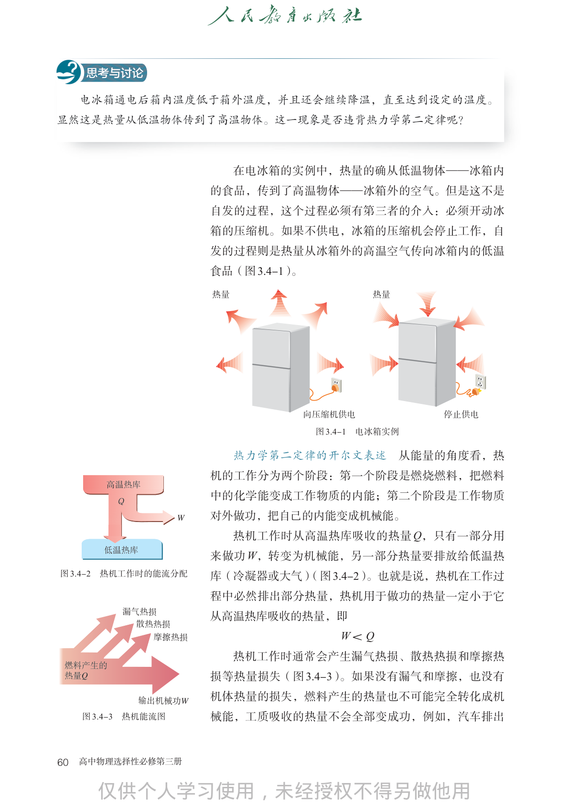

## RJ-PHYSICS-SEL3-050 热机与热力学第二定律的开尔文表述

第三章 热力学定律 / 4 热力学第二定律 · P65-P66

热力学第二定律的开尔文表述   从能量的角度看，热机的工作分为两个阶段：第一个阶段是燃烧燃料，把燃料中的化学能变成工作物质的内能；第二个阶段是工作物质对外做功，把自己的内能变成机械能。

热机工作时从高温热库吸收的热量Q，只有一部分用来做功W，转变为机械能，另一部分热量要排放给低温热库（冷凝器或大气）（图3.4-2）。也就是说，热机在工作过程中必然排出部分热量，热机用于做功的热量一定小于它从高温热库吸收的热量，即W＜ Q热机工作时通常会产生漏气热损、散热热损和摩擦热损等热量损失（图3.4-3）。如果没有漏气和摩擦，也没有机体热量的损失，燃料产生的热量也不可能完全转化成机械能，工质吸收的热量不会全部变成功，例如，汽车排出气体的温度一定会比空气的温度高，它会向空气散热。

在分析了热机及其他涉及做功的热学过程后，开尔文于1851年提出了热力学第二定律的另一种表述：不可能从单一热库吸收热量，使之完全变成功，而不产生其他影响。

这里所说“不可能从单一热库吸收热量”，意思是：不仅要从一个热库吸热，而且一定会向另一个热库放热。

热力学第二定律的开尔文表述阐述了机械能与内能转化的方向性：机械能可以全部转化为内能，而内能无法全部用来做功以转化成机械能。例如，两个相互接触并做相对运动的物体，由于摩擦而静止下来，它们在这个过程中消耗的机械能可以全部转化为内能；但相反的过程不可能自发进行而不产生其他影响。

可以证明，热力学第二定律的克劳修斯表述和开尔文表述是等价的。

## RJ-PHYSICS-SEL3-051 能量耗散与能源的有限性

第三章 热力学定律 / 4 热力学第二定律 · P66-P67

自然界的一切变化，人类社会的所有活动，都伴随着能量的转移和转化，能量是一切物质运动的源泉，是一切生命活动的基础。

能量在数量上虽然守恒，但其转移和转化却具有方向性。在取暖照明、耕田犁地、车钻磨锻、开车驾船……各种各样的活动中，机械能、电能、光能、声能、化学能、核能、生物能……最终都转化成内能，流散到周围的环境中。每天我们使用的能源最后都转化成了内能，能源消耗使得周围环境升温。根据热力学第二定律，分散在环境中的内能不管数量多么巨大，它也只不过能使地球、大气稍稍变暖一点，却再也不能自动聚集起来驱动机器做功了。

这样的转化过程叫作“能量耗散”。

周围环境中的内能很难再利用，而机械能、光能、化学能、电能相对于周围环境中的内能来说，可利用的品质要高。所谓能源，其实是指具有高品质的容易利用的储能物质，例如石油、天然气、煤等。能源的使用过程中虽然能的总量保持守恒，但能量的品质下降了。虽然能量总量不会减少，但能源会逐步减少，因此能源是有限的资源。

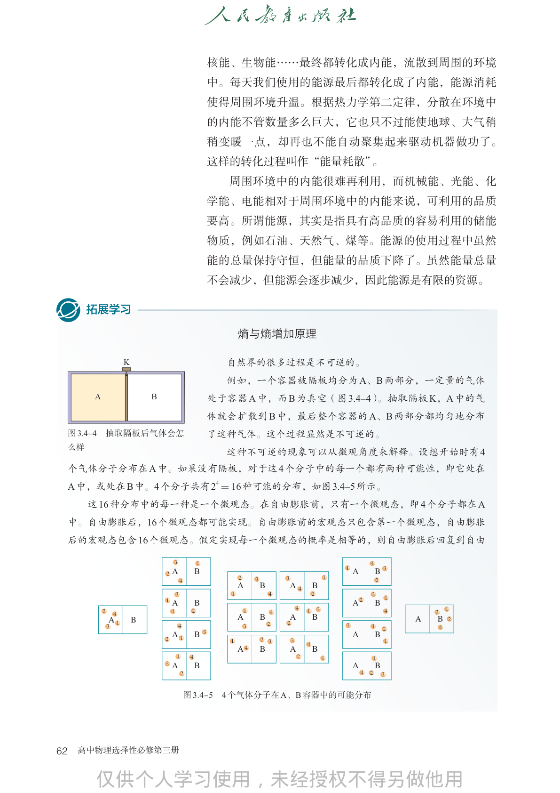

## RJ-PHYSICS-SEL3-052 熵与熵增加原理

第三章 热力学定律 / 4 热力学第二定律 · P67-P68

自然界的很多过程是不可逆的。

例如，一个容器被隔板均分为A、B两部分，一定量的气体处于容器A中，而B为真空（图3.4-4）。抽取隔板K，A中的气体就会扩散到B中，最后整个容器的A、B两部分都均匀地分布了这种气体。这个过程显然是不可逆的。

这种不可逆的现象可以从微观角度来解释。设想开始时有4个气体分子分布在A中。如果没有隔板，对于这4个分子中的每一个都有两种可能性，即它处在A中，或处在B中。4个分子共有2⁴＝16种可能的分布，如图3.4-5所示。

这16种分布中的每一种是一个微观态。在自由膨胀前，只有一个微观态，即4个分子都在A中。自由膨胀后，16个微观态都可能实现。自由膨胀前的宏观态只包含第一个微观态，自由膨胀后的宏观态包含16个微观态。假定实现每一个微观态的概率是相等的，则自由膨胀后回复到自由膨胀前状态的概率为$\frac{1}{16}$。

一般地说，如果A中气体分子数量为N个，则自由膨胀后的气体要回复到自由膨胀前的概率为$\frac{1}{2^N}$。实际上，气体内的分子数很大，因此自由膨胀的气体要自发地回复到膨胀前的状态实际上是不可能的。

生活中我们常说到有序和无序这两个词。一副扑克牌，按黑桃、红桃、梅花、方块的顺序，而且从小到大排列，我们说它是有序的，洗牌之后有序变成了无序。当然也可以规定奇数牌在先，偶数牌在后，等等。只要确定了某种规则，符合这个规则的就是有序的。由许多张纸牌组成的系统，如果对个体的分布没有确定的要求，怎样分布都可以，我们就说这样的分布是无序的。

有序与无序是相对的。

相对于膨胀后的状态，物理学中把气体膨胀前的状态叫作有序状态，而气体自由膨胀后的状态变得更混乱与无序，是无序状态。其实，把事情搞得乱糟糟的方式要比把事情做得整整齐齐的方式多得多。比如，要让操场上的一群学生按班级、身高，或按任何一种规则来站队都是比较麻烦的：组织者需要按规则来确定每个学生的位置，每个学生都要寻找自己的位置。但是，要让已经排好队的学生解散，那就非常简单，每个学生随便朝一个方向跑去，队形就乱了。从统计学的角度来解释，按一定规则排列的队形只有少数几种，而学生解散后的混乱状态有无数种。这样，混乱状态出现的概率要远大于整齐排列状态出现的概率。一个系统总是自发地从有序状态向混乱的无序状态发展。

1850年，克劳修斯首次提出熵的概念，熵可用来表达一个系统的无序程度，系统从有序向无序的发展过程中熵在增加。在物理学中，不与外界进行物质和能量交换的系统叫作孤立系统。在自发过程中，系统总是自发地向无序方向发展，即一个孤立系统的熵值总是不减少的，这就是熵增加原理。

从微观的角度看，热力学第二定律是一个统计规律：一个孤立系统总是从熵小的状态向熵大的状态发展，而熵值较大代表着较为无序，所以自发的宏观过程总是向无序度更大的方向发展。

熵的概念现在已经应用于信息学、天体物理学、生命科学、社会学等领域，在不同的学科中也有引申出的更为具体的定义。

## RJ-PHYSICS-SEL3-053 黑体与黑体辐射

第四章 原子结构和波粒二象性 / 1 普朗克黑体辐射理论 · P72

通过物理必修课的学习我们知道，如果某种物体能够完全吸收入射的各种波长的电磁波而不发生反射，这种物体就是绝对黑体，简称黑体（black body）。如图4.1-1，在空腔壁上开一个很小的孔，射入小孔的电磁波在空腔内表面会发生多次反射和吸收，最终不能从空腔射出。这个带小孔的空腔就可以近似为一个绝对黑体。

黑体虽然不反射电磁波，却可以向外辐射电磁波，这样的辐射叫作黑体辐射（black body radiation）。

19世纪，由于冶金、星体测温等需求，人们对热辐射进行了大量的研究。当时物理学家已有能力对热辐射的强度随波长的分布进行比较准确的测量。研究表明，对于一般材料的物体，辐射电磁波的情况除了与温度有关，还与材料的种类及表面状况有关，而黑体辐射电磁波的强度按波长的分布只与黑体的温度有关。它可能反映了某种具有普遍意义的客观规律，人们因此对黑体辐射进行了深入的实验及理论研究。

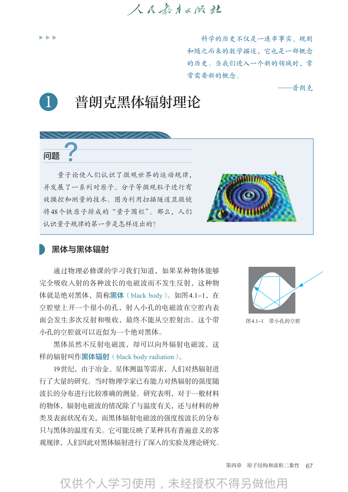

## RJ-PHYSICS-SEL3-054 黑体辐射的实验规律及理论解释

第四章 原子结构和波粒二象性 / 1 普朗克黑体辐射理论 · P73-P74

利用分光技术和热电偶等设备，可以测出黑体辐射电磁波的强度按波长分布的情况。图4.1-2画出了四种温度下黑体辐射的强度与波长的关系。从中可以看出，随着温度的升高，一方面，各种波长的辐射强度都有增加，另一方面，辐射强度的极大值向波长较短的方向移动。这些规律与日常经验是一致的。

物理学家总是力图用已有的知识去解释新发现的现象和规律。那么，怎样解释黑体辐射的实验规律呢？

我们知道，物体中存在着不停运动的带电微粒，按照当时物理学的认识，每个带电微粒的振动都产生变化的电磁场，从而产生电磁辐射。于是，人们很自然地要依据热学和电磁学的知识寻求黑体辐射的理论解释。

德国物理学家维恩在1896 年、英国物理学家瑞利在1900年，分别提出了辐射强度按波长分布的理论公式。他们提出的公式都只能解释一部分实验现象。维恩公式在短波区与实验非常接近，在长波区则与实验偏离较大；瑞利公式在长波区与实验基本一致，但在短波区与实验严重不符。

为了得出同全部实验相符的黑体辐射公式，德国物理学家普朗克做了多种尝试。1900年10月，普朗克找到了一个数学公式，它与实验吻合得非常完美（图4.1-3）。于是，普朗克尝试从电磁学、力学、统计物理学等物理学的基本理论出发，把这个公式推导出来。

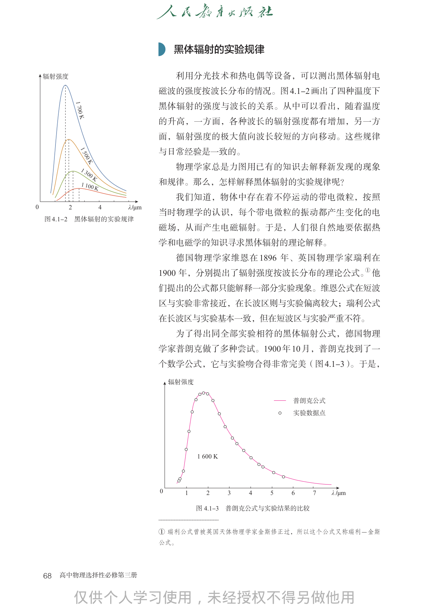

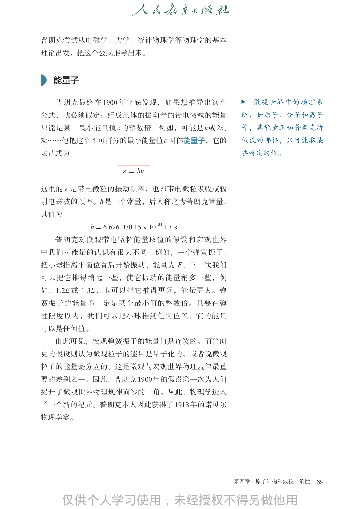

## RJ-PHYSICS-SEL3-055 能量子与普朗克常量

第四章 原子结构和波粒二象性 / 1 普朗克黑体辐射理论 · P74

普朗克最终在1900 年年底发现，如果想推导出这个公式，就必须假定：组成黑体的振动着的带电微粒的能量只能是某一最小能量值ε的整数倍。例如，可能是ε或2ε、3ε……他把这个不可再分的最小能量值ε 叫作能量子，它的表达式为

$$\varepsilon=h\nu$$

这里的ν是带电微粒的振动频率，也即带电微粒吸收或辐射电磁波的频率。h是一个常量，后人称之为普朗克常量，其值为h＝6.626 070 15×10⁻³⁴ J·s

普朗克对微观带电微粒能量取值的假设和宏观世界中我们对能量的认识有很大不同。例如，一个弹簧振子，把小球推离平衡位置后开始振动，能量为 E，下一次我们可以把它推得稍远一些，使它振动的能量稍多一些，例如，1.2E 或 1.3E，也可以把它推得更远，能量更大。弹簧振子的能量不一定是某个最小值的整数倍。只要在弹性限度以内，我们可以把小球推到任何位置，它的能量可以是任何值。

由此可见，宏观弹簧振子的能量值是连续的。而普朗克的假设则认为微观粒子的能量是量子化的，或者说微观粒子的能量是分立的。这是微观与宏观世界物理规律最重要的差别之一。

微观世界中的物理系统，如原子、分子和离子等，其能量正如普朗克所假设的那样，只可能取某些特定的值。

## RJ-PHYSICS-SEL3-056 光电效应及实验规律

第四章 原子结构和波粒二象性 / 2 光电效应 · P76-P78

把一块锌板连接在验电器上，并使锌板带负电，验电器指针张开。用紫外线灯照射锌板，观察验电器指针的变化。

实验发现，若使锌板带负电，用紫外线灯照射后，验电器张开的指针夹角会变小，说明锌板带的负电荷变少了。

这意味着，紫外线会让电子从锌板表面逸出。

照射到金属表面的光，能使金属中的电子从表面逸出。

这个现象称为光电效应（photoelectric effect），这种电子常称为光电子。

光电效应的实验规律

下面我们用图4.2-1所示的电路研究光电效应中电子发射的情况与照射光的强弱、光的颜色（频率）等物理量之间的关系。

如图4.2-1，阴极K和阳极A是密封在真空玻璃管中的两个电极，阴极K在受到光照时能够发射光电子。阴极K与阳极A之间电压U的大小可以调整，电源的正负极也可以对调。电源按图示极性连接时，闭合开关后，阳极A吸收阴极K发出的光电子，在电路中形成光电流。这导致电压U为0时电流I 并不为0。

科学家通过实验发现了以下规律。

存在截止频率   当入射光的频率减小到某一数值$ν_c$时，光电流消失，这表明已经没有光电子了。$ν_c$称为截止频率（cutoff frequency）或极限频率。当入射光的频率低于截止频率时不发生光电效应。

实验表明，不同金属的截止频率不同。换句话说，截止频率与金属自身的性质有关。

存在饱和电流   在光照条件不变的情况下，随着所加电压的增大，光电流趋于一个饱和值。也就是说，在电流较小时电流随着电压的增大而增大；但当电流增大到一定值之后，即使电压再增大，电流也不会再进一步增大了（图4.2-2）。

这说明，在一定的光照条件下，单位时间内阴极K发射的光电子的数目是一定的，电压增加到一定值时，所有光电子都被阳极A吸收，这时即使再增大电压，电流也不会增大。

实验表明，在光的频率不变的情况下，入射光越强，饱和电流越大。这说明，对于一定频率（颜色）的光，入射光越强，单位时间内发射的光电子数越多。

存在遏止电压   如果施加反向电压，也就是阴极K接电源正极、阳极A接电源负极，在光电管两极间形成使电子减速的电场，电流有可能为0。使光电流减小到0的反向电压$U_c$称为遏止电压。

遏止电压的存在意味着光电子具有一定的初速度，初速度的上限vc应该满足以下关系

$$\frac12m_ev_c^2=eU_c$$

进一步的实验表明，同一种金属对于一定频率的光，无论光的强弱如何，遏止电压都是一样的。光的频率ν改变时，遏止电压$U_c$也会改变（图4.2-2）。这意味着，对于同一种金属，光电子的能量只与入射光的频率有关，而与入射光的强弱无关。

光电效应具有瞬时性   当频率超过截止频率νc时，无论入射光怎样微弱，照到金属时会立即产生光电流。精确测量表明产生电流的时间很快，即光电效应几乎是瞬时发生的。

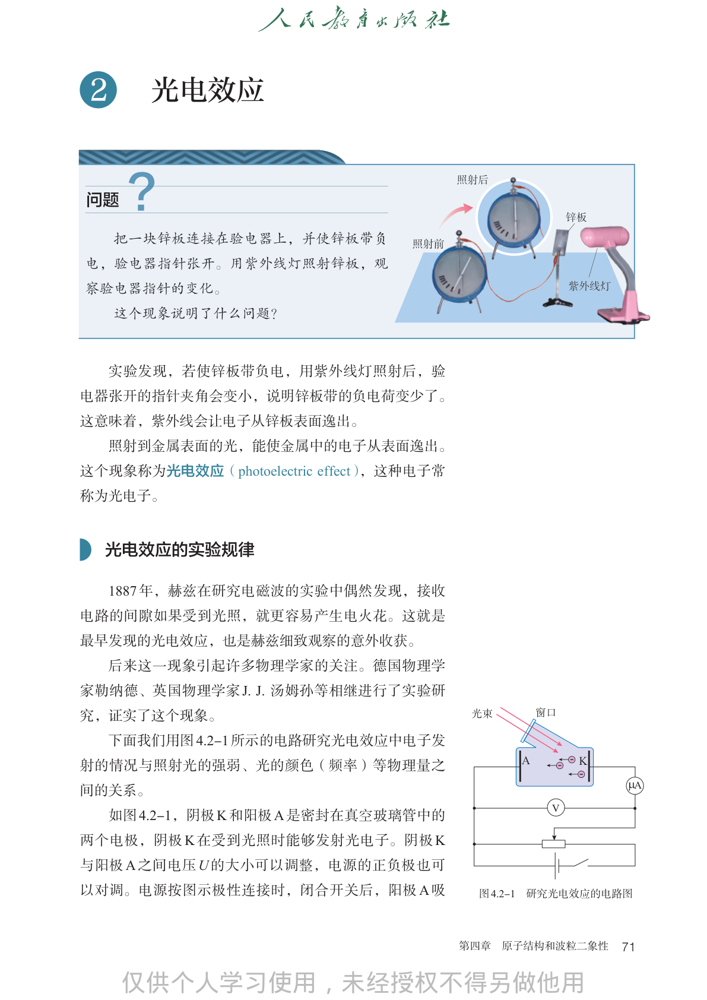

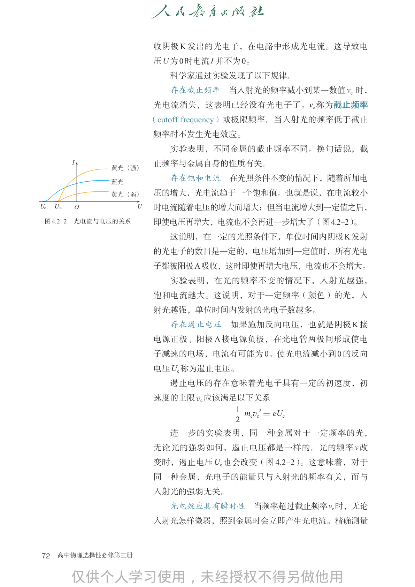

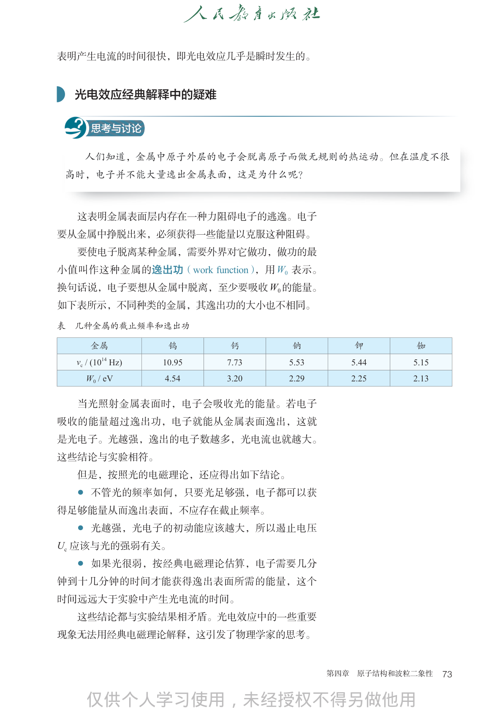

## RJ-PHYSICS-SEL3-057 逸出功与光电效应经典解释中的疑难

第四章 原子结构和波粒二象性 / 2 光电效应 · P78

这表明金属表面层内存在一种力阻碍电子的逃逸。电子要从金属中挣脱出来，必须获得一些能量以克服这种阻碍。

要使电子脱离某种金属，需要外界对它做功，做功的最小值叫作这种金属的逸出功（work function），用$W_0$ 表示。

换句话说，电子要想从金属中脱离，至少要吸收$W_0$的能量。

如下表所示，不同种类的金属，其逸出功的大小也不相同。

|金属|铂|钨|钠|钾|铷|
|---|---|---|---|---|---|
|截止频率$ν_c$/(10¹⁴ Hz)|10.95|7.73|5.53|5.44|5.15|
|逸出功W₀/eV|4.54|3.20|2.29|2.25|2.13|

当光照射金属表面时，电子会吸收光的能量。若电子吸收的能量超过逸出功，电子就能从金属表面逸出，这就是光电子。光越强，逸出的电子数越多，光电流也就越大。

这些结论与实验相符。

但是，按照光的电磁理论，还应得出如下结论。

● 不管光的频率如何，只要光足够强，电子都可以获得足够能量从而逸出表面，不应存在截止频率。

● 光越强，光电子的初动能应该越大，所以遏止电压$U_c$ 应该与光的强弱有关。

● 如果光很弱，按经典电磁理论估算，电子需要几分钟到十几分钟的时间才能获得逸出表面所需的能量，这个时间远远大于实验中产生光电流的时间。

这些结论都与实验结果相矛盾。光电效应中的一些重要现象无法用经典电磁理论解释，这引发了物理学家的思考。

## RJ-PHYSICS-SEL3-058 光子与爱因斯坦光电效应方程

第四章 原子结构和波粒二象性 / 2 光电效应 · P79-P80

对于光电效应的解释，爱因斯坦是在普朗克量子假说的基础上作出的。在这个假说的启发下，爱因斯坦在1905 年发表了题为《关于光的产生和转化的一个试探性观点》的文章。他表示，普朗克关于黑体辐射问题的崭新观点还不够彻底，仅仅认为振动着的带电微粒的能量不连续是不够的。为了解释光电效应，必须假定电磁波本身的能量也是不连续的，即认为光本身就是由一个个不可分割的能量子组成的，频率为ν的光的能量子为hν，其中，h为普朗克常量。这些能量子后来称为光子。

按照爱因斯坦的理论（图4.2-3），当光子照到金属上时，它的能量可以被金属中的某个电子全部吸收，金属中的电子吸收一个光子获得的能量是 hν，在这些能量中，一部分大小为$W_0$的能量被电子用来脱离金属，剩下的是逸出后电子的初动能，即

$$h\nu=E_k+W_0$$

或

$$E_k=h\nu-W_0\tag{1}$$

式中$E_k$为光电子的最大初动能。

$$E_k=\frac{1}{2}m_ev_c^2$$

（1）式称为爱因斯坦光电效应方程。

从下面的讨论可以看出，爱因斯坦光电效应方程可以很好地解释光电效应实验中的各种现象。

● 这个方程表明，只有当hν＞W₀时，光电子才可以从金属中逸出，$\nu_c=\frac{W_0}{h}$就是光电效应的截止频率（图4.2-4）。

● 这个方程还表明，光电子的最大初动能$E_k$与入射光的频率ν有关，而与光的强弱无关。这就解释了遏止电压和光强无关。

● 电子一次性吸收光子的全部能量，不需要积累能量的时间，光电流自然几乎是瞬时产生的。

● 对于同种频率的光，光较强时，单位时间内照射到金属表面的光子数较多，照射金属时产生的光电子较多，因而饱和电流较大。

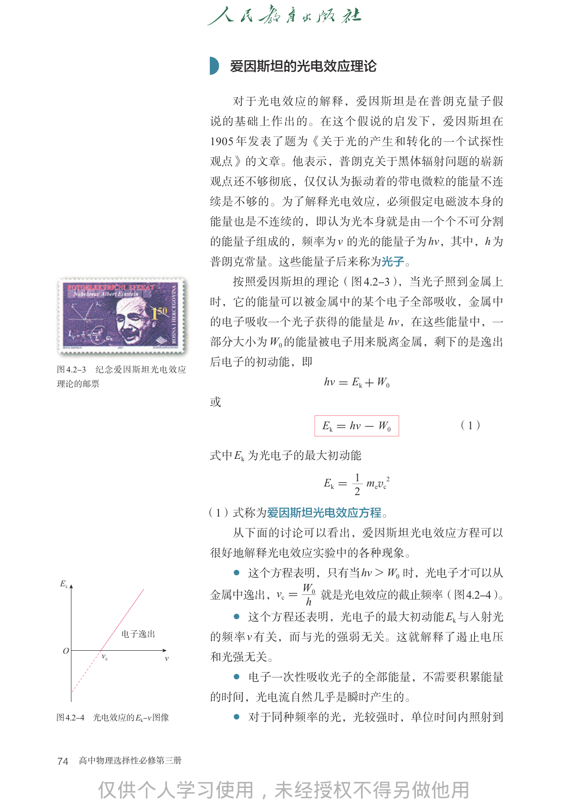

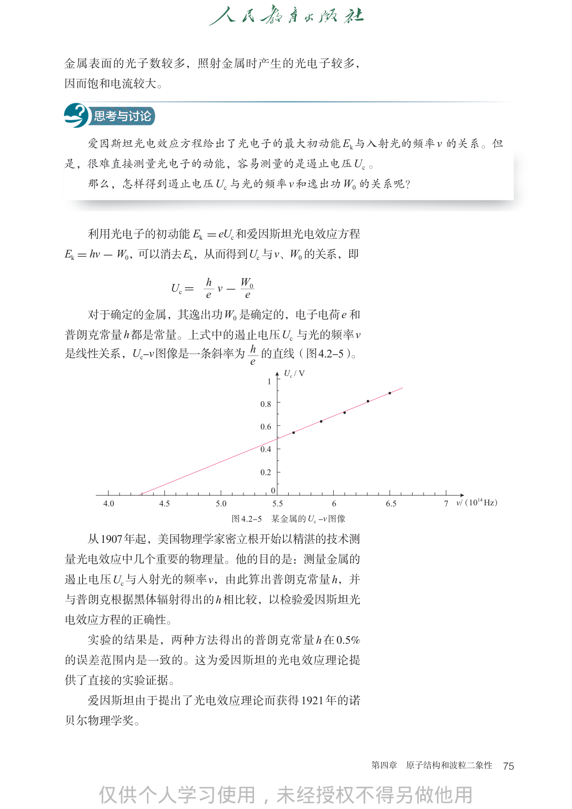

## RJ-PHYSICS-SEL3-059 遏止电压与入射光频率及光电效应理论的实验检验

第四章 原子结构和波粒二象性 / 2 光电效应 · P80

利用光电子的初动能 $E_k$ ＝e$U_c$和爱因斯坦光电效应方程$E_k$ ＝ hν －$W_0$，  可以消去$E_k$，从而得到$U_c$与ν、W₀ 的关系，即

$$U_c=\frac{h}{e}\nu-\frac{W_0}{e}$$

对于确定的金属，其逸出功$W_0$ 是确定的，电子电荷e 和普朗克常量h都是常量。上式中的遏止电压$U_c$ 与光的频率ν是线性关系，$U_c$–ν图像是一条斜率为$h/e$的直线（图4.2-5）。

从1907年起，美国物理学家密立根开始以精湛的技术测量光电效应中几个重要的物理量。他的目的是：测量金属的遏止电压$U_c$与入射光的频率ν，由此算出普朗克常量h，并与普朗克根据黑体辐射得出的h相比较，以检验爱因斯坦光电效应方程的正确性。

实验的结果是，两种方法得出的普朗克常量h在0.5%的误差范围内是一致的。这为爱因斯坦的光电效应理论提供了直接的实验证据。

## RJ-PHYSICS-SEL3-060 康普顿效应和光子的动量

第四章 原子结构和波粒二象性 / 2 光电效应 · P81

光可以被介质中的物质微粒散射而改变传播方向。

1918〜1922年，美国物理学家康普顿在研究石墨对X射线的散射时，发现在散射的X射线中，除了与入射波长λ0相同的成分外，还有波长大于λ0的成分，这个现象称为康普顿效应（Compton effect）。康普顿的学生，中国留学生吴有训测试了多种物质对X射线的散射，证实了该效应的普遍性。

按照经典物理学的理论，入射的电磁波引起物质内部带电微粒的受迫振动，振动着的带电微粒进而再次产生电磁波，并向四周辐射，这就是散射波。散射的X射线频率应该等于带电粒子受迫振动的频率，也就是入射X射线的频率。相应地，X 射线的波长也不会在散射中发生变化。

因此，康普顿效应无法用经典物理学解释。

康普顿用光子的模型成功地解释了这种效应。他的基本思想是：光子不仅具有能量，而且具有动量，光子的动量p与光的波长λ和普朗克常量h有关。这三个量之间的关系式为

$$p=\frac{h}{\lambda}\tag{2}$$

在康普顿效应中，当入射的光子与晶体中的电子碰撞时，要把一部分动量转移给电子，因而，光子动量可能会变小（图4.2-6）。从（2）式看，动量p减小，意味着波长λ变大，因此，这些光子散射后波长变大。

基于这个假定的理论结果与实验符合得很好。康普顿效应让人们对光子有了更深入的认识。

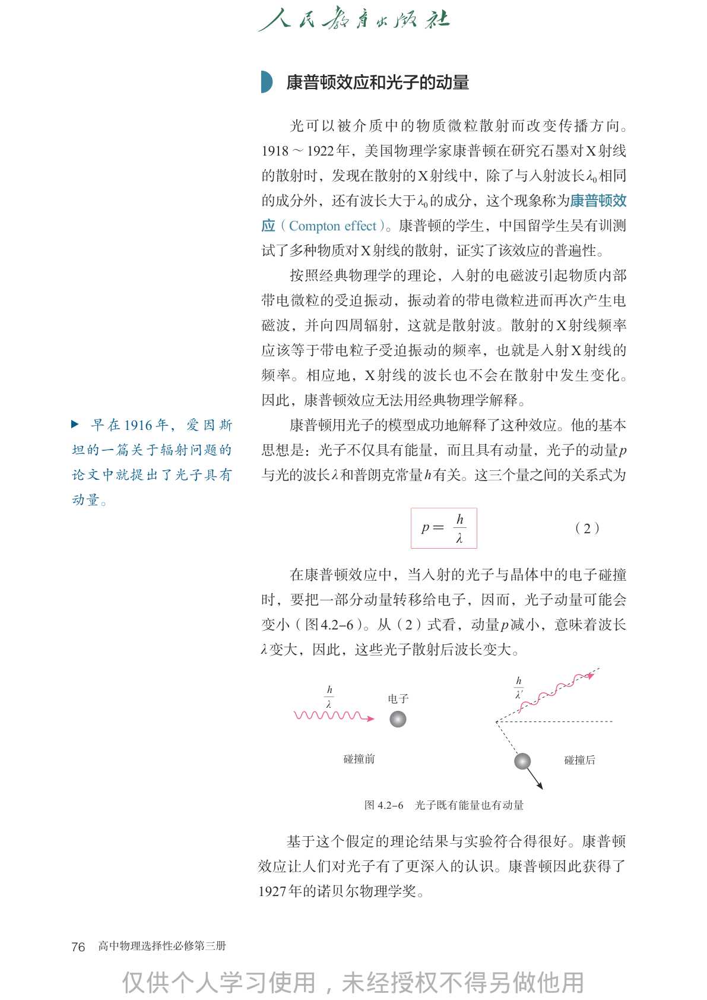

## RJ-PHYSICS-SEL3-061 光的波粒二象性

第四章 原子结构和波粒二象性 / 2 光电效应 · P82

众所周知，在麦克斯韦的电磁理论建立之后，人们认识到光是一种电磁波，从而光的波动说被普遍接受，人们不再认为光是由粒子组成的。而爱因斯坦的光电效应理论和康普顿效应理论表明，光在某些方面确实会表现得像是由一些粒子（即一个个有确定能量和动量的“光子”）组成的。也就是说，光电效应和康普顿效应重新揭示了光的粒子性。当然，此时人们对光的粒子性的认识，是以最新的实验和量子理论为基础的，已经和牛顿时代光的微粒说根本不同，其深度远远超出后者。人们意识到，光既具有波动性，又具有粒子性。换句话说，光具有波粒二象性（wave-particle duality）。此后，又经过一系列探索，人们最终建立了比较完善的，能统一描述光的波动性和粒子性的理论——量子电动力学。

## RJ-PHYSICS-SEL3-062 阴极射线、电子及电荷量子化

第四章 原子结构和波粒二象性 / 3 原子的核式结构模型 · P83-P85

这种射线称为阴极射线（cathode ray）。对这种射线本质的认识有两种观点：一种观点认为，它是一种电磁辐射；

另一种观点认为，它是带电微粒。如何用实验判断哪一种观点正确呢？

电子的发现

当时，两种观点的支持者争执不下，谁也说服不了谁。为了找到有利于自己的证据，双方都做了许多实验。

英国物理学家J. J. 汤姆孙认为阴极射线是带电粒子流。为了证实这一点，从1890 年起他和他的助手进行了一系列实验研究。图4.3-1是他当时使用的气体放电管的示意图。

由阴极K发出的带电粒子通过缝隙A、B形成一束细细的射线。它穿过两片平行的金属板D1、D2 之间的空间，到达右端带有标尺的荧光屏上。根据射线产生的荧光的位置

（如P1，P2，P3，…），可以研究射线的径迹。

图4.3-1 中产生阴极射线的机理是：管中残存气体分子中的正负电荷在强电场的作用下被“拉开”（即气体分子被电离），正电荷（即正离子）在电场加速下撞击阴极，于是阴极释放更多粒子流，形成了阴极射线。

1897年，J. J.汤姆孙根据阴极射线在电场和磁场中的偏转情况断定，它的本质是带负电的粒子流，并求出了这种粒子的比荷。他进一步发现，用不同材料的阴极做实验，所得比荷的数值都是相同的。这说明不同物质都能发射这种带电粒子，它是构成各种物质的共有成分。

由实验测得的阴极射线粒子的比荷是氢离子（也就是质子）比荷的近两千倍。J. J.汤姆孙认为，这可能表示阴极射线粒子电荷量的大小与一个氢离子一样，而质量比氢离子小得多。后来，他直接测到了阴极射线粒子的电荷量，尽管测量不很准确，但足以证明这种粒子电荷量的大小与氢离子大致相同，这就表明他当初的猜测是正确的。后来，组成阴极射线的粒子被称为电子。

电子电荷的精确测定是在1909〜1913年间由密立根通过著名的“油滴实验”做出的。目前公认的电子电荷e的值为e＝1.602 176 634×10⁻¹⁹ C

密立根实验更重要的发现是：电荷是量子化的，即任何带电体的电荷只能是 e 的整数倍。从实验测到的比荷及e 的数值，可以确定电子的质量。现在人们普遍认为电子的质量为m_e＝9.109 383 56×10⁻³¹ kg

质子质量与电子质量的比值为

$$\frac{m_p}{m_e}=1836$$

发现电子以后， J. J.汤姆孙又进一步研究了许多新现象，如光电效应、热离子发射效应和β射线等。他发现，不论阴极射线、光电流、热离子流还是β射线，它们都包含电子。也就是说，不论是由于正离子的轰击、紫外光的照射、金属受热还是放射性物质的自发辐射，都能发射同样的带电粒子——电子。

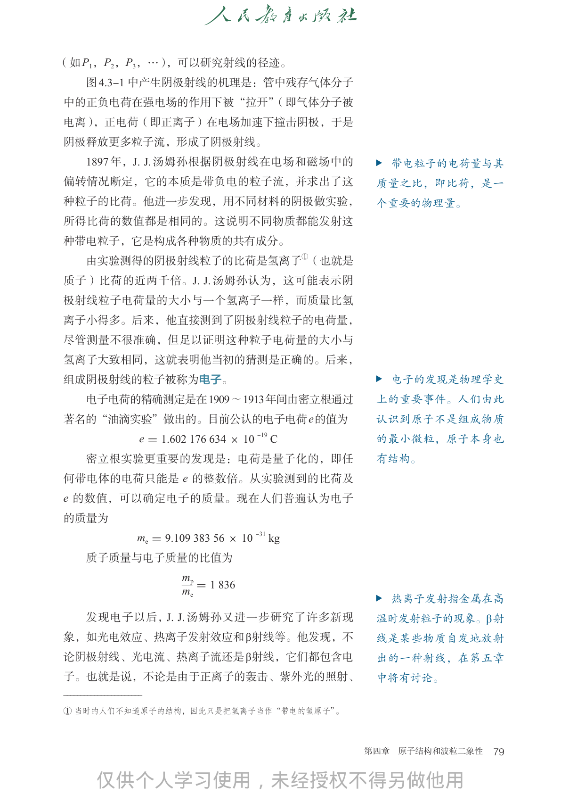

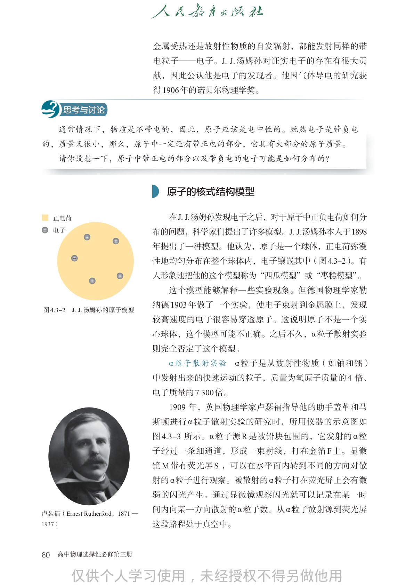

## RJ-PHYSICS-SEL3-063 原子结构模型与α粒子散射实验

第四章 原子结构和波粒二象性 / 3 原子的核式结构模型 · P85-P87

在J. J.汤姆孙发现电子之后，对于原子中正负电荷如何分布的问题，科学家们提出了许多模型。J. J.汤姆孙本人于1898年提出了一种模型。他认为，原子是一个球体，正电荷弥漫性地均匀分布在整个球体内，电子镶嵌其中（图4.3-2）。有人形象地把他的这个模型称为“西瓜模型”或“枣糕模型”。

这个模型能够解释一些实验现象。但德国物理学家勒纳德1903年做了一个实验，使电子束射到金属膜上，发现较高速度的电子很容易穿透原子。这说明原子不是一个实心球体，这个模型可能不正确。之后不久，α粒子散射实验则完全否定了这个模型。

α粒子散射实验 α粒子是从放射性物质（如铀和镭）中发射出来的快速运动的粒子，质量为氢原子质量的4 倍、电子质量的7 300倍。

1909 年，英国物理学家卢瑟福指导他的助手盖革和马斯顿进行α粒子散射实验的研究时，所用仪器的示意图如图4.3-3 所示。α粒子源R是被铅块包围的，它发射的α粒子经过一条细通道，形成一束射线，打在金箔F上。显微镜M带有荧光屏S ，可以在水平面内转到不同的方向对散射的α粒子进行观察。被散射的α粒子打在荧光屏上会有微弱的闪光产生。通过显微镜观察闪光就可以记录在某一时间内向某一方向散射的α粒子数。从α粒子放射源到荧光屏这段路程处于真空中。

当α 粒子打到金箔时，由于金原子中的带电粒子对α 粒子有库仑力的作用，一些α粒子的运动方向改变，也就是发生了α粒子的散射。统计散射到各个方向的 α粒子所占的比例，可以推知原子中电荷的分布情况。除了金箔外，当时的实验还用了其他重金属箔，例如铂箔。

实验发现，绝大多数α粒子穿过金箔后，基本上仍沿原来的方向前进，但有少数α粒子（约占$\frac{1}{8000}$）发生了大角度偏转，极少数偏转的角度甚至大于90°，也就是说，它们几乎被“撞了回来”。

对α粒子散射实验的解释   这样的事实令人惊奇。大角度的偏转不可能是电子造成的，因为它的质量只有α粒子的$\frac{1}{7300}$ ，它对α粒子速度的大小和方向的影响就像灰尘对枪弹的影响，完全可以忽略。因此，α粒子偏转主要是具有原子的大部分质量的带正电部分造成的。而按照J. J.汤姆孙的模型，正电荷是均匀地分布在原子内的，α粒子穿过原子时受到的各方向正电荷的斥力基本上会相互平衡，因此对α粒子运动的影响不会很大。所以，J. J.汤姆孙的模型无法解释大角度散射的实验结果。

卢瑟福分析了实验数据后认为，事实应该是：占原子质量绝大部分的带正电的物质集中在很小的空间范围。这样才会使α粒子在经过时受到很强的斥力，使其发生大角度的偏转。

1911 年，卢瑟福提出了自己的原子结构模型。他设想：原子中带正电部分的体积很小，但几乎占有全部质量，电子在正电体的外面运动。这样，当α 粒子接近原子时，电子对它的影响仍如前述可以忽略，但是，正电体对它的作用就不同了。因为正电体很小，当α粒子进入原子区域后，大部分离正电体很远，受到的库仑斥力很小，运动方向几乎不改变。只有极少数α粒子在穿过时距离正电体很近，因此受到很强的库仑斥力，发生大角度散射。这个情况如图4.3-4所示。

按照卢瑟福的理论，正电体的尺度是很小的，称为原子核。卢瑟福的原子模型因而称为核式结构模型。卢瑟福以这个模型为依据，利用经典力学计算了向各个方向散射的α粒子的比例，结果与实验数据符合得很好。

## RJ-PHYSICS-SEL3-064 原子核的电荷与尺度

第四章 原子结构和波粒二象性 / 3 原子的核式结构模型 · P87-P88

由不同元素对α 粒子散射的实验数据可以确定不同元素原子核的电荷量Q。又由于原子是电中性的，可以推算出原子内含有的电子数。科学家们注意到，各种元素的原子核的电荷数，即原子内的电子数，非常接近它们的原子序数，这说明元素周期表中的各种元素是按原子中的电子数来排列的。

现在，我们知道，原子确实是由带电荷＋Ze 的核与核外Z 个电子组成的。原子序数Z 等于核电荷与电子电荷大小的比值。后来又发现原子核是由质子和中子组成的，原子核的电荷数就是核中的质子数。

通常用核半径描述核的大小。原子核的半径是很难测量的，一般通过其他粒子与核的相互作用来确定。α粒子散射可以用来估算核半径。对于一般的原子核，实验确定的核半径的数量级为10⁻¹⁵ m，而整个原子半径的数量级是10⁻¹⁰ m，两者相差十万倍之多。可见原子内部是十分“空旷”的。

Ze是原子核的电荷，单位是库仑；Z是原子序数，也是原子核的电荷数，它表示原子核的电荷是一个电子电荷（绝对值）的多少倍。Z 是没有单位的，或者说Z的单位是1。

## RJ-PHYSICS-SEL3-065 光谱、特征谱线与光谱分析

第四章 原子结构和波粒二象性 / 4 氢原子光谱和玻尔的原子模型 · P89-P90

用棱镜或光栅可以把物质发出的光按波长（频率）展开，获得波长（频率）和强度分布的记录（图4.4-1），即光谱。有些光谱是一条条的亮线，叫作谱线，这样的光谱叫作线状谱。有的光谱看起来不是一条条分立的谱线，而是连在一起的光带，叫作连续谱。图4.4-2中最上一条是连续谱，其他几条则既有线状分立谱又有连续谱。

气体中中性原子的发光光谱都是线状谱，说明原子只发出几种特定频率的光。不同原子的亮线位置不同，说明不同原子的发光频率是不一样的，因此，这些亮线称为原子的特征谱线。

既然每种原子都有自己的特征谱线，我们就可以利用它来鉴别物质和确定物质的组成成分。这种方法称为光谱分析。它的优点是灵敏度高，样本中一种元素的含量达到10⁻¹³ kg时就可以被检测到。

## RJ-PHYSICS-SEL3-066 氢原子光谱的实验规律与巴耳末公式

第四章 原子结构和波粒二象性 / 4 氢原子光谱和玻尔的原子模型 · P90

氢原子的光谱如图4.4-3所示。 光谱的结果显示氢原子只能发出一系列特定波长的光。

1885年，瑞士科学家巴耳末对当时已知的氢原子在可见光区的四条谱线，即图4.4-3中Hα、Hβ、Hγ、Hδ谱线作了分析，发现这些谱线的波长λ 满足一个简单的公式，即

$$\frac{1}{\lambda}=R_\infty\left(\frac{1}{2^2}-\frac{1}{n^2}\right),\quad n=3,4,5,\ldots$$

式中$R_∞$叫作里德伯常量，实验测得的值为$R_∞$＝1.10×10⁷ m⁻¹。

这个公式称为巴耳末公式，式中的n 只能取整数，它确定的这一组谱线称为巴耳末系。巴耳末公式以简洁的形式反映了氢原子的线状光谱的特征。

除了巴耳末系，后来发现的氢光谱在红外和紫外光区的其他谱线也都满足与巴耳末公式类似的关系式。

## RJ-PHYSICS-SEL3-067 经典理论解释原子结构的困难

第四章 原子结构和波粒二象性 / 4 氢原子光谱和玻尔的原子模型 · P90-P91

卢瑟福的核式结构模型正确地指出了原子核的存在，很好地解释了α粒子散射实验，但跟经典电磁理论发生了矛盾。

核外电子受到原子核的库仑引力的作用，却没有被吸引到原子核上，而是在以一定的速度绕核运动。按照经典电磁理论，这样运动的电荷应该辐射出电磁波，电子绕核转动的能量将不断地被电磁波带走。随着能量的减少，电子绕核运动的轨道半径也应减小，最后电子会坠落到原子核上（图4.4-4）。由此判断，电子绕核转动这个系统应是不稳定的。但事实并非如此，原子是个很稳定的系统。

另一方面，根据经典电磁理论，电子辐射电磁波的频率，就是它绕核转动的频率。随着绕核运动轨道半径的不断变化，电子运动的频率也要不断变化，因此原子辐射电磁波的频率也要不断变化。这样，大量原子发光的光谱就应该是包含一切频率的连续光谱。然而，事实上原子光谱是由一些不连续的亮线组成的分立的线状谱。

这些矛盾说明，尽管经典物理学可以很好地应用于宏观物体，但它不能解释原子世界的现象。

## RJ-PHYSICS-SEL3-068 玻尔理论：轨道量子化、定态与频率条件

第四章 原子结构和波粒二象性 / 4 氢原子光谱和玻尔的原子模型 · P91-P92

丹麦物理学家玻尔意识到了经典理论在解释原子结构方面的困难。在普朗克关于黑体辐射的量子论和爱因斯坦关于光子的概念的启发下，他在1913 年把微观世界中物理量取分立值的观念应用到原子系统，提出了自己的原子结构假说。

玻尔的原子结构假说包括以下两方面的内容。

轨道量子化与定态 玻尔认为，原子中的电子在库仑引力的作用下，绕原子核做圆周运动，服从经典力学的规律。但不同的是，电子运行轨道的半径不是任意的，只有当半径的大小符合一定条件，这样的轨道才是可能的。也就是说，电子的轨道是量子化的。电子在这些轨道上绕核的运动是稳定的，不产生电磁辐射。

在玻尔理论中，电子的轨道半径只可能是某些分立的数值。例如，在氢原子中，电子轨道的最小半径是0.053 nm ；电子还可能在半径是 0.212 nm、0.477 nm……的轨道上运行（图4.4-5），但是轨道半径不可能是介于这些数值中间的某个值！

当电子在不同的轨道上运动时，原子处于不同的状态，具有不同的能量。根据玻尔理论，电子只能在特定轨道上运动，因此，原子的能量也只能取一系列特定的值。这些量子化的能量值叫作能级（energy level）。原子中这些具有确定能量的稳定状态，称为定态（stationary state）。能量最低的状态叫作基态（ground state），其他的状态叫作激发态（excited state）。通常用一个或几个量子数来标志各个不同的状态，例如，可以用n ＝1标记氢原子的基态，相应的基态能量记为E1 ；用n ＝ 2，3，4，…标记氢原子的激发态，相应的能量记为E2， $E_3$， $E_4$ ，…。

频率条件 按照玻尔的观点，电子在一系列定态轨道上运动，不会发生电磁辐射。那么，如何解释观察到的原子光谱呢？对此，玻尔假定：当电子从能量较高的定态轨道（其能量记为$E_n$）跃迁到能量较低的定态轨道（能量记为$E_m$，m < n）时，会放出能量为hν的光子（h是普朗克常量），这个光子的能量由前后两个能级的能量差决定，即

$$h\nu=E_n-E_m$$

这个式子称为频率条件，又称辐射条件。反之，当电子吸收光子时会从能量较低的定态轨道跃迁到能量较高的定态轨道，吸收的光子的能量同样由频率条件决定。

原子由一个能量态变为另一个能量态的过程称为跃迁。这里用的“跃”字，包含着“不连续”的意思。

## RJ-PHYSICS-SEL3-069 玻尔理论对氢光谱及原子发光的解释

第四章 原子结构和波粒二象性 / 4 氢原子光谱和玻尔的原子模型 · P92-P94

从玻尔的基本假设出发，运用经典电磁学和经典力学的理论，可以计算氢原子中电子的可能轨道半径及相应的能量。图4.4-6是氢原子的能级图。

玻尔的频率条件告诉我们，原子从较高的能级跃迁到较低的能级时，例如，从E3跃迁到E2时，辐射的光子的能量为hν＝ $E_3$ － E2按照玻尔理论，巴耳末公式中的正整数n 和2，正好代表电子跃迁之前和跃迁之后所处的定态轨道的量子数n 和2。因此，巴耳末公式代表的应该是电子从量子数分别为n ＝ 3，4，5，… 的能级向量子数为2 的能级跃迁时发出的光谱线。按照这个思路，可以根据玻尔理论推导出巴耳末公式，并从理论上算出里德伯常量 R∞的值。这样得到的结果与实验值符合得很好。同样，玻尔理论也能很好地解释甚至预言氢原子的其他谱线系，即氢原子从高能级向m ＝ 1，3，4等能级跃迁所产生的相应光谱。它们也都被实验观测到了，分别称为赖曼系、帕邢系、布喇开系等。

处于基态的原子非常稳定。处于激发态的原子是不稳定的，会自发地向能量较低的能级跃迁，放出光子，最终回到基态。当气体放电管中的气体导电时，其中的原子受到高速运动的电子的撞击，有可能向上跃迁到激发态，之后自发跃迁到基态并发光（图4.4-7）。这就是气体导电时发光的机理。

原子从较高的能级向低能级跃迁时放出的光子的能量等于前后两个能级之差。由于原子的能级是分立的，所以放出的光子的能量也是分立的。因此，原子的发射光谱只有一些分立的亮线。

由于不同的原子具有不同的结构，能级各不相同，因此辐射（或吸收）的光子频率也不相同。这就是不同元素的原子具有不同的特征谱线的原因。

各种气体原子的能级不同，跃迁时发射光子的能量各异。街道上的霓虹灯、试电笔中的氖管，都是由灯管内的气体原子从高能级向低能级跃迁而发光的。食盐被灼烧时发的光，也主要是由食盐蒸气中钠原子的能级跃迁而造成的。

在巴耳末公式中如果把分母中的2 换为其他自然数，就得到了其他谱线系的波长。它们对应于氢原子从较高能级向其他能级跃迁时辐射的光。

## RJ-PHYSICS-SEL3-070 玻尔理论的局限性与电子云

第四章 原子结构和波粒二象性 / 4 氢原子光谱和玻尔的原子模型 · P94

玻尔的原子理论第一次将量子观念引入原子领域，提出了定态和跃迁的概念。现在已经知道，它们都是微观世界物理规律中的核心概念。玻尔理论成功地解释了氢原子光谱的实验规律。但对于稍微复杂一点的原子如氦原子，玻尔理论就无法解释它的光谱现象。这说明，玻尔理论还没有完全揭示微观粒子的运动规律。后来，人们经过进一步探索，建立了完整描述微观规律的量子力学。玻尔理论的不足之处在于保留了经典粒子的观念，仍然把电子的运动看作经典力学描述下的轨道运动。实际上，根据量子力学，原子中电子的坐标没有确定的值。因此，我们只能说某时刻电子在某点附近单位体积内出现的概率是多少，而不能把电子的运动看成一个具有确定坐标的质点的轨道运动。当原子处于不同的状态时，电子在各处出现的概率是不一样的。如果用疏密不同的点子表示电子在各个位置出现的概率，画出图来就像云雾一样，人们形象地把它叫作电子云（electron cloud）。图4.4-8 甲是氢原子处于n＝1 状态时的电子云；当n＝2 时有几个可能的状态，图4.4-8乙画的是其中一个状态的电子云。

## RJ-PHYSICS-SEL3-071 吸收光谱与光谱分析的应用

第四章 原子结构和波粒二象性 / 4 氢原子光谱和玻尔的原子模型 · P95-P96

太阳光中含有各种颜色的光，但当太阳光透过太阳的高层大气射向地球时，太阳高层大气含有的元素会吸收它自己特征谱线的光，然后再发射出去，不过这次是向四面八方发射，所以到达地球的这些谱线看起来就弱了，这样就形成了明亮背景下的暗线。基尔霍夫断定，太阳光谱中的夫琅禾费暗线就是各种物质的特征谱线。与已知元素的光谱相比较，知道太阳中存在钠、镁、铜、锌、镍等金属元素。

由基尔霍夫开创的光谱分析方法对鉴别化学元素有着巨大的意义。许多化学元素，像铯、铷、铊、铟、镓，都是在实验室里通过光谱分析发现的。

当天文学家将光谱分析方法应用于恒星时，马上就证明了宇宙中物质构成的统一性。我国研制的郭守敬望远镜（大天区面积多目标光纤光谱天文望远镜，英文简称LAMOST，图4.4-9丁），将遥远天体的光分别传输到多台光谱仪而获得大量的光谱信息，为恒星的研究提供了重要的基础数据。除化学成分外，恒星的光谱还能够揭示其表面温度、质量和运动状态等信息。

## RJ-PHYSICS-SEL3-072 粒子的波动性与德布罗意波

第四章 原子结构和波粒二象性 / 5 粒子的波动性和量子力学的建立 · P97

德布罗意提出假设：实物粒子也具有波动性，即每一个运动的粒子都与一个对应的波相联系。粒子的能量 ε 和动量p 跟它所对应的波的频率ν和波长 λ 之间，遵从如下关系

$$\nu=\frac{\varepsilon}{h},\quad\lambda=\frac{h}{p}$$

这种与实物粒子相联系的波后来被称为德布罗意波（de Broglie wave），也叫作物质波（matter wave）。

## RJ-PHYSICS-SEL3-073 物质波的实验验证与可观察条件

第四章 原子结构和波粒二象性 / 5 粒子的波动性和量子力学的建立 · P97-P98

德布罗意关于实物粒子具有波动性的假说在当时看来是难以理解的。真正判定这个假说是否“站得住脚”的只能是实验。

我们知道，光的干涉和衍射现象是光具有波动性的有力证据。因此，如果电子、质子等实物粒子也真的具有波动性，那么，它们就应该像光波那样也能发生干涉和衍射。

这是验证德布罗意波是否存在的一条途径。

电子的德布罗意波长与X射线的波长具有相近的数量级。前面讲过，X 射线在通过晶体时会发生明显的衍射。

1927年戴维森和G. P. 汤姆孙分别用单晶和多晶晶体做了电子束衍射的实验，得到了类似图4.5-1的衍射图样，从而证实了电子的波动性。在后来的实验中，人们还进一步观测到了电子德布罗意波的干涉现象（图4.5-2）。

除了电子以外，后来还陆续证实了中子、质子以及原子、分子的波动性。对于这些粒子，德布罗意给出的$\nu=\varepsilon/h$和$\lambda=h/p$的关系同样正确。

宏观物体的质量比微观粒子大得多，它们运动时的动量很大，根据$\lambda=h/p$可知，它们对应的德布罗意波的波长就很短。例如，一个质量为0.01 kg、速度为300 m/s的子弹，它的德布罗意波长只有2.2×10⁻³⁴ m，比宏观物体的尺度小得多，根本无法观察到它的波动性。而一个原来静止的电子，在经过100 V电压加速后，德布罗意波长约为0.12 nm，因此有可能观察到电子的波动性。

德布罗意提出物质波的观念被实验证实，表明电子、质子、原子等粒子不但具有粒子的性质，而且具有波动的性质。换句话说，它们和光一样，也具有波粒二象性。

## RJ-PHYSICS-SEL3-074 量子力学与波动力学和矩阵力学

第四章 原子结构和波粒二象性 / 5 粒子的波动性和量子力学的建立 · P99-P100

19、20世纪之交，人们在黑体辐射、光电效应、氢原子光谱等许多类问题中，都发现了经典物理学无法解释的现象。

这些现象不是孤立的，而是在各类系统中普遍存在的，且都和原子、分子等微观粒子的行为紧密相关。在这些问题中经典物理学往往连实验结果的定性行为都无法解释。这就表明，微观世界的物理规律和宏观世界的物理定律可能存在巨大的差别，人们需要建立描述微观世界的物理理论。

普朗克黑体辐射理论、爱因斯坦光电效应理论、康普顿散射理论、玻尔氢原子理论以及德布罗意物质波假说等一系列理论在解释实验方面都取得了成功。但它们中的每一个，都是针对一个特定的具体问题，都不是统一的普遍性理论。值得注意的是，在这些成功的理论中，普朗克常量都扮演了关键性的角色（图4.5-3）。这就预示着这些理论之间存在着紧密的内在联系。在它们的背后，应该存在着统一描述微观世界行为的普遍性规律。

人们在20世纪20年代成功地建立了这种普遍性理论。

1925年，德国物理学家海森堡和玻恩等人对玻尔的氢原子理论进行了推广和改造，使之可以适用于更普遍的情况。

他们建立的理论被称为矩阵力学。很快，1926年，奥地利物理学家薛定谔提出了物质波满足的方程——薛定谔方程（图4.5-4）。把这个方程应用于氢原子，就能很容易得到氢原子光谱的公式。同时，这个方程还可以方便地应用于其他的系统，使玻尔理论的局限得以消除。由于这个理论的关键是物质波，因此被称为波动力学。1926年，薛定谔和美国物理学家埃卡特很快又证明，波动力学和矩阵力学在数学上是等价的，它们是同一种理论的两种表达方式。

随后数年，在以玻恩、海森堡、薛定谔以及英国的狄拉克和奥地利的泡利为代表的众多物理学家的共同努力下，描述微观世界行为的理论被逐步完善并最终完整地建立起来，它被称为量子力学（quantum mechanics）。

量子力学是在普朗克、玻尔等人所建立的一个个的具体理论（它们被统称为“早期量子论”）的基础上创立的。

它继承了早期量子论的成功之处并克服了其困难和局限，最终取代了早期量子论，成为统一描述微观世界物理规律的普遍性理论。

## RJ-PHYSICS-SEL3-075 量子力学的应用

第四章 原子结构和波粒二象性 / 5 粒子的波动性和量子力学的建立 · P100-P101

量子力学推动了原子、分子物理和光学的发展。人们认识了原子的结构，以及原子、分子和电磁场相互作用的方式。在此基础上，发展了各式各样的对原子和电磁场进行精确操控和测量的技术，如激光、核磁共振、原子钟，等等。激光技术使人们第一次拥有了纯净可控的光源，我们今天能在全球范围内实现即时通信，基础之一就是以激光为载体的光纤网络（图4.5-5）。核磁共振技术使人们可以利用振荡的磁场测量材料中原子的性质，因此，被广泛地用于化学、生物研究和医学诊断。原子钟利用原子为电磁波校准频率，从而实现了对时间的高精度测量。在日常生活和国家安全中发挥巨大作用的卫星定位技术，其核心部件就是原子钟。

量子力学推动了固体物理的发展。人们了解了固体中电子运行的规律，并弄清了为什么固体有导体、绝缘体和半导体之分。科学家们利用半导体的独特性质发明了晶体管等各类固态电子器件，并结合激光光刻技术制造了大规模集成电路，俗称“芯片”（图4.5-6）。这些器件利用固体的微观结构对电路进行操控，速度和可靠性都远胜过去的电子管，而体积则小得多。靠它们，人们才可以制造体积小且功能强大的电子计算机、智能手机等信息处理设备，真正走进了信息时代。此外，固体物理学的发展，还为人们带来了低能耗高亮度的半导体发光技术，并让人们认识了超导等一系列神奇的现象。

## RJ-PHYSICS-SEL3-076 核能

第五章 原子核 / 章引言 · P105

核能是蕴藏在原子核内部的能量。

## RJ-PHYSICS-SEL3-077 放射性、放射性元素与天然放射现象

第五章 原子核 / 1 原子核的组成 · P106

物质发出射线的性质称为放射性（radioactivity），具有放射性的元素称为放射性元素。后来发现，放射性并不是少数元素才有的，原子序数大于83的元素，都能自发地发出射线，原子序数小于或等于83的元素，有的也能发出射线。

放射性元素自发地发出射线的现象，叫作天然放射现象。

## RJ-PHYSICS-SEL3-078 α、β、γ射线的本质和特性

第五章 原子核 / 1 原子核的组成 · P107-P108

发现了天然放射现象之后不久，人们就在想，这些射线到底是什么呢？

把放射源铀、钋或镭放入用铅做成的容器中，射线只能从容器的小孔射出，成为细细的一束。若在射线经过的空间施加磁场，可以发现射线分裂成三束，其中两束在磁场中向不同的方向偏转，这说明它们是带电粒子流；另一束在磁场中不偏转，说明它不带电（图5.1-1）。于是，人们把这三种射线分别叫作α射线、β射线和γ射线。

物理学家经过多方面的研究后确认α射线、β射线和γ射线具有以下特征。

α射线   是α粒子流。α粒子带正电，电荷量是电子的2倍，质量是氢原子的4倍，其组成与氦原子核相同。α粒子的速度可以达到光速的$\frac{1}{10}$。由于α粒子带电，质量又比较大，通过气体时很容易把气体分子中的电子剥离，使气体电离。由于与物质中的微粒作用时会损失自己的能量，α粒子的穿透能力较弱，在空气中只能前进几厘米，用一张纸就能把它挡住。

β射线   是电子流，速度可以接近光速。β射线的电离作用较弱，穿透能力较强，很容易穿透黑纸，也能穿透几毫米厚的铝板。

γ射线   是一种电磁波，波长很短的光子，波长在10⁻¹⁰ m以下。γ射线的电离作用更弱，穿透能力更强，甚至能穿透几厘米厚的铅板和几十厘米厚的混凝土。

实验发现，如果一种元素具有放射性，那么，无论它是以单质存在的，还是以化合物形式存在的，都具有放射性。放射性的强度也不受温度、外界压强的影响。由于元素的化学性质决定于原子核外的电子，这就说明射线与这些电子无关，也就是说，射线来自原子核。这说明原子核内部是有结构的。

射线使原子中的电子脱离核的束缚成为自由电子，这样的过程叫作电离。射线的上述作用叫作电离作用。

## RJ-PHYSICS-SEL3-079 威耳逊云室及射线径迹

第五章 原子核 / 1 原子核的组成 · P108

由微观粒子构成的射线，肉眼是看不见的。但是，射线中的粒子与其他物质作用时产生的现象，会显示射线的存在。威耳逊云室就是一种常用的射线探测装置。

图5.1-2是威耳逊云室的实物照片。云室内部设计有可以上下移动的活塞，上盖是透明的，可以通过它观察粒子运动的径迹。

云室里面有干净的空气。实验时，先往云室里加少量酒精，使室内充满酒精的饱和蒸气，然后迅速向下拉动活塞，室内气体膨胀，温度降低，酒精蒸气达到过饱和状态。这时如果有粒子在室内气体中飞过，使沿途的气体分子电离，过饱和酒精蒸气就会以这些离子为核心凝结成雾滴，于是显示出粒子运动的径迹。这种云室是英国物理学家威耳逊在1912年发明的，叫作威耳逊云室。

图5.1-3中甲、乙两图分别是α射线和β射线在云室中的径迹。α粒子的质量比较大，在气体中飞行时不易改变方向。由于它的电离本领大，沿途产生的离子多，所以它在云室中的径迹直而清晰。高速β粒子的径迹又细又直，低速β粒子的径迹又短又粗而且是弯曲的。γ射线的电离本领很小，在云室中一般看不到它的径迹。

## RJ-PHYSICS-SEL3-080 质子、中子与核子

第五章 原子核 / 1 原子核的组成 · P108-P110

1919年，卢瑟福用镭放射出的α粒子轰击氮原子核，从氮原子核中打出了一种新的粒子（图5.1-4）。根据这种粒子在电场和磁场中的偏转，测出了它的质量和电荷量，原来它就是氢原子核，叫作质子（proton），用p表示。以后，人们用同样的方法从氟、钠、铝等原子核中都打出了质子，由此断定，质子是原子核的组成部分。

质子带正电荷，电荷量与一个电子的电荷量相等。质子的质量为$m_p$＝1.672 621 898×10⁻²⁷ kg

绝大多数原子核的质量与电荷量之比都大于质子的相应比值。卢瑟福猜想，原子核内可能还存在着另一种粒子，它的质量与质子相同，但是不带电，他把这种粒子叫作中子（neutron）。1932年，卢瑟福的学生查德威克通过实验证实了这个猜想（图5.1-5）。

中子不带电，用n表示。中子的质量是$m_n$＝1.674 927 471×10⁻²⁷ kg

它与质子的质量非常接近，只比质子质量约大千分之一。

质子和中子除了是否带电的差异以及质量上的微小差别外，其余性质十分相似，而且，都是原子核的组成成分，所以统称为核子（nucleon）。

## RJ-PHYSICS-SEL3-081 电荷数、质量数、原子核符号与同位素

第五章 原子核 / 1 原子核的组成 · P110

由于中子不带电，原子核所带的电荷等于核内质子电荷的总和。所以，原子核所带的电荷总是质子电荷的整数倍，通常用这个整数表示原子核的电荷量，叫作原子核的电荷数，用Z 表示。原子核的质量等于核内质子和中子的质量的总和，而质子与中子的质量几乎相等，所以原子核的质量几乎等于单个核子质量的整数倍，这个整数叫作原子核的质量数，用A 表示。

原子核的电荷数就是核内的质子数，也就是这种元素的原子序数，而原子核的质量数就是核内的核子数。

原子核常用符号${}^{A}_{Z}\mathrm{X}$表示（图5.1-6），X为元素符号，A 表示核的质量数，Z 表示核的电荷数（即原子序数）。

例如，氢原子核可以表示为 ${}^{1}_{1}\mathrm{H}$，有时也用它表示质子。氦原子核可以表示为 ${}^{4}_{2}\mathrm{He}$，它有2个质子和2个中子，所以电荷数是2，质量数是4。又如，${}^{238}_{92}\mathrm{U}$ 代表一种铀核，它的质量数为238，电荷数为92，即核内有92个质子、146个中子。

元素的性质与原子核外的电子有密切的关系。同种元素的原子，质子数相同，核外电子数也相同，它们就会具有相同的化学性质。但是，它们的中子数可能不同。这些核中质子数相同而中子数不同的原子，在元素周期表中处于同一位置，因而互称同位素（isotope）。

氢有三种同位素，分别叫作氕（也就是通常说的氢）、氘（也叫重氢）、氚（也叫超重氢），符号分别是 11H、${}^{2}_{1}\mathrm{H}$、${}^{3}_{1}\mathrm{H}$（图5.1-7）。

原子核的电荷数不是它所带的电荷量，质量数也不是它的质量。

## RJ-PHYSICS-SEL3-082 X射线的来源

第五章 原子核 / 1 原子核的组成 · P111

现在我们知道，X射线是原子内层电子跃迁时发射的波长很短的电磁波。

## RJ-PHYSICS-SEL3-083 天然放射现象的发现实验

第五章 原子核 / 1 原子核的组成 · P111

法国物理学家贝克勒尔对荧光研究了多年，他决定研究荧光与X射线的关系。1896年年初，他选择了在日光照晒时能发出荧光的铀盐——硫酸铀酰钾做实验材料。他用黑纸把照相底片包住，放到这种铀盐的下面，在阳光下曝晒了几小时。底片显影后，发现了铀盐在底片上的黑色轮廓，表示底片已经感“光”。阳光是不能透过黑纸的，贝克勒尔认为，这种铀盐受到阳光照射后除了能够发出可见的荧光外，还能发射X射线，是X射线透过黑纸使底片感光。再次准备实验的时候遇到了几个阴天，贝克勒尔只好把准备好的铀盐和包好的底片一起放进了抽屉。几天以后，贝克勒尔在检查底片时意外发现底片又已经感光。这个事实使贝克勒尔认为铀盐本身能够发射一种神秘的射线，正是这种射线导致了底片感光。贝克勒尔进一步用不发荧光的其他铀化合物进行实验，发现也能使底片感光。铀化合物发出的射线也像X射线一样能穿透多种物质。他还发现，只要有铀元素存在，不论是什么化合物，就一定有这种贯穿本领很强的射线发出。贝克勒尔认为这种射线不是X射线；他还进一步指出，发出射线的能力是铀原子自身的性质。

居里夫人首先证实，铀盐发出射线的强度只与化合物中铀的含量成正比，而与化合物的种类无关，也不受光照、加热、通电等因素的影响。由此，她确认这一现象的起因在于原子内部，并提出了“放射性”这个词，用来描写这一现象。

## RJ-PHYSICS-SEL3-084 原子核的α衰变、β衰变及伴随γ辐射

第五章 原子核 / 2 放射性元素的衰变 · P113-P115

原子核自发地放出α粒子或β粒子，由于核电荷数变了，它在元素周期表中的位置就变了，变成另一种原子核。

我们把这种变化称为原子核的衰变（decay）。

铀238放出一个α粒子后，质量数减少4，电荷数减少2，成为新核。这个新核就是钍234（图5.2-1）。

这种衰变过程叫作α衰变。这个过程可以用下面的衰变方程表示

$${}^{238}_{92}\mathrm{U}\longrightarrow{}^{234}_{90}\mathrm{Th}+{}^{4}_{2}\mathrm{He}$$

在这个衰变过程中，衰变前的质量数等于衰变后的质量数之和；衰变前的电荷数等于衰变后的电荷数之和。大量事实表明，原子核衰变时电荷数和质量数都守恒。

${}^{238}_{92}\mathrm{U}$在α衰变时产生的${}^{234}_{90}\mathrm{Th}$也具有放射性，它能放出一个β粒子而变为${}^{234}_{91}\mathrm{Pa}$（镤）（图5.2-2）。

由于电子的质量比核子的质量小得多，因此，我们可以认为电子的质量数为0、电荷数为−1，可以把电子表示为${}^{0}_{-1}\mathrm{e}$。这样，原子核放出一个电子后，因为其衰变前后电荷数和质量数都守恒，新核的质量数不会改变但其电荷数应当加1。其衰变方程为

$${}^{234}_{90}\mathrm{Th}\longrightarrow{}^{234}_{91}\mathrm{Pa}+{}^{0}_{-1}\mathrm{e}$$

放出β粒子的衰变叫作β衰变。

进一步的研究发现，β衰变的实质在于核内的中子转化成了一个质子和一个电子（图5.2-3），其转化方程是

$${}^{1}_{0}\mathrm{n}\longrightarrow{}^{1}_{1}\mathrm{H}+{}^{0}_{-1}\mathrm{e}$$

这种转化产生的电子发射到核外，就是β 粒子；与此同时，新核少了一个中子，却增加了一个质子。所以，新核质量数不变，而电荷数增加1。

研究还表明，在一定条件下，原子核中的两个中子和两个质子会结合起来形成α粒子，并被释放出来。此时原子核就发生了α衰变。

原子核的能量也跟原子的能量一样，其变化是不连续的，也只能取一系列不连续的数值，因此，也存在着能级，同样是能级越低越稳定。

放射性的原子核在发生α衰变、β衰变时产生的新核处于高能级，这时它要向低能级跃迁，并放出γ光子。因此，γ射线经常是伴随α射线和β射线产生的。当放射性物质连续衰变时，原子核中有的发生α衰变，有的发生β衰变，同时伴随着γ射线辐射。这时，放射性物质发出的射线中就会同时具有α、β、γ三种射线。

发生β衰变时，除了产生电子外，还产生中微子。中微子的质量数和电荷数都是0。

## RJ-PHYSICS-SEL3-085 半衰期及其统计意义

第五章 原子核 / 2 放射性元素的衰变 · P115-P116

放射性同位素衰变的快慢有一定的规律。例如氡222经过α衰变成为钋218。如图5.2-4，横坐标表示时间，纵坐标表示任意时刻氡的质量m与t ＝ 0时的质量m0 的比值。

如果隔一段时间测量一次剩余氡的数量就会发现，每过3.8 d就有一半的氡发生了衰变。也就是说，经过第一个3.8 d，剩有一半的氡；经过第二个3.8 d，剩有$\frac14$的氡；再经过3.8 d，剩有$\frac18$的氡……因此，我们可以用“半衰期”来表示放射性元素衰变的快慢。放射性元素的原子核有半数发生衰变所需的时间，叫作这种元素的半衰期（half life）。

不同的放射性元素，半衰期不同，甚至差别非常大。

例如，氡222衰变为钋218的半衰期是3.8 d，镭226衰变为氡222的半衰期是1 620年，铀238衰变为钍234的半衰期竟长达4.5×10⁹年。

对于一个特定的氡原子，我们只知道它发生衰变的概率，而不知道它将何时发生衰变。一个特定的氡核可能在下1 s就衰变，也可能在10 min之内衰变，也可能在200万年之后再衰变。然而，量子理论可以对大量原子核的行为作出统计预测。例如，对于大量氡核，可以准确地预言在1 s后、10 min后，或200万年后，各会剩下百分之几没有衰变。放射性元素的半衰期，描述的就是这样的统计规律。

放射性元素衰变的快慢是由核内部自身的因素决定的，跟原子所处的化学状态和外部条件没有关系。例如，一种放射性元素，不管它是以单质的形式存在，还是与其他元素形成化合物，或者对它施加压力、提高温度，都不能改变它的半衰期。这是因为压力、温度或与其他元素的化合等，都不会影响原子核的结构。

## RJ-PHYSICS-SEL3-086 核反应与原子核的人工转变

第五章 原子核 / 2 放射性元素的衰变 · P116-P117

衰变是原子核的自发变化，科学家更希望人工控制原子核的变化。当初卢瑟福用α粒子轰击氮原子核，产生了氧的一种同位素——氧17和一个质子，即

$${}^{14}_{7}\mathrm{N}+{}^{4}_{2}\mathrm{He}\longrightarrow{}^{17}_{8}\mathrm{O}+{}^{1}_{1}\mathrm{H}$$

这是人类第一次实现的原子核的人工转变。不仅用α粒子，用质子、中子甚至用γ光子去轰击一些原子核，都可以实现原子核的转变，通过这种方式可以研究原子核的结构，还可以发现和制造新元素。

原子核在其他粒子的轰击下产生新原子核或者发生状态变化的过程，称为核反应（nuclear reaction）。与衰变过程一样，在核反应中，质量数守恒、电荷数守恒。

## RJ-PHYSICS-SEL3-087 放射性同位素的应用：测厚、治疗、培优和保鲜

第五章 原子核 / 2 放射性元素的衰变 · P117

很多元素都存在一些具有放射性的同位素，它们被称为放射性同位素。天然放射性同位素不过40多种，而今天通过核反应生成的人工放射性同位素已达3 000多种，每种元素都有了自己的放射性同位素。丰富的放射性同位素资源在国民经济和科学研究的各个领域中得到了广泛的应用。

射线测厚仪 工业部门可以使用放射性同位素发出的射线来测厚度。例如，轧钢厂的热轧机上可以安装射线测厚仪（图5.2-5），让γ射线穿过钢板，仪器探测到的γ射线强度与钢板的厚度有关，轧出的钢板越厚，透过的射线越弱。因此，将射线测厚仪接收到的信号输入计算机，就可以对钢板的厚度进行自动控制。

放射治疗 在医疗方面，患了癌症的病人可以接受放射治疗（图5.2-6）。为什么射线能够用于治疗癌症呢？

一个很重要的原因是人体组织对射线的耐受能力是不同的，细胞分裂越快的组织，它对射线的耐受能力就越弱。像癌细胞那样，不断迅速繁殖的、无法控制的细胞组织，在射线照射下破坏得比健康细胞快。

培优、保鲜   利用γ射线照射种子，会使种子的遗传基因发生变异，经过筛选，可以培育出新品种。用γ射线照射食品可以杀死使食物腐败的细菌，抑制蔬菜发芽，延长保存期（图5.2-7）。

与天然放射性物质相比，人工放射性同位素的放射强度容易控制，半衰期比较短，因此放射性废料容易处理，获得了广泛的应用。

## RJ-PHYSICS-SEL3-088 示踪原子及应用

第五章 原子核 / 2 放射性元素的衰变 · P118

示踪原子   一种放射性元素的原子核，跟这种元素其他同位素的原子核具有相同数量的质子，因此，核外电子的数量也相同。由此可知，一种元素的各种同位素都有相同的化学性质。这样，我们可以用放射性同位素代替非放射性的同位素来制成各种化合物，这种化合物的原子跟通常的化合物一样参与所有化学反应，但却带有“放射性标记”，可以用仪器探测出来。这种原子就是示踪原子。

棉花在开花、结桃的时候需要较多的磷肥，把磷肥喷在棉花叶子上，磷肥也能被吸收。但是，什么时候的吸收率最高、磷在作物内能存留多长时间、磷在作物体内的分布情况等，用通常的方法很难研究。如果用磷的放射性同位素制成肥料喷在棉花的叶面上，然后每隔一定时间用探测器测量棉株各部位的放射性强度，上面的问题就解决了。

人体甲状腺的工作需要碘，碘被吸收后聚集在甲状腺内。如图5.2-8，给人注射碘的放射性同位素碘131，在颈部底部的甲状腺（红色，部分被遮蔽），被放射性示踪剂碘131高亮着色。定时用探测器测量甲状腺及邻近组织的放射强度，有助于诊断甲状腺的疾病。

近年来，有关生物大分子的结构及其功能的研究，几乎都要借助于示踪原子。

## RJ-PHYSICS-SEL3-089 辐射与安全

第五章 原子核 / 2 放射性元素的衰变 · P118

人类一直生活在放射性的环境中。例如，地球上的每个角落都有来自宇宙的射线，我们周围的岩石，其中也有放射性物质。我们的食物和日常用品中，有的也具有放射性，例如，食盐和有些水晶眼镜片中含有钾40，香烟中含有钋210，这些也是放射性同位素，不过它们辐射的强度都在安全剂量之内。

然而过量的射线对人体组织有破坏作用，这些破坏往往是对细胞核的破坏，有时不会马上察觉。因此，在使用放射性同位素时，必须严格遵守操作规程，注意人身安全，同时，要防止放射性物质对空气、水源、用具等的污染。

存在射线危险的地方，常能看到如图5.2-9所示的标志。

## RJ-PHYSICS-SEL3-090 碳14测年技术

第五章 原子核 / 2 放射性元素的衰变 · P119

自然界中的碳主要是碳12，也有少量的碳14。宇宙射线进入地球大气层时，同大气作用产生中子，中子撞击大气中的氮引发核反应产生碳14。核反应方程为

$${}^{14}_{7}\mathrm{N}+{}^{1}_{0}\mathrm{n}\longrightarrow{}^{14}_{6}\mathrm{C}+{}^{1}_{1}\mathrm{H}$$

碳14具有放射性，能够自发地进行β衰变而变成氮，衰变方程为

$${}^{14}_{6}\mathrm{C}\longrightarrow{}^{14}_{7}\mathrm{N}+{}^{0}_{-1}\mathrm{e}$$

碳14的半衰期T₁/₂为5 730年。碳14不断产生又不断衰变，达到动态平衡，因此，它在大气中的含量相当稳定，大约每10¹²个碳原子中有一个碳14。活的植物通过光合作用和呼吸作用与环境交换碳元素，体内碳14的比例与大气中的相同。植物枯死后，遗体内的碳14仍在衰变，不断减少，但是不能得到补充。因此，根据放射性强度减小的情况就可以推算植物死亡的时间。

例如，要推断一块古木的年代，可以从中取出一些样品，测量样品中的碳14含量。如果含量是现代植物的$\frac12$，则说明这块古木的历史大概有碳14的一个半衰期T₁/₂，即5 730年。类似地，如果碳14含量是现代植物的$\frac14$，则古木历史大概是2T₁/₂，即11 460年……

在经济建设中也会用到碳14测定年代的方法。例如，进行基本建设时，地质基础的力学性质是个重要指标。一般说来，地层形成年代越早，固结程度越高，抗冲击性和承压性越好。北京饭店新楼施工时，在地面以下13 m深的位置发现了两棵直径达1 m的榆树。用碳14测定，这两棵树距今29 285±1 350年。据此数据，建设部门认为这个地层已经足够古老，可以作为地基，于是停止下挖，这样就节约了资金。

## RJ-PHYSICS-SEL3-091 核力与四种基本相互作用

第五章 原子核 / 3 核力与结合能 · P120-P121

现代物理学认为，自然界存在着四种基本相互作用，即引力相互作用、电磁相互作用、强相互作用和弱相互作用。自然界中的各种力，都可以归结为这四种相互作用。

17世纪下半叶，人们发现了万有引力。正是万有引力把行星和恒星聚在一起（图5.3-1），组成太阳系、银河系和其他星系。引力是自然界的一种基本相互作用，地面物体所受的重力只是引力在地球表面附近的一种表现。

19世纪后，人们逐渐地认识到，电荷间的相互作用、磁体间的相互作用，从本质上说是同一种相互作用的不同表现，这种相互作用称为电磁相互作用（electromagnetic interaction）或电磁力。它也是自然界的一种基本相互作用。我们知道，宏观物体中包含了大量带负电的电子和带正电的原子核。宏观物体之间的压力、拉力、弹力、支持力等，都起源于这些电荷之间的电磁相互作用。

20 世纪，物理学家发现原子核是由若干带正电荷的质子和不带电的中子组成的。然而，带正电的质子之间存在相互排斥的电磁力，这种斥力比它们之间的万有引力大得多，似乎质子与质子结合在一起是不可能的。物理学家发现，原子核中的核子之间存在一种很强的相互作用，即存在一种核力，它使得核子紧密地结合在一起，形成稳定的原子核（图5.3-2）。这种作用称为强相互作用（strong interaction）。与万有引力和电磁力不同，距离增大时，强相互作用急剧减小，它的作用范围只有约10⁻¹⁵ m，即原子核的大小，超过这个界限，这种相互作用实际上已经不存在了，它是短程力。这样，万有引力、电磁力和强相互作用分别在不同的尺度上发挥了作用。

19世纪末20世纪初，物理学家发现了放射现象。后来发现，在某些放射现象中起作用的还有另一种基本相互作用，称为弱相互作用（weak interaction）。弱相互作用是引起原子核β衰变的原因，即引起中子—质子转变的原因。弱相互作用也是短程力，其力程比强相互作用更短，只有10⁻¹⁸ m。

## RJ-PHYSICS-SEL3-092 结合能与比结合能

第五章 原子核 / 3 核力与结合能 · P121-P122

我们考虑下面的问题。相距很远的两个物体，由于万有引力而相互接近，运动速度越来越大，引力势能转化为动能。最后撞在一起，一部分动能变成热并散失掉了。两个物体为了结合而付出了代价——失去了一些能量，如果要把它们分开，还要重新赋予它们能量。

类似地，要使基态氢原子电离，也就是要从氢原子中把电子剥离，需要通过碰撞、施加电场、让氢原子吸收光子等途径使它得到相应的能量。

原子核是核子凭借核力结合在一起构成的，要把它们分开，也需要能量，这就是原子核的结合能（bindingenergy）。这个能量也是核子结合成原子核而释放的能量。

自然，组成原子核的核子越多，它的结合能越大。原子核的结合能与核子数之比，叫作比结合能（specific binding energy），也叫作平均结合能。比结合能越大，原子核中核子结合得越牢固，原子核越稳定。

## RJ-PHYSICS-SEL3-093 质能关系、质量亏损及结合能计算

第五章 原子核 / 3 核力与结合能 · P122-P123

原子核的结合能很难直接测量。幸好，爱因斯坦已经给我们指出了物体的能量与它的质量的关系，即

$$E=mc^2$$

单个的质子、中子的质量已经精确测定。用质谱仪或其他仪器测定某种原子核的质量，与同等数量的质子、中子的质量之和相比较，看一看两条途径得到的质量之差，就能推知原子核的结合能。

【例题】

已知中子的质量$m_n$为1.674 9×10⁻²⁷ kg，质子的质量$m_p$为1.672 6×10⁻²⁷ kg，氘核的质量$m_D$为3.343 6×10⁻²⁷ kg，求氘核的比结合能。

分析　氘核是由1个质子和1个中子凭借核力结合在一起的，要把它们分开，需要吸收能量，这个能量就是氘核的结合能。由氘核的质量与同等数量的核子质量之间的差值就可以求出与这一质量亏损相对应的能量，再根据氘核的核子数求出氘核的比结合能。

解　单个的质子与中子的质量之和为

$$m_p+m_n=(1.6726+1.6749)\times10^{-27}\,\mathrm{kg}=3.3475\times10^{-27}\,\mathrm{kg}$$

这个数值与氘核质量之差

$$\Delta m=(m_p+m_n)-m_D=(3.3475-3.3436)\times10^{-27}\,\mathrm{kg}=3.90\times10^{-30}\,\mathrm{kg}$$

与这个质量差相对应的能量为

$$\Delta E=\Delta mc^2=3.90\times10^{-30}\times(3.00\times10^8)^2\,\mathrm{J}=3.51\times10^{-13}\,\mathrm{J}$$

在核物理中，能量单位常常使用电子伏特（eV），即

$$1\,\mathrm{eV}=1.60\times10^{-19}\,\mathrm{J}$$

所以，氘核的结合能是

$$\Delta E=\frac{3.51\times10^{-13}}{1.60\times10^{-19}}\,\mathrm{eV}=2.19\times10^6\,\mathrm{eV}=2.19\,\mathrm{MeV}$$

氘核的比结合能为

$$\frac{2.19\,\mathrm{MeV}}{2}=1.10\,\mathrm{MeV}$$

通过这个例题可以看出，原子核的质量小于组成它的核子的质量之和，这个现象叫作质量亏损（mass deficit）。质量亏损表明，的确存在着原子核的结合能。

不同原子核的比结合能是不一样的，图5.3-4是按照实际测量结果画的图线。可以看出，中等大小的核的比结合能最大（平均每个核子的质量亏损最大），这些核最稳定。

## RJ-PHYSICS-SEL3-094 核裂变、链式反应与临界质量

第五章 原子核 / 4 核裂变与核聚变 · P124-P126

1938年底，德国物理学家哈恩和他的助手斯特拉斯曼在用中子轰击铀核的实验中发现，生成物中有原子序数为56的元素钡。奥地利物理学家迈特纳和弗里施对此给出了解释：铀核在被中子轰击后分裂成两块质量差不多的碎块（图5.4-1）。弗里施借用细胞分裂的生物学名词，把这类核反应定名为核裂变（nuclear fission）。

铀核裂变的产物是多样的，一种典型的铀核裂变是生成钡和氪（铀236为中间过程，不稳定），同时放出3个中子，核反应方程是

$${}^{235}_{92}\mathrm{U}+{}^{1}_{0}\mathrm{n}\longrightarrow{}^{144}_{56}\mathrm{Ba}+{}^{89}_{36}\mathrm{Kr}+3{}^{1}_{0}\mathrm{n}$$

核裂变中放出中子，数目有多有少，中子的速度也有快有慢。以铀235为例，核裂变时产生两或三个中子。如果这些中子继续与其他铀235发生反应，再引起新的核裂变，就能使核裂变反应不断地进行下去（图5.4-2）。这种由重核裂变产生的中子使核裂变反应一代接一代继续下去的过程，叫作核裂变的链式反应（chain reaction）。

铀块的大小是链式反应能否进行的重要因素。原子核的体积非常小，原子内部的空隙很大，如果铀块不够大，中子在铀块中通过时，很有可能碰不到铀核而跑到铀块外面去，链式反应不能继续。只有当铀块足够大时，核裂变产生的中子才有足够大的概率打中某个铀核，使链式反应进行下去。通常把核裂变物质能够发生链式反应的最小体积叫作它的临界体积，相应的质量叫作临界质量。

我国科学家钱三强、何泽慧夫妇于1947年在实验中发现铀核也可能分裂为三部分或四部分，其概率大约是分裂为两部分的概率的$\frac{1}{300}$和$\frac{1}{5000}$。

铀核裂变时如果生成物不同，释放的能量也有差异。

如果一个铀235核裂变时释放的能量按200 MeV估算，那么，1 kg铀235全部发生核裂变时放出的能量就相当于2 800 t标准煤完全燃烧时释放的化学能！

## RJ-PHYSICS-SEL3-095 原子弹与核裂变能的释放

第五章 原子核 / 4 核裂变与核聚变 · P126

原子弹是利用重核裂变的链式反应制成的，在极短时间内能够释放大量核能，发生猛烈爆炸。

原子弹的燃料是铀235或钚239。在天然铀中只有0.7%的铀235，剩下的99.3%是不易核裂变的铀238。为得到高浓度的铀235，就必须进行同位素分离，形成铀235含量较高的浓缩铀。

钚239在自然界并不存在，人们利用核反应堆中产生的中子轰击铀238，生成物衰变后成为钚239，然后再利用化学方法将钚239从铀238中分离出来。

图5.4-3是“内爆式”原子弹结构图。核燃料一般被分成若干块放置，每块的体积都小于临界体积。它的外部安放化学炸药，引爆时利用化学炸药爆炸的冲击波将核燃料压缩至高密度的超临界状态，聚心冲击波同时压缩放在核燃料球心的中子源，使它释放中子，引起核燃料的链式反应。

其中，中子源的四周用铀238做成中子反射层，使逸出燃料区的部分中子返回，从而，降低中子逃逸率以减小临界质量，节省核燃料。

## RJ-PHYSICS-SEL3-096 反应堆与核电站

第五章 原子核 / 4 核裂变与核聚变 · P126-P128

原子核的链式反应也可以在人工控制下进行。这样，释放的核能就可以为人类的和平建设服务。其实，在第一个原子弹制成以前，科学家们已经实现了核能的可控释放。

1942年，美籍意大利物理学家费米就主持建立了世界上第一个称为“核反应堆”的装置，首次通过可控制的链式反应实现了核能的释放。

图5.4-4是当前普遍使用的“热中子（慢中子）”核反应堆的示意图。实际上，中子的速度不能太快，否则会与铀235“擦肩而过”，铀核不能“捉”住它，不能发生核裂变。实验证明，速度与热运动速度相当的中子最适于引发核裂变。这样的中子就是“热中子”，或称慢中子。但是，核裂变产生的是速度很大的快中子，因此，还要设法使快中子减速。为此，在铀棒周围要放“慢化剂”，快中子跟慢化剂中的原子核碰撞后，中子能量减少，变为慢中子。常用的慢化剂有石墨、重水和普通水（也叫轻水）。

为了调节中子数目以控制反应速度，还需要在铀棒之间插进一些镉棒。镉吸收中子的能力很强，当反应过于激烈时，将镉棒插入深一些，让它多吸收一些中子，链式反应的速度就会慢一些。这种镉棒叫作控制棒。

核燃料发生核裂变释放的能量使反应区温度升高。水或液态的金属钠等流体在反应堆内外循环流动，把反应堆内的热量传输出去，用于发电，同时也使反应堆冷却。

如图5.4-5，反应堆放出的热使水变成水蒸气，这些高温高压的蒸汽推动汽轮发电机发电。这一部分的工作原理跟火力发电站相同。

第一回路中的水被泵压入反应堆，通过堆芯时核反应放出的热使水的内能增加，水温升高，进入热交换器后，把热量传给第二回路的水，然后又被泵压回反应堆里。

在热交换器内，第二回路中的水被加热生成高温高压蒸汽，驱动汽轮机运转。

在核电站中，只要“烧”掉一支铅笔那么多的核燃料，释放的能量就相当于 10 t标准煤完全燃烧放出的热。一座百万千瓦级的核电站，每年只消耗30 t左右的浓缩铀，而同样功率的火电站，每年要烧煤2.5×10⁶ t！

建造核电站时需要特别注意防止放射线和放射性物质的泄漏，以避免射线对人体的伤害和放射性物质对水源、空气和工作场所造成放射性污染。为此，在反应堆的外面需要修建很厚的水泥层，用来屏蔽核裂变产物放出的各种射线。核反应堆中的核废料具有很强的放射性，需要装入特制的容器，深埋地下。

热中子反应堆的核燃料是铀棒，成分是天然铀或浓缩铀（铀235 的含量占2%〜4%）。

重水是两个氘原子与一个氧原子形成的化合物，它的化学性质与普通水相同，但分子质量比普通水的大。

## RJ-PHYSICS-SEL3-097 核聚变、热核反应与太阳能

第五章 原子核 / 4 核裂变与核聚变 · P128-P129

两个轻核结合成质量较大的核，这样的核反应叫作核聚变（nuclear fusion）。如图5.4-6，一个氘核与一个氚核聚合成一个氦核的同时放出一个中子，释放17.6 MeV的能量，平均每个核子放出的能量在3 MeV以上，比核裂变反应中平均每个核子放出的能量大3〜4倍。这时的核反应方程是

$${}^{2}_{1}\mathrm{H}+{}^{3}_{1}\mathrm{H}\longrightarrow{}^{4}_{2}\mathrm{He}+{}^{1}_{0}\mathrm{n}+17.6\,\mathrm{MeV}$$

要使轻核发生核聚变，必须使它们的距离达到10⁻¹⁵ m以内，核力才能起作用。由于原子核都带正电，要使它们接近到这种程度，必须克服巨大的库仑斥力。也就是说，原子核要有很大的动能才会“撞”到一起。

有一种办法，就是把它们加热到很高的温度。当物质的温度达到几百万开尔文时，剧烈的热运动使得一部分原子核具有足够的动能，可以克服库仑斥力，碰撞时十分接近，发生核聚变。因此，核聚变又叫热核反应。热核反应一旦发生，就不再需要外界给它能量，靠自身产生的热就会使反应继续下去。

实际上，热核反应在宇宙中时时刻刻地进行着，太阳就是一个巨大的热核反应堆（图5.4-7）。太阳的主要成分是氢。太阳的中心温度达1.6×10⁷ K。在这样的高温下，氢核聚变成氦核的反应不停地进行着，不断地放出能量。太阳每秒辐射出的能量约为3.8×10²⁶ J，相当于1.3×10¹⁶ t标准煤完全燃烧所放出的能量，其中只有不到20亿分之一的能量被地球接收。现在地球上消耗的能量，追根溯源，绝大部分还是来自太阳，即太阳内部核聚变时释放的核能。

太阳在“核燃烧”的过程中“体重”不断减轻。它每秒有7亿吨原子核参与反应。科学家估计，太阳的这种“核燃烧”还能维持几十亿年。当然，与人类历史相比，这个时间很长很长！太阳的寿命已经有50亿年了。

目前，人工产生的热核反应主要用在核武器上，那就是氢弹。氢弹原理如图5.4-8所示，首先由化学炸药引爆原子弹，再由原子弹爆炸产生的高温高压引发热核爆炸。

此外，人们也一直在努力尝试实现可控的人工核聚变，进而利用核聚变中的能源。与核裂变相比，核聚变有很多优点。第一，轻核聚变产能效率高，也就是说，相同质量的核燃料，反应中产生的能量比较多。第二，地球上核聚变燃料氘储量丰富，而氚可以利用锂来制取，足以满足核聚变的需要。第三，轻核聚变更为安全、清洁。

## RJ-PHYSICS-SEL3-098 可控核聚变的磁约束与惯性约束

第五章 原子核 / 4 核裂变与核聚变 · P129-P130

然而，核聚变需要的温度太高，地球上没有任何容器能够经受如此高的温度。这构成了实现可控核聚变的主要困难。为了解决这个难题，科学家设想了两种方案，即磁约束和惯性约束。

磁约束 带电粒子运动时，在匀强磁场中会由于洛伦兹力的作用而不飞散，因此有可能利用磁场来约束参加反应的物质，这就是磁约束。如图5.4-9，环流器（即tokamak，音译为托卡马克）是目前性能最好的一种磁约束装置。图5.4-10是中国科学院的环流器装置EAST。有“人造太阳”之称的EAST屡次创造托卡马克实验装置运行的世界纪录，标志着我国在磁约束核聚变研究领域引领国际前沿。

惯性约束 利用核聚变物质的惯性进行约束。在惯性约束下，可以用高能量密度的激光或X射线从各个方向照射参加反应的物质，使它们“挤”在一起发生反应。由于核聚变反应的时间非常短，被“挤”在一起的核聚变物质因自身的惯性还来不及扩散就完成了核反应（图5.4-11）。

在我国，中国工程物理研究院等单位建造了“神光Ⅲ”激光约束核聚变研究装置。总的来说，实现受控核聚变还有一段很长的路要走。

## RJ-PHYSICS-SEL3-099 粒子及其内部结构

第五章 原子核 / 5 “基本”粒子 · P131

直到19世纪末，人们都认为原子是组成物质的不可再分的最小微粒。后来发现了电子、质子和中子，并且知道了原子核和电子组成了原子，质子和中子组成了原子核。

于是许多人认为光子、电子、质子和中子是组成物质的不可再分的最基本的粒子，并把它们叫作“基本粒子”。然而，随着科学的进一步发展，科学家们认识到这些粒子并不“基本”。这是因为，一方面，科学家们逐渐发现了数以百计的不同种类的新粒子，它们并不能看作由质子、中子、电子组成的；另一方面，科学家们又发现质子、中子等本身也有自己的复杂的结构。所以，从20世纪后半期起，就将“基本”二字去掉，统称为粒子。

## RJ-PHYSICS-SEL3-100 超子

第五章 原子核 / 5 “基本”粒子 · P132

后来还发现了一些粒子，质量比质子的质量大很多，叫作超子。

## RJ-PHYSICS-SEL3-101 粒子加速器和对撞机

第五章 原子核 / 5 “基本”粒子 · P132

1932年发明的粒子加速器，能使带电粒子加速到很高的能量。让这些高能粒子在对撞机中彼此对撞，就可能产生新的粒子。利用加速器和对撞机，人们发现了更多的粒子。粒子物理的研究不再单纯依赖宇宙线。

## RJ-PHYSICS-SEL3-102 反粒子

第五章 原子核 / 5 “基本”粒子 · P133

实验中发现，存在着这样一类粒子，它们的质量、寿命、自旋等物理性质与过去已经发现的粒子相同，而电荷等其他性质相反，这些粒子叫作反粒子。例如，电子的反粒子是正电子，它的电荷量与电子相同，但带的是正电荷。

质子的反粒子是反质子，它的电荷量与质子相同，但带的是负电荷。

## RJ-PHYSICS-SEL3-103 强子、轻子、规范玻色子和希格斯玻色子

第五章 原子核 / 5 “基本”粒子 · P133

现在已经发现的粒子达400多种。它们大体可被分为强子、轻子、规范玻色子和希格斯玻色子几种类别。

强子 强子是参与强相互作用的粒子。质子和中子都是强子。

轻子 轻子不参与强相互作用。最早发现的轻子是电子，后来发现的轻子有电子中微子、μ子、μ子中微子以及τ子和τ子中微子。每种轻子都有对应的反粒子。目前发现的轻子只有这 6 种，其中τ子的质量比核子的质量还大，但从相互作用的性质上讲它仍然属于轻子。现代实验还没有发现轻子的内部结构。

规范玻色子 规范玻色子是传递各种相互作用的粒子，如光子、中间玻色子（W和Z玻色子）、胶子。光子传递电磁相互作用，中间玻色子传递弱相互作用，胶子传递强相互作用。

希格斯玻色子 希格斯玻色子是希格斯场的量子激发。

基本粒子因与希格斯场耦合而获得质量。希格斯玻色子是这几种基本粒子中最后一个被发现的。2012年，欧洲核子研究中心利用大型强子对撞机发现了希格斯玻色子。

## RJ-PHYSICS-SEL3-104 夸克与粒子物理标准模型

第五章 原子核 / 5 “基本”粒子 · P133-P134

许多实验事实表明，强子是有内部结构的（图5.5-2）。1964年，美国科学家盖尔曼等人提出了夸克模型，认为强子由更基本的成分组成，这种成分叫作夸克。夸克模型经过几十年的发展，已经被多数物理学家接受。夸克有6种，它们是上夸克、下夸克、奇异夸克、粲夸克、底夸克、顶夸克，它们带的电荷分别为元电荷的$+\frac23$或$-\frac13$。每种夸克都有对应的反夸克。到目前为止，人们已经从实验中发现了所有6种夸克及其反夸克存在的证据。

夸克模型的提出是物理学发展中的一个重大突破，它指出电子电荷不再是电荷的最小单元，即存在分数电荷。科学家们直到今天还从未捕捉到自由的夸克。夸克不能以自由的状态单个出现，这种性质称为夸克的“禁闭”。

在夸克模型的基础上，科学家们发展出了描述强相互作用的系统理论——量子色动力学。以量子色动力学和电弱统一理论为核心，人们已经完成了一整套关于粒子的理论，称为粒子物理标准模型。标准模型和大量实验吻合得很好，取得了很大的成功。在标准模型中，夸克、轻子、规范玻色子和希格斯玻色子是组成物质的几类最基本的粒子（图5.5-3）。

## RJ-PHYSICS-SEL3-105 正负电子对的产生和湮灭的观察

第五章 原子核 / 5 “基本”粒子 · P135

1930年，在美国加州理工学院学习的赵忠尧和英国剑桥大学的科学家各自独立地发现硬γ射线在重元素中的“反常吸收”。同年，他又发现了γ射线在重元素中的“额外散射”。这实际上是对正负电子对产生和湮灭过程的最早观察（尽管赵忠尧当时并未意识到这一点）。

## RJ-PHYSICS-SEL3-106 通过K俘获核反冲验证中微子

第五章 原子核 / 5 “基本”粒子 · P135

1942年，王淦昌提出证实中微子存在的一种实验方案：观察轻原子K俘获过程中的核反冲。半年后，美国物理学家阿伦照此方案进行实验，找到了中微子。

## RJ-PHYSICS-SEL3-107 反超子的高能加速器实验证据

第五章 原子核 / 5 “基本”粒子 · P135

王淦昌还预言在100亿电子伏特质子同步加速器上有可能找到反超子，并于1959年找到了一个与反西格玛负超子有关的实例。

## RJ-PHYSICS-SEL3-108 弱相互作用中的宇称不守恒

第五章 原子核 / 5 “基本”粒子 · P135

1956年，李政道和杨振宁提出，在弱相互作用过程中宇称不守恒，并提出了实验验证的建议。1957年，吴健雄领导的小组在钴60的衰变中证实了宇称不守恒的论断。不久，宇称不守恒在其他弱相互作用过程中也得到了证实。

## RJ-PHYSICS-SEL3-109 J/Ψ介子与粲夸克的实验证据

第五章 原子核 / 5 “基本”粒子 · P135

1974年，丁肇中领导的小组发现了一种新的粒子。这种粒子有两个奇怪的性质：质量大，大约是质子质量的3.3倍；寿命长，比一般介子的寿命长5 000倍。这个发现证实了人们对存在第四种夸克——粲夸克的预测。美国科学家里克特也在这一年独立地发现了这种粒子。这种新粒子被命名为J/Ψ介子。

## RJ-PHYSICS-SEL3-110 燃气灶火力对烧水效率的影响

课题研究 / 研究样例 · P137-P139

用燃气灶烧水时，怎样控制火力的大小来提高烧水效率，这是使用燃气灶时普遍遇到的问题。为此，需要研究影响燃气灶烧水效率的因素。燃气灶烧水时的能量转化和转移的情况如下。

燃气燃烧放出热量Q：给水加热，ΔU＋Q₁；给空气加热，损失热量Q₂。ΔU为水的内能变化量，Q₁为热水散失给空气的热量。

用燃气灶烧水时，水的内能增加了，水的内能的变化量ΔU就是燃气灶输出的有用能量。因此，燃气灶烧水的效率

$$\eta=\frac{\Delta U}{Q}$$

而Q＝ΔU＋Q₁＋Q₂，这样，要提高燃气灶的烧水效率η，便要设法减小烧水过程中热水散失给空气的热量Q₁和火焰加热空气损失的热量Q₂。

燃气灶火力如果太大，火焰散失在空气中的热量Q₂相对较多，会降低效率；调小火力，会延长烧水的时间，热水散失给空气的热量Q₁随加热时间延长而增大，也会降低效率。怎样的火力有利于提高燃气灶烧水的效率呢？

热水散热损失（Q₁）的研究及其启示

在一个水壶（燃气灶头和水壶吸收的热量忽略不计）中盛水4.0 kg，用燃气灶加热，如图研-1所示。水烧开后让其在自然散热下冷却，开始每隔10 min记录一次，一段时间后，每隔20 min记录水温一次。记录数据时室温为26 ℃，基本上保证了实验环境温度的恒定。记录散热过程中不同时刻水的温度值，如表1所示；作出水的温度随时间变化的水温—时间图像，如图研-2所示。

表1　开水冷却过程水温随时间的变化

|时间t/min|0|10|20|40|60|80|100|120|140|160|180|200|220|240|260|280|300|
|---|---|---|---|---|---|---|---|---|---|---|---|---|---|---|---|---|---|
|水温/℃|101.9|94.8|90.0|81.0|73.5|66.5|61.5|57.5|53.5|50.5|47.5|45.5|43.7|42.0|40.8|39.8|38.8|

质量一定时，水放出的热量跟它温度的下降量成正比。从表1中可以看出，水在0～20 min下降的温度（11.9 ℃）约为180～200 min下降的温度（2.0 ℃）的6倍，说明在单位时间内，水在90～100 ℃温度区间散失的热量远大于它在40～50 ℃温度区间散失的热量。为减小水在高温时的放热损失，应缩短水在高温时的加热时间。因此，水在高温时，燃气灶的火力不能太小。

燃气加热空气损失能量（Q₂）的研究及其启示

燃气灶的火力太大，烧水时明显感到水壶周围空气的热浪，这就意味着燃气在烧水时使周围的空气被加热，浪费了能源。为此，我们选择两种不同火力，分别加热质量为4.0 kg的水从室温上升到50 ℃。之所以只加热到50 ℃就停止，是因为50 ℃以下的水，通过水散失给空气的热量Q₁并不多，可把不同火力下的Q₁视为实验中的常量。该过程中，烧水的能量损失主要是燃气加热空气的热量Q₂所造成的。

表2中的火力1是燃气灶的最大火力；火力2是燃气火焰大到恰好布满壶底但又不火焰四射的火力。用两种火力把相同的水都升高到50 ℃所消耗的燃气量如表2所示。

表2　同一燃气灶不同火力加热的耗气量

|火力|水的质量/kg|水的初温/℃|水的末温/℃|加热前燃气表示数/m³|加热后燃气表示数/m³|消耗燃气/m³|
|---|---|---|---|---|---|---|
|火力1（大火）|4.0|26.0|50.0|995.598 5|995.643 8|0.045 3|
|火力2（中火）|4.0|26.0|50.0|995.643 8|995.671 6|0.027 8|

由表2可知，水温较低时，燃气灶火力不能太大。

燃气灶烧水火力的设计

根据以上对Q₁和Q₂的研究，可以形成以下燃气灶烧水的节能策略：加热初期，水温不太高时用中火，避免燃气过分加热空气造成的浪费；加热后期，水温较高时用大火，避免因加热时间过长，热水长时期散热造成的浪费。

用实验检验研究结论的正确性。表3是三种不同加热方案消耗燃气的实验数据。

表3　燃气灶三种加热方案消耗燃气的实验数据（水的质量、初温相同，都加热到沸腾）

|方案|加热前燃气表示数/m³|加热后燃气表示数/m³|消耗燃气/m³|
|---|---|---|---|
|方案1（始终大火）|995.972 5|996.060 8|0.088 3|
|方案2（始终中火）|996.060 8|996.145 3|0.084 5|
|方案3（先中火，后大火）|996.145 3|996.223 7|0.078 4|

实验结果表明，方案3所消耗的燃气量最少，验证了先中火、后大火加热方案的正确性。

水壶的质量和比热容都较小，以下不考虑其吸收的热量。室内空间较大，开启了一台排气扇的低风挡进行换气。

